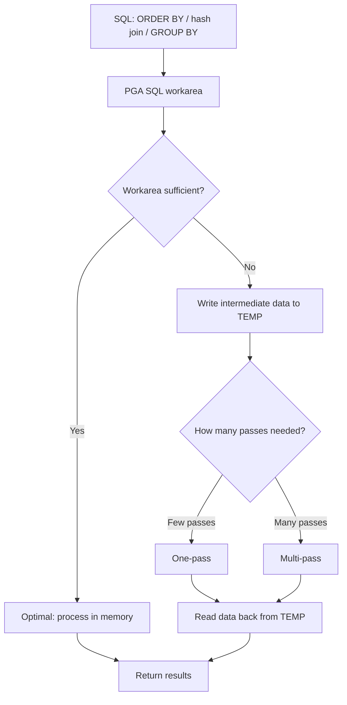
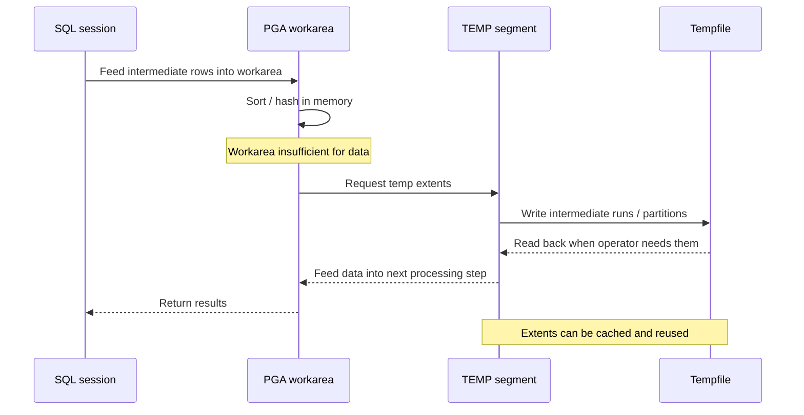

# Temporary Segments, Sort Spills, and TEMP Space Management in Oracle

An Oracle query may read a table very quickly yet slow down dramatically when adding an `ORDER BY`, `GROUP BY`, or a large join. Sometimes the cause is not the number of rows returned, but the **intermediate memory required to sort or perform a hash join**. When work-area memory is insufficient, Oracle may write intermediate data out to the **temporary tablespace (TEMP)** and read it back to finish the operation. This phenomenon is commonly called a **sort spill** or, more broadly, a **workarea spill to disk**.

When multiple concurrent queries run, TEMP can fill rapidly and trigger `ORA-01652: unable to extend temp segment ... in tablespace ...`. To troubleshoot properly, distinguish between **temporary segments**, **PGA workareas**, **tempfiles**, **currently active** TEMP usage, and **allocatable** TEMP capacity.

This lesson belongs to the **Storage** group of *Oracle Relational Database Engine*. Afterward, you will be able to trace the path from SQL operators to TEMP, read TEMP monitoring views, configure a temporary tablespace in a practice PDB, and select appropriate fixes when queries spill out of memory.

## 1. What Is TEMP and How Does It Differ from Permanent Tablespaces?

Oracle organizes data into tablespaces. **Permanent tablespaces** like `USERS` store persistent table and index segments. **Temporary tablespaces** are designed for intermediate data, typically serving sorts, hash joins, and certain session-level temporary objects.

| Component | Purpose | Typical Lifecycle |
|---|---|---|
| **Permanent tablespace** | Stores tables, indexes, and persistent objects | Persists until objects are altered or dropped. |
| **Temporary tablespace** | Provides space for temporary operations | Extents can be reused across operations and sessions. |
| **Tempfile** | Physical file backing a temporary tablespace | Remains on storage after queries finish. |
| **Temporary segment** | Segment allocated by Oracle for a temporary need | Used per operation/session or temporary object; not synonymous with a permanent table. |
| **PGA workarea** | Private memory region serving sorts, hash joins, and other operators | Used while the operator runs; if memory suffices, no spill occurs. |

For example, a user runs:

```sql
SELECT customer_id, SUM(amount) AS total_amount
FROM sales_orders
GROUP BY customer_id
ORDER BY total_amount DESC;
```

To aggregate and sort, Oracle uses intermediate processing memory. If the plan and workarea limits lack enough room, intermediate data can be written to TEMP. The original rows of `SALES_ORDERS` **are not moved** to TEMP just because a sort spill occurred; TEMP holds working data needed by the execution plan.

### Each PDB Also Has Its Own TEMP Context

In a multitenant architecture, connecting to a **PDB** requires checking the temporary tablespace configuration inside that right container. Some environments use local temporary tablespaces or CDB-level shared configurations depending on version and design; never deduce which tempfile a PDB uses from another PDB's filenames.

In this lesson, illustrative steps use a practice PDB, a PDB administrative account, and a test user. Do not change the default TEMP of a shared environment without verifying which other sessions depend on that configuration.

## 2. When Do Temporary Segments Appear?

Not every query with `ORDER BY` needs to write to TEMP. If data fits in memory, or if Oracle leverages ordering from an appropriate index, a temporary segment may never be allocated for that operation.

Situations **likely** to use TEMP include:

1. **Large sorts:** `ORDER BY`, `DISTINCT`, `SORT GROUP BY`, or sorting needed for part of an execution plan.
2. **Large hash joins / hash aggregations:** hash tables or intermediate partitioned data exceed the workarea, forcing partitioning and processing through TEMP.
3. **Analytic/window processing:** certain `ROW_NUMBER()`, `RANK()`, or window aggregations that must sort large partitions.
4. **Index creation/rebuilds and maintenance:** building indexes can require large sort areas depending on algorithm and plan.
5. **Global temporary tables (GTTs) or other temp data:** segments needed to hold session/transaction-scoped temporary data follow dedicated TEMP mechanisms.
6. **Parallel execution:** multiple parallel execution servers can concurrently create temporary work, sharply increasing total TEMP demand.

| SQL / Operation | Is TEMP Mandatory? | Why |
|---|---|---|
| `SELECT ... WHERE id = :id` via unique index | Usually no | Simple lookup needs no large sort workarea. |
| `ORDER BY` on many rows | Not always | May sort inside PGA or follow index order. |
| `GROUP BY` on a large set | Depends on execution plan | Hash or sort aggregation may spill if memory is short. |
| Hash join of two large datasets | Depends on build-side size and workarea | Oracle may partition data out to TEMP. |
| `CREATE INDEX` on a large table | Likely | Index sorting/organization step can need temporary space. |
| `INSERT` into a GTT | Can use temporary segments | Temporary data requires storage depending on table type and allocation. |

A **temporary segment** is an on-demand temporary storage allocation unit. It differs from a **temporary table**, which is a schema definition serving session/transaction data. Sort spills can create temporary segments **even when the SQL statement mentions no temporary table at all**.

## 3. Why Do Sorts/Hashes Spill from PGA to TEMP?

Oracle uses the **Program Global Area (PGA)** for process/session memory regions, including SQL workareas. When sorting, Oracle must hold intermediate records to compare, order, and emit output. For a hash join, Oracle builds a hash structure for one input side. These workareas scale with actual row counts, row widths, cardinality estimates, and concurrent activity.

Under standard automatic workarea management (`WORKAREA_SIZE_POLICY=AUTO`), Oracle allocates memory based on PGA policies and overall load. `PGA_AGGREGATE_TARGET` is a **system-wide PGA management target**, not a guaranteed byte quota reserved for every individual sort, SQL statement, or session.

Three execution modes can occur:

| Execution Mode | Characteristics | Impact |
|---|---|---|
| **Optimal** | Operation fits completely in memory workarea | Typically no spill due to workarea shortage. |
| **One-pass** | Cannot fit all intermediate data in workarea; writes/reads part via TEMP | Adds extra I/O, usually finishing with limited extra passes. |
| **Multi-pass** | Workarea is far smaller than data, forcing multiple passes through TEMP | Can raise I/O and elapsed time substantially. |



For a sort, imagine Oracle writing partially sorted sequences (*runs*) and then merging those runs to finish ordering when data exceeds the workarea. For a hash join, the operator splits data into intermediate partitions and reprocesses them via TEMP. This is a conceptual model; exact algorithms depend on execution plan, version, and execution mode.

**A spill does not mean Oracle has a bug.** A report scanning and sorting tens of millions of rows may legitimately need TEMP. The real questions are whether the I/O cost is acceptable, whether TEMP is sized for concurrent users, and whether any query is doing unnecessary work.

### Table Size Alone Does Not Determine TEMP Usage

Sorting 1 million rows containing two integers demands a vastly different workarea than sorting 1 million rows carrying wide strings or LOBs handled under a different plan. Even a small table caught in a **join that multiplies intermediate row counts** can produce a much larger sort than expected.

Key factors include:

- **Actual rows flowing through the operator**, not just final returned rows.
- **Width of intermediate data** that the sort/hash must retain.
- **Operator order and indexes**: an appropriate index can avoid a sort; an unsuitable index can worsen the plan.
- **Concurrent sessions and parallelism**: aggregate workarea/TEMP demand can surge.
- **Optimizer statistics** and cardinality misestimates: plans may mismatch actual data.
- **PGA/workarea policy** alongside current memory pressure.

## 4. How Does TEMP Operate When a Query Spills?

Suppose a query needs to sort roughly 200 MB of intermediate data while only a smaller workarea is available at runtime. Oracle can:

1. Read source data per the execution plan; sources may reside in the buffer cache or datafiles.
2. Process part of the data inside the PGA workarea.
3. Request **extents in the temporary tablespace** for intermediate data.
4. Write intermediate work chunks to tempfiles and read them back as needed.
5. Merge/combine into final results.
6. Once the operator no longer needs the segment, Oracle can **reuse** allocated space for other requests.



**Finishing the query does not shrink the tempfile.** Oracle normally keeps tempfiles and can manage/reuse already-allocated temporary extents to minimize overhead. Therefore, distinguish between:

- **Tempfile size on storage**: how big the file currently is or can expand to.
- **Allocated/managed space inside TEMP**: extents managed by the temporary tablespace.
- **TEMP actively used by sessions/SQL**: current temporary demand, monitored via segment-usage views.
- **Remaining usable TEMP capacity**: depends on free/reusable extents, autoextend, maxsize, filesystem/ASM, and infrastructure limits.

A 4 GB tempfile can remain present long after all `ORDER BY` queries finish. Deleting a tempfile directly at the OS level is dangerous; any file resizing or removal must go through Oracle and be evaluated by a DBA.

### Temporary Data Does Not Share Permanent Tables' Durability Semantics

Data in temporary segments serving computations or session-scoped temp data is not meant for long-term persistence like permanent table rows. Redo/undo rules and segment lifecycles differ by operation type and configuration. Even so, **never deduce "TEMP always skips redo"**: metadata operations, undo, and other database mechanisms can still generate redo. Persistent business results are protected only by transactions under permanent-data mechanisms.

## 5. Creating a Temporary Tablespace for a Practice Environment

**The following DDL is for an administrator in a practice PDB**, not for a user holding only table-creation privileges. Verify the right container before making changes:

```sql
SELECT SYS_CONTEXT('USERENV', 'CON_NAME') AS current_container
FROM dual;
```

Assuming the PDB has a valid file destination and **Oracle Managed Files (OMF)** configured with an appropriate `DB_CREATE_FILE_DEST`, you can create a dedicated TEMP tablespace named `LAB_TEMP`:

```sql
CREATE TEMPORARY TABLESPACE lab_temp
  TEMPFILE SIZE 256M
  AUTOEXTEND ON NEXT 64M MAXSIZE 2G
  EXTENT MANAGEMENT LOCAL UNIFORM SIZE 1M;
```

| Option | Meaning |
|---|---|
| `TEMPORARY TABLESPACE` | Specifies this is a tablespace for temporary segments. |
| `TEMPFILE SIZE 256M` | Creates a tempfile with an initial size of 256 MB. |
| `AUTOEXTEND ON` | Allows the file to extend when needed and storage permits. |
| `NEXT 64M` | Size increment when the file autoextends. |
| `MAXSIZE 2G` | Maximum size of **this tempfile**, not a per-user quota or total PDB ceiling. |
| `UNIFORM SIZE 1M` | Manages temporary extents in uniform 1 MB increments. |

In an environment **without OMF**, the administrator must specify a valid tempfile path; the following is an **alternative creation statement**—do not run both commands to create `LAB_TEMP`:

```sql
CREATE TEMPORARY TABLESPACE lab_temp
  TEMPFILE '/path/to/oradata/labpdb/lab_temp01.dbf'
  SIZE 256M AUTOEXTEND ON NEXT 64M MAXSIZE 2G
  EXTENT MANAGEMENT LOCAL UNIFORM SIZE 1M;
```

Replace the path with a location where Oracle Database actually has permission to create files and adequate space. If Oracle Free/XE, cloud, or container environments already provide TEMP, you can **use the existing temporary tablespace** for exercises without creating a new one. Never guess paths or OMF settings from examples.

### Assigning TEMP to a Practice Account

Assume local account `LAB_USER` exists in the PDB:

```sql
ALTER USER lab_user TEMPORARY TABLESPACE lab_temp;
```

When the user runs operations needing temporary segments, Oracle uses the configured temporary tablespace. **You do not need `CREATE TABLE` just for a `SELECT` query to use TEMP**; SQL privileges and tablespace administration are two different matters.

Verification queries in an administrative session with dictionary read access:

```sql
SELECT username, temporary_tablespace
FROM dba_users
WHERE username = 'LAB_USER';

SELECT tablespace_name, contents, status
FROM dba_tablespaces
WHERE tablespace_name = 'LAB_TEMP';
```

One temporary tablespace can serve many users and many sessions. Setting `MAXSIZE` on a tempfile caps that file—it **does not enforce separate per-learner limits**. Unlike permanent tablespace quotas, syntax like `QUOTA 256M ON LAB_TEMP` cannot be used as a per-user TEMP limit mechanism. Controlling load and sharing resources in multi-user environments requires proper TEMP sizing, monitoring large queries, and applying workload/resource management policies.

### Checking Tempfile Capacity

```sql
SELECT tablespace_name,
       file_id,
       file_name,
       ROUND(bytes / 1024 / 1024, 1) AS current_mb,
       autoextensible,
       ROUND(maxbytes / 1024 / 1024, 1) AS max_mb
FROM dba_temp_files
WHERE tablespace_name = 'LAB_TEMP'
ORDER BY file_id;
```

`CURRENT_MB` is the file size reported by Oracle, and `MAX_MB` is the configured expansion ceiling. When `AUTOEXTENSIBLE = NO`, do not interpret `MAX_MB` as guaranteed usable space. Even with autoextend enabled, insufficient disk space or storage-layer limits can still cause allocations to fail.

**Never switch the entire PDB's default TEMP** just to test one user. `ALTER DATABASE DEFAULT TEMPORARY TABLESPACE ...` affects a broader scope and should be decided by administrators per environment policy.

## 6. Monitoring TEMP Usage: From Files to Sessions

To answer "why is TEMP filling up?", inspect from multiple angles:

1. How many tempfiles does the temporary tablespace have, plus their sizes and autoextend ceilings?
2. How much space is currently managed/available?
3. **Which sessions** are holding temporary segments?
4. Which SQL operators are spilling and how much workarea are they using?

The queries using `DBA_*` and `V$*` views below are for accounts with corresponding read privileges; **never grant `DBA` to an application user just for performance queries**. In a PDB, query the right container; on RAC, you may need `GV$*` views and `INST_ID` alignment.

### 6.1. TEMP Capacity Overview

```sql
SELECT tablespace_name,
       ROUND(tablespace_size / 1024 / 1024, 1) AS tablespace_mb,
       ROUND(allocated_space / 1024 / 1024, 1) AS allocated_mb,
       ROUND(free_space / 1024 / 1024, 1) AS free_mb
FROM dba_temp_free_space
WHERE tablespace_name = 'LAB_TEMP';
```

`DBA_TEMP_FREE_SPACE` gives an overview of total tablespace size, managed/allocated space, and reported free space. **Do not read `ALLOCATED_MB` alone as "MB currently held by active sessions."** Because Oracle caches/reuses temporary extents, allocated figures, reusable space, and active session consumption can differ.

A per-tempfile space perspective:

```sql
SELECT tablespace_name,
       file_id,
       ROUND(bytes_used / 1024 / 1024, 1) AS used_mb,
       ROUND(bytes_free / 1024 / 1024, 1) AS free_mb
FROM v$temp_space_header
WHERE tablespace_name = 'LAB_TEMP'
ORDER BY file_id;
```

`V$TEMP_SPACE_HEADER` reflects space allocation/management state across tempfiles. Extents can stay cached for reuse after SQL completes; **the "used" figure in this view does not replace measuring TEMP actively held by each live session**.

### 6.2. Identifying Sessions Using Temporary Segments

`V$TEMPSEG_USAGE` (some docs/tools also mention `V$SORT_USAGE`) lists temporary segments associated with sessions. Example:

```sql
SELECT s.sid,
       s.serial#,
       u.username,
       u.sql_id,
       u.segtype,
       u.tablespace,
       u.blocks,
       ROUND(u.blocks * t.block_size / 1024 / 1024, 2) AS temp_mb
FROM v$tempseg_usage u
JOIN v$session s
  ON s.saddr = u.session_addr
 AND s.serial# = u.session_num
JOIN dba_tablespaces t
  ON t.tablespace_name = u.tablespace
WHERE u.tablespace = 'LAB_TEMP'
ORDER BY temp_mb DESC;
```

Meaning of fields:

- `SID`, `SERIAL#` identify the specific session; `USERNAME` shows which user owns the operation.
- `SEGTYPE` indicates the temporary usage type recorded by Oracle, such as `SORT` or `HASH`; value sets can vary by version.
- `BLOCKS` is the block count allocated to the segment as reported by the view; multiply by `BLOCK_SIZE` to convert to bytes.
- `SQL_ID` is a lead for tracing the SQL associated with the temporary segment allocation; **do not assume it is always the session's currently executing SQL**, as segment state and lifecycle may differ at snapshot time.

This is a point-in-time snapshot: a large sort query may finish before you query the view. Seeing zero rows does not prove "the system never uses TEMP." Capturing transient workloads requires appropriate sampling/monitoring tools.

In RAC, querying one instance via `V$TEMPSEG_USAGE` can miss sessions running on other instances. DBAs can use `GV$TEMPSEG_USAGE` joined with `GV$SESSION` on both `INST_ID` and session identifiers for a cluster-wide picture.

### 6.3. Identifying Sort/Hash Operators Using Workareas and TEMP

Oracle provides `V$SQL_WORKAREA_ACTIVE` for currently active workareas:

```sql
SELECT sid,
       sql_id,
       operation_type,
       ROUND(actual_mem_used / 1024 / 1024, 2) AS pga_workarea_mb,
       ROUND(tempseg_size / 1024 / 1024, 2) AS temp_mb,
       number_passes
FROM v$sql_workarea_active
WHERE tempseg_size > 0
ORDER BY temp_mb DESC;
```

This view is a **snapshot of currently active workareas**. `ACTUAL_MEM_USED` shows workarea memory used at observation time, `TEMPSEG_SIZE` shows associated TEMP usage, and `NUMBER_PASSES` indicates passes needed when the workarea was insufficient. Figures can shift quickly or disappear once the operation finishes.

To observe optimal/one-pass/multi-pass trends across executed workareas, DBAs can check `V$SQL_WORKAREA_HISTOGRAM`:

```sql
SELECT ROUND(low_optimal_size / 1024 / 1024, 1) AS low_optimal_mb,
       ROUND(high_optimal_size / 1024 / 1024, 1) AS high_optimal_mb,
       optimal_executions,
       onepass_executions,
       multipasses_executions
FROM v$sql_workarea_histogram
WHERE optimal_executions
    + onepass_executions
    + multipasses_executions > 0
ORDER BY low_optimal_size;
```

These are system-wide aggregated workarea stats, **not single-user stats**. Do not rush to raise PGA merely because a few one-pass executions appear: compare runtime, execution counts, data volume, and impact across the entire workload.

### 6.4. Viewing System-Level PGA Stats

```sql
SELECT name, value, unit
FROM v$pgastat
WHERE name IN (
    'aggregate PGA target parameter',
    'total PGA allocated',
    'extra bytes read/written',
    'over allocation count',
    'cache hit percentage'
)
ORDER BY name;
```

`EXTRA BYTES READ/WRITTEN` relates to additional I/O from workareas not executing optimally; `OVER ALLOCATION COUNT` helps spot times when PGA pressure pushed Oracle past the aggregate target. Read these metrics **over time**, alongside total executions and workload shifts, rather than inferring root causes from a single snapshot.

## 7. Sort Spills in Execution Plans and SQL Statistics

Execution plans show which operators Oracle expects to use. For example:

- `SORT ORDER BY`: sorts results per the `ORDER BY` expression.
- `SORT GROUP BY`: sorts to perform grouping/aggregation.
- `HASH JOIN`, `HASH GROUP BY`: operators using hash workareas, capable of spilling if workarea memory is short.
- `WINDOW SORT`: sorts serving analytic/window functions.

In `DBMS_XPLAN`, a `TempSpc` column—when displayed—is a **plan estimate** of TEMP space, **not sole proof of actual bytes written**. To understand actual spill volume, prioritize execution/workarea statistics and session metrics, subject to privileges and Oracle version.

Example inspecting the estimated plan for our practice query:

```sql
EXPLAIN PLAN FOR
SELECT id, payload
FROM lab_temp_source
ORDER BY payload DESC, id DESC;

SELECT *
FROM TABLE(DBMS_XPLAN.DISPLAY());
```

Run this only after creating `LAB_TEMP_SOURCE` in the practice section. `EXPLAIN PLAN` does not execute the full query to measure spills; actual plans can differ due to bind variables, statistics, adaptive plans, and real data. In SQL Developer, plan/monitor displays may present these metrics differently.

## 8. Hands-On Practice: Observing Workareas and TEMP

Practice in a dedicated schema with `CREATE TABLE` privilege and quota on a **permanent tablespace**; the DBA has already assigned a valid temporary tablespace to the user. The exercise uses many rows and wide strings to create meaningful workarea pressure, though it **cannot guarantee a spill on every PGA configuration**.

### Step 1. Create Sample Data

```sql
CREATE TABLE lab_temp_source AS
SELECT LEVEL AS id,
       MOD(LEVEL, 1000) AS group_id,
       RPAD(TO_CHAR(LEVEL), 300, 'X') AS payload
FROM dual
CONNECT BY LEVEL <= 50000;

SELECT COUNT(*) AS rows_loaded
FROM lab_temp_source;
```

This DDL creates a permanent table for the exercise. With 50,000 rows, `PAYLOAD` creates substantial data while remaining manageable in a lab. If your practice host is very small, reduce the row count; if no spill occurs, **never try altering shared PGA settings or filling a shared system's TEMP** just to trigger alerts.

### Step 2. Compare Query Types

Single-row lookup query:

```sql
SELECT id, group_id
FROM lab_temp_source
WHERE id = 1234;
```

Sorting query:

```sql
SELECT id, payload
FROM lab_temp_source
ORDER BY payload DESC, id DESC;
```

Aggregation query:

```sql
SELECT group_id,
       COUNT(*) AS row_count,
       MAX(payload) AS max_payload
FROM lab_temp_source
GROUP BY group_id
ORDER BY row_count DESC;
```

These three queries vary in result size and working memory demand. The second `ORDER BY` query returns many rows and can generate substantial terminal output; use appropriate client fetch/display controls, or run off-peak in the lab environment. **Do not add `FETCH FIRST 10 ROWS ONLY` and then draw conclusions about full-sort needs**: the optimizer can switch to a top-N sort, changing the problem being measured.

### Step 3. Observe from a Separate Administrative Session

While the sort query is running, an account authorized to read dictionary/dynamic views can snapshot `V$TEMPSEG_USAGE` and `V$SQL_WORKAREA_ACTIVE` using the queries from Section 6. Cross-check:

| Question | View / Source |
|---|---|
| Which tempfiles exist, their current size, and growth capacity? | `DBA_TEMP_FILES` |
| How much free/reusable space does overall TEMP have? | `DBA_TEMP_FREE_SPACE`, `V$TEMP_SPACE_HEADER` |
| Which session holds temporary segments? | `V$TEMPSEG_USAGE` and `V$SESSION` |
| Which workarea is spilling? | `V$SQL_WORKAREA_ACTIVE` |
| Did Oracle use the expected sort/hash operators? | Execution plans, actual SQL statistics |

If the query finishes before you capture the snapshot, dynamic views may show no rows. That is a normal property of monitoring snapshots, not an error in the practice SQL.

### Step 4. Distinguish Temporary Tables from Sort Spills

In the same schema with `CREATE TABLE` privilege:

```sql
CREATE GLOBAL TEMPORARY TABLE lab_gtt_notes (
    note_id NUMBER,
    note_text VARCHAR2(100)
) ON COMMIT DELETE ROWS;

INSERT INTO lab_gtt_notes (note_id, note_text)
VALUES (1, 'Transaction temporary data');

SELECT COUNT(*) AS before_commit
FROM lab_gtt_notes;

COMMIT;

SELECT COUNT(*) AS after_commit
FROM lab_gtt_notes;
```

`BEFORE_COMMIT` is 1, while `AFTER_COMMIT` is 0 under this setup. **The GTT definition still exists** in the schema; transaction temporary data is cleared per `ON COMMIT DELETE ROWS`. With `ON COMMIT PRESERVE ROWS`, GTT data follows session lifespan and is not cleared merely by committing.

This example shows that GTT data and a sort's temporary segment are **two different ways TEMP is used**. Check `SEGTYPE` and SQL context when reading `V$TEMPSEG_USAGE`, rather than treating every used MB as `ORDER BY` data.

At the end of the exercise, if sample tables are no longer needed:

```sql
DROP TABLE lab_gtt_notes PURGE;
DROP TABLE lab_temp_source PURGE;
```

Both `DROP` statements are DDL and trigger implicit commits. Run only on your own practice tables; never use these commands to delete someone else's data.

## 9. When TEMP Nears Full or Hits ORA-01652: Troubleshoot by Root Cause

Example error message:

```text
ORA-01652: unable to extend temp segment by ... in tablespace ...
```

This means Oracle could not allocate additional space for a temporary segment at that moment. **Do not jump straight to "we need more disk."** One SQL query may be generating excessive intermediate data, many sessions may be running concurrently, tempfiles may have reached `MAXSIZE`, autoextend may be off, underlying storage may be full, or a table/plan may be flawed. The error can also arise during operations like index creation; not every `ORA-01652` stems from `ORDER BY`.

Investigation workflow:

1. **Record timestamp and related SQL**: full error code, PDB, tablespace, user, and running SQL or job.
2. **Identify sessions consuming TEMP** using `V$TEMPSEG_USAGE`/`V$SESSION`, prioritizing the right instance/PDB.
3. **Cross-check workareas/plans**: large sorts/hashes, abnormally wide intermediate rows, multi-pass operations, row-multiplying hash joins, or excessive parallelism?
4. **Inspect tempfile status**: file count, `BYTES`, `MAXBYTES`, `AUTOEXTENSIBLE`, free space, and physical storage capacity.
5. **Apply matching remediation**, then re-measure under representative load.

| Situation | Action to Consider | Limit to Remember |
|---|---|---|
| Query reads/sorts too many rows | Filter data early, select only needed columns, inspect joins/cardinality and indexes | Do not add indexes blindly; full scans can still be optimal for huge sets. |
| Hash/sort goes multi-pass due to workarea shortage | Review workarea stats, PGA policy, and concurrent load | `PGA_AGGREGATE_TARGET` is a system-wide goal, not a single-SQL quota. |
| Many large reports run simultaneously | Schedule jobs, limit concurrent jobs/parallelism per policy | TEMP is shared, so one heavy session can impact others. |
| Tempfile hits ceiling | Evaluate `AUTOEXTEND`/`MAXSIZE` or add a tempfile | Requires real underlying storage and growth controls. |
| TEMP has many reusable cached extents | Check `V$TEMPSEG_USAGE` and extent caching behavior | Never drop/recreate TEMP merely because allocated space looks high. |
| PDB uses unexpected TEMP | Check user/PDB configuration and connection service | Never alter another container's TEMP out of scope. |

### Expanding TEMP Once True Capacity Shortage Is Confirmed

**Only a DBA** executes this in a controlled environment. If the temporary tablespace uses OMF, one way to add a tempfile:

```sql
ALTER TABLESPACE lab_temp
ADD TEMPFILE SIZE 512M
AUTOEXTEND ON NEXT 64M MAXSIZE 2G;
```

To alter autoextend on an existing tempfile:

```sql
-- Replace with the actual FILE_NAME from DBA_TEMP_FILES.
ALTER DATABASE TEMPFILE '<ACTUAL_TEMPFILE_PATH>'
AUTOEXTEND ON NEXT 64M MAXSIZE 2G;
```

These commands are **administrative examples**, not mandatory steps of the practice lab. The DBA must confirm whether expanding capacity aligns with storage availability, PDB limits, backup/recovery plans, workload balance, and recurrence risk. Adding TEMP relieves the immediate limit, yet if flawed SQL multiplies intermediate rows a hundredfold due to a bad join, the core problem remains.

## 10. Distinguishing TEMP from UNDO, REDO, and Other Temporary Data

Similar-sounding names serve very different purposes:

| Concept | Function |
|---|---|
| **TEMP** | Space for sort/hash spills and other temporary segments. |
| **PGA** | Working memory of server processes/sessions, where sorts/hashes attempt to execute before spilling. |
| **UNDO** | Information supporting rollback and consistent reads; managed by its own undo mechanism. |
| **REDO** | Change log serving durability and recovery; not where sort results are stored. |
| **GTT** | Schema-owned table definition whose per-session/transaction data is temporary; can use temporary storage. |

For example, a long `UPDATE` can generate substantial undo/redo while needing zero sort spill. Conversely, a huge `SELECT ... ORDER BY` can use TEMP without changing a single permanent row. Therefore, never try fixing TEMP exhaustion by "growing UNDO," nor assume all sort errors involve redo logs.

Another operational rule: **you cannot use permanent tablespace quotas as a switch to cap how many MB of TEMP a user consumes**. Assigning a default temporary tablespace routes allocations rather than imposing independent hard per-session limits. Controlling multi-user environments requires both resource management and query monitoring.

## 11. Common Misconceptions

**"Having an ORDER BY guarantees writing to TEMP."** False. Oracle can use an already-ordered index or sort completely in PGA. Spilling happens only when execution plans and workarea demands require it.

**"A temporary segment is a temporary table."** Inaccurate. A temporary segment is a temporary storage allocation unit; sorts, hashes, GTTs, and other tasks can involve temporary segments.

**"The query finished and the tempfile is still big—that means a data leak."** You cannot conclude that. Files and extents can remain cached for reuse. Distinguish allocated/free/reusable space from temp segments actively held by sessions.

**"Setting PGA_AGGREGATE_TARGET to 2 GB means every SQL query can use 2 GB to sort."** False. It is an aggregate PGA target across processes/workareas subject to concurrency and internal tuning limits.

**"Adding more TEMP always makes SQL run faster."** False. More allocatable space helps a spilling operation finish, yet TEMP I/O still costs time. Examine execution plans, workareas, and concurrent load.

**"ORA-01652 proves the database is completely out of disk space."** Not necessarily. A tempfile may have hit its individual ceiling or failed extent allocation even while total storage still has room.

**"Counting returned rows tells you how much TEMP is needed."** False. A query returning 10 rows might have to sort millions of intermediate rows; a query returning many rows via an ordered index might not spill at all.

## 12. Self-Check Questions

1. **What is a sort spill?** It occurs when a sort cannot finish entirely within its allocated workarea and must write/read intermediate data via TEMP to complete.
2. **How do optimal, one-pass, and multi-pass differ?** Optimal fits in memory; one-pass requires temporary I/O with fewer passes; multi-pass requires multiple cycles through TEMP, usually incurring heavier I/O.
3. **Why can two queries with identical `ORDER BY` clauses consume different amounts of TEMP?** Because intermediate row counts, row widths, indexes, plans, granted memory, and concurrent load differ.
4. **How do you see which session currently holds TEMP?** Join `V$TEMPSEG_USAGE` with `V$SESSION`, convert blocks to MB using block size, and mind snapshot timing and the right container/instance.
5. **What two different questions do `DBA_TEMP_FILES` and `V$TEMPSEG_USAGE` answer?** The first describes tempfile paths/sizes/configurations; the second shows temporary segments associated with sessions at observation time.
6. **Can you use `QUOTA 256M ON LAB_TEMP` to cap a user's sort capacity?** No. Quotas apply to permanent tablespaces; temporary demand requires resource management and administrative controls.
7. **Why doesn't the tempfile automatically shrink once TEMP usage stops?** Oracle retains files and extents for reuse, avoiding repeated allocation overhead.
8. **What should you do before growing TEMP after an `ORA-01652` error?** Identify the offending SQL/session, check sort/hash workareas, execution/parallelism counts, tempfile ceilings, and real storage capacity.
9. **Does a GTT with `ON COMMIT DELETE ROWS` still exist after `COMMIT`?** The table definition persists; transaction-scoped data is cleared per the chosen semantics.

When troubleshooting a TEMP issue in Oracle, trace the chain: **SQL operators → PGA workarea → spill demand → temporary segment → tempfile → session stats and allocation limits**. Tracing this chain reveals whether the root cause is query design, memory pressure, concurrency load, or storage limits, letting you resolve it without unintended impacts on other PDBs and users.
