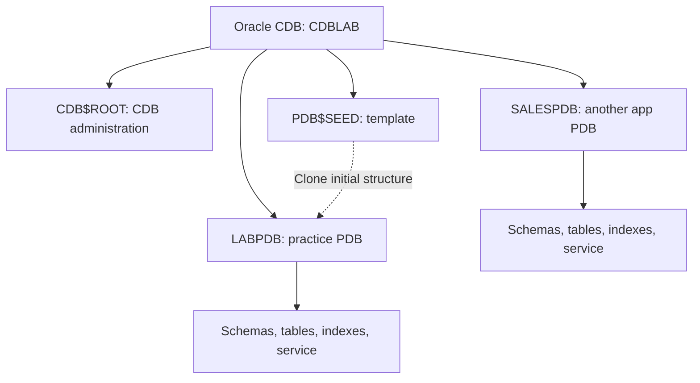
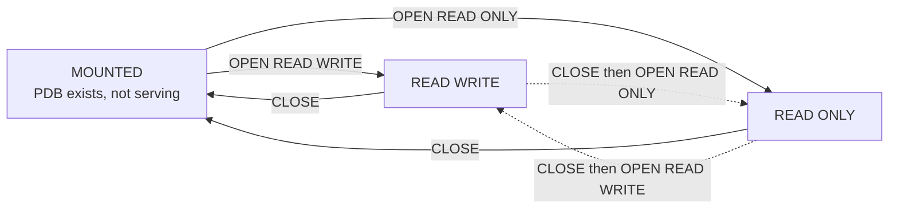

# Creating, Opening, Closing PDBs, and Saving Open State in Oracle Database

In the Oracle Multitenant architecture, a **Container Database (CDB)** can contain multiple **Pluggable Databases (PDBs)**. Each PDB provides a relatively independent scope for data, objects, and application accounts while sharing the CDB's underlying infrastructure components. Creating a PDB, opening it for application access, closing it for maintenance, and saving its open state across CDB restarts are core administrative operations every Oracle administrator must master.

Four concepts to distinguish right from the start:

- **`CREATE PLUGGABLE DATABASE`** creates a new PDB along with its metadata and required files according to the storage configuration.
- **`OPEN`** transitions an existing PDB to a state ready to serve connections in the specified access mode, typically `READ WRITE` or `READ ONLY`.
- **`CLOSE`** stops serving sessions in the PDB and returns the PDB to the `MOUNTED` state; this operation **does not delete the PDB**.
- **`SAVE STATE`** records the open state to be automatically restored upon subsequent instance/CDB startups; it does not replace a running `OPEN` command and is not a data backup.

The examples use a practice CDB `CDBLAB` and a new PDB `LABPDB`. These are illustrative names, not default names present in every environment. PDB creation/closing commands affect live connections and data, so execute them only on a **dedicated lab CDB** using an authorized administrative account; never run them on a shared or production system just to test syntax.

## 1. Understanding CDB Structure and PDB States

### 1.1. CDB$ROOT, PDB$SEED, and User PDBs

A standard CDB has three container types:

| Container | Role | Used to Store New Application Tables? |
|---|---|---|
| **`CDB$ROOT`** | Shared administrative scope of the CDB; holds metadata and components needed to manage PDBs | No; CDB administration is separate from creating business data |
| **`PDB$SEED`** | Template PDB provided by Oracle for creating new PDBs; normally maintained in read-only mode | No; do not modify the seed for lab work |
| **User PDB** such as `LABPDB` | Environment containing dedicated schemas, tables, data, and application accounts | Yes; applications connect via the PDB's service |



An Oracle instance manages resources such as memory and background processes; PDBs in the same CDB are not independent Oracle instances just because they have different names or services. A PDB can be placed in `MOUNTED` while the CDB root and other PDBs remain open.

### 1.2. Reading States Accurately

The `OPEN_MODE` column of `V$PDBS` reflects the PDB's active state:

| Common `OPEN_MODE` | Meaning | Application Accessibility |
|---|---|---|
| **`MOUNTED`** | The PDB exists and is recognized by the CDB, but is not yet open for use as a regular database | Does not yet serve normal application connections |
| **`READ WRITE`** | The PDB is open for reads and writes with granted privileges | Applications can query and modify data |
| **`READ ONLY`** | The PDB is open for reading; normal data-writing operations are restricted | Suitable for scenarios requiring read-only mode |
| **`MIGRATE`** or other specialized states | For upgrades/migrations or special version-specific operations | Not treated as a normal application mode |

Besides `OPEN_MODE`, check the **`RESTRICTED`** column. A PDB can be open `READ WRITE` yet in restricted connection mode; in that case, not all application accounts are permitted to log in. Thus, "open" does not always mean "applications can get in."



When switching from `READ WRITE` to `READ ONLY` or vice versa in a normal administrative workflow, close the PDB first and then reopen it in the new mode. Do not treat `ALTER PLUGGABLE DATABASE ... OPEN` as an arbitrary mode-switching command on an already open PDB.

## 2. Preparing the Environment Before Creating a PDB

### 2.1. System Prerequisites

You need:

1. An **already created and running CDB** with the Multitenant architecture and a version/edition that permits creating additional PDBs within practical limits.
2. An administrative account with privileges to create PDBs in **`CDB$ROOT`**, typically an authorized common administrative user or `SYSDBA` in a lab.
3. Storage capacity and a mechanism for determining where to place the newly created **datafiles** from `PDB$SEED`.
4. An appropriate Oracle Net listener/service if clients will connect to the PDB from remote machines.
5. A plan for the PDB name, local admin account name, and dedicated lab password.

Do not attempt to create a PDB using an application account that only has `CREATE TABLE` in one PDB. This is a higher-level CDB administrative operation.

### 2.2. Checking the Current Container Position

On a database server with OS authentication configured for DBAs, SQL*Plus can be opened as follows:

```console
sqlplus /nolog
SQL> CONNECT / AS SYSDBA
```

This authentication method depends on server configuration and OS permissions and does not work on every client machine. When logging in remotely, DBAs use the system-provided administrative authentication method and never embed passwords directly into commands saved in shared scripts.

Verify you are in `CDB$ROOT`:

```sql
SHOW CON_NAME

SELECT SYS_CONTEXT('USERENV', 'CON_NAME') AS current_container
FROM dual;

SELECT name, cdb, open_mode
FROM v$database;
```

`SHOW CON_NAME` is a SQL*Plus/SQLcl command, not a SQL statement usable across all JDBC clients. When `CDB` is `YES` and the container is `CDB$ROOT`, you are in the right administrative scope to create a PDB.

If an authenticated administrator with sufficient privileges is in another PDB, they can switch back to root via:

```sql
ALTER SESSION SET CONTAINER = CDB$ROOT;
```

The container-switching privilege must be valid. A local user inside a PDB cannot arbitrarily switch to root just by knowing this statement.

### 2.3. Viewing Existing PDBs

```sql
SHOW PDBS

SELECT con_id,
       name,
       open_mode,
       restricted
FROM v$pdbs
ORDER BY con_id;
```

This is the fastest way to avoid duplicate names and see which PDBs are open. `PDB$SEED` usually appears in the list. Do not alter the seed's state as you would a user PDB.

To inspect additional metadata, administrators can use:

```sql
SELECT pdb_name,
       status,
       creation_time
FROM dba_pdbs
ORDER BY pdb_name;
```

**`DBA_PDBS.STATUS` and `V$PDBS.OPEN_MODE` answer two different questions.** `STATUS` describes metadata/lifecycle status such as `NEW` or `NORMAL` depending on the case; `OPEN_MODE` is the direct indicator of whether the PDB is open `READ WRITE`, `READ ONLY`, or still `MOUNTED`. Do not conflate the two columns into one concept.

### 2.4. Preparing File Locations for the New PDB

Creating a PDB from seed requires a mechanism to determine new file paths. Common approaches:

- **Oracle Managed Files (OMF):** Oracle automatically names and manages datafiles based on a configured destination, such as the `DB_CREATE_FILE_DEST` parameter.
- **`FILE_NAME_CONVERT`:** defines path/filename mapping from the seed to the new PDB's file location when suitable OMF is not used.
- **Configuration provided by DBA/cloud service:** some managed database environments have their own mechanisms where users do not directly manage every path.

Inspect current parameters:

```sql
SHOW PARAMETER db_create_file_dest
SHOW PARAMETER pdb_file_name_convert
```

These are inspection commands and do not change configuration. Without OMF or a valid file-naming conversion rule, the PDB creation command can fail because Oracle does not know where to create the new files. In a live database, **never alter the storage location of the entire CDB** just to run an example: that requires DBA evaluation of disks, ASM/Oracle Managed Files, permissions, and backup policies.

## 3. Creating a New PDB from PDB$SEED

### 3.1. Basic CREATE PLUGGABLE DATABASE Example

Suppose the lab CDB has OMF enabled and valid storage space for datafiles. In an administrative session at `CDB$ROOT`:

```sql
CREATE PLUGGABLE DATABASE labpdb
  ADMIN USER lab_admin
  IDENTIFIED BY "ReplaceWithUniqueStrongLabPassword123";
```

Statement components:

| Part | Meaning |
|---|---|
| `CREATE PLUGGABLE DATABASE labpdb` | Creates a PDB named `LABPDB` in the current CDB |
| `ADMIN USER lab_admin` | Creates the first local administrative account inside the new PDB |
| `IDENTIFIED BY ...` | Sets the password for the PDB administrator account |
| File path clause omitted in example | Oracle uses the preconfigured OMF/file placement settings |

The password above is only a placeholder for a dedicated environment; never copy it literally to production, never commit real passwords to repositories, and never print credentials in shared logs. Having an `ADMIN USER` does not mean business applications should use that administrative account.

After creation, the new PDB is normally in the **`MOUNTED`** state. That means the `CREATE` command completed, but users cannot yet connect and run normal workloads until the PDB is opened.

```sql
SELECT name, open_mode, restricted
FROM v$pdbs
WHERE name = 'LABPDB';
```

The expected result after creation is a row for `LABPDB` with `OPEN_MODE` equal to `MOUNTED` (before running the open command).

### 3.2. When FILE_NAME_CONVERT Is Needed

If the system does not use suitable OMF, a DBA can specify replacement pairs mapping paths/filenames from the seed to the PDB:

```sql
-- Illustrative path example for a lab CDB with a matching file layout.
-- Do not run verbatim without first checking PDB$SEED's datafiles.
CREATE PLUGGABLE DATABASE labpdb
  ADMIN USER lab_admin
  IDENTIFIED BY "ReplaceWithUniqueStrongLabPassword123"
  FILE_NAME_CONVERT = (
    '/u02/oradata/CDBLAB/pdbseed/',
    '/u02/oradata/CDBLAB/labpdb/'
  );
```

`FILE_NAME_CONVERT` is not a "move tables" command, nor does it rename services. Oracle uses this rule to generate target file paths corresponding to the source files cloned from the seed. The paths above are **examples**, valid only when they match actual files and the target directory has sufficient permissions and space. With ASM/OMF, the configuration can look completely different; do not assume every Oracle Database has `/u02/oradata/...`.

**Choose only one PDB creation method.** If the basic command already created `LABPDB`, do not run the `FILE_NAME_CONVERT` example next as a second command for the same name. Starting over requires a dedicated procedure to handle the existing PDB and its data.

### 3.3. Creating a PDB Is Not Like Creating a New CDB

`CREATE PLUGGABLE DATABASE`:

- Creates a user container inside an **existing CDB**.
- Relies on cloning from `PDB$SEED` for standard new creation.
- Creates/prepares files and metadata belonging to the new PDB according to configuration.
- Does not create a new listener and does not require an independent Oracle instance per PDB.
- Does not automatically pre-create all application schemas, business tables, or a custom project-specific service.

This administrative DDL command has real storage effects and is an operation with an implicit commit per Oracle mechanics; do not rely on SQL `ROLLBACK` as a way to "undo creating a PDB" after it succeeds.

## 4. Opening a PDB with ALTER PLUGGABLE DATABASE ... OPEN

### 4.1. Opening READ WRITE

In `CDB$ROOT`:

```sql
ALTER PLUGGABLE DATABASE labpdb OPEN READ WRITE;
```

`OPEN READ WRITE` is the normal mode allowing applications to read and write data. In many cases `ALTER PLUGGABLE DATABASE labpdb OPEN;` also opens in read-write mode by default given appropriate syntax and state, but explicitly writing `READ WRITE` prevents confusion with `READ ONLY` scenarios.

Verify:

```sql
SELECT name, open_mode, restricted
FROM v$pdbs
WHERE name = 'LABPDB';
```

Under normal operation, `OPEN_MODE` returns `READ WRITE` and `RESTRICTED` is typically `NO`. If `RESTRICTED` is `YES`, the DBA must investigate why the PDB is restricting connections before allowing application use.

### 4.2. Connecting to the PDB After Opening

Normally Oracle creates a default service tied to the PDB name, such as `labpdb`; real environments may have domains, DBA-managed service names, or different registration mechanisms. Always use the **actual service known to the listener**, rather than guessing from filenames or usernames.

Connection example from SQL*Plus/SQLcl:

```console
sqlplus /nolog

SQL> CONNECT lab_admin@//db-lab.example.test:1521/labpdb
Enter password:
Connected.
```

If the listener has not yet received registration for the newly opened service or has a special Oracle Net setup, the connection may need registration time or DBA verification. Do not alter PDB file paths when the real cause is a wrong hostname, port, or service.

Confirm **you are actually inside the PDB**:

```sql
SELECT SYS_CONTEXT('USERENV', 'SESSION_USER') AS session_user,
       SYS_CONTEXT('USERENV', 'CON_NAME') AS container_name,
       SYS_CONTEXT('USERENV', 'SERVICE_NAME') AS service_name
FROM dual;
```

Expected output: container is `LABPDB`; service is the service the database routed to the session. PDB users should not confuse a display name in SQL Developer with the container value returned by the server.

### 4.3. Opening READ ONLY

When you need to allow read queries without allowing normal business DML operations, a DBA can open the PDB in `READ ONLY` mode. For a PDB currently in `READ WRITE`, transition via a close step:

```sql
-- In CDB$ROOT; execute only after notifying/coordinating lab clients.
ALTER PLUGGABLE DATABASE labpdb CLOSE IMMEDIATE;

ALTER PLUGGABLE DATABASE labpdb OPEN READ ONLY;
```

Verify `V$PDBS.OPEN_MODE` returns `READ ONLY`. Read privileges still apply normally, while write operations are restricted according to this mode. Never use `READ ONLY` as a substitute for user authorization: an account still needs appropriate privileges to read data.

### 4.4. Restricted Mode

During certain administrative activities, a PDB can be opened **restricted** so only accounts with the corresponding privilege can enter. Syntax example:

```sql
ALTER PLUGGABLE DATABASE labpdb OPEN RESTRICTED;
```

Run only when the PDB is in an eligible state to open and per DBA procedures. Restricted mode is a separate attribute from `READ WRITE`/`READ ONLY`: when inspecting, read **both `OPEN_MODE` and `RESTRICTED`**. If an application reports login errors even though the PDB says "OPEN," this is a key item to check.

## 5. Closing a PDB: CLOSE and CLOSE IMMEDIATE

### 5.1. What Does CLOSE Do?

When a DBA closes a PDB, Oracle stops serving normal session activity in that PDB and returns it to the **`MOUNTED`** state. The datafiles still belong to the PDB; schemas, tables, and data remain intact. Closing a PDB **is not** `DROP PLUGGABLE DATABASE`.

Operation from `CDB$ROOT`:

```sql
ALTER PLUGGABLE DATABASE labpdb CLOSE;
```

With a normal close, connected sessions, active transactions, and session wait/termination rules can affect command completion. DBAs must check active sessions and maintenance procedures rather than expecting every `CLOSE` to finish instantaneously.

### 5.2. CLOSE IMMEDIATE

In a scenario requiring a decisive close of a lab PDB after controlling the workload:

```sql
ALTER PLUGGABLE DATABASE labpdb CLOSE IMMEDIATE;
```

`IMMEDIATE` tells Oracle to close without waiting for applications to gracefully end all sessions; unfinished transactions are handled via Oracle's rollback/recovery mechanisms and sessions may be terminated. This operation **causes service disruption** for all applications using the PDB. Do not run it in production without a maintenance window, impact assessment, and administrative authorization.

After closing:

```sql
SELECT name, open_mode
FROM v$pdbs
WHERE name = 'LABPDB';
```

Expect `MOUNTED`. New connections via the closed PDB's application service normally cannot establish a regular session. Depending on the client, listener, and service registration, this may manifest as a service/handler error.

### 5.3. Closing a PDB vs. Stopping the Entire CDB

Suppose `LABPDB` and `SALESPDB` reside in the same CDB. If the DBA closes `LABPDB`, `SALESPDB` is not automatically closed with it. The CDB root retains its administrative role and can reopen `LABPDB`.

Conversely, when the instance/CDB itself stops, its PDBs also stop serving. After the next startup, **how each PDB's state is restored depends on saved state and current configuration**; that is why `SAVE STATE` must be learned separately.

## 6. SAVE STATE — Persisting Open State for the Next Startup

### 6.1. The Problem: PDB Was Open, Yet Restart Reverts It to MOUNTED

A common scenario:

1. A DBA creates `LABPDB` and runs `ALTER PLUGGABLE DATABASE labpdb OPEN READ WRITE`.
2. Applications connect successfully.
3. The instance/CDB undergoes a scheduled restart.
4. Without an appropriate saved state, the PDB returns to `MOUNTED`, and applications cannot access it until the DBA opens it again.

A PDB **being open** at one point in time does not automatically prove it will **auto-open after a restart**. Oracle provides the state-saving mechanism so administrators do not have to write manual PDB-opening scripts after every startup in supported versions.

### 6.2. Saving the Open State of a PDB

In `CDB$ROOT`, while `LABPDB` is `READ WRITE`:

```sql
ALTER PLUGGABLE DATABASE labpdb SAVE STATE;
```

This command saves the current open state so Oracle knows to open the PDB in the corresponding state on the next instance/CDB startup. This is **operational metadata**, not a table backup or datafile snapshot command.

After `SAVE STATE`:

- A PDB in `READ WRITE` continues operating; `SAVE STATE` **does not close or reopen the PDB at that moment**.
- On the next appropriate startup, Oracle can automatically bring the PDB to its saved state instead of leaving it `MOUNTED` by default.
- The open mode and restricted connection details can be recorded per the state-saving mechanism of the version in use.
- In Oracle RAC, state is managed per **instance**; evaluate saved state configuration across the relevant instances rather than extrapolating from one instance's state to the entire cluster.

**Running CLOSE after SAVE STATE does not automatically erase the saved state.** For example, if you saved `READ WRITE` and then closed the PDB for testing: the PDB is currently `MOUNTED`, yet the saved metadata may still request `READ WRITE` on the next startup. This is the difference between "currently closed" and "will open after restart."

### 6.3. Checking Whether Saved State Is Recorded

A DBA can query the view:

```sql
SELECT con_name,
       instance_name,
       state,
       restricted
FROM dba_pdb_saved_states
WHERE con_name = 'LABPDB'
ORDER BY instance_name;
```

Interpretation:

| Field | Meaning |
|---|---|
| `CON_NAME` | Name of the PDB whose state was saved |
| `INSTANCE_NAME` | Instance to which the saved state record applies |
| `STATE` | Saved open state, such as `OPEN` or the corresponding mode represented by the view for the version |
| `RESTRICTED` | Restricted open mode info, if applicable |

Read the `STATE` value according to the documentation/schema of your Oracle version; do not assume the view's column names or values must match `V$PDBS.OPEN_MODE` verbatim. **`DBA_PDB_SAVED_STATES` shows the saved state**, whereas **`V$PDBS` shows the running state**.

To compare both perspectives in the same root DBA session:

```sql
SELECT name, open_mode, restricted
FROM v$pdbs
WHERE name = 'LABPDB';

SELECT con_name, instance_name, state, restricted
FROM dba_pdb_saved_states
WHERE con_name = 'LABPDB';
```

If a PDB is `READ WRITE` but lacks the desired saved state record, do not claim the PDB will auto-open after a restart based solely on its current runtime state.

### 6.4. DISCARD STATE — Removing Auto-Open Information

When you no longer want to keep the saved auto-restore open state, a DBA can run:

```sql
ALTER PLUGGABLE DATABASE labpdb DISCARD STATE;
```

`DISCARD STATE` **removes the saved open state configuration** within the applicable scope; it **does not drop the PDB**, **does not delete data**, and **is not a command to close a running PDB**. If the PDB is currently `READ WRITE`, it remains in that runtime state until another operation or instance state change occurs.

After `DISCARD STATE`, query `DBA_PDB_SAVED_STATES` again to confirm the corresponding record is gone. When the instance/CDB restarts, the PDB will no longer auto-open based on the discarded saved state record (unless another infrastructure-managed startup mechanism exists).

### 6.5. SAVE STATE vs. ALTER SYSTEM and Automation Scripts

`SAVE STATE` is an Oracle-provided capability to persist a PDB's open state. It differs from:

- **`ALTER SYSTEM`**, which modifies instance parameters/configurations within the corresponding scope.
- **`ALTER PLUGGABLE DATABASE ... OPEN`**, which immediately affects the current PDB state.
- **Startup scripts** created by DBAs or external platforms, which may open PDBs on a different schedule or mechanism.
- **Backup/recovery**, which protects/restores data and cannot be replaced by saved state.

In automated environments, PDB state may also be influenced by orchestration, service startup, or organizational runbooks. Do not assume every automatic PDB open is caused by `SAVE STATE` without checking those mechanisms.

## 7. Complete Workflow: CREATE → OPEN → SAVE STATE

Suppose a **lab CDB** uses OMF, the administrator has privileges in root, and the name `LABPDB` does not yet exist.

### Step 1 — Check Root and PDB Names

```sql
SHOW CON_NAME

SELECT name, open_mode
FROM v$pdbs
ORDER BY con_id;
```

Confirm `CDB$ROOT` and that `LABPDB` does not exist.

### Step 2 — Create the PDB

```sql
CREATE PLUGGABLE DATABASE labpdb
  ADMIN USER lab_admin
  IDENTIFIED BY "ReplaceWithUniqueStrongLabPassword123";
```

Expected result: the PDB exists, is recorded in the dictionary, and is `MOUNTED` prior to opening.

### Step 3 — Open and Verify

```sql
ALTER PLUGGABLE DATABASE labpdb OPEN READ WRITE;

SELECT name, open_mode, restricted
FROM v$pdbs
WHERE name = 'LABPDB';
```

Expected result: `READ WRITE`, normally not restricted.

### Step 4 — Save State

```sql
ALTER PLUGGABLE DATABASE labpdb SAVE STATE;

SELECT con_name, instance_name, state, restricted
FROM dba_pdb_saved_states
WHERE con_name = 'LABPDB';
```

Expected result: a saved state entry appears for the relevant PDB/instance.

### Step 5 — Verify from Client

```console
sqlplus /nolog
SQL> CONNECT lab_admin@//db-lab.example.test:1521/labpdb
Enter password:
Connected.
```

Then run:

```sql
SELECT SYS_CONTEXT('USERENV', 'CON_NAME') AS container_name
FROM dual;
```

Expected result: `LABPDB`.

### Step 6 — Controlled Verification After Restart

Only on a lab with administrative privileges and a clear stop/start plan should a DBA perform a restart using the method appropriate for that environment. **Learners must not run `SHUTDOWN` on a shared server.**

After startup, check:

```sql
SELECT name, open_mode, restricted
FROM v$pdbs
WHERE name = 'LABPDB';

SELECT con_name, instance_name, state, restricted
FROM dba_pdb_saved_states
WHERE con_name = 'LABPDB';
```

If saved state was applied properly and nothing prevents opening, the PDB should return to the saved mode. If it remains `MOUNTED`, investigate privileges, file status, startup/open errors, per-instance saved state, and service management before simply repeating `SAVE STATE`.

### Step 7 — Test CLOSE and DISCARD STATE Separately

On the lab after no clients remain in use:

```sql
ALTER PLUGGABLE DATABASE labpdb CLOSE IMMEDIATE;

SELECT name, open_mode
FROM v$pdbs
WHERE name = 'LABPDB';

SELECT con_name, instance_name, state
FROM dba_pdb_saved_states
WHERE con_name = 'LABPDB';
```

At this step, `V$PDBS` may show `MOUNTED` while the saved state still remains. Next, if the goal is to remove auto-open:

```sql
ALTER PLUGGABLE DATABASE labpdb DISCARD STATE;

SELECT con_name, instance_name, state
FROM dba_pdb_saved_states
WHERE con_name = 'LABPDB';
```

Expected result: the corresponding saved state record is gone; the PDB still exists and is `MOUNTED`. To continue using the lab, you **must OPEN it again**, e.g., `ALTER PLUGGABLE DATABASE labpdb OPEN READ WRITE;`. To have it auto-open on the next startup, run `SAVE STATE` again after opening.

## 8. State Table: What Does Each Command Change?

Assume `LABPDB` is newly created without a saved state and all commands succeed on a single-instance lab:

| Step | Command | Current State (`V$PDBS`) | Saved State | Meaning |
|---|---|---|---|---|
| 1 | `CREATE PLUGGABLE DATABASE` | `MOUNTED` | None | PDB created, not yet serving applications |
| 2 | `OPEN READ WRITE` | `READ WRITE` | None | Immediately usable, not yet configured to auto-open after restart |
| 3 | `SAVE STATE` | `READ WRITE` | Present | Remembers state for the next appropriate startup |
| 4 | `CLOSE IMMEDIATE` | `MOUNTED` | Still present | Currently closed, yet auto-open configuration is retained |
| 5 | `DISCARD STATE` | `MOUNTED` | Gone | Removes auto-open configuration; does not drop PDB |
| 6 | `OPEN READ ONLY` | `READ ONLY` | None | Opens read-only for the current session |
| 7 | `SAVE STATE` | `READ ONLY` | Present | Records read-only state per saved state mechanism |

This table represents an ideal model of the command sequence. RAC systems, Oracle versions, PDBs with file errors, restricted PDBs, or external startup mechanisms may require separate evaluation. **Do not treat this table as an absolute guarantee that every PDB will always open after restart.**

## 9. Creating Application Users Inside an Opened PDB

Creating a PDB does not automatically create all business application accounts. Once the PDB is open, an administrator can connect as `LAB_ADMIN` to `LABPDB`'s service and create a dedicated **local user** to run application SQL.

Example for a lab environment that has a permanent tablespace `USERS`:

```sql
-- Run inside LABPDB by an appropriately privileged administrator.
SELECT SYS_CONTEXT('USERENV', 'CON_NAME') AS container_name
FROM dual;

CREATE USER lab_app
  IDENTIFIED BY "ReplaceWithSeparateAppPassword123"
  DEFAULT TABLESPACE users
  QUOTA 100M ON users;

GRANT CREATE SESSION, CREATE TABLE TO lab_app;
```

Run only when `USERS` actually exists in the PDB and the admin account has appropriate user/quota privileges. If the PDB's default tablespace has a different name, the DBA must use the exact name. This is an educational example and does not recommend granting broad privileges to production application accounts.

From the Java application side:

```text
jdbc:oracle:thin:@//db-lab.example.test:1521/labpdb
```

The `labpdb` part specifies the **service/PDB**, while username `LAB_APP` and password are passed separately for authentication. A JDBC pool in Spring Boot/HikariCP may keep multiple open connections; when a DBA closes the PDB, those connections can become unusable. Applications must configure timeouts, connection validation, and outage recovery according to business needs.

## 10. Similar-Looking Operations That Are Completely Different

### 10.1. PDB CLOSE Is Not PDB DROP

| Operation | Primary Effect | Do Data/Schemas Still Exist? |
|---|---|---|
| `CLOSE` | Stops serving, returns to `MOUNTED` | Yes |
| `OPEN` | Resumes serving in the specified mode | Yes |
| `SAVE STATE` | Saves open state configuration | Yes |
| `DISCARD STATE` | Removes open state configuration | Yes |
| `DROP PLUGGABLE DATABASE` | Removes the PDB from the CDB per syntax conditions and file management options | Destructive/resource-removing operation; **never use to test CLOSE** |

This lesson does not require dropping a PDB. When an environment needs cleanup, follow a dedicated procedure confirming data scope, backups, affected clients, and the proper drop command.

### 10.2. PDB MOUNTED Does Not Mean the CDB Is Shut Down

A `MOUNTED` PDB is an object recognized by the CDB that is not yet open for application activity. The CDB can still be running and other PDBs can remain `READ WRITE`. If the entire instance is down, querying `V$PDBS` normally from a session on that instance is not possible either.

### 10.3. Saved State Does Not Mean Data Backup

`SAVE STATE` specifies the open state for the next startup; it does not create backups, take snapshots, or protect against datafile loss. Data protection is the responsibility of backup/recovery (for example, RMAN) along with retention policies, restore testing, and recovery procedures.

### 10.4. PDB Name Is Not Always the Only Service

Normally a default service corresponds to the PDB, yet one PDB can have multiple services serving different application groups. Listener configuration, RAC services, domains, and connection policies can make the actual service name differ from the short string a learner guesses. On login errors, check the service provided by the listener rather than changing the PDB name in DDL.

## 11. Monitoring and Troubleshooting Create/Open/Close/Save State

### 11.1. Basic Inspection Queries

From `CDB$ROOT` using a privileged account:

```sql
-- Which container am I in?
SELECT SYS_CONTEXT('USERENV', 'CON_NAME') AS current_container
FROM dual;

-- PDBs and their current states.
SELECT con_id, name, open_mode, restricted
FROM v$pdbs
ORDER BY con_id;

-- Metadata of a specific PDB.
SELECT pdb_name, status, creation_time
FROM dba_pdbs
WHERE pdb_name = 'LABPDB';

-- Saved open state.
SELECT con_name, instance_name, state, restricted
FROM dba_pdb_saved_states
WHERE con_name = 'LABPDB';
```

When diagnosing why a PDB fails to open, DBAs can also inspect the diagnostic alert log, trace files, service registration, and file/capacity status per operational runbooks. Administrative views require appropriate privileges; never grant `DBA` or `SELECT ANY DICTIONARY` to an app user just for monitoring.

### 11.2. Common Errors or Scenarios

| Symptom | Possible Cause | First Checks |
|---|---|---|
| `CREATE PLUGGABLE DATABASE` reports insufficient privileges | Session is not in root or user lacks PDB creation privileges | `SHOW CON_NAME`, login method, and admin grants |
| `CREATE` fails with file path errors, e.g., `ORA-65016` | Missing file name conversion when needed, or OMF not configured properly | `DB_CREATE_FILE_DEST`, `PDB_FILE_NAME_CONVERT`, seed/target paths |
| PDB name already exists | Duplicate name or created successfully in an earlier run | `V$PDBS`, `DBA_PDBS` |
| PDB remains `MOUNTED` after creation | `OPEN` has not been executed yet | `OPEN_MODE` and `ALTER PLUGGABLE DATABASE ... OPEN` |
| `OPEN` fails due to file/space issues | Datafiles inaccessible, wrong location, filesystem/ASM out of space | Full ORA message, alert log, files/storage |
| Client reports `ORA-12514` after PDB is closed | Listener does not know the requested service, service not active/registered, or wrong name | `OPEN_MODE`, `lsnrctl services`, and connect string |
| PDB is `READ WRITE` yet app cannot log in | Wrong user/password, service, restricted mode, or privileges | `RESTRICTED`, service, and error message |
| `CLOSE` does not finish as expected | Active sessions/transactions remain, normal close must wait/handle | Active sessions, maintenance window, and close mode |
| After restart PDB is `MOUNTED` | Missing `SAVE STATE`, saved state on wrong instance, startup/open error, or other automation | `DBA_PDB_SAVED_STATES`, `V$PDBS`, alert log |
| After `DISCARD STATE` PDB remains open | Expected behavior: removes saved state, does not change runtime | Compare `V$PDBS` with `DBA_PDB_SAVED_STATES` |

Error codes suggest the problem class, not a final root cause. For instance, `ORA-12514` can also come from a typo in the service name even when the PDB is open; `ORA-01017` usually relates to authentication rather than proving the PDB is closed.

### 11.3. Listener and Services

Administrators can inspect services registered with the appropriate listener:

```text
lsnrctl services
```

When a PDB opens, its associated service must be ready and routed properly for clients to connect. The listener does not store PDB state, and `lsnrctl services` does not replace `V$PDBS`. Investigation requires checking all three: **PDB runtime state**, **service/listener**, and **client connect identifier**.

### 11.4. Specific Considerations in Oracle RAC

In Oracle RAC, a PDB can be opened on different instances according to configuration and service goals. State saved with `SAVE STATE` has **instance** scope, and SQL supports selecting instances in the corresponding clauses. When operating RAC:

- Do not assume "PDB is open on instance A" means it is open on every instance.
- Check saved state by `INSTANCE_NAME` and PDB state across relevant instances using cluster views like `GV$PDBS` when privileged.
- Coordinate service policies, failover, and workloads with the DBA/RAC team; never apply a single-instance lab script to open all instances blindly.

The goal of this lesson is identifying scope accurately. Implementing specific `INSTANCES=...` clauses must follow your Oracle topology/version and cluster runbook.

## 12. Scenario-Based Practice

### Scenario A — Newly Created PDB Yet App Cannot Connect

**Facts:** `CREATE PLUGGABLE DATABASE labpdb ...` succeeds, yet the Java app fails to connect to service `labpdb`.

**Reasoning:** Successful creation only confirms the PDB exists. Check `V$PDBS.OPEN_MODE`. If `MOUNTED`, open `READ WRITE`. Then check whether the service is registered with the listener, verify host/port/service, and test login with a PDB account. Do not grant extra table privileges or change datasource passwords when the real issue is the PDB state.

### Scenario B — Application Fails After Weekend Maintenance

**Facts:** Before the restart, `LABPDB` was `READ WRITE`; after the restart, it is `MOUNTED`.

**Reasoning:** Being `OPEN` before maintenance does not prove a saved state existed. Check `DBA_PDB_SAVED_STATES`. If not saved, after reopening and verifying the service, the DBA runs `SAVE STATE` for the required instance scope. If it was already saved, read the alert log and startup configuration to find why the state was not applied.

### Scenario C — Temporarily Pausing a PDB Without Deleting Data

**Facts:** The DBA needs to disconnect a lab PDB from applications for investigation.

**Reasoning:** Notify and disconnect clients, then use `CLOSE` or `CLOSE IMMEDIATE` per maintenance requirements. The PDB still exists and can be `OPEN`ed again. If the PDB should **not auto-open on the next startup**, inspect and adjust saved state separately; closing alone does not guarantee removing auto-open configuration.

### Scenario D — Allowing Read-Only Access During an Audit Window

**Facts:** The PDB needs to stay open for read queries without allowing business data updates.

**Reasoning:** Transition from `READ WRITE` via `CLOSE` then `OPEN READ ONLY` according to the outage plan. Verify the application supports read-only mode and check `OPEN_MODE`; if it should also auto-open in read-only mode after a restart, save state while the PDB is open in that mode. Before returning the application to normal writes, close and reopen `READ WRITE`, then update saved state accordingly.

## 13. Comprehensive Exercise with Expected Results

On a dedicated lab CDB, execute with an appropriate administrative account:

1. **Identify the CDB:** use `SHOW CON_NAME` and `V$DATABASE` to confirm you are in `CDB$ROOT` of a CDB.
2. **Check storage:** inspect `DB_CREATE_FILE_DEST` or `FILE_NAME_CONVERT` mechanism before creating the PDB.
3. **Create the PDB:** create `LABPDB`, check the new row in `V$PDBS`, and explain why it starts `MOUNTED`.
4. **Open read/write:** run `OPEN READ WRITE`, read `OPEN_MODE`, verify the service, and log in from a client.
5. **Save state:** run `SAVE STATE` and compare `DBA_PDB_SAVED_STATES` with the runtime state.
6. **Close the PDB:** disconnect lab clients, then run `CLOSE IMMEDIATE`; observe the `MOUNTED` state and check whether the saved state remains.
7. **Discard saved state:** run `DISCARD STATE` and confirm the saved state record is removed while the PDB is not deleted.
8. **Open read-only:** run `OPEN READ ONLY`, verify the mode, and discuss the impact on write applications.
9. **Restore the learning environment:** close and reopen `READ WRITE`, saving state accordingly if you want the PDB to auto-open on the next startup.

The recording sheet should include:

| Operation | `V$PDBS.OPEN_MODE` | `V$PDBS.RESTRICTED` | Saved State Record Exists? | App Connection Succeeds? |
|---|---|---|---|---|
| After CREATE | `MOUNTED` | Per actual output | No | Not normally |
| After OPEN READ WRITE | `READ WRITE` | Usually `NO` | No | Yes, if service and credentials are valid |
| After SAVE STATE | `READ WRITE` | Per output | Yes | Unchanged merely by saving state |
| After CLOSE | `MOUNTED` | Per output | Still present | Cannot serve normal new sessions |
| After DISCARD STATE | `MOUNTED` | Per output | No | Runtime unchanged |
| After OPEN READ ONLY | `READ ONLY` | Per output | Not yet unless saved again | Login/read per privileges and mode |

In the sheet, record **actual errors and context** if a step fails. Do not fill in expected results as "verified evidence" if they were not observed.

## 14. Questions You Should Be Able to Answer

1. How do `CDB$ROOT`, `PDB$SEED`, and a user PDB differ? Why are application tables not created in `PDB$SEED`?
2. Why can `CREATE PLUGGABLE DATABASE` succeed while applications still cannot connect?
3. How do `MOUNTED`, `READ WRITE`, `READ ONLY`, and `RESTRICTED` relate to one another?
4. Which command opens a closed PDB? In which container are privileges required?
5. What impact does `CLOSE IMMEDIATE` have on running sessions and transactions? Why cannot it be used casually in production?
6. After `SAVE STATE` followed by `CLOSE`, why can `V$PDBS` and `DBA_PDB_SAVED_STATES` show different information while both are accurate?
7. Does `DISCARD STATE` delete the PDB, delete data, or automatically close an open PDB?
8. How must file paths or OMF be prepared before creating a PDB from the seed?
9. If a PDB is open yet clients report a service error, in what order should you check `OPEN_MODE`, listener, and connect string?
10. Why must instance-level saved state be considered when using RAC?

Mastering the **CREATE → OPEN → SAVE STATE → CLOSE → DISCARD STATE** sequence helps learners manage the PDB lifecycle properly: knowing whether a PDB exists, whether it is currently serving applications, and what state it will enter after the next CDB startup. Additionally, consistently verifying **container, service, runtime state, and saved state** prevents confusion between storage issues, login issues, and operational actions.
