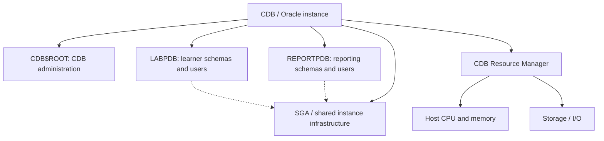

# Authorization and Resource Limits Across PDBs in Oracle

Within an Oracle **Container Database (CDB)**, multiple **Pluggable Databases (PDBs)** can run on the same infrastructure. This is convenient when an organization wants to separate development, reporting, and application environments without standing up an Oracle instance for each team. However, placing multiple PDBs side by side raises two critical questions:

1. **Who is allowed to do what, and where?** Does a CDB administrator automatically hold privileges in every PDB? Can a user in one PDB automatically view tables or grant privileges in another PDB?
2. **How much resource can each consume?** If a reporting query in one PDB consumes excessive CPU, PGA, or TEMP, how do other PDBs keep running reliably?

In Oracle, these two problems are addressed by distinct yet cooperating mechanisms: **account and privilege scope (common/local users, roles, privileges)**; **quotas, profiles, and PDB-level resource settings**; **CDB Resource Manager and storage limits**; and live monitoring.

Examples throughout use a CDB with two PDBs: `LABPDB` for learners and `REPORTPDB` for reporting. PDB names, roles, users, and limit values are illustrative only. Commands that change privileges or resource settings must be run by an authorized administrator in a test environment; available features depend on the Oracle version/edition and configuration in use.

## 1. Distinguishing PDB Boundaries from Shared Resources



A PDB is a **logical boundary for data, metadata, many accounts, and configuration**. For example, a local user `LAB_ALICE` in `LABPDB` does not become a user in `REPORTPDB` simply because the two PDBs belong to the same CDB. Same-named tables in two PDBs are two separate objects.

However, PDBs **share many CDB/instance components**, such as CPU, overall memory, background processes, and storage infrastructure. A heavy query can impact another PDB's resources without an appropriate allocation, limiting, and monitoring plan. This isolation level is not equivalent to two completely independent servers.

| Scope | Example Components | Principle |
|---|---|---|
| **CDB/root** | Common users/roles, cross-PDB resource plan policies, instance settings | For DBAs administering multiple containers. |
| **Individual PDB** | Local users, local roles, schemas, object privileges, many PDB-level parameters | For PDB administration and the PDB's own applications. |
| **Individual user/schema** | Privileges to create/read/modify tables, profiles, quotas on permanent tablespaces | Authorization and quotas inside a PDB. |
| **Shared resources** | CPU, overall PGA/SGA, I/O, underlying storage | Requires distribution policies so PDBs do not contend uncontrollably. |

In a multitenant configuration, redo and many instance-level operations remain tied to the CDB; undo can be organized in **local undo mode** or configured according to version. Do not infer from a PDB name that all CPU, RAM, redo logs, and OS resources are completely independent.

## 2. Access Control Begins with the Container the Session Connects To

Administrators typically work in `CDB$ROOT` or connect directly to a PDB via the PDB's **service name**. When running `CREATE USER`, `GRANT`, or `ALTER SYSTEM`, you must first know which container you are in.

In SQL*Plus/SQLcl, you can check:

```sql
SHOW CON_NAME;
SHOW PDBS;

SELECT SYS_CONTEXT('USERENV', 'CON_NAME') AS current_container,
       SYS_CONTEXT('USERENV', 'SESSION_USER') AS session_user
FROM dual;
```

`SHOW` is a client command; the `SYS_CONTEXT` query is SQL and works across other clients. In an administrative session permitted to switch containers, for example:

```sql
ALTER SESSION SET CONTAINER = CDB$ROOT;

SELECT con_id, name, open_mode
FROM v$pdbs
WHERE name IN ('LABPDB', 'REPORTPDB')
ORDER BY con_id;
```

`ALTER SESSION SET CONTAINER` only works when the session holds **appropriate privileges to switch to the target container**. Regular applications should connect to the exact PDB's service; they neither need nor should be granted CDB administrative privileges.

### Common Users and Local Users

Oracle distinguishes two account types:

| User Type | Where Created and Scope | Usage Example |
|---|---|---|
| **Common user** | Created per common-user rules in root and exists across eligible containers | Operational accounts needing to administer/monitor multiple PDBs. |
| **Local user** | Created inside a specific PDB and belongs solely to that PDB | Application accounts, learners, or DBAs managing only one PDB. |

In standard CDBs, administrator-created common usernames use the default prefix `C##`. Local users such as `LAB_ALICE` do not require this prefix. **A common username existing across multiple PDBs does not mean all privileges are automatically granted in all PDBs**; the scope of each `GRANT` must still be explicitly specified.

From the root, a DBA can inspect users per container via dictionary views, if authorized:

```sql
SELECT con_id, username, common, oracle_maintained
FROM cdb_users
WHERE username IN ('LAB_ALICE', 'C##OPS_VIEWER')
ORDER BY con_id, username;
```

`CON_ID` identifies the container of each metadata row. `COMMON` distinguishes common vs. local attributes. A local user can share the same name with a local user in another PDB while remaining completely separate identities.

### Common Privileges and Local Privileges

Grant scope is governed by the current container and, when valid, the `CONTAINER` clause:

- **`CONTAINER=CURRENT`:** grants privilege in the current container; this is local scope.
- **`CONTAINER=ALL`:** grants common privilege across eligible containers when executed in the root and meeting common grantee/privilege requirements. It is not syntax to arbitrarily grant privileges to any local user across all PDBs.

Example solely for CDB-level DBAs, replacing the password placeholder with a real secret at deployment:

```sql
ALTER SESSION SET CONTAINER = CDB$ROOT;

CREATE USER C##OPS_VIEWER
IDENTIFIED BY "<SECURE_PASSWORD>"
CONTAINER = ALL;

GRANT CREATE SESSION TO C##OPS_VIEWER CONTAINER = ALL;
```

This is purely an example showing the scope of **common users and common grants**. `CREATE SESSION` allows connecting; it **does not automatically grant read access to all tables in all PDBs**. When monitoring is actually required, the DBA must grant exact metadata/object read privileges, evaluate **`CONTAINER_DATA`** for relevant container data objects, and control the scope of data the user can view.

For applications running solely in `LABPDB`, prefer **local users and local grants**, avoiding unnecessary common privileges.

## 3. Creating Local Users, Local Roles, and Privileges in LABPDB

Assume `LABPDB` exists, is open, and has permanent tablespace `LAB_DATA` and temporary tablespace `TEMP`. The following statements must run inside **`LABPDB`** using an account permitted to create users/roles and grant privileges in the PDB.

```sql
ALTER SESSION SET CONTAINER = LABPDB;

SELECT SYS_CONTEXT('USERENV', 'CON_NAME') AS target_pdb
FROM dual;

CREATE ROLE LAB_READERS;
CREATE ROLE LAB_CREATORS;

GRANT CREATE SESSION TO LAB_READERS;
GRANT CREATE SESSION, CREATE TABLE TO LAB_CREATORS;

CREATE USER LAB_ALICE
  IDENTIFIED BY "<ALICE_PASSWORD>"
  DEFAULT TABLESPACE LAB_DATA
  TEMPORARY TABLESPACE TEMP
  QUOTA 128M ON LAB_DATA
  ACCOUNT UNLOCK;

GRANT LAB_CREATORS TO LAB_ALICE;
```

Here:

- `LAB_CREATORS` is a **local role** holding privileges to connect and create tables within appropriate PDB scope.
- `LAB_ALICE` is a **local user**. `QUOTA 128M ON LAB_DATA` limits the segment storage the user can allocate in that permanent tablespace.
- `CREATE TABLE` allows creating one's own tables; **never grant** `CREATE ANY TABLE`, `DROP ANY TABLE`, or `SELECT ANY TABLE`.
- A user with SQL privileges still needs tablespace quota to allocate segments there. Granting `CREATE TABLE` to a role cannot substitute for quota.
- Roles are convenient for grouping privileges; note that **definer's rights** PL/SQL programs follow different direct-grant rules than interactive SQL (privileges from roles normally do not apply when compiling/executing definer's rights objects).

If a table already exists in schema `LAB_OWNER` and needs to be shared with the reader group, **the table owner or someone with appropriate grant rights** can run in `LABPDB`:

```sql
-- Run by owner LAB_OWNER after the ORDERS table exists.
GRANT SELECT ON lab_owner.orders TO LAB_READERS;

-- Run by PDB DBA or role owner with grant privileges.
GRANT LAB_READERS TO LAB_ALICE;
```

`GRANT SELECT ON ...` grants an object-specific privilege, not schema-wide access by default. If learners need to view additional tables, grant each required object individually or design appropriate data-interface views.

### Local Privileges in Another PDB Do Not Propagate Automatically

To build a reporting application in `REPORTPDB`, that PDB's administrator must manage users and roles in that exact PDB:

```sql
ALTER SESSION SET CONTAINER = REPORTPDB;

SELECT SYS_CONTEXT('USERENV', 'CON_NAME') AS target_pdb
FROM dual;

-- Example: local role for reporting, independent of LAB_READERS in LABPDB.
CREATE ROLE REPORT_READERS;
GRANT CREATE SESSION TO REPORT_READERS;
```

`LAB_ALICE` in `LABPDB` does not automatically gain privileges to connect to `REPORTPDB` or `SELECT` tables there. Even if a local user also named `LAB_ALICE` is created in `REPORTPDB`, it remains an identity in a **different container**, with independently managed privileges and password.

If data must be retrieved across another PDB, design an explicit access path (such as a service, database link, or approved integration mechanism) following **least privilege**. Being in the same CDB does not replace data-access authorization.

### Reviewing Granted Privileges

Inside `LABPDB`, a DBA with dictionary read privileges can verify:

```sql
SELECT username, common, account_status, default_tablespace
FROM dba_users
WHERE username = 'LAB_ALICE';

SELECT grantee, granted_role, default_role
FROM dba_role_privs
WHERE grantee = 'LAB_ALICE';

SELECT grantee, privilege, common
FROM dba_sys_privs
WHERE grantee IN ('LAB_CREATORS', 'LAB_READERS')
ORDER BY grantee, privilege;

SELECT grantee, owner, table_name, privilege
FROM dba_tab_privs
WHERE grantee = 'LAB_READERS';

SELECT username, tablespace_name, bytes, max_bytes
FROM dba_ts_quotas
WHERE username = 'LAB_ALICE';
```

When reviewing effective privileges, remember users can receive **direct grants** as well as **role grants**, roles can be nested, and common privileges can be inherited in the container. Do not look at a single `DBA_SYS_PRIVS` row and conclude a user lacks privileges. Conversely, overly broad roles can inadvertently allow a user to do far more than intended.

## 4. Resource Limits: Multiple Mechanisms at Multiple Levels

Authorization answers "**what operations are allowed**"; resource limits answer "**how much can a workload consume and how is it prioritized under contention**."

| Mechanism | Enforcement Level | Primarily Controls | What Not to Confuse |
|---|---|---|---|
| **User quota** | User on a **permanent tablespace** inside a PDB | Allocated segment storage | Does not limit total CPU, PGA, or TEMP of a user. |
| **User profile** | User within managed scope | E.g., sessions per user, idle time, password policy | Does not divide CPU between PDBs. |
| **CDB Resource Manager** | CDB, with directives per PDB | CPU priority under contention, max utilization, and workload-related caps | `SHARES` does not guarantee fixed CPU speed or percentage at every moment. |
| **PDB resource controls / initialization parameters** | Individual PDB when supported by Oracle | Certain CPU, SGA/PGA, session, and other resource caps | Valid limits depend on CDB settings, version, and memory management. |
| **PDB storage limit / tempfile / datafile** | PDB or file/tablespace | Allocatable storage usage | Datafile `MAXSIZE` is not a per-user total quota. |
| **PDB-level Database Resource Manager** | Workloads/consumer groups inside a PDB when configured | Priority distribution among session groups within one PDB | Distinct from dividing CPU across PDBs at the CDB level. |

There is no **single** `GRANT` or `ALTER SYSTEM` command that addresses every dimension: CPU, memory, I/O, connections, and storage. Identify the contended resource first and set limits at the right layer.

### Hard Caps vs. Priority-Based Resource Sharing

Two forms of limits are especially important:

- **Hard cap (*cap/limit*):** when enforced, prevents a PDB from exceeding a specific resource utilization level. For instance, a utilization limit can cap a PDB's CPU even when other PDBs are mostly idle.
- **Weight (*share/weight*):** specifies relative priority when PDBs **simultaneously contend for a scarce resource**. A PDB with higher shares gets a larger proportion when both are busy, yet a less busy PDB does not always "reserve" its idle slice.

Setting high `SHARES` can prioritize a PDB's CPU under contention, but does not replace controlling session count, memory pressure, or storage capacity.

## 5. Using CDB Resource Manager to Share CPU Across PDBs

**Oracle Database Resource Manager** lets DBAs define workload management plans. At the CDB level, a **CDB resource plan** contains **plan directives** for each PDB. A directive can specify `SHARES` (relative weight) and `UTILIZATION_LIMIT` (percentage CPU cap per Resource Manager semantics), along with other workload parameters depending on version.

Example operational goals:

- `LABPDB` is a learning environment with lower priority under contention: `SHARES = 1`.
- `REPORTPDB` serves more critical reporting: `SHARES = 3`.
- Set illustrative CPU utilization ceilings per PDB so heavy queries do not monopolize total instance capacity.

| PDB | Illustrative Shares | Illustrative Utilization Limit | Meaning |
|---|---:|---:|---|
| `LABPDB` | 1 | 50% | Lower CPU priority and capped maximum utilization when the plan is active. |
| `REPORTPDB` | 3 | 80% | Higher CPU priority under contention, while still bounded by a ceiling. |

**Do not interpret** `1:3` as "`LABPDB` always uses exactly 25% and `REPORTPDB` exactly 75% CPU": shares only apply during contention, and actual CPU usage also depends on load and other limits. Likewise, ceilings of 50% and 80% do not guarantee both PDBs can simultaneously receive those full amounts of CPU.

### Example Creating a CDB Resource Plan

The following PL/SQL block is a **deployment template on a CDB supporting these procedures**, intended for a DBA running in `CDB$ROOT`. Confirm existing PDB names, administrative privileges, Resource Manager privileges, and the current plan before use. Run **once** in a test environment with a clear workload management plan:

```sql
ALTER SESSION SET CONTAINER = CDB$ROOT;

BEGIN
    DBMS_RESOURCE_MANAGER.CREATE_PENDING_AREA();

    DBMS_RESOURCE_MANAGER.CREATE_CDB_PLAN(
        plan    => 'LAB_CDB_PLAN',
        comment => 'Resource allocation for lab and reporting PDBs'
    );

    DBMS_RESOURCE_MANAGER.CREATE_CDB_PLAN_DIRECTIVE(
        plan               => 'LAB_CDB_PLAN',
        pluggable_database => 'LABPDB',
        shares             => 1,
        utilization_limit  => 50
    );

    DBMS_RESOURCE_MANAGER.CREATE_CDB_PLAN_DIRECTIVE(
        plan               => 'LAB_CDB_PLAN',
        pluggable_database => 'REPORTPDB',
        shares             => 3,
        utilization_limit  => 80
    );

    DBMS_RESOURCE_MANAGER.VALIDATE_PENDING_AREA();
    DBMS_RESOURCE_MANAGER.SUBMIT_PENDING_AREA();
END;
/
```

Resource Manager uses a **pending area** to create/edit/validate plans before publishing. If the block fails during creation or validation, the DBA must read the error, clear/handle the pending area per admin procedures, and check whether the plan name already exists; do not repeatedly rerun the whole block on an active CDB.

In a CDB with an existing plan, activating a new plan **changes resource distribution behavior across the entire CDB**. Only after evaluating other PDBs and the default directive (covering unspecified PDBs) should the DBA activate the plan, for example in versions supporting this parameter:

```sql
-- Execute in CDB$ROOT after validating the plan.
ALTER SYSTEM SET RESOURCE_MANAGER_PLAN = 'LAB_CDB_PLAN' SCOPE = MEMORY;
```

`SCOPE=MEMORY` demonstrates changing the parameter in the running instance. For persistence across restarts, DBAs must manage durable settings according to the system's SPFILE/PFILE startup method. Never swap plans in production just to run an exercise, and never delete or alter a resource plan used by another system.

### Inspecting Configured Plans

A DBA in `CDB$ROOT` can query:

```sql
SELECT name, value
FROM v$parameter
WHERE name = 'resource_manager_plan';

SELECT plan, pluggable_database, shares, utilization_limit
FROM dba_cdb_rsrc_plan_directives
WHERE plan = 'LAB_CDB_PLAN'
ORDER BY pluggable_database;
```

`V$PARAMETER` shows the parameter value in the corresponding instance/session; the dictionary view shows defined directives. **Having directives in the dictionary does not mean the plan is enabled.** In real deployments, inspect both the active plan and per-PDB resource/wait metrics to observe actual impact.

### What Happens When One PDB Is Idle?

Suppose `LABPDB` has low load while `REPORTPDB` needs heavy CPU. Defining shares does not force `REPORTPDB` to wait for `LABPDB` to "use up its turn" when `LABPDB` has no demand. However, `REPORTPDB` remains subject to independent caps like `UTILIZATION_LIMIT` and underlying CPU capacity. When both PDBs become busy, the priority plan shows its effect clearly.

Conversely, if a large `ORDER BY` query in `LABPDB` consumes heavy TEMP/read I/O, **CPU shares alone do not prevent `REPORTPDB` from suffering storage impact**. Monitor the exact contended resource.

## 6. Memory, CPU, and Connection Limits at the PDB Level

A CDB shares RAM and CPU, yet modern Oracle releases support **certain management parameters at the PDB level**. These depend on version, licensing/edition, and CDB-level parameter constraints; not every parameter can be modified arbitrarily inside a PDB.

### CPU: Shares, Utilization Limit, and CPU_COUNT

Three easily confused concepts:

- **`SHARES` in a CDB resource plan**: relative priority when PDBs contend for CPU.
- **`UTILIZATION_LIMIT`**: CPU ceiling enforced by Resource Manager per plan semantics.
- **`CPU_COUNT` at the PDB level when supported by version**: a parameter bounding/influencing a PDB's CPU budget and how Oracle determines execution concurrency, particularly in environments with PDB CPU controls.

When evaluating a PDB's CPU, check **both** the CDB plan, PDB parameters, and actual load. Do not set `CPU_COUNT=2` and assume every environment limits strictly to "two physical CPUs," because CPU scheduling and instance logical CPU counts vary by configuration.

### PGA and SGA

Oracle distinguishes:

- **SGA**: shared instance memory, including buffer cache, shared pool, and other components.
- **PGA**: server-process memory used for private work such as sorts/hashes and session state.
- **`SGA_TARGET` / `PGA_AGGREGATE_TARGET` at the PDB level (when supported)**: target/management levels for a PDB within the CDB's memory configuration and limits.
- **`PGA_AGGREGATE_LIMIT` and related limits**: controls PGA consumption per parameter policy; understand behavior when exceeded and CDB-level bounds.

`PGA_AGGREGATE_TARGET` is a **target**, not a guarantee of reserving a private RAM block of that exact byte size for each PDB. Raising targets in one PDB can impact the shared environment; DBAs should measure consumption and account for multiple active PDBs.

In an administrative session inside a PDB, you can **inspect** relevant parameters without changing configuration:

```sql
SELECT SYS_CONTEXT('USERENV', 'CON_NAME') AS current_container
FROM dual;

SELECT name, display_value, ispdb_modifiable
FROM v$parameter
WHERE name IN (
    'cpu_count',
    'sga_target',
    'pga_aggregate_target',
    'pga_aggregate_limit',
    'sessions'
)
ORDER BY name;
```

`ISPDB_MODIFIABLE` indicates whether a parameter can be set at the PDB level in the running environment. Even when `TRUE`, changes carry conditions (CDB-level values, `SCOPE`, PDB state, platform limits). On managed/cloud PDBs, the provider may restrict operations a DBA can normally self-manage.

### Connection Limits and Profiles

Too many sessions can increase PGA usage and internal contention, yet a **profile limiting one user's session count** differs from **parameters limiting total sessions** of a PDB/CDB.

An administrator in `LABPDB` can create a suitable profile for learner accounts:

```sql
CREATE PROFILE LAB_STUDENT_PROFILE LIMIT
    SESSIONS_PER_USER 3
    IDLE_TIME 30;

ALTER USER LAB_ALICE PROFILE LAB_STUDENT_PROFILE;
```

`SESSIONS_PER_USER 3` caps a user's concurrent sessions if resource limit enforcement is enabled; `IDLE_TIME 30` sets allowed idle minutes per profile mechanics. For profile resource limits like these to be enforced by Oracle, the DBA must check the `RESOURCE_LIMIT` parameter and enforcement conditions; password profile limits have their own semantics. Do not expect profiles to prevent all forms of CPU/resource usage across PDBs.

In applications using connection pools, actual session count also depends on max pool size, replica count, and timeout handling. Setting a low profile limit without checking pool configs can cause connection errors even when CPU is idle.

## 7. Storage Limits: PDB, Tablespace, Tempfile, and User Quota

Suppose `LABPDB` has permanent tablespace `LAB_DATA` and temporary tablespace `LAB_TEMP`. These are **distinct** limit layers:

```text
Host / ASM / cloud storage
  +-- CDB and required Oracle files
      +-- LABPDB (may have PDB-level storage limits)
      |   +-- LAB_DATA: datafiles, AUTOEXTEND, MAXSIZE
      |   |   +-- LAB_ALICE: 128 MB quota
      |   |   +-- LAB_BOB: separate quota
      |   +-- LAB_TEMP: tempfiles, file limits / TEMP workload
      +-- REPORTPDB (separate limits / tablespaces / tempfiles)
```

| Limit | Scope | Key Point to Remember |
|---|---|---|
| **User quota on permanent tablespace** | One user and one tablespace | Segment allocation limit for the user; does not directly cap CPU or TEMP. |
| **Datafile `AUTOEXTEND MAXSIZE`** | One file | File growth limit; multiple files can belong to one tablespace. |
| **Tempfile `MAXSIZE`** | One tempfile | Limit on a TEMP file; not a per-session quota. |
| **PDB storage limit** | Total PDB-scoped storage controlled by Oracle, if configured | Verify calculation rules and version/edition support. |
| **Physical storage** | Server/ASM/cloud volume | Real ceiling; allocation can fail before logical max limits are reached. |

For the sample user, inspect quota inside `LABPDB`:

```sql
SELECT username,
       tablespace_name,
       ROUND(bytes / 1024 / 1024, 1) AS used_mb,
       CASE
           WHEN max_bytes = -1 THEN 'UNLIMITED'
           ELSE TO_CHAR(ROUND(max_bytes / 1024 / 1024, 1))
       END AS quota_mb
FROM dba_ts_quotas
WHERE username = 'LAB_ALICE';
```

`MAX_BYTES=-1` means **unlimited at that user quota level**, not that PDB or host storage is infinite.

To reduce a quota, the DBA can run a local command:

```sql
ALTER USER LAB_ALICE QUOTA 64M ON LAB_DATA;
```

This statement **does not delete already allocated segments**. If the user already occupies more than 64 MB, lowering the quota does not erase existing data; allocating new extents may fail until space is freed or the quota is raised.

Issuing `GRANT UNLIMITED TABLESPACE` to a user can bypass normal quota controls. **Do not use `UNLIMITED TABLESPACE` to "fix" a quota error** if the goal is to restrict storage for a practice account.

### TEMP Is Not Bounded by Permanent Quotas

A large sort/hash query can spill to TEMP when PGA workarea is insufficient. `QUOTA 64M ON LAB_DATA` does not limit how many MB of TEMP an `ORDER BY` operation can consume. To control TEMP exhaustion, DBAs must inspect temporary tablespaces, tempfiles, TEMP-consuming queries, PGA pressure, and related workload limits.

When managing overall PDB storage, Oracle offers PDB-level limit clauses/settings in supported releases, yet never apply syntax like `STORAGE (MAXSIZE ...)` or similar parameters without checking your exact version and command scope. System files, temporary storage, and other allocations may follow specific accounting rules; capacity settings should be validated via dictionary views and realistic tests in that environment.

## 8. PDB-Level Resource Manager and Resource Allocation Inside a PDB

A **CDB resource plan** resolves resource contention **across PDBs**. When one PDB has multiple internal workload groups, a DBA can also configure a **PDB resource plan** to distribute priority among consumer groups inside that PDB, for example:

```text
CDB resource plan
  LABPDB          -> PDB-level resource share
    PDB resource plan
      APP_ONLINE   -> prioritizes user-facing APIs
      BATCH_JOB    -> batch load, can wait under high load
  REPORTPDB       -> PDB-level resource share
    PDB resource plan
      DASHBOARD    -> dashboard queries
      ETL          -> periodic aggregation jobs
```

Internal PDB allocation **does not grant extra CPU beyond the CDB-level limit**. If the CDB caps a PDB and that PDB also has a plan dividing consumer groups, internal sharing operates within the budget the PDB receives.

For systems requiring limits by **user, module, or workload type**, combine database-side Resource Manager with:

- **Connection pools**: prevent applications from opening unbounded sessions.
- **Transaction and statement timeouts**: cancel overly long transactions or queries per application policy.
- **Parallel job limits**: prevent multiple heavy ETL jobs from competing simultaneously for CPU/PGA/TEMP.
- **User policies**: grant only appropriate DML, DDL, and object access; read-only accounts do not need schema modification privileges.
- **Monitoring and alerts**: detect CPU/I/O/TEMP trends before other PDBs are affected.

These layers complement one another. A user with only `SELECT` can still submit a query that consumes massive CPU/TEMP; **read-only privilege is not a resource limit**.

## 9. Live Monitoring: Which PDB Is Consuming Resources?

After configuring privileges and resource plans, the DBA must verify both **policy** and **behavior**. Running a `SELECT` on plan config alone does not prove each PDB is properly isolated.

### 9.1. Identify Open PDBs

In `CDB$ROOT`, with privileges to view dynamic views:

```sql
SELECT con_id, name, open_mode
FROM v$pdbs
WHERE name IN ('LABPDB', 'REPORTPDB')
ORDER BY con_id;
```

`CON_ID` is the key joining information across multi-container views. In RAC, statistics on a single instance do not automatically represent the entire cluster; depending on the source, check `INST_ID` or use the appropriate `GV$` view.

### 9.2. Inspect CPU Consumption and Resource Manager Wait Time

In Oracle versions providing PDB Resource Manager metric views, DBAs can view point-in-time or short-history metrics, for example:

```sql
SELECT con_id,
       cpu_consumed_time,
       cpu_wait_time
FROM v$rsrc_pdb_metric
ORDER BY con_id;
```

`CPU_CONSUMED_TIME` and `CPU_WAIT_TIME` use units and sampling windows defined by the view/version. **Do not arbitrarily convert these counters into "instantaneous CPU percentage"** without reading the column semantics. When evaluating shares/caps, take multiple samples over time and compare while PDBs are genuinely contending for CPU.

A PDB showing rising `CPU_WAIT_TIME` may be throttled by Resource Manager, yet you must also examine total CPU load, active session states, I/O wait times, and infrastructure limits. Never conclude "Resource Manager is slowing down the database" from a single counter alone.

### 9.3. Inspect Sessions and Workloads by Container

A DBA in root with appropriate privileges can summarize sessions by container:

```sql
SELECT con_id,
       status,
       COUNT(*) AS session_count
FROM v$session
WHERE type = 'USER'
GROUP BY con_id, status
ORDER BY con_id, status;
```

Session count does not equal active CPU consumption: an `INACTIVE` session may mostly be waiting on a client, while a single session running parallel SQL can consume massive resources. Inspect active query activity, execution counts, elapsed time, and related wait events as well.

### 9.4. Inspect Memory and TEMP in the Right PDB

In an administrative session inside each PDB, you can use views related to PGA, TEMP, and storage (when authorized):

```sql
SELECT name, value, unit
FROM v$pgastat
WHERE name IN (
    'total PGA allocated',
    'total PGA inuse',
    'aggregate PGA target parameter'
);

SELECT tablespace_name,
       ROUND(tablespace_size / 1024 / 1024, 1) AS size_mb,
       ROUND(free_space / 1024 / 1024, 1) AS free_mb
FROM dba_temp_free_space;
```

Views and statistics **do not all have identical PDB scope and precision** across every Oracle release. For some PGA stats, values may reflect instance-wide scope rather than the single PDB; to analyze per-PDB usage, check views containing `CON_ID`, official resource monitor metrics, and environment-specific tools. Do not label a CDB-wide metric as "`LABPDB`'s private PGA" merely because you queried it while connected to the PDB.

When analyzing TEMP, distinguish **tempfile size**, **managed/reusable extents**, and **temporary segments actively held by sessions**. A TEMP file remaining large after a query finishes is not necessarily a resource leak.

### 9.5. Auditing Privileges and Configuration Changes

Beyond resource metrics, multi-PDB governance requires knowing:

- Who created users, roles, or granted/revoked privileges in each PDB?
- Who altered resource plans, quotas, or PDB parameters?
- Does any common user hold privileges across multiple PDBs beyond operational needs?
- Which applications use accounts with administrative privileges or unnecessary data access?

Oracle auditing mechanisms (especially unified auditing in supported environments), configuration change logs, and approval workflows help trace these actions. When querying audit trails, follow DBA privilege and data-protection policies; **never grant broad audit-record read privileges to regular application users**.

## 10. Illustrative Scenario: LABPDB Impacting REPORTPDB

Suppose `REPORTPDB` serves dashboards, while `LABPDB` runs a `GROUP BY` exercise over millions of rows. At peak time:

- Instance CPU approaches saturation.
- Reports in `REPORTPDB` respond slowly.
- Multiple `LABPDB` sessions run simultaneously with large sort/hash queries.
- High I/O also appears on the system.

Proper diagnosis separates the causes:

**Step 1 — Identify PDBs and load.** Inspect open PDBs, sessions by `CON_ID`, running SQL, CPU consumed/wait, and I/O. Do not assume `LABPDB` caused the slowdown solely because it has more sessions.

**Step 2 — Identify contention type.** If CPU contention, inspect CDB resource plan, shares, and utilization limits. If queries are spilling, check PGA workareas, TEMP, and read/write I/O. If sessions are blocked on locks, CPU shares will not resolve locking conflicts.

**Step 3 — Check policies and privileges.** Does `LABPDB` have a resource directive? Is the plan active? Does a user have `UNLIMITED TABLESPACE` or overly broad admin roles? Can batch job concurrency be throttled?

**Step 4 — Apply targeted adjustments.** Tune shares/caps via DBA procedures for CPU contention; optimize execution plans or cap batch concurrency if queries do excessive work; adjust memory/TEMP/storage if real shortages are confirmed; tune connection pools if too many sessions are open.

**Step 5 — Re-measure under representative load.** Monitor dashboard latency, CPU wait, throughput, memory, and I/O for **both PDBs**. The solution is effective when it prioritizes the right workload without creating limits that inadvertently break other systems.

Another example regarding **security isolation**: a learner has `CREATE TABLE` in `LABPDB` and tries to run:

```sql
SELECT *
FROM report_owner.monthly_revenue;
```

If that object **exists only in `REPORTPDB`**, the SQL in `LABPDB` does not automatically "jump over to the other PDB" just by naming the schema/table. Oracle only resolves objects in the connected container and validly referenced objects via configured mechanisms (such as a database link). Trying to read the table from `LABPDB` without authorization fails as nonexistent or inaccessible. **Data isolation relies on container + privileges**, not schema names alone.

## 11. Common Mistakes

| Misconception | Correct Understanding |
|---|---|
| "A PDB is like an independent server so it cannot affect other PDBs." | A PDB is a logical boundary, yet shares instance/infrastructure resources; heavy workloads can still contend for CPU, memory, and I/O. |
| "A local user in LABPDB can access REPORTPDB if they know the table name." | Local users/roles and object privileges are PDB-scoped; cross-PDB access requires explicitly configured mechanisms and grants. |
| "A common user by default has privileges over all PDB data." | Account existence scope differs from privilege scope; inspect common/local grants and actual privileges. |
| "`CONTAINER=ALL` grants privileges to any local user across all PDBs." | Common grants have specific conditions and scope, typically managed in root for eligible common grantees. |
| "`SHARES=3` guarantees a PDB always gets 75% CPU." | Shares are relative weights under contention, not fixed percentages at all times. |
| "If CPU is high, raise the tablespace quota." | Quota controls permanent segment allocation, not CPU capacity. |
| "A 128 MB quota also caps all user sorts at 128 MB TEMP." | TEMP/workarea uses separate allocation mechanics and is not governed by that permanent tablespace quota. |
| "Just `GRANT DBA` to the app to avoid privilege errors." | Excessive privileges create severe data and operational risks; grant least privilege per function. |
| "Enabling Resource Manager automatically solves all performance issues." | Plans address certain contention dimensions; SQL plans, locks, memory, I/O, and connection pooling still matter. |
| "Checking one metric while the PDB is idle proves the CPU cap works." | Measure under realistic load, with clear metric units/intervals and confirmed active plan state. |

## 12. Hands-On Exercises and Self-Check Questions

### Exercise A: Inspecting Security Scope

1. Log into `LABPDB` as the PDB admin user and verify the container name.
2. Create local role `LAB_READERS` and local user `LAB_ALICE` as shown in the example, granting a bounded quota on an existing permanent tablespace.
3. Inspect `DBA_USERS`, `DBA_ROLE_PRIVS`, `DBA_SYS_PRIVS`, and `DBA_TS_QUOTAS`.
4. Connect as `LAB_ALICE` to `LABPDB`'s service and create a table of your own (if granted `LAB_CREATORS`). Explain why the user cannot create tables in another schema without appropriate privileges.
5. If a separately administered `REPORTPDB` exists, check `CON_NAME` and verify that privileges in `LABPDB` **do not automatically carry over** to `REPORTPDB`.

**Expected outcome:** learners recognize that each local user/role and privilege is meaningful only within its declared container, while quota is a per-user bound on a permanent tablespace.

### Exercise B: Reading a Resource Allocation Plan

Using a CDB resource plan already created by the DBA for the lab environment:

1. Record the currently active plan via `V$PARAMETER`.
2. Inspect directives in `DBA_CDB_RSRC_PLAN_DIRECTIVES`.
3. Compare `SHARES=1` and `SHARES=3` when one PDB is idle versus when both need CPU.
4. Distinguish CPU priority sharing from the `UTILIZATION_LIMIT` ceiling.
5. Name the metrics/waits to inspect to confirm throttling is actually occurring.

**Do not activate a new plan** just to complete the reading and explanation portion; a shared environment may already have an active policy running.

### Exercise C: Distinguishing Storage and Memory Limits

Given the scenario:

- `LAB_ALICE` has a 128 MB quota on `LAB_DATA`.
- `LAB_DATA`'s datafile can autoextend up to 1 GB.
- `LABPDB` runs a large sort query and hits a TEMP allocation error.
- `REPORTPDB` continues operating normally.

Answer:

1. Does the 128 MB quota directly block the sort's TEMP usage? **No.**
2. Does `AUTOEXTEND MAXSIZE 1G` guarantee the entire PDB has 1 GB total storage? **No.** That is the limit of a single file.
3. If `REPORTPDB` CPU is impacted, will increasing `LABPDB`'s datafile size fix it? **No.** Measure CPU/Resource Manager and the real bottleneck.
4. Does a profile with `SESSIONS_PER_USER` limit each PDB individually? **It applies to the user within the profile's management and enforcement scope**, not as a shared PDB CPU ceiling.
5. Why must both memory and TEMP be monitored? **Insufficient workarea causes spills, increasing I/O/TEMP demand even when permanent data does not grow proportionally.**

### Self-Check Knowledge Questions

1. **What is the scope of a local user?** A specific PDB; this identity is not automatically present or privileged in other PDBs.
2. **How does a common user differ from a common privilege?** A common user defines account existence scope; a common privilege is granted within an appropriate scope and does not appear automatically for every action.
3. **How do `CONTAINER=CURRENT` and `CONTAINER=ALL` differ?** The first targets the current scope; the second applies per common-grant rules across eligible containers.
4. **How do CDB Resource Manager and PDB Resource Manager differ?** CDB level distributes resources across PDBs; PDB level distributes resources across workloads/consumer groups inside a single PDB.
5. **Why can a PDB with higher shares still be slow?** Due to utilization caps, non-CPU contention, SQL execution plans, locks, PGA/TEMP, I/O, or host limits.
6. **Is a user quota a GB cap for the entire PDB?** No; quota is a user's permanent segment allocation limit on a single tablespace.
7. **What must a DBA verify before limiting two PDBs?** Privileges and current container, active resource plan, version/edition constraints, workload metrics, and operational policies of all affected PDBs.
8. **Why do read-only privileges still require Resource Manager?** A single `SELECT` can consume heavy CPU, PGA, and TEMP even without modifying any table.

When operating Oracle multitenant, manage **identities and privileges in the right container**, set **quotas/profiles for users**, configure **resource plans and appropriate parameters for PDBs/CDB**, and finally measure CPU, memory, I/O, TEMP, and sessions per PDB. Combining these layers lets teams share a CDB while keeping access boundaries clear and resource consumption predictable.
