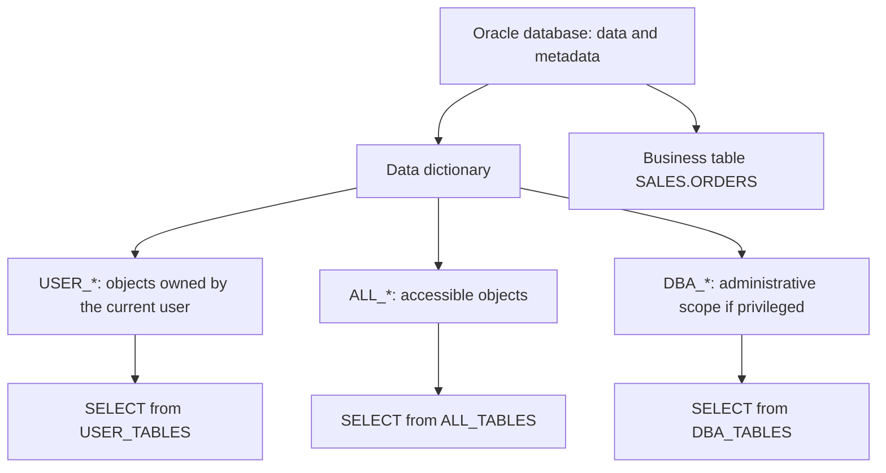
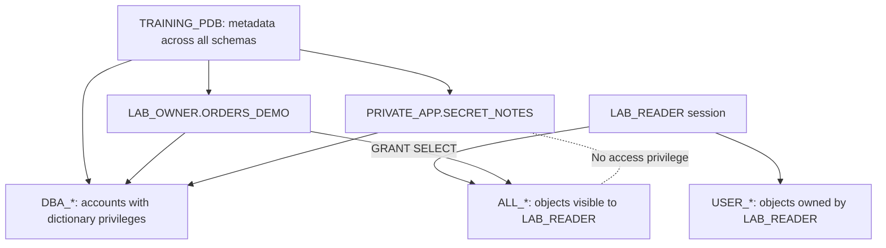
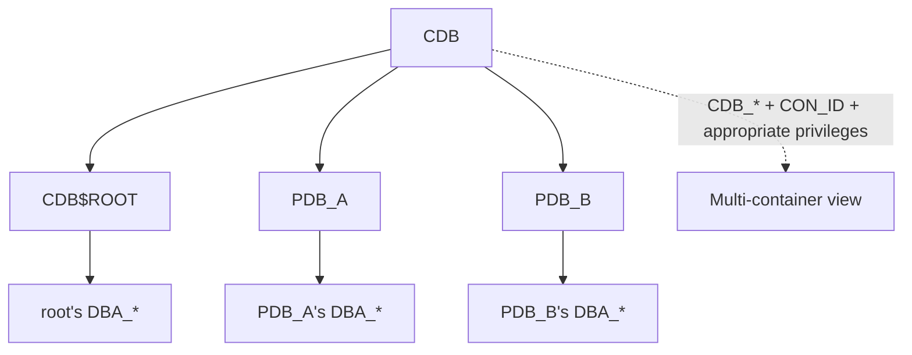

# Data Scope in Oracle Database's USER_*, ALL_*, and DBA_* Views

When managing schemas or troubleshooting SQL errors in Oracle Database, developers frequently encounter three groups of **data dictionary views** prefixed with `USER_`, `ALL_`, and `DBA_`. They provide metadata about tables, columns, keys, indexes, views, access privileges, and many other objects. For the same subject, such as a list of tables, Oracle provides `USER_TABLES`, `ALL_TABLES`, and `DBA_TABLES`, yet their results differ: **the core difference lies in the scope of objects the querying user is permitted to observe**.

Understanding these three view groups helps answer practical questions:

- "I just created a table, so why doesn't another account see it in `USER_TABLES`?"
- "Why do I see a table in `ALL_TABLES`, yet cannot find it in my own schema?"
- "Why does querying `DBA_TABLES` fail with `ORA-00942` even though `USER_TABLES` works?"
- "When logged into a PDB, does `DBA_TABLES` see every table in all other PDBs?"
- "If a table name appears in the dictionary, does that mean I can read all data in that table?"

The focus of this lesson is **metadata visibility scope**, the privileges that determine that scope, the relationship between schemas and containers, and how to choose the right views when building applications and working with DBAs.

## 1. What is the data dictionary?

The **data dictionary** is the metadata repository maintained by Oracle to describe database structure and configuration: users, schemas, tables, columns, constraints, indexes, privileges, storage, program objects, and information Oracle needs to process SQL. Oracle exposes much of this metadata through views so users can query it with SQL.

For example, the `SALES.ORDERS` table holds **business data** such as order IDs, order timestamps, and statuses. Meanwhile, `ALL_TABLES` and `ALL_TAB_COLUMNS` hold **information about tables and columns** that the current session is permitted to see.



These views are **not copies of row data inside tables**. They describe structure, attributes, or privileges associated with objects; to query application data, you still execute `SELECT` against the specific table or view with appropriate privileges.

### 1.1. Same suffix, different prefix

| View | Question answered | Basic scope |
|---|---|---|
| `USER_TABLES` | Which tables belong to the current user's schema? | Tables owned by the current user |
| `ALL_TABLES` | Which tables can the current user access? | User-owned tables plus tables in other schemas visible under the current privilege context |
| `DBA_TABLES` | Which tables exist in the database/container scope observable by an administrative account? | Broad administrative metadata requiring appropriate dictionary privileges |
| `USER_OBJECTS` | Which objects belong to me and what are their statuses? | Multiple object types owned by the user |
| `ALL_OBJECTS` | Which objects can I access? | Multiple object types per privileges and visibility rules |
| `DBA_OBJECTS` | Which objects exist within the administrative scope? | Broad dictionary scope, by container and privileges |

Across many view families, suffixes match for easy comparison, though **not every view has all three variants** or an identical set of columns. For instance, `USER_TABLES` typically omits an `OWNER` column because ownership is implicit; `ALL_TABLES` and `DBA_TABLES` include `OWNER` to distinguish schemas.

### 1.2. "USER, ALL, DBA" are not three connection modes

You do not need to connect three separate times to three different databases to use these prefixes. A normal session can query `USER_*` and many `ALL_*` views; an account with appropriate dictionary administrative privileges can also query `DBA_*`.

The view prefix **does not grant privileges by itself**. Writing `SELECT * FROM DBA_TABLES` does not turn an application account into a DBA. Without the required privilege, Oracle rejects the query even though the view exists in the database.

## 2. USER_* — metadata belonging to the current user

`USER_*` views help explore objects belonging to the **current user/schema in the query context**. They are usually the right starting point right after creating a table, checking your own table's columns, or inspecting indexes/constraints in a schema you manage.

For example, connect as user `LAB_OWNER` and run:

```sql
SELECT table_name,
       tablespace_name,
       num_rows
FROM user_tables
ORDER BY table_name;
```

The output lists tables owned by that user, within the view's scope. If another user owns `ORDERS_DEMO` and only grants `SELECT` to `LAB_OWNER`, that table **does not become owned by `LAB_OWNER`** and therefore does not appear in `LAB_OWNER`'s `USER_TABLES`.

### 2.1. Common USER_* views

| View | When to use | Commonly checked columns |
|---|---|---|
| `USER_OBJECTS` | Check names, types, and statuses of objects you own | `OBJECT_NAME`, `OBJECT_TYPE`, `STATUS` |
| `USER_TABLES` | Check tables and storage/statistics attributes | `TABLE_NAME`, `TABLESPACE_NAME`, `NUM_ROWS` |
| `USER_TAB_COLUMNS` | Check column names, order, data types, and nullability | `TABLE_NAME`, `COLUMN_NAME`, `DATA_TYPE`, `NULLABLE` |
| `USER_CONSTRAINTS` | Check PK/FK/unique/check constraints and statuses | `CONSTRAINT_NAME`, `CONSTRAINT_TYPE`, `TABLE_NAME`, `STATUS` |
| `USER_CONS_COLUMNS` | Check columns participating in a constraint | `CONSTRAINT_NAME`, `COLUMN_NAME`, `POSITION` |
| `USER_INDEXES` | Check indexes in your schema | `INDEX_NAME`, `TABLE_NAME`, `UNIQUENESS` |
| `USER_IND_COLUMNS` | Check columns and positions in an index | `INDEX_NAME`, `COLUMN_NAME`, `COLUMN_POSITION` |
| `USER_VIEWS` | Check views you own | `VIEW_NAME` |
| `USER_SEQUENCES` | Check your sequences | `SEQUENCE_NAME`, `INCREMENT_BY` |
| `USER_TRIGGERS` | Check triggers in your schema | `TRIGGER_NAME`, `TABLE_NAME`, `STATUS` |

Do not assume every object appears in every view. For example, tables appear in `USER_TABLES`, views appear in `USER_VIEWS`, and both can appear in `USER_OBJECTS` with their respective `OBJECT_TYPE`.

### 2.2. Inspecting object structure and status

```sql
SELECT object_name,
       object_type,
       status
FROM user_objects
WHERE object_name LIKE 'ORDERS%'
ORDER BY object_type, object_name;

SELECT column_id,
       column_name,
       data_type,
       data_length,
       nullable
FROM user_tab_columns
WHERE table_name = 'ORDERS_DEMO'
ORDER BY column_id;
```

Unquoted object names are normally normalized to uppercase in the dictionary by Oracle. Thus `'ORDERS_DEMO'` matches a table created via `CREATE TABLE orders_demo ...`. If an object was intentionally created with a quoted identifier like `"Orders_Demo"`, name comparisons must preserve exact casing.

### 2.3. USER_* does not automatically show another user's tables

Suppose `HR` owns `EMPLOYEES` and `LAB_OWNER` is granted `SELECT` on it. When logged in as `LAB_OWNER`:

```sql
SELECT table_name
FROM user_tables
WHERE table_name = 'EMPLOYEES';
```

The query may return zero rows, because `LAB_OWNER` **does not own** `HR.EMPLOYEES`. This does not contradict the fact that `SELECT * FROM HR.EMPLOYEES` can succeed if actual privileges allow it.

## 3. ALL_* — metadata of accessible objects

`ALL_*` is the view group commonly used to discover **objects accessible from the current account/context**, including objects you own and objects in other schemas that Oracle permits you to see according to privileges or visibility mechanisms.

Example:

```sql
SELECT owner,
       table_name,
       tablespace_name
FROM all_tables
WHERE table_name = 'ORDERS_DEMO'
ORDER BY owner, table_name;
```

The `OWNER` column is decisive: the same name `ORDERS_DEMO` can exist across multiple schemas. Within one database, `SALES.ORDERS_DEMO` and `REPORTING.ORDERS_DEMO` are two separate objects.

### 3.1. Privileges shape ALL_* results

For many object types, an account can see metadata via:

- **Object ownership**.
- **Direct object privileges**, such as `GRANT SELECT ON lab_owner.orders_demo TO lab_reader`.
- **Privileges through enabled roles**, depending on the view, object type, and SQL context.
- **Grants to PUBLIC** or system privileges with matching scope.

However, detailed visibility rules vary across dictionary views. Do not extrapolate a general description of `ALL_TABLES` mechanically to every `ALL_*` view, especially metadata for source code, privileges, security policies, or specialized objects.

### 3.2. ALL_* does not mean "every object in the database"

The `ALL_` prefix refers to **the set of objects the session can observe based on privileges**, not that a user can list every table on the server. An application user with privileges on only two tables will not automatically see internal tables across all schemas when querying `ALL_TABLES`.

Conversely, for a user with broad privileges or large roles, `ALL_*` result sets can be very large. Therefore:

```sql
SELECT COUNT(*) FROM all_tables;
```

only counts the rows returned by the view in the current session, **not the absolute total number of tables in the entire Oracle Database**.

### 3.3. Useful queries

List accessible tables in a specific schema:

```sql
SELECT owner, table_name
FROM all_tables
WHERE owner = 'LAB_OWNER'
ORDER BY table_name;
```

Inspect columns of a table in another schema:

```sql
SELECT owner,
       table_name,
       column_id,
       column_name,
       data_type,
       nullable
FROM all_tab_columns
WHERE owner = 'LAB_OWNER'
  AND table_name = 'ORDERS_DEMO'
ORDER BY column_id;
```

Explore object types:

```sql
SELECT owner,
       object_name,
       object_type,
       status
FROM all_objects
WHERE owner = 'LAB_OWNER'
  AND object_name LIKE 'ORDERS%'
ORDER BY object_type, object_name;
```

If a query returns no rows, the object may not exist, the name/owner may be wrong, the session may be in the wrong PDB, or the user may lack the required visibility scope. **An empty result does not definitively prove the object does not exist.**

## 4. DBA_* — administrative metadata scope

The `DBA_*` group provides broader administrative metadata: objects within the queried database/container scope, not restricted by regular user business-table access privileges like `ALL_*`. However, to read these views, the account needs appropriate **dictionary access privileges**.

Example of a DBA looking up tables across multiple schemas in the same container scope:

```sql
SELECT owner,
       table_name,
       tablespace_name
FROM dba_tables
WHERE owner IN ('LAB_OWNER', 'LAB_READER')
ORDER BY owner, table_name;
```

Other administrative variants:

```sql
SELECT owner,
       object_name,
       object_type,
       status
FROM dba_objects
WHERE owner = 'LAB_OWNER'
ORDER BY object_type, object_name;

SELECT owner,
       table_name,
       column_name,
       data_type
FROM dba_tab_columns
WHERE owner = 'LAB_OWNER'
  AND table_name = 'ORDERS_DEMO'
ORDER BY column_id;
```

### 4.1. Access requirements for DBA_*

In Oracle environments, dictionary privileges may be managed via roles such as `SELECT_CATALOG_ROLE` or other privileges granted by a DBA per policy. Which exact views are readable depends on actual privileges, version, and execution context; simply having "DBA" in a username does not grant privileges, nor do all roles apply inside all PL/SQL units.

On a low-privilege application account:

```sql
SELECT owner, table_name
FROM dba_tables
WHERE owner = 'LAB_OWNER';
```

may return `ORA-00942: table or view does not exist` because Oracle blocks access to the view object, even though `DBA_TABLES` actually exists. Depending on context, another privilege error may occur. **Never resolve this by granting the `DBA` role or `SELECT ANY DICTIONARY` to the application runtime user.**

If administrative reporting is needed, assign the task to a DBA or use a properly scoped metadata-reading account/role. If the application only needs column metadata for tables it uses, `USER_*` or `ALL_*` is usually sufficient.

### 4.2. Does DBA_* mean "the entire CDB"?

**Not by default.** In Oracle Multitenant, `DBA_*` interprets metadata within the **connected container**, combined with active privileges:

- Connected to **PDB A**: `DBA_TABLES` inspects metadata within **PDB A**'s scope when the account has sufficient privileges.
- Connected to **CDB$ROOT**: `DBA_TABLES` reflects the root scope; **it does not automatically aggregate user tables from every PDB** just because the query runs as SYS/DBA in root.
- To aggregate metadata across containers: explore `CDB_*` views and the `CON_ID` column, container data attributes, PDB open states, and corresponding access permissions.

This is a key boundary: **privilege scope** and **container scope** are two orthogonal axes. Having administrative metadata privileges in one PDB does not allow a user to inspect every other PDB.

## 5. Diagram of all three scopes in the same PDB

Suppose PDB `TRAINING_PDB` contains three schemas:

- `LAB_OWNER` owns the table `ORDERS_DEMO`.
- `LAB_READER` is granted `SELECT` on `LAB_OWNER.ORDERS_DEMO`.
- `PRIVATE_APP` owns the table `SECRET_NOTES`, to which `LAB_READER` has no grants.



In a typical `LAB_READER` session:

| Question | `USER_*` | `ALL_*` | `DBA_*` |
|---|---|---|---|
| Sees `LAB_OWNER.ORDERS_DEMO`? | No, because not owned | Visible once `SELECT` is granted and active | Yes, if account has broad dictionary read privileges |
| Sees `PRIVATE_APP.SECRET_NOTES`? | No | Typically no, absent other privileges or visibility paths | Yes, within corresponding administrative scope |
| Sees tables created by `LAB_READER` itself? | Yes | Yes | Yes, if holding dictionary privileges |
| Requires extra privileges to read `DBA_TABLES`? | Not applicable | Not applicable | Yes |

Note: this table illustrates standard tables with simple privileges. Specialized security features, roles, and other object types can have distinct visibility rules.

## 6. End-to-end hands-on lab with two schemas and one table

To observe actual behavior rather than memorizing definitions, use a dedicated lab PDB with two accounts `LAB_OWNER` and `LAB_READER`. **The following user creation commands are only for a DBA to run in a practice PDB with permanent tablespace `USERS` and appropriate quotas.** Never use sample passwords in real environments or commit them to git.

### 6.1. Step 1 — DBA creates lab users

First confirm you are in the right PDB:

```sql
SELECT SYS_CONTEXT('USERENV', 'CON_NAME') AS container_name
FROM dual;
```

Then, using an administrative account with required privileges:

```sql
CREATE USER lab_owner IDENTIFIED BY "SetUniqueLabOwnerPassword123"
  DEFAULT TABLESPACE users
  QUOTA 30M ON users;

CREATE USER lab_reader IDENTIFIED BY "SetUniqueLabReaderPassword123";

GRANT CREATE SESSION, CREATE TABLE TO lab_owner;
GRANT CREATE SESSION TO lab_reader;
```

`LAB_READER` only has `CREATE SESSION`; it does not need `CREATE TABLE` to read granted tables. Table privileges and storage quotas are two separate mechanisms.

If the PDB lacks a `USERS` tablespace, the DBA must substitute an appropriate lab tablespace. Do not run these commands in `CDB$ROOT` and accidentally create accounts outside the lesson scope.

### 6.2. Step 2 — LAB_OWNER creates the table and data

Connect as `LAB_OWNER` to the right PDB, then run:

```sql
CREATE TABLE orders_demo (
    order_id     NUMBER(10) CONSTRAINT pk_orders_demo PRIMARY KEY,
    customer_ref VARCHAR2(50 CHAR) NOT NULL,
    amount       NUMBER(12,2) NOT NULL,
    CONSTRAINT ck_orders_demo_amount CHECK (amount >= 0)
);

INSERT INTO orders_demo (order_id, customer_ref, amount)
VALUES (1001, 'CUST-01', 350000);

INSERT INTO orders_demo (order_id, customer_ref, amount)
VALUES (1002, 'CUST-02', 780000);

COMMIT;
```

`LAB_OWNER` verifies its own table:

```sql
SELECT table_name
FROM user_tables
WHERE table_name = 'ORDERS_DEMO';

SELECT object_name, object_type, status
FROM user_objects
WHERE object_name = 'ORDERS_DEMO';
```

Both `USER_TABLES` and `USER_OBJECTS` are expected to return matching rows, because `LAB_OWNER` owns the table.

### 6.3. Step 3 — LAB_READER attempts to query before privileges are granted

Log in as `LAB_READER` and run:

```sql
SELECT table_name
FROM user_tables
WHERE table_name = 'ORDERS_DEMO';

SELECT owner, table_name
FROM all_tables
WHERE owner = 'LAB_OWNER'
  AND table_name = 'ORDERS_DEMO';
```

For a new user with only login privileges and no matching grants, both queries typically return no rows for this table. `LAB_OWNER.ORDERS_DEMO` still exists; `ALL_TABLES` not listing it only proves `LAB_READER` lacks an appropriate visibility path in this lab setup.

Attempt to query the data:

```sql
SELECT order_id, amount
FROM lab_owner.orders_demo;
```

This statement fails due to missing table privileges. Oracle may raise `ORA-00942`, which is not proof the DBA dropped the table.

### 6.4. Step 4 — Table owner grants read access

Return to the `LAB_OWNER` session:

```sql
GRANT SELECT ON orders_demo TO lab_reader;
```

Return to the `LAB_READER` session:

```sql
SELECT owner,
       table_name
FROM all_tables
WHERE owner = 'LAB_OWNER'
  AND table_name = 'ORDERS_DEMO';

SELECT owner,
       table_name,
       column_name,
       data_type
FROM all_tab_columns
WHERE owner = 'LAB_OWNER'
  AND table_name = 'ORDERS_DEMO'
ORDER BY column_id;

SELECT order_id, amount
FROM lab_owner.orders_demo
ORDER BY order_id;
```

Now `ALL_TABLES` and `ALL_TAB_COLUMNS` display the metadata, and the data query runs under the `SELECT` privilege. However:

```sql
SELECT table_name
FROM user_tables
WHERE table_name = 'ORDERS_DEMO';
```

still **does not** return that table for `LAB_READER`, because `GRANT` does not change ownership.

### 6.5. Step 5 — Compare with DBA_TABLES

In a DBA session with dictionary read privileges in the same PDB:

```sql
SELECT owner,
       table_name
FROM dba_tables
WHERE owner IN ('LAB_OWNER', 'LAB_READER')
ORDER BY owner, table_name;
```

The DBA sees `LAB_OWNER.ORDERS_DEMO` whether or not `SELECT` was granted to `LAB_READER`. `DBA_TABLES` is used for administrative inventory/metadata inspection, not to simulate an individual user's data read permissions.

### 6.6. Step 6 — Revoke the privilege and observe again

In the `LAB_OWNER` session:

```sql
REVOKE SELECT ON orders_demo FROM lab_reader;
```

Then in `LAB_READER`'s session, re-run `ALL_TABLES` and `SELECT ... FROM LAB_OWNER.ORDERS_DEMO`. In this lab setup with only one direct grant and no other roles or privileges, the table ceases to be accessible along the revoked path, while `USER_TABLES` remains unchanged. The DBA can still see the metadata via `DBA_TABLES`.

If an account also holds privileges via **another role, PUBLIC, or system privileges**, revoking a single direct grant may **not remove all access paths**; always verify effective privileges in operations.

## 7. Ownership, CURRENT_SCHEMA, and object names

Misunderstandings about `USER_*` often stem from mixing up three concepts:

1. **Schema owner:** the schema name that actually owns the table, e.g., `LAB_OWNER`.
2. **User / execution context:** the principal authorized to execute the operation at that moment.
3. **CURRENT_SCHEMA:** the default schema Oracle uses to resolve **unprefixed** object names; it neither transfers ownership nor grants extra privileges.

Inspect these values in a normal SQL session:

```sql
SELECT USER AS user_name,
       SYS_CONTEXT('USERENV', 'SESSION_USER') AS session_user,
       SYS_CONTEXT('USERENV', 'CURRENT_USER') AS current_user,
       SYS_CONTEXT('USERENV', 'CURRENT_SCHEMA') AS current_schema,
       SYS_CONTEXT('USERENV', 'CON_NAME') AS container_name
FROM dual;
```

Suppose `LAB_READER` has already been granted privileges on `LAB_OWNER.ORDERS_DEMO`. In `LAB_READER`'s session:

```sql
ALTER SESSION SET CURRENT_SCHEMA = LAB_OWNER;

SELECT order_id FROM orders_demo ORDER BY order_id;
```

The `SELECT` without `LAB_OWNER.` can now resolve to `LAB_OWNER.ORDERS_DEMO` thanks to `CURRENT_SCHEMA`. Yet **changing `CURRENT_SCHEMA` grants no privileges and does not make the table `LAB_READER`'s property**. In a normal interactive SQL session, `USER_TABLES` continues to reflect ownership of the querying user, rather than listing tables in whatever schema was passed to `ALTER SESSION SET CURRENT_SCHEMA`.

In PL/SQL with definer's rights (`AUTHID DEFINER`) or invoker's rights (`AUTHID CURRENT_USER`), `CURRENT_USER`, active roles, and dictionary visibility can differ from a standard interactive session. When analyzing inside stored programs, inspect the **actual execution context** rather than always equating `SESSION_USER` with `CURRENT_USER`.

## 8. Object privileges, roles, and ALL_* visibility

### 8.1. Direct grants, roles, and PUBLIC

Example of the table owner granting directly to a user:

```sql
GRANT SELECT ON lab_owner.orders_demo TO lab_reader;
```

If the owner or authorized DBA grants via a role, the pattern might be:

```sql
-- Lab example with appropriate role-management and object privileges.
CREATE ROLE reporting_role;
GRANT SELECT ON lab_owner.orders_demo TO reporting_role;
GRANT reporting_role TO lab_reader;
```

Then read access can come from the enabled role. Distinguish among:

| Privilege type | Meaning |
|---|---|
| **Direct object privilege** | `SELECT`, `INSERT`, `UPDATE`, etc., on a specific object |
| **Role** | A group of privileges grantable to users and enabled/disabled by context |
| **PUBLIC grant** | Privilege granted to `PUBLIC`; broad scope, use cautiously |
| **System privilege** | Privilege over a class of actions/database-wide or allowed scope, e.g., `CREATE TABLE`, `SELECT ANY TABLE` |
| **Dictionary privilege** | Privilege to view administrative metadata, not equivalent to privileges on individual business tables |

`CREATE TABLE` does not automatically grant `SELECT` on tables in other schemas. `SELECT_CATALOG_ROLE` allows access to appropriate dictionary views and should not be used to grant business data access to applications.

### 8.2. Queries to inspect privileges and roles

From a user session:

```sql
SELECT role
FROM session_roles
ORDER BY role;

SELECT privilege
FROM session_privs
ORDER BY privilege;
```

These two views reflect roles and system privileges currently active in that session context. They **do not replace** querying object grants.

An object owner can view grants they made:

```sql
SELECT table_name,
       grantee,
       privilege
FROM user_tab_privs_made
WHERE table_name = 'ORDERS_DEMO'
ORDER BY grantee, privilege;
```

To inspect object grants received directly:

```sql
SELECT owner,
       table_name,
       privilege
FROM user_tab_privs_recd
ORDER BY owner, table_name, privilege;
```

When granted appropriate dictionary access, a DBA can inspect object privileges via `DBA_TAB_PRIVS` or role grants via the corresponding `DBA_*` views. A list of direct grants **does not always equal all effective privileges** due to roles, PUBLIC, system privileges, and execution context.

### 8.3. Roles in stored PL/SQL

In many PL/SQL units using **definer's rights**, normal roles are disabled when evaluating the code's privileges. Consequently, a SQL query that succeeds in SQL*Plus thanks to a role can fail when placed unchanged inside a definer's-rights procedure, even when invoked by the same user.

When stored code needs to access tables in another schema, check:

- Does the procedure/package use `AUTHID DEFINER` or `AUTHID CURRENT_USER`?
- Were the required privileges granted directly to the program owner, or only via a role?
- Are roles enabled in that invocation context and Oracle feature?
- How is the schema name resolved?

Do not automatically grant `SELECT ANY TABLE` or the `DBA` role to "fix" the error; fix the specific object grants and execution model instead.

## 9. Seeing metadata differs from being able to read data

A row appearing in `ALL_TABLES` indicates that the dictionary view exposes metadata in the current context. **It is not a guarantee that all data and all operations are allowed.**

For example, an application might:

- Have only `SELECT`, without `INSERT` or `DELETE`.
- Be allowed to read only a view, not the underlying base table.
- Be subject to row-level security/VPD or redaction/masking policies.
- Be permitted to read only certain columns via grants or a view layer by security design.
- Be denied at SQL execution time because privileges changed or a role was disabled.

Compare:

```sql
-- Column metadata visible to the current user:
SELECT owner, table_name, column_name
FROM all_tab_columns
WHERE owner = 'LAB_OWNER'
  AND table_name = 'ORDERS_DEMO';

-- Querying actual data requires an active SELECT privilege:
SELECT order_id, amount
FROM lab_owner.orders_demo;
```

These two queries serve different purposes and follow different protection rules. Never deduce actual table row counts from `NUM_ROWS` in the dictionary: `NUM_ROWS` is usually based on **optimizer statistics** from the most recent collection, so it may be `NULL` or out of sync with current rows. If permitted and you genuinely need the exact row count at read time, run `SELECT COUNT(*)` within your privilege scope, keeping resource cost in mind on large tables.

## 10. Choosing the right view for each task

### 10.1. Finding tables by owner

When you know you own the table:

```sql
SELECT table_name
FROM user_tables
WHERE table_name LIKE 'ORDER%'
ORDER BY table_name;
```

When searching for accessible tables owned by another schema:

```sql
SELECT owner, table_name
FROM all_tables
WHERE owner = 'SALES'
  AND table_name LIKE 'ORDER%'
ORDER BY table_name;
```

When performing administrative inventory in the connected container:

```sql
SELECT owner, table_name
FROM dba_tables
WHERE owner = 'SALES'
ORDER BY table_name;
```

Filtering by `OWNER` is especially helpful with `ALL_*`/`DBA_*` to avoid confusing homonymous tables.

### 10.2. Finding views and synonyms

`USER_TABLES` does not list view objects as regular tables. When an application successfully runs `SELECT ... FROM CUSTOMER_REPORT` yet the name does not appear in `USER_TABLES`, check:

```sql
SELECT object_name, object_type
FROM user_objects
WHERE object_name = 'CUSTOMER_REPORT';

SELECT owner, object_name, object_type
FROM all_objects
WHERE object_name = 'CUSTOMER_REPORT'
ORDER BY owner, object_type;
```

The object may be a **view** or a **synonym**, not a table. A synonym is an alias referencing another object; **the existence of a synonym does not automatically grant read privilege on the target object**.

You can look up synonyms within available metadata scope:

```sql
SELECT owner,
       synonym_name,
       table_owner,
       table_name
FROM all_synonyms
WHERE synonym_name = 'CUSTOMER_REPORT'
ORDER BY owner;
```

Presence of a name in `ALL_SYNONYMS` does not prove the user can `SELECT` from the target table or view. If a synonym points through a database link or the target object was dropped or had privileges altered, investigate both the resolution path and privileges on the target object.

### 10.3. Checking constraints and indexes

From the owning schema:

```sql
SELECT constraint_name,
       constraint_type,
       table_name,
       status
FROM user_constraints
WHERE table_name = 'ORDERS_DEMO'
ORDER BY constraint_name;

SELECT index_name,
       table_name,
       uniqueness
FROM user_indexes
WHERE table_name = 'ORDERS_DEMO'
ORDER BY index_name;
```

To inspect accessible tables in another schema, use `ALL_CONSTRAINTS`/`ALL_INDEXES` filtered by `OWNER`, or ask a DBA to use `DBA_*` when broader scope is required. For indexes, distinguish the index owner from the table owner when interpreting detailed views. Never conclude "no index exists" from a view that does not cover the right scope or object type.

### 10.4. Inspecting columns in an investigation query

```sql
SELECT owner,
       table_name,
       column_name,
       data_type,
       data_precision,
       data_scale,
       nullable
FROM all_tab_columns
WHERE owner = 'LAB_OWNER'
  AND table_name = 'ORDERS_DEMO'
ORDER BY column_id;
```

This is a clean pattern when writing code generators or checking Java/JDBC mappings for an accessible table. However, if you need metadata about **hidden/invisible columns** or specialized attributes, understand the differences between views such as `ALL_TAB_COLUMNS` and `ALL_TAB_COLS` for your Oracle version: some views filter out system-generated columns. Do not assume a `SELECT` from `ALL_TAB_COLUMNS` covers every internal column detail.

## 11. CDB/PDB scope: adding the CON_ID dimension

In Oracle Multitenant, PDBs share CDB infrastructure yet maintain independent container-level schema/data scopes. Always ask **"which container am I in?"** before interpreting metadata.

```sql
SELECT USER AS user_name,
       SYS_CONTEXT('USERENV', 'CON_NAME') AS container_name,
       SYS_CONTEXT('USERENV', 'SERVICE_NAME') AS service_name
FROM dual;
```

### 11.1. DBA_* inside a PDB

If a DBA logs into `SALES_PDB`, `DBA_TABLES` inspects tables within **SALES_PDB's scope**. The same schema name `APP` may exist in another PDB with completely different tables that queries inside `SALES_PDB` will not automatically include.

### 11.2. DBA_* inside CDB$ROOT

When connected to `CDB$ROOT`, querying `DBA_TABLES` reflects the root scope. To aggregate metadata across multiple containers, Oracle provides **`CDB_*` views** with an added `CON_ID` column (subject to privileges, visibility, and container states).

Example for a properly privileged common administrator connected to `CDB$ROOT`:

```sql
SELECT con_id,
       owner,
       table_name
FROM cdb_tables
WHERE owner = 'LAB_OWNER'
ORDER BY con_id, owner, table_name;
```

`CON_ID` identifies which container each metadata row belongs to. It can be joined with container info readable by the DBA, such as `V$CONTAINERS`, to map PDB names. In practice, visibility in `CDB_*` is influenced by dictionary privileges, **`CONTAINER_DATA`** attributes, PDB open mode, and Oracle version rules. **Never assume `CDB_TABLES` always returns every PDB for every account in root.**



**Boundary to remember:** `USER_*`, `ALL_*`, and `DBA_*` distinguish **object/privilege scope**; CDB/PDB adds **container scope**. An enterprise-wide inventory report must account for both, not merely change the view prefix.

## 12. Dictionary views differ from dynamic performance views

During administration, you will also encounter views like:

```sql
SELECT sid, serial#, username, status
FROM v$session
WHERE username IS NOT NULL;
```

The `V$...`/`GV$...` family represents **live operational state and dynamic metrics of the instance/cluster**, such as sessions, running SQL, and performance statistics. They are not a "fourth variant" of `USER_TABLES`:

| Group | Examples | Core question |
|---|---|---|
| Data dictionary `USER_*` | `USER_TABLES`, `USER_CONSTRAINTS` | Which objects exist in my own schema? |
| Data dictionary `ALL_*` | `ALL_OBJECTS`, `ALL_TAB_COLUMNS` | Which object structures are visible to me? |
| Data dictionary `DBA_*` | `DBA_TABLES`, `DBA_USERS` | What is the administrative metadata within granted scope? |
| Dynamic performance `V$*/GV$*` | `V$SESSION`, `V$SQL` | What are the instance/sessions currently doing and what are their metrics? |
| Multitenant `CDB_*` | `CDB_TABLES`, `CDB_OBJECTS` | What is the metadata across containers by privileges and `CON_ID`? |

Having `SELECT` on an application table does not automatically grant access to `V$SESSION`. Dynamic views generally require dedicated privileges; do not grant overly broad privileges to an application just to build a monitoring screen.

## 13. Common errors and investigation paths

| Scenario | Common cause | How to check |
|---|---|---|
| `USER_TABLES` lacks a newly "shared" table | Table belongs to another schema; user was only granted access | Query `ALL_TABLES` with `OWNER`, check grants |
| `ALL_TABLES` cannot find the table name | Wrong name/owner, missing privilege, wrong PDB, or view does not cover that object type | Check `CON_NAME`, `ALL_OBJECTS`, privileges, and owner |
| `DBA_TABLES` raises `ORA-00942` | User lacks dictionary view privileges | Review privileges with DBA; use `USER_*`/`ALL_*` if appropriate |
| `SELECT owner FROM user_tables` fails with invalid column | `USER_TABLES` normally has no `OWNER` column | Use `ALL_TABLES` or `DBA_TABLES` if owner is needed |
| `ALL_TABLES` shows the table, yet `SELECT` fails | Different role/privilege context, wrong name resolution, security policy, or changed privileges | Use `owner.table`, inspect effective privileges and exact error |
| External SQL script works, procedure fails | Definer's rights disable roles; missing direct grant | Check `AUTHID`, direct grants, and program owner |
| `DBA_TABLES` in root misses PDB tables | `DBA_*` does not auto-aggregate across PDBs | Use `CDB_*` with privileges and filter `CON_ID` |
| `NUM_ROWS` does not match `COUNT(*)` | `NUM_ROWS` is optimizer statistics, not always real-time | Check when statistics were last gathered |
| `ALL_SYNONYMS` lists the name, yet querying fails | Synonyms do not grant privileges on the target object | Check target object, database link, and privileges |
| Same table name yields different results across users | Different ownership, privileges, roles, or containers | Record user, current schema, container, owner, and roles |

When investigating, record the **executing account, where SQL runs (direct vs. PL/SQL), PDB/service, owner-qualified object name, query text, and actual error code**. These details usually explain discrepancies without needing to test broader privileges.

### 13.1. A short investigation workflow

1. **Confirm context:** `SESSION_USER`, `CURRENT_USER`, `CURRENT_SCHEMA`, `CON_NAME`.
2. **Confirm object type:** use `USER_OBJECTS` or `ALL_OBJECTS`; tables, views, and synonyms are not the same type.
3. **Confirm owner:** filter `OWNER` in `ALL_*` or `DBA_*` if permitted.
4. **Confirm privileges:** inspect direct grants, active roles, PUBLIC/system privileges, and code execution mode.
5. **Cross-check DBA perspective:** if you need proof an object exists outside the user's scope, ask a DBA to query the right container.
6. **Only then adjust config/grants:** avoid granting broad privileges based on a single empty dictionary result.

## 14. Extended practice exercises

### Exercise 1 — Predict before running

Using the two-schema lab from Section 6, predict the results for each query at three stages: before `GRANT`, after `GRANT SELECT`, and after `REVOKE SELECT`:

```sql
-- Run as LAB_READER.
SELECT table_name
FROM user_tables
WHERE table_name = 'ORDERS_DEMO';

SELECT owner, table_name
FROM all_tables
WHERE owner = 'LAB_OWNER'
  AND table_name = 'ORDERS_DEMO';

SELECT COUNT(*)
FROM lab_owner.orders_demo;
```

Compare actual results against the rule: **ownership does not change with grants**, whereas accessibility changes with grants and other privilege paths.

### Exercise 2 — Find full schema and structure

In the `LAB_READER` session with read privileges granted, write SQL to:

1. Find all accessible tables whose name starts with `ORDERS` along with their owner.
2. List columns, position, data type, and nullability of `LAB_OWNER.ORDERS_DEMO`.
3. List all accessible objects named `ORDERS_DEMO` and distinguish tables from views/synonyms.
4. From the owning user, inspect constraint names, primary key columns, and supporting indexes.

You do not need `DBA_*` privileges to complete this exercise if the user already has appropriate visibility paths.

### Exercise 3 — Understanding CURRENT_SCHEMA

In `LAB_READER`'s session with `GRANT SELECT` on `LAB_OWNER.ORDERS_DEMO`:

```sql
SELECT USER,
       SYS_CONTEXT('USERENV', 'CURRENT_SCHEMA') AS current_schema
FROM dual;

ALTER SESSION SET CURRENT_SCHEMA = LAB_OWNER;

SELECT order_id FROM orders_demo ORDER BY order_id;

SELECT table_name
FROM user_tables
WHERE table_name = 'ORDERS_DEMO';
```

Explain why the unprefixed `SELECT` works while `USER_TABLES` still does not treat `LAB_READER` as the table owner. When done, restore the session's default schema using `ALTER SESSION SET CURRENT_SCHEMA = LAB_READER`.

### Exercise 4 — DBA and CDB perspectives

Ask a DBA to inspect `DBA_TABLES` in the same PDB and compare it with `LAB_READER`'s `ALL_TABLES`. If the lab has multiple PDBs, use `CDB_TABLES` from root to distinguish them via `CON_ID`. Discuss:

- Why does the DBA know the table exists while the application user cannot see it?
- Why might a DBA logged into the wrong PDB see a different list of tables?
- What additional privilege and container conditions does `CDB_*` require?

### Exercise 5 — Distinguishing metadata from data

Compare the table count from `ALL_TABLES` with a `COUNT(*)` result on a granted table. Inspect `NUM_ROWS` in `ALL_TABLES` before and after a few DML operations and explain why it is not a live row counter. Never run `COUNT(*)` on huge production tables just to check a minor statistics discrepancy.

### Sample results table

| Context | `USER_TABLES` has `ORDERS_DEMO`? | `ALL_TABLES` sees `LAB_OWNER.ORDERS_DEMO`? | Can `SELECT` data? |
|---|---|---|---|
| `LAB_OWNER` | Yes | Yes | Yes |
| `LAB_READER` before `GRANT` | No | Typically no | No |
| `LAB_READER` after `GRANT SELECT` | No | Yes | Yes |
| `LAB_READER` after `REVOKE`, no other privileges | No | Typically no | No |
| DBA account with dictionary privileges | Depends on tables owned by the DBA account itself | Depends on privileges held by the DBA | Cannot be inferred from `DBA_TABLES` alone |

Record actual outputs, PDB names, and grants used; those form the evidence for each case.

## 15. Self-check questions

1. Why does `USER_TABLES` omit the `OWNER` column while `ALL_TABLES` includes it?
2. Where does the difference between `USER_OBJECTS`, `ALL_OBJECTS`, and `DBA_OBJECTS` lie?
3. Why is the absence of `HR.EMPLOYEES` in `ALL_TABLES` insufficient to conclude the table was dropped?
4. Does `GRANT SELECT ON LAB_OWNER.ORDERS_DEMO TO LAB_READER` change ownership or accessibility?
5. When can a user read `DBA_TABLES`? Why should broad dictionary privileges not be granted to an application?
6. Does `ALTER SESSION SET CURRENT_SCHEMA=LAB_OWNER` grant data query privileges or change table ownership?
7. Why can definer's-rights PL/SQL fail when privileges come only through a role?
8. Does `NUM_ROWS` in `ALL_TABLES` always match `SELECT COUNT(*)`?
9. Why does the existence of a synonym not mean the user has privileges on the target table or view?
10. In a CDB/PDB environment, how do `DBA_TABLES` and `CDB_TABLES` differ in container scope?
11. How do `USER_*`, `ALL_*`, and `DBA_*` differ in purpose from `V$SESSION`/`V$SQL`?
12. If a metadata query raises `ORA-00942`, what layers of information should you check before asking a DBA for extra privileges?

The three dictionary view groups reflect three perspectives: **`USER_*` for objects you own; `ALL_*` for objects accessible under current privileges and context; and `DBA_*` for administrative metadata when granted appropriate privileges**. In Oracle Multitenant, always add the question "which PDB am I in?", and when interpreting results, distinguish **seeing metadata**, **owning an object**, and **executing SQL on the data**. That foundation enables safe schema exploration, accurate privilege checks, and precise Oracle troubleshooting.
