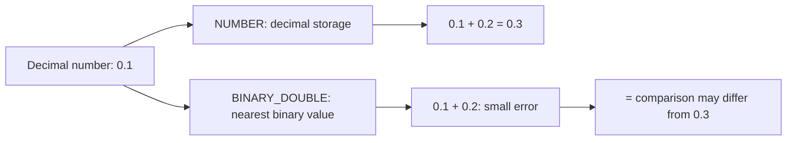
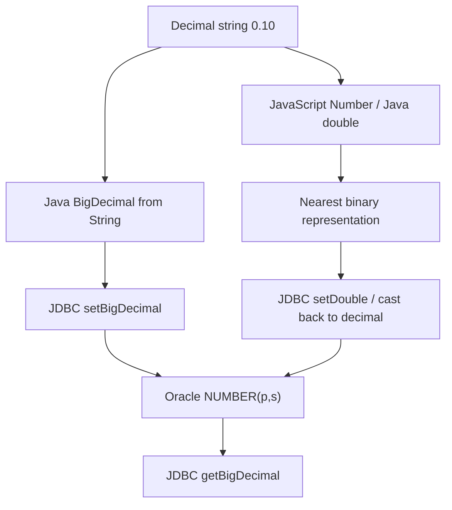

# NUMBER, Precision, Scale, and Errors When Converting to Floating-Point Numbers in Oracle

When designing Oracle tables, choosing a numeric type is not just a decision about maximum magnitude. A currency column must preserve exact decimal places according to business policy; a quantity column needs to prevent fractional values; while sensor measurements may tolerate approximate error. These requirements lead to the distinction between **`NUMBER` with `precision`/`scale`** and binary floating-point types **`BINARY_FLOAT`/`BINARY_DOUBLE`**.

For example, a system stores `0.10` and `0.20` and wants to compute `0.30` accurately. With the decimal `NUMBER` type, these values are represented exactly within the supported range. If converted to binary numbers like `BINARY_DOUBLE` or `double` in Java, neither `0.1` nor `0.2` has a finite binary representation: rounding errors can appear when accumulating, comparing, or converting back to decimal.

After this lesson, you will be able to:

- Explain `NUMBER`, `NUMBER(p)`, and `NUMBER(p,s)`, including negative scales or scales larger than precision.
- Determine when Oracle **rounds** and when a value is rejected for **exceeding precision**.
- Distinguish decimal arithmetic with bounded precision from approximate binary floating-point arithmetic.
- Recognize precision loss when using `CAST`, mixing operands of different types, or passing data through JDBC/Java.
- Choose appropriate types for quantities, money, rates, IDs, and measured values.

## 1. What Is Oracle NUMBER?

`NUMBER` is Oracle's decimal numeric type, stored in a variable-length format (internally encoded in base-100). It is **different** from the IEEE 754 binary floating point of `BINARY_FLOAT` and `BINARY_DOUBLE`. A finite decimal number such as `0.1`, `0.2`, or `123.45` can be represented exactly by `NUMBER` when within the type's precision and range limits.

Oracle guarantees **up to 38 significant digits** for `NUMBER`. The range of absolute values for a nonzero `NUMBER` is very wide, from about `1E-130` up to just under `1E126`. Declaring `NUMBER(p,s)` creates an additional, narrower constraint reflecting the business value domain. Maximum precision of 38 digits **does not mean** every operation is infinitely exact; for instance, `1/3` still must be rounded in a finite decimal representation.

| Declaration | Meaning | Example |
| --- | --- | --- |
| `NUMBER` | No fixed precision/scale declared for the column, though still subject to `NUMBER` limits. | Decimal values requiring flexibility. |
| `NUMBER(p)` | Equivalent to `NUMBER(p,0)`, rounded to the unit. | `NUMBER(10)` for whole-number quantities. |
| `NUMBER(p,s)` | Precision `p` is the declared number of significant digits; scale `s` is the number of digits retained after the decimal point. | `NUMBER(12,2)` for monetary amounts. |
| `NUMBER(p,s)` with `s < 0` | Rounds to tens, hundreds, etc., to the left of the decimal point. | `NUMBER(5,-2)`. |
| `NUMBER(p,s)` with `s > p` | Holds very small numbers close to 0; requires appropriate leading zero positions after the decimal point. | `NUMBER(4,5)`. |

When declaring `NUMBER(p,s)`, the standard declaration ranges are **`p` from 1 to 38** and **`s` from -84 to 127**. Values inserted must still satisfy the overall range of `NUMBER`.

### Precision and scale

**Precision** (`p`) is the maximum declared number of significant digits; **scale** (`s`) is the rounding position:

- `s = 2`: keeps two digits after the decimal point.
- `s = 0`: rounds to an integer.
- `s = -2`: rounds to the nearest hundred.
- `s = 5`: keeps up to five positions after the decimal point, provided the value fits within precision.

With `0 ≤ s ≤ p`, the number of integer digits allowed is `p - s`. For instance, `NUMBER(5,2)` can hold three integer digits and two fractional digits:

```text
NUMBER(5,2)
       | |
       | +-- s = 2: 2 digits after the decimal point
       +---- p = 5: 5 declared digits

123.45   -> fits 5 digits
999.99   -> largest positive value
1000.00  -> 4 integer digits, exceeds limit
```

Precision is a constraint on the **numeric value**, not the character count of a display string. Minus signs, decimal points, and leading zeros are not counted as in a text string. In particular, the value **after rounding to scale** must still fit within precision.

## 2. Examples of Precision, Scale, and Actual Values

| Declaration | Input Value | Expected Result | Reason |
| --- | ---: | ---: | --- |
| `NUMBER(5,2)` | `123.456` | `123.46` | Rounded to two decimal places. |
| `NUMBER(5,2)` | `999.99` | `999.99` | Fits the three-integer-digit limit. |
| `NUMBER(5,2)` | `1000` | Error | Integer part exceeds `p-s = 3`. |
| `NUMBER(5,2)` | `999.995` | Error | Rounds to `1000.00`, exceeding precision. |
| `NUMBER(5,0)` | `123.6` | `124` | Scale 0 rounds to an integer. |
| `NUMBER(5,-2)` | `12345` | `12300` | Rounds to the nearest hundred. |
| `NUMBER(5,-2)` | `12350` | `12400` | At midpoint, rounds up. |
| `NUMBER(4,5)` | `0.01234` | `0.01234` | Scale exceeds precision, but value is small enough. |
| `NUMBER(5,2)` | `0.001` | `0` | Fractional part is too small for the scale. |

Testing with `CAST` (the literals below are `NUMBER`, not yet converted to binary numbers):

```sql
SELECT
    CAST(123.456 AS NUMBER(5,2)) AS rounded_cents,
    CAST(123.6   AS NUMBER(5,0)) AS rounded_integer,
    CAST(12345   AS NUMBER(5,-2)) AS rounded_hundreds,
    CAST(0.01234 AS NUMBER(4,5)) AS small_value
FROM dual;
```

The corresponding results are `123.46`, `124`, `12300`, and `0.01234`. An Oracle client may display `12300` or `12300.0` depending on the tool and formatting. Whether trailing zeros are shown **does not determine** the column's precision/scale.

Inserting `1000` into a `NUMBER(5,2)` column typically results in `ORA-01438` (value larger than specified precision allowed for this column). An invalid `CAST` can return the corresponding cast error code; inspect the actual error in the execution context:

```sql
CREATE TABLE lab_limit_demo (
    id     NUMBER(5,0) PRIMARY KEY,
    amount NUMBER(5,2) NOT NULL
);

INSERT INTO lab_limit_demo (id, amount) VALUES (1, 123.456);
-- Stores 123.46.

-- Standalone error example: this row cannot be inserted.
INSERT INTO lab_limit_demo (id, amount) VALUES (2, 1000);
-- Precision error, typically ORA-01438.

COMMIT;
```

After a failed `INSERT`, other successful DML statements in the same transaction **are not automatically rolled back in full**; the application must choose `COMMIT` or `ROLLBACK` according to business rules. In exercises where you do not want to save changes, you can run `ROLLBACK` instead of `COMMIT`.

### Unconstrained NUMBER Still Has Limits

```sql
CREATE TABLE numeric_precision_demo (
    id            NUMBER(6,0) PRIMARY KEY,
    exact_decimal NUMBER,
    limited_money NUMBER(12,2)
);
```

`EXACT_DECIMAL` has no **declared** precision/scale, yet it still uses Oracle's numeric representation and its guaranteed 38-significant-digit limit. `LIMITED_MONEY` adds rules for value range and fractional rounding. When an operation yields more digits than can be represented, retaining additional digits cannot continue indefinitely.

## 3. ROUND, TRUNC, and Display Formatting

There are three distinct times rounding can occur:

1. **When storing into `NUMBER(p,s)` or using `CAST` to that type:** Oracle applies scale and checks precision.
2. **When calling `ROUND` or `TRUNC` in SQL:** the statement computes a new numeric value; table data only changes if you write the result back.
3. **When using `TO_CHAR` or a UI formatter:** formats only into a **string**, without changing the stored value.

For `NUMBER` operands, `ROUND` rounds at half a unit of the target position **away from 0**, while `TRUNC` discards the remainder:

```sql
SELECT
    ROUND( 2.345, 2) AS round_pos, -- 2.35
    ROUND(-2.345, 2) AS round_neg, -- -2.35
    TRUNC( 2.345, 2) AS trunc_pos, -- 2.34
    TRUNC(-2.345, 2) AS trunc_neg  -- -2.34
FROM dual;
```

With approximate binary operands, the actual value may sit slightly off the decimal position you expect; midpoint behavior must be evaluated according to binary-type semantics.

```sql
SELECT
    CAST(12.3 AS NUMBER(7,2)) AS numeric_value,
    TO_CHAR(
        CAST(12.3 AS NUMBER(7,2)),
        'FM9999990D00',
        'NLS_NUMERIC_CHARACTERS = ''.,'''
    ) AS formatted_value
FROM dual;
```

`NUMERIC_VALUE` is a number, which a client might print as `12.3`. `FORMATTED_VALUE` is the string `12.30`. To display money with two decimal places, format **when producing reports**; do not alter the column type just to print an extra `0` character.

## 4. How NUMBER Differs from BINARY_FLOAT and BINARY_DOUBLE

The decimal number `0.1` is finite in base 10, but has an infinite representation in base 2. IEEE 754 binary floating-point types must store the **nearest binary value** to that number. Therefore, the intended mathematical value and the value stored by the machine can differ slightly.

| Oracle Type | Nature | Approximate or Guaranteed Precision | Best For |
| --- | --- | --- | --- |
| `NUMBER` | Decimal number in Oracle representation | Up to 38 guaranteed significant digits | Money, quantities, decimal math, numeric codes |
| `BINARY_FLOAT` | IEEE 754 binary32 (32-bit) | Roughly 6–7 significant decimal digits | Certain approximate measurement problems |
| `BINARY_DOUBLE` | IEEE 754 binary64 (64-bit) | Roughly 15–16 significant decimal digits | Continuous quantities / scientific computing |

`BINARY_FLOAT`/`BINARY_DOUBLE` also support special values such as NaN and infinity with Oracle's comparison rules; standard `NUMBER` does not carry these special values. Do not assume Java/IEEE NaN comparison rules apply identically to every Oracle expression without checking database semantics.

**Warning about the name `FLOAT`:** in Oracle SQL, `FLOAT(p)` is a **subtype of `NUMBER`** with precision declared in binary bits. It is **not** an alias for IEEE `BINARY_FLOAT`. When you want 32/64-bit binary floating-point types, write `BINARY_FLOAT`/`BINARY_DOUBLE` explicitly.



### Testing Comparisons in Oracle

```sql
-- Numeric literals default to NUMBER.
SELECT CASE
         WHEN 0.1 + 0.2 = 0.3 THEN 'EQUAL'
         ELSE 'DIFFERENT'
       END AS decimal_test
FROM dual;

-- Convert operands to BINARY_DOUBLE before adding.
SELECT CASE
         WHEN CAST(0.1 AS BINARY_DOUBLE)
            + CAST(0.2 AS BINARY_DOUBLE)
              = CAST(0.3 AS BINARY_DOUBLE)
         THEN 'EQUAL'
         ELSE 'DIFFERENT'
       END AS binary_double_test
FROM dual;
```

With decimal, the expected result is `EQUAL`. With binary64, the sum of the two binary values near `0.1` and `0.2` usually differs from the binary64 value near `0.3`, so the result is `DIFFERENT`. A client printing a rounded `0.3` does not prove the two bit patterns are equal.

### Loss of Resolution in Large Integers

Another way to observe the difference without depending on display formatting:

```sql
SELECT
    CASE
      WHEN 10000000000000000 + 1 = 10000000000000000
      THEN 'EQUAL' ELSE 'DIFFERENT'
    END AS number_test,
    CASE
      WHEN CAST(10000000000000000 AS BINARY_DOUBLE)
             + CAST(1 AS BINARY_DOUBLE)
           = CAST(10000000000000000 AS BINARY_DOUBLE)
      THEN 'EQUAL' ELSE 'DIFFERENT'
    END AS binary_double_test
FROM dual;
```

In `NUMBER`, the two integers in the first expression are distinct. In binary64, around `10^16`, the gap between consecutive representable numbers is greater than 1: adding 1 can yield the **exact same binary value**. This bug is dangerous when long identifier numbers are passed through JavaScript `Number` or Java `double`. For example, JavaScript `Number` only guarantees exact integers in the range `-(2^53-1)` to `2^53-1`.

## 5. Where Is Precision Lost During Type Conversions?

Precision loss often occurs **before data is ever inserted into Oracle**. A `NUMBER(18,2)` column cannot "recover" digits already lost through intermediate conversions to binary64.



Stages to watch closely:

- **Data ingestion:** numbers from a form, CSV, or JSON may already have been parsed into `double` by a parser. If the system needs to preserve the exact string entered by the user, parse directly to a decimal type.
- **Computation:** expressions mixing `NUMBER` with `BINARY_FLOAT`/`BINARY_DOUBLE` often convert operands according to **numeric precedence**. For mixed-type numeric operations, the common precedence order is `BINARY_DOUBLE` higher than `BINARY_FLOAT`, higher than `NUMBER`. A single approximate operand can make the entire calculation approximate.
- **Binding:** `PreparedStatement.setDouble` introduces binary floating-point into the pipeline; `setBigDecimal` is appropriate when preserving decimal exactness.
- **Reading back:** reading a `NUMBER` column into a Java `double` for further calculations can introduce new errors even though the data in Oracle is still exact.
- **Display:** formatters can hide errors by printing fewer digits; that is output beautification, not verification that the value is exact.

Conversion example:

```sql
SELECT
    CAST(0.1 AS NUMBER(10,4)) AS exact_decimal,
    CAST(0.1 AS BINARY_DOUBLE) AS approximate_binary
FROM dual;

SELECT
    CAST(123456789.125 AS NUMBER(12,3)) AS exact_number,
    CAST(CAST(123456789.125 AS BINARY_FLOAT)
         AS NUMBER(12,3)) AS after_binary_float
FROM dual;
```

`BINARY_FLOAT` has about seven significant decimal digits, fewer than the digits in `123456789.125`. When casting that value back to `NUMBER(12,3)`, Oracle cannot reconstruct the digits lost during conversion to binary32.

Do not use `CAST(... AS NUMBER)` **after** a series of approximate operations and assume the result has become exact. Changing the target type only changes the representation of the **already computed result**; it does not erase errors from prior calculations.

### Numeric Strings and NLS

With a string `'1,234'`, the comma may be a decimal separator or a thousands separator depending on locale settings. Avoid implicit conversion:

```sql
-- NLS-dependent, not a reliable way to load data:
SELECT '1,234' + 1
FROM dual;
```

Prefer binding **typed** parameters from the application. When parsing a string in SQL is necessary, specify the format and NLS explicitly:

```sql
SELECT TO_NUMBER(
           '1234.56',
           '9999D99',
           'NLS_NUMERIC_CHARACTERS = ''.,'''
       ) AS parsed_number
FROM dual;
```

Parsing from a decimal string can preserve the exact value; converting from a `double` that has already dropped digits cannot recover the lost information.

## 6. Choosing Numeric Types by Business Purpose

| Data | Suggested Declaration | Explanation |
| --- | --- | --- |
| Whole-number quantity | `NUMBER(10,0)` | Scale 0; add `CHECK(quantity >= 0)` to forbid negative numbers. |
| Price/money with two fractional digits | `NUMBER(18,2)` | Rounds to 0.01 on storage; requires business rules. |
| Unit price needing four fractional digits | `NUMBER(18,4)` | Preserves fractional precision before line totals. |
| Rate with six decimal places | `NUMBER(12,6)` | Keeps decimal exactness within the specified range. |
| Approximate measurement | `BINARY_DOUBLE` | Choose when calculations accept binary64 rounding error. |
| Measurement needing compact storage and lower precision | `BINARY_FLOAT` | Choose when ~7 significant digits are sufficient. |
| Numeric identifier | `NUMBER(p,0)` | Must consider passing through Java/JavaScript without losing digits. |
| Code with leading zeros, hyphens, or letters | `VARCHAR2` | Textual code, not a quantity for addition/subtraction. |

These examples are only starting points. Currencies do not always have two decimal places; exchange rates may require larger scale than settlement amounts. A `NUMBER(19,0)` column can hold numbers outside Java's signed `long` range: do not map by habit without determining the true maximum value.

### Rounding Before or After SUM Is a Business Rule

Given invoice lines with quantity and unit price:

```sql
CREATE TABLE invoice_lines (
    line_id    NUMBER(12,0) PRIMARY KEY,
    quantity   NUMBER(10,0) NOT NULL,
    unit_price NUMBER(18,4) NOT NULL,
    CONSTRAINT ck_invoice_quantity CHECK (quantity > 0),
    CONSTRAINT ck_invoice_price CHECK (unit_price >= 0)
);

SELECT ROUND(SUM(quantity * unit_price), 2)
       AS rounded_invoice_total
FROM invoice_lines;
```

Two rounding policies can produce different results:

```sql
SELECT
    ROUND(0.015 + 0.015, 2)            AS round_after_sum,
    ROUND(0.015, 2) + ROUND(0.015, 2) AS sum_rounded_lines
FROM dual;
-- ROUND_AFTER_SUM = 0.03
-- SUM_ROUNDED_LINES = 0.04
```

The different outcomes are **not an Oracle bug**; the first expression rounds the sum, while the second rounds each line. Define clearly when tax, discounts, and totals are rounded, and apply the exact same rule in SQL and the application.

Even decimal types still require rounding when a result has no finite representation:

```sql
SELECT
    ROUND(1 / 3, 2) AS two_decimals,
    ROUND(1 / 3, 6) AS six_decimals
FROM dual;
-- 0.33 and 0.333333
```

## 7. Java and JDBC: Using BigDecimal to Preserve Decimal

Java `double` and `float` are approximate binary numeric types. `BigDecimal` supports arithmetic on decimal numbers with arbitrary precision on the Java side, making it usually the right choice for money or decimal data requiring exact calculation.

### Do Not Construct BigDecimal from an Already Approximate double

```java
import java.math.BigDecimal;

public class DecimalDemo {
    public static void main(String[] args) {
        double binarySum = 0.1d + 0.2d;
        BigDecimal decimalSum = new BigDecimal("0.1")
                .add(new BigDecimal("0.2"));

        System.out.println(binarySum);  // 0.30000000000000004
        System.out.println(decimalSum); // 0.3

        BigDecimal correct = new BigDecimal("0.1");
        BigDecimal fromDouble = new BigDecimal(0.1d);
        System.out.println(correct);    // 0.1
        System.out.println(fromDouble); // long decimal string of the binary value
    }
}
```

`new BigDecimal(0.1d)` receives the exact **binary value** nearest to 0.1 and expresses it as a long decimal string. `new BigDecimal("0.1")` directly reads the decimal representation the user entered. `BigDecimal.valueOf(0.1d)` typically produces `0.1` because it goes through `double`'s canonical string representation, yet it cannot rescue precision already lost by prior binary arithmetic.

### Using PreparedStatement with Decimal Types

```java
import java.math.BigDecimal;
import java.math.RoundingMode;
import java.sql.Connection;
import java.sql.PreparedStatement;
import java.sql.ResultSet;

public class PriceRepository {
    public void savePrice(Connection connection, long id, String rawPrice)
            throws Exception {
        BigDecimal price = new BigDecimal(rawPrice)
                .setScale(2, RoundingMode.HALF_UP);

        try (PreparedStatement st = connection.prepareStatement(
                "UPDATE products SET price = ? WHERE product_id = ?")) {
            st.setBigDecimal(1, price);
            st.setLong(2, id);
            st.executeUpdate();
        }
    }

    public BigDecimal findPrice(Connection connection, long id)
            throws Exception {
        try (PreparedStatement st = connection.prepareStatement(
                "SELECT price FROM products WHERE product_id = ?")) {
            st.setLong(1, id);
            try (ResultSet rs = st.executeQuery()) {
                return rs.next() ? rs.getBigDecimal("price") : null;
            }
        }
    }
}
```

This example assumes the `PRODUCTS` table has a `PRICE NUMBER(...,2)` column and a `PRODUCT_ID` key that fits within Java `long`. `setBigDecimal`/`getBigDecimal` preserves the decimal pipeline; `COMMIT`/`ROLLBACK` transaction boundaries belong to the application layer managing the connection, not the responsibility of this price read/write method.

If you want to **reject** amounts with more than two fractional digits instead of rounding, use `setScale(2, RoundingMode.UNNECESSARY)` and handle the exception. If the business chooses `HALF_EVEN` rather than `HALF_UP`, ensure Java and Oracle rules match wherever calculations and storage occur.

### equals, compareTo, and Division

```java
BigDecimal a = new BigDecimal("1.0");
BigDecimal b = new BigDecimal("1.00");

System.out.println(a.equals(b));         // false: different scale
System.out.println(a.compareTo(b) == 0); // true: same numeric value
```

`BigDecimal.equals` compares scale as well; `compareTo` compares numeric value. For non-terminating division, `BigDecimal` needs an explicit scale/mode or `MathContext`:

```java
import java.math.BigDecimal;
import java.math.RoundingMode;

BigDecimal ratio = BigDecimal.ONE.divide(
        new BigDecimal("3"), 6, RoundingMode.HALF_UP);
System.out.println(ratio); // 0.333333
```

`BigDecimal.ONE.divide(new BigDecimal("3"))` without a rounding context throws `ArithmeticException` because the quotient has infinitely many decimal digits. This is an intermediate precision design issue, not an Oracle bug.

## 8. Oracle Lab: Storing Decimals and Comparing Binary Values

Practice in your own schema with `CREATE TABLE` privileges and quota on a permanent tablespace. DDL issues an **implicit commit**, so create tables before testing transactions.

### Step 1: Create the table

```sql
CREATE TABLE lab_numeric_values (
    sample_id    NUMBER(6,0) PRIMARY KEY,
    quantity     NUMBER(8,0) NOT NULL,
    price        NUMBER(7,2) NOT NULL,
    exact_value  NUMBER,
    approx_value BINARY_DOUBLE,
    CONSTRAINT ck_lab_numeric_qty CHECK (quantity >= 0)
);
```

`PRICE` holds up to five integer digits and two fractional digits. `EXACT_VALUE` stores decimal; `APPROX_VALUE` stores binary64 approximations.

### Step 2: Insert and query back

```sql
INSERT INTO lab_numeric_values (
    sample_id, quantity, price, exact_value, approx_value
) VALUES (
    1, 4, 123.456, 0.1, CAST(0.1 AS BINARY_DOUBLE)
);

INSERT INTO lab_numeric_values (
    sample_id, quantity, price, exact_value, approx_value
) VALUES (
    2, 3, 999.995, 0.2, CAST(0.2 AS BINARY_DOUBLE)
);

COMMIT;

SELECT sample_id, quantity, price, exact_value, approx_value
FROM lab_numeric_values
ORDER BY sample_id;
```

The `PRICE` values for the two rows are `123.46` and `1000.00` respectively; the second row still fits the five-digit integer part of `NUMBER(7,2)`.

### Step 3: Inspect precision/scale metadata

```sql
SELECT column_name, data_type, data_precision, data_scale
FROM user_tab_columns
WHERE table_name = 'LAB_NUMERIC_VALUES'
ORDER BY column_id;
```

For `EXACT_VALUE NUMBER` without p/s specified, precision/scale metadata is typically `NULL`. This means **the schema does not constrain p/s**, not that Oracle allows infinite precision.

### Step 4: Intentionally trigger a precision overflow error

```sql
-- Run separately; this statement is expected to be rejected.
INSERT INTO lab_numeric_values (
    sample_id, quantity, price, exact_value, approx_value
) VALUES (
    3, 1, 100000.00, 1, CAST(1 AS BINARY_DOUBLE)
);
-- NUMBER(7,2) only allows 5 integer digits; 100000.00 has 6.
```

`ORA-01438` typically reports that a value exceeds the column's precision. A failed `INSERT` does not automatically roll back the entire preceding transaction.

### Step 5: Compare decimal and binary sums

```sql
SELECT
    CASE
      WHEN SUM(exact_value) = 0.3 THEN 'EQUAL'
      ELSE 'DIFFERENT'
    END AS exact_sum_test,
    CASE
      WHEN SUM(approx_value) = CAST(0.3 AS BINARY_DOUBLE)
      THEN 'EQUAL'
      ELSE 'DIFFERENT'
    END AS approximate_sum_test
FROM lab_numeric_values
WHERE sample_id IN (1, 2);
```

Even if the client displays concise `0.1`/`0.2`/`0.3` strings, the binary comparison still operates on the actual binary64 values.

### Step 6: Clean up the sample table

```sql
DROP TABLE lab_numeric_values PURGE;
```

Only drop your practice table after finishing the exercise; `DROP TABLE ... PURGE` is DDL and cannot be rolled back like uncommitted DML.

## 9. Comparing Approximate Numbers Using a Tolerance

For `NUMBER` used in IDs, whole-number quantities, or bounded decimals, `=` generally means exact comparison. For `BINARY_FLOAT`/`BINARY_DOUBLE`, `=` compares **binary numeric values per Oracle semantics**, not "approximately equal" within measurement accuracy.

For sensor data, you can combine an absolute tolerance and a relative tolerance:

```sql
-- :target and the tolerances are bound by the application with appropriate types.
SELECT *
FROM sensor_readings
WHERE ABS(measured_value - :target) <=
      :abs_tolerance
      + :rel_tolerance
        * GREATEST(ABS(measured_value), ABS(:target));
```

This assumes `SENSOR_READINGS` has a `MEASURED_VALUE` column containing approximate measurements. Tolerance values must be derived from sensor accuracy, measurement units, and acceptable range. `NULL`, NaN/infinity, and special values must be handled separately based on actual data. **Never use tolerances for identifier keys or monetary settlements**.

A fixed threshold like `1E-9` does not fit all scales: for numbers near 0, an absolute tolerance helps; for numbers with very large magnitudes, a relative tolerance makes more sense. Choosing tolerances is part of the business/metrology specification.

## 10. Common Misconceptions

| Symptom or Claim | Correct Explanation |
| --- | --- |
| "`NUMBER(5,2)` keeps `123.456` as-is because it is still NUMBER." | No; scale 2 rounds it to `123.46`. |
| "`NUMBER(5,2)` accepts `1000` if there is only one decimal point." | No; only three digits are allocated to the integer part. |
| "`NUMBER` without declared p/s has infinite precision." | False; Oracle NUMBER limits still apply, guaranteeing up to 38 significant digits. |
| "Oracle's `FLOAT` is `BINARY_FLOAT`." | False; Oracle `FLOAT` is a subtype of `NUMBER`, not IEEE binary32. |
| "When `BINARY_DOUBLE` displays `0.1`, the exact value is decimal 0.1." | False; a formatter can mask the difference between an approximate binary value and exact decimal. |
| "Casting `BINARY_FLOAT` to `NUMBER` restores the original data." | False; digits lost during conversion to binary32 cannot be recreated automatically. |
| "Money in Oracle is NUMBER so Java `double` is fine." | False when the business requires exact decimal; keep `BigDecimal` end-to-end. |
| "`ROUND(SUM(...))` always equals `SUM(ROUND(...))`." | False; it depends on where rounding is applied. |
| "`12.3` and `12.30` displaying differently means the database stored it wrong." | No; the difference may simply be string formatting. |
| "Any very small number should use `BINARY_DOUBLE`." | No; evaluate significant digits, magnitude, scale, and exact/approximate requirements. |
| "A long ID in NUMBER stays exact when passed through JavaScript Number." | Not guaranteed; integers beyond JS Number's exact range can be rounded. |

## 11. Choosing Types and Calculation Rules in Projects

Before writing `CREATE TABLE`, answer:

1. **Is the value a quantity, identifier, or text code?** Codes with leading zeros or characters that are not quantities for arithmetic should normally use `VARCHAR2`.
2. **Is exact decimal required, or is approximation acceptable?** Money and business quantities usually use `NUMBER(p,s)`; measured quantities may use `BINARY_DOUBLE`.
3. **What are the maximum value and valid fractional digits?** Choose `p,s` from real limits, including cases where rounding adds an extra digit to the integer part.
4. **What are the rounding rules?** Per-line or total rounding, which mode, and at what stage? Align SQL and Java.
5. **What intermediate types does the data pass through?** Avoid passing through `double`, `float`, or JS `Number` when decimal precision or long IDs must be preserved.
6. **How are comparisons performed?** Use exact equality for decimals/IDs; use tolerance only when data and algorithms accept approximate error.

## 12. Self-Check Questions

1. **Can `NUMBER(7,2)` store `12345.67`?** Yes: five integer digits and two fractional digits.
2. **Can `NUMBER(7,2)` store `123456.78`?** No: six integer digits exceed `p-s=5`.
3. **What does `NUMBER(5,-2)` store for `12345`?** `12300`, because it rounds to the nearest hundred.
4. **Is `NUMBER(4,5)` a syntax error because scale is larger than precision?** No. Oracle supports this for very small numbers close to 0.
5. **Why can't `NUMBER` perform `1/3` with infinite exactness?** The quotient has infinitely many decimal digits, exceeding the type's finite precision.
6. **Is `FLOAT(126)` the same as `BINARY_FLOAT`?** No; `FLOAT` is a subtype of `NUMBER` with precision declared in bits.
7. **Why doesn't `CAST` from `BINARY_DOUBLE` to `NUMBER` automatically fix all errors?** The binary value was already rounded earlier; the original information may have been lost.
8. **What Java type should read `PRICE NUMBER(18,2)`?** `BigDecimal`, via `ResultSet.getBigDecimal` or an equivalent mapping.
9. **What is the difference between `new BigDecimal(0.1)` and `new BigDecimal("0.1")`?** The first takes the binary value near 0.1; the second takes the exact decimal string.
10. **When should you compare using a tolerance?** When data represents approximate quantities with a valid error bound; never use it for keys or money.
11. **Does `NUMBER(18,2)` automatically guarantee business-correct tax totals?** No; the schema only constrains stored representation, while calculation and rounding rules must be explicitly specified.

In Oracle, treat **`NUMBER(p,s)` as a contract on the decimal domain and rounding position at storage time**, and **`BINARY_FLOAT`/`BINARY_DOUBLE` as the choice for approximate binary calculations**. For trustworthy results, preserve the right semantics end-to-end: **input string → Java/SQL type → arithmetic → cast/binding → Oracle column → read-back and display**. Do not merely pick the right column type in the table—also avoid silent type conversions that can strip away precision.
