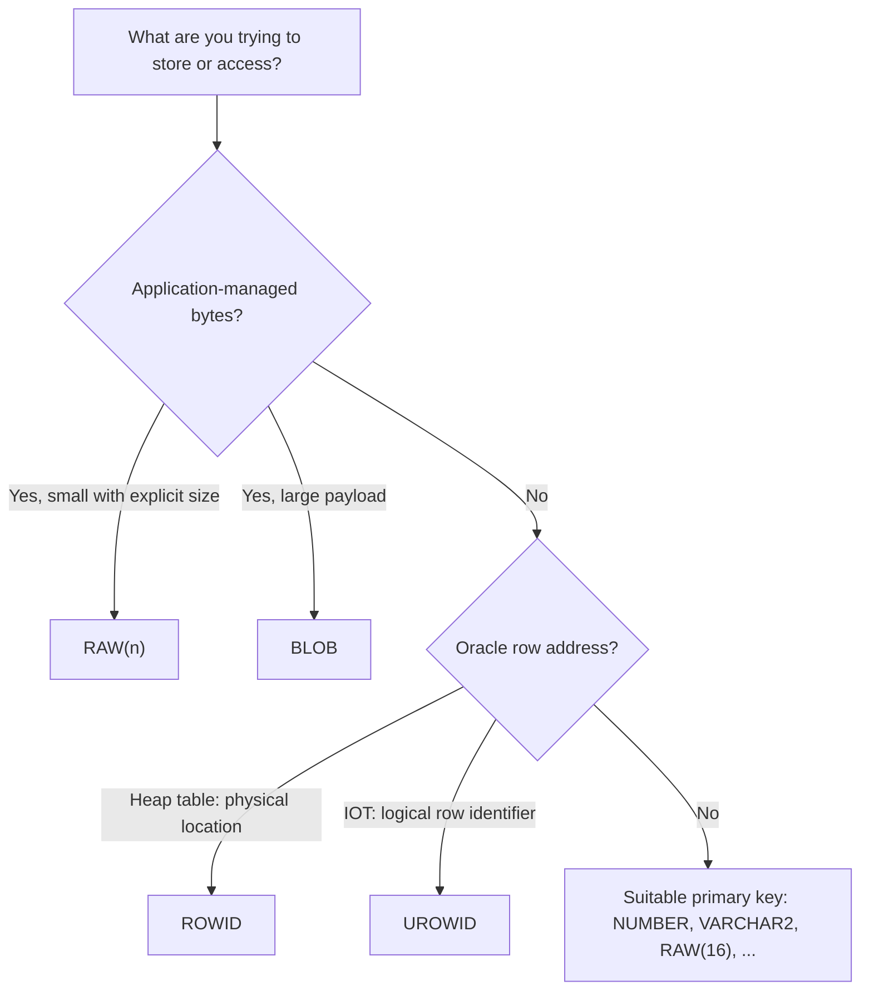
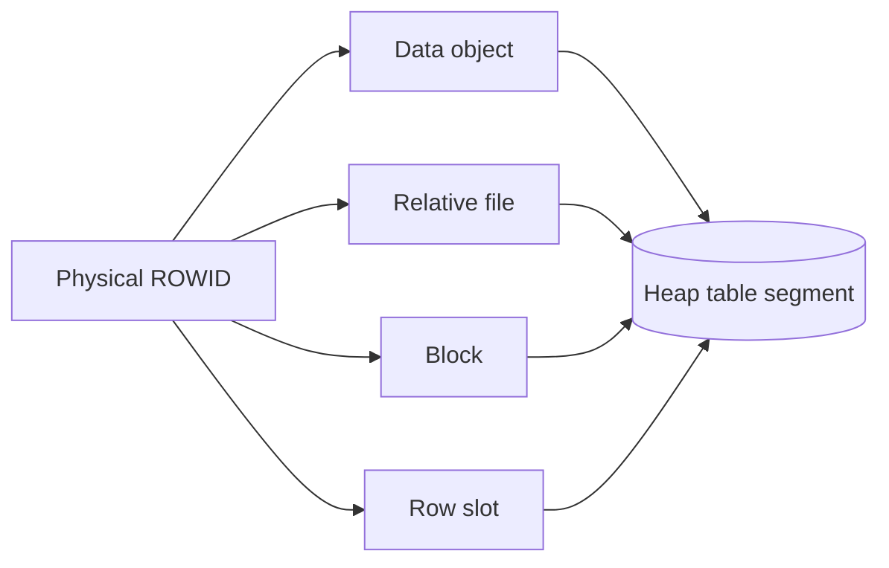
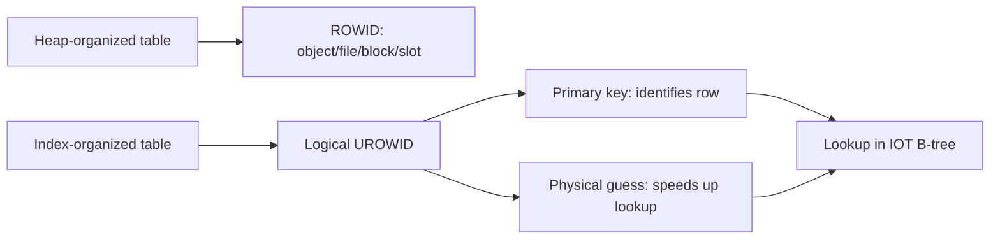

# RAW, ROWID, UROWID, and Proper Usage in Oracle Database

Oracle Database does not only store data in `VARCHAR2`, `NUMBER`, or `TIMESTAMP`. When working with byte-level identifiers, digital signatures, hashes, storage structures, and row-access mechanics, you also encounter three easily confused data types: **`RAW`, `ROWID`, and `UROWID`**. All three can appear as character strings in SQL tools, yet their purposes are completely different:

- **`RAW`** holds *application-defined binary byte sequences*. Oracle does not interpret those bytes as text, numbers, UUIDs, images, or hashes.
- **`ROWID`** represents a *physical row address* used by Oracle for eligible table structures, typically heap-organized tables.
- **`UROWID`** is a *universal rowid* that can represent both physical and logical rowids, especially needed for index-organized tables (IOTs).

Never use `ROWID` or `UROWID` as a substitute for a business primary key, and never assume a `RAW` column is "securely encrypted". This lesson shows how to choose the right type, read values, work with SQL/JDBC, recognize the risks of persisting rowids long-term, and verify everything hands-on in Oracle Database.

## 1. Big Picture: Three Types Answering Three Different Questions

| Design Question | Suitable Type | Typical Example |
|---|---|---|
| "I need to store an exact **16-byte identifier** issued by the app" | `RAW(16)` | Identifier token, UUID/GUID in binary bytes |
| "I need to store an exact **32-byte digest**" | `RAW(32)` | SHA-256 computed by the application |
| "I need to know **where a heap row sits** so Oracle can fetch it fast" | `ROWID` pseudocolumn, `ROWID` value | `SELECT ROWID, ... FROM orders` |
| "I need to represent a **logical IOT rowid**, or mixed rowid forms" | `UROWID` | `ROWID` pseudocolumn returning an IOT logical rowid |
| "I need to store PDFs, large images, or multi-MB binary payloads" | `BLOB` | File attachments |
| "I need a stable key for APIs, foreign keys, and external systems" | Business/surrogate primary key | `NUMBER IDENTITY`, `RAW(16)` holding an app-defined GUID |

A frequent source of confusion is that the *name* `ROWID` refers both to a **data type** and to a **pseudocolumn** available on certain table queries. A pseudocolumn is not a user-declared column in DDL. For an index-organized table, the pseudocolumn of the same name can return a **logical rowid of type `UROWID`**, rather than a standard physical heap row address.



## 2. `RAW`: Storing Short Binary Data Byte-for-Byte

### 2.1. What Does `RAW(n)` Mean?

`RAW` is a variable-length binary data type declared with a maximum byte count:

```sql
CREATE TABLE binary_assets (
    asset_id    RAW(16) DEFAULT SYS_GUID() NOT NULL,
    checksum    RAW(32),
    marker      RAW(4),
    asset_name  VARCHAR2(100 CHAR) NOT NULL,
    CONSTRAINT pk_binary_assets PRIMARY KEY (asset_id)
);
```

Meaning:

- `asset_id RAW(16)` stores up to **16 bytes**. `SYS_GUID()` generates a 16-byte RAW value that can serve as a surrogate identifier.
- `checksum RAW(32)` stores up to **32 bytes**, fitting a binary SHA-256 digest when computed by the application or a controlled component.
- `marker RAW(4)` can store fixed bytes such as protocol codes or magic numbers.
- `asset_name VARCHAR2(100 CHAR)` stores **text** with character-set semantics; that is a different purpose from `RAW`.

Declaring `RAW(16)` sets a **maximum limit**; it does not force every value to be exactly 16 bytes. If business rules require an exact length, enforce it at both database and application layers—for example, with a `CHECK` constraint using `UTL_RAW.LENGTH` or validating the byte array before writing.

In common Oracle configurations with `MAX_STRING_SIZE=STANDARD`, the maximum size of a `RAW` column in SQL is **2,000 bytes**; `MAX_STRING_SIZE=EXTENDED` allows up to **32,767 bytes** depending on version and support conditions. `RAW` in PL/SQL also has its own PL/SQL-specific size limit. Do not assume a schema can create `RAW(32767)` unless the CDB/PDB is configured for extended data types.

If data size can grow to MBs or GBs, `BLOB` is the natural choice; never split a file across multiple `RAW` columns just to bypass limits.

### 2.2. `RAW` Has No Character Encoding

Suppose the two bytes `C3 A9` represent the character "é" in UTF-8. When stored:

```sql
INSERT INTO binary_assets (asset_id, marker, asset_name)
VALUES (SYS_GUID(), HEXTORAW('C3A9'), 'UTF-8 marker example');
```

Oracle stores **the bytes** `C3A9` in `marker`. Oracle does not treat them as the character "é". If the application decodes those bytes as UTF-8, it gets the character back; if it decodes using another encoding, it gets something else. A `RAW` column does not undergo the character-set conversions applied to `VARCHAR2`.

This is useful for data whose bytes must remain untouched across system boundaries—such as hashes, binary-standard identifiers, protocol headers, or payloads already encrypted **by an external mechanism**. However, merely putting text into `RAW` **does not encrypt it**: bytes can still be printed as hex or decoded under the original encoding.

### 2.3. Two Essential Functions: `HEXTORAW` and `RAWTOHEX`

`HEXTORAW` converts a **hexadecimal** string into bytes; two hex characters represent one byte. `RAWTOHEX` converts bytes into a readable hex string:

```sql
SELECT HEXTORAW('00A1FF') AS raw_value,
       RAWTOHEX(HEXTORAW('00A1FF')) AS hex_value
FROM dual;
```

SQL clients typically print hex `00A1FF`. The first value is RAW; the second is a string displaying the bytes in hex. The hex string is twice as long as the byte count—for example, **3 bytes** become **6 hex characters**.

On stored values:

```sql
SELECT RAWTOHEX(asset_id) AS asset_id_hex,
       RAWTOHEX(marker) AS marker_hex,
       UTL_RAW.LENGTH(marker) AS marker_bytes
FROM binary_assets
ORDER BY asset_name;
```

`UTL_RAW.LENGTH` returns the byte length of a RAW value; in many cases, `LENGTHB` is also used to measure byte length under the corresponding type rules. If a value is `NULL`, length functions normally return `NULL`; distinguish `NULL` from empty RAW per Oracle/client representation.

Do not pass an arbitrary string like `'Hello'` to `HEXTORAW`: this is **not** a "text-to-binary" function. Input must be valid hex digits. When input is malformed or has an incompatible length, Oracle raises a conversion or invalid-hex error.

### 2.4. Inserting Data and Comparing Bytes

Example testing exact byte matching:

```sql
INSERT INTO binary_assets (asset_id, checksum, marker, asset_name)
VALUES (
    SYS_GUID(),
    HEXTORAW('000102030405060708090A0B0C0D0E0F101112131415161718191A1B1C1D1E1F'),
    HEXTORAW('DEADBEEF'),
    'Report checksum'
);

COMMIT;

SELECT asset_name,
       RAWTOHEX(marker) AS marker_hex,
       UTL_RAW.LENGTH(checksum) AS checksum_bytes
FROM binary_assets
WHERE marker = HEXTORAW('DEADBEEF');
```

Comparison here is binary value comparison. `'DEADBEEF'` is **8 hex characters** representing **4 bytes** `DE AD BE EF`, not 8 ASCII bytes. Different tools or languages may format those bytes differently on display, yet the underlying binary value stays identical.

### 2.5. `SYS_GUID()` and UUID: Similar, Not Identical Concepts

`SYS_GUID()` returns **16 RAW bytes** and is commonly used to generate unique IDs in Oracle. Standard application UUIDs are also 128 bits and can be stored in `RAW(16)`. However:

- Do not assume every value generated by `SYS_GUID()` is an **RFC 4122 UUID version 4 / specific standard UUID**. If the system requires a specific UUID version, generate and validate it per that standard.
- When formatting UUIDs like `550e8400-e29b-41d4-a716-446655440000`, define explicitly how 36-char UUID strings map to 16 bytes. `RAWTOHEX` produces only **32 contiguous hex characters without hyphens**.
- If multiple applications generate keys, standardize **endianness, byte order, and representation** so the same UUID is never written as two different byte sequences.
- Randomly distributed IDs behave differently from sequential numeric IDs; as primary keys/indexes, evaluate write workload, caching, and index fragmentation on real data.

Example using an agreed binary UUID literal:

```sql
INSERT INTO binary_assets (asset_id, asset_name)
VALUES (
    HEXTORAW('550E8400E29B41D4A716446655440000'),
    'UUID example'
);

SELECT RAWTOHEX(asset_id) AS id_hex, asset_name
FROM binary_assets
WHERE asset_id = HEXTORAW('550E8400E29B41D4A716446655440000');
```

If you ran a prior example and the ID collides with an existing record, the primary key prevents duplicates. That is proper data integrity enforcement, not a `RAW` bug.

## 3. Using `RAW` Properly in Java/JDBC Integration

Oracle JDBC typically maps `RAW` values to **`byte[]`** in Java:

```java
import java.sql.Connection;
import java.sql.PreparedStatement;
import java.sql.ResultSet;
import java.sql.SQLException;

public final class BinaryAssetRepository {
    public static void saveMarker(Connection connection, byte[] id,
                                  byte[] marker, String name)
            throws SQLException {
        String sql =
            "INSERT INTO binary_assets(asset_id, marker, asset_name) " +
            "VALUES (?, ?, ?)";
        try (PreparedStatement ps = connection.prepareStatement(sql)) {
            ps.setBytes(1, id);
            ps.setBytes(2, marker);
            ps.setString(3, name);
            ps.executeUpdate();
        }
    }

    public static byte[] findMarker(Connection connection, byte[] id)
            throws SQLException {
        String sql =
            "SELECT marker FROM binary_assets WHERE asset_id = ?";
        try (PreparedStatement ps = connection.prepareStatement(sql)) {
            ps.setBytes(1, id);
            try (ResultSet rs = ps.executeQuery()) {
                return rs.next() ? rs.getBytes(1) : null;
            }
        }
    }
}
```

In real applications, transactions are coordinated by the service/JDBC framework, and ad-hoc commits inside repository methods should be avoided. For `RAW(16)`, validate that the input array has exactly 16 bytes and use bind parameters (`?`) rather than concatenating user-supplied hex strings into SQL.

### 3.1. Converting `java.util.UUID` to 16 Bytes

If the application uses Java's standard UUID representation, you can pack the 128 bits as two `long`s in big-endian byte order for consistent storage and retrieval:

```java
import java.nio.ByteBuffer;
import java.util.UUID;

public final class UuidBinary {
    public static byte[] toBytes(UUID uuid) {
        return ByteBuffer.allocate(16)
                .putLong(uuid.getMostSignificantBits())
                .putLong(uuid.getLeastSignificantBits())
                .array();
    }

    public static UUID fromBytes(byte[] bytes) {
        if (bytes == null || bytes.length != 16) {
            throw new IllegalArgumentException("UUID needs exactly 16 bytes");
        }
        ByteBuffer buffer = ByteBuffer.wrap(bytes);
        return new UUID(buffer.getLong(), buffer.getLong());
    }
}
```

For example, `UUID.fromString("550e8400-e29b-41d4-a716-446655440000")` converted via `toBytes` yields 16 bytes whose hex is `550E8400E29B41D4A716446655440000`. What matters is **applying the exact same conversion rule on both write and read**. If another system uses a different byte order (e.g., certain external drivers or storage engines), convert according to that system's format contract.

### 3.2. When Should `RAW` NOT Be Used?

| Data | Usually Better Choice | Why |
|---|---|---|
| Full names, emails, small JSON text | `VARCHAR2`, `CLOB`, or version-appropriate JSON type | Requires string semantics, searching/character handling, and charset processing |
| Monetary amounts, quantities | `NUMBER` | Requires numeric arithmetic and range constraints |
| Large binary files | `BLOB` | Exceeds RAW limits; requires LOB/streaming APIs |
| User passwords | Never store raw passwords; use dedicated password hashing | `RAW` does not make passwords secure; password hashes need salts and brute-force-resistant algorithms |
| Stable natural textual IDs | `VARCHAR2` with appropriate constraints | Identifiers with character semantics, such as SKU codes |

Nor does `RAW` provide **encryption**. For sensitive data, design access control, TLS, storage encryption (such as TDE where appropriate), key management, and auditing per security requirements.

## 4. `ROWID`: Physical Row Address in a Heap Table

### 4.1. Where Does the `ROWID` Pseudocolumn Come From?

In a standard **heap-organized table**, Oracle exposes the `ROWID` pseudocolumn representing the row's current physical location. You can select it even though no `rowid` column was declared in `CREATE TABLE`:

```sql
CREATE TABLE rowid_heap_lab (
    item_id NUMBER(10) CONSTRAINT pk_rowid_heap_lab PRIMARY KEY,
    item_name VARCHAR2(80 CHAR) NOT NULL
);

INSERT INTO rowid_heap_lab (item_id, item_name) VALUES (1, 'First');
INSERT INTO rowid_heap_lab (item_id, item_name) VALUES (2, 'Second');
COMMIT;

SELECT item_id,
       item_name,
       ROWID AS physical_rowid,
       ROWIDTOCHAR(ROWID) AS physical_rowid_text
FROM rowid_heap_lab
ORDER BY item_id;
```

`PHYSICAL_ROWID` was never declared in the table, yet Oracle returns its value. The character representation of an **extended physical ROWID** is typically **18 characters** long in Oracle's own encoding; do not mistake it for a UUID or an application-generated random string.

### 4.2. What Components Does a Physical ROWID Describe?

An extended heap-table ROWID contains these logical components:

1. **Data object number** identifying the segment/data object holding the row.
2. **Relative file number** of the datafile within the associated storage structure.
3. **Block number** where the row is placed.
4. **Row slot number** locating the row inside the block.



This is an address **within Oracle's storage structure**, not a TCP address, hostname, or RAM pointer. Oracle uses rowids to fetch rows directly after locating matching rowids in an index.

To inspect these components on rows in the lab table, you can use the `DBMS_ROWID` package when granted execute privilege:

```sql
SELECT item_id,
       DBMS_ROWID.ROWID_OBJECT(ROWID) AS data_object_id,
       DBMS_ROWID.ROWID_RELATIVE_FNO(ROWID) AS relative_file_no,
       DBMS_ROWID.ROWID_BLOCK_NUMBER(ROWID) AS block_no,
       DBMS_ROWID.ROWID_ROW_NUMBER(ROWID) AS row_slot
FROM rowid_heap_lab
ORDER BY item_id;
```

These `DBMS_ROWID` functions decode **physical rowids**. Do not mechanically apply block/file decoding to logical rowids of an IOT.

### 4.3. Querying Directly by ROWID

Oracle can access a row via a valid physical rowid:

```sql
SELECT item_id, item_name
FROM rowid_heap_lab
WHERE ROWID = (
    SELECT ROWID
    FROM rowid_heap_lab
    WHERE item_id = 1
);
```

This example uses a subquery to look up the rowid from the primary key within the same statement, avoiding hardcoded machine-dependent addresses. When a client previously read a rowid as a string, for eligible **physical rowids** it can convert back to rowid type via `CHARTOROWID`:

```sql
-- :rid is a bind variable holding the physical ROWID string from a prior query.
SELECT item_id, item_name
FROM rowid_heap_lab
WHERE ROWID = CHARTOROWID(:rid);
```

From applications, use bind parameters rather than string concatenation in SQL. `:rid` is standard bind notation in Oracle SQL/SQL*Plus; the client must supply its value before execution. In JDBC APIs, placeholders are written `?` and bound through `PreparedStatement`.

**A ROWID value is valid only for the current object and point in time.** If you read a rowid today and put it in a message queue to update next week, the row may have been deleted, moved, or had its slot reused. That is why ROWID must never serve as a system's public ID.

### 4.4. `ROWID` Is Not a Primary Key

Primary keys and ROWIDs serve completely different purposes:

| Criterion | Primary Key | Physical ROWID |
|---|---|---|
| Who defines it? | Chosen and constrained by schema/business rules | Supplied by Oracle based on row location |
| Used in foreign keys? | Yes | Should not be used for relational modeling |
| Stable across move/rebuild/reorganization? | Preserved when data is migrated properly | Can change |
| Good for API URLs and external integrations? | Yes, with proper ID design | No |
| Single-row lookup speed in current state? | Depends on index/plan and schema | Direct access to a valid address |
| Reusable after DELETE/INSERT? | Key values managed by app/constraints | Storage slot can be reused |
| Business meaning? | Yes, or stable technical ID | None |

A record with primary key `item_id=1` keeps `item_id=1` after Oracle moves its segment to another datafile, whereas its physical rowid changes. Conversely, an old rowid may no longer point to that row after table reorganization.

### 4.5. Events That Change or Invalidate ROWID

Cases requiring special care:

- `ALTER TABLE ... MOVE` or segment reorganization/relocation operations can change physical row addresses.
- `SHRINK SPACE`, when table and configuration enable row movement, can relocate rows and alter rowids.
- Moving rows across **partitions** when row movement is enabled can change rowids.
- Export/import, table rebuilds, or certain recovery/conversion tools can create new segments with different row addresses.
- `DELETE` frees the old slot; a newly inserted row can reuse that slot later.
- In row migration/chaining scenarios, the rowid may continue pointing to the row's head piece; do not assume every change in byte storage changes the rowid.

You do not need to memorize every internal storage detail to pick keys. The design rule is simple: **any identifier that must survive infrastructure changes must never use physical ROWID**.

## 5. ROWID in Execution Plans and SQL Processing

ROWID appears constantly in execution plans even when the developer never wrote `ROWID` in the query:

```sql
CREATE INDEX ix_rowid_heap_name
ON rowid_heap_lab (item_name);

EXPLAIN PLAN FOR
SELECT item_id, item_name
FROM rowid_heap_lab
WHERE item_name = 'First';

SELECT * FROM TABLE(DBMS_XPLAN.DISPLAY);
```

On tables of appropriate size and statistics, a plan can show:

```text
INDEX RANGE SCAN
TABLE ACCESS BY INDEX ROWID
```

Meaning:

1. Oracle uses the index to locate matching keys/index entries.
2. A heap table's index entry typically stores the corresponding row's rowid.
3. Oracle uses that rowid to visit the row in the table segment when columns not present in the index are needed.

**Nothing forces the optimizer to pick an index on a few-row demo table.** A full table scan may be cheaper; `EXPLAIN PLAN` shows an estimated plan. Seeing `TABLE ACCESS BY INDEX ROWID` in a plan is not advice to turn rowid into a business ID.

Applications may use ROWID for short-lived internal operations—such as fetching rows within one transaction and processing them with protective predicates. Even then, under concurrency, verify identity and version:

```sql
-- :rid, :item_id, and :old_name are bind variables supplied by the application.
UPDATE rowid_heap_lab
SET item_name = 'Updated'
WHERE ROWID = CHARTOROWID(:rid)
  AND item_id = :item_id
  AND item_name = :old_name;
```

Always check the affected row count. If it is 0, the row changed, was deleted/moved, or the condition no longer holds; handle the conflict instead of silently assuming success. Including `item_id` guards against updating the wrong row if a slot was reused; in production apps, combine with a version column / optimistic locking.

## 6. `UROWID`: Universal Rowid for Physical or Logical Addresses

### 6.1. Why Does Oracle Need Another Kind of ROWID?

Heap tables store rows by block and slot, so a physical ROWID describes a fixed address. In an **index-organized table (IOT)**, however, rows are stored inside a B-tree index structure ordered by primary key. Leaf entries contain the row data, and physical locations can shift as the index reorganizes. Using a fixed block/slot address as row identity is therefore unsuitable.

Oracle provides a **logical rowid** for IOTs. A logical rowid is based on the **primary key value** and may include a physical location hint (*physical guess*) to speed up access. That value has type **`UROWID`**, which can represent broader rowid forms than physical ROWID.



An IOT logical rowid can continue identifying the row when its physical location moves, as long as the underlying primary key remains valid under Oracle's mechanism. Still, **if the primary key changes or the row is deleted**, an old UROWID cannot be treated as a durable business ID. Across distributed systems, reference the primary key itself.

### 6.2. Index-Organized Table Example

Create a small IOT in a lab schema:

```sql
CREATE TABLE catalog_iot (
    catalog_code VARCHAR2(20 CHAR) NOT NULL,
    description  VARCHAR2(100 CHAR),
    CONSTRAINT pk_catalog_iot PRIMARY KEY (catalog_code)
)
ORGANIZATION INDEX;

INSERT INTO catalog_iot (catalog_code, description)
VALUES ('BOOK-001', 'Database fundamentals');

INSERT INTO catalog_iot (catalog_code, description)
VALUES ('BOOK-002', 'Oracle SQL lab');

COMMIT;
```

Query it:

```sql
SELECT catalog_code,
       description,
       ROWID AS logical_rowid
FROM catalog_iot
ORDER BY catalog_code;
```

The pseudocolumn is still named `ROWID`, yet on an IOT it represents a **logical rowid of type UROWID**. Do not assume an 18-character string format like a heap table's extended physical ROWID. Logical rowid length also depends on the IOT's structure and key.

To distinguish heap tables from IOTs in metadata:

```sql
SELECT table_name,
       iot_type
FROM user_tables
WHERE table_name IN ('ROWID_HEAP_LAB', 'CATALOG_IOT')
ORDER BY table_name;
```

For an index-organized table, metadata reflects the corresponding IOT type. That is far better evidence than guessing from table names or whether `SELECT ROWID` executes.

### 6.3. What Is the `UROWID` Column Type For?

Oracle provides the `UROWID` column data type to store either physical or logical rowid values when persisting them is genuinely necessary. Syntax example:

```sql
CREATE TABLE row_locator_cache_lab (
    cache_key NUMBER(10) PRIMARY KEY,
    locator   UROWID(4000)
);
```

`UROWID(n)` takes a size parameter in bytes with the common SQL maximum limit of **4,000 bytes**. Actual stored length depends on the rowid stored; declaring `UROWID(4000)` does not make every value consume 4,000 bytes. Do not treat this column as a business key or standard foreign key simply because it holds a row identifier.

Certain Oracle operations use `UROWID` to hold rowids from tables with varying storage organizations. **Not every object allows querying ROWID freely**: complex views, join views without a key-preserved table, or certain object types have specific restrictions.

### 6.4. UROWID Is Not "A Better ROWID for Every Table"

`UROWID` is designed to **accommodate multiple rowid formats**, especially logical rowids. It does not confer business-ID stability and does not establish relational indexes/constraints between two tables.

For heap tables, `ROWID` fits short-lived physical rowid representation. For IOTs, Oracle manages logical rowids automatically. You never need to convert primary keys from `NUMBER` or `RAW(16)` into `UROWID` when using an IOT.

## 7. Exact Comparison of `RAW`, `ROWID`, and `UROWID`

| Property | `RAW(n)` | `ROWID` | `UROWID(n)` |
|---|---|---|---|
| Data represented | Bytes under application contract | Physical address of an Oracle row | Universal rowid, covering physical or logical forms |
| Who determines value? | Application, DB function, or integration | Oracle based on current storage layout | Oracle issued per rowid kind |
| Display example | `550E8400E29B41D4A716446655440000` | Extended physical ROWID string | Can be a variable-length logical rowid string |
| Usable as app PK? | **Yes**, if bytes are a stable ID with unique/PK constraint | **No** | **No** |
| Storable as a table column? | Yes | Has a `ROWID` column type, though rarely modeled as business data | Yes |
| Selectable via `ROWID` pseudocolumn? | No: RAW is a user-declared data type | Yes on eligible heap tables | Yes as logical rowid on IOTs |
| Depends on physical table layout? | Not directly | Yes | For IOT, logical identity rests on PK; may include physical guess |
| Encoding/format concerns? | Yes at byte ↔ UUID/text boundary | Oracle-specific rowid encoding | Oracle-specific encoding, potentially variable |
| Suitable for large binary files? | No | No | No |
| Typical Java handling | `byte[]`, convertible to `UUID` | `java.sql.RowId` / string form per driver | Driver/Oracle-specific handling depending on logical rowid kind |

Similarities in how SQL tools print them do not give them identical semantics: **`RAWTOHEX` of an ID can represent durable data**, whereas a physical rowid string is only a point-in-time locator representation.

## 8. Handling ROWID/UROWID in Java

For `RAW`, Java should use `byte[]`. For physical ROWID, JDBC provides `java.sql.RowId` and methods like `ResultSet.getRowId` and `PreparedStatement.setRowId` when supported by the driver. Some apps read string representations of ROWID for display or internal tasks, though care is required when converting back from strings, especially for logical UROWIDs.

Example using JDBC to read a heap table's physical rowid within a short transaction:

```java
import java.sql.Connection;
import java.sql.PreparedStatement;
import java.sql.ResultSet;
import java.sql.RowId;
import java.sql.SQLException;

public final class HeapRowLocatorReader {
    public static RowId findRowId(Connection connection, long itemId)
            throws SQLException {
        String sql = "SELECT ROWID FROM rowid_heap_lab WHERE item_id = ?";
        try (PreparedStatement ps = connection.prepareStatement(sql)) {
            ps.setLong(1, itemId);
            try (ResultSet rs = ps.executeQuery()) {
                return rs.next() ? rs.getRowId(1) : null;
            }
        }
    }
}
```

Check your Oracle JDBC driver's API support and `RowId` lifetime rules. A `RowId` obtained in an earlier run is not guaranteed to still point to the same row after another transaction deletes or moves data. For real business updates, querying by primary key combined with proper versioning/locking is far easier to keep correct.

### 8.1. Do Not Expose ROWID in External API Contracts

Suppose a REST API returns:

```json
{
  "orderId": 1001,
  "rowId": "AAAXYZAAEAAAACXAAA"
}
```

The ROWID string in JSON is only a structural example, not a value verified in any live database. Clients should never use `rowId` as the identifier in `PUT /orders/{id}` or store it as a foreign reference in another service. When a table is moved, rebuilt, or imported, locators can change; external synchronization breaks even though order `orderId=1001` still exists.

APIs should expose only stable IDs, for example:

```json
{
  "orderId": 1001,
  "status": "NEW"
}
```

ROWID can help DBA tools, internal queries, or controlled short-lived batch optimizations, but it is never an inter-system data contract.

## 9. Choosing Primary Keys: NUMBER, VARCHAR2, or RAW—Never ROWID

Suppose an order system needs:

- IDs stable across backup/restore/migration.
- An `order_items` table referencing orders via foreign keys.
- Stable API URLs.
- Data movable across tables or partitions.

Design using `NUMBER IDENTITY`:

```sql
CREATE TABLE orders_by_number (
    order_id NUMBER GENERATED BY DEFAULT AS IDENTITY
        CONSTRAINT pk_orders_by_number PRIMARY KEY,
    order_status VARCHAR2(20 CHAR) NOT NULL
);
```

Or using `RAW(16)` when the system uses a 16-byte GUID/UUID contract:

```sql
CREATE TABLE orders_by_guid (
    order_id RAW(16) DEFAULT SYS_GUID() NOT NULL,
    order_status VARCHAR2(20 CHAR) NOT NULL,
    CONSTRAINT pk_orders_by_guid PRIMARY KEY (order_id)
);
```

A child table can reference it with a matching `RAW(16)` foreign key:

```sql
CREATE TABLE order_events (
    event_id NUMBER(10) CONSTRAINT pk_order_events PRIMARY KEY,
    order_id RAW(16) NOT NULL,
    event_name VARCHAR2(80 CHAR) NOT NULL,
    CONSTRAINT fk_order_events_order
        FOREIGN KEY (order_id) REFERENCES orders_by_guid(order_id)
);
```

When `orders_by_guid` is moved/reorganized, the `order_id` key value retains its meaning independent of physical ROWID. Meanwhile, Oracle's internal rowids update to the new locations. That is precisely why primary keys and rowids are two distinct architectural concepts.

### 9.1. When Can a Locator Be Cached?

In a tightly controlled operational tool, caching a rowid can speed up a short-lived task. To mitigate risk:

1. Store it alongside the row's **real ID**.
2. Use the cache only within a bounded window and transaction scope.
3. On lookup, re-verify the ID and row condition/version.
4. Expect cache invalidation after move, import, truncate, partition maintenance, or data relocation.
5. Maintain a fallback path querying by primary key and refreshing the locator.

Without a measured performance requirement, **do not add columns storing ROWID/UROWID**. They create derived data that is hard to maintain and never replace a primary key.

## 10. Common Errors and How to Diagnose Them

| Symptom / Error | Possible Cause | Resolution |
|---|---|---|
| Invalid `HEXTORAW` value | Input string is not valid hex format | Verify characters `0–9, A–F` and representation length |
| Value too large for `RAW(n)` | Byte sequence exceeds column limit, or wrong driver bind | Check actual byte count, DDL, and bound data type |
| `RAWTOHEX` returns 32 chars while app expects 36-char UUID | `RAWTOHEX` produces contiguous hex without hyphens | Format UUID representation in the application layer per contract |
| Java reads bytes yet GUID prints "reversed" | Layers use different byte-order conventions | Standardize 16-byte ↔ UUID mapping and verify with fixed test vectors |
| `ORA-01410: invalid ROWID` | Passed ROWID is invalid in context or locator is stale | Never edit rowid strings manually; re-fetch via primary key |
| Query by rowid returns 0 rows | Row deleted/moved, stale rowid, or other predicate failed | Re-query by stable key and handle conflict |
| Query by stale rowid hits an unintended row | Slot was reused after data changes | Never use rowid as sole update key; verify PK and version |
| `ROWIDTOCHAR` does not behave as expected for logical rowid | Confusing physical ROWID with IOT UROWID | Check table organization, data type, and use compatible API/representation |
| Selecting `ROWID` from join/complex view rejected, e.g. `ORA-01445`/`ORA-01446` | Oracle cannot determine a valid rowid for the view as queried | Select rowid directly from an eligible base table or use primary key |
| `USER_TAB_COLUMNS` has no `ROWID` column | ROWID is a pseudocolumn, not a heap-table DDL column | Query `SELECT ROWID FROM table` where supported |
| Query still slow despite `ROWID` filter | Bottleneck is locks, I/O, uncached blocks, or another operation | Inspect execution plan, wait events, and transactions |

Error codes and symptoms must be interpreted alongside the SQL statement, table type, session privileges, object state, and Oracle version. If `CHARTOROWID` receives a string that looks like a rowid but is an IOT logical UROWID, do not force physical rowid parsing rules onto it; use the corresponding API/type.

### 10.1. Key Misconceptions to Avoid

**"RAW is a hex string."** Inaccurate. RAW is bytes; hex strings are merely one way to display those bytes to humans.

**"Using SYS_GUID in RAW guarantees UUID v4."** Cannot be assumed. `SYS_GUID` produces a 16-byte RAW identifier; specific UUID version/variant requirements must be controlled separately.

**"ROWID is Oracle's built-in primary key."** False in relational modeling. ROWID is a storage-dependent locator with a storage-tied lifecycle.

**"IOTs have no ROWID, so SELECT ROWID must fail."** IOTs can expose a **logical rowid of type UROWID** via the `ROWID` pseudocolumn.

**"UROWID never changes."** Do not promise that. Logical rowids depend on the primary key and table organization; never substitute them for application-managed stable keys.

**"Knowing ROWID always makes a query fastest."** False. Real cost depends on the query, indexes, I/O, caching, transactions, and row counts. The optimizer may pick another better access path.

**"RAW protects confidential data."** False. Anyone with read privilege on the column can inspect the hex string or raw bytes; security relies on encryption, access control, and key management.

## 11. Hands-On Lab: From RAW to Physical and Logical Rowids

Practice in your own schema inside a lab PDB with `CREATE TABLE` privilege and quota on an appropriate tablespace. Never use production tables to test `MOVE`, `TRUNCATE`, or reorganization operations.

### Exercise 1 — Inspect RAW Bytes

```sql
SELECT RAWTOHEX(HEXTORAW('00112233445566778899AABBCCDDEEFF')) AS hex_value,
       UTL_RAW.LENGTH(HEXTORAW('00112233445566778899AABBCCDDEEFF')) AS byte_count
FROM dual;
```

Explain why the displayed string has **32 hex characters** yet represents **16 bytes**. Compare `HEXTORAW('AA')` and `HEXTORAW('aa')` to verify that upper/lower case in hex notation does not alter byte values.

### Exercise 2 — Create a Binary Primary Key

Create `binary_assets` from Section 2, insert one row using `SYS_GUID()` and one row using `HEXTORAW`. Use `RAWTOHEX(asset_id)` to display them, try inserting the same `asset_id` twice, and explain the unique/primary key error. Answer: is ID stability guaranteed by the **column's bytes** and constraint, or by physical rowid?

### Exercise 3 — Observe Heap Table ROWID

Create `rowid_heap_lab` from Section 4:

```sql
SELECT item_id,
       ROWID,
       ROWIDTOCHAR(ROWID) AS rid_text
FROM rowid_heap_lab
ORDER BY item_id;
```

Record the actual rowids and use `DBMS_ROWID` if authorized to inspect object/file/block/slot. Do not conclude from two rowids sharing a prefix that they always sit adjacent in every table organization.

### Exercise 4 — Observe Index-Organized Table ROWID

Create `catalog_iot` from Section 6 and run:

```sql
SELECT catalog_code, ROWID AS iot_rowid
FROM catalog_iot
ORDER BY catalog_code;

SELECT table_name, iot_type
FROM user_tables
WHERE table_name IN ('ROWID_HEAP_LAB', 'CATALOG_IOT');
```

Compare the returned values without attempting to extract file/block/slot from a logical UROWID using physical-rowid functions. Explain why the primary key is essential to an IOT's index organization.

### Exercise 5 — Plan for Row Movement Impact

Suppose an application stored a physical ROWID in a queue and replayed it after an import or `ALTER TABLE ... MOVE`. Redesign the workflow around `item_id`:

```sql
SELECT item_id, item_name
FROM rowid_heap_lab
WHERE item_id = :item_id;
```

If protection against lost updates from concurrent requests is needed, add a `version_no` column and update conditionally on version. Consider rowid as a short-lived internal optimization only when backed by benchmarks and strict locator lifecycle control.

### Exercise 6 — Java Round-Trip for RAW(16)

Create a `UUID` in Java, convert it to `byte[16]` using `UuidBinary.toBytes`, bind it with `setBytes` into a `RAW(16)` column, and read it back with `getBytes`. Use `UuidBinary.fromBytes` to confirm the before/after UUIDs match. Compare against `RAWTOHEX` in Oracle and document the application's byte-order rule.

### Lab Submission Checklist

Deliverables should include:

| Evidence | What It Proves |
|---|---|
| `RAW(16)` DDL, hex data, and `UTL_RAW.LENGTH` | Bytes are the real data; hex is only a representation |
| Table with `RAW(16)` or `NUMBER` PK | Durable key independent of ROWID |
| `SELECT ROWID` on a heap table | Oracle provides a physical locator |
| `SELECT ROWID` on an IOT | Oracle provides a logical UROWID |
| `USER_TABLES.IOT_TYPE` output | Distinguishes physical table organization |
| Scenario using primary key instead of persisting ROWID | Handles row movement or slot reuse safely |
| Java `byte[]` ↔ UUID | Clear, consistent binary conversion contract |

## 12. Self-Check Questions

1. Does `RAW(16)` store at most 16 **bytes** or 16 **hex characters**? How many characters long is `RAWTOHEX` for a full 16 bytes?
2. Does `HEXTORAW('48656C6C6F')` declare itself to be UTF-8 text `"Hello"`? Who is responsible for choosing encoding?
3. What type does `SYS_GUID()` return, and why should you not automatically claim it is UUID v4?
4. Why can a SHA-256 hash column use `RAW(32)` while large image files should use `BLOB`?
5. Does a heap table have to declare a `ROWID` column in order to query `ROWID`, or does Oracle provide it as a pseudocolumn?
6. Which components of a row does a physical ROWID describe?
7. Why can `ALTER TABLE ... MOVE` or storage reorganization invalidate previously recorded locators?
8. In an execution plan, what does `TABLE ACCESS BY INDEX ROWID` tell you about how the optimizer uses rowid?
9. Why does an IOT need a logical rowid, and how does logical UROWID relate to the primary key?
10. Is `UROWID` an ideal replacement primary key for every table?
11. Why should an update with `WHERE ROWID=...` also check the primary key and a condition/version under concurrency?
12. When passing `RAW(16)` between Java and Oracle, why must byte order and UUID format be standardized?

**Key selection principle:** if you need to store **bytes whose meaning is defined by the application**, consider `RAW`; if you are analyzing **heap row locations** and how Oracle executes SQL, understand `ROWID`; if you work with **IOT logical rowids**, understand `UROWID`. For table relationships, foreign keys, APIs, and long-term integration, always use a **stable primary key** and let Oracle manage physical locators underneath.
