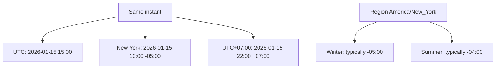
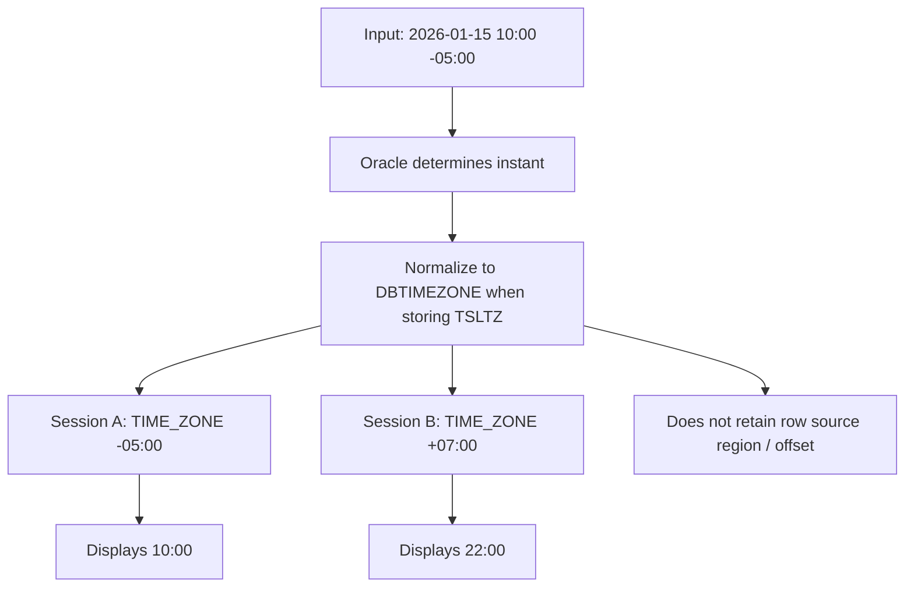

# TIMESTAMP WITH TIME ZONE and TIMESTAMP WITH LOCAL TIME ZONE in Oracle

An application with users across multiple countries must handle at least two distinct time concepts: **the actual point in time when an event occurred** (*instant*) and **the date and time shown on a wall clock in a specific time zone** (*local civil time*). Two people in Hanoi and New York may see different clock times while observing the exact same instant. Conversely, "09:00 AM Monday in New York" is a local calendar rule; if converted into a single fixed offset for the entire year, daylight saving time (DST) can shift appointments by an hour.

Oracle Database provides two frequently confused data types:

- **`TIMESTAMP WITH TIME ZONE` (TSTZ)**: stores a timestamp together with time zone/offset metadata attached to the value, allowing interpretation of the instant and presentation in the supplied region or offset.
- **`TIMESTAMP WITH LOCAL TIME ZONE` (TSLTZ)**: normalizes the value on storage using the **database time zone**, then **converts it to the session time zone on retrieval**; it does not retain the original source time zone per row.

This lesson explains the differences between the two types in depth within Oracle's **Date/Time and NLS** context: constructing values, displaying them, converting time zones, session effects, DST boundaries, storage and querying patterns, and Java/JDBC considerations. Examples use Oracle SQL/SQL*Plus syntax; if your environment uses SQL Developer, run DDL/DML in a worksheet and run session configuration statements on the exact target connection.

## 1. Distinguishing instants, local times, offsets, and time zone regions

To understand both data types, separate four concepts:

| Concept | Meaning | Example |
| --- | --- | --- |
| **Instant** | A unique point on the timeline | `2026-01-15 15:00:00 UTC` |
| **Local date-time** | Wall-clock date and time, **without** specifying which time zone it belongs to | `2026-01-15 10:00:00` |
| **UTC offset** | Fixed offset from UTC at a specific moment | `-05:00` or `+07:00` |
| **Time zone region** | Region name carrying historical/current offset rules and potentially DST | `America/New_York`, `Europe/Paris` |

For example, on January 15, 2026, `10:00 -05:00` in New York corresponds to `15:00 +00:00` UTC. In summer, New York typically switches to `-04:00`; therefore, **`-05:00` is not long-term equivalent to `America/New_York`**. An offset gives the UTC difference for one specific value; a region enables applying time zone rules by calendar date.



Two different local time strings can represent **the same instant** when their offsets differ. Yet a string containing only `2026-01-15 10:00` **lacks enough information** to determine which instant it represents.

## 2. Comparing Oracle's datetime data types

Oracle provides multiple datetime types; choose based on what information must be preserved:

| Type | Fractional seconds? | Time zone stored in value? | Characteristic behavior |
| --- | --- | --- | --- |
| `DATE` | No; precision to the second | No | Stores year, month, day, hour, minute, second; does not mean "date only." |
| `TIMESTAMP(p)` | Yes; `p` is fractional-seconds precision | No | Stores wall-clock time without specifying offset or region. |
| `TIMESTAMP(p) WITH TIME ZONE` | Yes | **Yes**, offset or region metadata | Value carries the supplied time zone context and can be converted to other zones. |
| `TIMESTAMP(p) WITH LOCAL TIME ZONE` | Yes | **Does not store source region/offset per row** | Normalized on write, presented in session time zone on read. |

For `TIMESTAMP(p)` and both time-zone variants, `p` is the number of fractional second digits from **0 to 9**, defaulting typically to **6**. For instance, `TIMESTAMP(3)` retains milliseconds; `TIMESTAMP(6)` retains microseconds. **Fractional-second precision** and **time zone accuracy** are orthogonal concerns: keeping 6 fractional digits does not turn a fixed offset into a DST-aware region.

Example table columns:

```sql
CREATE TABLE lab_event_types (
    event_id      NUMBER(10) PRIMARY KEY,
    local_time    TIMESTAMP(3),
    zoned_time    TIMESTAMP(3) WITH TIME ZONE,
    session_time  TIMESTAMP(3) WITH LOCAL TIME ZONE
);
```

Here, all three values can coexist in one row yet carry different semantics: `LOCAL_TIME` has no zone; `ZONED_TIME` carries its own time zone; `SESSION_TIME` is converted by Oracle on write/read according to database/session context.

## 3. TIMESTAMP WITH TIME ZONE: what it stores and when to use it

**`TIMESTAMP WITH TIME ZONE`** combines date/time, fractional seconds, and **time zone metadata**. Values can be created from an **offset** such as `+07:00` or from a **region** such as `America/New_York`. Oracle uses the time zone information to determine the instant; when queried, the value still carries time zone context in its type.

Two values can refer to the same instant:

```text
2026-01-15 10:00:00 -05:00
2026-01-15 15:00:00 +00:00
2026-01-15 22:00:00 +07:00
```

In temporal comparisons, Oracle resolves to the corresponding point in time to test equality of instants. However, **the original presentation** and **the region/offset used to interpret the time** carry distinct business meaning, so two rows representing the same instant may format differently.

### Creating values with an offset using TO_TIMESTAMP_TZ

```sql
SELECT TO_TIMESTAMP_TZ(
           '2026-01-15 10:00:00.125 -05:00',
           'YYYY-MM-DD HH24:MI:SS.FF3 TZH:TZM'
       ) AS new_york_offset,
       TO_TIMESTAMP_TZ(
           '2026-01-15 22:00:00.125 +07:00',
           'YYYY-MM-DD HH24:MI:SS.FF3 TZH:TZM'
       ) AS utc_plus_seven
FROM dual;
```

`TO_TIMESTAMP_TZ` returns a `TIMESTAMP WITH TIME ZONE` value. `TZH:TZM` denotes the offset; `FF3` denotes three fractional digits. In this example, both times correspond to **15:00:00.125 UTC**.

### Creating values with a region using FROM_TZ

`FROM_TZ` takes a **zone-less `TIMESTAMP`** and attaches a time zone:

```sql
SELECT FROM_TZ(
           TIMESTAMP '2026-01-15 10:00:00',
           'America/New_York'
       ) AS ny_winter,
       FROM_TZ(
           TIMESTAMP '2026-07-15 10:00:00',
           'America/New_York'
       ) AS ny_summer
FROM dual;
```

When Oracle's time zone file defines this region and its DST rules, the January date gets the winter offset `-05:00` while the July date gets `-04:00`. A region lets Oracle determine **the offset appropriate for that specific date**, whereas a fixed `-05:00` offset never adapts seasonally.

**`FROM_TZ` does not guess which time zone "10:00" belongs to**: the second argument must state the exact offset or region per business requirements. When accepting user input, never use the application server's time zone as the user's zone unless the user actually operates in that zone.

### When is TSTZ the right choice?

- Event logs requiring both the instant and the original time zone/offset attached to the data.
- Transactions recording timestamps sent by systems in diverse time zones where timestamp context must be retained.
- Appointments tied to a time zone region that must be re-evaluated under that region's rules.
- Integration data where distinguishing `10:00 -05:00` from `10:00 -04:00` matters.

If business contracts require preserving **the exact source zone string, physical location, raw input formatting, or future recurrence rules**, consider storing extra metadata in separate columns. `TIMESTAMP WITH TIME ZONE` retains the value's time zone info, but does not automatically record user location, verbatim input strings, or the time zone rule version active at insert time.

## 4. TIMESTAMP WITH LOCAL TIME ZONE: normalizing and presenting per session

**`TIMESTAMP WITH LOCAL TIME ZONE` (TSLTZ)** behaves differently from TSTZ:

1. On insert, Oracle determines the instant using the input's time zone. If the input **has no time zone**, Oracle interprets it in the **session time zone**.
2. Oracle **normalizes the value** to the **database time zone** for storage; the source time zone/region is not retained per row.
3. On `SELECT`, Oracle **converts the value to the session time zone** of the reading connection.

Consequently, **the exact same TSLTZ row** can appear as `10:00` on a New York connection and `22:00` on a `+07:00` connection, while still representing **the same instant**.



Watch out for three easily confused points:

- **`DBTIMEZONE`** is the time zone Oracle uses to normalize TSLTZ storage; it is **not the default** time every user sees.
- **`SESSIONTIMEZONE`** directly affects how TSLTZ is displayed and how zone-less inputs are interpreted on insert.
- **The source time zone** cannot be reliably recovered from TSLTZ. Even knowing the instant and current session time zone, you cannot tell which region the original writer was in.

### Example: one row, two ways of displaying

Create the table in a practice schema:

```sql
CREATE TABLE lab_tz_events (
    event_id    NUMBER(10) PRIMARY KEY,
    event_name  VARCHAR2(80 CHAR) NOT NULL,
    event_tstz  TIMESTAMP(3) WITH TIME ZONE,
    event_ltz   TIMESTAMP(3) WITH LOCAL TIME ZONE
);
```

Insert **the exact same explicit-offset TSTZ value** into both columns:

```sql
INSERT INTO lab_tz_events (
    event_id, event_name, event_tstz, event_ltz
) VALUES (
    1,
    'System event',
    TO_TIMESTAMP_TZ(
        '2026-01-15 10:00:00.125 -05:00',
        'YYYY-MM-DD HH24:MI:SS.FF3 TZH:TZM'
    ),
    TO_TIMESTAMP_TZ(
        '2026-01-15 10:00:00.125 -05:00',
        'YYYY-MM-DD HH24:MI:SS.FF3 TZH:TZM'
    )
);

COMMIT;
```

In the first connection state:

```sql
ALTER SESSION SET TIME_ZONE = '-05:00';

SELECT SESSIONTIMEZONE AS session_zone,
       TO_CHAR(
           event_tstz,
           'YYYY-MM-DD HH24:MI:SS.FF3 TZH:TZM'
       ) AS tstz_text,
       TO_CHAR(
           event_ltz,
           'YYYY-MM-DD HH24:MI:SS.FF3 TZH:TZM'
       ) AS ltz_text
FROM lab_tz_events
WHERE event_id = 1;
```

With the session offset at `-05:00`, both columns render the instant as **10:00:00.125 -05:00**. Switch the time zone of **the same session**:

```sql
ALTER SESSION SET TIME_ZONE = '+07:00';

SELECT SESSIONTIMEZONE AS session_zone,
       TO_CHAR(
           event_tstz,
           'YYYY-MM-DD HH24:MI:SS.FF3 TZH:TZM'
       ) AS tstz_text,
       TO_CHAR(
           event_ltz,
           'YYYY-MM-DD HH24:MI:SS.FF3 TZH:TZM'
       ) AS ltz_text
FROM lab_tz_events
WHERE event_id = 1;
```

| Session time zone | `EVENT_TSTZ` with stored offset | `EVENT_LTZ` displayed in session |
| --- | --- | --- |
| `-05:00` | `2026-01-15 10:00:00.125 -05:00` | `2026-01-15 10:00:00.125 -05:00` |
| `+07:00` | `2026-01-15 10:00:00.125 -05:00` | `2026-01-15 22:00:00.125 +07:00` |

This is the core difference: **a TSTZ value is read with its own stored time zone**, whereas **TSLTZ is reconstructed in the reading session's time zone**. Running `ALTER SESSION SET TIME_ZONE` does not update either column; it changes how values are read and how zone-less inputs are interpreted.

### When should you choose TSLTZ?

TSLTZ is convenient when business logic primarily cares about **the instant**, and each reader wants to see times automatically in their own session's time zone: system activity, login times, update timestamps, or events shown to global users.

Conversely, if you must prove **which time zone the user supplied**, or reproduce times in the **event's original region**, TSLTZ alone is insufficient. You can store an extra `event_zone VARCHAR2(64)` column holding a validated region name and use the instant for ordering.

## 5. DBTIMEZONE, SESSIONTIMEZONE, and time functions

Oracle has several "current time" functions, but they return **different data types and time zones**:

| Function/expression | Type or primary property | Time zone used for interpretation |
| --- | --- | --- |
| `SYSTIMESTAMP` | `TIMESTAMP WITH TIME ZONE` from database host | Time zone of the system running the database. |
| `CURRENT_TIMESTAMP` | `TIMESTAMP WITH TIME ZONE` | **Session time zone**. |
| `LOCALTIMESTAMP` | `TIMESTAMP`, **without time zone** | Current date/time value in the session time zone. |
| `SYSDATE` | `DATE`, second precision | Database system clock; carries no time zone in value. |
| `CURRENT_DATE` | `DATE` | Date/time in the session time zone, carrying no time zone in value. |
| `DBTIMEZONE` | String indicating database time zone | Used for TSLTZ normalization mechanics. |
| `SESSIONTIMEZONE` | String indicating session time zone | Affects TSLTZ display and current/local functions. |

Observation query:

```sql
SELECT DBTIMEZONE       AS database_zone,
       SESSIONTIMEZONE  AS session_zone,
       SYSTIMESTAMP     AS system_timestamp,
       CURRENT_TIMESTAMP AS current_timestamp_value,
       LOCALTIMESTAMP   AS local_timestamp_value,
       SYSDATE          AS system_date,
       CURRENT_DATE     AS current_date_value
FROM dual;
```

Test changing the session time zone and querying again:

```sql
ALTER SESSION SET TIME_ZONE = '+07:00';

SELECT DBTIMEZONE, SESSIONTIMEZONE,
       CURRENT_TIMESTAMP, LOCALTIMESTAMP
FROM dual;

ALTER SESSION SET TIME_ZONE = '-05:00';

SELECT DBTIMEZONE, SESSIONTIMEZONE,
       CURRENT_TIMESTAMP, LOCALTIMESTAMP
FROM dual;
```

`CURRENT_TIMESTAMP` carries the session's time zone. `LOCALTIMESTAMP` changes its wall-clock value **but returns a zone-less TIMESTAMP**; if assigned to a TSLTZ column, Oracle interprets that local time using the session's time zone at insert time.

### Do not treat DBTIMEZONE as "the user's time zone"

`DBTIMEZONE` may be UTC or an offset/region per configuration. It does not identify a client's local time. If a customer selects `America/New_York`, persist/apply that time zone per application requirements instead of relying on `DBTIMEZONE` or the backend host's time zone.

**Changing the database time zone** is nothing like `ALTER SESSION SET TIME_ZONE`. It is a conditional administrative operation that Oracle can reject when the database already contains `TIMESTAMP WITH LOCAL TIME ZONE` columns; even a valid change may require a restart and a proper migration plan. Never alter `DBTIMEZONE` mid-lab just to make two display values differ: change `SESSIONTIMEZONE` instead.

## 6. Converting time zones with AT TIME ZONE, AT LOCAL, and SYS_EXTRACT_UTC

Rather than manually adding or subtracting hours, Oracle provides syntax to **convert the same instant to a target time zone**:

```sql
SELECT TO_CHAR(
           FROM_TZ(
               TIMESTAMP '2026-01-15 10:00:00',
               'America/New_York'
           ) AT TIME ZONE '+07:00',
           'YYYY-MM-DD HH24:MI:SS TZH:TZM'
       ) AS utc_plus_seven_text
FROM dual;
```

On January 15, 2026, 10:00 in New York under winter rules corresponds to 22:00 at UTC+07:00. `AT TIME ZONE` transforms **the representation of the instant**, without creating a new event.

Example viewing times in both UTC and New York:

```sql
SELECT TO_CHAR(
           FROM_TZ(
               TIMESTAMP '2026-07-15 14:30:00',
               '+00:00'
           ) AT TIME ZONE 'America/New_York',
           'YYYY-MM-DD HH24:MI:SS TZH:TZM'
       ) AS ny_summer_time,
       TO_CHAR(
           FROM_TZ(
               TIMESTAMP '2026-01-15 14:30:00',
               '+00:00'
           ) AT TIME ZONE 'America/New_York',
           'YYYY-MM-DD HH24:MI:SS TZH:TZM'
       ) AS ny_winter_time
FROM dual;
```

In summer, 14:30 UTC maps to 10:30 New York when the offset is `-04:00`; in winter, 14:30 UTC maps to 09:30 when the offset is `-05:00`. That is why converting by **region** beats subtracting a hardcoded 5 hours year-round.

`AT LOCAL` also renders a TSTZ value in the **session time zone**:

```sql
ALTER SESSION SET TIME_ZONE = '+07:00';

SELECT FROM_TZ(
           TIMESTAMP '2026-01-15 10:00:00',
           '-05:00'
       ) AT LOCAL AS value_in_session_zone
FROM dual;
```

To extract a **UTC timestamp** from TSTZ, use `SYS_EXTRACT_UTC`:

```sql
SELECT SYS_EXTRACT_UTC(
           TO_TIMESTAMP_TZ(
               '2026-01-15 10:00:00 -05:00',
               'YYYY-MM-DD HH24:MI:SS TZH:TZM'
           )
       ) AS utc_timestamp
FROM dual;
-- Corresponding UTC date and time: 2026-01-15 15:00:00.
```

**Return-type note:** `SYS_EXTRACT_UTC` returns a **zone-less `TIMESTAMP`**, though its date/time value is computed in UTC. If an API needs an explicitly zoned instant type, maintain the matching type contract; never assume any arbitrary `TIMESTAMP` column is UTC.

### Formatting TZH/TZM, TZR, and TZD

| Format element | Meaning |
| --- | --- |
| `TZH` | Signed hour component of the time zone offset. |
| `TZM` | Minute component of the offset. |
| `TZR` | Time zone region name or applicable time zone representation. |
| `TZD` | Abbreviated DST/standard indicator when applicable, such as daylight/standard abbreviation. |
| `FF3`, `FF6` | Number of fractional second digits when formatting TIMESTAMP. |

Example:

```sql
SELECT TO_CHAR(
           FROM_TZ(
               TIMESTAMP '2026-07-15 10:00:00',
               'America/New_York'
           ),
           'YYYY-MM-DD HH24:MI:SS TZR TZD TZH:TZM'
       ) AS region_information
FROM dual;
```

For a value constructed from a fixed **offset**, `TZR` will not turn into `America/New_York`: many regions share an offset at a given instant, so the original region cannot be inferred from an offset alone.

## 7. DST: nonexistent times and repeated times

DST regions introduce two critical edge cases:

- **Spring forward (clocks jump ahead):** a slice of local wall-clock time is skipped. For example, on a spring-forward day in New York, local times from roughly 02:00 to 02:59 **do not exist**.
- **Fall back (clocks turn back):** a slice of local wall-clock time occurs **twice** under two different offsets. For instance, 01:30 can refer to **two distinct instants**.

Depending on **the date, region, and time zone file version**, these intervals vary. Not all countries observe DST, and governments can alter policies over time.

Example on New York's return to standard time in 2026:

```text
2026-11-01 01:30:00 -04:00  --> 2026-11-01 05:30:00 UTC
2026-11-01 01:30:00 -05:00  --> 2026-11-01 06:30:00 UTC
```

Both strings show **the exact same wall-clock time** yet are **two different instants**. If you store only `TIMESTAMP '2026-11-01 01:30:00'`, the application cannot tell which 01:30 the user intended.

### Example explicitly representing both instants

```sql
SELECT
    SYS_EXTRACT_UTC(
        TO_TIMESTAMP_TZ(
            '2026-11-01 01:30:00 -04:00',
            'YYYY-MM-DD HH24:MI:SS TZH:TZM'
        )
    ) AS first_utc,
    SYS_EXTRACT_UTC(
        TO_TIMESTAMP_TZ(
            '2026-11-01 01:30:00 -05:00',
            'YYYY-MM-DD HH24:MI:SS TZH:TZM'
        )
    ) AS second_utc
FROM dual;
```

The two UTC values differ by one hour. To preserve both "New York" and which DST occurrence was selected, an application can collect the region, local date-time, and chosen offset/DST branch, resolving the exact instant before persisting.

Oracle provides the **`ERROR_ON_OVERLAP_TIME`** session parameter governing how repeated local times are handled during conversions in DST regions. Handling of *ambiguous times* should be an explicit application decision rather than relying on an obscure default:

```sql
-- Shown only for a session testing local DST input behavior.
ALTER SESSION SET ERROR_ON_OVERLAP_TIME = TRUE;

-- Specify explicit time zone offset to avoid ambiguity:
SELECT TO_TIMESTAMP_TZ(
           '2026-11-01 01:30:00 -04:00',
           'YYYY-MM-DD HH24:MI:SS TZH:TZM'
       ) AS explicitly_first_occurrence
FROM dual;
```

When a local time **does not exist** on a spring-forward day, manually adding/subtracting offsets or attaching a region without validation can cause invalid results or conversion errors. Design UX to prompt the user for a valid time or apply an explicit resolution rule; never silently shift "02:30" to another time.

### Time zone files and changing DST laws

Oracle uses **time zone files** to map regions to offsets by date and apply historical rules. DBAs can inspect the time zone file version, for instance:

```sql
SELECT filename, version
FROM v$timezone_file;
```

If two Oracle environments run different time zone file versions, converting the same **region and local time** under updated rules can yield different results, especially when time zone laws change. Upgrading time zone files and affected `TIMESTAMP WITH TIME ZONE`/`TIMESTAMP WITH LOCAL TIME ZONE` data requires proper DBA procedures (such as `DBMS_DST` tooling/workflows when required), not merely tweaking UI formats.

## 8. Comparing, sorting, and filtering datetimes

For TSTZ values denoting the same instant:

```sql
SELECT CASE
         WHEN TO_TIMESTAMP_TZ(
                  '2026-01-15 10:00:00 -05:00',
                  'YYYY-MM-DD HH24:MI:SS TZH:TZM'
              )
              =
              TO_TIMESTAMP_TZ(
                  '2026-01-15 22:00:00 +07:00',
                  'YYYY-MM-DD HH24:MI:SS TZH:TZM'
              )
         THEN 'SAME_INSTANT'
         ELSE 'DIFFERENT_INSTANT'
       END AS comparison_result
FROM dual;
```

The result is `SAME_INSTANT` because both correspond to 15:00 UTC. For TSLTZ, comparisons also evaluate normalized instant semantics rather than comparing display strings in the session's time zone.

### Filter by time intervals instead of formatting to strings

To filter events between two absolute bounds, pass parameters with explicit offsets/regions into SQL:

```sql
SELECT event_id, event_name, event_tstz
FROM lab_tz_events
WHERE event_tstz >= TO_TIMESTAMP_TZ(
          '2026-01-15 00:00:00 +00:00',
          'YYYY-MM-DD HH24:MI:SS TZH:TZM'
      )
  AND event_tstz < TO_TIMESTAMP_TZ(
          '2026-01-16 00:00:00 +00:00',
          'YYYY-MM-DD HH24:MI:SS TZH:TZM'
      );
```

The **`>= start` and `< end`** pattern fits continuous time ranges cleanly and avoids inconsistent precision-dependent `23:59:59.999999` hacks. When users ask for "all events on January 15 in New York," **the day boundaries must be determined in New York's time zone** and converted into instants for filtering. Never assume 00:00 UTC starts everyone's day.

**A local DST day can last 23 or 25 hours.** Therefore, "from 00:00 today to 00:00 tomorrow in the region" does not always equal "plus 24 absolute hours."

### Sorting by date/time

`ORDER BY event_tstz` or `ORDER BY event_ltz` orders by the chronological timeline of the underlying instants. Conversely, `ORDER BY TO_CHAR(event_ltz, 'HH24:MI:SS')` sorts by **wall-clock string in the session time zone** rather than global chronological order, and prevents the optimizer from leveraging direct column index ordering.

When a UI must group events by local calendar day, deliberately choose the grouping time zone and convert/format for reporting. "Per-day" metrics require consistent time zone rules across every query.

## 9. How does NLS affect display and input parsing?

NLS (*National Language Support*) controls many formatting and language settings for an Oracle session. With time-zone-aware timestamp types, distinguish:

1. **The actual stored instant and time zone.**
2. **The default format mask used by the client/NLS to render strings.**
3. **The session time zone**, affecting TSLTZ and current/local functions.

Key NLS parameters:

| Parameter | Role |
| --- | --- |
| `NLS_TIMESTAMP_FORMAT` | Default string format for zone-less `TIMESTAMP`. |
| `NLS_TIMESTAMP_TZ_FORMAT` | Default string format for `TIMESTAMP WITH TIME ZONE` and time-zone-aware output. |
| `NLS_DATE_FORMAT` | Default format for `DATE`. |
| `NLS_DATE_LANGUAGE` | Language of day/month names during parsing/formatting. |
| `NLS_TERRITORY` | Can influence territory-based default formatting rules. |
| `SESSIONTIMEZONE` | Not an NLS formatting parameter; determines the session's time zone. |

Inspect:

```sql
SELECT parameter, value
FROM nls_session_parameters
WHERE parameter IN (
    'NLS_DATE_FORMAT',
    'NLS_TIMESTAMP_FORMAT',
    'NLS_TIMESTAMP_TZ_FORMAT',
    'NLS_DATE_LANGUAGE',
    'NLS_TERRITORY'
)
ORDER BY parameter;
```

Example changing **only the display format** of zoned timestamps in the session:

```sql
ALTER SESSION SET NLS_TIMESTAMP_TZ_FORMAT =
    'YYYY-MM-DD HH24:MI:SS.FF3 TZH:TZM';

SELECT event_tstz, event_ltz
FROM lab_tz_events
WHERE event_id = 1;
```

NLS formatting controls presentation; **it does not change the stored time zone of a TSTZ value**. To control both display format and region conversion simultaneously, combine explicit `TO_CHAR` masks with `AT TIME ZONE` when shifting instant representation.

### Avoid parsing timestamps from NLS-dependent strings

Do not rely on implicit conversion:

```sql
-- Dependent on session NLS format; do not use as a stable API contract.
INSERT INTO lab_tz_events (event_id, event_name, event_tstz)
VALUES (99, 'Ambiguous input', '15/01/2026 10:00:00 -05:00');
```

Replace with explicit type conversion and format model:

```sql
INSERT INTO lab_tz_events (event_id, event_name, event_tstz)
VALUES (
    99,
    'Explicit input',
    TO_TIMESTAMP_TZ(
        '2026-01-15 10:00:00 -05:00',
        'YYYY-MM-DD HH24:MI:SS TZH:TZM'
    )
);
```

In JDBC applications, prefer **typed bind parameters** over assembling datetime strings as SQL literals, avoiding NLS failures and SQL injection risks.

## 10. Choosing TSTZ or TSLTZ for business requirements

| Requirement | Usually suitable choice | Explanation |
| --- | --- | --- |
| Record login, update, or event instants to display in reader's session zone | `TIMESTAMP WITH LOCAL TIME ZONE` or explicit UTC instant strategy | Oracle automatically renders TSLTZ per session. |
| Record instants with source-provided offset or region | `TIMESTAMP WITH TIME ZONE` | Preserves the value's time zone context. |
| Appointment at a specific location, possibly after a future DST change | Region + local date-time + DST resolution rule; optionally combined with TSTZ and metadata | Do not store only current offset when future local civil time matters. |
| Record "09:00 daily in New York" | Store **local time + region + recurrence rule** | This is a recurring schedule, not a single fixed instant. |
| Normalized API events exchanged across multiple systems | Canonical instant (e.g., UTC) plus source info if required by business | Type and time zone contracts must stay consistent. |
| Store only birth dates or due dates with no "hour of occurrence" | `DATE` with clear date-only convention | Do not force pure calendar dates into instants. |
| Reconstruct the exact time zone chosen by the user at creation | TSTZ when semantics suffice; optionally add source region column | TSLTZ alone discards source time zone. |

**Note on future schedules:** Even when storing TSTZ with a region, you may also need to preserve "09:00 local" and DST handling choices because government time zone laws can change after an appointment is booked. Past events are fixed instants; future local-time appointments are a different kind of commitment.

## 11. Java/JDBC: proper mapping and time zone conversion

In Java, `java.time` types cleanly separate concerns:

- `Instant`: absolute point in time, no region.
- `LocalDateTime`: date and time without time zone, **does not identify an instant**.
- `OffsetDateTime`: date and time with offset, identifies an instant.
- `ZonedDateTime`: date and time with `ZoneId` region and DST rules.
- `ZoneId`: region identifier, e.g. `America/New_York`.

```java
import java.time.Instant;
import java.time.LocalDateTime;
import java.time.OffsetDateTime;
import java.time.ZoneId;
import java.time.ZonedDateTime;

public class TimeZoneExample {
    public static void main(String[] args) {
        Instant instant = Instant.parse("2026-01-15T15:00:00Z");

        ZonedDateTime newYork = instant.atZone(ZoneId.of("America/New_York"));
        ZonedDateTime vietnam = instant.atZone(ZoneId.of("Asia/Ho_Chi_Minh"));

        System.out.println(newYork); // 2026-01-15T10:00-05:00[America/New_York]
        System.out.println(vietnam); // 2026-01-15T22:00+07:00[Asia/Ho_Chi_Minh]

        OffsetDateTime withOffset = newYork.toOffsetDateTime();
        LocalDateTime localOnly = newYork.toLocalDateTime();

        System.out.println(withOffset); // Has offset, does not keep region name.
        System.out.println(localOnly);  // Does not identify instant without zone.
    }
}
```

With JDBC, use a **modern Oracle driver** and verify its version and supported mappings for `TIMESTAMP WITH TIME ZONE`/`TIMESTAMP WITH LOCAL TIME ZONE`. Example reading TSTZ with JDBC 4.2 when the driver supports the mapping:

```java
import java.sql.Connection;
import java.sql.PreparedStatement;
import java.sql.ResultSet;
import java.time.OffsetDateTime;

public class EventTimeReader {
    public OffsetDateTime readEventTime(Connection connection, long eventId)
            throws Exception {
        String sql = "SELECT event_tstz FROM lab_tz_events WHERE event_id = ?";
        try (PreparedStatement ps = connection.prepareStatement(sql)) {
            ps.setLong(1, eventId);
            try (ResultSet rs = ps.executeQuery()) {
                return rs.next()
                        ? rs.getObject("event_tstz", OffsetDateTime.class)
                        : null;
            }
        }
    }
}
```

**Never assume every JDBC driver preserves the region when mapping to `OffsetDateTime`**: `OffsetDateTime` holds only an offset, not a `ZoneId`. If you must retrieve the exact TSTZ region, verify your Oracle JDBC/type behavior or store the region separately per data contract. TSLTZ may depend on the connection's session time zone when converted to Java types by the driver; applications using connection pools should enforce/verify a **consistent session time zone** rather than relying on unclear defaults.

### Connection pool rules

A pool can reuse a session where user A set `TIME_ZONE = '+07:00'` and later hand it to user B expecting New York. If the application reads TSLTZ without resetting the time zone per contract, displayed results will be wrong.

Two common strategies:

1. **Set a consistent session time zone**, such as UTC, when opening/borrowing connections; read instants uniformly and convert to the user's `ZoneId` in the application layer.
2. **Set the exact session time zone per task** when intentionally relying on TSLTZ automatic conversion, then reset via pool hooks before returning the connection.

For API transport, explicit-offset formats like `2026-01-15T15:00:00Z` or `2026-01-15T10:00:00-05:00` communicate the instant unambiguously. When preserving the region matters, pass `America/New_York` in a dedicated field; an offset ISO string **cannot uniquely identify the source region**.

## 12. Comprehensive hands-on exercise

Run this in a **practice schema** with table-creation privileges and adequate quota. Do not modify `DBTIMEZONE` on a shared database. `ALTER SESSION` affects only the connected session; `CREATE TABLE` and `DROP TABLE` are DDL statements carrying Oracle's implicit commit.

### Step A. Prepare same-instant data

```sql
CREATE TABLE lab_zone_compare (
    id           NUMBER(4) PRIMARY KEY,
    source_zone  VARCHAR2(64 CHAR),
    exact_tstz   TIMESTAMP(6) WITH TIME ZONE,
    local_tstz   TIMESTAMP(6) WITH LOCAL TIME ZONE
);

INSERT INTO lab_zone_compare (
    id, source_zone, exact_tstz, local_tstz
)
SELECT 1,
       'America/New_York',
       FROM_TZ(
           TIMESTAMP '2026-01-15 10:00:00',
           'America/New_York'
       ),
       FROM_TZ(
           TIMESTAMP '2026-01-15 10:00:00',
           'America/New_York'
       )
FROM dual;

COMMIT;
```

`SOURCE_ZONE` stores the source region name as business metadata; `EXACT_TSTZ` and `LOCAL_TSTZ` receive **the exact same instant**. Because the `SELECT` constructs values using `FROM_TZ` with an explicit region, the result does not depend on the session time zone at insert time.

### Step B. Query under two session time zones

```sql
ALTER SESSION SET TIME_ZONE = '-05:00';

SELECT SESSIONTIMEZONE,
       TO_CHAR(exact_tstz,
           'YYYY-MM-DD HH24:MI:SS TZH:TZM') AS tzt,
       TO_CHAR(local_tstz,
           'YYYY-MM-DD HH24:MI:SS TZH:TZM') AS ltz
FROM lab_zone_compare;

ALTER SESSION SET TIME_ZONE = '+07:00';

SELECT SESSIONTIMEZONE,
       TO_CHAR(exact_tstz,
           'YYYY-MM-DD HH24:MI:SS TZH:TZM') AS tzt,
       TO_CHAR(local_tstz,
           'YYYY-MM-DD HH24:MI:SS TZH:TZM') AS ltz
FROM lab_zone_compare;
```

Explain why `EXACT_TSTZ` preserves the value's time zone context while `LOCAL_TSTZ` shifts display per session. Then query `DBTIMEZONE` and confirm it **did not change** after running the two `ALTER SESSION` statements.

### Step C. Compare an instant across two offsets

```sql
SELECT CASE
         WHEN TO_TIMESTAMP_TZ(
                  '2026-01-15 10:00:00 -05:00',
                  'YYYY-MM-DD HH24:MI:SS TZH:TZM'
              )
            = TO_TIMESTAMP_TZ(
                  '2026-01-15 22:00:00 +07:00',
                  'YYYY-MM-DD HH24:MI:SS TZH:TZM'
              )
         THEN 'SAME_INSTANT'
         ELSE 'DIFFERENT_INSTANT'
       END AS same_instant
FROM dual;
```

Explain why two local times **12 hours apart** still represent an equal instant.

### Step D. Verify DST offset differences

```sql
SELECT TO_CHAR(
           FROM_TZ(TIMESTAMP '2026-01-15 10:00:00',
                   'America/New_York'),
           'YYYY-MM-DD HH24:MI:SS TZH:TZM'
       ) AS january_time,
       TO_CHAR(
           FROM_TZ(TIMESTAMP '2026-07-15 10:00:00',
                   'America/New_York'),
           'YYYY-MM-DD HH24:MI:SS TZH:TZM'
       ) AS july_time
FROM dual;
```

State the difference between region `America/New_York` and offset `-05:00` when handling summer appointments.

### Step E. Clean up the lab environment

```sql
DROP TABLE lab_zone_compare PURGE;
DROP TABLE lab_tz_events PURGE;
DROP TABLE lab_event_types PURGE;
```

Run these drop statements only if you created those three tables in your own practice schema and no longer need the data. `PURGE` bypasses the Recycle Bin; these are DDL statements and cannot be rolled back like uncommitted DML.

## 13. Common misconceptions

| Misconception | Correct understanding |
| --- | --- |
| "`TIMESTAMP` includes a time zone by default." | `TIMESTAMP` has no time zone; choose TSTZ/TSLTZ or store separate metadata. |
| "`TIMESTAMP WITH LOCAL TIME ZONE` always displays the server's local time." | It displays in the **session time zone**, not necessarily the server's. |
| "TSLTZ preserves the creator's original time zone." | No; data is normalized on write and source time zone info is discarded. |
| "A TSTZ with `-05:00` uniquely identifies `America/New_York`." | No; many regions share an offset, so store region name from the source if needed. |
| "`DBTIMEZONE` changes when running `ALTER SESSION SET TIME_ZONE`." | No; that command only changes the session time zone. |
| "`SYSTIMESTAMP` and `CURRENT_TIMESTAMP` always share the same time zone." | They use different time sources: database system vs. session. |
| "`LOCALTIMESTAMP` has a time zone because its name includes LOCAL." | No; it returns a zone-less `TIMESTAMP`. |
| "New York time is always UTC − 5." | No; DST typically shifts summer offset to −4. |
| "Every local calendar day has 24 hours." | False on DST transition days in many regions. |
| "`SYS_EXTRACT_UTC` returns TSTZ with `+00:00`." | It returns a zone-less `TIMESTAMP` representing UTC clock time. |
| "Changing `NLS_TIMESTAMP_TZ_FORMAT` updates stored timestamp values." | NLS formats only alter string presentation; instants do not change. |
| "Sorting by `HH24:MI` string is the same as sorting by instant." | No; those are two completely different orderings. |
| "Choosing TSTZ/TSLTZ alone is enough for daily recurring local schedules." | You also need local wall-clock time, region, and calendar/DST rules. |

## 14. Self-check questions

1. **How does `TIMESTAMP WITH TIME ZONE` differ from `TIMESTAMP WITH LOCAL TIME ZONE`?** TSTZ carries the value's time zone/offset; TSLTZ normalizes on storage and converts to the session time zone on display, discarding the source time zone.
2. **For the same TSLTZ row, why do `+07:00` and `-05:00` sessions see different times?** Because Oracle renders that instant in each session's respective time zone.
3. **Is `DBTIMEZONE` the end user's device time zone?** No. It is a database configuration setting used for TSLTZ normalization.
4. **What inputs does `FROM_TZ` need to construct a TSTZ?** A zone-less `TIMESTAMP` and an explicit offset or region.
5. **Does `AT TIME ZONE` change the instant?** No; it converts the representation of an instant into the target time zone.
6. **How does `-05:00` differ from `America/New_York`?** An offset is a fixed difference; a region carries calendar rules and DST per date.
7. **Why can 01:30 on a fall-back day be ambiguous?** Clocks turn back so that local hour occurs twice with two offsets, corresponding to two instants.
8. **How do the return types of `CURRENT_TIMESTAMP` and `LOCALTIMESTAMP` differ?** The former returns TSTZ in the session time zone; the latter returns a zone-less `TIMESTAMP`.
9. **What type does `SYS_EXTRACT_UTC` return?** A zone-less `TIMESTAMP` holding the UTC date/time value.
10. **If you must know which region a user picked when saving an event, is TSLTZ enough?** No. Use TSTZ appropriately or add a separate source region column.
11. **Why shouldn't filtering "a day in New York" always add 24 hours?** DST days can be 23 or 25 hours long; compute two consecutive 00:00 boundaries in that region.
12. **Why must connection pools manage session time zone?** Sessions are reused; TSLTZ and current/local functions reflect whatever session time zone remains active.

In Oracle, **`TIMESTAMP WITH TIME ZONE` fits cases where the value's time zone context matters**, while **`TIMESTAMP WITH LOCAL TIME ZONE` is convenient when primarily storing instants and letting Oracle display per session**. Choose the type based on the business question: *do you need an absolute instant, source time zone reconstruction, or a region-based local schedule?* From there, explicitly design NLS formats, DST handling, connection time zones, and time contracts between Oracle and your applications.
