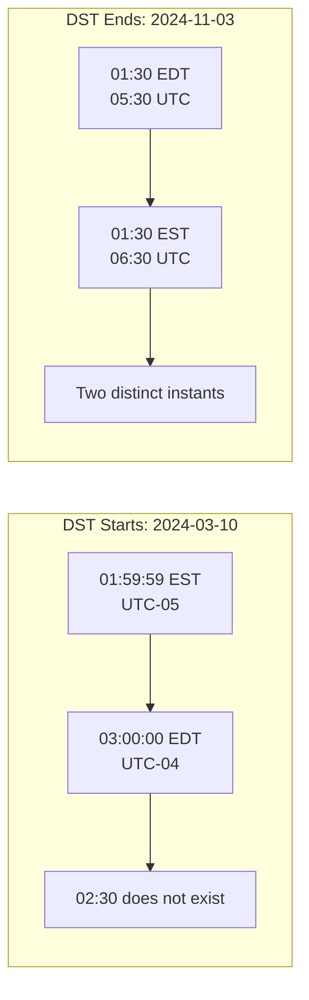
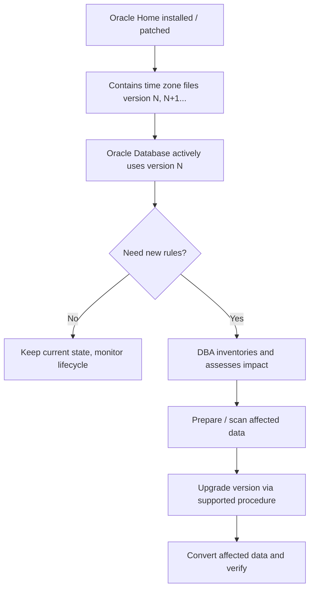

# Daylight Saving Time, Time Zone Regions, and Updating Time Zone Files in Oracle Database

In applications backed by Oracle Database, time is more than a string like `2024-11-03 01:30:00`. To interpret a point in time accurately, you sometimes need **the time zone**, **Daylight Saving Time (DST) transition rules**, and **the time zone data version** Oracle is currently using. Ignoring these factors allows two identical-looking values to denote different instants; a local clock time may never have existed; and a system running smoothly for years can suddenly schedule appointments an hour off after a country changes its DST laws.

In Oracle, three concerns must be kept distinct:

1. **Data types and session state:** `DATE`, `TIMESTAMP`, `TIMESTAMP WITH TIME ZONE`, `TIMESTAMP WITH LOCAL TIME ZONE`, `SESSIONTIMEZONE`, and `DBTIMEZONE`.
2. **How a time zone is specified:** a fixed offset such as `+07:00` differs from a **named time zone region** such as `Asia/Ho_Chi_Minh`, `America/New_York`, or `Europe/Berlin`. A region carries history and DST rules that vary by calendar date.
3. **Oracle's time zone file:** the time zone rule dataset used by Oracle Net/database to interpret and convert timestamps. Placing a new file in Oracle Home **does not automatically mean** the database has upgraded its active time zone data version; upgrading database data requires a dedicated DBA procedure.

This lesson progresses from verifiable DST examples to SQL, schema design, Java/JDBC, and safe time zone file operations. Session-modification examples are for lab practice only; any database time zone upgrade must be planned separately by a DBA.

## 1. Absolute instants, local times, offsets, and regions

### 1.1. One instant can display as many wall-clock times

For example, these three strings represent the exact same instant:

```text
2024-07-01 12:00:00 +00:00   (UTC)
2024-07-01 08:00:00 -04:00   (New York observing DST)
2024-07-01 19:00:00 +07:00   (offset +07:00)
```

As absolute points in time (*instants*), all three are equal. In a user interface, displaying local time is helpful because users reside in different locations.

Conversely, a **zone-less** string **`2024-07-01 08:00:00`** cannot identify an instant. It might be 08:00 in New York, Hanoi, London, or another system with a different default time zone.

| Concept | Example | What question does it answer? |
|---|---|---|
| **Instant / UTC** | `2024-07-01T12:00:00Z` | When did the event occur on the universal timeline? |
| **Local date-time** | `2024-07-01 08:00:00` | What do the local clock and calendar display? |
| **UTC offset** | `-04:00` | At the instant in question, how far is local time from UTC? |
| **Time zone region** | `America/New_York` | Which historical and future offset rules apply to a locality? |
| **DST** | New York shifts from UTC−05 to UTC−04 in summer | Rule changing the offset by date/instant |
| **Time zone file version** | Version number of Oracle time zone data in use | Which rule set is the database using for conversions? |

**An offset is not a region.** `-04:00` is merely the offset at a single moment; it does not tell you New York typically uses `-05:00` in winter. Meanwhile, `America/New_York` lets Oracle look up the rule matching the target date. To calculate a meeting **next month** or a weekly recurring local-time schedule, you need the region—not just today's offset.

### 1.2. What is Daylight Saving Time?

**Daylight Saving Time (DST)** is a regional policy of advancing clocks seasonally. Not all regions observe DST; start dates, end dates, offsets, and historical rules vary across countries, regions, and years.

In the New York 2024 example:

- Before the transition on **2024-03-10**, standard time used offset `-05:00` (EST).
- When DST began, clocks jumped directly from **01:59:59** to **03:00:00**; the span **02:00–02:59** never appeared on local clocks that day.
- On **2024-11-03**, when DST ended, clocks stepped back from **01:59:59** to **01:00:00**; the span **01:00–01:59** occurred **twice**, first in EDT `-04:00` and then in EST `-05:00`.

These two anomalies are called:

- **Gap (nonexistent time):** local clock time skipped when clocks spring forward.
- **Overlap (ambiguous/repeated time):** local clock time repeated when clocks fall back.



In Vietnam today, `Asia/Ho_Chi_Minh` uses `+07:00` and does not currently observe DST. Still, **the region name carries historical context**, so never equate `Asia/Ho_Chi_Minh` with `+07:00` across all historical dates or possible future legislative changes.

## 2. Named time zone regions differ from fixed offsets and abbreviations

### 2.1. Region IDs represent rule sets

Common region names:

```text
Asia/Ho_Chi_Minh
Asia/Tokyo
America/New_York
Europe/Berlin
Europe/London
UTC
```

Time zone region names are recognized by Oracle according to the time zone data in the active release. Never assume Oracle supports every alias seen in a Java library or operating system. Inspect supported names directly in **your Oracle Database** via `V$TIMEZONE_NAMES` when permitted:

```sql
SELECT DISTINCT tzname
FROM v$timezone_names
WHERE tzname IN (
    'Asia/Ho_Chi_Minh',
    'America/New_York',
    'Europe/Berlin'
)
ORDER BY tzname;
```

One region can map to multiple daylight/standard abbreviations; `V$TIMEZONE_NAMES` provides `TZNAME` and `TZABBREV` columns to assist identification.

### 2.2. Offsets carry no DST rules

The timestamps:

```text
2024-01-15 09:00:00 -05:00
2024-07-15 09:00:00 -05:00
```

both use a fixed `-05:00` offset. It does not magically switch to `-04:00` in July just because a developer had New York in mind. If the requirement is "09:00 New York time year-round," use the `America/New_York` region and its DST rules; the two interpretations do not yield the same UTC instant in every month.

### 2.3. Abbreviations can be ambiguous

`EST`, `EDT`, `CST`, and `IST` are common abbreviations; several are shared across different regions or interpreted differently by context. For instance, `CST` can refer to distinct civil time standards worldwide. Therefore:

- Avoid API contracts where clients send `CST` or `IST` without a canonical region.
- Use a **standard Oracle-supported region** whenever date-dependent rules apply.
- Use an **explicit offset** when representing an already resolved instant.
- When disambiguating repeated hours within a region, pair **`TZD`** (time zone daylight saving abbreviation) with the region and date to specify the DST/standard branch.

**A region does not necessarily imply DST is active.** A region is a rule set, potentially spanning historical shifts and policy updates.

## 3. Oracle's four temporal types: which actually retain time zone info?

| Type | Primary data | Retains time zone itself? | Use case |
|---|---|---|---|
| `DATE` | Date, hour, minute, second | **No** | Datetime values needing neither fractional seconds nor time zone semantics |
| `TIMESTAMP(p)` | Date and time with fractional seconds | **No** | Zone-less local date-time, e.g., scheduled store opening hours |
| `TIMESTAMP(p) WITH TIME ZONE` (**TSTZ**) | Timestamp with corresponding offset or region | **Yes** | Time-zone-aware instants; cross-region events |
| `TIMESTAMP(p) WITH LOCAL TIME ZONE` (**TSLTZ**) | Value normalized to database time zone; displayed in session time zone | **Does not keep original region name** | Single instant displayed locally in each viewer's session |

`p` is fractional-second precision; check DDL/Oracle release for defaults and limits. For example, `TIMESTAMP(6)` stores fractional seconds down to microseconds.

### 3.1. DATE has no time zone

```sql
CREATE TABLE date_example (
    event_id NUMBER PRIMARY KEY,
    occurred_at DATE
);
```

A `DATE` value like `2024-11-03 01:30:00` does not tell you whether it happened in New York before or after the fallback clock shift. Oracle `DATE` stores hours, minutes, and seconds, yet has no fractional seconds, time zone region, or offset. Changing `SESSIONTIMEZONE` does not make a `DATE` column time-zone-aware.

### 3.2. TIMESTAMP has no time zone

```sql
CREATE TABLE local_schedule (
    schedule_id NUMBER PRIMARY KEY,
    local_start TIMESTAMP(6) NOT NULL,
    zone_name VARCHAR2(64 CHAR) NOT NULL
);
```

This is a useful pattern for **future local-time schedules**, such as "Mondays at 09:00 in Europe/Berlin," storing the region separately. Before resolving to an instant for reminders, the application applies the region's rules for the actual target date and enforces explicit gap/overlap handling.

Storing only `TIMESTAMP '2024-11-03 01:30:00'` without a zone prevents reconstructing a unique instant later when context is missing.

### 3.3. TIMESTAMP WITH TIME ZONE

```sql
CREATE TABLE tz_events (
    event_id NUMBER PRIMARY KEY,
    event_time TIMESTAMP(6) WITH TIME ZONE NOT NULL,
    event_type VARCHAR2(30 CHAR) NOT NULL
);
```

TSTZ represents timestamps with either an offset or a region name per Oracle storage/interpretation rules. Stored with a **region**, Oracle applies DST rules from the time zone file; stored with a **fixed offset**, you record the offset at that instant without tying it to future regional DST changes.

Example:

```sql
INSERT INTO tz_events (event_id, event_time, event_type)
VALUES (
    1,
    TO_TIMESTAMP_TZ(
        '2024-07-01 08:30:00 America/New_York',
        'YYYY-MM-DD HH24:MI:SS TZR'
    ),
    'MEETING'
);

INSERT INTO tz_events (event_id, event_time, event_type)
VALUES (
    2,
    TO_TIMESTAMP_TZ(
        '2024-07-01 12:30:00 +00:00',
        'YYYY-MM-DD HH24:MI:SS TZH:TZM'
    ),
    'MEETING_UTC'
);

COMMIT;
```

Both rows represent the exact same instant (08:30 EDT in New York = 12:30 UTC). To compare them on a common timeline, run:

```sql
SELECT event_id,
       TO_CHAR(event_time,
           'YYYY-MM-DD HH24:MI:SS TZR TZD TZH:TZM') AS original_display,
       SYS_EXTRACT_UTC(event_time) AS utc_time
FROM tz_events
ORDER BY event_id;
```

`SYS_EXTRACT_UTC` converts a time-zone-aware timestamp to a UTC timestamp; **its return type is a zone-less `TIMESTAMP`**, so column names and API documentation should state clearly that it represents UTC.

### 3.4. TIMESTAMP WITH LOCAL TIME ZONE

```sql
CREATE TABLE ltz_events (
    event_id NUMBER PRIMARY KEY,
    seen_at TIMESTAMP(6) WITH LOCAL TIME ZONE NOT NULL
);
```

When inserting a zoned value, Oracle normalizes it to the **database time zone** for storage. On retrieval, it converts to the **session time zone** for display. Example:

```sql
INSERT INTO ltz_events (event_id, seen_at)
VALUES (
    1,
    TO_TIMESTAMP_TZ(
        '2024-07-01 12:30:00 +00:00',
        'YYYY-MM-DD HH24:MI:SS TZH:TZM'
    )
);
COMMIT;

ALTER SESSION SET TIME_ZONE = 'America/New_York';

SELECT event_id,
       TO_CHAR(seen_at, 'YYYY-MM-DD HH24:MI:SS.FF3') AS local_display
FROM ltz_events;
```

In the New York session on that sample date, `LOCAL_DISPLAY` reflects `08:30` under DST rules. Switching sessions:

```sql
ALTER SESSION SET TIME_ZONE = 'Asia/Ho_Chi_Minh';

SELECT event_id,
       TO_CHAR(seen_at, 'YYYY-MM-DD HH24:MI:SS.FF3') AS local_display
FROM ltz_events;
```

displays `19:30` in Vietnam for the exact same value. **Oracle does not preserve the original region name supplied by the client** inside TSLTZ; if the application needs to know whether the creator selected `America/New_York` or another region, store the region separately.

For scenarios requiring preservation of local wall-clock time for future events, TSLTZ alone is insufficient: it reflects an instant per session, rather than recording a contract like "09:00 in city X" to adjust under future legal changes.

## 4. NLS controls parsing and display, not time zones

In Oracle, **NLS (National Language Support)** governs language and formatting rules. Common parameters:

| Parameter | Role |
|---|---|
| `NLS_DATE_FORMAT` | Default format when converting `DATE` to/from strings in contextual operations |
| `NLS_TIMESTAMP_FORMAT` | Default format for `TIMESTAMP` |
| `NLS_TIMESTAMP_TZ_FORMAT` | Default format for `TIMESTAMP WITH TIME ZONE` |
| `NLS_DATE_LANGUAGE` | Language of month names, day names, and textual elements when formatting/parsing |
| `NLS_TERRITORY` | Influences territory-based default conventions; does not assign a time zone to timestamps |
| `SESSIONTIMEZONE` | Session time zone/offset when converting temporal values |
| `DBTIMEZONE` | Database time zone used in `TIMESTAMP WITH LOCAL TIME ZONE` normalization |

Example:

```sql
ALTER SESSION SET NLS_DATE_FORMAT = 'YYYY-MM-DD HH24:MI:SS';
ALTER SESSION SET NLS_TIMESTAMP_TZ_FORMAT =
    'YYYY-MM-DD HH24:MI:SS.FF3 TZR TZD';

SELECT SYSDATE AS server_date,
       SYSTIMESTAMP AS server_timestamp_tz,
       CURRENT_TIMESTAMP AS current_session_tz
FROM dual;
```

Changing `NLS_DATE_FORMAT` only changes default string presentation/parsing rules for `DATE`. It **does not attach a new time zone to DATE**, does not convert `TIMESTAMP` rows to UTC, and does not alter database DST rules.

### 4.1. Never let implicit conversion decide business outcomes

Error-prone example:

```sql
-- Discouraged for multi-environment applications:
SELECT TO_DATE('03/04/2024') FROM dual;
```

That string can parse differently depending on default session settings. Pass typed parameters/binds from Java, and use explicit format masks whenever string parsing is unavoidable:

```sql
SELECT TO_DATE('2024-04-03', 'YYYY-MM-DD') AS parsed_date
FROM dual;

SELECT TO_TIMESTAMP_TZ(
           '2024-04-03 09:30:00 +07:00',
           'YYYY-MM-DD HH24:MI:SS TZH:TZM'
       ) AS parsed_instant
FROM dual;
```

`TZH:TZM` is used when strings carry numeric offsets; `TZR` is used for regions. When distinguishing daylight/standard times during an overlap, `TZD` may also be required.

## 5. Common time zone functions and settings in SQL

### 5.1. Knowing which time zone Oracle is using

```sql
SELECT SESSIONTIMEZONE AS session_tz,
       DBTIMEZONE AS database_tz
FROM dual;

SELECT SYSTIMESTAMP AS server_timestamp,
       CURRENT_TIMESTAMP AS session_timestamp,
       LOCALTIMESTAMP AS local_timestamp,
       CURRENT_DATE AS session_date,
       SYSDATE AS server_date
FROM dual;
```

Distinguish them:

- `SYSTIMESTAMP`: `TIMESTAMP WITH TIME ZONE` from the system hosting Oracle Database (reflecting OS offset/time zone).
- `CURRENT_TIMESTAMP`: `TIMESTAMP WITH TIME ZONE` in the **session time zone**.
- `LOCALTIMESTAMP`: local time in the session as a **zone-less TIMESTAMP**.
- `CURRENT_DATE`: `DATE` in the session time zone.
- `SYSDATE`: date/time from the database host OS, **without a time zone**.

`SYSTIMESTAMP` and `CURRENT_TIMESTAMP` may display different clock times while denoting closely matching current instants. Do not use the difference between these functions as a precise latency measurement; execution order and sampling timing also affect results.

### 5.2. Changing the session time zone

```sql
ALTER SESSION SET TIME_ZONE = 'UTC';

SELECT SESSIONTIMEZONE FROM dual;

ALTER SESSION SET TIME_ZONE = 'America/New_York';

SELECT SESSIONTIMEZONE FROM dual;

ALTER SESSION SET TIME_ZONE = '+07:00';

SELECT SESSIONTIMEZONE FROM dual;
```

Notice the semantic difference in the last two:

- `America/New_York` is a **region** whose offset changes by calendar date.
- `+07:00` is a **fixed offset**, carrying no DST rules.

`ALTER SESSION` affects the current session; in applications using connection pools, connections are reused. If code alters a connection's time zone and returns it to the pool without resetting, subsequent requests can see unexpected display times. Enforce a consistent time zone policy when initializing or borrowing connections.

### 5.3. Converting an instant to a specific region

```sql
SELECT
    TO_CHAR(
        TO_TIMESTAMP_TZ(
            '2024-07-01 12:30:00 +00:00',
            'YYYY-MM-DD HH24:MI:SS TZH:TZM'
        ) AT TIME ZONE 'America/New_York',
        'YYYY-MM-DD HH24:MI:SS TZR TZD TZH:TZM'
    ) AS new_york_time
FROM dual;
```

At that sample instant, the result reflects New York DST—08:30 with offset `-04:00`. `AT TIME ZONE` converts the representation of the same instant to the requested zone without altering the event itself.

Similarly for Hanoi/Ho Chi Minh City:

```sql
SELECT TO_CHAR(
           TO_TIMESTAMP_TZ(
               '2024-07-01 12:30:00 +00:00',
               'YYYY-MM-DD HH24:MI:SS TZH:TZM'
           ) AT TIME ZONE 'Asia/Ho_Chi_Minh',
           'YYYY-MM-DD HH24:MI:SS TZR TZH:TZM'
       ) AS vietnam_time
FROM dual;
```

### 5.4. TZ_OFFSET does not answer every historical question

`TZ_OFFSET` returns the offset associated with a time zone identifier at the current evaluation time/rules. Example:

```sql
SELECT TZ_OFFSET('America/New_York') AS ny_offset_now
FROM dual;
```

Never apply that returned value across all past or future dates. New York's offset in January differs from July. When you need the offset for **a specific instant**, convert that timestamp to the region and format `TZH:TZM` as shown in section 5.3.

## 6. Gap: nonexistent local times when DST starts

### 6.1. What happens in New York on March 10, 2024?

| Local time | Offset | UTC instant | Exists? |
|---|---|---|---|
| `2024-03-10 01:30:00` | EST `-05:00` | `06:30 UTC` | Yes |
| `2024-03-10 02:30:00` | No valid offset at transition | No corresponding instant in region | **No** |
| `2024-03-10 03:30:00` | EDT `-04:00` | `07:30 UTC` | Yes |

Someone scheduling "02:30 on March 10, 2024 in New York" has picked a nonexistent local time. If a system silently shifts it to 03:30 or another day without an explicit business rule, appointment records become impossible to audit.

### 6.2. Verification example in Oracle

Two valid values:

```sql
SELECT SYS_EXTRACT_UTC(
           TO_TIMESTAMP_TZ(
               '2024-03-10 01:30:00 America/New_York EST',
               'YYYY-MM-DD HH24:MI:SS TZR TZD'
           )
       ) AS before_dst_utc,
       SYS_EXTRACT_UTC(
           TO_TIMESTAMP_TZ(
               '2024-03-10 03:30:00 America/New_York EDT',
               'YYYY-MM-DD HH24:MI:SS TZR TZD'
           )
       ) AS after_dst_utc
FROM dual;
```

The **UTC** difference between these two instants is only one hour even though the local wall clock jumped from 01:30 to 03:30.

Example **expected to raise an error for a nonexistent local time** in the region:

```sql
-- Run separately in a lab to observe the error; this time does not exist.
SELECT TO_TIMESTAMP_TZ(
           '2024-03-10 02:30:00 America/New_York',
           'YYYY-MM-DD HH24:MI:SS TZR'
       ) AS invalid_local_time
FROM dual;
```

With appropriate DST data and rules, Oracle raises **`ORA-01878: specified field not found in datetime or interval`** for this case. Exact error wording depends on the statement, time zone data version, and client string handling; the key takeaway is that **no valid instant exists for that local time** in the chosen region.

### 6.3. Applications must choose an explicit policy

When users schedule a recurring event that lands inside a gap, applications have distinct business strategies:

1. **Reject the invalid schedule** and prompt the user to pick another time (safest for high-precision transactions).
2. **Shift to the next valid time** per a published policy, such as moving 02:30 to 03:00 or 03:30 depending on convention.
3. **Skip that occurrence** if the recurring job specifies skipping runs inside a gap.

No single choice fits every domain. Medical appointments, financial settlements, periodic reports, and alarm clocks each require different policies. Document the policy and enforce it consistently across Java, Oracle, and schedulers.

## 7. Overlap: repeated local times when DST ends

### 7.1. Two 01:30s, two distinct instants

On November 3, 2024 in New York:

| Local representation | Offset | UTC instant |
|---|---|---|
| `2024-11-03 01:30:00 EDT` | `-04:00` | `2024-11-03 05:30:00 UTC` |
| `2024-11-03 01:30:00 EST` | `-05:00` | `2024-11-03 06:30:00 UTC` |

The exact same local date-time `01:30` maps to **two real instants 60 minutes apart**. Storing only `TIMESTAMP '2024-11-03 01:30:00'` makes it impossible to tell which occurrence the user chose.

### 7.2. Specify TZD to eliminate ambiguity

```sql
SELECT SYS_EXTRACT_UTC(
           TO_TIMESTAMP_TZ(
               '2024-11-03 01:30:00 America/New_York EDT',
               'YYYY-MM-DD HH24:MI:SS TZR TZD'
           )
       ) AS first_0130_utc,
       SYS_EXTRACT_UTC(
           TO_TIMESTAMP_TZ(
               '2024-11-03 01:30:00 America/New_York EST',
               'YYYY-MM-DD HH24:MI:SS TZR TZD'
           )
       ) AS second_0130_utc
FROM dual;
```

`TZR` supplies the region; `TZD` specifies daylight vs. standard time when disambiguation is needed. Here, the two UTC outputs differ by one hour.

If you omit `TZD` and pass only `2024-11-03 01:30:00 America/New_York`, the local time is **ambiguous**. Oracle's session parameter `ERROR_ON_OVERLAP_TIME` lets you control how Oracle reacts in such cases.

```sql
-- Lab environment: instruct Oracle to raise an error on overlapping local times.
ALTER SESSION SET ERROR_ON_OVERLAP_TIME = TRUE;

-- Expect an error for an ambiguous timestamp lacking TZD.
SELECT TO_TIMESTAMP_TZ(
           '2024-11-03 01:30:00 America/New_York',
           'YYYY-MM-DD HH24:MI:SS TZR'
       )
FROM dual;
```

With `ERROR_ON_OVERLAP_TIME=TRUE`, Oracle treats an unresolved overlap as an error instead of silently picking an offset. When `FALSE`, Oracle resolves to standard time per product/release rules, yet **applications should never rely on an implicit default** for critical transactions or events.

In practice, reset it afterward:

```sql
ALTER SESSION SET ERROR_ON_OVERLAP_TIME = FALSE;
```

In production, the cleaner choice is designing inputs with full information to avoid ambiguity rather than depending on a session parameter that might linger in a connection pool.

### 7.3. Consequences for metrics

If a system groups logs by "`YYYY-MM-DD HH24:MI` in New York" while dropping the offset, both `01:30` occurrences collapse into one bucket. If you subtract start time from end time using zone-less local timestamps, reports miscalculate elapsed duration.

For duration metrics, use **UTC/instants or time-zone-aware types**, then convert to local regions **at the presentation step**. When grouping by local business day, define the reporting region and apply DST rules across that period.

## 8. Designing data models for schedules, logs, and transactions

### 8.1. Past event logs: store unambiguous instants

For audit logs, payment events, or request completion timestamps, the question is **"exactly when did it happen?"** A clear storage pattern is:

```sql
CREATE TABLE service_audit (
    audit_id NUMBER GENERATED BY DEFAULT AS IDENTITY PRIMARY KEY,
    occurred_at TIMESTAMP(6) WITH TIME ZONE NOT NULL,
    actor_code VARCHAR2(50 CHAR) NOT NULL,
    action_code VARCHAR2(50 CHAR) NOT NULL
);
```

On insert, supply an instant from the application or database under an explicit contract:

```sql
INSERT INTO service_audit (occurred_at, actor_code, action_code)
VALUES (SYSTIMESTAMP, 'USER-01', 'LOGIN');
```

`SYSTIMESTAMP` carries the database environment's time zone; if the API standardizes on UTC, the application can bind a UTC instant and apply consistent display rules. Never use zone-less `LOCALTIMESTAMP` to record cross-region events without a shared interpretation rule.

### 8.2. Future local-time schedules: store region and local time

A meeting at **09:00 every Monday in Europe/Berlin** differs from **08:00 UTC every Monday**. When Berlin shifts its offset for DST, the UTC instant corresponding to 09:00 local time shifts accordingly.

An illustrative schema:

```sql
CREATE TABLE recurring_schedule (
    schedule_id NUMBER GENERATED BY DEFAULT AS IDENTITY PRIMARY KEY,
    local_time_text VARCHAR2(5 CHAR) NOT NULL,
    zone_region VARCHAR2(64 CHAR) NOT NULL,
    overlap_policy VARCHAR2(20 CHAR) NOT NULL,
    gap_policy VARCHAR2(20 CHAR) NOT NULL,
    CONSTRAINT ck_schedule_overlap CHECK (
        overlap_policy IN ('FIRST', 'SECOND', 'REJECT')
    ),
    CONSTRAINT ck_schedule_gap CHECK (
        gap_policy IN ('SKIP', 'NEXT_VALID', 'REJECT')
    )
);
```

Real systems may store minutes-since-midnight or a structured type instead of `HH24:MI` text, along with recurrence rules (day of week, effective dates, exceptions). The table above highlights the minimal fields most often forgotten: **local time, time zone region, and DST handling policies**. When materializing the next occurrence, compute the instant using current time zone rules and persist that resolved instant so workers execute deterministically.

### 8.3. Do not store only an offset when city-based schedules are needed

An API storing only:

```json
{
  "localTime": "09:00",
  "offset": "-05:00"
}
```

cannot tell whether 09:00 is in New York, Bogotá, or elsewhere. If the user wants 09:00 in New York year-round, July occurrences require `-04:00`. A better contract is:

```json
{
  "localTime": "09:00",
  "zoneRegion": "America/New_York",
  "overlapPolicy": "REJECT",
  "gapPolicy": "NEXT_VALID"
}
```

Once a concrete occurrence is resolved, the corresponding UTC instant can be attached. **Never treat a region name as sensitive data**; it is a temporal rule identifier, not a secret.

## 9. Java/JDBC and Oracle: do not lose time zones at the boundary

Modern Java provides `java.time` types to keep semantics clear:

| Java type | Primary meaning | Oracle relationship |
|---|---|---|
| `Instant` | Point on the UTC timeline | Useful for audits/logs/events; mapped via appropriate driver/API |
| `OffsetDateTime` | Local timestamp + offset | Fits binding/reading `TIMESTAMP WITH TIME ZONE` via JDBC 4.2 with supporting drivers |
| `ZonedDateTime` | Local timestamp + `ZoneId` and region rules | Fits schedule/DST logic in Java; consider persisting zone ID separately |
| `LocalDateTime` | Date/time without zone | Fits `TIMESTAMP` and unmaterialized local schedules |
| `LocalDate` | Date without time | Requires clear mapping convention; Oracle `DATE` still includes time |

Java example handling New York's two `01:30` occurrences:

```java
import java.time.LocalDateTime;
import java.time.ZoneId;
import java.time.ZoneOffset;
import java.time.ZonedDateTime;
import java.util.List;

public class DstOverlapExample {
    public static void main(String[] args) {
        ZoneId zone = ZoneId.of("America/New_York");
        LocalDateTime local =
                LocalDateTime.of(2024, 11, 3, 1, 30);

        List<ZoneOffset> offsets =
                zone.getRules().getValidOffsets(local);

        // Two valid offsets exist: -04:00 and -05:00.
        for (ZoneOffset offset : offsets) {
            ZonedDateTime chosen =
                    ZonedDateTime.ofLocal(local, zone, offset);
            System.out.println(chosen + " => " + chosen.toInstant());
        }
    }
}
```

In a gap, `getValidOffsets(local)` returns an empty list; at normal hours, one offset; during an overlap, two offsets. This lets the application **detect** ambiguity before writing to Oracle. Note that Java uses the **JDK's** time zone rules, while Oracle uses its own time zone file; the two rule sets can be on different versions even for the exact same region name.

### 9.1. Binding time-zone-aware values with PreparedStatement

JDBC 4.2 example with an Oracle driver supporting `OffsetDateTime`:

```java
import java.sql.Connection;
import java.sql.PreparedStatement;
import java.time.OffsetDateTime;
import java.time.ZoneOffset;

public final class AuditWriter {
    public static void write(Connection connection,
                             long auditId,
                             OffsetDateTime eventTime) throws Exception {
        String sql =
            "INSERT INTO audit_events(event_id, event_time) VALUES (?, ?)";
        try (PreparedStatement ps = connection.prepareStatement(sql)) {
            ps.setLong(1, auditId);
            ps.setObject(2, eventTime);
            ps.executeUpdate();
        }
    }

    public static OffsetDateTime nowUtc() {
        return OffsetDateTime.now(ZoneOffset.UTC);
    }
}
```

This snippet assumes `AUDIT_EVENTS` has column `EVENT_TIME TIMESTAMP WITH TIME ZONE` and a matching `EVENT_ID`. Verify time-zone-aware mappings for your exact driver/JDBC version and framework; older drivers or ORMs behave differently. Never treat `java.sql.Timestamp`/`LocalDateTime` as lossless when you need to retain regions.

### 9.2. Connection pools and NLS/TIME_ZONE sessions

Applications using Spring Boot/HikariCP reuse connections; the underlying Oracle session may retain:

- `TIME_ZONE` altered by a prior request.
- `NLS_*` parameters set via `ALTER SESSION`.
- Other session state such as current schema or program settings.

If code changes the session time zone, enforce initialization/reset rules before connection reuse. Prefer explicit typed datetime binds, configure a consistent system default time zone, and convert to the user's zone only for display.

### 9.3. Rule version mismatches across JDK, Oracle, and OS

An accurate system clock does not prove time zone rules match across layers. In one deployment:

- The JDK may already have a country's new DST update;
- Oracle Database may still run an older time zone file;
- The OS/container may carry a different `tzdata` version;
- Mobile clients may send local times with offsets computed from phone OS data.

When a country changes DST laws, different layers can translate the same future schedule into different UTC instants. Inventory rule versions across all tiers, test affected regions and dates, and plan coordinated updates per business needs.

## 10. What is an Oracle time zone file?

Oracle uses **time zone files** containing region names and time-varying transition rules. Depending on the release, Oracle Home may contain **small** and **large** time zone files under a path such as:

```text
$ORACLE_HOME/oracore/zoneinfo/

timezone_<version>.dat
timezlrg_<version>.dat
```

These are typical filename patterns, not instructions to copy or edit files manually. Exact paths depend on Oracle Home, installation layout, and applied patches.

Time zone data updates typically include:

1. Government changes to DST start/end dates.
2. A country abolishing or reintroducing DST.
3. A region changing its standard UTC offset.
4. Oracle updating historical data or supported aliases/regions.

**Time zone file version** is neither the SQL engine release nor an NLS date format. Two databases running the exact same Oracle Database version can still run **different time zone file versions** due to patching or upgrade history.

### 10.1. Two version layers that are easily confused

**Layer 1 — Files present in Oracle Home:** installed/patched Oracle software may contain multiple versions of time zone data.

**Layer 2 — Version actively used by the database:** a database/container uses one active version to resolve regions and read/write zoned data. Upgrading this active version in a supported manner typically requires **`DBMS_DST`/time zone upgrade** procedures, not merely dropping new files on disk.



Adding new files does not automatically rewrite stored TSTZ values. Assess affected data and rule changes for impacted regions; data stored with **fixed offsets** is affected differently than data stored with **region names**.

### 10.2. Checking the active time zone file version

With privileges to query dynamic performance views:

```sql
SELECT filename,
       version
FROM v$timezone_file;
```

`VERSION` is the time zone file version **currently used by the database/container**. Do not confuse it with the current year or current UTC offset.

Check DST transition status properties when permitted:

```sql
SELECT property_name,
       property_value
FROM database_properties
WHERE property_name IN (
    'DST_PRIMARY_TT_VERSION',
    'DST_SECONDARY_TT_VERSION',
    'DST_UPGRADE_STATE'
)
ORDER BY property_name;
```

These properties track primary/secondary versions and upgrade/preparation state when active. Interpret their names and values against your exact Oracle release and execution state; do not assume a secondary value of 0 indicates an error.

To check region names recognized by the active file:

```sql
SELECT tzname, tzabbrev
FROM v$timezone_names
WHERE tzname = 'America/New_York'
ORDER BY tzabbrev;
```

This view lists multiple abbreviations for the same region. It is a region dictionary, not a day-by-day DST calendar; resolve a concrete timestamp to inspect the exact offset at a given instant.

## 11. When is updating the time zone file necessary?

The need typically arises from one of these situations:

- **Time zone laws changed:** the application schedules future events in a region that recently changed DST or standard offset.
- **Oracle Database upgrade/patching:** a newer time zone data version ships in Oracle Home and should be evaluated for adoption.
- **Data Pump import/export:** source and target time zone file versions are incompatible under your Oracle version's Data Pump rules.
- **Distributed system clock mismatches:** Java, Oracle, and another service produce different UTC instants for the same local time and region.
- **Compliance/auditing requirements:** historical conversions and future schedules must rest on controlled rule datasets.

**Never upgrade merely because "a higher version exists" without impact analysis.** Changing time zone rules can alter how region-tagged timestamps are interpreted, especially around affected dates. Plan upgrades with testing, backups, a maintenance window, and a rollback strategy.

### 11.1. Do not confuse ORACLE_HOME with DBTIMEZONE

`DBTIMEZONE` is a database setting tied to `TIMESTAMP WITH LOCAL TIME ZONE` storage. **Changing `DBTIMEZONE` is not equivalent to upgrading the time zone file version.** It is an entirely different operation with strict prerequisites and data implications; never modify `DBTIMEZONE` trying to fix a missing region or outdated DST rule.

### 11.2. Do systems without TSTZ columns still need to check?

If every column uses zone-less `DATE`/`TIMESTAMP`, Oracle cannot infer regions for stored rows, and a new time zone file will not retroactively "fix" contextless local times. Even so, applications may still use `AT TIME ZONE`, `TO_TIMESTAMP_TZ`, `CURRENT_TIMESTAMP`, or region-based schedulers—where the active rule set still affects results.

Inventory **both stored columns and SQL/PLSQL/API time conversion logic**, not just whether `TIMESTAMP WITH TIME ZONE` columns exist.

## 12. Safe time zone file upgrade workflow with DBMS_DST

**This section covers administrative architecture and workflow, not a script to run blindly on production.** Different Oracle releases enforce different sequencing, instance/PDB states, and utility requirements. DBAs must follow official documentation for their exact release/update alongside internal runbooks.

Oracle supplies the **`DBMS_DST`** package to prepare, evaluate, and upgrade database time zone data. Some Oracle releases also include utility scripts under `$ORACLE_HOME/rdbms/admin` such as `utltz_upg_check.sql` and `utltz_upg_apply.sql` to assist the workflow. Never mix both methods concurrently during the same upgrade window.

### 12.1. Phase A — Inventory and planning

1. Confirm **Oracle Database version/Release Update**, deployment topology (single instance vs. RAC), CDB/PDB layout, standby/Data Guard, and services.
2. Record `V$TIMEZONE_FILE.VERSION` for **each target database/container**, plus `DST_*` properties.
3. Inventory newer time zone files installed/supported in Oracle Home and patch requirements.
4. Identify applications using TSTZ/TSLTZ, region names, Data Pump, future schedules, or Java conversions.
5. Review backup policies, restore tests, outage windows, rollback plans, and coordination with dependent systems.
6. Provision a staging environment with representative data and workloads.

Example query to inventory zoned timestamp columns where privileged:

```sql
SELECT owner,
       table_name,
       column_name,
       data_type
FROM dba_tab_columns
WHERE data_type IN (
    'TIMESTAMP WITH TIME ZONE',
    'TIMESTAMP WITH LOCAL TIME ZONE'
)
ORDER BY owner, table_name, column_id;
```

This is an initial inventory only; it **does not cover hidden structures, nested types, object attributes, queues, or other dependencies**. Oracle's standard upgrade utilities perform deeper scans of affected objects.

### 12.2. Phase B — Prepare window

`DBMS_DST` includes a **prepare** phase to identify data and objects affected by differences between the current and target time zone file versions. Key APIs include:

```text
DBMS_DST.BEGIN_PREPARE(new_version)
DBMS_DST.FIND_AFFECTED_TABLES(...)
DBMS_DST.END_PREPARE
```

This is an **API outline to recognize the workflow**, not a complete standalone script: it requires privileges, log/error tables, and release-specific parameters. Scanning affected data can consume substantial time and resources on large databases and requires dedicated planning.

Collect the list of affected tables/objects, invalid or ambiguous conversions, required runtime, and business outage windows. Gaps or overlaps introduced by rule changes require explicit handling policies rather than arbitrary instant coercion.

### 12.3. Phase C — Upgrade window

The `DBMS_DST` upgrade workflow typically involves:

```text
BEGIN_UPGRADE(target_version)
UPGRADE_DATABASE(...) / upgrading affected data
END_UPGRADE(...)
```

In Oracle workflows, **BEGIN_UPGRADE** requires the database in upgrade mode and updates system metadata, followed by appropriate restarts and upgrading user data in the corresponding phase. **Do not assume those three names can simply be called sequentially in a normal session.** DBAs must follow exact start/stop sequences, container open modes, error-handling parameters, logging, and post-checks for their Oracle release.

In CDB/PDB architectures, verify whether **root and each PDB** upgrade individually, how closed PDBs are handled, and RAC instance coordination. Never check only `CDB$ROOT` and assume every PDB matches.

### 12.4. Phase D — Post-upgrade verification

Once the procedure completes:

1. Re-query `V$TIMEZONE_FILE`, `DST_*` properties, and relevant PDB states.
2. Inspect utility summaries for converted tables/rows, unresolved errors, and dependent objects.
3. Test TSTZ/TSLTZ queries across **impacted regions and dates**, including gaps, overlaps, and future schedules.
4. Test Java/JDBC, scheduler jobs, BI reports, Data Pump, and time-zone-converting interfaces.
5. Monitor the alert log and application logs after reopening services.
6. Verify historical audit logs and past events retained their exact intended instants; check JDK/OS time zone rules if conversions occur across tiers.

This phase requires live test evidence and operational sign-off; never declare "success" solely because `VERSION` incremented.

### 12.5. Why must backup and recovery be prepared beforehand?

Changing time zone data can alter the interpretation or stored offsets of many TSTZ rows simultaneously. Not every upgrade supports a simple "downgrade," nor can new files/patches be safely removed once data has been upgraded. **A tested backup/restore plan** matters far more than assuming you can run `BEGIN_UPGRADE` in reverse.

In environments with standbys, replication, or Data Pump, align time zone file upgrade plans across sites and test compatibility beforehand.

## 13. Time zone files and multitenant CDB/PDB

A CDB contains `CDB$ROOT`, `PDB$SEED`, and multiple application PDBs. Inspecting and upgrading time zone data can be **container-scoped** depending on the Oracle release and mechanics in use.

Before querying:

```sql
SELECT SYS_CONTEXT('USERENV', 'CON_NAME') AS con_name
FROM dual;

SELECT filename, version
FROM v$timezone_file;
```

When inventorying an entire CDB, the DBA must verify how to inspect each PDB via services/connections or container views, PDB open states, and container privileges. Never assume a single `SELECT` in root reads the active time zone version and data of every PDB.

Questions a DBA must answer before upgrading:

- Which **version** are root and each PDB currently running, and what is the target version?
- Which PDBs contain TSTZ/TSLTZ columns or affected data?
- Are any PDBs `MOUNTED` or `READ ONLY`, and what open mode does the upgrade utility require?
- Are there RAC instances, application services, or Data Guard configurations to coordinate?
- Does the database use OMF, encryption, or specialized backup policies?

**Saving PDB open state is not upgrading the time zone file.** `ALTER PLUGGABLE DATABASE ... SAVE STATE` controls PDB startup state; `DBMS_DST` upgrades time zone rule versions. The two tasks are completely unrelated and non-interchangeable.

## 14. Data Pump and TSTZ version mismatches

When moving data with Oracle Data Pump between environments, mismatched time zone file versions can block imports, especially for `TIMESTAMP WITH TIME ZONE` data. A common DBA error is:

```text
ORA-39405: Oracle Data Pump does not support importing from a source
database with TSTZ version ... into a target database with TSTZ version ...
```

Exact messages and compatibility rules depend on the Oracle/Data Pump version; never assume all version combinations behave identically.

Approach:

1. Capture `V$TIMEZONE_FILE.VERSION` on both **source** and **target** inside the exact containers.
2. Record Oracle Database/patch versions, export/import modes, and affected data types.
3. Consult Data Pump compatibility documentation for your exact release.
4. If the target time zone file must be upgraded, follow the supported DBA procedure and re-test import on staging.
5. Never tamper with dump files, force-rewrite region strings, or downgrade versions via unsupported hacks.

Time zone file version is just one compatibility gate; Data Pump also checks database versions, character sets, privileges, and object types.

## 15. Diagnosing common errors

| Symptom | Possible meaning | What to check |
|---|---|---|
| `ORA-01878` when parsing local time | Nonexistent time due to DST gap or invalid datetime field | Date, region, format mask, time zone file version |
| Overlap/transition error, e.g., `ORA-01883` in applicable contexts | Ambiguous local time or enforced daylight/standard check | `TZR`, `TZD`, `ERROR_ON_OVERLAP_TIME`, and timestamp |
| `ORA-01882: timezone region not found` | Region unrecognized by the relevant Oracle/client component | `V$TIMEZONE_NAMES`, driver/JDK, region sent by client |
| `ORA-39405` during Data Pump import | Source and target TSTZ/time zone file versions incompatible under current Data Pump | Source/target versions, Oracle/Data Pump compatibility |
| Scheduled reports off by 1 hour for a few weeks | Used fixed offset instead of region, or missing new DST rule | Region, Oracle/JDK time zone data, failing dates |
| `CURRENT_TIMESTAMP` differs from `SYSTIMESTAMP` | Session and server have different display time zones | `SESSIONTIMEZONE`, OS time zone; convert both to UTC |
| `TIMESTAMP WITH LOCAL TIME ZONE` displays differently across two clients | Differing session time zones | `SESSIONTIMEZONE` and pool/client configuration |
| Patched Oracle Home yet `V$TIMEZONE_FILE.VERSION` stayed old | Database/container time zone data upgrade has not been run | `DBMS_DST`/utility workflow and container states |
| Two systems share a region name yet produce different UTC for future dates | Differing rule dataset versions or different gap/overlap policies | Oracle file version, Java tzdb, OS tzdata, policy |

Time bugs are almost always **semantic conversion errors**, not disk failures or network drops. When investigating, capture complete evidence:

```text
1. Original input datetime and supplied region/offset.
2. Oracle data type of the column or expression.
3. SESSIONTIMEZONE, DBTIMEZONE, and relevant NLS parameters.
4. Oracle time zone file version and connected CDB/PDB.
5. Driver/JDK/OS time zone rule version if a Java tier is involved.
6. Computed UTC instant at each tier.
7. Policy for nonexistent or repeated local times.
```

Never edit historical data rows just because display formatting looks unexpected. Distinguish **same instant, different display clock** from **genuinely miscomputed instant**.

## 16. Guided hands-on Oracle lab

Run these in a permitted PDB lab schema using SQL*Plus, SQLcl, SQL Developer, or JDBC; `SYSDBA` is not required for standard `DUAL` queries. Certain dynamic views require a DBA to grant read access or supply output. Never run a real time zone file upgrade just to complete this SQL lab.

### Exercise 1 — Distinguish session and database time zones

```sql
SELECT SESSIONTIMEZONE AS session_tz,
       DBTIMEZONE AS db_tz,
       SYSTIMESTAMP AS server_time,
       CURRENT_TIMESTAMP AS session_time
FROM dual;
```

Run sequentially:

```sql
ALTER SESSION SET TIME_ZONE = 'UTC';
SELECT SESSIONTIMEZONE, CURRENT_TIMESTAMP FROM dual;

ALTER SESSION SET TIME_ZONE = 'Asia/Ho_Chi_Minh';
SELECT SESSIONTIMEZONE, CURRENT_TIMESTAMP FROM dual;
```

Compare the displayed times and explain why both results remain virtually simultaneous instants. Never conclude `SYSDATE` stores a time zone merely because the server host runs in a time zone.

### Exercise 2 — Convert one instant to two regions

```sql
WITH t AS (
    SELECT TO_TIMESTAMP_TZ(
               '2024-07-01 12:00:00 +00:00',
               'YYYY-MM-DD HH24:MI:SS TZH:TZM'
           ) AS utc_instant
    FROM dual
)
SELECT TO_CHAR(
           utc_instant AT TIME ZONE 'America/New_York',
           'YYYY-MM-DD HH24:MI:SS TZR TZH:TZM'
       ) AS new_york,
       TO_CHAR(
           utc_instant AT TIME ZONE 'Asia/Ho_Chi_Minh',
           'YYYY-MM-DD HH24:MI:SS TZR TZH:TZM'
       ) AS vietnam
FROM t;
```

Record each region's offset; explain why Vietnam displays 19:00 while New York displays 08:00 at this instant.

### Exercise 3 — Gap in New York

Run the two valid-time queries from section 6.2; compute the UTC difference between `01:30 EST` and `03:30 EDT`. Then **in the lab**, attempt converting `2024-03-10 02:30 America/New_York` and record the actual error. Discuss how a scheduling app should prompt the user.

### Exercise 4 — Overlap with TZD

Run the two `01:30` examples from section 7.2 and record both UTC values. Enable `ERROR_ON_OVERLAP_TIME=TRUE`, test a timestamp with the same time/region but without `TZD`, and observe the reaction. Afterward, restore the session to the lab's standard setting.

Never alter `ERROR_ON_OVERLAP_TIME` on a connection reused by a production pool without a guaranteed reset mechanism.

### Exercise 5 — Compare TSTZ and TSLTZ

Create `TZ_EVENTS` and `LTZ_EVENTS` as in section 3. Insert an instant with `+00:00`, then query under two different session time zones.

Record:

| Type/column | Session UTC | Session Asia/Ho_Chi_Minh | Preserves source region? |
|---|---|---|---|
| `TIMESTAMP WITH TIME ZONE` | Same instant; formatting reflects original value | Same instant; use `AT TIME ZONE` to convert display zone | Can retain offset/region per input and storage method |
| `TIMESTAMP WITH LOCAL TIME ZONE` | Displays in UTC | Displays in Vietnam session time zone | Does not preserve source region |

Watch carefully when inspecting TSTZ: **changing `SESSIONTIMEZONE` does not cause a TSTZ stored with one region to automatically display in the new session region everywhere**. Use explicit `AT TIME ZONE` whenever you want to convert a TSTZ value's display region.

### Exercise 6 — Inventory the time zone file

Ask a DBA to run inside the target PDB/container:

```sql
SELECT filename, version
FROM v$timezone_file;

SELECT property_name, property_value
FROM database_properties
WHERE property_name IN (
    'DST_PRIMARY_TT_VERSION',
    'DST_SECONDARY_TT_VERSION',
    'DST_UPGRADE_STATE'
)
ORDER BY property_name;
```

Record the **actively used** version, not just files sitting in Oracle Home. In your report, note any missing privileges rather than requesting DBA grants for an application account.

### Exercise 7 — Designing a DST-safe scheduling API

Given: a user wants "every Sunday at 01:30 in New York" and a job runner must recover reliably after restarts.

Propose a schema/API contract storing:

- local wall-clock time and recurrence rule;
- exact time zone region;
- policy when `01:30` repeats;
- policy when another schedule falls inside a gap;
- computed next-run instant (UTC);
- rule version or administrative metadata sufficient to explain re-calculations if time zone policies change.

Explain why `CURRENT_TIMESTAMP` at creation time or today's offset alone cannot determine all future occurrences.

### Exercise 8 — Simulate a time zone file upgrade request

Do not run `DBMS_DST` for real. Draft a DBA handoff table following this template:

| Item | Details to collect |
|---|---|
| Current source | Oracle release/RU, CDB/PDB, `V$TIMEZONE_FILE.VERSION` |
| Target | Target time zone data version supported by Oracle release |
| Data scope | TSTZ/TSLTZ columns, affected objects, future schedules |
| Dependent applications | Java/JDBC, APIs, schedulers, reporting, Data Pump |
| Deployment window | Downtime, backups, staging validation, service/client list |
| Procedure | Prepare/check → upgrade → validate per exact release docs |
| Completion criteria | Zero unresolved errors, new rules verified on test dates, apps connect cleanly |
| Recovery | Tested and approved restore/backout plan |

This table is an architectural/operational artifact, not an automated database-change script.

## 17. Self-check questions

1. Why is offset `-04:00` insufficient to represent "09:00 in New York year-round"?
2. How do gaps and overlaps occur when a region observes DST? What do March 10, 2024 and November 3, 2024 in New York illustrate?
3. How do `TZR` and `TZD` differ in a format mask?
4. Does a plain `TIMESTAMP` contain enough information to determine the instant of `2024-11-03 01:30` in New York?
5. How do `TIMESTAMP WITH TIME ZONE` and `TIMESTAMP WITH LOCAL TIME ZONE` differ in storing and displaying time zones?
6. How does `SESSIONTIMEZONE` differ from `DBTIMEZONE`? Should you change `DBTIMEZONE` just to fix a DST bug?
7. How do `CURRENT_TIMESTAMP`, `SYSTIMESTAMP`, and `LOCALTIMESTAMP` differ in return type and time zone?
8. Does `ALTER SESSION SET NLS_DATE_FORMAT` shift `DATE` values into another time zone?
9. Why is `ERROR_ON_OVERLAP_TIME=TRUE` useful in certain local-time ingestion workflows?
10. When the JDK `tzdb` is updated before Oracle's time zone file is updated, what integration bugs can occur?
11. What does `V$TIMEZONE_FILE.VERSION` tell you? How does it differ from merely seeing a new `timezlrg_*.dat` file on disk?
12. What two groups of tasks do the prepare and upgrade phases of `DBMS_DST` handle? Why shouldn't they be run on production as a casual lab?
13. What issue can Data Pump hit when source and target databases run different time zone file versions?
14. In CDB/PDB architectures, why must you inspect containers before declaring a system-wide time zone file version?
15. If an application needs both "past event instants" and "09:00 every Monday in Berlin," should both datasets share the exact same design or differ?

The single most important takeaway of this lesson is separating **instant**, **local date-time**, **offset**, **region**, and **time zone rule version**. Use time-zone-aware types for past events; store regions and DST policies for future schedules; avoid NLS/session-dependent implicit conversions; and let DBAs manage time zone file/`DBMS_DST` upgrades with backups, impact assessment, and thorough verification. Keeping these boundaries clear allows Oracle systems to handle time consistently even across global users and changing time zone laws.
