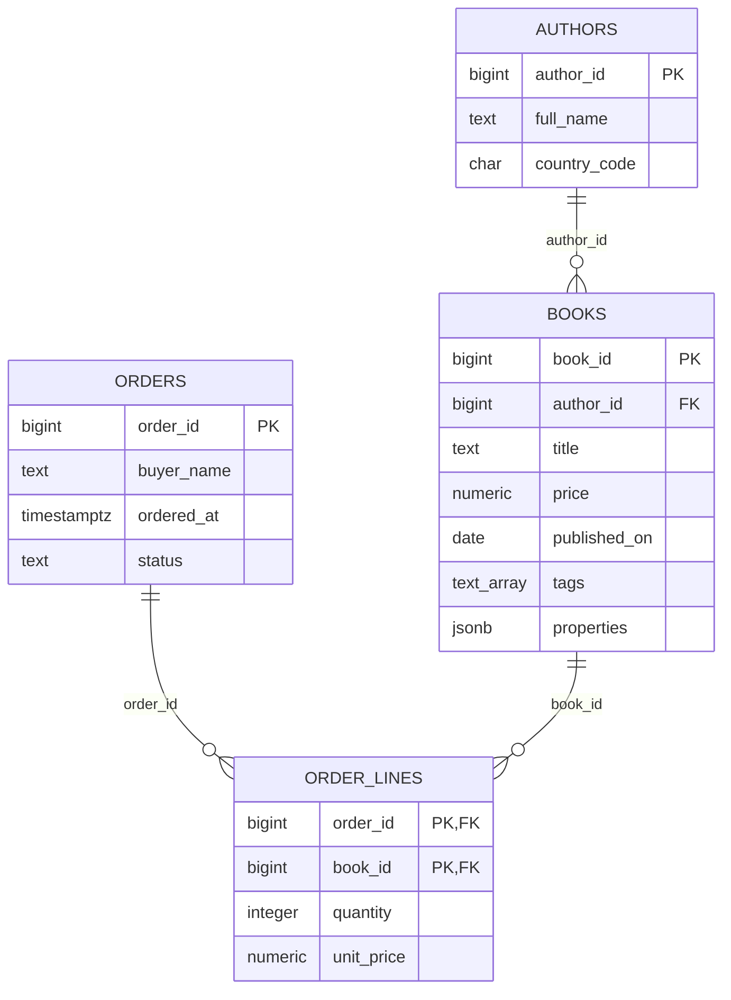

# The Relational Model, SQL, and PostgreSQL's Object-Relational Features

## 1. What Kind of Database Management System Is PostgreSQL?

**PostgreSQL** is an open-source relational database management system, more accurately described as an **object-relational database management system (ORDBMS)**. PostgreSQL uses the **relational model** as its foundation: data is organized into tables, rows, and columns; tables are linked via keys and constraints; and data is queried with **SQL**. At the same time, PostgreSQL provides a rich type system and extensibility, allowing you to work with user-defined types, composite values, arrays, JSONB, range types, functions, and extensions.

Three concepts to distinguish:

- **Relational:** structured data, keys, constraints, and join/aggregation operations over sets of rows.
- **SQL:** the language for defining schemas, manipulating, querying, and controlling data.
- **Object-relational:** still uses relations and SQL, while adding rich type system capabilities, user-defined types/functions/operators, and certain inheritance mechanisms.

PostgreSQL is **not** a database that stores only "Java/Python objects" instead of tables. Nor does it become a NoSQL database simply because it supports JSONB. PostgreSQL's extensibility **complements** the relational model rather than erasing relational design principles.

```text
Application (Java, Python, Go, ...)
                  │
                  │ SQL / PostgreSQL protocol
                  ▼
          PostgreSQL Server
                  │
    +-------------+-----------------+
    |             |                 |
SQL Schema   Execution Engine   Extensible Types/Funcs
Tables, keys Index, MVCC        ENUM, DOMAIN,
FK, JOIN     transaction        ARRAY, JSONB,
GROUP BY     WAL, VACUUM        RANGE, extension
    |             |                 |
    +-------------+-----------------+
                  │
                  ▼
             Stored Data
```

This lesson uses **PostgreSQL** as its context throughout; the SQL examples should not be blindly copied to MySQL because data type syntax, identity columns, JSONB operators, schemas, and extension mechanisms can differ.

## 2. The Relational Model: Tables, Rows, Columns, and Relationships Between Tables

### 2.1. From Mathematical Concepts to SQL Tables

In relational theory, a **relation** can be thought of as a set of **tuples** conforming to a structure of **attributes**. When implemented in SQL, we typically use:

| Concept | In PostgreSQL | Example |
| --- | --- | --- |
| Relation | Table | `books` |
| Tuple | Row | One book |
| Attribute | Column | `title`, `price` |
| Domain | Data type and value constraints | `numeric(12,2)`, `CHECK` |
| Record identifier | Primary key / unique key | `book_id` |
| Relationship between entities | Foreign key | `books.author_id → authors.author_id` |
| Relation schema | Column names, types, and constraints | `CREATE TABLE` |

Example `books` table:

| book_id | author_id | title | price |
| ---: | ---: | --- | ---: |
| 101 | 1 | Introduction to PostgreSQL | 180000.00 |
| 102 | 1 | Practical SQL | 150000.00 |
| 103 | 2 | Data Design | 220000.00 |

Each row represents **one book**; each column stores one attribute. In practical SQL, a table can contain duplicate rows if no appropriate constraint is declared. Therefore, to ensure records have clear identifiers, a **primary key** is usually needed.

An important point: **tables have no guaranteed row order**. If an application wants to list books in ascending price order, it must write `ORDER BY price ASC`; it cannot rely on `INSERT` order or physical row placement.

### 2.2. Primary Key (`PRIMARY KEY`)

A primary key is a column or set of columns used to identify each row. In PostgreSQL, `PRIMARY KEY` guarantees **non-NULL** and **uniqueness** over the key columns.

```sql
CREATE TABLE authors (
    author_id bigint PRIMARY KEY,
    full_name text NOT NULL
);
```

Rows:

```text
author_id = 1, full_name = 'Nguyễn An'
author_id = 2, full_name = 'Trần Bình'
```

have distinct identifiers. An attempt to insert another row with `author_id = 1` will violate the primary key constraint. A table can have multiple `UNIQUE` constraints, but only **one** `PRIMARY KEY` constraint (which may span multiple columns).

A composite key example:

```sql
PRIMARY KEY (order_id, book_id)
```

This key means the **pair of order ID + book ID** must be unique. An individual `order_id` can repeat across line items of the same order; an individual `book_id` can appear across multiple orders.

### 2.3. Foreign Key (`FOREIGN KEY`)

A foreign key represents the relationship between a child table and a parent table. For example:

```text
authors                             books
+--------------------+             +--------------------+
| author_id (PK)     |◄────────────| author_id (FK)     |
| full_name          |             | book_id (PK)       |
+--------------------+             | title              |
                                   | price              |
                                   +--------------------+
```

Here `books.author_id` references `authors.author_id`. PostgreSQL checks the constraint to prevent a book from referencing a nonexistent author (except in cases permitted by design and constraint behavior).

```sql
CREATE TABLE books (
    book_id bigint PRIMARY KEY,
    author_id bigint NOT NULL REFERENCES authors(author_id),
    title text NOT NULL,
    price numeric(12,2) NOT NULL
);
```

Suppose the `authors` table only has IDs 1 and 2. The statement:

```sql
INSERT INTO books (book_id, author_id, title, price)
VALUES (999, 9999, 'Book with Unknown Author', 100000.00);
```

will be rejected because `author_id = 9999` does not match any author row.

**A foreign key does not automatically join tables when querying.** To fetch author names alongside book titles, the `SELECT` query still needs an explicit `JOIN` condition.

### 2.4. Common Relationship Types

| Relationship Type | Example | Typical Design |
| --- | --- | --- |
| 1–1 | One user has one extended profile | Foreign key with `UNIQUE` on the profile table |
| 1–N | One author has many books | `books` table contains `author_id` |
| N–N | One order has many books; one book appears in many orders | Junction table `order_lines` linking `orders` and `books` |

```text
authors   1 ---- N   books
                        |
                        | 1
                        |
                        N
                   order_lines
                        N
                        |
                        | 1
                      orders
```

For N–N relationships, avoid storing all book IDs as a string like `'101,102,103'` and splitting it in every query. A **junction table with foreign keys** is usually clearer, enforces integrity better, and works naturally with `JOIN`.

## 3. Domains, Data Types, NULL, and Constraints

A column does not just have a name; it also has a **data type** and may carry business constraints. PostgreSQL offers many common SQL types:

| Data Type | When to Use? | Example |
| --- | --- | --- |
| `integer`, `bigint` | Integers, identifiers | `book_id bigint` |
| `numeric(12,2)` | Decimal values requiring exact precision | Book prices, monetary amounts |
| `text`, `varchar(n)` | Text | Book titles |
| `boolean` | True/false | `is_active boolean` |
| `date` | Date without time | Publication date |
| `timestamp` | Date and time without time zone | Local timestamp |
| `timestamptz` | An absolute point in time, displayed per session time zone | Order placement time |
| `uuid` | UUID identifier | External system ID |
| `bytea` | Binary data | A small binary payload |

**`numeric(12,2)`** fits monetary values in examples because it preserves decimal precision as declared; avoid `real`/`double precision` for monetary amounts requiring exact decimal arithmetic.

**`NULL` is not synonymous with 0 or an empty string**. It represents an unknown or missing value, depending on context. In SQL:

```sql
-- Correct way to check for NULL:
WHERE published_on IS NULL

-- Do not use to check for NULL:
-- WHERE published_on = NULL
```

In SQL's three-valued logic, comparing equality with `NULL` generally evaluates to **UNKNOWN**, not `TRUE`.

### 3.1. Basic Constraints

```sql
CREATE TABLE demo_products (
    product_id bigint PRIMARY KEY,
    sku text UNIQUE NOT NULL,
    price numeric(12,2) NOT NULL CHECK (price >= 0),
    is_active boolean NOT NULL DEFAULT true
);
```

| Constraint | Meaning |
| --- | --- |
| `PRIMARY KEY` | Unique identifier, non-NULL |
| `UNIQUE` | Enforces uniqueness according to the constraint's NULL rules |
| `NOT NULL` | Disallows NULL values |
| `CHECK (...)` | Requires the check expression not to evaluate to FALSE |
| `DEFAULT` | Default value when no value is supplied for the column |
| `REFERENCES` / `FOREIGN KEY` | Enforces referential relationship |

For example: `CHECK (price >= 0)` prevents negative prices when `price` has a value. If a column allows `NULL`, the CHECK expression can evaluate to UNKNOWN and will not automatically reject NULL; that is why the example also declares `NOT NULL`.

For standard `UNIQUE` constraints, PostgreSQL has specific rules for NULLs; modern versions also support `NULLS NOT DISTINCT` when NULLs must be treated as duplicates. Do not assume `UNIQUE` and `PRIMARY KEY` share identical NULL rules.

## 4. SQL: The Language for Working with the Relational Model

**SQL (Structured Query Language)** is a declarative language: you describe the **desired result**, and PostgreSQL plans how to execute it. This differs from writing an imperative algorithm in application code that iterates record by record.

Common statement categories:

| Category | Purpose | Statements |
| --- | --- | --- |
| DDL (*Data Definition Language*) | Define structure | `CREATE`, `ALTER`, `DROP` |
| DML (*Data Manipulation Language*) | Modify data | `INSERT`, `UPDATE`, `DELETE` |
| Query | Read data | `SELECT`, `WITH` |
| Transaction control | Manage transactions | `BEGIN`, `COMMIT`, `ROLLBACK`, `SAVEPOINT` |
| Access privileges | Grant and revoke privileges | `GRANT`, `REVOKE` |

This is a learning categorization. In practice, statements can overlap: `INSERT ... RETURNING` both writes and returns results; `WITH` can be used alongside data-modifying statements.

### 4.1. A Query Is a Transformation Over Row Sets

```sql
SELECT title, price
FROM books
WHERE price >= 150000
ORDER BY price DESC;
```

Logical reading:

1. **`FROM`** identifies the data source.
2. **`WHERE`** restricts which rows to keep.
3. **`SELECT`** specifies the columns/expressions to return.
4. **`ORDER BY`** requests the output ordering.

The optimizer may execute physical operations differently for speed, provided SQL semantics are satisfied.

### 4.2. Object Names and Case Sensitivity

PostgreSQL folds **unquoted identifiers** to lowercase. Both statements:

```sql
SELECT title FROM books;
SELECT TITLE FROM BOOKS;
```

reference unquoted identifiers resolving to `title` and `books` (if created unquoted).

However:

```sql
SELECT "Title" FROM books;
```

references the **exact** column named `Title` (with an uppercase T), not `title`. To avoid errors, use `snake_case` table/column names and avoid creating case-sensitive quoted identifiers without a clear reason.

### 4.3. PostgreSQL Supports Multiple Schemas Within a Database

A `schema` is a namespace containing tables, data types, functions, views, and other objects. A PostgreSQL server can manage multiple **databases**, and each database can have multiple **schemas**.

```text
PostgreSQL instance
  ├── database: app_db
  │     ├── schema: public
  │     ├── schema: library_demo
  │     │      ├── authors
  │     │      ├── books
  │     │      └── orders
  │     └── schema: analytics
  └── database: other_db
```

Use a qualified name:

```sql
SELECT *
FROM library_demo.books;
```

or set `search_path` in the session to reference `books` directly. `search_path` helps PostgreSQL resolve unqualified object names, so privileges and trusted schema ordering should also be managed carefully in multi-user environments.

## 5. Full Practice: A Library Schema in PostgreSQL

The following examples assume you are connected via `psql` or an equivalent PostgreSQL tool to **a test database** with privileges to create schemas and tables. Run the `CREATE` and `INSERT` statements only once; re-running them can cause duplicate-object or duplicate-key errors.

### 5.1. Create a Dedicated Schema

```sql
CREATE SCHEMA IF NOT EXISTS library_demo;

SET search_path TO library_demo, public;
```

`SET search_path` affects only the current session scope. In real applications, specify the schema explicitly in configuration or use fully qualified schema names where needed. Never run `DROP SCHEMA ... CASCADE` on a schema holding important data just to clean up an exercise.

### 5.2. Create Tables and Constraints

```sql
CREATE TABLE authors (
    author_id bigint PRIMARY KEY,
    full_name text NOT NULL,
    country_code char(2)
);

CREATE TABLE books (
    book_id bigint PRIMARY KEY,
    author_id bigint NOT NULL,
    title text NOT NULL,
    price numeric(12,2) NOT NULL CHECK (price >= 0),
    published_on date,
    tags text[] NOT NULL DEFAULT '{}'::text[],
    properties jsonb NOT NULL DEFAULT '{}'::jsonb,

    CONSTRAINT fk_books_author
        FOREIGN KEY (author_id)
        REFERENCES authors(author_id)
        ON DELETE RESTRICT
);

CREATE TABLE orders (
    order_id bigint PRIMARY KEY,
    buyer_name text NOT NULL,
    ordered_at timestamptz NOT NULL DEFAULT now(),
    status text NOT NULL DEFAULT 'NEW'
        CHECK (status IN ('NEW', 'PAID', 'CANCELLED'))
);

CREATE TABLE order_lines (
    order_id bigint NOT NULL REFERENCES orders(order_id),
    book_id bigint NOT NULL REFERENCES books(book_id),
    quantity integer NOT NULL CHECK (quantity > 0),
    unit_price numeric(12,2) NOT NULL CHECK (unit_price >= 0),
    PRIMARY KEY (order_id, book_id)
);
```

Here:

- `authors` stores authors.
- `books` stores books and references an author via `author_id`.
- `orders` stores purchase orders.
- `order_lines` is the many-to-many junction table between orders and books, including quantity and price at order time.
- `tags text[]` and `properties jsonb` illustrate PostgreSQL's rich data types; a later section explains why they should not replace every relationship.
- `status` has a check constraint enforcing valid values.

Diagram:



### 5.3. Insert Sample Data

```sql
INSERT INTO authors (author_id, full_name, country_code)
VALUES
    (1, 'Nguyễn An', 'VN'),
    (2, 'Trần Bình', 'VN'),
    (3, 'Alex Morgan', 'US');

INSERT INTO books
    (book_id, author_id, title, price, published_on, tags, properties)
VALUES
    (
        101, 1, 'Introduction to PostgreSQL',
        180000.00, DATE '2026-03-10',
        ARRAY['postgresql', 'sql', 'beginner'],
        '{"language":"vi","pages":240,"edition":1}'::jsonb
    ),
    (
        102, 1, 'Practical SQL',
        150000.00, DATE '2026-04-20',
        ARRAY['sql', 'practice'],
        '{"language":"vi","pages":190}'::jsonb
    ),
    (
        103, 2, 'Data Design',
        220000.00, DATE '2026-05-15',
        ARRAY['database', 'design'],
        '{"language":"vi","pages":310}'::jsonb
    ),
    (
        104, 3, 'Database Systems',
        380000.00, DATE '2025-11-01',
        ARRAY['database', 'advanced'],
        '{"language":"en","pages":420}'::jsonb
    );

INSERT INTO orders (order_id, buyer_name, status)
VALUES
    (1001, 'Customer A', 'PAID'),
    (1002, 'Customer B', 'NEW');

INSERT INTO order_lines
    (order_id, book_id, quantity, unit_price)
VALUES
    (1001, 101, 1, 180000.00),
    (1001, 102, 2, 150000.00),
    (1002, 103, 1, 220000.00);
```

### 5.4. `SELECT` with Filtering and Sorting

```sql
SELECT book_id, title, price
FROM books
WHERE price >= 180000
ORDER BY price DESC, book_id ASC;
```

Result with sample data:

| book_id | title | price |
| ---: | --- | ---: |
| 104 | Database Systems | 380000.00 |
| 103 | Data Design | 220000.00 |
| 101 | Introduction to PostgreSQL | 180000.00 |

`ORDER BY price DESC, book_id ASC` makes both the price sort rule and the ID tie-breaker explicit. Without `ORDER BY`, PostgreSQL **makes no guarantee** on row ordering.

### 5.5. `INNER JOIN`: Combining Related Tables

```sql
SELECT
    b.book_id,
    b.title,
    a.full_name AS author_name,
    b.price
FROM books AS b
INNER JOIN authors AS a
    ON b.author_id = a.author_id
ORDER BY b.book_id;
```

Result:

| book_id | title | author_name | price |
| ---: | --- | --- | ---: |
| 101 | Introduction to PostgreSQL | Nguyễn An | 180000.00 |
| 102 | Practical SQL | Nguyễn An | 150000.00 |
| 103 | Data Design | Trần Bình | 220000.00 |
| 104 | Database Systems | Alex Morgan | 380000.00 |

The condition `ON b.author_id = a.author_id` expresses **the foreign-key-to-primary-key relationship**. Never join two columns merely because both hold numbers or have similar names.

### 5.6. `LEFT JOIN` and Unmatched Rows

```sql
SELECT
    a.author_id,
    a.full_name,
    COUNT(b.book_id) AS book_count
FROM authors AS a
LEFT JOIN books AS b
    ON b.author_id = a.author_id
GROUP BY a.author_id, a.full_name
ORDER BY a.author_id;
```

`LEFT JOIN` retains authors without books, if any, with `COUNT(b.book_id) = 0`. Use `COUNT(b.book_id)` instead of `COUNT(*)` because in an outer join, an author without books still produces **one result row containing NULLs on the books side**; `COUNT(*)` would count that row.

With the current data:

| author_id | full_name | book_count |
| ---: | --- | ---: |
| 1 | Nguyễn An | 2 |
| 2 | Trần Bình | 1 |
| 3 | Alex Morgan | 1 |

### 5.7. `GROUP BY`, `SUM`, and Junction Tables

```sql
SELECT
    o.order_id,
    o.buyer_name,
    SUM(ol.quantity * ol.unit_price) AS order_total
FROM orders AS o
JOIN order_lines AS ol
    ON ol.order_id = o.order_id
GROUP BY o.order_id, o.buyer_name
ORDER BY o.order_id;
```

Result:

| order_id | buyer_name | order_total |
| ---: | --- | ---: |
| 1001 | Customer A | 480000.00 |
| 1002 | Customer B | 220000.00 |

Order 1001 totals `1 × 180000 + 2 × 150000 = 480000`. The `order_lines` table has its own `unit_price` because **the selling price at order time** may differ from the current list price in `books.price`.

This query illustrates the benefit of the relational model: there is no need to embed an entire list of books in a text column and manually parse it to calculate totals.

## 6. SQL Also Allows Constrained Data Updates

### 6.1. `INSERT ... RETURNING`

PostgreSQL provides the `RETURNING` clause to immediately retrieve values from inserted/written rows:

```sql
INSERT INTO authors (author_id, full_name, country_code)
VALUES (4, 'Lê Chi', 'VN')
RETURNING author_id, full_name;
```

The returned result contains the columns of the newly inserted row. This syntax is useful when an application needs the generated ID or written values without issuing a separate `SELECT`.

Note that if you run the example above a second time in the same database, the key `author_id = 4` already exists and PostgreSQL will raise a duplicate-key error. Use a fresh test database or actively manage data during practice.

### 6.2. Conditional `UPDATE`

```sql
UPDATE books
SET price = 175000.00
WHERE book_id = 101
RETURNING book_id, title, price;
```

The `WHERE` clause identifies which row to modify. Omitting `WHERE` causes `UPDATE` to modify **every row** in the table.

A conditional statement is also a way to guard correctness:

```sql
UPDATE books
SET price = price + 10000
WHERE book_id = 101
  AND price < 200000
RETURNING book_id, price;
```

If the condition no longer holds, the statement returns no rows in `RETURNING`. When multiple transactions update concurrently, combine this with appropriate transaction/locking decisions to protect the entire workflow.

### 6.3. `DELETE` and Foreign Key Constraints

```sql
DELETE FROM authors
WHERE author_id = 1;
```

With the sample data, author 1 still has books, so the command is blocked by the foreign key `books.author_id` and `ON DELETE RESTRICT`. This is **referential integrity** being enforced, not an accidental bug.

Do not drop a foreign key just to execute a delete that violates data rules. Define the intended business behavior instead: restrict deletion, delete dependent records per policy, or mark the record as inactive.

## 7. Transactions, ACID, and MVCC in PostgreSQL

The relational model must remain valid even when multiple connections write concurrently. PostgreSQL supports transactions with **ACID** properties:

| Property | Meaning |
| --- | --- |
| **Atomicity** | Steps within a transaction succeed together or are rolled back together at the transaction boundary |
| **Consistency** | Data must satisfy all applied constraints and rules when the transaction completes |
| **Isolation** | Concurrent transactions observe data according to the DBMS's isolation rules |
| **Durability** | Once a commit is confirmed per durability settings, changes persist across crashes via storage/logging mechanisms |

### 7.1. Multi-Step Transactions

When inserting an order along with its line items, wrap them in a single transaction:

```sql
BEGIN;

INSERT INTO orders (order_id, buyer_name, status)
VALUES (1003, 'Customer C', 'NEW');

INSERT INTO order_lines
    (order_id, book_id, quantity, unit_price)
VALUES
    (1003, 101, 1, 180000.00),
    (1003, 104, 1, 380000.00);

COMMIT;
```

If a step fails, the application must perform `ROLLBACK` instead of treating the order as created. In PostgreSQL, when a statement raises an error inside a transaction, the transaction enters an **aborted state** and subsequent commands cannot proceed normally until `ROLLBACK` or appropriate savepoint handling.

### 7.2. Trying Rollback

```sql
BEGIN;

UPDATE books
SET price = price + 50000
WHERE book_id = 101;

-- Discard uncommitted changes:
ROLLBACK;
```

After `ROLLBACK`, the price of book 101 returns to its state prior to the test transaction (reflecting prior valid committed changes).

Not every administrative command can run inside a transaction block; for example, `CREATE DATABASE` has specific restrictions. However, many common PostgreSQL DDL operations can participate in transactions, which is very helpful when building controlled migrations.

### 7.3. MVCC: Concurrent Readers and Writers

**MVCC (Multi-Version Concurrency Control)** is a mechanism that manages multiple row versions so transactions can read data according to their isolation level without constantly blocking writers with read locks. PostgreSQL defaults to **READ COMMITTED** isolation for new transactions unless configured otherwise.

```text
Transaction A                       Transaction B
    |                                     |
    | SELECT book 101                     |
    |                                     | UPDATE book 101
    |                                     | COMMIT
    | SELECT book 101 again               |
    |   (in READ COMMITTED, the new       |
    |    statement's snapshot can see     |
    |    the committed price)             |
```

Exact behavior depends on the isolation level and transaction timing. MVCC does not mean write conflicts are automatically resolved per business rules; when two transactions modify the same row or require a "read-then-write" invariant, proper transaction and locking design is still required.

### 7.4. How Do WAL and VACUUM Relate?

- **WAL (Write-Ahead Logging):** PostgreSQL writes necessary change records to support crash recovery and record-replay capabilities.
- **VACUUM:** reclaims/marks reusable space from row versions no longer needed under MVCC and maintains operational metadata; autovacuum handles routine work automatically.
- **Index:** an access structure that helps filter/select/sort efficiently; it does not guarantee every query will automatically be fast.

These mechanisms enable PostgreSQL to handle relational data in production environments, though they are not part of `JOIN` syntax or primary key theory. They belong to the DBMS's storage and operational layer.

## 8. Object-Relational Characteristics: A Rich Type System

The "object" part of **object-relational** is frequently misunderstood. The key distinction is that PostgreSQL provides an **extensible type system** and supports complex structures inside **column values**, alongside basic SQL types.

### 8.1. `ENUM`: Named Set of Values

Create an enumerated type:

```sql
CREATE TYPE book_format AS ENUM (
    'PAPERBACK',
    'HARDCOVER',
    'EBOOK'
);
```

Type value:

```sql
SELECT 'EBOOK'::book_format AS format;
```

Use in a table:

```sql
ALTER TABLE books
ADD COLUMN format book_format NOT NULL DEFAULT 'PAPERBACK';
```

Benefits: data accepts only declared labels, giving clearer semantics than a free-form string. A few notes:

- Adding enum values is managed via DDL such as `ALTER TYPE ... ADD VALUE`.
- Removing or renaming an in-use label can require a migration procedure.
- When the value list is frequently changing business data, a **lookup table + foreign key** can be more flexible than an enum.

### 8.2. `DOMAIN`: Reusable Constrained Data Types

PostgreSQL lets you define a **domain** based on an existing type:

```sql
CREATE DOMAIN nonnegative_price AS numeric(12,2)
    CHECK (VALUE >= 0);
```

Example:

```sql
SELECT 125000.00::nonnegative_price AS price;
```

Benefit: the non-negative price rule can be reused across many columns without repeating the full declaration. Domains do not replace all table constraints: for instance, a check involving **two columns** still requires a table-level rule or application validation.

Keep in mind that `CHECK (VALUE >= 0)` does not automatically reject NULL in all situations. If NULL must be disallowed, combine it with an appropriate `NOT NULL` constraint at the column or domain level.

### 8.3. Composite Types: A Single Value with Multiple Fields

You can define a **composite type**:

```sql
CREATE TYPE postal_address AS (
    street text,
    city text,
    country_code char(2)
);
```

Use in a table:

```sql
CREATE TABLE supplier_profiles (
    supplier_id bigint PRIMARY KEY,
    supplier_name text NOT NULL,
    address postal_address
);
```

Insert data and access fields:

```sql
INSERT INTO supplier_profiles
    (supplier_id, supplier_name, address)
VALUES
    (
        1,
        'Supplier A',
        ROW('12 Le Loi', 'Hanoi', 'VN')::postal_address
    );

SELECT
    supplier_name,
    (address).city AS city,
    (address).country_code AS country_code
FROM supplier_profiles;
```

Composite types let you represent a multi-field value inside a single column. However, **a composite type does not replace a relational table with keys, indexes, and referential constraints**. If the address or its inner components need an independent lifecycle, links from multiple entities, or dedicated constraints, a separate table is usually more appropriate.

### 8.4. Array: One Column Holding Multiple Elements of the Same Type

In the `books` table, `tags` is `text[]`:

```sql
SELECT book_id, title, tags
FROM books
WHERE tags @> ARRAY['sql']::text[]
ORDER BY book_id;
```

The `@>` operator checks whether the array on the left contains the elements requested on the right under PostgreSQL array semantics.

With the sample data, books 101 and 102 have the `sql` tag.

Another operation:

```sql
SELECT
    book_id,
    title,
    cardinality(tags) AS tag_count
FROM books
ORDER BY book_id;
```

`cardinality()` returns the total number of elements in the array. PostgreSQL also provides `unnest()` to expand array elements into rows:

```sql
SELECT
    b.book_id,
    tag
FROM books AS b
CROSS JOIN LATERAL unnest(b.tags) AS t(tag)
ORDER BY b.book_id, tag;
```

**When to use arrays?** When the list is small, uniformly typed, tightly bound to a single record, and does not need complex foreign key relationships.

**When to use a child table?** When each element has its own attributes, needs an FK, needs separate permissions, is frequently updated or queried independently, or forms an N–N relationship. Do not stuff critical foreign identifiers into an array just to avoid designing a junction table.

### 8.5. JSONB: Storing and Querying Semi-Structured Attributes

PostgreSQL provides `json` and `jsonb`. `jsonb` stores JSON data in a parsed representation optimized for many queries and operators; in exchange, its formatting preservation differs from `json`. `json` preserves input text formatting more closely, whereas `jsonb` does not preserve object key order or duplicate keys from the source text.

In the `books` example:

```sql
SELECT
    book_id,
    title,
    properties ->> 'language' AS language,
    (properties ->> 'pages')::integer AS pages
FROM books
ORDER BY book_id;
```

- `->` extracts a value as JSON/JSONB.
- `->>` extracts a value as text.
- `::integer` casts the pages text to an integer if valid.

Filtering with containment:

```sql
SELECT book_id, title
FROM books
WHERE properties @> '{"language":"vi"}'::jsonb
ORDER BY book_id;
```

With the sample data, the result includes books 101, 102, and 103. Here the `@>` operator checks whether the JSONB document on the left contains the requested JSON structure/object.

**Why does JSONB count as an object-relational feature?** A column in a relational table can hold a complex document value with multiple keys, arrays, and nested objects, while SQL can still access and filter it.

**Do not overuse JSONB for core relational data:**

- If `author_id` is an important relationship, keep an `author_id` column with a `FOREIGN KEY`, rather than storing the author ID only inside JSONB.
- A field inside JSONB does not automatically receive referential integrity guarantees like a standard foreign key.
- Key names and inner data types can vary across rows unless validated/enforced; the application must decide how much flexibility is acceptable.

JSONB is well suited for **optional or variable metadata**, not necessarily the best choice for attributes requiring strict queries, aggregations, foreign keys, and tight constraints.

### 8.6. Range Types

PostgreSQL supports range types such as `int4range`, `numrange`, `daterange`, and `tstzrange`. They are convenient for time intervals or continuous value ranges.

Example:

```sql
SELECT
    daterange(
        DATE '2026-01-01',
        DATE '2026-02-01',
        '[)'
    ) @> DATE '2026-01-15' AS inside_period;
```

The result `inside_period` is `true` because January 15 falls within the range from January 1 up to **before** February 1.

Some operators:

| Operator | General Meaning |
| --- | --- |
| `@>` | Range contains a value or another range |
| `<@` | Value/range is contained within another range |
| `&&` | Two ranges overlap |
| `-|-` | Two ranges are adjacent |

Range types can be useful in booking systems, validity histories, work schedules, and resource allocation. However, using them requires clear bound inclusivity/exclusivity rules and time units to prevent off-by-one boundary bugs.

## 9. PostgreSQL Allows Extending Operators, Functions, and Indexes

Extensibility goes beyond a built-in list of data types. PostgreSQL can be extended with:

- **User-defined data types** and domains.
- **Functions** in SQL, PL/pgSQL, or other supported languages.
- **Operators** operating on corresponding data types.
- **Operator classes** and access/index methods compatible with those types.
- **Extensions** packaging objects and extended capabilities.

### 9.1. User-Defined SQL Functions

Example function computing a percentage-discounted price:

```sql
CREATE FUNCTION discounted_price(
    original_price numeric,
    discount_percent numeric
)
RETURNS numeric
LANGUAGE sql
IMMUTABLE
AS $$
    SELECT round(
        original_price * (1 - discount_percent / 100),
        2
    )
$$;
```

Calling the function:

```sql
SELECT
    title,
    price,
    discounted_price(price, 10) AS price_after_discount
FROM books
ORDER BY book_id;
```

A function can be used inside SQL expressions. Here, `IMMUTABLE` states that for the same arguments, the result does not depend on database data or external mutable state; a function's volatility attribute must be declared **accurately to match its actual behavior**, because it affects how the optimizer handles the function.

Real applications still need to define rounding, tax, and discount policies per business rules; this example only illustrates PostgreSQL's function mechanism.

### 9.2. GIN Indexes for Arrays and JSONB

PostgreSQL supports multiple index methods. B-tree is common for equality, range, and sorting; **GIN** is often helpful for multi-element types such as arrays and JSONB with matching operators.

```sql
CREATE INDEX idx_books_tags_gin
    ON books USING GIN (tags);

CREATE INDEX idx_books_properties_gin
    ON books USING GIN (properties);
```

Example queries that may benefit:

```sql
SELECT book_id, title
FROM books
WHERE tags @> ARRAY['sql']::text[];

SELECT book_id, title
FROM books
WHERE properties @> '{"language":"vi"}'::jsonb;
```

However, a GIN index on `properties` **does not automatically optimize every expression** like `properties ->> 'language' = 'vi'` in the same way. For frequently run expression queries, consider an **expression index**:

```sql
CREATE INDEX idx_books_language
    ON books ((properties ->> 'language'));
```

Whether an index performs well depends on row count, selectivity, operators, version, and execution plan. Check `EXPLAIN`; do not assume "having an index makes every JSONB query fast."

### 9.3. Expression Indexes and Partial Indexes

PostgreSQL can create an index over an **expression**:

```sql
CREATE INDEX idx_books_title_lower
    ON books (lower(title));
```

Candidate for:

```sql
SELECT book_id, title
FROM books
WHERE lower(title) = lower('Practical SQL');
```

And a **partial index** indexes only a subset of rows matching a predicate:

```sql
CREATE INDEX idx_orders_paid_recent
    ON orders (ordered_at DESC, order_id DESC)
    WHERE status = 'PAID';
```

Candidate for queries frequently fetching the most recent paid orders:

```sql
SELECT order_id, ordered_at
FROM orders
WHERE status = 'PAID'
ORDER BY ordered_at DESC, order_id DESC
LIMIT 20;
```

A partial index is only used by the optimizer when the query predicate matches the indexed row subset. Do not create indexes for every conceivable case while ignoring `INSERT`/`UPDATE`/`DELETE` overhead and storage cost.

### 9.4. Extensions: Installing Specialized Capabilities

PostgreSQL has a rich extension ecosystem. For example, `pg_trgm` adds trigram-based text similarity matching:

```sql
-- Check whether the extension is available on the server:
SELECT name, default_version, installed_version
FROM pg_available_extensions
WHERE name = 'pg_trgm';
```

If the server has the extension and the account has permission to install it:

```sql
CREATE EXTENSION IF NOT EXISTS pg_trgm;
```

An application example:

```sql
CREATE INDEX idx_books_title_trgm
    ON books USING GIN (title gin_trgm_ops);

SELECT book_id, title
FROM books
WHERE title ILIKE '%postgresql%';
```

A trigram index can accelerate pattern matching that standard B-tree indexes struggle with. However, `pg_trgm` must be **installed/supported on the server**, and installation privileges may be restricted. In this example, `search_path` can affect which schema installs the extension; explicitly control the target schema in production environments.

**Not every PostgreSQL system needs every extension installed.** Install only what business requirements and deployment environments need, while considering security, version upgrades, and operations.

## 10. Table Inheritance: Supported, But Know Its Limits

One object-relational feature in PostgreSQL is **table inheritance**. Example:

```sql
CREATE TABLE assets (
    asset_id bigint,
    asset_name text NOT NULL
);

CREATE TABLE laptops (
    cpu_model text
) INHERITS (assets);
```

The `laptops` table inherits columns from `assets` and adds `cpu_model`:

```sql
INSERT INTO assets (asset_id, asset_name)
VALUES (1, 'Printer');

INSERT INTO laptops (asset_id, asset_name, cpu_model)
VALUES (2, 'Staff Laptop', 'Sample CPU');

SELECT asset_id, asset_name
FROM assets
ORDER BY asset_id;
```

In PostgreSQL, querying a parent table **by default includes rows from child tables**, so this result contains both asset 1 and 2. To retrieve only rows stored directly in the parent table:

```sql
SELECT asset_id, asset_name
FROM ONLY assets
ORDER BY asset_id;
```

**Important takeaway:** table inheritance is **not** Java objects automatically mapped into the database, and does not replace all parent–child relationships. In particular, constraints such as **`PRIMARY KEY`, `UNIQUE`, and `FOREIGN KEY` do not automatically span the entire inheritance hierarchy as OOP intuition might suggest**. Therefore, do not use table inheritance to design a taxonomy with strict integrity requirements without thoroughly studying constraint behavior.

When splitting a large table by time range or key, PostgreSQL also offers **declarative partitioning** (`PARTITION BY ...`), with its own mechanisms and rules. Do not equate partitioning with object inheritance or N–N junction tables.

## 11. How Does Object-Relational PostgreSQL Differ from an ORM?

These two terms sound similar but are not the same:

| Term | Where It Lives | Role |
| --- | --- | --- |
| **ORDBMS (PostgreSQL)** | Database management system | Stores, queries, and processes rich data types and constraints |
| **ORM (Object-Relational Mapping)** | Application library | Maps Java/Python/... classes/objects to tables and rows |
| **Composite type** | Inside PostgreSQL | A value type consisting of multiple fields |
| **Table inheritance** | Inside PostgreSQL | Allows a child table to inherit columns and certain query behaviors from a parent table |
| **Class inheritance** | In programming languages | Inherits fields/methods per language rules |

For example, a Java `Book` entity can map to the `books` table via JPA/Hibernate. But PostgreSQL's support for `jsonb`, `text[]`, or `CREATE TYPE` is a **database capability**, independent of whether the application uses an ORM.

An ORM may not natively support every PostgreSQL type. When using JSONB, composite types, or range types, check your driver and mapping strategy; sometimes an extension library, converter, or plain SQL is needed.

## 12. Use Complex Data Types or Normalize into Tables?

Object-relational features bring flexibility, but that does not mean every column should be JSONB or an array.

### 12.1. Scenario: A Book's List of Authors

If one book has multiple authors and each author writes multiple books, this is an **N–N** relationship. Standard design:

```sql
CREATE TABLE book_authors (
    book_id bigint NOT NULL REFERENCES books(book_id),
    author_id bigint NOT NULL REFERENCES authors(author_id),
    author_order integer NOT NULL CHECK (author_order > 0),
    PRIMARY KEY (book_id, author_id),
    UNIQUE (book_id, author_order)
);
```

A junction table can store **author ordering**, enforce FKs, and prevent duplicates. It is preferable to storing `author_ids bigint[]` when referential integrity and relationship attributes are needed.

Note that our initial sample schema had `books.author_id` to illustrate a one-to-many relationship. If an application genuinely transitions to **multiple authors per book**, design a clear migration for `author_id` rather than simply adding `book_authors` and leaving two conflicting sources of truth.

### 12.2. Scenario: Book Metadata

If each book has varying optional attributes:

```json
{
  "language": "vi",
  "pages": 240,
  "illustrated": true,
  "edition": 1
}
```

then `jsonb` may be suitable because fields are not always fixed and rarely need relational links. If `language` becomes a frequent filter field with strict validation rules or a foreign key to a languages lookup table, extracting it into an **explicitly typed column** can bring clear benefits.

### 12.3. Decision Matrix

| Data | Usually Suitable Choice | Reason |
| --- | --- | --- |
| Author ID of a book | FK `author_id` | Needs referential integrity |
| Multiple authors of a book | Junction table `book_authors` | N–N relationship, may carry relationship attributes |
| Small tag set, no FK needed | `text[]` or tag table depending on needs | Array is convenient if purely simple attributes |
| Metadata varying by book type | `jsonb` | Flexible and offers query operators |
| Status with a few stable labels | `ENUM`/`CHECK`/lookup table | Depends on change frequency and linking requirements |
| Address as a value attached to a profile | Composite type or separate columns | Depends on querying/constraint needs |
| Price validity interval | Range type or start/end columns | Ranges provide strong containment/overlap operators |

**Core criterion:** does that data have independent identity and relationships that the database must validate, or is it merely a complex attribute of one entity?

## 13. PostgreSQL Enforces Correctness in the Database, Not Just in Code

An API can have many clients: Java services, mobile apps, batch jobs, admin tools. If the "non-negative price" rule is only checked in one service, other write paths can still insert invalid data into the database.

A PostgreSQL-level constraint protects the shared rule:

```sql
ALTER TABLE books
ADD CONSTRAINT chk_book_price_nonnegative
CHECK (price >= 0);
```

**Practice note:** the `books` table in our example already had a `CHECK (price >= 0)` from creation, so running the command above creates **an additional constraint with the same meaning**. It only demonstrates `ALTER TABLE` syntax; there is no need to add a duplicate constraint to the sample table.

Similarly:

- `PRIMARY KEY` prevents duplicate identifiers.
- `FOREIGN KEY` validates references.
- `NOT NULL` requires data to be present.
- `UNIQUE` prevents duplicate values/tuples per declared rules.
- `CHECK` enforces valid conditions on each row.
- Transactions ensure multiple changes commit or roll back as a single unit.

**Database constraints and application checks should work together.** Applications still need user-friendly error messages; the database serves as the final safeguard across disparate write paths.

## 14. Views, Materialized Views, and Query-Level Relational Representations

PostgreSQL supports **views**—named objects representing queries:

```sql
CREATE VIEW book_catalog AS
SELECT
    b.book_id,
    b.title,
    b.price,
    a.full_name AS author_name
FROM books AS b
JOIN authors AS a
    ON a.author_id = b.author_id;
```

Usage:

```sql
SELECT *
FROM book_catalog
ORDER BY book_id;
```

A standard view does not store a permanent copy of rows like a separate table; query data reflects the underlying source tables according to query semantics.

A **materialized view** stores the results computed at creation/refresh time:

```sql
CREATE MATERIALIZED VIEW book_price_summary AS
SELECT
    author_id,
    COUNT(*) AS book_count,
    AVG(price) AS avg_price
FROM books
GROUP BY author_id;
```

To refresh results when source tables change:

```sql
REFRESH MATERIALIZED VIEW book_price_summary;
```

Materialized views require a refresh workflow; without refreshing, their data can become **stale** relative to the source tables. The two view types serve different read and operational needs.

## 15. Comparing Traditional Relational Capabilities and Extensible Features

| Criterion | Core Relational Capabilities | PostgreSQL Extensions |
| --- | --- | --- |
| Table definition | `CREATE TABLE` with basic column types | `jsonb`, array, composite, range, enum, domain columns |
| Data relationships | PK, FK, JOIN | Still uses PK/FK/JOIN; complex types enrich attribute representation |
| Querying | `SELECT`, `WHERE`, `JOIN`, `GROUP BY` | JSONB/array/range operators, custom functions |
| Validity enforcement | `NOT NULL`, `CHECK`, `UNIQUE`, `FOREIGN KEY` | Domains and custom constraints within PostgreSQL's limits |
| Optimization | Standard B-tree indexes | GIN, GiST, expression indexes, partial indexes, operator classes |
| System extensibility | SQL and core features | `CREATE EXTENSION`, custom types/functions/operators |
| Inheritance | Not a pure relational cornerstone | Table inheritance with specific limitations |
| Data types | Numbers, text, date/time, boolean | JSONB, arrays, ranges, composites, custom types |

The common denominator remains **SQL and the relational model**. PostgreSQL does not require cramming all data into a single specialized type. Conventional relational designs such as customers–orders–order lines remain a rock-solid foundation.

## 16. Common Misconceptions

| Misconception | Accurate Understanding |
| --- | --- |
| "PostgreSQL is NoSQL because it has JSONB." | PostgreSQL is an object-relational DBMS; JSONB is a data type queried within SQL |
| "Object-relational means using a Java ORM." | ORDBMS is a database characteristic; an ORM is an application mapping library |
| "An SQL table cannot contain two duplicate rows." | Without constraints, SQL tables can hold duplicate rows; `PRIMARY KEY`/`UNIQUE` enforce identity |
| "Rows are returned in INSERT order." | There is no ordering guarantee without `ORDER BY` |
| "Foreign keys automatically join tables on SELECT." | FKs enforce references; `JOIN ... ON ...` specifies row matching in queries |
| "An array column of IDs completely replaces an N–N table." | Arrays do not automatically enforce per-element FKs like a junction table |
| "JSONB means inner attributes are always valid." | Custom constraints/checks must be designed as required |
| "All data should go into JSONB for flexibility." | Core data with relationships/constraints usually fits explicit columns and tables |
| "ENUM is great for every frequently changing lookup list." | ENUM suits stable label sets; lookup tables are usually more flexible when changing often |
| "A composite type is a child table with a primary key." | A composite is a **value type**, not an independent relational table |
| "Table inheritance behaves identically to class inheritance." | Table inheritance has its own rules and constraint limitations |
| "MVCC means there is no write contention." | MVCC improves concurrent reads/writes; write conflicts can still occur |
| "Having an index makes every query fast." | Effectiveness depends on operators, selectivity, table size, and query plans |
| "Special data types don't need SQL." | Complex types are still created, read, filtered, and updated using SQL |

## 17. Practice Exercises and Suggested Solutions

### Exercise 1. Distinguish Entities and Attributes

A store has customers, orders, and multiple line items per order. Which tables should exist?

**Hint:**

```text
customers (customer_id PK, ...)
orders (order_id PK, customer_id FK, ...)
products (product_id PK, ...)
order_lines (order_id FK, product_id FK, quantity, unit_price, ...)
```

Do not store all product IDs as a single string inside `orders` when per-line foreign keys, quantities, and unit prices are needed.

### Exercise 2. Fetch Books Along with Author Names

```sql
SELECT
    b.book_id,
    b.title,
    a.full_name
FROM books AS b
JOIN authors AS a
    ON b.author_id = a.author_id
ORDER BY b.book_id;
```

The `ON` condition reflects the foreign key `books.author_id` referencing `authors.author_id`.

### Exercise 3. Count Books per Author, Including Authors Without Books

```sql
SELECT
    a.author_id,
    a.full_name,
    COUNT(b.book_id) AS book_count
FROM authors AS a
LEFT JOIN books AS b
    ON b.author_id = a.author_id
GROUP BY a.author_id, a.full_name
ORDER BY a.author_id;
```

Use `LEFT JOIN` to retain authors without books; use `COUNT(b.book_id)` so the synthetic NULL row on the books side is not counted.

### Exercise 4. Find Books Written in Vietnamese Using JSONB

```sql
SELECT book_id, title
FROM books
WHERE properties @> '{"language":"vi"}'::jsonb
ORDER BY book_id;
```

`@>` checks whether the JSONB structure on the left contains the requested key-value pair.

### Exercise 5. Find Books Tagged with `sql`

```sql
SELECT book_id, title
FROM books
WHERE tags @> ARRAY['sql']::text[]
ORDER BY book_id;
```

`tags` is an **array**; PostgreSQL provides operators for working with arrays without manually splitting strings.

### Exercise 6. Why Is `numeric(12,2)` More Suitable Than `double precision` for Book Prices?

Because prices in the example must be stored and calculated using exact decimal representation at the declared scale. Binary floating-point types such as `double precision` approximate many decimal fractions; they are better suited for scientific measurements, not monetary amounts requiring exactness.

### Exercise 7. Use an Enum or a Lookup Table for Statuses?

If there are just a few stable status values and no extra attributes are needed, `ENUM` or `CHECK` can work well. If statuses need multilingual display names, transition permissions, sort order, descriptions, and frequent updates, a **lookup table** with a foreign key can be a better fit.

### Exercise 8. Why Are Foreign Keys Important Even When the Application Checks That the Author Exists?

Because multiple programs or transactions may write to the table. A database FK constraint is a consistent safeguard across **all valid write paths**, preventing a session from creating a book pointing to a nonexistent author ID.

## 18. Summary

- **PostgreSQL is an object-relational DBMS:** the relational model and SQL form the foundation; complex types and extensibility provide additional ways to represent data.
- **Tables/rows/columns, keys, and constraints** organize structured data and preserve integrity. A sound model typically separates entities and uses foreign keys/junction tables for relationships.
- **SQL is the unified language** for creating tables, reading and transforming row sets, joining tables, aggregating, updating data, and managing transactions.
- **PostgreSQL has a rich type system:** `ENUM`, `DOMAIN`, composites, arrays, JSONB, and ranges, plus the ability to define functions, indexes, and extensions.
- **Complex types complement rather than replace all relationships.** Use JSONB/arrays for appropriate attributes; use FKs and relational tables when integrity, identity, or multi-entity links are required.
- **ACID, MVCC, WAL, and VACUUM** are critical mechanisms helping PostgreSQL serve concurrent workloads, recover from crashes, and maintain storage in production.
- **Table inheritance exists but has specific constraint limitations** and is not synonymous with OOP class inheritance.
- **Design guideline:** structure data properly, let the database enforce the rules it can protect, and adopt extensibility features when they provide genuine value.

When learning PostgreSQL, view the DBMS as two complementary layers: **the relational layer** keeps data consistent and queryable with SQL; **the extensibility layer** lets you work effectively with specialized value types, operators, and domain needs that basic table types do not express as conveniently.
