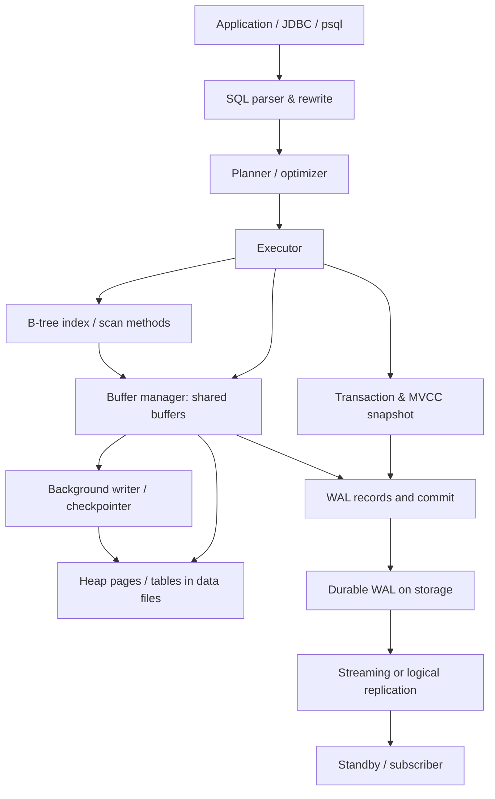
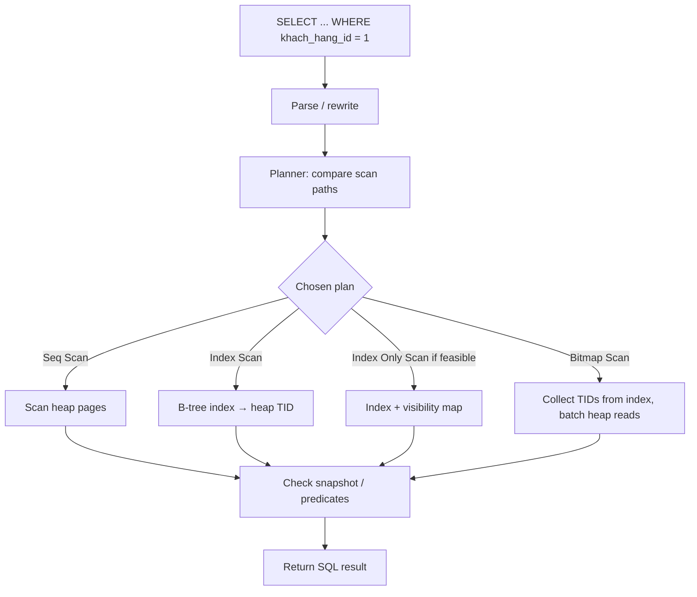
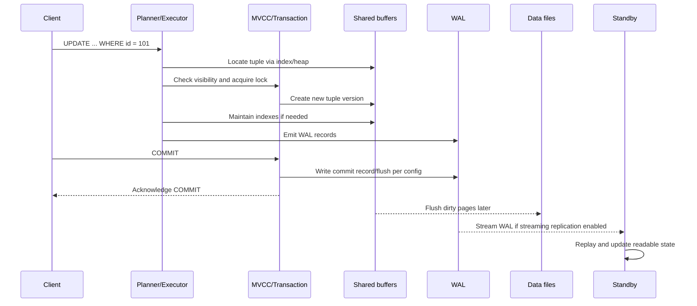
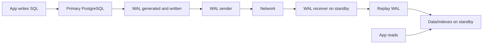

# Relationships Between Storage, Querying, Transactions, Indexes, and Replication

PostgreSQL is a relational database management system, yet an SQL statement is never handled by a single isolated component. When an application sends a `SELECT`, PostgreSQL must parse the query, choose an execution plan, read pages from memory or disk, probe indexes when helpful, and decide **which row versions are visible**. When an application sends `UPDATE` and `COMMIT`, PostgreSQL must create a new data version, manage locks and transactions, record **Write-Ahead Log (WAL)** entries for crash recovery, and optionally stream changes to a replica server.

Looking at each concept in isolation easily breeds misconceptions: "having an index means no table reads," "COMMIT means every data page has been flushed to disk," "having a replica means no backups are needed," or "each record exists only once in a table file." This lesson builds a **causal map** showing how the five pillars—**storage, querying, transactions, indexes, and replication**—interconnect in PostgreSQL.

The scope focuses on modern PostgreSQL with standard tables using heap storage and B-tree indexes. Extensions such as columnar storage, foreign tables, distributed PostgreSQL, or non-default storage engines can differ; the examples focus on core architecture so learners can build a foundation for deeper study.

## 1. Five Components Viewed Through a Single SQL Statement

| Component | Question It Answers | Key Concepts to Remember |
|---|---|---|
| **Storage** | Where are tables, rows, and pages stored, and how are they read/written? | Heap, page, tuple, shared buffers, WAL, vacuum |
| **Query processing** | How is SQL turned into execution steps? | Parser, rewrite, planner, executor, scan, join, aggregate |
| **Transactions** | Which changes are visible, and when do commits/rollbacks take effect? | ACID, MVCC, snapshot, isolation, locks |
| **Indexes** | How are rows located efficiently without scanning every page? | B-tree, index scan, bitmap scan, index-only scan |
| **Replication** | How is data maintained on another server for HA and read scaling? | WAL streaming, standby, logical decoding, publication/subscription |

Each mechanism typically depends on the others:

- Indexes help **locate rows**, but query results are still governed by **MVCC visibility** rules.
- Transactions generate row versions, creating the need for **VACUUM** and affecting index efficiency.
- Data modifications produce **WAL** for crash recovery and supply the change stream for replication mechanisms.
- The planner uses statistics about data and indexes to decide between reading via **heap** or **index**.
- Replicas apply changes with some delay, so a `SELECT` on a standby can return different results than on the primary even when both execute valid SQL.

### 1.1. Conceptual Architecture Map



This diagram shows **logical relationships**, not a strict execution sequence for every statement. For instance, a simple `SELECT` does not generate business-change WAL; whether redo/WAL is produced during processing depends on the actual operation, and an `UPDATE` can touch heap, indexes, and WAL before the client sends `COMMIT`.

## 2. A Running Example: Customers, Orders, and Order Lines

Let us create a small schema reused across the explanations below. These PostgreSQL statements are meant for practice in a test database—never run them on production data.

```sql
CREATE SCHEMA IF NOT EXISTS demo_pg_arch;

CREATE TABLE demo_pg_arch.khach_hang (
    id BIGINT GENERATED BY DEFAULT AS IDENTITY PRIMARY KEY,
    ho_ten TEXT NOT NULL,
    email TEXT NOT NULL UNIQUE
);

CREATE TABLE demo_pg_arch.don_hang (
    id BIGINT GENERATED BY DEFAULT AS IDENTITY PRIMARY KEY,
    khach_hang_id BIGINT NOT NULL
        REFERENCES demo_pg_arch.khach_hang(id),
    trang_thai TEXT NOT NULL
        CHECK (trang_thai IN ('NEW', 'PAID', 'CANCELLED')),
    tong_tien NUMERIC(14, 2) NOT NULL
        CHECK (tong_tien >= 0),
    tao_luc TIMESTAMPTZ NOT NULL DEFAULT now()
);

CREATE TABLE demo_pg_arch.dong_hang (
    id BIGINT GENERATED BY DEFAULT AS IDENTITY PRIMARY KEY,
    don_hang_id BIGINT NOT NULL
        REFERENCES demo_pg_arch.don_hang(id),
    san_pham TEXT NOT NULL,
    so_luong INTEGER NOT NULL CHECK (so_luong > 0),
    don_gia NUMERIC(14, 2) NOT NULL CHECK (don_gia >= 0)
);

CREATE INDEX idx_don_hang_khach_tao
    ON demo_pg_arch.don_hang(khach_hang_id, tao_luc DESC);

CREATE INDEX idx_dong_hang_ma_don
    ON demo_pg_arch.dong_hang(don_hang_id);
```

Insert sample data:

```sql
INSERT INTO demo_pg_arch.khach_hang (id, ho_ten, email)
VALUES
    (1, 'Lan', 'lan@example.test'),
    (2, 'Minh', 'minh@example.test');

INSERT INTO demo_pg_arch.don_hang
    (id, khach_hang_id, trang_thai, tong_tien, tao_luc)
VALUES
    (101, 1, 'NEW', 150000.00, '2026-11-10 08:00:00+07'),
    (102, 1, 'PAID', 230000.00, '2026-11-11 09:00:00+07'),
    (103, 2, 'PAID',  80000.00, '2026-11-12 10:00:00+07');

INSERT INTO demo_pg_arch.dong_hang
    (id, don_hang_id, san_pham, so_luong, don_gia)
VALUES
    (1001, 101, 'Book',       1, 150000.00),
    (1002, 102, 'Pen',        3,  10000.00),
    (1003, 102, 'Notebook',   2, 100000.00),
    (1004, 103, 'Headphones', 1,  80000.00);
```

In real systems, overriding an identity column marked `GENERATED BY DEFAULT` as in this example does not automatically advance the underlying sequence to the highest inserted value. If automatic ID generation is needed later in the same test table, synchronize the sequence state or omit explicit IDs in `INSERT` statements from the start. Here, fixed IDs are used solely to keep illustrative query outputs easy to follow.

Relational model:

```text
khach_hang (one row / customer)
       │ 1:N
       ▼
don_hang (one row / order)
       │ 1:N
       ▼
dong_hang (one row / product line item)
```

When we say an order has two order lines, we describe a **logical relationship**. At the physical layer, those rows may live across different heap pages and multiple index entries.

## 3. Storage: A PostgreSQL Table Is More Than a List of Rows

### 3.1. Heap, Pages, and Tuples

A standard PostgreSQL table uses **heap storage**: row versions (*tuples*) are placed inside data pages of the relation file. PostgreSQL's typical page size is **8 KiB** in default builds, though custom builds may use another size.

A tuple carries a header holding transaction status metadata alongside the row data. Many tuples can reside on a single page; a single table can span multiple pages and physical file segments.

```text
Table demo_pg_arch.don_hang
 ├── Heap page 0
 │    ├── Order 101 tuple, version A
 │    ├── Order 102 tuple, version A
 │    └── ...
 ├── Heap page 1
 │    └── ...
 └── ...

Index idx_don_hang_khach_tao
 ├── Keys (khach_hang_id, tao_luc)
 └── Physical pointer to heap tuple (TID)
```

**TID (tuple identifier)** typically represents a physical location as a block/page number and tuple offset. A TID is not a stable business key. An `UPDATE` can create a different tuple version, and maintenance or data-relocation operations can change physical locations.

To identify an order in an application, use the primary key `id`—**never use `ctid` as a permanent identifier**.

### 3.2. Shared Buffers and Operating System Cache

PostgreSQL uses **shared buffers** to hold actively accessed data and index pages. In addition, the operating system typically maintains a page cache for I/O operations. When a query needs a page:

1. The executor requests data from the heap or index.
2. The buffer manager checks whether the page is in shared buffers.
3. If not present, PostgreSQL reads the page from storage via the I/O subsystem.
4. The page can serve multiple queries; if modified, it is marked dirty.
5. The background writer, checkpointer, and backends as needed flush dirty pages to data files.

```sql
SHOW shared_buffers;
SHOW block_size;
```

`shared_buffers` is a key memory setting, though increasing it indefinitely does not make every query faster. Cache hit ratios, workload type, index effectiveness, and I/O capacity all matter.

### 3.3. Structures Alongside the Heap

| Structure | Architectural Role |
|---|---|
| **Heap** | Stores row versions for ordinary tables |
| **Index** | Supports lookup, sorting, and uniqueness checks by key structure |
| **WAL** | Records change information for crash recovery and replication |
| **Visibility Map (VM)** | Tracks all-visible / all-frozen status of heap pages, aiding vacuum and index-only scans |
| **Free Space Map (FSM)** | Tracks estimated free space within pages to assist inserts and updates |
| **TOAST** | Stores large values that exceed standard inline row layout |
| **System catalogs** | Stores metadata about tables, columns, indexes, privileges, types, and other objects |

These structures are tightly linked: an `UPDATE` may insert a new heap tuple, update indexes as needed, clear visibility map bits, and emit corresponding WAL. Later, VACUUM manages obsolete tuples and space reuse.

## 4. From SQL Statement to Data Access Path

Consider querying orders for customer 1:

```sql
SELECT id, trang_thai, tong_tien, tao_luc
FROM demo_pg_arch.don_hang
WHERE khach_hang_id = 1
ORDER BY tao_luc DESC;
```

High-level stages:

1. **Parser:** parses SQL syntax into a parse tree.
2. **Analyzer/rewriter:** resolves tables, columns, data types, views/rules, and query semantics.
3. **Planner/optimizer:** evaluates access, filter, join, and sort paths; estimates row counts and costs.
4. **Executor:** runs the chosen plan, reads index/heap pages through the buffer manager, and returns matching rows.
5. **MVCC visibility:** determines whether each tuple version is visible to the query's snapshot.



### 4.1. The Planner Does Not Always Pick an Index

In a three-row example table, reading the entire table is tiny. PostgreSQL may choose `Seq Scan` even though `idx_don_hang_khach_tao` exists. That is **not necessarily wrong**.

With millions of rows and only a few orders per customer, using an index drastically reduces pages read. Conversely, if a condition matches most rows, scanning the heap sequentially can be cheaper than many random index lookups.

Costs depend on:

- Row counts and value distribution.
- Heap and index sizes.
- How much data is already cached.
- Whether requested columns are present in the index.
- Whether `ORDER BY` is needed.
- Planner settings and I/O/CPU cost parameters.
- Predicate selectivity and table access frequency during `JOIN`s.

### 4.2. Reading Plans with EXPLAIN

```sql
EXPLAIN
SELECT id, trang_thai, tong_tien, tao_luc
FROM demo_pg_arch.don_hang
WHERE khach_hang_id = 1
ORDER BY tao_luc DESC;
```

To see metrics when the query **actually runs**:

```sql
EXPLAIN (ANALYZE, BUFFERS)
SELECT id, trang_thai, tong_tien, tao_luc
FROM demo_pg_arch.don_hang
WHERE khach_hang_id = 1
ORDER BY tao_luc DESC;
```

Plain `EXPLAIN` shows the **estimated** plan; `EXPLAIN ANALYZE` **executes the SQL statement** and reports actual timing, actual row counts, and buffer I/O details. For `UPDATE`/`DELETE`, `EXPLAIN ANALYZE` actually modifies data unless wrapped in a transaction with a proper rollback—never run it carelessly in production.

Numbers from a plan on a few-row table do not reflect large-table behavior. This lesson focuses on **why the optimizer makes those choices**, rather than prescribing a single fixed plan for every environment.

## 5. An Index Is a Separate Data Structure Linked to the Heap

### 5.1. B-Tree Indexes Link Key Values to Tuple Locations

In PostgreSQL, B-tree is the default index method when running `CREATE INDEX` without specifying another method. A B-tree entry contains key values and a reference to the matching heap tuple.

Example:

```sql
CREATE INDEX idx_don_hang_trang_thai
    ON demo_pg_arch.don_hang(trang_thai);
```

When running:

```sql
SELECT id, tong_tien
FROM demo_pg_arch.don_hang
WHERE trang_thai = 'PAID';
```

The planner may choose:

- **Seq Scan:** inspect the entire heap.
- **Index Scan:** find `'PAID'` entries in the B-tree, then visit corresponding heap tuples to fetch other columns and check visibility.
- **Bitmap Index/Heap Scan:** gather multiple row locations and read heap pages in sorted block batches.
- **Index Only Scan:** if the index holds all needed columns and visibility conditions allow reducing or skipping heap fetches.

The word "index" does not mean "all row data lives inside the index." A standard index stores only the indexed keys and necessary reference pointers.

### 5.2. Index-Only Scans Still Depend on MVCC

PostgreSQL must verify whether a tuple version is visible to the current snapshot. It cannot simply read an index entry and blindly assume it is a valid current row.

The **visibility map** tracks whether every tuple on a heap page is visible to all active transactions. When a page is marked **all-visible**, an `Index Only Scan` can skip heap fetches to check visibility for those entries. When not marked all-visible, the executor must still check the heap.

```sql
CREATE INDEX idx_don_hang_khach_tao_cover
    ON demo_pg_arch.don_hang(khach_hang_id, tao_luc DESC)
    INCLUDE (tong_tien, trang_thai);
```

An index with `INCLUDE` stores extra payload columns to satisfy queries without making them part of the primary search/sort key. This can enable index-only scans, subject to:

- Which columns the query actually selects.
- The all-visible status of heap pages.
- Data volume and planner cost estimates.
- Larger index footprint and write overhead.

**There is no guarantee that creating a covering index forces every query into an Index Only Scan.**

### 5.3. Adding Indexes Makes Writes More Expensive

Every index is a structure that must be maintained. When inserting an order:

```sql
INSERT INTO demo_pg_arch.don_hang
    (khach_hang_id, trang_thai, tong_tien)
VALUES (1, 'NEW', 99000.00);
```

PostgreSQL may have to:

1. Insert the tuple into the heap.
2. Insert corresponding entries into the primary key index, foreign-key lookup indexes, and any other created indexes.
3. Validate applicable constraints.
4. Generate WAL for recoverable changes.
5. Maintain page structures, creating future VACUUM work as well.

Many indexes can help some `SELECT` queries while making `INSERT`/`UPDATE`/`DELETE` cost more CPU, I/O, WAL, and disk space. Design indexes for the **combined read/write workload**, rather than blindly creating an index for every column appearing in `WHERE`.

### 5.4. Beyond B-Trees

PostgreSQL also offers Hash, GiST, SP-GiST, GIN, and BRIN index methods. Each targets specific operator families and data distributions:

| Index Type | Example Use Cases |
|---|---|
| **B-tree** | Equality, range, ascending/descending ordering across many types |
| **Hash** | Certain equality comparison queries |
| **GIN** | Multi-element/multi-key data such as arrays, JSONB, or full-text with matching operator classes |
| **GiST/SP-GiST** | Specialized searches such as spatial geometry, ranges, and matching operator classes |
| **BRIN** | Very large tables with strong correlation between physical placement and values, often useful for time-series data |

This lesson uses B-trees to clarify the **index → heap → visibility** relationship; do not infer that all index types share B-tree structure or costs.

## 6. Transactions: From One Logical Row to Multiple Physical Versions

### 6.1. Atomicity and MVCC

Consider updating an order status:

```sql
BEGIN;

UPDATE demo_pg_arch.don_hang
SET trang_thai = 'PAID'
WHERE id = 101;

COMMIT;
```

To the application, that is a modification to one order. Yet PostgreSQL uses **Multi-Version Concurrency Control (MVCC)**: a normal `UPDATE` creates a **new tuple version** and marks the old version with transaction metadata, rather than overwriting the old bytes in place like a simple array.

As a result, a reading transaction with an older snapshot can continue seeing the prior version while another transaction updates and commits the new version. Once no active snapshot needs the old version, VACUUM can mark and reclaim that space for reuse.

```text
Order id=101, initial state:
  Tuple A: trang_thai = NEW

Transaction T1 executes UPDATE:
  Tuple A: old version
  Tuple B: trang_thai = PAID

Reader with older snapshot:
  Can see A

Reader with new snapshot after T1 commits:
  Sees B

Once A is no longer needed:
  VACUUM processes dead tuple, reclaims/reuses space
```

This illustrates a fundamental difference between a **business entity** and **physical row versions**. A normal `SELECT COUNT(*)` counts logical rows visible to the snapshot, not every obsolete physical tuple still sitting in the heap.

### 6.2. xmin/xmax and Transaction Status

Tuple headers contain fields such as `xmin` and `xmax` tied to the transactions that created, deleted, or superseded a version. PostgreSQL also tracks transaction commit/abort status to evaluate visibility.

You can inspect them on test data:

```sql
SELECT
    ctid,
    xmin,
    xmax,
    id,
    trang_thai
FROM demo_pg_arch.don_hang
WHERE id = 101;
```

These system columns are helpful for learning internals and deep diagnostics, not as application-level business APIs. `xmin` is not a substitute for an application optimistic-locking version column; `ctid` must not be treated as a stable primary key.

### 6.3. Snapshots by Isolation Level

Under the default **READ COMMITTED** isolation level, each statement generally sees a snapshot of committed data as of the start of that statement. Two `SELECT`s inside the same transaction can observe different results if another transaction commits in between.

Under **REPEATABLE READ**, a transaction holds a consistent snapshot across ordinary statements, so queries see a consistent logical view until the transaction ends (aside from changes made by the transaction itself and other specific rules).

```sql
BEGIN ISOLATION LEVEL REPEATABLE READ;

SELECT id, trang_thai
FROM demo_pg_arch.don_hang
WHERE id = 101;

-- Another session may COMMIT a change after the snapshot was taken.

SELECT id, trang_thai
FROM demo_pg_arch.don_hang
WHERE id = 101;

COMMIT;
```

Testing this requires **two connections** so one session updates while the other reads. A snapshot in PostgreSQL does not lock the entire table to block all `UPDATE`s.

### 6.4. Locks Are Still Needed Despite MVCC

MVCC reduces conflicts between normal reads and writes, yet does not eliminate the need for locks:

- Two transactions updating the same row must wait for each other.
- `SELECT ... FOR UPDATE` acquires row locks to coordinate concurrent processing.
- DDL typically acquires appropriate relation-level locks.
- Foreign keys, unique constraints, and certain data validation steps also involve locks.

```sql
BEGIN;

SELECT *
FROM demo_pg_arch.don_hang
WHERE id = 101
FOR UPDATE;

-- After business checks:
UPDATE demo_pg_arch.don_hang
SET trang_thai = 'PAID'
WHERE id = 101;

COMMIT;
```

Row locks are held only for the duration of the transaction. A transaction waiting on user input or slow external API calls can cause lock waits for other transactions. **Keep transactions scoped tightly around what must be atomic, never stretching them arbitrarily.**

### 6.5. Isolation Levels and Anomaly Control

| Isolation Level | High-Level Meaning in PostgreSQL |
|---|---|
| `READ COMMITTED` | Each statement takes its own snapshot; default |
| `REPEATABLE READ` | Transaction-wide consistent snapshot, stronger than the minimum SQL standard requirement |
| `SERIALIZABLE` | Ensures outcomes equivalent to a serial execution order; may require retries when serialization conflicts occur |

PostgreSQL accepts `READ UNCOMMITTED` syntax but treats it identically to `READ COMMITTED`, disallowing dirty reads seen in some other engines.

Under `SERIALIZABLE`, a transaction can fail with a serialization error when a conflict is detected. Applications must implement bounded, idempotent retries of the **entire transaction**, rather than merely re-running the final statement.

## 7. On UPDATE, PostgreSQL Coordinates Heap, Indexes, and WAL

This is the core flow connecting storage, transactions, and indexes.

```sql
BEGIN;

UPDATE demo_pg_arch.don_hang
SET tong_tien = tong_tien + 10000.00
WHERE id = 101;

COMMIT;
```

One way to trace the process:

1. **The executor locates the target tuple**, e.g., via primary key `id`.
2. **Transaction/visibility** validates the row version to update and acquires necessary locks.
3. **The heap stores the new tuple version**; the old version may remain for older snapshots.
4. **Indexes are maintained** if indexed keys changed or HOT update conditions are not met.
5. **WAL is generated** so PostgreSQL has sufficient recovery data for the changes.
6. **COMMIT** records transaction completion and satisfies durability settings.
7. **Dirty data pages** may be flushed to data files later, independent of when commit returns.
8. **VACUUM** cleans up old versions once they are no longer needed.



This is a conceptual sequence, not an exact syscall-level trace. WAL can be generated while pages are modified; background writer, walwriter, and checkpointer each run on their own schedules. Very large transactions may also flush WAL prior to commit.

### 7.1. WAL Is Not a List of SQL Statements

**Write-Ahead Log (WAL)** is PostgreSQL's log stream for crash recovery. It describes storage/transaction-level changes needed for recovery, rather than storing raw `UPDATE ...` text for the server to re-execute like a client.

The **write-ahead logging** principle requires necessary WAL records to be durably written before the corresponding modified data pages are persisted to main storage files.

Consequently, if PostgreSQL loses power after a client receives a `COMMIT` acknowledgment under reliable durability settings and storage hardware, heap/index pages that were not yet flushed can still be reconstructed from WAL during crash recovery.

### 7.2. Commit Does Not Require Flushing Every Heap Page Immediately

Suppose a transaction modifies three tables and five indexes. If every `COMMIT` immediately flushed all affected data pages to data files, random I/O overhead would be huge. PostgreSQL separates concerns:

- Write/flush necessary WAL to satisfy commit durability settings.
- Keep modified pages in the buffer cache.
- Flush dirty data pages at appropriate intervals.
- Advance checkpoints to bound recovery starting points.

Relevant settings:

```sql
SHOW synchronous_commit;
SHOW fsync;
SHOW full_page_writes;
SHOW checkpoint_timeout;
SHOW max_wal_size;
```

**`synchronous_commit = on`** typically ensures commit WAL is flushed on the primary before acknowledging commit; it does not promise that a standby has replayed the change. Standby acknowledgment behavior depends on `synchronous_standby_names` and `synchronous_commit` levels such as `remote_write`, `on`, or `remote_apply` when synchronous replication is configured appropriately.

Disabling or weakening durability mechanisms such as `fsync` significantly increases the risk of data loss or corruption after a crash. Never run unsafe configurations on critical systems just to chase benchmark numbers.

### 7.3. Checkpoints and Crash Recovery

A **checkpoint** ensures dirty data is flushed as needed and records a known point so restarts do not have to replay WAL history from the very beginning.

If the server shuts down abruptly:

1. PostgreSQL locates the latest checkpoint state and required WAL.
2. It replays WAL to restore changes not yet reflected in data files.
3. Transaction commit/abort statuses determine which changes are valid.
4. The database returns to a consistent state ready to serve connections.

WAL **does not replace backups**. It can recover from a crash when storage volumes remain intact, but it cannot restore data if volumes are destroyed or a user commits an accidental `DELETE`.

## 8. MVCC Makes VACUUM Essential for Both Storage and Queries

When a row is updated, the old version does not vanish from the heap immediately. If many transactions keep creating new versions without dead-tuple cleanup, **bloat** accumulates: tables and indexes consume excess space and queries must read more pages.

PostgreSQL uses **VACUUM**, typically automated via **autovacuum**, to handle dead tuples and maintain helper structures.

### 8.1. From UPDATE to Dead Tuples

```text
UPDATE a row
   │
   ├── New tuple version
   ├── Old version stays while snapshots still need it
   │
   └── WAL for the change
          │
          ▼
Old snapshots no longer need the prior version
          │
          ▼
VACUUM reclaims/marks space for reuse
          │
          ▼
Visibility map and stats updated for maintenance/reads
```

Normal `VACUUM` does not necessarily return trailing free space to the OS; it primarily makes space reusable inside the relation. `VACUUM FULL` is a different operation requiring heavier locks and rewriting the whole table—do not treat `VACUUM FULL` as a routine scheduled step.

### 8.2. HOT Updates Link Heap and Indexes

PostgreSQL features **Heap-Only Tuples (HOT)** to avoid index updates on certain `UPDATE`s. If no indexed columns change and sufficient free space exists on the same heap page, the new tuple version can be chained via a HOT link.

For example, updating only `tong_tien` when **no index references or includes `tong_tien`** allows eligible updates to use HOT. Yet once you add a covering index with `INCLUDE (tong_tien)`, that column is now in an index, changing whether HOT updates remain possible.

Thus, adding an index to speed up `SELECT` can:

- Increase index footprint and WAL volume.
- Increase update overhead.
- Reduce HOT update eligibility.
- Increase old-version cleanup work.

This is a direct link between **index design** and **MVCC write behavior**.

### 8.3. Observing Dead Tuples and VACUUM Activity

```sql
SELECT
    schemaname,
    relname,
    n_live_tup,
    n_dead_tup,
    last_vacuum,
    last_autovacuum,
    last_analyze,
    last_autoanalyze
FROM pg_stat_user_tables
WHERE schemaname = 'demo_pg_arch'
ORDER BY relname;
```

`n_live_tup` and `n_dead_tup` are **statistical estimates**, not exact counts at a snapshot. To assess bloat or vacuum lag, observe trends over time alongside transaction age and snapshot horizons.

Long-running read transactions can hold old snapshots, preventing VACUUM from cleaning up certain tuple versions. In systems with logical decoding, inactive slots or long-lived sessions can similarly retain WAL or tuples via different mechanisms.

## 9. Statistics Connect Storage to the Query Optimizer

The optimizer does not inspect every row for each query. Instead, it relies on statistics about data distribution and cost models.

```sql
ANALYZE demo_pg_arch.don_hang;

SELECT
    attname,
    n_distinct,
    most_common_vals,
    most_common_freqs
FROM pg_stats
WHERE schemaname = 'demo_pg_arch'
  AND tablename = 'don_hang';
```

`ANALYZE` collects statistics so the planner can estimate row counts matching predicates. `pg_stats` exposes details such as estimated distinct value counts and most common column values.

How the pieces connect:

- **Storage:** the heap holds actual rows and value distributions.
- **Statistics:** approximate row counts and distributions.
- **Planner:** uses estimates to pick Seq Scan, Index Scan, Hash Join, Nested Loop, etc.
- **Executor:** runs on live data under the transaction's snapshot.
- **Operational feedback:** `EXPLAIN ANALYZE` reveals how far estimates deviated and whether the plan fits.

An index can still be skipped if the planner estimates higher cost than a table scan. Likewise, an index may be chosen yet yield modest gains if data is skewed or the query touches most of the table.

### 9.1. Join Strategies and Intermediate Row Counts

Suppose a report needs revenue per customer:

```sql
SELECT
    k.id,
    k.ho_ten,
    COUNT(DISTINCT d.id) AS so_don,
    COALESCE(SUM(d.tong_tien), 0) AS tong_tien
FROM demo_pg_arch.khach_hang AS k
LEFT JOIN demo_pg_arch.don_hang AS d
    ON d.khach_hang_id = k.id
GROUP BY k.id, k.ho_ten
ORDER BY k.id;
```

The planner may select Nested Loop, Hash Join, or Merge Join depending on statistics, indexes, and volume. For small tables, Seq Scan + Hash Join is completely reasonable.

**Note on grain:** if you also join `dong_hang` into this report and keep `SUM(d.tong_tien)`, orders with multiple line items will have their totals multiplied. That is a relational-level SQL bug, not a planner or MVCC flaw. **Query optimization never fixes broken aggregation logic.**

## 10. Physical Replication: WAL from Primary to Standby

**Physical streaming replication** ships WAL records from a **primary** to one or more **standbys** so they apply changes at the storage level.

High-level flow:



Because the standby replays WAL, physical replication mirrors changes across the **entire corresponding PostgreSQL cluster**, rather than only "selected tables" like logical replication. It covers physical changes to heaps, indexes, and cluster objects within replication configuration bounds.

A typical physical standby can serve read queries when **hot standby** is enabled and state permits, though it is not an independent write endpoint like the primary.

### 10.1. Key Progress Milestones

| Milestone | Meaning |
|---|---|
| Primary generates WAL | Change has WAL records created on primary |
| Primary flushes WAL | WAL has reached required durability on primary |
| Standby receives WAL | Log data has arrived at standby |
| Standby writes/flushes WAL | WAL is saved per standby durability state |
| Standby replays WAL | Changes have been applied into readable data state |

Because receive, flush, and replay are distinct stages, never equate "standby received WAL" with "queries on standby immediately see the new row."

### 10.2. Asynchronous vs. Synchronous Replication

**Asynchronous replication** is common: the primary acknowledges commit without waiting for standbys to receive or replay changes. This keeps network latency off the commit path, though standbys can lag behind.

**Synchronous replication** configures the primary to wait for confirmation from one or more synchronous standbys per policy. `synchronous_commit` combined with `synchronous_standby_names` determines how far to wait—such as WAL received/flushed or applied on the standby.

- `synchronous_commit = on` on the primary does not by itself guarantee every standby has replayed.
- `remote_apply` can require waiting until changes are applied to a readable state on synchronous standbys.
- Actual guarantees depend on the synchronous standby list, connection state, policy, and full configuration.
- If synchronous standbys become unavailable, commits may block, shifting the trade-off between availability and durability.

### 10.3. Replication Lag and Reading Freshly Written Data

Suppose an application:

1. Sends `UPDATE don_hang SET trang_thai='PAID'` to the primary.
2. Receives a successful `COMMIT`.
3. Immediately sends `SELECT` to an asynchronous standby.

If the standby has not yet replayed the corresponding WAL, `SELECT` can still see `NEW`. This is **replication lag**, not a transaction bug on the primary.

For **read-your-writes** requirements, route those reads to the primary or wait until the replica reaches the corresponding WAL position/consistency point before reading. Never assume a pool reading "any replica" will immediately reflect just-committed writes.

### 10.4. Replicas Do Not Replace Backups

If an operator runs:

```sql
DELETE FROM demo_pg_arch.don_hang WHERE id = 101;
```

and commits, physical replication will **propagate that deletion** to the standby as well. Thus, replicas lose accidentally deleted rows too.

Replicas primarily serve HA, read scaling, and certain operational needs; recovering from accidental deletes or total cluster loss requires independent backups and recovery strategies, optionally combined with WAL archiving for **point-in-time recovery (PITR)**.

## 11. Logical Replication: Row-Level Data Instead of Full-Cluster Physical Copies

**Logical replication** decodes WAL changes into table/row-level events. A publisher publishes changes for a set of tables; a subscriber receives and applies them to target tables.

Conceptual diagram:

```text
PostgreSQL publisher
  Table don_hang
       │ Committed INSERT / UPDATE / DELETE
       ▼
WAL + logical decoding
       │
       ▼
Publication: select tables / change types
       │
       ▼
Subscriber connects, receives changes
       │
       ▼
Corresponding don_hang table on subscriber
```

Creating a publication on the publisher:

```sql
-- Run on a publisher with appropriate wal_level and privileges:
CREATE PUBLICATION pub_don_hang_demo
FOR TABLE demo_pg_arch.don_hang;
```

On the subscriber, compatible schemas/tables must be set up and a subscription configured to connect to the publisher. Syntax illustration, **do not run in production without preparing accounts, privileges, networking, and target data**:

```sql
-- Run on the subscriber after creating the compatible target table.
-- Connection string is illustrative and contains no real password.
CREATE SUBSCRIPTION sub_don_hang_demo
CONNECTION 'host=publisher.example.test port=5432 dbname=shopdb user=replicator'
PUBLICATION pub_don_hang_demo;
```

In production, ensure secure authentication, `REPLICATION` and read privileges, slots, `wal_level = logical`, and appropriate networking. Creating a subscription may trigger an **initial data sync** before streaming ongoing changes; plan for this carefully if the subscriber already holds data.

### 11.1. How Physical and Logical Replication Differ

| Aspect | Physical Streaming | Logical Replication |
|---|---|---|
| Data shipped | Cluster physical/recovery WAL | Table/row changes decoded from WAL |
| Scope | Corresponding physical cluster | Tables and events selected by publication/subscription |
| Receiver tables/indexes | Matches physical standby state | Subscriber maintains its own tables/indexes, must align structure |
| DDL | Physical changes replayed cluster-wide | Does not automatically replicate all DDL changes |
| Read/write capability | Hot standby is normally read-only | Subscriber can be an independent system with its own writes, risking conflicts |
| Versions/architecture | Strict physical compatibility requirements | More flexible across supported versions and object topologies |
| Typical uses | HA and read replicas of the same cluster | Selective replication, integration, data movement, and certain migrations |

**Logical replication limits to remember:** schema/DDL must usually be managed separately; sequence state is not synced like regular table data changes; `UPDATE`/`DELETE` operations may require an appropriate **replica identity** to locate rows on the subscriber. A subscription does not automatically turn two independent databases into an atomic distributed transaction system.

### 11.2. Logical Replication Relates to Indexes

In physical replication, WAL replay reproduces physical index changes on the standby at the storage layer. In logical replication, the subscriber applies row changes to its own tables; therefore, index structures, constraints, and row-identification settings on the subscriber directly affect apply cost and `UPDATE`/`DELETE` handling.

If the target table lacks an appropriate index to locate rows being modified, apply performance can degrade. Likewise, differing constraints between publisher and subscriber can halt replication. Thus, replication is about **data, transactions, and table design**, not merely network wiring.

## 12. Transactions and Replication: Consistency Across Multiple Levels

A transaction committed on the primary and applied on a standby are linked, yet they are not observable at the exact same instant by every client.

```mermaid
sequenceDiagram
    participant C as Client
    participant P as Primary
    participant W as WAL
    participant S as Standby
    participant R as Read client

    C->>P: BEGIN; UPDATE; COMMIT
    P->>W: Commit WAL
    P-->>C: COMMIT OK per policy
    R->>S: Immediate SELECT
    S-->>R: May still see old version
    W-->>S: WAL received and replayed
    R->>S: SELECT after replay
    S-->>R: Sees updated version
```

In a synchronous setup waiting for `remote_apply`, the commit acknowledgment point is tighter than shown above. However, not every standby, read route, and client action shares the same consistency guarantee automatically.

### 12.1. Three Distinct Forms of "Correctness"

1. **Primary transaction correctness:** committed changes of a transaction are atomic and visible per isolation rules.
2. **Standby replay correctness:** a replica reflects a consistent state up to a certain log point, potentially lagging behind the primary.
3. **Cross-service business correctness:** emails, caches, message queues, or external APIs require separate coordination; WAL and MVCC do not govern external side effects automatically.

For instance, recording an order and sending an email are not atomic simply because `COMMIT` succeeded. For reliable event publishing, consider a **transactional outbox** pattern paired with idempotent publishing.

### 12.2. Replication Changes the Read/Write Model

A common topology:

```text
Application
   ├── Writes / reads needing freshly committed data
   │       └── Primary
   │
   └── Reports / lag-tolerant read queries
           └── Read replica
```

Splitting read traffic does not guarantee linear throughput scaling: replicas also have CPU, I/O, caches, vacuum/recovery conflicts, and WAL apply limits. A very long read query on a standby can conflict with WAL replay; conflict-handling settings can cancel queries or increase replica lag depending on configuration.

## 13. Replication Slots, WAL Retention, and Operational Risks

WAL feeds crash recovery, archiving, and replication. If a standby or logical subscriber has not yet consumed needed changes, the system may have to **retain WAL** so the consumer can catch up.

**Replication slots** track a consumer's log progress, preventing removal of unconsumed WAL when configured appropriately. Yet slots also introduce risks:

- A subscriber stops for an extended period.
- The slot retains unconsumed WAL, inflating `pg_wal` disk usage.
- If unmonitored, the primary can face disk-exhaustion pressure.
- Logical slots may also retain catalog/xmin horizons needed for logical decoding and vacuum behavior.

```sql
SELECT
    slot_name,
    slot_type,
    active,
    restart_lsn,
    confirmed_flush_lsn
FROM pg_replication_slots
ORDER BY slot_name;
```

`confirmed_flush_lsn` applies to logical slots; on other slot types it may be `NULL`. Never rely on a single LSN value to infer full receive, flush, apply progress, and data-loss risk.

**Do not drop a slot just because it holds a lot of WAL.** Dropping a slot can leave the consumer unable to resume from its prior position, forcing a full replication rebuild. Take action only after verifying subscriber state and a recovery plan.

## 14. Backups, Recovery, and Replication Are Three Separate Layers

### 14.1. WAL for Crash Recovery

If PostgreSQL terminates abruptly while data files and WAL remain intact on reliable storage, the server replays required WAL on startup to bring the database back to a consistent state.

### 14.2. Streaming Replication for HA

If the primary becomes unavailable, a failover/standby-promotion procedure can restore service. However, potential transaction loss on failover depends on flush/replay progress and synchronous/asynchronous settings. Failover also involves client endpoints, timelines, and preventing two primaries from accepting writes simultaneously (*split-brain*).

### 14.3. Backups and PITR for Data Recovery

If a user accidentally deletes data and commits, that valid change replicates to every replica. At that point you need **backups** to recover lost data, and to restore to a specific point in time you need **PITR** using a base backup plus continuous WAL archives per your recovery procedure.

High-level model:

```text
Consistent base backup
        +
Continuous WAL archive covering target interval
        +
Restore procedure to chosen recovery target
        ↓
PostgreSQL instance recovered to target point
```

Never assume simply keeping the live `pg_wal` directory allows infinite recovery. WAL files are recycled or removed over their lifecycle, and backups must preserve required artifacts independently from the source cluster.

## 15. SQL Views to Observe How the Five Components Interact

### 15.1. Inspect Active Sessions and Open Transactions

```sql
SELECT
    pid,
    usename,
    application_name,
    state,
    wait_event_type,
    wait_event,
    now() - xact_start AS transaction_age,
    now() - query_start AS query_age,
    left(query, 200) AS query_preview
FROM pg_stat_activity
WHERE datname = current_database()
ORDER BY xact_start NULLS LAST, query_start NULLS LAST;
```

This is a point-in-time snapshot subject to privilege visibility. `transaction_age` is `NULL` when no transaction is open. Sessions in `idle in transaction` warrant investigation because long-open transactions hold locks or old snapshots, impacting VACUUM and DDL.

### 15.2. Inspect Index Usage

```sql
SELECT
    schemaname,
    relname,
    indexrelname,
    idx_scan,
    idx_tup_read,
    idx_tup_fetch
FROM pg_stat_user_indexes
WHERE schemaname = 'demo_pg_arch'
ORDER BY relname, indexrelname;
```

These counters reveal **trends and workloads**, not an absolute verdict on unused indexes. A unique index may rarely be scanned yet remain vital to enforce uniqueness. Counters also have specific scopes and reset times.

### 15.3. Inspect Live/Dead Tuples and Autovacuum

```sql
SELECT
    relname,
    n_live_tup,
    n_dead_tup,
    n_tup_ins,
    n_tup_upd,
    n_tup_del,
    n_tup_hot_upd,
    last_autovacuum,
    last_autoanalyze
FROM pg_stat_user_tables
WHERE schemaname = 'demo_pg_arch'
ORDER BY relname;
```

`n_live_tup` and `n_dead_tup` are **statistical estimates**, not exact snapshot counts. Look at `n_tup_hot_upd` to observe updates recorded as HOT updates. Do not assume one universal optimal HOT ratio for every workload: outcomes depend on which columns are updated, `fillfactor`, indexes, and free space on heap pages.

### 15.4. Observe WAL and Replication Progress

Check whether the server is in recovery/standby mode:

```sql
SELECT pg_is_in_recovery();
```

On the primary, inspect connected standbys:

```sql
SELECT
    pid,
    application_name,
    client_addr,
    state,
    sync_state,
    sent_lsn,
    write_lsn,
    flush_lsn,
    replay_lsn,
    write_lag,
    flush_lag,
    replay_lag
FROM pg_stat_replication
ORDER BY application_name;
```

The `*_lag` columns can be `NULL` and reflect PostgreSQL's internal timing estimates—**not an absolute guarantee that replica queries are delayed by exactly N seconds**. Especially during idle periods with no new commits, interpret lag carefully.

On a standby, inspect receive/replay progress:

```sql
SELECT
    pg_last_wal_receive_lsn() AS received_lsn,
    pg_last_wal_replay_lsn() AS replayed_lsn,
    pg_last_xact_replay_timestamp() AS last_replay_commit_time;
```

If no new changes have occurred on the primary for a long time, a large "time since last replayed transaction" **does not prove the replica is lagging**. Evaluating freshness requires comparing against primary progress and stream status.

### 15.5. Inspect WAL and Checkpoint Statistics

```sql
SELECT
    wal_records,
    wal_fpi,
    wal_bytes
FROM pg_stat_wal;

SELECT *
FROM pg_stat_bgwriter;
```

Checkpoint statistics have been separated into a dedicated view such as `pg_stat_checkpointer` in newer PostgreSQL versions; do not assume one view contains identical columns across all releases. Measure deltas **over time intervals** to assess WAL generation rates, page flushes, and I/O pressure.

## 16. Experiment 1: Indexes, Heap, and the Planner

The goal is understanding why PostgreSQL does not always use an existing index.

### 16.1. Inspect Indexes and the Default Plan

```sql
SELECT
    indexname,
    indexdef
FROM pg_indexes
WHERE schemaname = 'demo_pg_arch'
  AND tablename = 'don_hang';

ANALYZE demo_pg_arch.don_hang;

EXPLAIN (ANALYZE, BUFFERS)
SELECT id, trang_thai, tao_luc
FROM demo_pg_arch.don_hang
WHERE khach_hang_id = 1
ORDER BY tao_luc DESC;
```

With three sample rows, `Seq Scan` is completely reasonable. Focus on `actual rows`, `Buffers`, and timing to see how the query actually accessed data.

### 16.2. Understand Index Covering Behavior

```sql
EXPLAIN (ANALYZE, BUFFERS)
SELECT khach_hang_id, tao_luc, id
FROM demo_pg_arch.don_hang
WHERE khach_hang_id = 1
ORDER BY tao_luc DESC;
```

Index `idx_don_hang_khach_tao` stores key columns; however, `id` is a different column, and PostgreSQL does not have a universal rule that every secondary index implicitly includes the primary key as some other engines do. Thus, an index-only scan is feasible only when the index actually contains all columns required by the query and the visibility map permits skipping heap fetches.

To test a covering index, create one with `INCLUDE (id)`:

```sql
CREATE INDEX idx_khach_tao_id
    ON demo_pg_arch.don_hang(khach_hang_id, tao_luc DESC)
    INCLUDE (id);
```

Even then, the optimizer may still pick Seq Scan because the table is tiny. **Never force index usage solely to get a "pretty" EXPLAIN screenshot**; focus on trade-offs at realistic data volumes.

## 17. Experiment 2: MVCC and Two Different Reader Sessions

Open two independent connections to the same test database.

### 17.1. Session A Holds an Older Snapshot

```sql
BEGIN ISOLATION LEVEL REPEATABLE READ;

SELECT id, trang_thai
FROM demo_pg_arch.don_hang
WHERE id = 101;
```

Assume the result is `NEW`. Keep transaction A open.

### 17.2. Session B Updates and Commits

```sql
BEGIN;

UPDATE demo_pg_arch.don_hang
SET trang_thai = 'PAID'
WHERE id = 101;

COMMIT;
```

### 17.3. Session A Re-Reads Before Ending Its Transaction

```sql
SELECT id, trang_thai
FROM demo_pg_arch.don_hang
WHERE id = 101;

COMMIT;

-- A new query after COMMIT gets a fresh snapshot:
SELECT id, trang_thai
FROM demo_pg_arch.don_hang
WHERE id = 101;
```

Because A took its snapshot on the first `SELECT`, re-reading inside the `REPEATABLE READ` transaction continues seeing `NEW`. After A ends and runs a new query, the result reflects the committed `PAID` value.

This experiment shows that **storage can hold multiple tuple versions** while **transactions determine which version is visible**, even though the SQL query and indexes are unchanged.

Never leave session A open unnecessarily long in production: long-running read transactions delay VACUUM cleanup of obsolete tuple versions.

## 18. Experiment 3: One UPDATE Affects Multiple Components

On the test table, check before and after a single update:

```sql
SELECT
    relname,
    n_tup_upd,
    n_tup_hot_upd,
    n_dead_tup
FROM pg_stat_user_tables
WHERE schemaname = 'demo_pg_arch'
  AND relname = 'don_hang';

SELECT pg_current_wal_lsn() AS wal_before;
```

Then run:

```sql
BEGIN;

UPDATE demo_pg_arch.don_hang
SET tong_tien = tong_tien + 1000.00
WHERE id = 102;

COMMIT;

SELECT pg_current_wal_lsn() AS wal_after;
```

Observable effects:

- **Heap:** a new tuple version has been created.
- **Indexes:** depending on updated columns and dependent indexes, index entries may have been updated.
- **WAL:** primary WAL position advances due to logged activity (including any concurrent activity, not solely the test statement).
- **Transaction:** changes become visible to matching snapshots after commit.
- **Replication:** if a standby is attached, related WAL is streamed and replayed per configuration.
- **VACUUM:** later cleans up obsolete tuple versions once unneeded.

Do not treat the LSN difference between two SELECTs as the exact WAL size of **one isolated UPDATE** if other server activity is running concurrently. Similarly, statistics in `pg_stat_user_tables` update asynchronously and may not reflect a single statement instantaneously.

## 19. Trade-Offs When Designing a PostgreSQL System

### 19.1. Faster Reads Can Burden Writes

Adding indexes reduces read query time, yet every write incurs index-maintenance and WAL costs. Write-heavy tables with many indexes suffer greater write amplification and bloat.

### 19.2. Long Transactions Slow Down Other Components

Long read transactions hold old snapshots that hinder VACUUM; long write transactions hold row locks; both strain storage and query performance even when individual SQL statements look simple.

### 19.3. Replication Solves Read Scaling at a Consistency Cost

Read replicas help offload read traffic, yet data can lag. If a workflow must read freshly committed writes, design an explicit consistency path rather than blindly pointing the connection string at a standby.

### 19.4. Durability and Availability Require Deliberate Trade-Offs

Waiting for synchronous standbys strengthens guarantees that WAL reached another node, yet ties commit latency and availability to network and standby health. Asynchronous mode keeps commit latency low and primary decoupled, at the cost of a data-loss window on failover.

### 19.5. Backups Must Remain Independent

Replicas also replicate bad changes. Recovery WAL does not retain infinite history. A system needing recovery from accidental deletion or ransomware requires separate backups, tested restores, and independent storage protection.

## 20. Common Misconceptions

**"A row in a table is literally one physical record."** Not necessarily. MVCC can retain multiple tuple versions for one logical row until appropriate cleanup.

**"Adding an index means SELECT never touches the heap."** Not necessarily. Indexes often hold only keys and TIDs; many queries still read the heap, and index-only scans depend on index coverage and the visibility map.

**"UPDATE overwrites the same tuple in place like modifying a variable in RAM."** False in PostgreSQL's standard MVCC heap model. UPDATE writes a new tuple version and uses visibility/linking mechanisms.

**"COMMIT means PostgreSQL flushed every table page."** False. Durability guarantees normally rest on flushed WAL, while dirty data pages can be written later.

**"WAL is only for replication."** False. WAL is first and foremost the crash recovery mechanism; replication and continuous backup build upon that WAL stream.

**"Replicas always have fresh data the instant the primary returns COMMIT."** False for async replication. Under synchronous replication, wait guarantees depend on policy and configured standbys.

**"Having replicas means no backups are needed."** False. Accidental deletes, committed bad data, or destructive operations also replicate.

**"Slow queries are definitely caused by a missing index."** False. Causes can include stale stats, cardinality skew, bad joins, data volume, locks, I/O, replica lag, or long transactions.

**"VACUUM deletes live business data."** False. Normal VACUUM cleans up unneeded obsolete versions and enables space reuse; correctness follows visibility/transaction rules.

**"Logical replication automatically copies everything including schemas, sequences, and privileges."** False. Logical replication has defined boundaries and normally requires separate management of DDL/metadata objects.

## 21. Review Questions

### Question 1. Why can the same SELECT return different order statuses in two transactions?

Because PostgreSQL uses **MVCC snapshots**. Transactions with different snapshots can see different tuple versions depending on commit state and isolation level.

### Question 2. When updating a non-indexed column, is it guaranteed that no index updates occur?

No. PostgreSQL can use a **HOT update** if index conditions and free space on the same heap page permit; otherwise, new index entries for the new tuple version must still be inserted.

### Question 3. Why can an Index Only Scan still read the heap?

Because the executor must ensure snapshot visibility. When the visibility map does not mark a page all-visible, it must visit the heap to verify tuple visibility.

### Question 4. If data pages have not been flushed yet, how is a committed transaction durable?

Through **WAL**, provided commit settings and storage hardware satisfied WAL write/flush requirements. Crash recovery replays WAL to reconstruct changes.

### Question 5. Why can a long transaction prevent VACUUM from reclaiming old tuples?

Because that transaction's snapshot may still need older row versions. VACUUM cannot remove versions still required for correct MVCC visibility.

### Question 6. Primary just committed; an async standby immediately selects stale data. Is this an ACID violation?

No. Primary transaction ACID properties and **asynchronous replica replay progress** are two distinct layers. Applications must route reads according to freshness needs.

### Question 7. If an accidental delete commits and replicates, can a replica immediately restore it?

Do not assume so. The replica likely already replayed the accidental delete. You need backups and PITR procedures to restore data to a point before the mistake.

### Question 8. Why can adding an index to speed up SELECT increase replication lag?

Because extra indexes increase write work and WAL generation. In physical replication, standbys must replay those additional WAL changes; if replay cannot keep pace with the primary, lag increases.

## 22. Summary: Viewing the System as a Connected Pipeline

```text
                       APPLICATION / SQL
                                │
                 ┌──────────────┴───────────────┐
                 │                              │
                 ▼                              ▼
             READ PATH                      WRITE PATH
                 │                              │
           Parse / Planner                  Transaction
                 │                              │
          Seq/Index/Join                    Locks + MVCC
                 │                              │
         Buffer manager                     New heap tuple
                 │                              │
          Heap + Index                    Index maintenance
                 │                              │
          Snapshot visibility                   WAL
                 │                              │
            SELECT result                     COMMIT
                                                │
                                      ┌─────────┴─────────┐
                                      │                   │
                                      ▼                   ▼
                               Flush data pages      Replication
                                      │                   │
                                  Checkpoint          Standby / subscriber
                                      │                   │
                               Crash recovery          Read lag / HA

Both read and write paths are shaped by:
  - Statistics and index design
  - Snapshots, transactions, and locks
  - Cache, I/O, and storage capacity
  - VACUUM, WAL, and checkpoints
  - Consistency levels and replication state
```

Five core relationships summarize the architecture:

1. **Querying → Storage:** The planner chooses an access path; the executor reads heap/index pages through the buffer manager.
2. **Transactions → Querying:** MVCC and isolation determine which row versions are visible; locks protect conflicting operations.
3. **Indexes ↔ Storage/Transactions:** Indexes locate tuples, yet visibility must still be verified; tuple updates and VACUUM affect index maintenance cost.
4. **Data Writes → WAL → Replication:** Committed changes are protected by WAL per durability policy; WAL also drives streaming and logical decoding.
5. **Replication ↔ Consistency/Operations:** Replicas can lag on reads, requiring lag/failover management; backups and PITR remain an independent data-protection layer.

Understanding these relationships lets developers and operators accurately answer practical questions: **why an indexed query is still slow, why SELECT sees different data, why UPDATE bloats tables, why COMMIT does not flush every page immediately, and why replicas can lag behind the primary**. With that holistic picture, deeper PostgreSQL topics like EXPLAIN, VACUUM, WAL tuning, locking, and replication all fit into one coherent framework.
