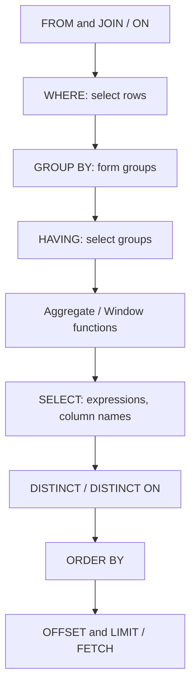

# Logical Query Processing Order and Common Misconceptions in PostgreSQL

When reading a SQL statement, we usually read from top to bottom: `SELECT`, then `FROM`, `WHERE`, `GROUP BY`, and `ORDER BY`. However, **the written clause order is not the logical processing order**. This difference explains many common issues: why an alias defined in `SELECT` cannot yet be used in `WHERE`, why `WHERE` does not accept aggregate functions, why filtering the right-hand table in a `LEFT JOIN` can drop rows, or why `LIMIT` does not guarantee returning the “10 newest records” without an `ORDER BY`.

In PostgreSQL, logical order is **a conceptual model for understanding SQL results**. PostgreSQL is not required to physically execute each step strictly according to that diagram: the optimizer (planner) can push filter predicates down early, reorder joins, choose indexes, or evaluate computations under an equivalent execution plan. This lesson distinguishes between those two layers, focusing on `SELECT` query semantics and practical mistakes when reading, writing, and fixing SQL.

## 1. Written in One Order, Understood in Another

A query typically takes the form:

```sql
SELECT customer_id, COUNT(*) AS order_count
FROM orders
WHERE status = 'paid'
GROUP BY customer_id
HAVING COUNT(*) >= 2
ORDER BY order_count DESC
LIMIT 10;
```

An easy-to-learn logical model is:

| Stage | Clause / Component | Role |
| --- | --- | --- |
| 1 | `WITH` (if present) | Defines named subqueries; whether they are materialized depends on context and the optimizer |
| 2 | `FROM`, `JOIN`, `ON` | Determines the row sources and relationships between sources |
| 3 | `WHERE` | Filters **rows** before grouping |
| 4 | `GROUP BY` | Combines the remaining rows into groups |
| 5 | `HAVING` | Filters **groups** after aggregation |
| 6 | Aggregates and window functions | Aggregate functions operate per group; window functions operate on the row set after the relevant filtering/grouping steps |
| 7 | `SELECT` list | Produces the output columns and assigns aliases |
| 8 | `DISTINCT` / `DISTINCT ON` | Removes duplicate rows or selects representative rows according to the corresponding rules |
| 9 | `ORDER BY` | Specifies the result ordering |
| 10 | `OFFSET`, `LIMIT` / `FETCH` | Skips and limits the number of returned rows |

This is a **conceptual model**, not a rigid algorithm that every PostgreSQL version must execute literally. Certain special constructs such as `UNION`/`INTERSECT`/`EXCEPT`, `LATERAL`, `WINDOW`, locking clauses, or subqueries have specific rules explained in later sections.



The core idea: to know whether a condition is valid and what result it returns, first ask: **at that logical point, which rows, groups, and columns exist?**

## 2. Creating the Practice Dataset

The following examples use a dedicated schema named `query_lab`. Run them in a learning database; names and data are fixed so results are easy to predict.

```sql
CREATE SCHEMA IF NOT EXISTS query_lab;

CREATE TABLE query_lab.customers (
    customer_id integer PRIMARY KEY,
    customer_name text NOT NULL
);

CREATE TABLE query_lab.orders (
    order_id integer PRIMARY KEY,
    customer_id integer NOT NULL
        REFERENCES query_lab.customers(customer_id),
    status text NOT NULL
        CHECK (status IN ('paid', 'pending', 'cancelled')),
    amount numeric(10, 2) NOT NULL
        CHECK (amount >= 0),
    created_at timestamptz NOT NULL
);

INSERT INTO query_lab.customers(customer_id, customer_name)
VALUES
    (1, 'Alice'),
    (2, 'Bob'),
    (3, 'Carol'),
    (4, 'Dani');

INSERT INTO query_lab.orders
    (order_id, customer_id, status, amount, created_at)
VALUES
    (101, 1, 'paid',      100.00, '2026-11-01T08:00:00Z'),
    (102, 1, 'pending',    50.00, '2026-11-02T08:00:00Z'),
    (103, 2, 'paid',      200.00, '2026-11-03T08:00:00Z'),
    (104, 2, 'cancelled',  30.00, '2026-11-04T08:00:00Z'),
    (105, 4, 'paid',      120.00, '2026-11-05T08:00:00Z');
```

The `customers` table has four people; Carol has no orders yet. The `orders` table has three `paid` orders, one `pending`, and one `cancelled`.

| order_id | customer | status | amount |
| --- | --- | --- | ---: |
| 101 | Alice | paid | 100.00 |
| 102 | Alice | pending | 50.00 |
| 103 | Bob | paid | 200.00 |
| 104 | Bob | cancelled | 30.00 |
| 105 | Dani | paid | 120.00 |

The statements are presented sequentially in the same practice environment. If you created those tables earlier, use a fresh database or schema instead of re-inserting data and causing duplicate primary key errors.

## 3. FROM and JOIN: Building the Initial Row Set

A multi-table query starts logically from the relations specified in `FROM`. For example:

```sql
SELECT c.customer_name, o.order_id, o.amount
FROM query_lab.customers AS c
JOIN query_lab.orders AS o
    ON o.customer_id = c.customer_id
ORDER BY c.customer_id, o.order_id;
```

`INNER JOIN` produces rows from pairs of records matching the `ON` condition. On the sample dataset, there are five result rows because each order matches exactly one customer.

Key points to remember:

- `JOIN` does not automatically “collapse into one row per customer.” If a customer has two orders, the result contains two rows.
- `ON` describes the join condition between tables. If you omit the relationship predicate or use `CROSS JOIN`, the row count can grow to the Cartesian product of the tables' row counts.
- Tables are given aliases `c` and `o` to distinguish `customer_id` on each side.
- Subsequent `WHERE` and `GROUP BY` clauses operate on the row set logically established by `FROM`/`JOIN`.

### 3.1. LEFT JOIN Preserves Unmatched Left-Side Rows

```sql
SELECT
    c.customer_name,
    o.order_id
FROM query_lab.customers AS c
LEFT JOIN query_lab.orders AS o
    ON o.customer_id = c.customer_id
ORDER BY c.customer_id, o.order_id;
```

`LEFT JOIN` preserves Carol as well, with `o.order_id IS NULL`. This is a *null-extended* row: columns from `o` have no matching partner, so they appear as `NULL`.

With `LEFT JOIN`, the logical progression is: find pairs matching the `ON` condition, then **include any unmatched left-side rows**. This explains why placing a condition in `ON` versus `WHERE` can produce different results.

## 4. WHERE Filters Rows Before GROUP BY

Query:

```sql
SELECT order_id, customer_id, amount
FROM query_lab.orders
WHERE status = 'paid'
ORDER BY order_id;
```

`WHERE` keeps the three paid orders: 101, 103, and 105. The `pending` and `cancelled` orders do not proceed to the aggregation stage if a `GROUP BY` follows.

If you want to calculate revenue from paid orders per customer:

```sql
SELECT customer_id, SUM(amount) AS total_paid
FROM query_lab.orders
WHERE status = 'paid'
GROUP BY customer_id
ORDER BY customer_id;
```

The result contains Alice 100, Bob 200, and Dani 120; Carol has no orders, so she has no group in a query sourced from `orders`.

**Misconception 1:** using `WHERE` as a filter on aggregated results.

```sql
-- Invalid: aggregates cannot be used directly in WHERE at the same query level.
SELECT customer_id, SUM(amount) AS total_paid
FROM query_lab.orders
WHERE SUM(amount) > 100
GROUP BY customer_id;
```

`SUM(amount)` is only computed after groups are formed. To filter groups, use `HAVING`.

### 4.1. WHERE Conditions Can Evaluate to UNKNOWN

SQL uses three-valued logic: `TRUE`, `FALSE`, and `UNKNOWN` (typically caused by `NULL`). `WHERE` **only keeps rows when the expression evaluates to TRUE**.

```sql
SELECT
    NULL::integer = 1 AS unknown_comparison,
    NULL::integer IS NULL AS known_null_test;
```

The first expression returns `NULL`; the second returns `TRUE`.

Therefore, `WHERE column = NULL` is not the way to find missing data. Use `IS NULL` instead. Also be careful with `NOT IN` when the list contains `NULL`:

```sql
SELECT 5 NOT IN (1, 2, NULL);
-- Result is NULL (UNKNOWN), not TRUE.
```

## 5. WHERE and ON Play Different Roles in OUTER JOIN

Consider the following two queries.

**Query A — filtering the right side directly in ON:**

```sql
SELECT c.customer_name, o.order_id, o.status
FROM query_lab.customers AS c
LEFT JOIN query_lab.orders AS o
    ON o.customer_id = c.customer_id
   AND o.status = 'paid'
ORDER BY c.customer_id, o.order_id;
```

The result includes Alice 101, Bob 103, Dani 105, and **Carol with a NULL order_id**. The condition `o.status = 'paid'` only restricts which right-hand rows are joined; `LEFT JOIN` still preserves customers with no matching orders.

**Query B — filtering after LEFT JOIN using WHERE:**

```sql
SELECT c.customer_name, o.order_id, o.status
FROM query_lab.customers AS c
LEFT JOIN query_lab.orders AS o
    ON o.customer_id = c.customer_id
WHERE o.status = 'paid'
ORDER BY c.customer_id, o.order_id;
```

Carol disappears because `o.status` on the unmatched row is `NULL`, so `o.status = 'paid'` evaluates to `UNKNOWN` and is discarded by `WHERE`.

| Condition Placement | Is Carol in the Result? | Meaning |
| --- | --- | --- |
| `ON ... AND o.status = 'paid'` | Yes, `o.*` columns are NULL | Keep every customer; only join paid orders |
| `WHERE o.status = 'paid'` | No | Keep only results that already have a paid order |

This is one of the most common mistakes when reporting data that includes rows with “no related records.”

One way to count **paid orders for every customer, including 0**, is:

```sql
SELECT
    c.customer_id,
    c.customer_name,
    COUNT(o.order_id) AS paid_order_count
FROM query_lab.customers AS c
LEFT JOIN query_lab.orders AS o
    ON o.customer_id = c.customer_id
   AND o.status = 'paid'
GROUP BY c.customer_id, c.customer_name
ORDER BY c.customer_id;
```

Result: Alice 1, Bob 1, Carol 0, Dani 1.

## 6. GROUP BY: Turning Individual Rows Into Groups

After `FROM` and `WHERE`, `GROUP BY` combines rows that share the same grouping key:

```sql
SELECT
    customer_id,
    COUNT(*) AS order_count,
    SUM(amount) AS total_amount
FROM query_lab.orders
GROUP BY customer_id
ORDER BY customer_id;
```

Result: Alice has two orders (total 150), Bob has two orders (total 230), and Dani has one order (total 120). There is no group for Carol because the `orders` table contains no rows for Carol.

In a query with `GROUP BY`, expressions in `SELECT` must generally be:

- Grouping keys (for example, `customer_id`);
- Aggregate expressions such as `COUNT(*)`, `SUM(amount)`, `MAX(created_at)`;
- Expressions valid under functional dependency rules recognized by PostgreSQL in that case, such as columns functionally dependent on a primary key included in `GROUP BY`.

Invalid example:

```sql
-- Invalid: order_id is not in GROUP BY and is not aggregated.
SELECT customer_id, order_id, COUNT(*)
FROM query_lab.orders
GROUP BY customer_id;
```

PostgreSQL cannot arbitrarily pick which `order_id` represents Alice's two-order group.

### 6.1. COUNT(*) vs. COUNT(column) After LEFT JOIN

```sql
SELECT
    c.customer_name,
    COUNT(*) AS joined_row_count,
    COUNT(o.order_id) AS real_order_count
FROM query_lab.customers AS c
LEFT JOIN query_lab.orders AS o
    ON o.customer_id = c.customer_id
GROUP BY c.customer_id, c.customer_name
ORDER BY c.customer_id;
```

For Carol:

- `COUNT(*)` returns `1` because `LEFT JOIN` still produces one null-extended row.
- `COUNT(o.order_id)` returns `0` because that aggregate ignores `NULL` values in `order_id`.

If you want to count actual orders, `COUNT(o.order_id)` is the appropriate choice in this example.

### 6.2. Grouping Is Not the Same as Deduplication

`GROUP BY customer_id` creates one group per `customer_id`, but it is not meant solely as an equivalent to `DISTINCT customer_id`: grouping is typically used to compute aggregates.

```sql
-- List of customers who have placed at least one order:
SELECT DISTINCT customer_id
FROM query_lab.orders;

-- Order count per customer:
SELECT customer_id, COUNT(*)
FROM query_lab.orders
GROUP BY customer_id;
```

Both results have one row per `customer_id` in `orders`, but one returns a list of identifiers while the other computes counts.

## 7. HAVING: Filtering Groups After GROUP BY

`HAVING` applies a condition to the formed groups. For example, selecting customers with two or more orders:

```sql
SELECT
    customer_id,
    COUNT(*) AS order_count
FROM query_lab.orders
GROUP BY customer_id
HAVING COUNT(*) >= 2
ORDER BY customer_id;
```

Alice and Bob are kept; Dani has only one order and is excluded.

Comparison:

| `WHERE` | `HAVING` |
| --- | --- |
| Filters individual rows before `GROUP BY` | Filters groups after `GROUP BY` |
| Cannot directly use aggregates from the same query level | Can use aggregates such as `COUNT`, `SUM` |
| Often helps narrow input rows early | Applies meaningfully to grouped results |
| Example: `WHERE status = 'paid'` | Example: `HAVING SUM(amount) > 100` |

Select customers whose **total paid order amount** exceeds 100:

```sql
SELECT customer_id, SUM(amount) AS total_paid
FROM query_lab.orders
WHERE status = 'paid'
GROUP BY customer_id
HAVING SUM(amount) > 100
ORDER BY total_paid DESC;
```

Result: Bob (200) and Dani (120). Alice's paid total is 100, so she is excluded by `>`.

**Misconception 2:** thinking `HAVING` is just another version of `WHERE`.

If you place `status = 'paid'` into `HAVING` when `status` is neither in the grouping key nor aggregated, PostgreSQL cannot pick a single `status` value to represent the entire group. Row-level predicates belong in `WHERE`; group-level predicates belong in `HAVING`.

A query with aggregates but no `GROUP BY` still treats the entire input set as **one group**, for example:

```sql
SELECT COUNT(*) AS total_orders
FROM query_lab.orders
HAVING COUNT(*) > 0;
```

When the table has data, the query returns one row; when the `HAVING` condition fails, it returns zero rows, unlike a plain `SELECT COUNT(*)` which always returns one row containing `0` for an empty table.

## 8. SELECT: Aliases Do Not Exist Yet in Same-Level WHERE

In the `SELECT` list, PostgreSQL defines the output columns and their aliases:

```sql
SELECT
    amount * 1.1 AS amount_after_markup
FROM query_lab.orders;
```

Someone might try filtering directly using that new name:

```sql
-- Invalid unless an input column named amount_after_markup already exists:
SELECT amount * 1.1 AS amount_after_markup
FROM query_lab.orders
WHERE amount_after_markup > 150;
```

In the logical model, `WHERE` runs before the `SELECT` list stage, so the alias `amount_after_markup` does not exist at that point. Write the expression in `WHERE`:

```sql
SELECT
    amount * 1.1 AS amount_after_markup
FROM query_lab.orders
WHERE amount * 1.1 > 150
ORDER BY amount_after_markup DESC;
```

Or use a subquery to turn the alias into an input column for the outer query level:

```sql
SELECT *
FROM (
    SELECT
        order_id,
        amount * 1.1 AS amount_after_markup
    FROM query_lab.orders
) AS priced
WHERE priced.amount_after_markup > 150
ORDER BY priced.amount_after_markup DESC;
```

The second approach is especially convenient when the expression is long or reused in multiple places at the outer query level.

### 8.1. Output Aliases in ORDER BY and GROUP BY in PostgreSQL

PostgreSQL allows referencing output column names in `ORDER BY`:

```sql
SELECT amount * 1.1 AS amount_after_markup
FROM query_lab.orders
ORDER BY amount_after_markup DESC;
```

`GROUP BY` can also reference output aliases in certain cases:

```sql
SELECT
    status AS order_state,
    COUNT(*) AS n
FROM query_lab.orders
GROUP BY order_state
ORDER BY order_state;
```

However, **`HAVING` cannot use an output alias as a column name at the same query level**:

```sql
-- Invalid: n is an alias for COUNT(*) in the same-level SELECT.
SELECT status, COUNT(*) AS n
FROM query_lab.orders
GROUP BY status
HAVING n > 1;
```

Correct way:

```sql
SELECT status, COUNT(*) AS n
FROM query_lab.orders
GROUP BY status
HAVING COUNT(*) > 1;
```

One naming subtlety that easily causes confusion: when an output alias shares the same name as an input column, PostgreSQL has **different resolution rules** between `ORDER BY` and `GROUP BY`. For an ambiguous bare name, `ORDER BY` prefers the output column name, whereas `GROUP BY` prefers the input column name. To avoid hard-to-read bugs, choose aliases that do not collide with source column names or write the expression explicitly.

### 8.2. Using Column Positions in ORDER BY/GROUP BY

PostgreSQL supports ordinal column positions in certain clauses:

```sql
SELECT status, COUNT(*) AS n
FROM query_lab.orders
GROUP BY 1
ORDER BY 2 DESC, 1;
```

`GROUP BY 1` groups by the first expression in the `SELECT` list (`status`); `ORDER BY 2` sorts by the second column (`n`).

This syntax is concise, but its meaning easily breaks when columns are added to or reordered in `SELECT`. In documentation and long-lived production code, using explicit names or expressions is usually easier to maintain.

## 9. Aggregate Functions and Window Functions Happen at Different Logical Times

Aggregate functions (`COUNT`, `SUM`, `AVG`, etc.) operate across groups or the entire row set. Window functions (`ROW_NUMBER`, `RANK`, `SUM(...) OVER (...)`, etc.) compute values over **the rows remaining after WHERE/GROUP BY/HAVING**, within the specified window partitions and ordering.

### 9.1. Window Functions Do Not Collapse Rows Like GROUP BY

```sql
SELECT
    order_id,
    customer_id,
    amount,
    ROW_NUMBER() OVER (
        PARTITION BY customer_id
        ORDER BY created_at DESC, order_id DESC
    ) AS order_rank
FROM query_lab.orders
ORDER BY customer_id, order_rank;
```

The result still has five rows, with each order assigned a sequence number within its customer partition. This differs from `GROUP BY customer_id`, which produces only one row per customer in the earlier aggregate example.

### 9.2. Window Functions Cannot Be Filtered Directly in Same-Level WHERE

```sql
-- Invalid: window functions cannot be used in WHERE.
SELECT
    order_id,
    ROW_NUMBER() OVER (
        PARTITION BY customer_id ORDER BY created_at DESC
    ) AS rn
FROM query_lab.orders
WHERE rn = 1;
```

The solution is an outer subquery layer:

```sql
SELECT order_id, customer_id, amount, created_at
FROM (
    SELECT
        o.*,
        ROW_NUMBER() OVER (
            PARTITION BY customer_id
            ORDER BY created_at DESC, order_id DESC
        ) AS rn
    FROM query_lab.orders AS o
) AS ranked
WHERE rn = 1
ORDER BY customer_id;
```

The result returns the latest order for Alice (102), Bob (104), and Dani (105). When two orders share the same timestamp, `order_id DESC` is added as a tie-breaker so the result is deterministic.

PostgreSQL allows window functions in the `SELECT` list and `ORDER BY` where appropriate, but does not allow them directly in `WHERE`, `GROUP BY`, or `HAVING` at the same query level. To filter on a window result, wrap the query in an outer level.

### 9.3. GROUP BY/HAVING Runs Before Window Results

Suppose you want to rank customers by their total paid order amount:

```sql
SELECT
    customer_id,
    SUM(amount) AS total_paid,
    RANK() OVER (ORDER BY SUM(amount) DESC) AS revenue_rank
FROM query_lab.orders
WHERE status = 'paid'
GROUP BY customer_id
HAVING SUM(amount) > 0
ORDER BY revenue_rank, customer_id;
```

The window function operates on the remaining aggregated result rows, not on the individual initial orders. Here Bob ranks 1st, Dani 2nd, and Alice 3rd.

**Note:** `ORDER BY` inside `OVER (...)` controls the order in which the **window function is computed**; it does not automatically guarantee final output display order. To sort the final result properly, add an outer `ORDER BY` as shown in the example.

## 10. DISTINCT Applies to the Output Columns

`SELECT DISTINCT` removes duplicate rows across the set of columns selected in `SELECT`:

```sql
SELECT DISTINCT status
FROM query_lab.orders
ORDER BY status;
```

The result has three values: `cancelled`, `paid`, and `pending`.

However, this query does not mean “one representative order per customer”:

```sql
SELECT DISTINCT customer_id, order_id
FROM query_lab.orders;
```

Because `order_id` already differs on every row, all five rows are retained. `DISTINCT` inspects **all selected expressions together**, not just the one column the author happened to care about.

### 10.1. DISTINCT ON Is a PostgreSQL-Specific Feature

PostgreSQL provides `DISTINCT ON`, which keeps one representative row for each distinct value of the specified expressions:

```sql
SELECT DISTINCT ON (customer_id)
    customer_id, order_id, created_at
FROM query_lab.orders
ORDER BY customer_id, created_at DESC, order_id DESC;
```

On the sample dataset, each customer gets their most recent order. To select a meaningful representative row, a deterministic `ORDER BY` is required:

- The expressions inside `DISTINCT ON (...)` must match the leading expressions in `ORDER BY`.
- The subsequent sort keys determine which row is kept first within each group.
- If the sort keys still tie, do not assume PostgreSQL will consistently pick the same row; add a unique secondary key when a stable result is needed.

`DISTINCT ON` is not equivalent to `GROUP BY` and does not replace aggregates when you need sums or counts.

### 10.2. DISTINCT and ORDER BY Cannot Be Combined Arbitrarily

In PostgreSQL, when using standard `SELECT DISTINCT`, any `ORDER BY` expression must appear in the select list according to syntax rules. For example:

```sql
-- Invalid in standard PostgreSQL SELECT DISTINCT:
SELECT DISTINCT customer_id
FROM query_lab.orders
ORDER BY created_at;
```

Because each customer has multiple `created_at` values while the result has collapsed to one `customer_id`, the database has no single `created_at` to determine the ordering. To sort by the latest order timestamp, aggregate first:

```sql
SELECT customer_id, MAX(created_at) AS last_order_at
FROM query_lab.orders
GROUP BY customer_id
ORDER BY last_order_at DESC, customer_id;
```

## 11. ORDER BY: SQL Promises No Order Unless You Ask for It

A query without `ORDER BY` **is not guaranteed** to return rows in insertion order, primary key order, index order, or the order from a previous run.

```sql
-- Result order is not guaranteed:
SELECT order_id, created_at
FROM query_lab.orders;
```

To get the 3 newest orders:

```sql
SELECT order_id, created_at
FROM query_lab.orders
ORDER BY created_at DESC, order_id DESC
LIMIT 3;
```

The sample dataset returns 105, 104, 103. Using `order_id` as a secondary tie-breaker when `created_at` matches gives a clearly defined top-three selection.

**Misconception 3:** thinking that an `ORDER BY` inside a subquery or CTE always enforces ordering on the outer query.

```sql
WITH sorted_orders AS (
    SELECT order_id, amount
    FROM query_lab.orders
    ORDER BY amount DESC
)
SELECT *
FROM sorted_orders;
```

If the outer query has no `ORDER BY`, you should not treat the final output order as guaranteed. Place `ORDER BY` at the output level where ordering is required:

```sql
WITH sorted_orders AS (
    SELECT order_id, amount
    FROM query_lab.orders
)
SELECT *
FROM sorted_orders
ORDER BY amount DESC, order_id;
```

Sorting together with `LIMIT` inside a subquery has a distinct role: it determines which subset of rows is chosen, yet **still does not guarantee the final presentation order of the outer query**.

### 11.1. NULLS FIRST and NULLS LAST

PostgreSQL lets you specify where `NULL` values sort:

```sql
SELECT customer_id, created_at
FROM query_lab.orders
ORDER BY created_at DESC NULLS LAST, order_id DESC;
```

With `ORDER BY col ASC`, PostgreSQL defaults to `NULLS LAST`; with `DESC`, it defaults to `NULLS FIRST`. Use `NULLS LAST` explicitly when missing values should not sort to the top of the list.

## 12. LIMIT and OFFSET: Slicing the Result Set After Ordering

`LIMIT` only caps **the number of rows returned**; it does not by itself make a query return the “newest,” “largest,” or “primary-key-ordered” rows.

```sql
-- Whichever two rows the current plan happens to produce may appear:
SELECT order_id
FROM query_lab.orders
LIMIT 2;
```

A more meaningful query:

```sql
SELECT order_id, created_at
FROM query_lab.orders
ORDER BY created_at DESC, order_id DESC
LIMIT 2 OFFSET 1;
```

Result on the sample dataset: skips order 105 and returns orders 104 and 103.

### 12.1. Large OFFSET Can Be Slow and Unstable Under Concurrent Changes

Pagination using `OFFSET 100000 LIMIT 20` typically still has to walk past many rows before discarding them; cost grows with page position. If inserts or deletes occur between two calls, rows can shift positions, causing duplicates or skipped rows across pages.

**Keyset pagination** is often better suited when ordering is fixed by a key tuple:

```sql
-- Find the next page after the marker row
-- (created_at, order_id) = ('2026-11-04T08:00:00Z', 104).
SELECT order_id, created_at
FROM query_lab.orders
WHERE (created_at, order_id)
      < ('2026-11-04T08:00:00Z'::timestamptz, 104)
ORDER BY created_at DESC, order_id DESC
LIMIT 20;
```

The tuple comparison matches the descending sort order of both columns and only applies when the cursor key columns have suitable types and semantics. You need an index aligned with the query pattern and a strategy for handling mutating data if consistent long-term pagination is required.

### 12.2. LIMIT Does Not Make Every Query Cheap in the Same Way

If a query must aggregate every group, sort the entire result set, or execute a large join, `LIMIT 10` does not mean PostgreSQL processes only 10 rows from the base table. The planner can optimize with top-N sorting or an appropriate index, but actual cost depends on the execution plan.

To know what actually happens, run `EXPLAIN` or `EXPLAIN (ANALYZE, BUFFERS)` in an authorized environment on representative data.

## 13. Tracing One Query End to End

Consider the goal: “Find the top two customers with the **highest total paid order amount**, where the total amount must exceed 100.”

```sql
SELECT
    c.customer_id,
    c.customer_name,
    COUNT(o.order_id) AS paid_orders,
    SUM(o.amount) AS total_paid
FROM query_lab.customers AS c
JOIN query_lab.orders AS o
    ON o.customer_id = c.customer_id
WHERE o.status = 'paid'
GROUP BY c.customer_id, c.customer_name
HAVING SUM(o.amount) > 100
ORDER BY total_paid DESC, c.customer_id
LIMIT 2;
```

Tracing each logical stage:

| Stage | Remaining Dataset |
| --- | --- |
| `FROM / JOIN` | 5 customer–order pairs |
| `WHERE status = 'paid'` | 3 pairs: Alice–101, Bob–103, Dani–105 |
| `GROUP BY` | 3 customer groups |
| `HAVING SUM(amount) > 100` | 2 groups: Bob (200), Dani (120) |
| `SELECT` | Produces `customer_id`, `customer_name`, `paid_orders`, `total_paid` |
| `ORDER BY total_paid DESC` | Bob before Dani |
| `LIMIT 2` | Returns 2 rows: Bob and Dani |

Final result:

| customer_id | customer_name | paid_orders | total_paid |
| ---: | --- | ---: | ---: |
| 2 | Bob | 1 | 200.00 |
| 4 | Dani | 1 | 120.00 |

This query clearly shows why `WHERE` and `HAVING` are not interchangeable: if `status` were filtered after summing all orders, Alice's and Bob's totals would mean something completely different.

## 14. Subqueries and CTEs Create Separate Column-Name Scopes

A CTE (`WITH`) or subquery gives a name to an intermediate result so the outer query can process it further.

```sql
WITH customer_totals AS (
    SELECT
        customer_id,
        SUM(amount) AS total_paid
    FROM query_lab.orders
    WHERE status = 'paid'
    GROUP BY customer_id
)
SELECT customer_id, total_paid
FROM customer_totals
WHERE total_paid > 100
ORDER BY total_paid DESC;
```

The alias `total_paid` appears in the `SELECT` list of the CTE, but to the **outer** query it is an input column from `FROM customer_totals`; therefore `WHERE total_paid > 100` is valid.

**Misconception 4:** “A CTE is always computed, written to a temporary table, and only then used by the outer query.”

In modern PostgreSQL, a side-effect-free `SELECT` CTE can be **inlined/folded** into the outer query when conditions allow. Some CTEs may be materialized, and supported versions provide `MATERIALIZED`/`NOT MATERIALIZED` options. Thus, a CTE is first and foremost a **logical naming and structuring boundary**, not an automatic guarantee of materialization or performance optimization.

### 14.1. Each SELECT Level Has Its Own Alias Scope

```sql
SELECT t.order_id, t.amount_with_tax
FROM (
    SELECT
        order_id,
        amount * 1.1 AS amount_with_tax
    FROM query_lab.orders
) AS t
WHERE t.amount_with_tax > 150;
```

At the inner level, `amount_with_tax` is an output alias. At the outer level, it is a column of the derived table `t`. Reading SQL level by level helps resolve “column does not exist” errors accurately.

## 15. LATERAL: When a FROM Source Depends on Earlier Rows

`LATERAL` allows a subquery in `FROM` to reference columns from preceding sources in the same `FROM` clause. This pattern is useful for fetching “the few newest records per parent”:

```sql
SELECT
    c.customer_id,
    c.customer_name,
    recent.order_id,
    recent.created_at
FROM query_lab.customers AS c
LEFT JOIN LATERAL (
    SELECT o.order_id, o.created_at
    FROM query_lab.orders AS o
    WHERE o.customer_id = c.customer_id
    ORDER BY o.created_at DESC, o.order_id DESC
    LIMIT 1
) AS recent ON TRUE
ORDER BY c.customer_id;
```

Logical meaning: for each customer on the left, the `LATERAL` subquery is evaluated with that `customer_id` and selects the newest order; `LEFT JOIN` still preserves Carol with `recent.order_id = NULL`.

This example shows that even the “FROM first” model allows **internal dependencies within FROM**. You cannot move `WHERE o.customer_id = c.customer_id` outside `LATERAL` without considering how it changes semantics.

## 16. UNION, INTERSECT, and EXCEPT Combine Query Results

When using set operations, each `SELECT` branch produces its own result set. PostgreSQL then combines the branches according to the chosen operator:

```sql
-- customer_ids appearing in paid or pending orders.
SELECT customer_id
FROM query_lab.orders
WHERE status = 'paid'

UNION

SELECT customer_id
FROM query_lab.orders
WHERE status = 'pending'
ORDER BY customer_id;
```

`UNION` deduplicates across the combined result columns, whereas `UNION ALL` preserves duplicates. `INTERSECT` keeps rows present in both inputs and `EXCEPT` keeps rows from the left input absent from the right, according to their respective set semantics.

Set operations combine **result rows matching in column count and compatible data types**, not by source table name. `ORDER BY` and `LIMIT` placed after an unparenthesized set operation can apply to the **combined result** rather than a single branch. If you want to limit or sort individual branches before `UNION`, use parentheses or subqueries according to the syntax rules.

```sql
(
    SELECT order_id, created_at
    FROM query_lab.orders
    WHERE customer_id = 1
    ORDER BY created_at DESC, order_id DESC
    LIMIT 1
)
UNION ALL
(
    SELECT order_id, created_at
    FROM query_lab.orders
    WHERE customer_id = 2
    ORDER BY created_at DESC, order_id DESC
    LIMIT 1
)
ORDER BY created_at DESC, order_id DESC;
```

`UNION`/`INTERSECT`/`EXCEPT` have their own operator precedence and syntax constraints; for complex queries, use explicit parentheses instead of guessing precedence.

## 17. Logical Order Is Not Physical Execution Order

This is an essential distinction when analyzing performance. If you write:

```sql
SELECT
    c.customer_name,
    SUM(o.amount) AS revenue
FROM query_lab.customers AS c
JOIN query_lab.orders AS o
    ON o.customer_id = c.customer_id
WHERE o.status = 'paid'
GROUP BY c.customer_id, c.customer_name
ORDER BY revenue DESC;
```

You can explain the output using logical order. Yet PostgreSQL may use an index to read only `paid` orders, perform a hash join or nested loop instead of joining in some imagined order, run a hash aggregate or group aggregate, and then sort/limit using whichever strategy fits best.

```sql
EXPLAIN
SELECT
    c.customer_name,
    SUM(o.amount) AS revenue
FROM query_lab.customers AS c
JOIN query_lab.orders AS o
    ON o.customer_id = c.customer_id
WHERE o.status = 'paid'
GROUP BY c.customer_id, c.customer_name
ORDER BY revenue DESC;
```

`EXPLAIN` describes the **physical execution plan**, not a literal “FROM → WHERE → GROUP BY → SELECT” pipeline like the table in Section 1. Node names such as `Seq Scan`, `Index Scan`, `Hash Join`, `Aggregate`, and `Sort` show the execution methods chosen by the planner.

`EXPLAIN (ANALYZE, BUFFERS)` actually executes the query to record row counts, timings, and buffer statistics; for data-modifying statements, it also performs the modifications unless wrapped in a rolled-back transaction. Use it only when you understand its impact.

### 17.1. PostgreSQL Can Reorder Condition Evaluation

A dangerous mistake is relying on `AND`/`OR` to “guarantee” one expression is never evaluated before another:

```sql
-- Do not rely on left-to-right reading order to avoid division by zero:
SELECT 100 / amount
FROM query_lab.orders
WHERE amount <> 0
  AND 100 / amount > 2;
```

The optimizer is free to arrange expression checks in ways consistent with SQL semantics, and boolean evaluation order is not a reliable error-handling barrier. The safe, intention-revealing approach is:

```sql
SELECT 100 / NULLIF(amount, 0) AS ratio
FROM query_lab.orders
WHERE 100 / NULLIF(amount, 0) > 2;
```

`NULLIF(amount, 0)` returns `NULL` when `amount` equals `0`, preventing division by zero in that case. For other complex expressions, `CASE` can express conditional choice, though you still need to account for optimization limits, constant folding, and values that can be evaluated at plan time.

Another consequence: **do not write SQL assuming a function with side effects will be called exactly once in the textual order written in `WHERE`**. The planner may eliminate, repeat, or reorder expression evaluation when valid. `VOLATILE` functions have specific optimization restrictions, and they should not be treated as a reason to rely on unguaranteed evaluation order for business logic.

## 18. Common Misconceptions and How to Fix Them

| Misconception | Consequence | Correct Pattern or Mental Model |
| --- | --- | --- |
| `SELECT` is always processed first | Using a newly created alias in `WHERE` fails | `WHERE` operates on input columns; repeat the expression or use a subquery |
| `WHERE COUNT(*) > 1` is valid | Aggregates do not exist yet at the `WHERE` stage | `GROUP BY ... HAVING COUNT(*) > 1` |
| `HAVING` and `WHERE` are the same | Summing over the wrong row set or referencing ungrouped columns | `WHERE` filters rows; `HAVING` filters groups |
| `LEFT JOIN` always keeps all left rows regardless of `WHERE` | `WHERE` on right-side columns drops null-extended rows | Put the right-side filter condition in `ON` when preserving left rows |
| `COUNT(*)` always counts right-table rows | Null-extended rows get counted too | Use `COUNT(right_table.primary_key)` to count matched rows |
| `GROUP BY` lets you `SELECT` any column | Query errors out or semantics are undefined | Select only grouping keys, aggregates, or functionally dependent expressions |
| `DISTINCT customer_id, order_id` keeps one row per customer | Distinct pairs remain uncollapsed | Choose the exact column set or use `DISTINCT ON`/window functions |
| `ORDER BY` inside `OVER` sorts the final output | Displayed order may differ from expectations | Add an outermost `ORDER BY` |
| `LIMIT 10` returns the 10 newest records | No order is guaranteed | `ORDER BY created_at DESC, id DESC LIMIT 10` |
| CTEs are always materialized | Misjudging performance or evaluation count | Check PostgreSQL version, options, and actual execution plan |
| `NOT IN` with `NULL` always returns `TRUE`/`FALSE` | Rows unexpectedly excluded due to `UNKNOWN` | Use `NOT EXISTS` where appropriate and handle `NULL` explicitly |
| Condition order in `WHERE` prevents runtime errors | Planner may evaluate predicates in another order | Use `NULLIF`/`CASE` and validate data assumptions |
| `EXPLAIN` shows the logical order | Confusing physical plan with SQL semantics | Separate logical semantics from physical execution plan |

## 19. Tiered Practice Exercises

Use the `query_lab.customers` and `query_lab.orders` dataset created in Section 2.

### Exercise 1 — Filtering Before Grouping

Write a query to count the number of `paid` orders for each customer who has at least one paid order, ordered by `customer_id`. Predict the result table before running it.

```sql
SELECT customer_id, COUNT(*) AS paid_count
FROM query_lab.orders
WHERE status = 'paid'
GROUP BY customer_id
ORDER BY customer_id;
```

Question: why does Carol not appear in the result, even though Carol exists in `customers`?

### Exercise 2 — Preserving Customers Without Orders

Modify Exercise 1 so Carol is returned with `paid_count = 0`, using `LEFT JOIN` and placing `status = 'paid'` in `ON`.

```sql
SELECT
    c.customer_id,
    c.customer_name,
    COUNT(o.order_id) AS paid_count
FROM query_lab.customers AS c
LEFT JOIN query_lab.orders AS o
    ON o.customer_id = c.customer_id
   AND o.status = 'paid'
GROUP BY c.customer_id, c.customer_name
ORDER BY c.customer_id;
```

### Exercise 3 — WHERE and HAVING

Find customers whose total `amount` from paid orders is greater than 100. Predict why Alice is excluded despite having a `pending` order worth 50.

```sql
SELECT customer_id, SUM(amount) AS total_paid
FROM query_lab.orders
WHERE status = 'paid'
GROUP BY customer_id
HAVING SUM(amount) > 100
ORDER BY total_paid DESC;
```

### Exercise 4 — Alias in WHERE

Read and explain the error in the following query:

```sql
SELECT order_id, amount * 1.1 AS gross_amount
FROM query_lab.orders
WHERE gross_amount > 150;
```

Fix it with a subquery so `gross_amount` becomes an input column of the outer query.

### Exercise 5 — Selecting the Latest Record per Group

Use two separate approaches:

1. `ROW_NUMBER() OVER (PARTITION BY customer_id ORDER BY created_at DESC, order_id DESC)` with an outer query filtering `rn = 1`.
2. `DISTINCT ON (customer_id) ... ORDER BY customer_id, created_at DESC, order_id DESC`.

Explain why both approaches need the secondary key `order_id` as a tie-breaker when two orders share the same `created_at`.

### Exercise 6 — Pagination

Retrieve the two newest orders using `ORDER BY created_at DESC, order_id DESC LIMIT 2`. Then fetch the next page using `OFFSET 2`. If new data is inserted before fetching page 2, analyze the risk of duplicate or skipped rows and propose a suitable keyset cursor.

### Exercise 7 — Inspecting EXPLAIN

```sql
EXPLAIN
SELECT customer_id, SUM(amount) AS total_paid
FROM query_lab.orders
WHERE status = 'paid'
GROUP BY customer_id
ORDER BY total_paid DESC;
```

Note the scan, aggregate, and sort nodes chosen by PostgreSQL. Compare the observed physical plan with the logical stages; explain why the plan's node names and display order do not have to match the clause order in SQL.

## 20. Takeaways When Reading and Writing SELECT

- `FROM`/`JOIN` builds the row source; `ON` defines matching pairs; `WHERE` filters rows **after the join relation is logically formed**. With outer joins, predicate placement can change the result.
- `GROUP BY` forms groups and `HAVING` filters groups. Aggregates cannot be used directly in `WHERE` at the same level.
- The `SELECT` list produces output expressions and aliases; those aliases do not exist in same-level `WHERE`. An outer query or CTE introduces a new name scope layer.
- Window functions evaluate over the remaining row set after filtering/grouping; to filter on window results, use a subquery or CTE.
- `DISTINCT` deduplicates across the projected expressions, whereas PostgreSQL's `DISTINCT ON` keeps one representative row according to the specified `ORDER BY`.
- The outermost `ORDER BY` guarantees the output order, and `LIMIT`/`OFFSET` does not replace it. Add tie-breakers when deterministic results are needed.
- PostgreSQL may choose a physical execution plan that differs from logical order to optimize the query. `EXPLAIN` answers “how will the database execute this?”, whereas the logical model answers “what must the query mean?”
- Never rely on the evaluation order of boolean operands to prevent runtime errors; use safe expressions such as `NULLIF` or explicitly modeled conditions.

Reading SQL through logical processing order helps you explain query results accurately, catch filtering/grouping/join bugs early, and avoid mistaking a physical optimization for data semantics. Once you know whether each clause is operating on **rows, groups, or projected results**, designing and reviewing PostgreSQL queries becomes far more predictable.
