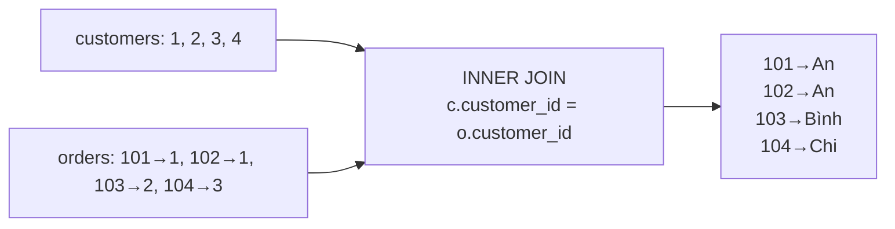
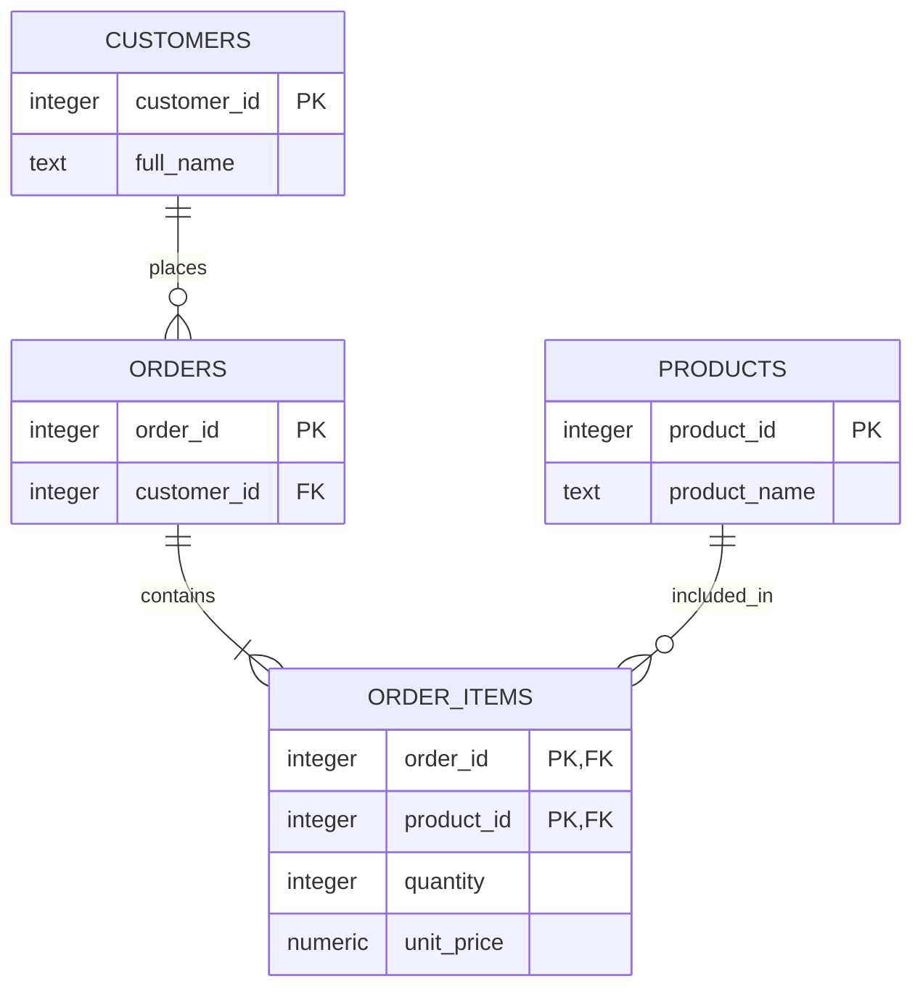

# INNER JOIN and Join Conditions in PostgreSQL

In a relational database management system, business information is typically split across multiple tables to avoid duplication and protect data consistency. An order resides in the `orders` table, while customer names and details reside in the `customers` table. When you need to return "order ID, order date, and customer name," the query must **combine rows from multiple tables**.

**`INNER JOIN`** is a join operation that keeps only the row combinations that **satisfy the join condition**. It is one of the most important SQL skills because it reconstructs relationships represented through primary keys, foreign keys, or attributes with linking semantics.

This lesson focuses on the `INNER JOIN ... ON` syntax, the meaning of join expressions, `USING`, the difference between join conditions and filter conditions, the impact of `NULL`, result multiplicity, multi-table joins, composite keys, and reading `EXPLAIN` plans in PostgreSQL.

## 1. Mental Model of INNER JOIN

Suppose we have two tables:

**`customers`**

| customer_id | full_name |
| ---: | --- |
| 1 | An |
| 2 | Bình |
| 3 | Chi |
| 4 | Dũng |

**`orders`**

| order_id | customer_id | status |
| ---: | ---: | --- |
| 101 | 1 | PAID |
| 102 | 1 | PENDING |
| 103 | 2 | PAID |
| 104 | 3 | PAID |

We want to find the customer for each order:

```sql
SELECT
    o.order_id,
    c.full_name,
    o.status
FROM customers AS c
INNER JOIN orders AS o
    ON c.customer_id = o.customer_id
ORDER BY o.order_id;
```

Result:

| order_id | full_name | status |
| ---: | --- | --- |
| 101 | An | PAID |
| 102 | An | PENDING |
| 103 | Bình | PAID |
| 104 | Chi | PAID |

**Customer Dũng does not appear** because this customer has no orders. `INNER JOIN` does not append a "NULL order" row for customers without orders. To retain customers who have not made a purchase yet, you need `LEFT JOIN`; that is a join with different semantics.



A logical way to think about it: PostgreSQL evaluates row combinations from both sides and keeps those where the `ON` expression evaluates to **TRUE**. The actual physical execution does not necessarily build the full Cartesian product and then filter it; the planner can use indexes, hash joins, or merge joins to find matching pairs more efficiently.

## 2. Basic Syntax

Pattern:

```sql
SELECT
    alias_a.column_name,
    alias_b.other_column
FROM table_a AS alias_a
INNER JOIN table_b AS alias_b
    ON alias_a.join_key = alias_b.join_key;
```

Components:

| Component | Role |
| --- | --- |
| `FROM table_a AS alias_a` | The first data source and its alias |
| `INNER JOIN table_b AS alias_b` | The second data source to combine |
| `ON ...` | **Condition selecting row pairs** to form the result |
| `SELECT ...` | Selects the columns/expressions to return |
| `WHERE ...` | Filters rows in the logical result of the join |
| `ORDER BY ...` | Specifies the final display order |

In PostgreSQL, writing `JOIN` alone in this context is shorthand for `INNER JOIN`:

```sql
SELECT o.order_id, c.full_name
FROM customers AS c
JOIN orders AS o
  ON o.customer_id = c.customer_id;
```

Both `JOIN` and `INNER JOIN` keywords perform the same type of join. Use `INNER JOIN` when you want to emphasize the semantics; use `JOIN` when the project prefers concise syntax. What matters is the **correct join condition**, not the length of the join keyword.

### 2.1. Using Aliases to Disambiguate Duplicate Column Names

Both `customers` and `orders` have `customer_id`. Therefore, the query:

```sql
-- Do not run in the same script with critical steps:
-- SELECT customer_id
-- FROM customers JOIN orders ON customers.customer_id = orders.customer_id;
```

may report **column reference "customer_id" is ambiguous** because the name alone is insufficient to distinguish the source. Write it explicitly:

```sql
SELECT
    c.customer_id,
    c.full_name,
    o.order_id
FROM customers AS c
JOIN orders AS o
  ON o.customer_id = c.customer_id;
```

Aliases also help prevent errors when a query joins four, five, or more tables. A simple convention is `c` for customers, `o` for orders, `i` for order_items, and `p` for products; in complex queries, longer descriptive names can be used.

### 2.2. Does an INNER JOIN Return One Row per Table?

**No.** The number of rows depends on the number of pairs matching the condition, not the number of tables or input rows.

In the example, An has two orders, so An appears **twice**. This is completely expected: the two rows represent two distinct relationships `(customer 1, order 101)` and `(customer 1, order 102)`. `INNER JOIN` does not automatically deduplicate by customer.

## 3. Creating Sample Data in PostgreSQL

The following sections use the `join_lab` schema. You can run this script on a **test database** using a role allowed to create schemas and tables. The script assumes the tables do not yet exist in the schema; do not run it on a production database or overwrite real data.

### 3.1. Creating the Customers Table

```sql
CREATE SCHEMA IF NOT EXISTS join_lab;

CREATE TABLE join_lab.customers (
    customer_id INTEGER PRIMARY KEY,
    full_name   TEXT NOT NULL,
    city        TEXT NOT NULL
);
```

`customer_id` is the primary key, ensuring each customer ID identifies at most one row and contains no `NULL`.

### 3.2. Creating the Orders Table

```sql
CREATE TABLE join_lab.orders (
    order_id    INTEGER PRIMARY KEY,
    customer_id INTEGER NOT NULL,
    ordered_at  DATE NOT NULL,
    status      TEXT NOT NULL,
    CONSTRAINT fk_orders_customer
        FOREIGN KEY (customer_id)
        REFERENCES join_lab.customers (customer_id),
    CONSTRAINT chk_orders_status
        CHECK (status IN ('PAID', 'PENDING', 'CANCELLED'))
);
```

The foreign key states that **each order must belong to an existing customer**. It does not guarantee that every customer must have an order. This is a **one customer → many orders** relationship.

### 3.3. Creating the Products and Order Items Tables

```sql
CREATE TABLE join_lab.products (
    product_id   INTEGER PRIMARY KEY,
    sku          TEXT NOT NULL UNIQUE,
    product_name TEXT NOT NULL,
    list_price   NUMERIC(12, 2) NOT NULL
        CHECK (list_price >= 0)
);

CREATE TABLE join_lab.order_items (
    order_id   INTEGER NOT NULL,
    product_id INTEGER NOT NULL,
    quantity   INTEGER NOT NULL CHECK (quantity > 0),
    unit_price NUMERIC(12, 2) NOT NULL CHECK (unit_price >= 0),
    PRIMARY KEY (order_id, product_id),
    CONSTRAINT fk_order_items_order
        FOREIGN KEY (order_id)
        REFERENCES join_lab.orders (order_id),
    CONSTRAINT fk_order_items_product
        FOREIGN KEY (product_id)
        REFERENCES join_lab.products (product_id)
);
```

In this lesson, `PRIMARY KEY (order_id, product_id)` reflects the assumption that a product appears in **only one line item per order**. If a product can appear on multiple lines due to promotions or batches, a line-level key such as `(order_id, line_no)` should be used instead of a constraint on the order–product pair.

`unit_price` is the **locked-in price at purchase time**, rather than pulling the current `products.list_price` when calculating order history.

### 3.4. Loading Intentional Sample Data

```sql
INSERT INTO join_lab.customers
    (customer_id, full_name, city)
VALUES
    (1, 'An', 'Hanoi'),
    (2, 'Bình', 'Da Nang'),
    (3, 'Chi', 'Hanoi'),
    (4, 'Dũng', 'Hue');

INSERT INTO join_lab.orders
    (order_id, customer_id, ordered_at, status)
VALUES
    (101, 1, DATE '2026-01-05', 'PAID'),
    (102, 1, DATE '2026-01-10', 'PENDING'),
    (103, 2, DATE '2026-01-12', 'PAID'),
    (104, 3, DATE '2026-01-15', 'PAID');

INSERT INTO join_lab.products
    (product_id, sku, product_name, list_price)
VALUES
    (10, 'BOOK-A5', 'A5 Notebook', 50000),
    (20, 'PEN-BLUE', 'Blue Ballpoint Pen', 10000),
    (30, 'MUG-WHITE', 'White Mug', 80000),
    (40, 'BAG-BLACK', 'Black Bag', 120000);

INSERT INTO join_lab.order_items
    (order_id, product_id, quantity, unit_price)
VALUES
    (101, 10, 2, 45000),
    (101, 20, 3, 9000),
    (102, 30, 1, 80000),
    (103, 20, 5, 10000),
    (104, 10, 1, 50000);
```

**Intentional characteristics of the test data:**

- Customer **An** has two orders; **Dũng** has no orders yet.
- Order **101** has two product line items; orders 102, 103, and 104 each have one line item.
- Product **BOOK-A5** appears in two orders; **BAG-BLACK** has not been purchased yet.
- Product BOOK-A5 currently has a list price of 50,000, but in order 101 the locked-in price is 45,000.

These differences make it immediately clear how `INNER JOIN` works, how rows multiply, and how to choose columns for aggregation.

## 4. INNER JOIN Between Two Tables with a 1:N Relationship

### 4.1. Joining Orders with Customers

```sql
SELECT
    o.order_id,
    c.customer_id,
    c.full_name,
    o.ordered_at,
    o.status
FROM join_lab.orders AS o
INNER JOIN join_lab.customers AS c
    ON c.customer_id = o.customer_id
ORDER BY o.order_id;
```

Expected result:

| order_id | customer_id | full_name | ordered_at | status |
| ---: | ---: | --- | --- | --- |
| 101 | 1 | An | 2026-01-05 | PAID |
| 102 | 1 | An | 2026-01-10 | PENDING |
| 103 | 2 | Bình | 2026-01-12 | PAID |
| 104 | 3 | Chi | 2026-01-15 | PAID |

**Why are there exactly four rows?** The `orders` table has four orders. With a `customer_id NOT NULL` foreign key pointing to the customer's PK, every valid order matches **exactly one** customer. Therefore, on this dataset, the join neither increases nor decreases the row count of `orders`.

This is a consequence of the **PK/FK/NOT NULL constraints in the example**, not a default property of every `INNER JOIN`. When joining on a non-unique key or another condition, one input row can match multiple rows on the other side.

### 4.2. Swapping the Order of the Two Tables in INNER JOIN

```sql
SELECT o.order_id, c.full_name
FROM join_lab.customers AS c
JOIN join_lab.orders AS o
  ON c.customer_id = o.customer_id
ORDER BY o.order_id;
```

In terms of the **result set**, the join in this case is equivalent to the query with `FROM orders JOIN customers`. However:

- The column order of `SELECT *` may differ when swapping table sides.
- **Row order is not guaranteed** without `ORDER BY`.
- The planner can independently choose an access order for the two tables different from the SQL query text.

Therefore, never rely on the order of tables written in `FROM` as a mechanism to control output row order.

## 5. The ON Condition: What Makes Two Rows Join?

`ON` accepts a **boolean expression**. With `INNER JOIN`, only row pairs for which `ON` evaluates to **TRUE** are included in the result.

The most common condition is an **equality join / equijoin**:

```sql
ON c.customer_id = o.customer_id
```

However, `ON` can contain multiple expressions combined with `AND`, `OR`, and other operators. What matters is that the expression genuinely represents the **business relationship**.

### 5.1. Joining with Multiple Conditions

For example, to retrieve **paid orders** for customers in Hanoi:

```sql
SELECT
    c.full_name,
    o.order_id,
    o.status
FROM join_lab.customers AS c
JOIN join_lab.orders AS o
  ON o.customer_id = c.customer_id
 AND o.status = 'PAID'
WHERE c.city = 'Hanoi'
ORDER BY o.order_id;
```

Result:

| full_name | order_id | status |
| --- | ---: | --- |
| An | 101 | PAID |
| Chi | 104 | PAID |

Here:

- `o.customer_id = c.customer_id` defines the order–customer relationship.
- `o.status = 'PAID'` narrows down the retained row pairs.
- `c.city = 'Hanoi'` filters for customers in Hanoi.

With **INNER JOIN**, the filter `o.status = 'PAID'` can be placed in either `ON` or `WHERE` **without changing the result set** as long as the conditions and expression semantics remain unchanged. With `LEFT JOIN`/`RIGHT JOIN`/`FULL JOIN`, moving conditions between `ON` and `WHERE` can drastically alter the result; see section 10.

### 5.2. ON Does Not Have to Use Equality

In PostgreSQL, the join condition can use comparison operators other than `=` when the business logic requires a **non-equi join**.

In a standalone example with two tables for grade bands and scores, you can join scores to the matching range:

```sql
CREATE TABLE join_lab.score_bands (
    band_name TEXT PRIMARY KEY,
    minimum_score INTEGER NOT NULL,
    maximum_score INTEGER NOT NULL,
    CHECK (maximum_score >= minimum_score)
);

INSERT INTO join_lab.score_bands
    (band_name, minimum_score, maximum_score)
VALUES
    ('C', 0, 59),
    ('B', 60, 79),
    ('A', 80, 100);

WITH exam_results(student_name, score) AS (
    VALUES
        ('An', 88),
        ('Bình', 71),
        ('Chi', 54)
)
SELECT
    r.student_name,
    r.score,
    b.band_name
FROM exam_results AS r
JOIN join_lab.score_bands AS b
  ON r.score BETWEEN b.minimum_score AND b.maximum_score
ORDER BY r.student_name;
```

Result:

| student_name | score | band_name |
| --- | ---: | --- |
| An | 88 | A |
| Bình | 71 | B |
| Chi | 54 | C |

The `BETWEEN` condition is **inclusive of both endpoints**. If two grade ranges overlap, a score can match **multiple bands**, causing the result to contain multiple rows for one student. The `CHECK(maximum_score >= minimum_score)` constraint only guarantees that **each individual range is valid**, not that ranges do not overlap across rows; preventing overlaps requires an appropriate constraint design.

### 5.3. An Incorrect Join Condition Can Produce Meaningless Rows

A dangerous mistake:

```sql
-- Has ON, but does not link customers to their actual orders!
SELECT c.full_name, o.order_id
FROM join_lab.customers AS c
JOIN join_lab.orders AS o
  ON o.status = 'PAID';
```

In the sample data with **4 customers** and **3 PAID orders**, this condition allows **4 × 3 = 12 pairs**. Every customer is paired with every PAID order, including orders belonging to other people. This is effectively a **product of customer rows and the set of PAID orders**, not a join based on order ownership.

**A SQL query that executes without error does not mean the ON condition is business-correct.** Always ask what key or logic pairs each row, then verify uniqueness and expected row counts.

## 6. JOIN USING When Key Column Names Match

When two tables share the **same column name to join on** and you want an equality comparison on that column, PostgreSQL supports the `USING` syntax:

```sql
SELECT
    order_id,
    customer_id,
    full_name
FROM join_lab.orders
JOIN join_lab.customers
USING (customer_id)
ORDER BY order_id;
```

In terms of the join condition, the query above is equivalent to:

```sql
SELECT
    o.order_id,
    o.customer_id,
    c.full_name
FROM join_lab.orders AS o
JOIN join_lab.customers AS c
  ON o.customer_id = c.customer_id
ORDER BY o.order_id;
```

### 6.1. Difference with SELECT *

With `JOIN ... ON`, `SELECT *` can return **two columns with the same name** `customer_id`: one from orders and one from customers. With `JOIN ... USING (customer_id)`, the output column list of the join has **a single merged `customer_id` column**, followed by the remaining columns from both sources.

Therefore, even though the two syntaxes have equivalent join conditions in the example, **the column list of `SELECT *` is not necessarily identical**.

You should explicitly list output columns in APIs or reports:

```sql
SELECT
    o.order_id,
    o.customer_id,
    c.full_name
FROM join_lab.orders AS o
JOIN join_lab.customers AS c USING (customer_id);
```

With `INNER JOIN`, the merged column values from both tables are equal in every result row, so choosing which side to take `customer_id` from usually does not change the value; however, the shape of the `USING` output and column names still need to be controlled.

### 6.2. USING with Multi-Column Keys

`USING` supports a list of columns:

```sql
SELECT *
FROM tenant_orders AS o
JOIN tenant_customers AS c
USING (tenant_id, customer_id);
```

This example illustrates **hypothetical** tables in a multi-tenant system; it only runs if the corresponding tables exist and have both columns with the same names. The equivalent join condition is:

```sql
ON o.tenant_id = c.tenant_id
AND o.customer_id = c.customer_id
```

If the child-side and parent-side columns have **different names** (for example `created_by_id` and `user_id`), use `ON`. `USING` does not support mapping two different column names arbitrarily.

## 7. NATURAL JOIN and Why You Should Be Cautious

PostgreSQL supports `NATURAL INNER JOIN`. This syntax automatically takes **every column that has the same name on both sides** as a `USING` condition.

Syntax example:

```sql
SELECT *
FROM join_lab.orders
NATURAL JOIN join_lab.customers;
```

With the sample schema, the common column name is `customer_id`, so the result may look like `USING (customer_id)`. However, suppose the development team later adds a `status` or `created_at` column to both tables: PostgreSQL will **automatically add those columns to the join condition** without any change to the query text.

This can cause:

- Rows that should match to be excluded because a same-named column has different values.
- Result counts to change silently after a schema migration.
- Code readers to be unaware of which columns are actually being joined.
- If there are no common columns, a natural join can behave like an unconditional join according to the corresponding syntax, producing a huge number of rows.

**Best practice:** prefer `JOIN ... ON ...` or `JOIN ... USING (...)` with an explicitly specified column list. `NATURAL JOIN` can be handy in controlled ad hoc situations, but it is generally unsafe for long-lived application queries.

## 8. INNER JOIN Does Not Require a Foreign Key

`INNER JOIN` can join two sources **even without an FK**. The database does not require you to declare a foreign key before using an `ON` condition.

However, an FK helps:

- Protect referential integrity when data is written.
- Prevent child rows from referencing a non-existent parent key according to FK rules.
- Document business structure semantics for schema readers.

Without an FK, an order could exist with a `customer_id` not present in the customers table. In that case:

```sql
SELECT ...
FROM orders AS o
INNER JOIN customers AS c
    ON c.customer_id = o.customer_id;
```

will **drop unmatched orders**. This can cause the total row count in a report to be lower than the row count in `orders`. Therefore, when comparing counts, distinguish between **intentional filtering by INNER JOIN** and **corrupt referential data**.

Do not rely on `INNER JOIN` as a way to silently "clean" bad data without logging the issue; dropped records can hide data integration bugs.

## 9. NULL and Three-Valued Logic in Join Conditions

In SQL, comparisons with `NULL` do not follow standard two-valued Boolean logic:

```sql
SELECT
    (NULL::integer = NULL::integer) AS equal_nulls,
    (1 = NULL::integer) AS one_equals_null,
    (1 IS NOT DISTINCT FROM NULL::integer) AS null_safe_compare;
```

The first two expressions evaluate to **NULL/UNKNOWN**; the third evaluates to **FALSE**.

With `INNER JOIN ... ON a.key = b.key`:

- `TRUE`: the row pair is kept.
- `FALSE`: the row pair is discarded.
- `UNKNOWN` due to `NULL`: the row pair is also **not kept**.

### 9.1. Demonstrating NULL Values on Both Sides

```sql
WITH left_data(id, group_code) AS (
    VALUES
        (1, 'A'::text),
        (2, NULL::text)
),
right_data(id, group_code) AS (
    VALUES
        (10, 'A'::text),
        (20, NULL::text)
)
SELECT
    l.id AS left_id,
    r.id AS right_id,
    l.group_code
FROM left_data AS l
JOIN right_data AS r
  ON l.group_code = r.group_code
ORDER BY l.id, r.id;
```

The result contains only:

| left_id | right_id | group_code |
| ---: | ---: | --- |
| 1 | 10 | A |

The two rows with `group_code IS NULL` **do not match each other** through the `=` operator.

### 9.2. Intentional NULL Matching with IS NOT DISTINCT FROM

PostgreSQL supports:

```sql
ON l.group_code IS NOT DISTINCT FROM r.group_code
```

This expression treats two `NULL` values as **not distinct** for comparison purposes, so the example can additionally return the pair `(2, 20)`.

This is **not** the default behavior of `=`; use it only when business logic explicitly dictates that two missing values of the same kind should be paired together. If each side has thousands of `NULL`s, a null-safe condition can multiply into a huge number of meaningless pairs.

### 9.3. Composite Primary Keys Do Not Contain NULL

If `customers.customer_id` is a PK, it contains no `NULL`. If `orders.customer_id NOT NULL` also has an FK to that PK, every valid order row has a matching customer under an equality join.

With **nullable composite foreign keys**, `MATCH SIMPLE` or `MATCH FULL` rules also govern whether referencing columns may be partially missing. Distinguish **write-time data constraints** from **SELECT-time pairing conditions**.

## 10. How Do ON and WHERE Differ?

This is a critical point when moving from `INNER JOIN` to other JOIN types.

### 10.1. With INNER JOIN: Filter Conditions Can Be Moved

The following two queries yield equivalent results on the sample schema:

**Filtering in ON:**

```sql
SELECT o.order_id, c.full_name
FROM join_lab.orders AS o
INNER JOIN join_lab.customers AS c
  ON c.customer_id = o.customer_id
 AND o.status = 'PAID'
ORDER BY o.order_id;
```

**Filtering in WHERE:**

```sql
SELECT o.order_id, c.full_name
FROM join_lab.orders AS o
INNER JOIN join_lab.customers AS c
  ON c.customer_id = o.customer_id
WHERE o.status = 'PAID'
ORDER BY o.order_id;
```

Both return three rows with order IDs 101, 103, and 104. For a pure inner join, conditions combined with `AND` may be pushed down earlier or later by the planner during execution as long as semantics are preserved.

**Maintainable style:** use `ON` for **relationships between two sources** (e.g., `c.customer_id = o.customer_id`), and use `WHERE` for **report filters** (e.g., `o.status = 'PAID'` or `c.city = 'Hanoi'`). This is a readability convention, not a strict syntax requirement for INNER JOIN.

### 10.2. With LEFT JOIN: Moving Conditions Can Drop Rows

Compare:

```sql
-- A: keep every customer; join only PAID orders.
SELECT
    c.customer_id,
    c.full_name,
    o.order_id
FROM join_lab.customers AS c
LEFT JOIN join_lab.orders AS o
  ON o.customer_id = c.customer_id
 AND o.status = 'PAID'
ORDER BY c.customer_id, o.order_id;
```

Result A has **four rows**:

| customer_id | full_name | order_id |
| ---: | --- | ---: |
| 1 | An | 101 |
| 2 | Bình | 103 |
| 3 | Chi | 104 |
| 4 | Dũng | NULL |

Whereas:

```sql
-- B: WHERE after LEFT JOIN drops rows without a PAID order.
SELECT
    c.customer_id,
    c.full_name,
    o.order_id
FROM join_lab.customers AS c
LEFT JOIN join_lab.orders AS o
  ON o.customer_id = c.customer_id
WHERE o.status = 'PAID'
ORDER BY c.customer_id, o.order_id;
```

Result B has only **three rows**, **excluding Dũng**. The `WHERE` condition requires `o.status = 'PAID'`, and on a row with no order, `o.status` is `NULL`, so the condition evaluates to UNKNOWN and the row is discarded.

Therefore, the rule "moving a condition from `ON` to `WHERE` does not change the result" **applies only in qualifying cases like the INNER JOIN above**, not as a general rule for every JOIN type.

## 11. Joining Multiple Tables: Customers → Orders → Order Items → Products

A SQL query can chain multiple `INNER JOIN` clauses. With the sample schema, the relationship path is:



Query:

```sql
SELECT
    o.order_id,
    c.full_name,
    p.sku,
    p.product_name,
    i.quantity,
    i.unit_price,
    i.quantity * i.unit_price AS line_total
FROM join_lab.orders AS o
JOIN join_lab.customers AS c
  ON c.customer_id = o.customer_id
JOIN join_lab.order_items AS i
  ON i.order_id = o.order_id
JOIN join_lab.products AS p
  ON p.product_id = i.product_id
ORDER BY o.order_id, p.product_id;
```

Result:

| order_id | full_name | sku | quantity | unit_price | line_total |
| ---: | --- | --- | ---: | ---: | ---: |
| 101 | An | BOOK-A5 | 2 | 45000.00 | 90000.00 |
| 101 | An | PEN-BLUE | 3 | 9000.00 | 27000.00 |
| 102 | An | MUG-WHITE | 1 | 80000.00 | 80000.00 |
| 103 | Bình | PEN-BLUE | 5 | 10000.00 | 50000.00 |
| 104 | Chi | BOOK-A5 | 1 | 50000.00 | 50000.00 |

Product `BAG-BLACK` does not appear because it has not been purchased; customer Dũng also does not appear. This aligns with the semantics of an **INNER JOIN chain**.

### 11.1. Why Are There Five Rows Even Though There Are Only Four Orders?

One order can have multiple line items. Order 101 has two line items; when joining `orders` with `order_items`, order 101's details **repeat for each line item**. We do not have "corrupt" duplicate data in the database: this is the **output of a one-to-many relationship**.

The row count can grow even further if you join two independent 1:N relationships onto the same parent table. For instance, if an order has **3 product line items** and **2 payment attempts**, joining both child tables directly can produce **3 × 2 = 6 rows for the same order**. To aggregate accurately, pre-aggregate each side separately or apply an appropriate query structure rather than running `SUM` over a multiplied set.

### 11.2. JOIN Order in SQL Text vs. the Planner

In the logical model, `JOIN` constructs the resulting relation. The PostgreSQL planner can choose the execution order of inner joins to minimize cost, provided it does not break semantics or applicable constraints.

Therefore, writing the order:

```text
orders -> customers -> order_items -> products
```

is not a promise that the executor will read `orders` first and then `customers`. To see the actual execution path, use `EXPLAIN`.

## 12. Composite Keys and Multi-Column JOIN Conditions

In a **multi-tenant** model, a customer may be identified by the pair `(tenant_id, customer_id)`. Two different companies can both have `customer_id = 10`, so joining on `customer_id` alone will mix data across tenants.

Example using a `VALUES` CTE to run standalone without creating extra tables:

```sql
WITH tenant_customers(tenant_id, customer_id, full_name) AS (
    VALUES
        (1, 10, 'An (Company A)'),
        (2, 10, 'Bình (Company B)')
),
tenant_orders(tenant_id, order_id, customer_id) AS (
    VALUES
        (1, 500, 10),
        (2, 600, 10)
)
SELECT
    o.tenant_id,
    o.order_id,
    c.full_name
FROM tenant_orders AS o
JOIN tenant_customers AS c
  ON c.tenant_id = o.tenant_id
 AND c.customer_id = o.customer_id
ORDER BY o.tenant_id, o.order_id;
```

Correct result:

| tenant_id | order_id | full_name |
| ---: | ---: | --- |
| 1 | 500 | An (Company A) |
| 2 | 600 | Bình (Company B) |

If you omit `c.tenant_id = o.tenant_id` from the `ON` condition, each order will match **both customers with `customer_id = 10`**, producing four rows, two of which reference the wrong company.

### 12.1. Composite Foreign Keys Help Protect at Write Time

In a real schema, you should declare:

```sql
-- Illustrative DDL snippet: parent table needs PK/UNIQUE on the exact pair.
FOREIGN KEY (tenant_id, customer_id)
REFERENCES tenant_customers (tenant_id, customer_id)
```

A composite FK prevents creating an order that points to a customer in another tenant. However, when writing a `SELECT` query, you must still **JOIN on all key columns**. Constraints do not automatically inject missing `ON` conditions into a poorly written query.

**Furthermore, composite keys do not replace authorization or Row-Level Security.** Tenant conditions maintain relational correctness, but preventing cross-tenant reads also requires proper access control mechanisms.

## 13. How Do JOIN Conditions Affect Row Counts?

To predict results, examine the **cardinality** of the joined relationship.

| Input Relationship | Join Condition | Typical Consequence |
| --- | --- | --- |
| N:1, where the 1-side is PK/UNIQUE and FK is valid and mandatory | `o.customer_id = c.customer_id` | Each order matches exactly one customer |
| 1:N | `o.order_id = i.order_id` | One order can produce multiple rows based on line item count |
| N:M via junction table | `orders -> order_items -> products` | Each order–product relationship produces one row |
| Non-unique on both sides | `a.code = b.code` | Can multiply rows according to key duplicates |
| No meaningful relational condition | `ON TRUE` or single-table filter only | Can produce a massive Cartesian product |
| Nullable key compared with `=` | `a.key = b.key` | NULLs do not match, which can reduce row count |

### 13.1. Duplicate Keys on Both Sides Can Multiply Results

```sql
WITH a(code, description) AS (
    VALUES
        ('X', 'A1'),
        ('X', 'A2')
),
b(code, description) AS (
    VALUES
        ('X', 'B1'),
        ('X', 'B2'),
        ('X', 'B3')
)
SELECT
    a.description AS from_a,
    b.description AS from_b
FROM a
JOIN b ON a.code = b.code
ORDER BY from_a, from_b;
```

The result has **2 × 3 = 6 rows**. There is no SQL error: because `code = 'X'` appears twice in A and three times in B, every corresponding pair satisfies the condition.

If the business expects one code to have only one record, enforce a **UNIQUE/PK constraint at the source**, or adjust the data model/join condition accordingly. `DISTINCT` may mask the symptom, but it does not fix an invalid data relationship.

### 13.2. Counting Rows Before and After JOIN

```sql
SELECT COUNT(*) AS order_count
FROM join_lab.orders;

SELECT COUNT(*) AS joined_line_count
FROM join_lab.orders AS o
JOIN join_lab.order_items AS i
  ON i.order_id = o.order_id;
```

The results are **4** and **5**, respectively. The join does not increase the data stored in `orders`; it produces **five row pairs** in the query result.

## 14. INNER JOIN and GROUP BY Aggregations

Because a JOIN can produce multiple rows for a single parent entity, you must be especially careful with `COUNT` and `SUM`.

### 14.1. Counting Orders and Total Value per Customer

```sql
SELECT
    c.customer_id,
    c.full_name,
    COUNT(DISTINCT o.order_id) AS order_count,
    SUM(i.quantity * i.unit_price) AS total_items_value
FROM join_lab.customers AS c
JOIN join_lab.orders AS o
  ON o.customer_id = c.customer_id
JOIN join_lab.order_items AS i
  ON i.order_id = o.order_id
GROUP BY c.customer_id, c.full_name
ORDER BY c.customer_id;
```

Expected result:

| customer_id | full_name | order_count | total_items_value |
| ---: | --- | ---: | ---: |
| 1 | An | 2 | 197000.00 |
| 2 | Bình | 1 | 50000.00 |
| 3 | Chi | 1 | 50000.00 |

Why `COUNT(DISTINCT o.order_id)` is needed:

- An has **two orders**: 101 and 102.
- However, after joining order items, order 101 appears **twice** and order 102 appears once.
- `COUNT(o.order_id)` would return **3** for An, instead of the true order count of **2**.
- `COUNT(DISTINCT o.order_id)` accurately counts distinct order IDs.

For total value, each `order_items` row represents one part of the amount to sum, so `SUM(i.quantity * i.unit_price)` is accurate under the assumption that **each line item is joined once**. If you also join a payments table that has multiple rows per order, the total will be multiplied; pre-aggregate before joining.

### 14.2. Aggregating Child Tables Before Joining

A safe approach when you need one row per order:

```sql
WITH order_totals AS (
    SELECT
        order_id,
        SUM(quantity * unit_price) AS items_total,
        COUNT(*) AS line_count
    FROM join_lab.order_items
    GROUP BY order_id
)
SELECT
    o.order_id,
    c.full_name,
    t.line_count,
    t.items_total
FROM join_lab.orders AS o
JOIN join_lab.customers AS c
  ON c.customer_id = o.customer_id
JOIN order_totals AS t
  ON t.order_id = o.order_id
ORDER BY o.order_id;
```

`order_totals` has at most **one row per order_id**, so joining it to `orders` no longer multiplies the result by line item count. This pattern is very useful when combining multiple aggregated sources such as payments, discounts, and shipping.

**Note:** because `INNER JOIN order_totals` is used, orders with no line items are excluded. If the report needs to keep empty orders, use `LEFT JOIN` along with appropriate `NULL`/`COALESCE` handling.

### 14.3. Do Not Use SUM(DISTINCT amount) to Fix Join Multiplication

If two orders happen to have the same monetary amount, `SUM(DISTINCT amount)` only adds **each distinct dollar value once**, rather than once per order. As a result, it can produce incorrect totals. The proper solution is usually to **preserve the grain of the result** by pre-aggregating by ID, or fixing the join relationship.

## 15. When Only Checking Existence, Consider EXISTS

Suppose the question is "which customers **have ever placed an order**?" without needing order IDs. If you use:

```sql
SELECT c.customer_id, c.full_name
FROM join_lab.customers AS c
JOIN join_lab.orders AS o
  ON o.customer_id = c.customer_id;
```

An appears **twice** because of having two orders. You could use `DISTINCT`, but if the goal is solely checking existence, an `EXISTS` query expresses the intent more clearly:

```sql
SELECT c.customer_id, c.full_name
FROM join_lab.customers AS c
WHERE EXISTS (
    SELECT 1
    FROM join_lab.orders AS o
    WHERE o.customer_id = c.customer_id
)
ORDER BY c.customer_id;
```

The result is An, Bình, and Chi, each **one row**, excluding Dũng. PostgreSQL can optimize `EXISTS` using appropriate semi-join plans.

**Selection guideline:**

- Use `INNER JOIN` when you need **data from both sides** or care about individual relationship pairs.
- Use `EXISTS` when you only need to know whether the other side **has at least one matching row**.
- Use `NOT EXISTS` when you need to find entities **with no matching relationship**.

Example finding customers who have never ordered:

```sql
SELECT c.customer_id, c.full_name
FROM join_lab.customers AS c
WHERE NOT EXISTS (
    SELECT 1
    FROM join_lab.orders AS o
    WHERE o.customer_id = c.customer_id
)
ORDER BY c.customer_id;
```

The result is Dũng. Do not try to find customers without orders using `INNER JOIN` alone, because that join **filters out customers without orders** from the start.

## 16. Self JOIN: Joining a Table to Itself

`INNER JOIN` also works when both sides are the **same table** representing two different roles. This is a **self join**.

Example of an employees table with managers:

```sql
CREATE TABLE join_lab.employees (
    employee_id INTEGER PRIMARY KEY,
    full_name   TEXT NOT NULL,
    manager_id  INTEGER,
    CONSTRAINT fk_employee_manager
        FOREIGN KEY (manager_id)
        REFERENCES join_lab.employees (employee_id)
);

INSERT INTO join_lab.employees
    (employee_id, full_name, manager_id)
VALUES
    (1, 'Director', NULL),
    (2, 'Team Lead A', 1),
    (3, 'Engineer A', 2),
    (4, 'Engineer B', 2);
```

Query:

```sql
SELECT
    e.employee_id,
    e.full_name AS employee_name,
    m.full_name AS manager_name
FROM join_lab.employees AS e
INNER JOIN join_lab.employees AS m
  ON e.manager_id = m.employee_id
ORDER BY e.employee_id;
```

Result:

| employee_id | employee_name | manager_name |
| ---: | --- | --- |
| 2 | Team Lead A | Director |
| 3 | Engineer A | Team Lead A |
| 4 | Engineer B | Team Lead A |

The Director does not appear because `manager_id IS NULL` and there is no corresponding manager row.

If you need a list of **all employees**, including those without a manager, use `LEFT JOIN`. If you need the entire multi-level management chain, a single self join only traverses one level; for arbitrary depth chains, use a **recursive CTE**.

## 17. CROSS JOIN, INNER JOIN ON TRUE, and Missing Join Conditions

**`CROSS JOIN`** generates every combination of rows between two sources:

```sql
SELECT c.full_name, p.product_name
FROM join_lab.customers AS c
CROSS JOIN join_lab.products AS p;
```

With **4 customers** and **4 products**, the result has **16 rows**. That can be useful when building recommendation matrices, schedules, or test combinations; however, it is very dangerous if produced unintentionally.

`INNER JOIN ... ON TRUE` also has the semantics of generating every pair combination:

```sql
SELECT c.full_name, p.product_name
FROM join_lab.customers AS c
INNER JOIN join_lab.products AS p
  ON TRUE;
```

Both examples above generate 16 rows. In contrast, the query:

```sql
SELECT c.full_name, o.order_id
FROM join_lab.customers AS c
INNER JOIN join_lab.orders AS o
  ON c.customer_id = o.customer_id;
```

produces only the four customer–order pairs.

If two tables have one million and one hundred thousand rows respectively, a full Cartesian product theoretically contains **100 billion pairs**. PostgreSQL may choose an appropriate execution plan, but generating massive intermediate or final results still consumes heavy CPU, memory, I/O, and network transfer time.

### 17.1. Commas in FROM Can Make Queries Hard to Read

Legacy syntax:

```sql
SELECT ...
FROM customers c, orders o
WHERE c.customer_id = o.customer_id;
```

can logically express an inner join via a filter condition. However, with multiple tables, mixing join conditions into `WHERE` makes it easy to miss a condition and accidentally create a Cartesian product. The `JOIN ... ON ...` syntax makes **the boundaries of relationships** much clearer.

Additionally, comma syntax and explicit `JOIN` syntax have different precedence rules when mixed in the same `FROM` clause; therefore, use explicit JOIN syntax consistently.

## 18. Joining Mismatched Data Types and Normalization

For instance, one table stores `customer_id` as `INTEGER`, while another stores it as `TEXT`. PostgreSQL does not automatically guarantee that a comparison:

```sql
-- Bad design example:
-- ON a.customer_id_integer = b.customer_id_text
```

always has an appropriate operator or implicit cast. You may have to cast explicitly, such as `b.customer_id_text::integer`. However, this introduces several risks:

- A text record with a value like `'ABC'` cannot be converted to integer, causing the query to fail.
- Casting a column in a JOIN condition can prevent direct index usage.
- Values with leading zeros or special identifiers may lose or change semantics when cast.
- Two tables using different collations or case rules can also produce unexpected results.

**Better approach:** standardize linking key types in the schema and import pipeline; let FK/UNIQUE constraints protect the data instead of repeating casts in every JOIN.

### 18.1. Name Normalization Is Not a Substitute for Keys

An error-prone JOIN style:

```sql
-- Illustrative only; do not use to join customers in production systems.
ON lower(c.full_name) = lower(o.customer_name)
```

People's names can collide, change, contain whitespace variations, and involve complex Unicode rules. A stable `customer_id` key is generally far more appropriate. Joins on normalized text may be necessary when reconciling external data, but you must accept the **probability of false positives and false negatives** and design a dedicated reconciliation workflow.

## 19. INNER JOIN with Date, Range, and Status Conditions

Date filters are commonly placed in `WHERE` after joining relational keys:

```sql
SELECT
    o.order_id,
    c.full_name,
    o.ordered_at
FROM join_lab.orders AS o
JOIN join_lab.customers AS c
  ON c.customer_id = o.customer_id
WHERE o.ordered_at >= DATE '2026-01-10'
  AND o.ordered_at < DATE '2026-01-16'
ORDER BY o.ordered_at, o.order_id;
```

The result includes orders **102, 103, and 104**. Using a **half-open** interval `[start, end)` helps queries on `TIMESTAMP`/`TIMESTAMPTZ` avoid end-of-day boundary traps when partitioning time ranges. In this example `ordered_at` is a `DATE`, yet the half-open convention still extends cleanly to timestamps.

### 19.1. JOIN on Time Ranges

A more complex case: joining an event with a policy effective during a period.

```sql
WITH price_periods(product_id, valid_from, valid_to, price) AS (
    VALUES
        (10, DATE '2026-01-01', DATE '2026-02-01', 45000::numeric),
        (10, DATE '2026-02-01', DATE '2026-03-01', 50000::numeric)
),
sample_sales(product_id, sold_on) AS (
    VALUES
        (10, DATE '2026-01-15'),
        (10, DATE '2026-02-10')
)
SELECT
    s.sold_on,
    p.price
FROM sample_sales AS s
JOIN price_periods AS p
  ON s.product_id = p.product_id
 AND s.sold_on >= p.valid_from
 AND s.sold_on < p.valid_to
ORDER BY s.sold_on;
```

Illustrative result:

| sold_on | price |
| --- | ---: |
| 2026-01-15 | 45000 |
| 2026-02-10 | 50000 |

If price periods for the same product **overlap**, a single sale can join to multiple price levels, corrupting aggregations. Therefore, alongside a correct JOIN query, the schema must enforce **non-overlapping intervals**, such as via an appropriate exclusion constraint or guarded write workflow.

## 20. JOIN Performance in PostgreSQL

`INNER JOIN` expresses the desired relationship, while the PostgreSQL **planner/optimizer** decides how to execute it efficiently based on statistics, indexes, filter conditions, row counts, and estimated costs.

Three common join algorithms:

| Method | Idea | Typical Best-Fit Scenario |
| --- | --- | --- |
| **Nested Loop Join** | For each outer row, find matching rows in the inner side | Small outer set, good index lookup on the inner side |
| **Hash Join** | Build a hash table from one side, probe keys from the other | Equijoin with datasets fitting available resources |
| **Merge Join** | Read two streams sorted by join key and match groups | Data already sorted or sort cost is reasonable |

**There is no rule that "INNER JOIN always uses Hash Join"**. A query with the exact same syntax might use Nested Loop when selecting one customer, yet use Hash Join when processing a report over millions of rows.

### 20.1. Inspecting Plans with EXPLAIN

```sql
EXPLAIN
SELECT
    o.order_id,
    c.full_name
FROM join_lab.orders AS o
JOIN join_lab.customers AS c
  ON c.customer_id = o.customer_id
WHERE o.status = 'PAID';
```

PostgreSQL may choose `Hash Join`, `Nested Loop`, or another strategy depending on data size and statistics. On tiny demo tables, a **Seq Scan** can be completely reasonable even when a PK index exists. Never judge a query as slow merely by seeing the keyword `Seq Scan`.

### 20.2. Measuring Actual Execution with EXPLAIN ANALYZE

```sql
EXPLAIN (ANALYZE, BUFFERS)
SELECT
    o.order_id,
    c.full_name
FROM join_lab.orders AS o
JOIN join_lab.customers AS c
  ON c.customer_id = o.customer_id
WHERE o.status = 'PAID';
```

Since this is a `SELECT` on test data, measuring it is relatively safe. `EXPLAIN ANALYZE` **actually executes the SQL query**, unlike `EXPLAIN` which only displays the estimated plan.

What to observe:

- `cost=... rows=...`: planner estimates, not milliseconds.
- `actual time=... rows=... loops=...`: actual execution time, row count, and loop count metrics.
- `Hash Cond`, `Merge Cond`, or `Join Filter`: conditions evaluated in respective parts of the plan.
- `Rows Removed by Join Filter`: number of rows discarded by a join filter if reported.
- `Buffers`: buffer usage across instrumented nodes.
- `Planning Time` and `Execution Time`: reported planning and execution durations.

If estimated rows differ greatly from actual rows, check statistics freshness, join key distribution, filter conditions, and data skew/duplicates. However, do not assume that is the sole cause of slowness: lock waits, I/O, caching, memory spills, and concurrent load also play a role.

### 20.3. Indexes Related to Join Conditions

PostgreSQL automatically creates B-tree indexes to back `PRIMARY KEY`/`UNIQUE` constraints. However, it **does not automatically create indexes on child-side FOREIGN KEY columns**.

For example, an index that can help look up orders by customer:

```sql
CREATE INDEX idx_orders_customer
ON join_lab.orders (customer_id);
```

Since `order_items` already has `PRIMARY KEY (order_id, product_id)`, the PK index has `order_id` as its leading prefix, which can support queries fetching all line items of an order. If you frequently search for all orders containing **a given product**, an index leading with `product_id` can help:

```sql
CREATE INDEX idx_order_items_product
ON join_lab.order_items (product_id);
```

Do not create redundant indexes reflexively. Every index consumes storage and adds write overhead. Observe the workload and query plans before designing complex composite indexes.

### 20.4. Statistics and ANALYZE

```sql
ANALYZE join_lab.customers;
ANALYZE join_lab.orders;
ANALYZE join_lab.order_items;
ANALYZE join_lab.products;
```

`ANALYZE` updates statistics so the planner can estimate row counts and choose better plans; it **does not add indexes** and does not guarantee a specific plan. In production, the cost of gathering statistics and autoanalyze schedules must be weighed against operational needs.

## 21. Common INNER JOIN Mistakes

| Mistake | Consequence | Fix |
| --- | --- | --- |
| Not joining on the true relational key | Wrong row pairings, inflated row count | Identify exact PK/FK and `ON` condition |
| Putting only `o.status = 'PAID'` in `ON` without `o.customer_id = c.customer_id` | Product of all customers with all PAID orders | Keep the key-linking condition |
| Joining on only one column of a composite key | Cross-tenant mixing / row multiplication | Match all columns of the key |
| Using `SELECT *` across multiple tables | Duplicate column names, bloated payload | Explicitly specify needed columns and aliases |
| Expecting a customer to appear only once in a 1:N join | Misinterpreting result row count | Define result grain; use `EXISTS` or `GROUP BY` as appropriate |
| Using `COUNT(o.order_id)` after joining order items to count orders | Counting the same order multiple times | Use `COUNT(DISTINCT o.order_id)` or pre-aggregate |
| Joining two 1:N child sets simultaneously and running `SUM` directly | Totals get multiplied | Pre-aggregate each child set before joining |
| Using `SUM(DISTINCT amount)` to remove multiplication | Can drop two distinct transactions with the same amount | Aggregate by record key, not by value |
| Assuming `NULL = NULL` is TRUE | Missing matching rows or misinterpreting data | Understand three-valued logic; use null-safe comparison when business logic requires |
| Moving an `ON` condition to `WHERE` in an OUTER JOIN | Can drop rows from the preserved side | Distinguish `INNER` from `LEFT/RIGHT/FULL JOIN` |
| Using `NATURAL JOIN` carelessly | Schema changes silently alter join conditions | Use explicit `ON`/`USING` |
| Using `DISTINCT` to hide all duplicated rows | Masks relational bugs, adds overhead | Diagnose root cause from cardinality and JOIN |
| Joining on unnormalized names/emails | Mismatched people or missed matches | Use stable keys, verify reconciliation data |
| Assuming JOIN sorts rows automatically | Row order varies across executions | Use `ORDER BY` |
| Assuming an FK automatically creates an index on the child table | Queries may incur heavy I/O | Inspect actual indexes and `EXPLAIN` |
| Treating `Seq Scan` as always wrong | Optimizing the wrong problem | Compare estimated/actual rows and cost |
| Using `INNER JOIN` to find entities with no relationship | Unmatched entities are already dropped | Use `NOT EXISTS` or `LEFT JOIN`/`IS NULL` as appropriate |
| Relying solely on tenant conditions in JOIN for security | Other queries may still read other tenants' data | Combine with access controls and RLS when needed |

## 22. Practice Exercises

The exercises below use the `join_lab` schema and data from section 3. Run queries intended to trigger errors only in an isolated learning environment to avoid leaving application transactions in an aborted state.

1. Write an `INNER JOIN` returning `order_id`, `ordered_at`, and `full_name` for all orders. Predict the row count, then verify with `COUNT(*)`.
2. Rewrite the query in exercise 1 using `JOIN` without writing `INNER`. Does the result differ? Why?
3. Filter `PAID` orders with a condition in `ON` and another version in `WHERE`. Compare both results and explain why they are equivalent for INNER JOIN.
4. Use `JOIN ... USING (customer_id)` and `JOIN ... ON ...` with `SELECT *`. Observe the output column names of both queries.
5. Write a query returning customer name, SKU, product name, quantity, and locked-in price for order line items. Why does the result have five rows instead of four?
6. Write a query summing the line item value of order 101 using `SUM(quantity * unit_price)`. The correct result must be **117000**.
7. Compute the order count and total item value per customer. Why would `COUNT(o.order_id)` return 3 for customer An when the true order count is 2?
8. Write an `order_totals` CTE that aggregates order items first, then JOIN it with the orders table. Compare the result with a direct JOIN and GROUP BY.
9. Find all customers who have placed at least one order using `INNER JOIN` + `DISTINCT`, and then using `EXISTS`. What are the pros and cons of each approach?
10. Find customers who have not placed any orders. Why does a plain `INNER JOIN` fail to return Dũng? Use `NOT EXISTS`.
11. Write a query returning the list of products that have been ordered using `INNER JOIN`. Which product does not appear, and why?
12. Try joining `customers` with `orders` using only `o.status = 'PAID'` in `ON`. Predict the 12 rows and explain what condition is missing.
13. Create two `VALUES` sets with two and three rows having `code='X'` and join them with `=`. Explain why six rows are produced.
14. Using the two-tenant CTE from section 12, intentionally omit the `tenant_id` condition from `ON`. Why does the result include cross-company pairs?
15. Write an employee–manager self join. Use `INNER JOIN` first, then replace it with `LEFT JOIN`. Explain why the Director only appears in the latter version.
16. Create two CTE tables with `NULL` in the join column. Compare `ON a.code = b.code` against `ON a.code IS NOT DISTINCT FROM b.code`.
17. Write a query joining sale dates to effective price periods using `>= valid_from` and `< valid_to`. If two periods overlap, how many rows could a single sale produce?
18. Run `EXPLAIN` on the orders–customers join filtered by `status`; then use `EXPLAIN (ANALYZE, BUFFERS)` to check actual rows. Why might the join algorithm differ between sample data and production?
19. Add an index on `orders(customer_id)` and re-check the plan. Why might the planner still choose a Seq Scan on a small table?
20. Suppose a `payment_attempts` table has multiple rows per order. Explain why directly joining `orders + order_items + payment_attempts` can multiply total amounts, then design a plan that pre-aggregates each child table before joining.
21. Compare the semantics of "customers with at least one PAID order" and "customers with any order." Use `EXISTS` and appropriate conditions to express both requirements.
22. Write a checklist for a new JOIN query: join keys, uniqueness, join type, NULL handling, expected output, tenant permissions, and EXPLAIN plan.

## 23. Summary

**`INNER JOIN`** is a join operation that returns only row combinations where the **`ON` condition evaluates to TRUE**. Syntax:

```sql
SELECT ...
FROM table_a AS a
INNER JOIN table_b AS b
  ON a.key_column = b.key_column;
```

Principles to remember:

- **Join on real relationships:** usually PK/FK, though it can be a composite key or another well-defined condition.
- **Distinguish join conditions from filter conditions:** `ON`/`WHERE` can be equivalent for INNER JOIN in certain cases, but differ significantly when using OUTER JOIN.
- **Understand cardinality:** one row can match multiple rows, multiplying result counts and aggregations.
- **Understand NULL:** the `=` operator does not match two NULLs; use `IS NOT DISTINCT FROM` only when business semantics allow it.
- **Control the output:** list columns explicitly, use `ORDER BY` when ordering matters, and use `EXISTS` when only checking existence.
- **Observe PostgreSQL in practice:** use appropriate PK/FK/indexes, along with `EXPLAIN` and `EXPLAIN ANALYZE` to verify plans rather than guessing from SQL clause order.

Once you identify **what each row represents** and **what rule each ON condition uses to pair two entities**, you will write business-accurate INNER JOIN queries, avoid silent data loss from non-matches, and prevent accidental row multiplication when combining multiple tables.
