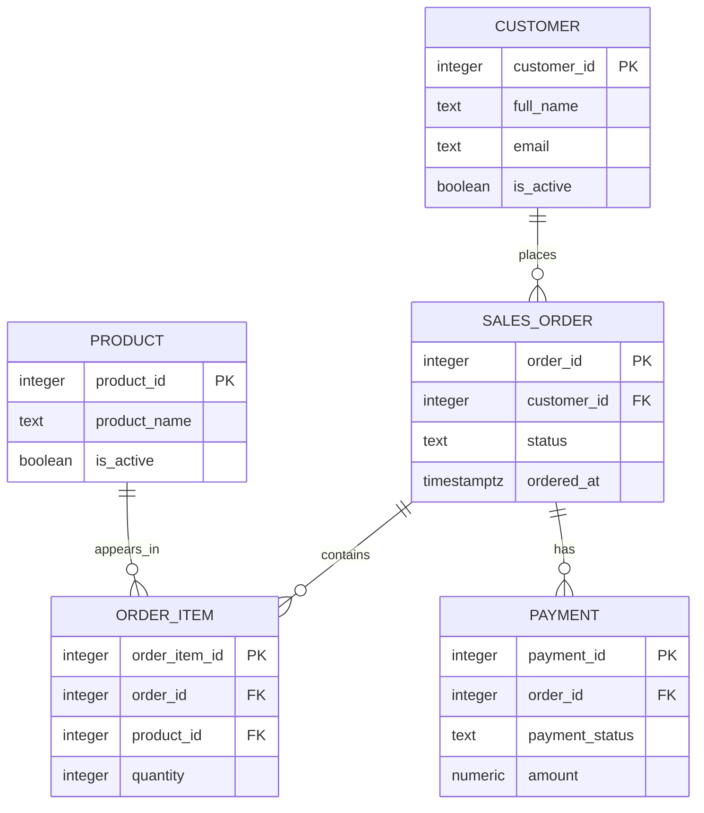
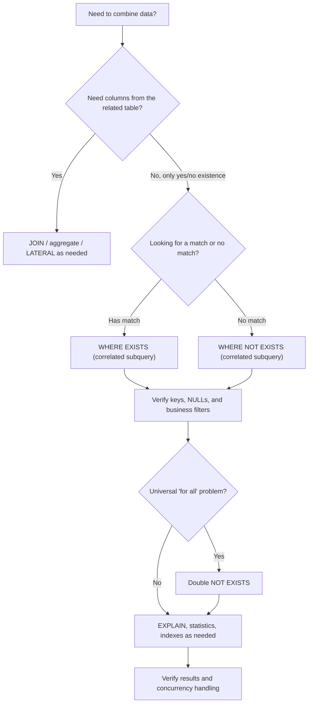

# EXISTS, NOT EXISTS, and Existence Checks in PostgreSQL

When working with relational databases, many business questions do not require fetching extra columns from another table—they only ask **whether at least one related row exists**:

- Which customers **have ever placed an order**?
- Which customers **have no orders yet**?
- Which orders **have at least one successful payment**?
- Which products **have never appeared in a paid order**?
- Which orders **have line items yet no successful payment transaction**?
- Which customers **have purchased every active product**?

In PostgreSQL, the two core tools for expressing these questions are **`EXISTS`** and **`NOT EXISTS`**. They work alongside `SELECT`, `WHERE`, `JOIN`, correlated subqueries, the query optimizer, and `NULL` handling rules.

The concise idea:

> **`EXISTS (subquery)` is true when the subquery returns at least one row; `NOT EXISTS (subquery)` is true when the subquery returns zero rows.**

It does not matter how many columns the subquery selects, what their values are, or how many matching rows exist. What is tested is **row existence**.

This lesson belongs to the **Combining Data** chapter. Therefore, the focus is not solely on `EXISTS` syntax, but also on **how it relates to `JOIN`, `IN`, `NOT IN`, `LEFT JOIN`, set operations, and PostgreSQL performance**, with hands-on examples that make every difference visible.

## 1. Understanding EXISTS as a Yes/No Question

Syntax:

```sql
EXISTS (
    SELECT ...
    FROM ...
    WHERE ...
)
```

The entire `EXISTS (...)` expression has a **boolean** return type:

- `TRUE` when the subquery has at least one row.
- `FALSE` when the subquery has zero rows.

An example without any tables:

```sql
SELECT
    EXISTS (SELECT 1) AS has_row,
    EXISTS (SELECT 1 WHERE FALSE) AS no_row,
    EXISTS (SELECT NULL::integer) AS null_is_still_a_row;
```

Logical results:

| Expression | Result | Explanation |
|---|---|---|
| `EXISTS (SELECT 1)` | `TRUE` | One row exists |
| `EXISTS (SELECT 1 WHERE FALSE)` | `FALSE` | Zero rows |
| `EXISTS (SELECT NULL::integer)` | `TRUE` | One row containing a `NULL` value |

**EXISTS does not check whether a value is `NULL` or non-`NULL`.** A subquery returning one row of `NULL` cells is still a subquery **with a row**.

### 1.1. NOT EXISTS Is the Negation of Existence

```sql
SELECT
    NOT EXISTS (SELECT 1) AS has_no_row,
    NOT EXISTS (SELECT 1 WHERE FALSE) AS empty_result;
```

Results: `FALSE` and `TRUE`.

In standard existence checks, `EXISTS` and `NOT EXISTS` return a definite boolean—they never evaluate to `UNKNOWN` like direct comparisons with `NULL`.

### 1.2. Mental Model

```text
         Subquery is evaluated
                   │
                   ▼
          Any rows returned?
             ┌─────┴─────┐
             │           │
            Yes          No
             │           │
             ▼           ▼
         EXISTS=TRUE  EXISTS=FALSE
         NOT EXISTS   NOT EXISTS
          =FALSE       =TRUE

Row count:  1 or 1000 both give EXISTS=TRUE
Values:     SELECT NULL can still produce a row
```

The question PostgreSQL actually answers is **"is the result set non-empty?"**, not "does the result set contain a JavaScript-style truthy value?"

## 2. Shared Practice Dataset

We will build a small sales system with customers, orders, products, order items, and payment transactions. Use a learning database; **do not run these data creation/modification scripts on production**.

### 2.1. Creating the Schema and Tables

```sql
CREATE SCHEMA IF NOT EXISTS demo_exists;

CREATE TABLE demo_exists.customer (
    customer_id INTEGER PRIMARY KEY,
    full_name TEXT NOT NULL,
    email TEXT,
    is_active BOOLEAN NOT NULL DEFAULT TRUE
);

CREATE TABLE demo_exists.product (
    product_id INTEGER PRIMARY KEY,
    product_name TEXT NOT NULL,
    is_active BOOLEAN NOT NULL DEFAULT TRUE
);

CREATE TABLE demo_exists.sales_order (
    order_id INTEGER PRIMARY KEY,
    customer_id INTEGER NOT NULL,
    status TEXT NOT NULL,
    ordered_at TIMESTAMPTZ NOT NULL,
    CONSTRAINT fk_sales_order_customer
        FOREIGN KEY (customer_id)
        REFERENCES demo_exists.customer(customer_id),
    CONSTRAINT ck_sales_order_status
        CHECK (status IN ('NEW', 'PAID', 'CANCELLED'))
);

CREATE TABLE demo_exists.order_item (
    order_item_id INTEGER PRIMARY KEY,
    order_id INTEGER NOT NULL,
    product_id INTEGER NOT NULL,
    quantity INTEGER NOT NULL,
    CONSTRAINT fk_order_item_order
        FOREIGN KEY (order_id)
        REFERENCES demo_exists.sales_order(order_id),
    CONSTRAINT fk_order_item_product
        FOREIGN KEY (product_id)
        REFERENCES demo_exists.product(product_id),
    CONSTRAINT ck_order_item_quantity
        CHECK (quantity > 0)
);

CREATE TABLE demo_exists.payment (
    payment_id INTEGER PRIMARY KEY,
    order_id INTEGER NOT NULL,
    payment_status TEXT NOT NULL,
    amount NUMERIC(12, 2) NOT NULL,
    CONSTRAINT fk_payment_order
        FOREIGN KEY (order_id)
        REFERENCES demo_exists.sales_order(order_id),
    CONSTRAINT ck_payment_status
        CHECK (payment_status IN ('PENDING', 'SUCCESS', 'FAILED')),
    CONSTRAINT ck_payment_amount
        CHECK (amount > 0)
);
```

Relationships:



A customer can have many orders, an order can have many line items, a product appears on many line items, and an order can have multiple payment attempts. This is the exact kind of schema where `JOIN` easily multiplies rows for a single entity, whereas `EXISTS` cleanly answers yes/no questions.

### 2.2. Inserting Sample Data

```sql
INSERT INTO demo_exists.customer
    (customer_id, full_name, email, is_active)
VALUES
    (1, 'Lan',  'lan@example.test', TRUE),
    (2, 'Minh', 'minh@example.test', TRUE),
    (3, 'Hoa',  NULL, TRUE),
    (4, 'An',   'an@example.test', TRUE),
    (5, 'Binh', 'binh@example.test', TRUE),
    (6, 'Dao',  NULL, FALSE);

INSERT INTO demo_exists.product
    (product_id, product_name, is_active)
VALUES
    (10, 'PostgreSQL Book', TRUE),
    (20, 'Pen', TRUE),
    (30, 'Mouse', FALSE);

INSERT INTO demo_exists.sales_order
    (order_id, customer_id, status, ordered_at)
VALUES
    (101, 1, 'PAID',      '2026-11-10 09:00:00+07'),
    (102, 1, 'CANCELLED', '2026-11-11 10:00:00+07'),
    (103, 2, 'NEW',       '2026-11-10 16:00:00+07'),
    (104, 4, 'PAID',      '2026-11-12 11:00:00+07'),
    (105, 5, 'PAID',      '2026-11-13 08:00:00+07'),
    (106, 5, 'PAID',      '2026-11-13 09:30:00+07'),
    (107, 2, 'CANCELLED', '2026-11-12 15:00:00+07'),
    (108, 4, 'NEW',       '2026-11-13 18:00:00+07');

INSERT INTO demo_exists.order_item
    (order_item_id, order_id, product_id, quantity)
VALUES
    (1001, 101, 10, 1),
    (1002, 101, 20, 2),
    (1003, 104, 10, 1),
    (1004, 105, 20, 1),
    (1005, 106, 10, 1),
    (1006, 106, 20, 1),
    (1007, 108, 30, 1);

INSERT INTO demo_exists.payment
    (payment_id, order_id, payment_status, amount)
VALUES
    (201, 101, 'SUCCESS', 200000.00),
    (202, 104, 'FAILED',  150000.00),
    (203, 104, 'SUCCESS', 150000.00),
    (204, 105, 'PENDING',  10000.00),
    (205, 106, 'SUCCESS', 160000.00),
    (206, 103, 'FAILED',   80000.00);
```

These tables and keys are illustrative sample data. Running `INSERT` a second time in the same schema will fail on primary key collisions. Use a clean lab database when practicing again.

### 2.3. Reference Results

Based on the inserted data:

| Customer | Orders |
|---|---|
| Lan (1) | 101 (PAID), 102 (CANCELLED) |
| Minh (2) | 103 (NEW), 107 (CANCELLED) |
| Hoa (3) | None |
| An (4) | 104 (PAID), 108 (NEW) |
| Binh (5) | 105 (PAID), 106 (PAID) |
| Dao (6) | None |

The two active products are 10 (PostgreSQL Book) and 20 (Pen). Product 30 (Mouse) is no longer active. We will use this setup in the nested queries later.

## 3. Simple EXISTS: Does the Database Have Any Matching Row?

Example checking if the system has any `PAID` order:

```sql
SELECT EXISTS (
    SELECT 1
    FROM demo_exists.sales_order
    WHERE status = 'PAID'
) AS has_paid_order;
```

The result is `TRUE` because at least one order satisfies the condition.

Checking a specific order:

```sql
SELECT EXISTS (
    SELECT 1
    FROM demo_exists.sales_order
    WHERE order_id = 999
) AS order_exists;
```

Result is `FALSE` on the sample dataset.

The condition inside the subquery executes under standard SQL semantics. If zero rows satisfy `WHERE`, the result set is empty and `EXISTS` returns FALSE.

### 3.1. EXISTS Can Appear in SELECT

```sql
SELECT
    EXISTS (
        SELECT 1
        FROM demo_exists.payment
        WHERE payment_status = 'FAILED'
    ) AS has_failed_payment,
    NOT EXISTS (
        SELECT 1
        FROM demo_exists.product
        WHERE is_active = FALSE
    ) AS all_products_active;
```

Results are `TRUE`, `FALSE` respectively.

You can use `EXISTS` as an expression in `SELECT`, `WHERE`, `CASE`, or anywhere a boolean expression is allowed. It is not restricted to `WHERE`.

### 3.2. EXISTS Does Not Return Columns from the Subquery

```sql
SELECT
    EXISTS (
        SELECT order_id, customer_id, status
        FROM demo_exists.sales_order
        WHERE status = 'PAID'
    ) AS paid_order_exists;
```

This query still returns **a single boolean column**, not the three inner columns. The columns in a normal subquery's SELECT list do not affect whether rows exist.

Hence, the common convention is:

```sql
EXISTS (SELECT 1 FROM ... WHERE ...)
```

The `1` signals "I do not need row data, only whether a row exists." `SELECT *` generally produces the same result for this goal, while `SELECT 1` states the intent concisely.

## 4. Correlated Subqueries: Linking Each Outer Row to Inner Rows

The most important pattern is when the subquery **references a column from the outer query**.

To find customers who have placed at least one order:

```sql
SELECT
    c.customer_id,
    c.full_name
FROM demo_exists.customer AS c
WHERE EXISTS (
    SELECT 1
    FROM demo_exists.sales_order AS o
    WHERE o.customer_id = c.customer_id
)
ORDER BY c.customer_id;
```

How to read it:

1. The outer query considers each candidate `c` from `customer`.
2. The subquery asks whether any row `o` in `sales_order` has `o.customer_id = c.customer_id`.
3. If yes, `EXISTS` is TRUE and that customer is kept.
4. If no, `EXISTS` is FALSE and that customer is dropped.

Result: Lan (1), Minh (2), An (4), Binh (5). Hoa (3) and Dao (6) have no orders yet.

### 4.1. Correlation Diagram

```text
Outer Customer                Inner Sales Order
───────────────────           ─────────────────────
c.customer_id = 1      ──→   Has orders 101, 102 → EXISTS TRUE
c.customer_id = 2      ──→   Has orders 103, 107 → EXISTS TRUE
c.customer_id = 3      ──→   No orders           → EXISTS FALSE
c.customer_id = 4      ──→   Has orders 104, 108 → EXISTS TRUE
c.customer_id = 5      ──→   Has orders 105, 106 → EXISTS TRUE
c.customer_id = 6      ──→   No orders           → EXISTS FALSE

Outer result: c = 1, 2, 4, 5
```

This is a **logical model**. PostgreSQL does not necessarily re-run the subquery from scratch for each customer in a naive loop. The planner can transform the condition into a **semi join**, using hash tables, indexes, or another strategy depending on the data.

### 4.2. Aliases Determine Column Scope

In the query:

```sql
WHERE o.customer_id = c.customer_id
```

- `o.customer_id` belongs to the inner order table.
- `c.customer_id` belongs to the outer customer table.

Avoid ambiguous references:

```sql
-- Example THAT CAN BE LOGICALLY WRONG:
SELECT c.customer_id
FROM demo_exists.customer AS c
WHERE EXISTS (
    SELECT 1
    FROM demo_exists.sales_order AS o
    WHERE o.customer_id = customer_id
);
```

The unqualified `customer_id` on the right resolves within the inner table `o`'s scope, turning the condition into comparing the order column with itself. As long as any order exists with a non-NULL customer ID, every outer customer gets selected even if they have no orders of their own.

**Always qualify both sides of a correlated condition with explicit aliases.** This is immediately checkable during code review, not merely a formatting preference.

### 4.3. Uncorrelated Subqueries Return the Same Result for Every Row

```sql
SELECT c.customer_id, c.full_name
FROM demo_exists.customer AS c
WHERE EXISTS (
    SELECT 1
    FROM demo_exists.sales_order
    WHERE status = 'PAID'
);
```

Here there is no predicate referencing `c.customer_id`. Since at least one PAID order exists in the table, the global check is TRUE for **every customer**, including Hoa and Dao who have never ordered.

The query is syntactically valid; it simply answers a different question: "does the system have any paid order?" instead of "does this customer have a paid order?"

## 5. Filtering Existence with Specific Conditions

To find customers with at least one **PAID** order:

```sql
SELECT c.customer_id, c.full_name
FROM demo_exists.customer AS c
WHERE EXISTS (
    SELECT 1
    FROM demo_exists.sales_order AS o
    WHERE o.customer_id = c.customer_id
      AND o.status = 'PAID'
)
ORDER BY c.customer_id;
```

Result: Lan (1), An (4), Binh (5).

Minh has orders, yet none are PAID, so Minh is excluded. That is why the status condition must live inside the subquery correlated to the **current** customer, rather than checking globally for a PAID order.

### 5.1. Date Conditions Inside EXISTS

Example finding customers with an order from Nov 12 to before Nov 14, 2026 in UTC+07:

```sql
SELECT c.customer_id, c.full_name
FROM demo_exists.customer AS c
WHERE EXISTS (
    SELECT 1
    FROM demo_exists.sales_order AS o
    WHERE o.customer_id = c.customer_id
      AND o.ordered_at >= TIMESTAMPTZ '2026-11-12 00:00:00+07'
      AND o.ordered_at <  TIMESTAMPTZ '2026-11-14 00:00:00+07'
)
ORDER BY c.customer_id;
```

The **half-open** interval `[start, end)` avoids computing "23:59:59.999..." and handles high-precision timestamps cleanly.

In multi-timezone systems, define the "business day" explicitly before constructing the two bounds. Avoid writing `ordered_at::date = '2026-11-13'` assuming timezone independence; casting `TIMESTAMPTZ` to `DATE` depends on the session timezone.

### 5.2. EXISTS with Multiple Filters

Find active customers who have had a PAID order:

```sql
SELECT c.customer_id, c.full_name
FROM demo_exists.customer AS c
WHERE c.is_active = TRUE
  AND EXISTS (
      SELECT 1
      FROM demo_exists.sales_order AS o
      WHERE o.customer_id = c.customer_id
        AND o.status = 'PAID'
  )
ORDER BY c.customer_id;
```

The outer predicate `c.is_active = TRUE` checks the customer's attribute; the inner condition checks **order existence** for that customer. Separating them keeps SQL readable and less error-prone across multiple tables.

## 6. NOT EXISTS: Finding Rows with No Matching Relationship

To find customers who **have never placed an order**:

```sql
SELECT
    c.customer_id,
    c.full_name
FROM demo_exists.customer AS c
WHERE NOT EXISTS (
    SELECT 1
    FROM demo_exists.sales_order AS o
    WHERE o.customer_id = c.customer_id
)
ORDER BY c.customer_id;
```

Result: Hoa (3), Dao (6).

Conceptually, this is an **anti-semi join** or **anti join**: keep outer rows for which no matching inner row exists.

### 6.1. No PAID Orders Differs from No Orders at All

```sql
SELECT c.customer_id, c.full_name
FROM demo_exists.customer AS c
WHERE NOT EXISTS (
    SELECT 1
    FROM demo_exists.sales_order AS o
    WHERE o.customer_id = c.customer_id
      AND o.status = 'PAID'
)
ORDER BY c.customer_id;
```

Result: Minh (2), Hoa (3), Dao (6).

Minh has NEW and CANCELLED orders yet **no PAID order**, so Minh satisfies this condition even though he does not satisfy "no orders at all."

Two distinct questions:

| Business Question | Condition |
|---|---|
| No orders at all | `NOT EXISTS (... WHERE o.customer_id = c.customer_id)` |
| No PAID orders | `NOT EXISTS (... WHERE o.customer_id = c.customer_id AND o.status = 'PAID')` |

Filter placement inside the subquery is part of the **semantics**, not a detail to move casually.

### 6.2. NOT EXISTS Does Not Require the Base Table to Be Empty

Other customers having orders in `sales_order` does not affect the current customer's result. PostgreSQL only checks whether **at least one row matches the correlated condition**.

It is the correlated predicate that turns "is `sales_order` empty?" into "is this customer's order set empty?"

## 7. How Does EXISTS Differ from INNER JOIN?

The following two queries share a similar goal yet produce **different row counts**.

### 7.1. JOIN Returns Matching Pairs

```sql
SELECT c.customer_id, c.full_name
FROM demo_exists.customer AS c
JOIN demo_exists.sales_order AS o
    ON o.customer_id = c.customer_id
ORDER BY c.customer_id, o.order_id;
```

Because Lan has two orders, JOIN returns **two rows for Lan**. Minh, An, and Binh also have two orders each. The result is no longer "one row per customer."

### 7.2. EXISTS Only Filters Each Outer Row

```sql
SELECT c.customer_id, c.full_name
FROM demo_exists.customer AS c
WHERE EXISTS (
    SELECT 1
    FROM demo_exists.sales_order AS o
    WHERE o.customer_id = c.customer_id
)
ORDER BY c.customer_id;
```

Each `customer` row appears at most once because the outer source has one row per `customer_id` and `EXISTS` evaluates to a boolean. Whether there are 2 or 200 orders, the customer row is never duplicated.

### 7.3. Quick Comparison

| Criterion | `INNER JOIN` | `WHERE EXISTS` |
|---|---|---|
| Goal | Combine columns from multiple tables | Filter outer rows by presence/absence of a match |
| Row count | Can multiply rows by match count | Never multiplies outer rows by subquery matches |
| Access inner columns | Yes | Not directly |
| Need `DISTINCT` for one row per customer? | Often yes, depending on cardinality | No (from `EXISTS` itself) |
| Planner strategies | Inner join | Semi join, SubPlan, or equivalent plan |
| Best suited when | Inner columns or individual pairs are needed | Only existence check is needed |

**Caution:** `EXISTS` does not remove duplicate rows **already present in the outer query**. If the outer query is itself a JOIN that multiplies customers, adding `WHERE EXISTS` does not turn it into `DISTINCT`.

### 7.4. JOIN + DISTINCT Is Not Always the Ideal Substitute

```sql
SELECT DISTINCT c.customer_id, c.full_name
FROM demo_exists.customer AS c
JOIN demo_exists.sales_order AS o
    ON o.customer_id = c.customer_id;
```

This query may return the same customer list as `EXISTS`, yet it first models paired relations and then deduplicates them according to the chosen plan. PostgreSQL can optimize it, though the intent "just needs at least one order" is far clearer with `EXISTS`.

Use `JOIN` when you actually need `o.order_id`, `o.status`, or per-order aggregations. Never replace every `JOIN` with `EXISTS` mechanically.

## 8. NOT EXISTS vs. LEFT JOIN ... IS NULL

A popular way to find customers without orders:

```sql
SELECT c.customer_id, c.full_name
FROM demo_exists.customer AS c
LEFT JOIN demo_exists.sales_order AS o
    ON o.customer_id = c.customer_id
WHERE o.order_id IS NULL
ORDER BY c.customer_id;
```

Because `o.order_id` is the PRIMARY KEY and cannot be NULL in a real row, `o.order_id IS NULL` in the `LEFT JOIN` output proves **no order row matched**.

Written with `NOT EXISTS`:

```sql
SELECT c.customer_id, c.full_name
FROM demo_exists.customer AS c
WHERE NOT EXISTS (
    SELECT 1
    FROM demo_exists.sales_order AS o
    WHERE o.customer_id = c.customer_id
)
ORDER BY c.customer_id;
```

Both carry the same meaning on this schema; PostgreSQL can generate equivalent anti-join plans depending on version, statistics, and query shape.

### 8.1. Pitfall When Checking a Nullable Column

Suppose you write:

```sql
-- NOT a reliable way to find customers without orders:
SELECT c.customer_id, c.full_name
FROM demo_exists.customer AS c
LEFT JOIN demo_exists.sales_order AS o
    ON o.customer_id = c.customer_id
WHERE o.status IS NULL;
```

In our sample data, `status` is declared NOT NULL, so using it as a signal happens to work by coincidence. Yet in another table where the right-side column **allows NULL**, matched rows whose column happens to be NULL would slip in too.

Use `IS NULL` only on a **key or guaranteed non-NULL column of a real row** when writing a `LEFT JOIN` anti-join. `NOT EXISTS` expresses "no row exists" more directly without needing a sentinel column.

### 8.2. Right-Table Filter Must Sit in ON When Using LEFT JOIN

Finding customers with no PAID orders via `LEFT JOIN`:

```sql
SELECT c.customer_id, c.full_name
FROM demo_exists.customer AS c
LEFT JOIN demo_exists.sales_order AS o
    ON o.customer_id = c.customer_id
   AND o.status = 'PAID'
WHERE o.order_id IS NULL
ORDER BY c.customer_id;
```

The `o.status = 'PAID'` predicate belongs in `ON` because the outer join should attempt to match only **PAID orders**. Then `WHERE o.order_id IS NULL` selects customers with no match in that subset.

Moving `o.status = 'PAID'` down to `WHERE` filters **after the outer join** and rejects all unmatched rows, breaking the anti-join completely.

### 8.3. When to Use Which?

- Choose `NOT EXISTS` when you simply need the negation "no row satisfies these conditions."
- Choose `LEFT JOIN` when you also need right-side columns or the overall query fits it better, while carefully managing `ON` and the NULL sentinel.
- Never assume one is always faster. Inspect `EXPLAIN` and actual costs on realistically sized tables.

## 9. NOT EXISTS vs. NOT IN: The NULL Trap

This is the single most critical difference for data correctness.

Create an exclusion table that intentionally contains a NULL ID:

```sql
CREATE TABLE demo_exists.blocked_customer (
    customer_id INTEGER
);

INSERT INTO demo_exists.blocked_customer (customer_id)
VALUES (2), (NULL);
```

Now test:

```sql
SELECT c.customer_id, c.full_name
FROM demo_exists.customer AS c
WHERE c.customer_id NOT IN (
    SELECT b.customer_id
    FROM demo_exists.blocked_customer AS b
)
ORDER BY c.customer_id;
```

**Result: zero customers.** Why? For customer `1`, the condition expands as:

```text
1 NOT IN (2, NULL)
= NOT (1 = 2 OR 1 = NULL)
= NOT (FALSE OR UNKNOWN)
= NOT UNKNOWN
= UNKNOWN
```

`WHERE` keeps only TRUE, so customer 1 is dropped. Customer 2 matches 2 so `NOT IN` is FALSE. Likewise, every other customer not matching 2 evaluates to UNKNOWN due to the NULL in the right-hand set.

### 9.1. Writing with NOT EXISTS

```sql
SELECT c.customer_id, c.full_name
FROM demo_exists.customer AS c
WHERE NOT EXISTS (
    SELECT 1
    FROM demo_exists.blocked_customer AS b
    WHERE b.customer_id = c.customer_id
)
ORDER BY c.customer_id;
```

Result: customers 1, 3, 4, 5, 6. The row with `blocked_customer.customer_id IS NULL` does not match customer IDs 1–6 via `=`, so it does not "poison" the entire result.

### 9.2. Fixing NOT IN by Filtering NULL Inside

```sql
SELECT c.customer_id, c.full_name
FROM demo_exists.customer AS c
WHERE c.customer_id NOT IN (
    SELECT b.customer_id
    FROM demo_exists.blocked_customer AS b
    WHERE b.customer_id IS NOT NULL
)
ORDER BY c.customer_id;
```

When `customer.customer_id` is NOT NULL, the result matches `NOT EXISTS`.

If the **left-hand expression is also nullable**, clarify what NULL on the left means. `NOT EXISTS` with `=` finds no match for a left NULL (returning TRUE), whereas `NOT IN` against a non-empty right list returns UNKNOWN for a left NULL.

**There is no rule that "replacing every NOT IN with NOT EXISTS is always equivalent."** They handle NULL differently; define business rules first, especially when both sides are nullable.

### 9.3. What If You Want NULL to Match NULL?

Use null-safe equality:

```sql
SELECT ...
WHERE NOT EXISTS (
    SELECT 1
    FROM another_table AS b
    WHERE b.key IS NOT DISTINCT FROM outer_table.key
);
```

This is a **syntax template** and cannot be run verbatim since `another_table` and `outer_table` are placeholders.

`IS NOT DISTINCT FROM` treats two NULLs as equal for comparison. Use it only when business logic explicitly treats two missing codes as belonging to the same group; for entity identifiers, never treat two NULLs as the same entity.

## 10. EXISTS vs. IN

Finding customers with orders using `IN`:

```sql
SELECT c.customer_id, c.full_name
FROM demo_exists.customer AS c
WHERE c.customer_id IN (
    SELECT o.customer_id
    FROM demo_exists.sales_order AS o
)
ORDER BY c.customer_id;
```

When `customer_id` is non-NULL, the result matches the `EXISTS` query: 1, 2, 4, 5.

However:

- `IN` checks **whether an expression belongs to a value set**.
- `EXISTS` checks **whether a subquery yields at least one matching row**.
- Inside `WHERE`, many `IN` and `EXISTS` queries return the same rows under specific conditions.
- When the subquery or left expression contains NULL, `IN` can evaluate to UNKNOWN, whereas `EXISTS` is always TRUE or FALSE.

Because PostgreSQL can convert both into appropriate semi-join plans, never assume `EXISTS` always beats `IN` across every query.

### 10.1. Avoid IN When Multi-Column Conditions Are Nuanced

You can use row constructors with `IN` for composite keys, though you must examine per-field NULL logic. For complex predicates across two tables, `EXISTS` with explicit correlated predicates expresses business rules much more clearly—especially when some columns need null-safe equality.

## 11. Semi Join and Anti Join in PostgreSQL Plans

In relational algebra, a **semi join** returns left rows that have a match on the right without multiplying them by right-side matches. An **anti join** returns left rows with no match.

```text
          CUSTOMER                 SALES_ORDER
       (each customer)            (many orders)
              │                        │
              └──────────┬─────────────┘
                         │
               Evaluate match condition
                         │
         ┌───────────────┴───────────────┐
         │                               │
         ▼                               ▼
      Semi Join                       Anti Join
   (at least one)                      (none)
         │                               │
         ▼                               ▼
  EXISTS keeps customers          NOT EXISTS keeps customers
  1, 2, 4, 5                      3, 6
```

Example inspecting the estimated plan:

```sql
EXPLAIN
SELECT c.customer_id
FROM demo_exists.customer AS c
WHERE EXISTS (
    SELECT 1
    FROM demo_exists.sales_order AS o
    WHERE o.customer_id = c.customer_id
);
```

Depending on version, statistics, table size, and costs, the plan may contain nodes like:

- `Hash Semi Join`.
- `Nested Loop Semi Join`.
- `Merge Semi Join`.
- Another join/set form optimized by PostgreSQL to equivalent behavior.
- `SubPlan` for subquery shapes not flattened into a join the same way.

For `NOT EXISTS`, you may see `Hash Anti Join`, `Nested Loop Anti Join`, `Merge Anti Join`, or another suitable plan.

**Do not insist that EXPLAIN output must literally say "Semi Join."** The planner is free to choose any strategy that preserves semantics at lower cost.

### 11.1. Interpreting "Only Needs to Find One Row"

Semantically, `EXISTS` does not need to count every matching row. PostgreSQL can **short-circuit once sufficient proof is found** in several plan shapes, such as an index lookup finding one matching row.

Even so, do not assume PostgreSQL always loops customer-by-customer probing an index once. With a hash semi join, the engine may build a hash table from the inner relation before probing, because that can be globally faster.

The goal is to **let the planner choose the best existence-checking strategy**, rather than forcing a loop order based on imperative Java intuition.

## 12. Why Is SELECT 1 Commonly Used in EXISTS?

A recommended style:

```sql
WHERE EXISTS (
    SELECT 1
    FROM demo_exists.sales_order AS o
    WHERE o.customer_id = c.customer_id
)
```

Meaning of `1`: the outer query does not use any column values from the subquery. For most simple existence checks:

```sql
EXISTS (SELECT 1 FROM ...)
EXISTS (SELECT * FROM ...)
```

yield the exact same boolean when `FROM`/`WHERE` and row-generating clauses are identical.

### 12.1. Never Attach Side Effects to an EXISTS SELECT List

Do not place state-mutating or sequence-consuming functions in the subquery's SELECT list expecting PostgreSQL to evaluate them a predictable number of times:

```sql
-- Anti-pattern: DO NOT rely on side effects:
SELECT EXISTS (
    SELECT nextval('some_sequence')
    FROM some_table
    WHERE ...
);
```

Depending on the planner and query structure, the target list may not be evaluated as assumed because `EXISTS` only cares about row existence. Special rules also apply when subqueries contain set operations or expressions affecting row counts.

**Safe rule:** keep `EXISTS` as a side-effect-free check; perform data mutations explicitly via DML inside proper transactions.

### 12.2. LIMIT 1 Is Usually Unnecessary

```sql
WHERE EXISTS (
    SELECT 1
    FROM demo_exists.sales_order AS o
    WHERE o.customer_id = c.customer_id
    LIMIT 1
)
```

Here, `LIMIT 1` generally **does not change meaning** because `EXISTS` already stops at one row semantically. You do not need `LIMIT 1` to "tell" PostgreSQL it only needs existence.

However, **`LIMIT 0`** forces zero rows and turns `EXISTS` into FALSE. `OFFSET`, `GROUP BY`, `HAVING`, and set operations can also alter whether the subquery yields any rows, so never strip them blindly.

### 12.3. ORDER BY Is Meaningless for Existence Alone

```sql
WHERE EXISTS (
    SELECT 1
    FROM demo_exists.sales_order AS o
    WHERE o.customer_id = c.customer_id
    ORDER BY o.ordered_at DESC
)
```

Unless paired with something order-dependent that changes row counts like `OFFSET`, an inner `ORDER BY` adds no value to `EXISTS`. To **fetch the latest order**, that is a different requirement; use `ORDER BY ... LIMIT 1` in a data-returning subquery, `LATERAL`, or a window function.

## 13. The EXISTS Trap with Aggregate COUNT(*)

A query that looks reasonable at first glance:

```sql
SELECT EXISTS (
    SELECT COUNT(*)
    FROM demo_exists.sales_order
    WHERE order_id = -1
) AS surprising;
```

The result is **TRUE**, even though no order with ID -1 exists.

Why: an ungrouped `COUNT(*)` aggregate **without `GROUP BY`** always returns **one result row** containing `0`, never an empty set.

Compare:

```sql
SELECT COUNT(*)
FROM demo_exists.sales_order
WHERE order_id = -1;
-- One row: 0

SELECT 1
FROM demo_exists.sales_order
WHERE order_id = -1;
-- Zero rows
```

`EXISTS` checks **row count**, not whether a count column equals 0 or > 0.

### 13.1. Correct Way When Checking Existence

```sql
SELECT EXISTS (
    SELECT 1
    FROM demo_exists.sales_order
    WHERE order_id = -1
) AS correct_answer;
```

Result: FALSE.

### 13.2. HAVING Can Change Whether an Aggregate Emits a Row

```sql
SELECT EXISTS (
    SELECT COUNT(*)
    FROM demo_exists.sales_order
    WHERE order_id = -1
    HAVING COUNT(*) > 0
) AS has_any;
```

Here `HAVING` filters out the aggregate row because the count is 0, so `EXISTS` returns FALSE. This works, yet it is **verbose and unnecessary** when you just want existence: `EXISTS (SELECT 1 FROM ... WHERE ...)` is far clearer.

### 13.3. GROUP BY Also Changes Row Count

```sql
SELECT EXISTS (
    SELECT customer_id, COUNT(*)
    FROM demo_exists.sales_order
    WHERE order_id = -1
    GROUP BY customer_id
) AS has_any_group;
```

Because the input is empty and `GROUP BY customer_id` forms zero groups, the subquery result is empty; `EXISTS` returns FALSE.

Whenever reviewing an `EXISTS` subquery that contains an aggregate, verify whether it **actually emits a row when no base records match**.

## 14. EXISTS Combining JOIN: Has an Order with a Successful Payment

Question: which customers have **at least one order that has a SUCCESS payment transaction**?

```sql
SELECT
    c.customer_id,
    c.full_name
FROM demo_exists.customer AS c
WHERE EXISTS (
    SELECT 1
    FROM demo_exists.sales_order AS o
    JOIN demo_exists.payment AS p
        ON p.order_id = o.order_id
    WHERE o.customer_id = c.customer_id
      AND p.payment_status = 'SUCCESS'
)
ORDER BY c.customer_id;
```

Result: Lan (1), An (4), Binh (5).

Here an inner `JOIN` makes complete sense because we must verify **a relationship across two tables**; the outer `EXISTS` picks **customers** with any valid link path without multiplying customer rows by payment attempts.

### 14.1. Writing with Nested EXISTS

The same intent can be written as:

```sql
SELECT c.customer_id, c.full_name
FROM demo_exists.customer AS c
WHERE EXISTS (
    SELECT 1
    FROM demo_exists.sales_order AS o
    WHERE o.customer_id = c.customer_id
      AND EXISTS (
          SELECT 1
          FROM demo_exists.payment AS p
          WHERE p.order_id = o.order_id
            AND p.payment_status = 'SUCCESS'
      )
)
ORDER BY c.customer_id;
```

Model:

```text
Customer c
  └── Has an order o for c?
        └── Does order o have a SUCCESS payment?
              └── If at least one → select c
```

Both styles are valid:

- `JOIN` inside the subquery is often concise when multiple tables form the matching condition.
- Nested `EXISTS` clearly mirrors the chain "has order" and "order has payment."

Prefer whichever is clearer for the business logic, then measure plans if latency matters.

### 14.2. "PAID Order" and "SUCCESS Payment" Are Two Distinct Facts

In the sample data, order `105` has `sales_order.status = 'PAID'` while its payment is `PENDING`. That is **intentional synthetic data** illustrating two separate predicates, not a canonical payment-system state machine.

If business rules require both:

```sql
WHERE EXISTS (
    SELECT 1
    FROM demo_exists.sales_order AS o
    JOIN demo_exists.payment AS p ON p.order_id = o.order_id
    WHERE o.customer_id = c.customer_id
      AND o.status = 'PAID'
      AND p.payment_status = 'SUCCESS'
)
```

Never substitute `o.status = 'PAID'` for `payment_status = 'SUCCESS'` when the two columns represent different facts.

## 15. Nested NOT EXISTS: PAID Orders Without a SUCCESS Payment

Find **orders marked PAID that have no successful payment**:

```sql
SELECT
    o.order_id,
    o.customer_id,
    o.status
FROM demo_exists.sales_order AS o
WHERE o.status = 'PAID'
  AND NOT EXISTS (
      SELECT 1
      FROM demo_exists.payment AS p
      WHERE p.order_id = o.order_id
        AND p.payment_status = 'SUCCESS'
  )
ORDER BY o.order_id;
```

In the sample data, the result is order **105**. Orders 101, 104, and 106 each have at least one SUCCESS payment.

This is a classic reconciliation query. It does not prove order 105 wasn't paid in the real world; it proves **no SUCCESS payment record exists in the data visible to the query at the current snapshot**.

### 15.1. Switching from "No SUCCESS" to "Has FAILED"

These two conditions are **not equivalent**:

```sql
-- Condition A: no SUCCESS payment
NOT EXISTS (
    SELECT 1 FROM demo_exists.payment AS p
    WHERE p.order_id = o.order_id
      AND p.payment_status = 'SUCCESS'
)

-- Condition B: at least one FAILED payment
EXISTS (
    SELECT 1 FROM demo_exists.payment AS p
    WHERE p.order_id = o.order_id
      AND p.payment_status = 'FAILED'
)
```

An order can have both FAILED and SUCCESS payments (order 104). Another can have PENDING without SUCCESS (order 105). Thus:

- Order 104: Condition A is FALSE, Condition B is TRUE.
- Order 105: Condition A is TRUE, Condition B is FALSE.

**Never treat the negation of one status as synonymous with another status** when multiple statuses or multiple attempts exist.

## 16. Combining Multiple EXISTS and NOT EXISTS Clauses

Question: active customers who **have at least one order** yet **no PAID order**.

```sql
SELECT c.customer_id, c.full_name
FROM demo_exists.customer AS c
WHERE c.is_active
  AND EXISTS (
      SELECT 1
      FROM demo_exists.sales_order AS o
      WHERE o.customer_id = c.customer_id
  )
  AND NOT EXISTS (
      SELECT 1
      FROM demo_exists.sales_order AS o
      WHERE o.customer_id = c.customer_id
        AND o.status = 'PAID'
  )
ORDER BY c.customer_id;
```

Result: Minh (2).

Explanation:

- First `EXISTS`: customer **has at least one order**.
- Trailing `NOT EXISTS`: customer has **no PAID order**.
- `c.is_active`: customer is active.

If you drop the first `EXISTS`, Hoa and Dao (who have no orders) would also satisfy "no PAID order" if outer filters allow. Thus, when a rule asks for "has had activity yet hasn't completed X," require **both at least one event and the absence of the desired state**.

### 16.1. OR Can Also Express Existence Conditions

Example: customers with a PAID order **or** a NEW order:

```sql
SELECT c.customer_id, c.full_name
FROM demo_exists.customer AS c
WHERE EXISTS (
    SELECT 1 FROM demo_exists.sales_order AS o
    WHERE o.customer_id = c.customer_id
      AND o.status = 'PAID'
)
OR EXISTS (
    SELECT 1 FROM demo_exists.sales_order AS o
    WHERE o.customer_id = c.customer_id
      AND o.status = 'NEW'
)
ORDER BY c.customer_id;
```

In this specific case, it can be shortened to one `EXISTS` with `o.status IN ('PAID','NEW')`. However, when two conditions involve **two different relationships**, two separate `EXISTS` expressions are often clearer.

## 17. The "Purchased All" Problem: Double NOT EXISTS

A more advanced requirement: **which customers have purchased every active product across their PAID orders?**

This is a universal quantification problem: "for **every** active product, there exists a paid order containing that product." In relational logic, we convert it via:

> "For all x, P(x) holds" is equivalent to "There does not exist an x where P(x) is false."

Applying that:

1. Pick a customer `c`.
2. Ask whether there exists **an active product `p` that customer `c` has never bought**.
3. If **no such unpurchased active product exists**, the customer has bought all active products.

```sql
SELECT
    c.customer_id,
    c.full_name
FROM demo_exists.customer AS c
WHERE NOT EXISTS (
    SELECT 1
    FROM demo_exists.product AS p
    WHERE p.is_active
      AND NOT EXISTS (
          SELECT 1
          FROM demo_exists.sales_order AS o
          JOIN demo_exists.order_item AS oi
              ON oi.order_id = o.order_id
          WHERE o.customer_id = c.customer_id
            AND o.status = 'PAID'
            AND oi.product_id = p.product_id
      )
)
ORDER BY c.customer_id;
```

On the initial sample data, the result is **Lan (1)** and **Binh (5)**:

- Lan has PAID order 101 containing products 10 and 20.
- Binh has PAID orders 105 and 106, together containing 10 and 20.
- An has only product 10 in PAID orders; product 30 is in a NEW order and is inactive anyway.
- Minh has no PAID orders; Hoa and Dao have no orders.

### 17.1. Reading Each Negation Layer

```text
For each customer c:
    Find active product p
        such that NO PAID order of c contains p.
    If the "unpurchased products" set is EMPTY:
        Select customer c.
    If that set has at least one product:
        Reject customer c.
```

This pattern is extremely useful for requirements such as:

- Employees who have completed **all** mandatory certifications.
- Customers who have accepted **every** applicable policy.
- Orders that have passed **all** required verification steps.
- Users holding **every** required permission in a group.

### 17.2. Empty Condition Set: Vacuous Truth

If **zero active products exist**, the subquery searching for unpurchased products returns empty for every customer; the outer `NOT EXISTS` evaluates to TRUE for **all customers**. This is the logical property of vacuous truth ("every element of the empty set satisfies the predicate").

If business rules require **at least one active product to exist** before claiming a customer bought them all, add:

```sql
AND EXISTS (
    SELECT 1
    FROM demo_exists.product AS p0
    WHERE p0.is_active
)
```

in the outermost `WHERE` alongside the double `NOT EXISTS`.

Do not treat empty-set vacuous truth as a PostgreSQL bug; it is standard logic that must be tailored to business rules.

### 17.3. Purchase Success Must Match Business Rules

Above, "purchased" was defined as `sales_order.status = 'PAID'`. If a real system requires a SUCCESS payment, or must account for refunds/returns, add those criteria. `NOT EXISTS` provides the **logical structure**, not the commercial rules.

## 18. EXISTS in SELECT to Flag Each Row

Instead of filtering down to customers with orders, we can keep **every customer** and add boolean flags:

```sql
SELECT
    c.customer_id,
    c.full_name,
    EXISTS (
        SELECT 1
        FROM demo_exists.sales_order AS o
        WHERE o.customer_id = c.customer_id
    ) AS has_order,
    EXISTS (
        SELECT 1
        FROM demo_exists.sales_order AS o
        WHERE o.customer_id = c.customer_id
          AND o.status = 'PAID'
    ) AS has_paid_order
FROM demo_exists.customer AS c
ORDER BY c.customer_id;
```

Result on the baseline dataset:

| Customer | has_order | has_paid_order |
|---|---|---|
| Lan | TRUE | TRUE |
| Minh | TRUE | FALSE |
| Hoa | FALSE | FALSE |
| An | TRUE | TRUE |
| Binh | TRUE | TRUE |
| Dao | FALSE | FALSE |

This format works well for status dashboards or APIs returning customer lists with indicators. Note that if you need order counts or the latest order timestamp, `EXISTS` **cannot supply those values**—use aggregates, scalar subqueries, `JOIN LATERAL`, or window functions as needed.

### 18.1. CASE WHEN EXISTS

```sql
SELECT
    c.customer_id,
    c.full_name,
    CASE
        WHEN EXISTS (
            SELECT 1
            FROM demo_exists.sales_order AS o
            WHERE o.customer_id = c.customer_id
              AND o.status = 'PAID'
        )
        THEN 'HAS_PAID_ORDER'
        ELSE 'NO_PAID_ORDER'
    END AS purchase_state
FROM demo_exists.customer AS c
ORDER BY c.customer_id;
```

`CASE` translates booleans into business labels. You can also write `WHEN NOT EXISTS (...) THEN ...`.

Never turn the label "no PAID order" into "customer has never purchased" if other statuses or historical rules invalidate that leap.

## 19. EXISTS in UPDATE: Conditional Updates Based on Existence

`EXISTS` can be used in `UPDATE` to target rows needing modification.

For instance, mark inactive only **customers with zero orders**:

```sql
-- Practice only on a lab database.
UPDATE demo_exists.customer AS c
SET is_active = FALSE
WHERE NOT EXISTS (
    SELECT 1
    FROM demo_exists.sales_order AS o
    WHERE o.customer_id = c.customer_id
)
RETURNING c.customer_id, c.full_name, c.is_active;
```

On the initial dataset, Hoa (3) and Dao (6) match. Note that this is a real data-mutating operation.

### 19.1. Preview Before UPDATE

In production, test the exact same filter with `SELECT` first:

```sql
SELECT c.customer_id, c.full_name
FROM demo_exists.customer AS c
WHERE NOT EXISTS (
    SELECT 1
    FROM demo_exists.sales_order AS o
    WHERE o.customer_id = c.customer_id
)
ORDER BY c.customer_id;
```

Then, once authorized and business conditions are confirmed, execute with transactions, logging, `RETURNING`, and an appropriate rollback strategy.

**A SELECT preview and an UPDATE are not atomic together** if run in separate transactions. Data can change between preview and UPDATE; previewing checks intent, not race conditions.

### 19.2. UPDATE ... FROM vs. EXISTS

`UPDATE ... FROM` is useful when pulling values from another table to update columns. However, when you only ask "does a match exist?", `WHERE EXISTS` is clearer and avoids the ambiguity of one target row matching **multiple source rows**.

If `UPDATE ... FROM` joins a target row to multiple source rows with differing values, never rely on PostgreSQL picking one arbitrarily; design the query so a single deterministic source row matches, or pre-aggregate.

## 20. NOT EXISTS in DELETE: Controlled Cleanup of Orphan Rows

A common need is deleting child records that no longer have a valid parent. Note that with a **proper foreign key**, creating orphans may already be prevented by referential rules.

Illustrative syntax on staging tables, no need to create in the lab:

```sql
DELETE FROM staging_record AS s
WHERE NOT EXISTS (
    SELECT 1
    FROM canonical_record AS c
    WHERE c.business_key = s.business_key
);
```

Meaning: delete staging rows that have no canonical record with the same business key.

**Do not run this snippet verbatim** since the tables are illustrative. When crafting a real DELETE:

1. Verify the match condition uses the exact business key.
2. Check NULLs on both sides and choose between `=` and `IS NOT DISTINCT FROM`.
3. Preview/count affected rows with `SELECT` first.
4. Batch deletions on large tables.
5. Capture `RETURNING` or audit logs as needed.
6. Assess transactions, locks, WAL, replication, and rollback impact.

Lab example wrapped in a rollback if you want to test conditional deletion safely:

```sql
BEGIN;

DELETE FROM demo_exists.customer AS c
WHERE NOT EXISTS (
    SELECT 1
    FROM demo_exists.sales_order AS o
    WHERE o.customer_id = c.customer_id
)
RETURNING c.customer_id, c.full_name;

ROLLBACK;
```

`ROLLBACK` ensures the test deletion is not committed; even so, PostgreSQL still performs the work during the transaction, generating load and taking locks while running. Never run `EXPLAIN ANALYZE DELETE` in production thinking it is a harmless "dry run."

## 21. EXISTS and MVCC: "Exists" According to Which Snapshot?

PostgreSQL uses **Multi-Version Concurrency Control (MVCC)**. An `EXISTS` check does not inspect an absolute timeless state; it inspects **rows visible to the statement/transaction's snapshot**.

Suppose:

- Session A queries customers with orders.
- Session B just inserted an order for customer 3 without committing yet.
- Session A's `EXISTS` does not see that order; under `READ COMMITTED`, it never reads uncommitted changes from another session.
- Once B commits, a new statement in A under `READ COMMITTED` can see the new order.
- Under `REPEATABLE READ`, if transaction A already acquired its snapshot before B committed, subsequent reads in A continue not seeing the new order until A ends.

### 21.1. EXISTS Does Not Enforce Uniqueness or Prevent Write Races

A common application bug:

```text
Transaction A: NOT EXISTS(code='X') → TRUE
Transaction B: NOT EXISTS(code='X') → TRUE
A: INSERT code='X'
B: INSERT code='X'
```

Without a constraint, both can proceed to insert and create duplicate data. **A `NOT EXISTS` check does not lock the future to stop someone else from inserting.**

If a code must be unique, declare a constraint:

```sql
CREATE TABLE demo_exists.external_event (
    event_id BIGINT GENERATED ALWAYS AS IDENTITY PRIMARY KEY,
    event_code TEXT NOT NULL UNIQUE,
    payload TEXT
);
```

Then use appropriate conflict-handling syntax:

```sql
INSERT INTO demo_exists.external_event (event_code, payload)
VALUES ('EVT-001', 'first import')
ON CONFLICT (event_code) DO NOTHING
RETURNING event_id;
```

`UNIQUE` is what enforces uniqueness at the data layer. `NOT EXISTS` remains useful for filtering and reporting, yet it never replaces unique constraints, transaction isolation, or proper key design.

### 21.2. Serializable and Retries

Under `SERIALIZABLE`, PostgreSQL detects non-serializable concurrent schedules and may abort a transaction with SQLSTATE `40001`. When this happens, the application must retry **the entire transaction** safely, not merely re-run a single INSERT blindly.

Never pick a stricter isolation level merely to skip a unique constraint; constraints should still encode uniqueness invariants in the schema.

## 22. Optimizing EXISTS: Indexes for Correlated Predicates

An `EXISTS` query over millions of customers and orders can be fast or slow depending on **filters, relations, indexes, statistics, and plans**.

Query:

```sql
SELECT c.customer_id
FROM demo_exists.customer AS c
WHERE EXISTS (
    SELECT 1
    FROM demo_exists.sales_order AS o
    WHERE o.customer_id = c.customer_id
      AND o.status = 'PAID'
);
```

The inner lookup condition is:

```text
o.customer_id = c.customer_id
AND o.status = 'PAID'
```

A well-suited index for many workloads:

```sql
CREATE INDEX idx_sales_order_customer_status
ON demo_exists.sales_order (customer_id, status);
```

It supports looking up orders by `customer_id` and then `status`. Still, PostgreSQL may choose a different index, sequential scan, or hash join depending on data size and distribution.

### 22.1. Partial Index for a Fixed Status

If queries very frequently check only PAID orders:

```sql
CREATE INDEX idx_sales_order_paid_customer
ON demo_exists.sales_order (customer_id)
WHERE status = 'PAID';
```

This is a **partial index**: it indexes only rows matching the predicate. It can be compact and fast for the right workload, though effectiveness depends on:

- The fraction of PAID orders in the table.
- Whether query predicates clearly imply the index predicate.
- Update frequency on `status` and write amplification.
- The planner's ability to prove predicate implication, especially with parameterized SQL.

Do not create single-column, composite, and partial indexes all at once just because each sounds helpful. On production, weigh query benefits against update overhead, disk space, and VACUUM costs.

### 22.2. Indexing the Payment Table

For the condition:

```sql
WHERE p.order_id = o.order_id
  AND p.payment_status = 'SUCCESS'
```

consider:

```sql
CREATE INDEX idx_payment_order_status
ON demo_exists.payment (order_id, payment_status);
```

The tiny lab `payment` table won't show much difference. In a system with many payment attempts, this index helps verify quickly whether each order has a SUCCESS payment.

**Foreign keys on child columns do not create child-side indexes automatically by default.** Hence queries filtering on `payment.order_id` are a common reason to evaluate such an index.

### 22.3. Why Does Index Column Order Matter?

An index on `(customer_id, status)` fits lookups by a specific customer and then status. An index on `(status, customer_id)` can fit filtering all PAID orders system-wide and linking to customers.

In PostgreSQL B-trees, prefix usability, selectivity, and how the planner combines predicates determine the plan. No single column order is optimal for all queries.

## 23. EXPLAIN and EXPLAIN ANALYZE

Use `EXPLAIN` to inspect the estimated plan:

```sql
EXPLAIN
SELECT c.customer_id
FROM demo_exists.customer AS c
WHERE EXISTS (
    SELECT 1
    FROM demo_exists.sales_order AS o
    WHERE o.customer_id = c.customer_id
      AND o.status = 'PAID'
);
```

Use `EXPLAIN (ANALYZE, BUFFERS)` on test SELECTs:

```sql
EXPLAIN (ANALYZE, BUFFERS)
SELECT c.customer_id
FROM demo_exists.customer AS c
WHERE NOT EXISTS (
    SELECT 1
    FROM demo_exists.sales_order AS o
    WHERE o.customer_id = c.customer_id
      AND o.status = 'PAID'
);
```

Key metrics/nodes to understand:

| Metric/Node | Meaning |
|---|---|
| `Hash Semi Join` | Plan keeping left rows with a match, typically using a hash table |
| `Hash Anti Join` | Plan keeping left rows without a match |
| `Nested Loop Semi Join` | Probes inner side iteratively for a match |
| `SubPlan` | Subquery retained as a sub-plan node |
| `rows` | Planner's estimated row count |
| `actual rows` | Actual rows returned per execution loop |
| `loops` | Number of times the node executed |
| `Buffers: shared hit/read` | Buffer hits vs. disk/OS page reads |
| `Planning Time` | Time spent planning the query |
| `Execution Time` | Measured execution time with instrumentation |

Estimated `cost` is not milliseconds. `EXPLAIN ANALYZE` adds timing overhead and actually executes the query; never run it on production DML without assessing impact.

### 23.1. Is EXISTS Always Faster Than COUNT(*) > 0?

If you only need a boolean, `EXISTS` states the intent much better:

```sql
SELECT EXISTS (
    SELECT 1
    FROM demo_exists.sales_order
    WHERE customer_id = 1
);
```

Compared to:

```sql
SELECT COUNT(*) > 0
FROM demo_exists.sales_order
WHERE customer_id = 1;
```

`COUNT(*)` is defined to count every matching row, whereas `EXISTS` only needs a yes/no answer. In many plans, `EXISTS` can short-circuit early or leverage an efficient semi join.

However, **never claim `EXISTS` is always faster in every query**. The planner, cache, indexes, data skew, and query structure can produce identical or different plans. Choose first based on **semantic intent**, then benchmark when latency matters.

### 23.2. Refreshing Statistics at the Right Time

After large data changes:

```sql
ANALYZE demo_exists.sales_order;
ANALYZE demo_exists.payment;
```

`ANALYZE` gives PostgreSQL fresher statistics for planning. It cannot fix broken correlation predicates, replace missing indexes, or resolve lock waits from other transactions.

## 24. Writing Maintainable EXISTS Queries

A maintainable query makes **the outer row**, **the linking relationship**, and **the existence predicate** obvious.

Example alias naming:

```sql
SELECT
    customer.customer_id,
    customer.full_name
FROM demo_exists.customer AS customer
WHERE EXISTS (
    SELECT 1
    FROM demo_exists.sales_order AS sales_order
    WHERE sales_order.customer_id = customer.customer_id
      AND sales_order.status = 'PAID'
);
```

Longer aliases than `c`/`o` can help in multi-level nested queries. Pick a consistent codebase convention; `c`/`o` pairs are also completely fine when scope is short and clear.

### 24.1. Avoid Self-Comparing Predicates

Bug:

```sql
-- Easily resolved to the inner table column on both sides:
WHERE customer_id = customer_id
```

For non-NULL columns, this is almost always TRUE, breaking correlation with the outer customer.

Fix:

```sql
WHERE o.customer_id = c.customer_id
```

### 24.2. Do Not Add Unnecessary ORDER BY or DISTINCT Inside EXISTS

```sql
WHERE EXISTS (
    SELECT DISTINCT o.customer_id
    FROM demo_exists.sales_order AS o
    WHERE o.customer_id = c.customer_id
)
```

`DISTINCT` usually adds no meaning when checking row existence; removing it clarifies intent. Do not, however, blindly strip `GROUP BY`/`HAVING` when they are part of **conditional group** logic.

### 24.3. Name Business Questions Clearly

Identifiers or comments in code can look like:

```text
has_any_order
has_successful_payment
has_missing_required_document
customer_without_paid_order
```

Avoid generic variable names like `exists` that fail to say what exists. "Has no payment" differs from "has no SUCCESS payment"; "purchased product" differs from "paid successfully."

### 24.4. Do Not Use EXISTS as a Sloppy Substitute for Authorization Checks

An `EXISTS` check can form part of an authorization query, such as checking a membership table. In multi-tenant apps, conditions must always enforce **tenant_id, ownership, permission state, and security boundaries** per the real model.

Never check merely that an order ID exists in the database and then let any user read it; existence does not imply the caller is authorized.

## 25. EXISTS in Java/JDBC Applications

Example service checking whether a customer has a PAID order:

```java
String sql = """
    SELECT EXISTS (
        SELECT 1
        FROM demo_exists.sales_order AS o
        WHERE o.customer_id = ?
          AND o.status = 'PAID'
    ) AS has_paid_order
    """;

try (PreparedStatement ps = connection.prepareStatement(sql)) {
    ps.setInt(1, customerId);

    try (ResultSet rs = ps.executeQuery()) {
        if (rs.next()) {
            boolean hasPaidOrder = rs.getBoolean("has_paid_order");
            System.out.println(hasPaidOrder);
        }
    }
}
```

Here `EXISTS` returns a definite boolean, so `getBoolean` cleanly matches the yes/no check. With regular **nullable** boolean columns, Java code must inspect `rs.wasNull()` after `getBoolean` to avoid confusing NULL with FALSE.

### 25.1. EXISTS Does Not Guarantee the Next Action Will Succeed

Sequence:

```text
Client 1: EXISTS(order=101) → TRUE
Client 2: DELETE order=101; COMMIT
Client 1: UPDATE order=101 ...
```

If concurrent changes happen between statements, the earlier `EXISTS` does not guarantee the subsequent `UPDATE` will find the row.

Instead of "check-then-write" outside a transaction, rely on:

- Primary key / foreign key / unique constraints.
- Conditional write statements.
- `RETURNING` or affected-row counts from the write.
- Transactions and row locks when coordination is needed.
- Isolation and retries matching consistency requirements.

For example, `UPDATE ... WHERE ... RETURNING` both verifies the matching row and updates it in **one atomic statement**, avoiding a race window between `SELECT EXISTS` and `UPDATE`.

### 25.2. JDBC Placeholders Are Not psql Syntax

The `?` symbol in Java is a JDBC bind placeholder. Pasting SQL with `?` verbatim into `psql` will not behave like a Java prepared statement. In `psql`, substitute typed literals or use PostgreSQL's `PREPARE`/variables for quick testing.

Never concatenate user values directly into SQL strings to build an `EXISTS` query; always use parameter binding and authorization checks.

## 26. Advanced NULL Scenarios

### 26.1. EXISTS with a Subquery Returning All NULLs

```sql
SELECT EXISTS (
    SELECT NULL::text
    FROM demo_exists.customer
    WHERE customer_id = 1
);
```

TRUE because customer 1's row exists, even though the SELECT expression is NULL.

### 26.2. EXISTS with a Predicate Producing UNKNOWN

```sql
SELECT EXISTS (
    SELECT 1
    FROM demo_exists.customer AS c
    WHERE c.email = NULL::text
);
```

FALSE because `c.email = NULL` in `WHERE` evaluates to UNKNOWN and keeps zero rows.

Contrast:

- `SELECT NULL` still produces a row if no filter drops it.
- `WHERE email = NULL` drops all rows because the predicate is UNKNOWN.
- `WHERE email IS NULL` keeps rows with NULL emails as intended.

### 26.3. NOT EXISTS with Nullable Match Conditions

A subquery condition:

```sql
WHERE o.optional_code = c.optional_code
```

will not match when both columns are NULL under `=`. If business rules want NULL to match NULL, use:

```sql
WHERE o.optional_code IS NOT DISTINCT FROM c.optional_code
```

This snippet is illustrative; the current lab tables have no `optional_code`. Clarify NULL semantics and uniqueness before introducing null-safe equality into real join predicates.

### 26.4. SQL NULL Is Not "Row Not Found"

`EXISTS (SELECT NULL FROM ...)` is TRUE whenever a row exists; `NOT EXISTS` is FALSE in that case. Never use `NOT EXISTS` as a substitute for "field A is NULL."

To find rows where field A is NULL, use `WHERE A IS NULL`. To find entities lacking a related row, use `NOT EXISTS` with the proper linking predicate.

## 27. Practical Problem: Finding Products Never Sold in a PAID Order

Question: which products have never appeared on a **line item of a PAID order**?

```sql
SELECT
    p.product_id,
    p.product_name
FROM demo_exists.product AS p
WHERE NOT EXISTS (
    SELECT 1
    FROM demo_exists.order_item AS oi
    JOIN demo_exists.sales_order AS o
        ON o.order_id = oi.order_id
    WHERE oi.product_id = p.product_id
      AND o.status = 'PAID'
)
ORDER BY p.product_id;
```

On the sample data, the result is **Mouse (30)**, because it only appeared in order 108 which is NEW.

Distinguish:

- "Never appeared in **any order**": `NOT EXISTS` on `order_item` without filtering order status.
- "Never appeared in a **PAID order**": join `sales_order` and filter `status = 'PAID'`.
- "Never **paid successfully**": may require joining `payment` SUCCESS and handling refund rules.
- "**Active** products never purchased": add `p.is_active` in the outer query.

If you ask for active products never purchased in a PAID order, the initial sample data returns zero products because products 10 and 20 already appeared in PAID orders. That is the difference between **existence across all products** vs. **active products only**.

## 28. Practice Exercises with Solutions

### Exercise 1 — Find Customers with at Least One Order

```sql
SELECT c.customer_id, c.full_name
FROM demo_exists.customer AS c
WHERE EXISTS (
    SELECT 1
    FROM demo_exists.sales_order AS o
    WHERE o.customer_id = c.customer_id
)
ORDER BY c.customer_id;
```

**Answer:** 1, 2, 4, 5. A customer with multiple orders still appears only once.

### Exercise 2 — Find Customers Without Orders

```sql
SELECT c.customer_id, c.full_name
FROM demo_exists.customer AS c
WHERE NOT EXISTS (
    SELECT 1
    FROM demo_exists.sales_order AS o
    WHERE o.customer_id = c.customer_id
)
ORDER BY c.customer_id;
```

**Answer:** Hoa (3), Dao (6).

### Exercise 3 — Find Orders with at Least One FAILED Payment

```sql
SELECT o.order_id
FROM demo_exists.sales_order AS o
WHERE EXISTS (
    SELECT 1
    FROM demo_exists.payment AS p
    WHERE p.order_id = o.order_id
      AND p.payment_status = 'FAILED'
)
ORDER BY o.order_id;
```

**Answer:** 103 and 104. Order 104 also has a SUCCESS payment; `EXISTS FAILED` does **not** mean all payments failed.

### Exercise 4 — Find Orders with Zero Payments at All

```sql
SELECT o.order_id
FROM demo_exists.sales_order AS o
WHERE NOT EXISTS (
    SELECT 1
    FROM demo_exists.payment AS p
    WHERE p.order_id = o.order_id
)
ORDER BY o.order_id;
```

**Answer:** 102, 107, 108. Order 105 has a PENDING payment, so it does **not** belong to "zero payments at all."

### Exercise 5 — Find Orders Without a SUCCESS Payment

```sql
SELECT o.order_id
FROM demo_exists.sales_order AS o
WHERE NOT EXISTS (
    SELECT 1
    FROM demo_exists.payment AS p
    WHERE p.order_id = o.order_id
      AND p.payment_status = 'SUCCESS'
)
ORDER BY o.order_id;
```

**Answer:** 102, 103, 105, 107, 108. Order 103 has FAILED and 105 has PENDING; both still satisfy having no SUCCESS payment.

### Exercise 6 — Why Does EXISTS SELECT COUNT(*) Return TRUE?

```sql
SELECT EXISTS (
    SELECT COUNT(*)
    FROM demo_exists.customer
    WHERE customer_id = -1
);
```

**Answer:** `COUNT(*)` without `GROUP BY` returns one row containing `0`. `EXISTS` checks whether a **result row** exists, so it returns TRUE. To check whether customer -1 exists, use `EXISTS (SELECT 1 FROM ... WHERE customer_id = -1)`.

### Exercise 7 — NOT IN Containing a NULL Value

```sql
SELECT 9 NOT IN (1, 2, NULL);
```

**Answer:** UNKNOWN (`NULL::boolean`), not TRUE. In `WHERE`, the row is discarded. Filter NULL out of the list when business rules permit, or use `NOT EXISTS` with an explicit match condition.

### Exercise 8 — Customers with Orders Yet No PAID Order

```sql
SELECT c.customer_id, c.full_name
FROM demo_exists.customer AS c
WHERE EXISTS (
    SELECT 1 FROM demo_exists.sales_order AS o
    WHERE o.customer_id = c.customer_id
)
AND NOT EXISTS (
    SELECT 1 FROM demo_exists.sales_order AS o
    WHERE o.customer_id = c.customer_id
      AND o.status = 'PAID'
)
ORDER BY c.customer_id;
```

**Answer:** Minh (2).

### Exercise 9 — Find Customers Who Purchased Every Active Product

Use the **double NOT EXISTS** from section 17. Predict the output before running.

**Answer:** Lan (1), Binh (5). If all products become inactive, "purchased all active products" holds vacuously for every customer under empty-set logic. When at least one active product is required, add an `EXISTS` check ensuring the required set is non-empty.

### Exercise 10 — Find Products in NEW Orders That Have Not Appeared in PAID Orders

```sql
SELECT p.product_id, p.product_name
FROM demo_exists.product AS p
WHERE EXISTS (
    SELECT 1
    FROM demo_exists.order_item AS oi
    JOIN demo_exists.sales_order AS o ON o.order_id = oi.order_id
    WHERE oi.product_id = p.product_id
      AND o.status = 'NEW'
)
AND NOT EXISTS (
    SELECT 1
    FROM demo_exists.order_item AS oi
    JOIN demo_exists.sales_order AS o ON o.order_id = oi.order_id
    WHERE oi.product_id = p.product_id
      AND o.status = 'PAID'
)
ORDER BY p.product_id;
```

**Answer:** Mouse (30) on the sample data. This is an example of **has event type A** while **lacking event type B**.

### Exercise 11 — Choosing JOIN or EXISTS?

Task: list each customer once if they have an order; no order columns needed. Choose `INNER JOIN` or `WHERE EXISTS`?

**Suggested answer:** `WHERE EXISTS` directly expresses "filter customers by existence" and avoids multiplying customer rows by order count. If you need `order_id` or `ordered_at` per order, `JOIN` is the right tool.

### Exercise 12 — Avoiding Updates When Nothing Changed

An application wants to update a config row only when `setting_value` changed, including from NULL to text.

**Explanation:** use `IS DISTINCT FROM` in the `WHERE` condition of `ON CONFLICT DO UPDATE`, as shown in section 10. It compares nullable values more accurately than `<>` and avoids rewriting unchanged rows.

## 29. Query Design Checklist

Before choosing `EXISTS`, `NOT EXISTS`, or `JOIN`, ask in order:

1. **Should the output have one row per outer entity or one per matching pair?** If one row per customer with no order columns needed, prefer `EXISTS`.
2. **Is the question "no rows at all" or "no rows in state X"?** Subquery predicates must match the exact question.
3. **Does the subquery explicitly correlate to the outer row?** Missing correlation predicates can select or reject all customers at once.
4. **Can any key be NULL?** `=`, `NOT IN`, and `IS NOT DISTINCT FROM` have different semantics.
5. **Can multiple matches cause a JOIN to multiply rows?** Never use `DISTINCT` as a patch for an unexamined grain.
6. **Which column does a LEFT JOIN anti-join check for "no match"?** The sentinel column must be non-NULL on real rows.
7. **Are there COUNT(*), GROUP BY, or HAVING inside EXISTS?** An ungrouped aggregate can return one row even with zero input records.
8. **Is the goal checking or enforcing data integrity?** `NOT EXISTS` before INSERT does not replace `UNIQUE`.
9. **Which snapshot is the query reading?** Existence results can change across statements as concurrent transactions commit.
10. **Do indexes support the correlated predicate?** Evaluate actual queries and statistics rather than adding indexes out of habit.
11. **Does any part of the query need columns from the inner table?** When fetching the latest order or totals, you may need JOIN/aggregates/LATERAL.
12. **Was it tested on representative data with NULLs and one-to-many matches?** One-to-one test data easily hides logic bugs.

## 30. Misconceptions to Avoid

**"EXISTS checks whether SELECT 1 equals 1."** False. `EXISTS (SELECT NULL)` is still TRUE if the subquery returns a row.

**"If a customer has 10 orders, EXISTS returns the customer 10 times."** False. `EXISTS` filters each outer row via a boolean; it never multiplies rows by match count.

**"EXISTS always runs the subquery once per outer row."** False physically. PostgreSQL can use semi joins, hashes, or other optimization strategies.

**"NOT EXISTS and NOT IN are identical in every situation."** False when NULLs exist or matching semantics differ.

**"NOT EXISTS payment SUCCESS means the order FAILED."** False. It could be PENDING, have no payments at all, or have FAILED without a SUCCESS.

**"LEFT JOIN followed by WHERE any_column IS NULL always finds unmatched rows."** False if the chosen column is nullable in a real right-side row.

**"Adding LIMIT 1 always makes EXISTS faster."** Not guaranteed; semantically `EXISTS` already checks only for at least one row.

**"EXISTS(SELECT COUNT(*)) checks whether the count is non-zero."** False; ungrouped COUNT always returns one row.

**"Checking EXISTS before INSERT prevents anyone else from inserting a duplicate."** False under concurrency; use unique constraints and proper transactions.

**"Seeing Seq Scan in EXPLAIN means the query is broken."** False. On small tables or low-selectivity filters, Seq Scan can be cheaper.

**"Customers buying all products in an empty set must be excluded."** False under universal quantification logic; if business rules require a non-empty set, add a dedicated condition.

## 31. Quick Reference Table

| Question | SQL Pattern |
|---|---|
| At least one row matches condition | `EXISTS (SELECT 1 FROM t WHERE ...)` |
| Zero rows match condition | `NOT EXISTS (SELECT 1 FROM t WHERE ...)` |
| Outer row has related inner row | `WHERE EXISTS (... WHERE inner.fk = outer.pk)` |
| Outer row has no related inner row | `WHERE NOT EXISTS (... WHERE inner.fk = outer.pk)` |
| Has event A yet lacks event B | `EXISTS (A) AND NOT EXISTS (B)` |
| Has every item in required set | `NOT EXISTS (required r WHERE NOT EXISTS (matching ...))` |
| Check if a column is NULL | `column IS NULL`, **not** `NOT EXISTS` |
| Compare two nullable values as equal | `a IS NOT DISTINCT FROM b` |
| Compare two nullable values as different | `a IS DISTINCT FROM b` |
| Exclude rows via a list that may contain NULL | `NOT EXISTS` with proper predicate or explicit NULL filter |
| Inspect existence-check plan | `EXPLAIN ... WHERE EXISTS (...)` |
| Inspect execution and buffers on SELECT | `EXPLAIN (ANALYZE, BUFFERS) SELECT ...` |

### 31.1. Summary Flowchart



## 32. Summary

Five key points to remember:

1. **`EXISTS` and `NOT EXISTS` ask whether at least one row exists or none exists**, regardless of whether the SELECT list produces numbers, text, or NULL.
2. **Correlated predicates select the right entity**: `o.customer_id = c.customer_id` links the subquery to the outer row. Use explicit aliases to avoid accidental uncorrelated predicates.
3. **`EXISTS` is often better suited than JOIN when filtering purely by existence**: it does not multiply outer rows by inner matches. `NOT EXISTS` expresses anti-joins cleanly.
4. **`NOT IN`, `LEFT JOIN ... IS NULL`, and `COUNT(*)` each have distinct logic traps**, especially around NULLs, nullable columns, and ungrouped aggregates.
5. **Correctness matters more than optimization tricks**: model the exact business intent first, use indexes/`EXPLAIN` when needed, and never use `EXISTS` as a substitute for constraints or concurrency protection.

Whenever a requirement sounds like **"at least one..."**, think `EXISTS`. Whenever it sounds like **"none / no..."**, think `NOT EXISTS`. Whenever it sounds like **"for all..."**, consider double negation with two nested `NOT EXISTS` layers. Then verify **matching predicates**, **NULL handling**, and **transaction/snapshot boundaries** so your SQL accurately answers the business question.
