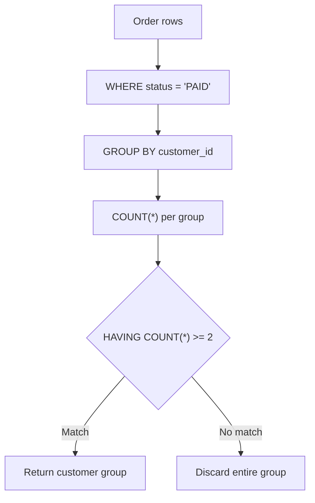

# HAVING and Distinguishing Group Filtering from Row Filtering in PostgreSQL

An orders table can store millions of transactions. When an application asks **"which orders have been paid?"**, we want to filter individual rows of the table. But when it asks **"which customers have paid for at least two orders?"** or **"which months exceeded a revenue threshold?"**, we must **gather multiple rows into groups, compute aggregates, and only then check each group**.

Those two questions are very different, even though both use the word "filter":

- **`WHERE`** selects **input rows** before aggregation.
- **`HAVING`** selects **groups** after evaluating aggregate expressions such as `COUNT`, `SUM`, and `AVG`.

PostgreSQL supports both together, and also provides **`FILTER (WHERE ...)`** to filter inputs for **an individual aggregate function** without excluding rows from other aggregates. Understanding all three mechanisms is essential for writing reports with accurate order counts, revenue, active customer counts, and transaction ratios.

This lesson belongs to the **Data Aggregation** chapter, focusing on distinguishing row filtering from group filtering, common pitfalls, and SQL examples with clear expected outputs.

## 1. Mental Model: Rows, Groups, and Qualifying Groups

Suppose we have an `orders` table:

| order_id | customer_id | status | amount |
| ---: | ---: | --- | ---: |
| 101 | 1 | PAID | 120000 |
| 102 | 1 | PAID | 80000 |
| 103 | 1 | PENDING | 50000 |
| 104 | 2 | PAID | 200000 |
| 105 | 2 | CANCELLED | 90000 |
| 106 | 3 | PAID | 70000 |
| 107 | 3 | PAID | 30000 |

If the question is **"which orders are PAID?"**, we select rows directly where `status = 'PAID'`.

If the question is **"which customers have at least two PAID orders?"**, logically we:

1. Select rows with status `PAID` using `WHERE`.
2. Group the remaining rows by `customer_id` using `GROUP BY`.
3. Count orders in each group using `COUNT(*)`.
4. Keep only groups with 2 or more orders using `HAVING COUNT(*) >= 2`.



When a group is filtered out by `HAVING`, PostgreSQL does not delete source rows. It simply **omits that group from the query result**.

## 2. Logical Processing Order of an Aggregate Query

A SQL query is typically written in this order:

```sql
SELECT
    customer_id,
    COUNT(*) AS order_count
FROM orders
WHERE status = 'PAID'
GROUP BY customer_id
HAVING COUNT(*) >= 2
ORDER BY order_count DESC
LIMIT 10;
```

To understand its meaning, picture the **logical** order:

| Stage | Purpose | Self-Check Question |
| --- | --- | --- |
| `FROM` / `JOIN` | Identify source tables and join relationships | Where does the data start? |
| `WHERE` | Discard **individual rows** not matching the predicate | Which transactions are allowed into aggregation? |
| `GROUP BY` | Partition remaining rows into groups | What does one group represent? |
| Aggregate functions | Compute `COUNT`, `SUM`, `AVG`, etc. per group | How many rows or what total does this group have? |
| `HAVING` | Discard **entire groups** failing the requirement | Which groups make it into the report? |
| `SELECT` | Compute output expressions/columns | Which fields are presented? |
| `ORDER BY` | Sort the result | What display order must be guaranteed? |
| `LIMIT` / `OFFSET` | Cap and paginate output rows | How many groups are returned? |

This is a **semantic model**, not a claim that the physical executor always runs clauses strictly in this sequence. The PostgreSQL planner may push predicates down, switch scan methods, or use `HashAggregate`/`GroupAggregate` as long as the same result is preserved.

Key takeaway: **`HAVING` does not operate on raw rows like `WHERE`; it operates on already formed groups**.

## 3. Preparing the PostgreSQL Practice Data

Use a **test database**. The SQL below creates a dedicated schema to avoid colliding with customer and order tables from other applications. The script assumes the tables do not yet exist; do not re-run the `INSERT` statements over existing data.

### 3.1. Creating the Tables

```sql
CREATE SCHEMA IF NOT EXISTS having_lab;

CREATE TABLE having_lab.customers (
    customer_id INTEGER PRIMARY KEY,
    full_name   TEXT NOT NULL,
    city        TEXT NOT NULL
);

CREATE TABLE having_lab.orders (
    order_id    INTEGER PRIMARY KEY,
    customer_id INTEGER NOT NULL
        REFERENCES having_lab.customers (customer_id),
    order_date  DATE NOT NULL,
    status      TEXT NOT NULL
        CHECK (status IN ('PAID', 'PENDING', 'CANCELLED')),
    amount      NUMERIC(12, 2) NOT NULL
        CHECK (amount >= 0)
);
```

`NUMERIC(12, 2)` is chosen to illustrate exact decimal currency amounts. In real systems, clarify currency units, tax/discount calculation, and rounding policies; this lesson assumes `amount` is the finalized order total.

### 3.2. Loading Data

```sql
INSERT INTO having_lab.customers
    (customer_id, full_name, city)
VALUES
    (1, 'An', 'Hà Nội'),
    (2, 'Bình', 'TP. Hồ Chí Minh'),
    (3, 'Chi', 'Hà Nội'),
    (4, 'Dũng', 'Huế'),
    (5, 'Em', 'TP. Hồ Chí Minh');

INSERT INTO having_lab.orders
    (order_id, customer_id, order_date, status, amount)
VALUES
    (101, 1, DATE '2026-01-05', 'PAID', 120000),
    (102, 1, DATE '2026-01-10', 'PAID',  80000),
    (103, 1, DATE '2026-02-01', 'PENDING',  50000),
    (104, 2, DATE '2026-01-12', 'PAID', 200000),
    (105, 2, DATE '2026-02-03', 'CANCELLED', 90000),
    (106, 3, DATE '2026-01-18', 'PAID',  70000),
    (107, 3, DATE '2026-01-20', 'PAID',  30000),
    (108, 3, DATE '2026-02-10', 'PENDING',  60000),
    (109, 4, DATE '2026-01-24', 'CANCELLED', 40000);
```

Intentional dataset characteristics:

- An has **3 orders**, including **2 PAID**.
- Bình has **2 orders**, including **1 PAID**.
- Chi has **3 orders**, including **2 PAID**.
- Dũng has **1 CANCELLED order**, **0 PAID**.
- Em **has no orders yet**.

These numbers make it easy to distinguish results produced by `WHERE`, `HAVING`, and `LEFT JOIN`.

### 3.3. Inspecting the Table Before Aggregating

```sql
SELECT
    order_id,
    customer_id,
    order_date,
    status,
    amount
FROM having_lab.orders
ORDER BY order_id;
```

When loaded as shown, there are **9 rows**. All aggregations below rely on this exact dataset.

## 4. WHERE Filters Rows Before GROUP BY

Suppose we want to count **paid orders** per customer:

```sql
SELECT
    customer_id,
    COUNT(*) AS paid_order_count
FROM having_lab.orders
WHERE status = 'PAID'
GROUP BY customer_id
ORDER BY customer_id;
```

Result:

| customer_id | paid_order_count |
| ---: | ---: |
| 1 | 2 |
| 2 | 1 |
| 3 | 2 |

**Dũng does not appear** because he only has a CANCELLED order. Em does not appear because she has no orders. After `WHERE status = 'PAID'`, no rows remain for either customer to form a group.

### 4.1. WHERE Does Not Delete Groups

`WHERE` applies **before groups are formed**. It does not know each customer's `COUNT(*)` because counting has not occurred at that logical stage.

Therefore, the following query is **invalid**:

```sql
-- DOES NOT RUN: aggregate functions cannot be used in WHERE.
SELECT customer_id, COUNT(*)
FROM having_lab.orders
WHERE COUNT(*) >= 2
GROUP BY customer_id;
```

PostgreSQL rejects it because `COUNT(*)` is a group-level calculation. To filter by group count, use `HAVING`.

### 4.2. Filtering by Date Before Grouping

```sql
SELECT
    customer_id,
    COUNT(*) AS january_order_count
FROM having_lab.orders
WHERE order_date >= DATE '2026-01-01'
  AND order_date < DATE '2026-02-01'
GROUP BY customer_id
ORDER BY customer_id;
```

Result on the sample data:

| customer_id | january_order_count |
| ---: | ---: |
| 1 | 2 |
| 2 | 1 |
| 3 | 2 |
| 4 | 1 |

February orders **never enter the count**. If the report asks for "customers with at least two orders in January," you must also add `HAVING COUNT(*) >= 2` after filtering by date.

## 5. HAVING Filters Groups After Evaluating Aggregates

Keeping all order statuses, find customers with **two or more orders**:

```sql
SELECT
    customer_id,
    COUNT(*) AS total_orders
FROM having_lab.orders
GROUP BY customer_id
HAVING COUNT(*) >= 2
ORDER BY customer_id;
```

Result:

| customer_id | total_orders |
| ---: | ---: |
| 1 | 3 |
| 2 | 2 |
| 3 | 3 |

`GROUP BY customer_id` forms four groups for customers who have orders: 1, 2, 3, and 4. Dũng's group has one row, so `HAVING COUNT(*) >= 2` removes it. Em forms no group because `orders` has no matching row for her.

### 5.1. HAVING Can Combine Multiple Aggregates

Suppose we want customers **with at least two orders and a total amount across all orders of 150,000 or more**:

```sql
SELECT
    customer_id,
    COUNT(*) AS order_count,
    SUM(amount) AS total_amount
FROM having_lab.orders
GROUP BY customer_id
HAVING COUNT(*) >= 2
   AND SUM(amount) >= 150000
ORDER BY customer_id;
```

Result:

| customer_id | order_count | total_amount |
| ---: | ---: | ---: |
| 1 | 3 | 250000.00 |
| 2 | 2 | 290000.00 |
| 3 | 3 | 160000.00 |

Here the totals **include all statuses** because there is no `WHERE status='PAID'`. If you want actual collected revenue, you cannot blindly include `PENDING`/`CANCELLED`; filter and define explicitly which transactions count.

### 5.2. HAVING with SUM, AVG, MIN, and MAX

`HAVING` is not limited to `COUNT(*)`. For example:

```sql
SELECT
    customer_id,
    AVG(amount) AS average_order_amount,
    MAX(amount) AS largest_order
FROM having_lab.orders
GROUP BY customer_id
HAVING AVG(amount) >= 100000
ORDER BY customer_id;
```

In the sample data, Bình has an average of `(200000 + 90000)/2 = 145000`, which passes the threshold; An averages approx. 83,333.33, Chi approx. 53,333.33, and Dũng 40,000, so they are excluded.

What matters is deciding the **input to AVG**: above, it includes PAID, PENDING, and CANCELLED orders. If the business asks for "average value of paid orders," filter status first or apply `FILTER` to the relevant aggregate.

### 5.3. HAVING Does Not Require Listing the Same Aggregate in SELECT

PostgreSQL allows:

```sql
SELECT customer_id
FROM having_lab.orders
GROUP BY customer_id
HAVING COUNT(*) >= 2
ORDER BY customer_id;
```

The result returns the three customer IDs 1, 2, and 3, even though `COUNT(*)` **does not appear in the SELECT list**. `HAVING` requires a condition that can be evaluated per group, not that every aggregate appear in the output.

## 6. Combining WHERE and HAVING in One Query

Question: **"Which customers have at least two PAID orders?"**

```sql
SELECT
    customer_id,
    COUNT(*) AS paid_orders
FROM having_lab.orders
WHERE status = 'PAID'
GROUP BY customer_id
HAVING COUNT(*) >= 2
ORDER BY customer_id;
```

Result:

| customer_id | paid_orders |
| ---: | ---: |
| 1 | 2 |
| 3 | 2 |

**Bình does not qualify** because he has only one PAID order, despite having two orders total. This query shows:

- `WHERE status='PAID'` defines **which rows** enter the groups.
- `GROUP BY customer_id` defines the **statistical unit**.
- `HAVING COUNT(*) >= 2` defines the **group acceptance condition**.

### 6.1. A Small Change Can Alter Report Semantics

Compare two requirements:

**A. Customers with at least two orders, and we want to see the value of their PAID orders.**

**B. Customers with at least two PAID orders.**

These two requirements are not equivalent. For Bình, A accepts the customer because he has two total orders, whereas B rejects him because only one is PAID.

If you mistakenly put `WHERE status='PAID'` into A's query and then check `COUNT(*) >= 2`, you silently change the condition from **"any two orders"** to **"two PAID orders."** This is a very common business-logic bug and is hard to spot if test data lacks varied statuses.

## 7. FILTER (WHERE ...): Filtering Inputs per Aggregate

PostgreSQL supports the syntax:

```sql
aggregate_function(...) FILTER (WHERE condition)
```

This is a **filter attached to an individual aggregate function**. It does not exclude rows from other aggregates in the same group.

For example, to see **total orders**, **PAID orders**, and **PAID revenue** for each customer:

```sql
SELECT
    customer_id,
    COUNT(*) AS all_orders,
    COUNT(*) FILTER (WHERE status = 'PAID') AS paid_orders,
    COALESCE(
        SUM(amount) FILTER (WHERE status = 'PAID'),
        0
    ) AS paid_amount
FROM having_lab.orders
GROUP BY customer_id
ORDER BY customer_id;
```

Result:

| customer_id | all_orders | paid_orders | paid_amount |
| ---: | ---: | ---: | ---: |
| 1 | 3 | 2 | 200000.00 |
| 2 | 2 | 1 | 200000.00 |
| 3 | 3 | 2 | 100000.00 |
| 4 | 1 | 0 | 0.00 |

Explanation:

- `COUNT(*)` counts **every order** in the group.
- `COUNT(*) FILTER (WHERE status='PAID')` counts only PAID orders.
- `SUM(amount) FILTER (WHERE status='PAID')` sums only amounts from PAID orders.
- `COALESCE(...,0)` converts a sum with no matching rows to 0 instead of `NULL`.

### 7.1. FILTER vs. Query-Level WHERE

If instead you write:

```sql
SELECT
    customer_id,
    COUNT(*) AS all_orders
FROM having_lab.orders
WHERE status = 'PAID'
GROUP BY customer_id;
```

then `all_orders` actually **counts only PAID orders**; PENDING/CANCELLED orders never reach any aggregate. Therefore, when reporting multiple statuses in the **same result row**, `FILTER` keeps the SQL clear and avoids multiple subqueries.

### 7.2. Using FILTER Directly Inside HAVING

Question: **"Which customers have at least two PAID orders, while still displaying their total orders across all statuses?"**

```sql
SELECT
    customer_id,
    COUNT(*) AS all_orders,
    COUNT(*) FILTER (WHERE status = 'PAID') AS paid_orders
FROM having_lab.orders
GROUP BY customer_id
HAVING COUNT(*) FILTER (WHERE status = 'PAID') >= 2
ORDER BY customer_id;
```

Result:

| customer_id | all_orders | paid_orders |
| ---: | ---: | ---: |
| 1 | 3 | 2 |
| 3 | 3 | 2 |

This query **differs** from filtering upfront with `WHERE status='PAID'`: the same customers are selected on this dataset, but `all_orders` is **3**, not **2**.

### 7.3. FILTER Can Be Written with CASE, but Semantics Must Stay Clear

A familiar pattern:

```sql
SELECT
    customer_id,
    SUM(CASE WHEN status = 'PAID' THEN 1 ELSE 0 END)
        AS paid_orders
FROM having_lab.orders
GROUP BY customer_id;
```

On this data, the count matches:

```sql
COUNT(*) FILTER (WHERE status = 'PAID')
```

However, the two forms are not mechanically interchangeable for every aggregate: `COUNT(CASE WHEN ... THEN 1 ELSE 0 END)` will count **every row**, because 0 is **non-NULL**. To use CASE with COUNT, write `COUNT(CASE WHEN status='PAID' THEN 1 END)`.

**Recommendation:** when PostgreSQL supports `FILTER` and you only want a per-aggregate condition, `FILTER (WHERE ...)` is usually easier to read.

## 8. Comparing WHERE, FILTER, and HAVING in One Table

| Feature | Query-Level `WHERE` | `FILTER (WHERE ...)` | `HAVING` |
| --- | --- | --- | --- |
| What does it filter? | **Rows** from the query source | **Input rows to one aggregate** | **Groups** after aggregation |
| Where does it go? | After `FROM`/`JOIN`, before `GROUP BY` | Immediately after an aggregate call | After `GROUP BY` |
| Direct `COUNT(*)` allowed in condition? | **No** | The FILTER condition cannot arbitrarily use same-level aggregates as row values | **Yes** |
| Affects all aggregates in SELECT? | **Yes** | **No**, only the aggregate with FILTER | **Does not alter group values**; decides whether the group is returned |
| Works without GROUP BY? | Yes | Yes, on that aggregate | Yes, over the implicit group |
| Example | `WHERE status='PAID'` | `COUNT(*) FILTER (WHERE status='PAID')` | `HAVING COUNT(*) >= 2` |

Ask yourself: **do I want to drop individual transactions, count only one kind of transaction, or drop entire customers after summarizing?** Answering that tells you where the condition belongs.

## 9. HAVING Can Be Used Without GROUP BY

Usually `HAVING` accompanies `GROUP BY`. However, PostgreSQL also permits `HAVING` in an aggregate query **without an explicit GROUP BY**: all input rows form **one implicit group**.

For example, return the order count only if there are at least 5 orders total:

```sql
SELECT COUNT(*) AS total_orders
FROM having_lab.orders
HAVING COUNT(*) >= 5;
```

With 9 orders in the sample data, the result is **one row** with `total_orders = 9`.

Changing the threshold:

```sql
SELECT COUNT(*) AS total_orders
FROM having_lab.orders
HAVING COUNT(*) >= 10;
```

The result is **0 rows**, not one row with 0. The implicit group was filtered out by `HAVING`.

### 9.1. Comparison with WHERE Only

```sql
SELECT COUNT(*) AS paid_orders
FROM having_lab.orders
WHERE status = 'PAID';
```

The result is one row with **5** because there are 5 PAID orders. Even if there were no PAID orders, `COUNT(*)` would still return one row with count 0.

Conversely, adding `HAVING COUNT(*) > 0` can turn the result into **0 rows** when no orders match. You must distinguish "zero result groups" from "a group with count 0," especially when an API expects exactly one summary row.

### 9.2. Queries with HAVING and No Aggregates

In PostgreSQL semantics, the presence of `HAVING` turns the query into a grouped query even without `GROUP BY`. Without explicit grouping keys, you cannot arbitrarily select raw row columns:

```sql
-- Invalid: order_id is an individual row column,
-- neither aggregated nor included in GROUP BY.
SELECT order_id
FROM having_lab.orders
HAVING TRUE;
```

Never use `HAVING` in place of `WHERE` just because both accept boolean expressions. If you want orders with `order_id > 100`, write `WHERE order_id > 100`.

## 10. Columns Allowed Inside HAVING

With `GROUP BY customer_id`, each group represents **one `customer_id`**. Expressions in `SELECT` and `HAVING` must be well-defined at the group level.

Valid:

```sql
SELECT customer_id, COUNT(*) AS order_count
FROM having_lab.orders
GROUP BY customer_id
HAVING customer_id IN (1, 3)
   AND COUNT(*) >= 2
ORDER BY customer_id;
```

Here:

- `customer_id` is a **grouping key column**.
- `COUNT(*)` is a **group-level aggregate value**.

Invalid example:

```sql
-- DOES NOT RUN: status is not in GROUP BY
-- and is not wrapped in an aggregate.
SELECT customer_id, COUNT(*)
FROM having_lab.orders
GROUP BY customer_id
HAVING status = 'PAID';
```

A customer can have orders in multiple statuses, so after grouping by `customer_id`, PostgreSQL has **no single `status` value** to check at the group level.

If the intent is counting PAID orders, write:

```sql
SELECT customer_id, COUNT(*) AS paid_count
FROM having_lab.orders
WHERE status = 'PAID'
GROUP BY customer_id
HAVING COUNT(*) >= 2;
```

If the intent is **selecting groups with at least one PAID order**, while still counting all orders:

```sql
SELECT customer_id, COUNT(*) AS all_orders
FROM having_lab.orders
GROUP BY customer_id
HAVING COUNT(*) FILTER (WHERE status = 'PAID') > 0;
```

**Semantic exception:** PostgreSQL has rules for recognizing functional dependencies—for example, when grouping by a base table's primary key, other columns of that same table may appear without being listed in `GROUP BY`. However, do not assume the engine infers functional dependencies across complex JOINs, views, or expressions. When learning, stick to explicit grouping columns or aggregates.

## 11. SELECT Aliases in HAVING: A Common Error

Example:

```sql
SELECT
    customer_id,
    COUNT(*) AS order_count
FROM having_lab.orders
GROUP BY customer_id
HAVING order_count >= 2;
```

In PostgreSQL, the alias `order_count` defined in the `SELECT` list **is not visible in HAVING at the same SELECT level**. This query fails unless a source column happens to share that name.

The right fix is repeating the expression:

```sql
SELECT
    customer_id,
    COUNT(*) AS order_count
FROM having_lab.orders
GROUP BY customer_id
HAVING COUNT(*) >= 2
ORDER BY order_count DESC;
```

**`ORDER BY order_count` is valid** because PostgreSQL allows referencing output column aliases in `ORDER BY`.

### 11.1. To Filter by Alias Name, Use a CTE or Subquery

```sql
WITH customer_counts AS (
    SELECT
        customer_id,
        COUNT(*) AS order_count
    FROM having_lab.orders
    GROUP BY customer_id
)
SELECT
    customer_id,
    order_count
FROM customer_counts
WHERE order_count >= 2
ORDER BY order_count DESC, customer_id;
```

In the outer query, `order_count` is already an **output column of the CTE**, so `WHERE order_count >= 2` is completely valid.

Both forms usually produce the same result, serving different readability needs:

- `HAVING COUNT(*) >= 2`: concise and direct at the aggregation step.
- CTE/subquery: helpful when applying **multiple conditions on named metrics**, multi-step reports, or further joins.

There is no need to create physical tables solely to give an alias to a group condition.

## 12. COUNT(*), COUNT(column), COUNT(DISTINCT ...), and NULL

Group filtering results can be wrong if you pick the wrong counting function.

| Aggregate | What Does It Count? | NULL Handling |
| --- | --- | --- |
| `COUNT(*)` | All rows in the group | Counts rows with NULL columns |
| `COUNT(column)` | Rows where `column IS NOT NULL` | Ignores NULL |
| `COUNT(DISTINCT column)` | **Distinct non-NULL** values | Ignores NULL and duplicates |
| `SUM(column)` | Sum of non-NULL values | Ignores NULL; group with no valid values returns NULL |
| `AVG(column)` | Average of non-NULL values | Ignores NULL; no valid inputs returns NULL |

Standalone example:

```sql
WITH values_demo(group_id, value) AS (
    VALUES
        (1, 10),
        (1, 10),
        (1, NULL::integer),
        (1, 20),
        (2, NULL::integer)
)
SELECT
    group_id,
    COUNT(*) AS row_count,
    COUNT(value) AS nonnull_count,
    COUNT(DISTINCT value) AS unique_values,
    SUM(value) AS value_sum,
    AVG(value) AS value_avg
FROM values_demo
GROUP BY group_id
ORDER BY group_id;
```

Result:

| group_id | row_count | nonnull_count | unique_values | value_sum | value_avg |
| ---: | ---: | ---: | ---: | ---: | ---: |
| 1 | 4 | 3 | 2 | 40 | 13.333... |
| 2 | 1 | 0 | 0 | NULL | NULL |

If you write `HAVING COUNT(value) >= 1`, group 2 is dropped; `HAVING COUNT(*) >= 1` keeps group 2.

### 12.1. HAVING SUM(...) and UNKNOWN

For a group with no non-NULL numeric values, `SUM(value)` returns `NULL`. Consequently:

```sql
HAVING SUM(value) > 100
```

evaluates to **UNKNOWN** when SUM is NULL; the group is dropped because HAVING keeps only **TRUE** conditions.

When business logic treats "no values" as 0, you can write:

```sql
HAVING COALESCE(SUM(value), 0) >= 0
```

However, do not blindly convert every NULL to 0: **"no data yet"** and **"data summing to 0"** often carry different business meanings.

## 13. LEFT JOIN, Empty Groups, and Finding Customers Without Purchases

In the sample data, **Em** has no orders. Starting from `having_lab.orders`, no row forms a group for Em. To report on **all customers**, start from `customers` and use `LEFT JOIN`.

```sql
SELECT
    c.customer_id,
    c.full_name,
    COUNT(o.order_id) AS all_orders,
    COUNT(o.order_id) FILTER (WHERE o.status = 'PAID')
        AS paid_orders,
    COALESCE(
        SUM(o.amount) FILTER (WHERE o.status = 'PAID'),
        0
    ) AS paid_amount
FROM having_lab.customers AS c
LEFT JOIN having_lab.orders AS o
  ON o.customer_id = c.customer_id
GROUP BY c.customer_id, c.full_name
ORDER BY c.customer_id;
```

Result:

| customer_id | full_name | all_orders | paid_orders | paid_amount |
| ---: | --- | ---: | ---: | ---: |
| 1 | An | 3 | 2 | 200000.00 |
| 2 | Bình | 2 | 1 | 200000.00 |
| 3 | Chi | 3 | 2 | 100000.00 |
| 4 | Dũng | 1 | 0 | 0.00 |
| 5 | Em | 0 | 0 | 0.00 |

### 13.1. Why Not Use COUNT(*) to Count Orders After a LEFT JOIN?

`LEFT JOIN` still produces one row for customer Em; columns on the `orders` side receive `NULL` due to no match. Therefore:

```sql
COUNT(*)
```

**counts 1** for Em, whereas:

```sql
COUNT(o.order_id)
```

**counts 0**, because `o.order_id` is NULL. This is one of the most frequent counting bugs when switching from `INNER JOIN` to `LEFT JOIN`.

### 13.2. Using HAVING to Find Customers Without Orders

```sql
SELECT
    c.customer_id,
    c.full_name,
    COUNT(o.order_id) AS order_count
FROM having_lab.customers AS c
LEFT JOIN having_lab.orders AS o
  ON o.customer_id = c.customer_id
GROUP BY c.customer_id, c.full_name
HAVING COUNT(o.order_id) = 0
ORDER BY c.customer_id;
```

The result contains only **Em**.

An existence/non-existence check can be expressed clearly and efficiently with `NOT EXISTS`:

```sql
SELECT c.customer_id, c.full_name
FROM having_lab.customers AS c
WHERE NOT EXISTS (
    SELECT 1
    FROM having_lab.orders AS o
    WHERE o.customer_id = c.customer_id
);
```

When you only need to test **whether a relationship exists**, `EXISTS`/`NOT EXISTS` usually conveys intent more directly than grouping and checking `HAVING COUNT(...) = 0`.

### 13.3. Putting the Filter in ON vs. WHERE of a LEFT JOIN

Keep **all customers** and match only PAID orders:

```sql
SELECT
    c.customer_id,
    c.full_name,
    COUNT(o.order_id) AS paid_orders
FROM having_lab.customers AS c
LEFT JOIN having_lab.orders AS o
  ON o.customer_id = c.customer_id
 AND o.status = 'PAID'
GROUP BY c.customer_id, c.full_name
ORDER BY c.customer_id;
```

The result includes **five customers**, with Dũng and Em showing `paid_orders = 0`.

If you move `o.status = 'PAID'` down to `WHERE`:

```sql
SELECT
    c.customer_id,
    c.full_name,
    COUNT(o.order_id) AS paid_orders
FROM having_lab.customers AS c
LEFT JOIN having_lab.orders AS o
  ON o.customer_id = c.customer_id
WHERE o.status = 'PAID'
GROUP BY c.customer_id, c.full_name
ORDER BY c.customer_id;
```

then customers without PAID orders are dropped by `WHERE`, leaving only An, Bình, and Chi. **Placing conditions in ON vs. WHERE is not always equivalent with OUTER JOINs.** This is a difference in results, not merely performance.

## 14. HAVING with Multiple Grouping Dimensions

Not every group is a customer. You can group by status, city, month, or **combinations of multiple columns**.

### 14.1. Grouping by Status

```sql
SELECT
    status,
    COUNT(*) AS order_count,
    SUM(amount) AS total_amount
FROM having_lab.orders
GROUP BY status
HAVING COUNT(*) >= 2
ORDER BY status;
```

Result:

| status | order_count | total_amount |
| --- | ---: | ---: |
| CANCELLED | 2 | 130000.00 |
| PAID | 5 | 500000.00 |
| PENDING | 2 | 110000.00 |

`HAVING COUNT(*) >= 2` applies **per status group**, not per customer. With the exact same `COUNT(*)` expression, changing `GROUP BY` completely changes what the report means.

### 14.2. Grouping by City and Status

```sql
SELECT
    c.city,
    o.status,
    COUNT(*) AS order_count,
    SUM(o.amount) AS total_amount
FROM having_lab.customers AS c
JOIN having_lab.orders AS o
  ON o.customer_id = c.customer_id
GROUP BY c.city, o.status
HAVING COUNT(*) >= 2
ORDER BY c.city, o.status;
```

Qualifying groups:

| city | status | order_count | total_amount |
| --- | --- | ---: | ---: |
| Hà Nội | PAID | 4 | 300000.00 |
| Hà Nội | PENDING | 2 | 110000.00 |

Explanation: Both An and Chi are in Hà Nội. Combining both customers yields four PAID orders and two PENDING orders; other groups have at most one order per status.

**Granularity warning:** `GROUP BY c.city, o.status` forms groups by **(city, status)** pairs, not per customer. If you want "each customer in each city," include the customer identifier in the grouping key.

### 14.3. Grouping by Month

```sql
SELECT
    date_trunc('month', order_date::timestamp)::date
        AS month_start,
    COUNT(*) AS order_count,
    SUM(amount) AS total_amount
FROM having_lab.orders
GROUP BY date_trunc('month', order_date::timestamp)::date
HAVING COUNT(*) >= 3
ORDER BY month_start;
```

Result:

| month_start | order_count | total_amount |
| --- | ---: | ---: |
| 2026-01-01 | 6 | 540000.00 |
| 2026-02-01 | 3 | 200000.00 |

`date_trunc('month', ...)` computes the start of each month in the corresponding representation; casting `::date` keeps output clean for `DATE` values. In systems using `TIMESTAMPTZ`, define the **business time zone** before grouping by day/month, since the same UTC instant can fall on different dates across time zones.

### 14.4. ROLLUP and Total Rows

PostgreSQL supports `ROLLUP` for retrieving both detail and summary levels:

```sql
SELECT
    status,
    GROUPING(status) AS is_grand_total,
    COUNT(*) AS order_count,
    SUM(amount) AS total_amount
FROM having_lab.orders
GROUP BY ROLLUP(status)
HAVING COUNT(*) >= 2
ORDER BY GROUPING(status), status;
```

In this example, the status groups have counts 2/5/2 and the total row has **9** orders. `GROUPING(status)` equals 1 on the total row, helping distinguish a **rollup-generated NULL** from an actual NULL value if the column were nullable.

To **keep only detail rows and exclude the total row**:

```sql
HAVING GROUPING(status) = 0
   AND COUNT(*) >= 2
```

This advanced example shows `HAVING` can filter by **grouping level**, not just `SUM`/`COUNT`. For simple reports, plain `GROUP BY` is usually easier to read.

## 15. HAVING and JOIN: Avoiding Multiplied Metrics

A major reporting hazard is **joining two 1:N child tables before GROUP BY**. Rows multiply before aggregation, causing `HAVING` to evaluate distorted figures.

Suppose order 101 has:

- **2 line items**: 90,000 and 30,000.
- **2 payment attempts**: attempt 1 FAILED, attempt 2 SUCCEEDED.

Joining line items directly with payment attempts:

```sql
WITH order_lines(order_id, line_id, line_amount) AS (
    VALUES
        (101, 1, 90000::numeric),
        (101, 2, 30000::numeric)
),
payment_attempts(order_id, attempt_id, result) AS (
    VALUES
        (101, 1, 'FAILED'),
        (101, 2, 'SUCCEEDED')
)
SELECT
    l.order_id,
    COUNT(*) AS joined_rows,
    SUM(l.line_amount) AS incorrect_total
FROM order_lines AS l
JOIN payment_attempts AS p
  ON p.order_id = l.order_id
GROUP BY l.order_id;
```

Result:

| order_id | joined_rows | incorrect_total |
| ---: | ---: | ---: |
| 101 | 4 | 240000 |

The true sum of the two lines is only **120,000**. Joining 2 lines × 2 attempts produces **4 combinations**, summing each line amount **twice**.

### 15.1. Fix by Pre-Aggregating Each Branch

```sql
WITH order_lines(order_id, line_id, line_amount) AS (
    VALUES
        (101, 1, 90000::numeric),
        (101, 2, 30000::numeric)
),
payment_attempts(order_id, attempt_id, result) AS (
    VALUES
        (101, 1, 'FAILED'),
        (101, 2, 'SUCCEEDED')
),
line_totals AS (
    SELECT
        order_id,
        COUNT(*) AS line_count,
        SUM(line_amount) AS correct_total
    FROM order_lines
    GROUP BY order_id
),
attempt_counts AS (
    SELECT
        order_id,
        COUNT(*) AS attempt_count
    FROM payment_attempts
    GROUP BY order_id
)
SELECT
    l.order_id,
    l.line_count,
    l.correct_total,
    a.attempt_count
FROM line_totals AS l
JOIN attempt_counts AS a
  ON a.order_id = l.order_id;
```

The output has one row for order 101, with `line_count = 2`, `correct_total = 120000`, and `attempt_count = 2`.

**Do not fix fan-out using `SUM(DISTINCT line_amount)`**: if two line items happen to share the same monetary amount, `DISTINCT` discards a valid value and keeps the report wrong. Fix the **grain** of the JOIN rather than applying `DISTINCT` to monetary amounts.

### 15.2. HAVING Cannot Repair an Already-Broken Aggregate

If you write `HAVING SUM(l.line_amount) >= 200000` after an improper JOIN, order 101 can pass the threshold because its sum was doubled, even though its real total is 120,000. `HAVING` filters groups based on **values computed from its current input**; it has no business awareness to detect rows multiplied by a JOIN.

Therefore, before placing HAVING on a JOIN result, verify **what one row at the GROUP BY stage represents**, and check the uniqueness of join keys.

## 16. HAVING, Window Functions, and Keeping Detail Rows

`GROUP BY` collapses multiple rows into one row per group. Sometimes, however, a report wants to **keep each individual order** while showing only orders from customers who have two or more orders.

If you use:

```sql
SELECT customer_id, COUNT(*) AS order_count
FROM having_lab.orders
GROUP BY customer_id
HAVING COUNT(*) >= 2;
```

the output has only **one row per `customer_id`**, losing individual `order_id`s.

When you need to preserve every row, use a **window function**:

```sql
WITH orders_with_counts AS (
    SELECT
        order_id,
        customer_id,
        status,
        amount,
        COUNT(*) OVER (PARTITION BY customer_id)
            AS customer_order_count
    FROM having_lab.orders
)
SELECT
    order_id,
    customer_id,
    status,
    amount,
    customer_order_count
FROM orders_with_counts
WHERE customer_order_count >= 2
ORDER BY customer_id, order_id;
```

The result has **8 rows**: all orders for An (3), Bình (2), and Chi (3). Dũng's order is excluded because he has only one order; Em has no source rows.

### 16.1. Why Not Put Window Functions Directly in HAVING?

Window functions like `COUNT(*) OVER (...)` operate at a different logical stage than group aggregates. In PostgreSQL, window functions cannot appear directly in `WHERE` or `HAVING` of the same query level. Use a **CTE or subquery** to compute the window column first, then filter in the outer SELECT.

Remember the rule:

- Want **one row per group**: `GROUP BY ... HAVING ...`.
- Want **individual rows annotated with group statistics**: `OVER (PARTITION BY ...)` then filter in an outer query.

## 17. Choosing WHERE or HAVING for Performance?

When the same condition could be placed in multiple positions, expressing intent clearly helps both the optimizer and maintainers.

### 17.1. Filter Rows as Early as Appropriate

Suppose you only need statistics for January orders:

```sql
SELECT
    customer_id,
    COUNT(*) AS january_orders
FROM having_lab.orders
WHERE order_date >= DATE '2026-01-01'
  AND order_date < DATE '2026-02-01'
GROUP BY customer_id
HAVING COUNT(*) >= 2;
```

`WHERE` restricts input to January rows. On large workloads, it reduces rows entering aggregation and can leverage indexes or partition pruning if the schema supports them.

A logically similar query:

```sql
SELECT customer_id, COUNT(*)
FROM having_lab.orders
GROUP BY customer_id
HAVING customer_id = 1;
```

may have PostgreSQL **push down the grouping-key predicate** before grouping. Still, if the intent is **aggregating only customer 1's transactions**, writing:

```sql
SELECT customer_id, COUNT(*)
FROM having_lab.orders
WHERE customer_id = 1
GROUP BY customer_id;
```

expresses that intent much more clearly.

**Do not assume HAVING is always slower than WHERE**: the PostgreSQL planner optimizes many equivalent predicates. However, predicates on `SUM` or `COUNT` genuinely require group-level results, so they cannot simply be replaced by `WHERE` while preserving semantics in general.

### 17.2. Indexes Cannot Directly "Filter SUM Before SUM Exists"

An index on `(customer_id, order_date)` can speed up locating rows to aggregate when `WHERE` filters match. Yet a predicate like `HAVING SUM(amount) >= 200000` is not a direct comparison on a **single row** in an ordinary index; PostgreSQL generally must aggregate each group's data before deciding whether the group clears the threshold.

For recurring reports over massive tables, consider:

- More selective `WHERE` conditions when aligned with business logic.
- Indexes supporting filter predicates and grouping keys.
- Time-based partitioning if volume and operations justify it.
- Maintained summary tables or materialized views when staleness tolerance permits.
- Report caching with clear invalidation policies.

Every choice has maintenance overhead and must be measured against real workloads.

## 18. Reading Execution Plans with EXPLAIN and EXPLAIN ANALYZE

PostgreSQL can execute aggregation using different plan nodes:

| Common Node | Meaning |
| --- | --- |
| `Seq Scan` / `Index Scan` / `Bitmap Heap Scan` | Retrieves source rows |
| `HashAggregate` | Groups rows using a hash table |
| `GroupAggregate` | Groups rows from suitably pre-sorted input |
| `Sort` | Sorts rows when required |
| `Aggregate` | Ungrouped overall aggregation or applicable cases |
| `Filter` on aggregate node | May represent the `HAVING` predicate in the plan |

Try:

```sql
EXPLAIN
SELECT
    customer_id,
    COUNT(*) AS paid_orders
FROM having_lab.orders
WHERE status = 'PAID'
GROUP BY customer_id
HAVING COUNT(*) >= 2;
```

An **illustrative plan, not fixed server output**:

```text
HashAggregate
  Group Key: customer_id
  Filter: (count(*) >= 2)
  -> Seq Scan on orders
       Filter: (status = 'PAID')
```

Distinguish the two filters:

- `Filter: (status = 'PAID')` on the scan node corresponds to **WHERE row filtering**.
- `Filter: (count(*) >= 2)` on the aggregate node corresponds to **HAVING group filtering**.

Actual plans depend on data volume, PostgreSQL version, indexes, statistics, and cost settings. Do not expect your plan to match this illustrative tree verbatim.

### 18.1. Measuring Actual Row Counts

```sql
EXPLAIN (ANALYZE, BUFFERS)
SELECT
    customer_id,
    COUNT(*) AS paid_orders
FROM having_lab.orders
WHERE status = 'PAID'
GROUP BY customer_id
HAVING COUNT(*) >= 2;
```

For a `SELECT` on a test table, this lets you compare estimated vs. actual rows, execution time, buffer usage, and rows/groups removed by filters (when reported by the node).

**`EXPLAIN ANALYZE` actually executes the SQL statement.** Never run it casually on `UPDATE`/`DELETE` statements or live production workloads just to inspect a plan; assess cost and side effects first.

### 18.2. Sample Data Is Too Small for Performance Conclusions

This lab has only nine orders. PostgreSQL will likely choose `Seq Scan` even if indexes exist, because scanning a handful of rows is cheaper than traversing an index. When learning `HAVING` semantics, focus on **correct results**; when tuning performance, benchmark with representative volume and data distribution.

## 19. Edge Cases: Empty Groups, NULL Groups, and Thresholds

Group filters often raise questions that need explicit answers:

**Does "at least two orders" include CANCELLED orders?** If yes, use `HAVING COUNT(*) >= 2` across all orders. If no, add `WHERE status = 'PAID'` or a suitable conditional aggregate.

**Does "revenue" include unpaid orders?** You cannot tell from a column named `amount` alone; align on statuses, refunds, currency, and recognition timing.

**Do customers with zero orders have a total amount of 0?** In a `LEFT JOIN` report, you can use `COALESCE(SUM(o.amount), 0)` to show 0. In a report starting solely from `orders`, customers without orders **form no group**.

**Does `HAVING COUNT(*) >= 0` return all customers?** No—if querying `FROM orders GROUP BY customer_id`, groups exist only for customers present in `orders`. `HAVING` does not invent missing customer groups.

**Can `COUNT(*) = 0` ever hold for a group produced directly by `GROUP BY` on a table?** For a normal group formed from at least one row, `COUNT(*) >= 1`. In a `LEFT JOIN` group with a NULL-extended row, `COUNT(*) = 1`, so you need `COUNT(o.order_id) = 0` to detect zero orders. In ungrouped aggregation, `COUNT(*)` can be 0 on an empty input set.

**Is an amount equal to the threshold of 200,000 kept?** Yes with `>= 200000`; no with `> 200000`. Especially with `AVG` and decimals, agree on rounding rules before applying threshold comparisons.

## 20. Common Mistakes

| Mistake | Consequence | Correct Pattern / Understanding |
| --- | --- | --- |
| `WHERE COUNT(*) > 1` | PostgreSQL rejects aggregates in WHERE | Use `HAVING COUNT(*) > 1` |
| Using HAVING to filter raw row columns | Wrong semantics or ungrouped-column error | Put row conditions in WHERE |
| Thinking HAVING happens before GROUP BY | Misinterprets metrics and groups | HAVING logically evaluates after grouping |
| Using `GROUP BY` and forgetting HAVING | Report returns every group | Add HAVING when filtering groups |
| Filtering `PAID` in WHERE while still wanting all-order counts | Drops PENDING/CANCELLED from all aggregates | Use `FILTER (WHERE ...)` per aggregate |
| Using `COUNT(CASE WHEN ... THEN 1 ELSE 0 END)` | Counts non-matching rows too | Use FILTER, `SUM(CASE...)`, or `COUNT(CASE ... THEN 1 END)` |
| Referencing a SELECT alias directly in HAVING | Alias is not resolved at that level in PostgreSQL | Repeat the aggregate or wrap in a CTE/subquery |
| Using `COUNT(*)` after LEFT JOIN to count child records | Customers with zero orders count as 1 | Use `COUNT(o.order_id)` |
| Moving a filter from ON to WHERE in a LEFT JOIN | Can drop unmatched parent rows | Verify row-preservation requirements before moving |
| Using `HAVING COUNT(*) >= 0` to include non-buyers | Does not create groups absent from FROM | Start from customers and LEFT JOIN |
| Using `SUM(DISTINCT amount)` to fix JOIN row multiplication | Can drop valid orders sharing the same amount | Aggregate by key per branch before joining |
| Counting orders after joining `order_items` with `COUNT(*)` | Multi-item orders are counted multiple times | `COUNT(DISTINCT order_id)` or pre-aggregate |
| Ignoring `SUM` returning NULL when no rows match | Threshold comparison becomes UNKNOWN, dropping the group | Use COALESCE if 0 semantics are intended |
| Grouping only by customer name instead of ID | Merges distinct customers sharing a name | Group by unique identifier key |
| Using `HAVING COUNT(*) >= 2` without defining "valid order" | Accepts groups with two cancelled orders | Filter/count according to business status rules |
| Using HAVING instead of Row-Level Security | Risks leaking data across tenants | Enforce proper permissions, tenant scoping, or RLS |
| Assuming HashAggregate is always faster than GroupAggregate | Depends on group count, memory, sorting, and stats | Measure with EXPLAIN ANALYZE on representative data |
| Expecting `ORDER BY` inside a CTE to dictate final output order | SQL does not guarantee final order without outer ORDER BY | Put ORDER BY on the outermost query |

## 21. Practice Exercises

Use the `having_lab` dataset from Section 3. For questions extending beyond the sample data, state your assumptions clearly when explaining results.

1. **Row filtering:** list all `PAID` orders using `WHERE`. How many orders are there, and what is their total amount?
2. **Basic grouping:** count all orders by `customer_id`, without HAVING. Which customer is missing and why?
3. **Group filtering:** write a query finding customers with at least three orders across all statuses. Which customers should appear?
4. **WHERE + HAVING:** find customers with at least two PAID orders. The output must include An and Chi, with two orders each.
5. **Sum threshold:** find customers whose total `amount` across all orders is at least 200,000. How does the list differ from checking PAID orders only?
6. **Average:** use `AVG(amount)` in HAVING to find customers whose average order value is at least 100,000.
7. **Counting multiple statuses:** write a query returning `all_orders`, `paid_orders`, and `cancelled_orders` on the same row using `FILTER (WHERE ...)`.
8. **Distinguishing filter scope:** find customers with at least two PAID orders while showing their total order count across all statuses. Why is `all_orders = 3` for both An and Chi?
9. **Aliases:** test `HAVING paid_orders >= 2` when `paid_orders` is only a SELECT alias. Fix it by repeating the expression, then fix it with a CTE.
10. **Without GROUP BY:** run `SELECT COUNT(*) ... HAVING COUNT(*) >= 10`. Explain why the sample data does not return one row with `0`.
11. **NULLs:** create a CTE with one all-NULL group and one numeric group; compare `COUNT(*)`, `COUNT(value)`, `SUM(value)`, and the result of `HAVING SUM(value) > 0`.
12. **Customers without orders:** start from `customers`, LEFT JOIN `orders`; use `HAVING COUNT(o.order_id)=0` to find Em. Why doesn't `COUNT(*)=0` work the same way?
13. **ON vs. WHERE:** test two LEFT JOIN queries counting PAID orders with the status predicate in `ON` vs. in `WHERE`. Show that the two queries return different numbers of customers.
14. **Multi-column grouping:** group by `city` and `status`, keeping only groups with at least two orders. Explain why Hà Nội has two qualifying groups.
15. **Monthly:** use `date_trunc('month', order_date::timestamp)` to count orders per month; apply HAVING to keep only months with at least four orders.
16. **JOIN fan-out:** run the `order_lines`/`payment_attempts` CTE from Section 15. Why is `SUM(line_amount)` wrong without pre-aggregation?
17. **Window function:** retrieve every order belonging to customers with two or more orders, while still returning `order_id`. Why is a window function + CTE better suited here than `GROUP BY ... HAVING` directly?
18. **GROUPING SETS/ROLLUP:** use `GROUP BY ROLLUP(status)` and `GROUPING(status)` to distinguish the total row from detail rows. Apply HAVING to keep only status groups with at least three orders.
19. **Reading plans:** run `EXPLAIN` and `EXPLAIN (ANALYZE, BUFFERS)` for a `WHERE + GROUP BY + HAVING` query. Locate the filters on the scan and aggregate nodes (if present in the plan).
20. **Report design:** an event table has `tenant_id`, `user_id`, `event_type`, and `occurred_at`. Formulate the requirement "users per tenant with at least 5 LOGIN events in the 7 days preceding a given reference timestamp," identifying which conditions go in WHERE, which columns to group by, and what goes in HAVING.
21. **Controlling sums:** suppose every PAID order has one or more payment attempts. Propose a query that avoids multiplying revenue on JOIN, and explain why `SUM(DISTINCT amount)` is not a general solution.
22. **Business verification:** a report defines an "active customer" as one with at least two non-CANCELLED orders in a month. Write three SQL check queries (one using WHERE, one using HAVING, one using FILTER) and explain how to verify the numbers are interpreted accurately.

## 22. Summary

A sound aggregate query can be read along this chain:

```text
FROM / JOIN
    -> WHERE: keep qualifying ROWS
    -> GROUP BY: form GROUPS
    -> Aggregates: COUNT, SUM, AVG, ...
    -> HAVING: keep qualifying GROUPS
    -> SELECT / ORDER BY / LIMIT: present the result
```

Three key practical rules:

- **WHERE selects the input for all aggregates**; use it to exclude irrelevant transactions before summarizing.
- **FILTER (WHERE ...) selects the input for one specific aggregate**; use it when counting or summing multiple transaction categories within the same group.
- **HAVING selects groups after aggregation**; use it for group thresholds such as "at least N transactions," "revenue above X," or "average value meeting a cutoff."

Always clarify **what one group represents**, **which rows enter each group**, and **whether prior JOINs duplicate rows**. Once those three points are clear, `HAVING` becomes a precise report-filtering tool rather than a confusing substitute for `WHERE`.
