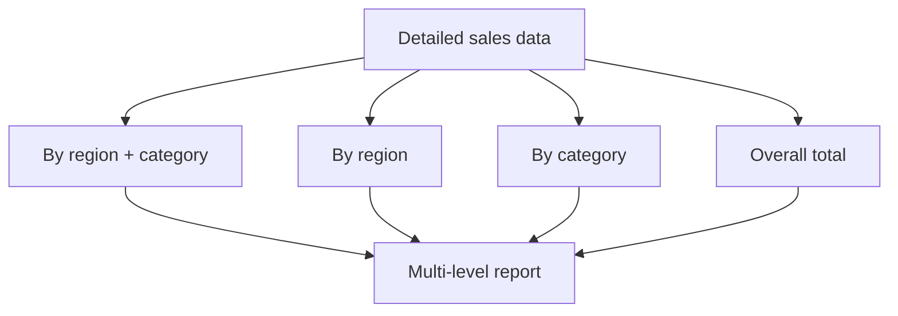

# GROUPING SETS, ROLLUP, and CUBE in PostgreSQL

Summary reports often need multiple aggregation levels at once: revenue by region and category, subtotals by region, subtotals by category, and company-wide grand total revenue. You could write multiple `GROUP BY` queries and combine them with `UNION ALL`, yet PostgreSQL provides three stronger constructs to express multiple aggregation levels directly in one query: **`GROUPING SETS`**, **`ROLLUP`**, and **`CUBE`**.

These three tools answer different questions:

- **`GROUPING SETS`:** picks the exact combinations of dimensions to compute.
- **`ROLLUP`:** generates a hierarchical series of aggregations, from detail rows through subtotals up to the grand total.
- **`CUBE`:** generates every possible aggregation combination across the specified dimensions.

In the output, columns excluded from the current grouping level appear as `NULL`. That is easily mistaken for missing source data. Therefore, this lesson also explains the **`GROUPING()`** function and how to consume these results properly in PostgreSQL reports, SQL queries, and Java applications.

## 1. From Standard GROUP BY to Multi-Level Aggregation

Suppose a `sales` table has columns `sale_year`, `region`, `category`, `channel`, and `amount`. To compute revenue by region:

```sql
SELECT region, SUM(amount) AS revenue
FROM analytics_lab.sales
GROUP BY region;
```

To compute by category:

```sql
SELECT category, SUM(amount) AS revenue
FROM analytics_lab.sales
GROUP BY category;
```

To compute by region **and** category:

```sql
SELECT region, category, SUM(amount) AS revenue
FROM analytics_lab.sales
GROUP BY region, category;
```

These three queries choose three different **granularities**. When a dashboard needs all of them, rather than maintaining separate SQL pipelines, we can declare the desired granularities together using `GROUPING SETS`.



Understand two concepts:

- **Dimension:** an attribute used to partition groups, such as year, region, or category.
- **Measure:** an aggregated result such as `SUM(amount)`, `COUNT(*)`, or `AVG(amount)`.

`GROUPING SETS`, `ROLLUP`, and `CUBE` determine **which groups are formed along which dimensions**, whereas `SUM`, `COUNT`, and other aggregates determine **how each measure is calculated**.

## 2. Preparing the Practice Data

Examples use a table in the `analytics_lab` schema. Run these in a fresh learning database; never run schema/data changes against active business tables.

```sql
CREATE SCHEMA IF NOT EXISTS analytics_lab;

CREATE TABLE analytics_lab.sales (
    sale_id integer PRIMARY KEY,
    sale_year integer NOT NULL,
    region text,
    category text NOT NULL,
    channel text NOT NULL
        CHECK (channel IN ('Online', 'Store')),
    amount numeric(12, 2) NOT NULL CHECK (amount >= 0),
    units integer NOT NULL CHECK (units > 0)
);

INSERT INTO analytics_lab.sales
    (sale_id, sale_year, region, category, channel, amount, units)
VALUES
    (1, 2025, 'North', 'Books',   'Online', 100.00, 2),
    (2, 2025, 'North', 'Books',   'Store',   50.00, 1),
    (3, 2025, 'North', 'Devices', 'Online', 300.00, 1),
    (4, 2025, 'South', 'Books',   'Online',  80.00, 1),
    (5, 2025, 'South', 'Devices', 'Store',  200.00, 1),
    (6, 2026, 'North', 'Books',   'Online', 120.00, 2),
    (7, 2026, 'South', 'Devices', 'Online', 250.00, 1),
    (8, 2026, NULL,    'Books',  'Online',  40.00, 1);
```

The row with `sale_id = 8` intentionally has `region IS NULL`, representing a transaction with an unspecified region. This helps distinguish **real NULLs in the source data** from **NULLs produced because an aggregation level omits that column**.

The sample data has eight transactions. Total revenue must be:

```sql
SELECT
    COUNT(*) AS sale_count,
    SUM(amount) AS revenue,
    SUM(units) AS total_units
FROM analytics_lab.sales;
```

Expected output is `sale_count = 8`, `revenue = 1140.00`, `total_units = 10`. This serves as a reference baseline when reading subtotals and the grand total.

We can view the data across simple dimensions:

| Year | Region | Category | Revenue |
| --- | --- | --- | ---: |
| 2025 | North | Books | 150.00 |
| 2025 | North | Devices | 300.00 |
| 2025 | South | Books | 80.00 |
| 2025 | South | Devices | 200.00 |
| 2026 | North | Books | 120.00 |
| 2026 | South | Devices | 250.00 |
| 2026 | NULL | Books | 40.00 |

The two 2025 Books/North rows combine two transactions from different channels. Annual totals are `730.00` for 2025 and `410.00` for 2026.

## 3. GROUPING SETS: Listing the Exact Aggregation Levels Needed

General syntax:

```sql
SELECT grouping_columns, aggregate_expression
FROM source
GROUP BY GROUPING SETS (
    (column_a, column_b),
    (column_a),
    (column_b),
    ()
);
```

Each entry in `GROUPING SETS` is **a grouping key list**:

- `(region, category)`: groups across both dimensions.
- `(region)`: totals by region, omitting category.
- `(category)`: totals by category, omitting region.
- `()`: the empty grouping set, computing the **grand total** (overall total across all input rows).

Example:

```sql
SELECT
    region,
    category,
    SUM(amount) AS revenue
FROM analytics_lab.sales
GROUP BY GROUPING SETS (
    (region, category),
    (region),
    (category),
    ()
);
```

The result contains multiple aggregation levels in one table. When a level **does not use** `region` or `category` for grouping, PostgreSQL shows `NULL` in that column. However, `NULL` can also come from real source data in `sale_id = 8`. Therefore, inspecting `region` or `category` alone is insufficient to tell which rows are subtotals.

### 3.1. GROUPING SETS Conceptually Parallels UNION ALL

Semantically, the query above resembles combining four `GROUP BY` queries:

```sql
SELECT region, category, SUM(amount) AS revenue
FROM analytics_lab.sales
GROUP BY region, category

UNION ALL

SELECT region, NULL::text AS category, SUM(amount)
FROM analytics_lab.sales
GROUP BY region

UNION ALL

SELECT NULL::text AS region, category, SUM(amount)
FROM analytics_lab.sales
GROUP BY category

UNION ALL

SELECT NULL::text AS region, NULL::text AS category, SUM(amount)
FROM analytics_lab.sales;
```

In both versions, a `NULL` in an output column may come from a rollup row or from source data. However, PostgreSQL may plan a `GROUPING SETS` query differently from a chain of `UNION ALL`s; there is **no guarantee** that GROUPING SETS always scans the table exactly once or is always faster.

`UNION ALL` keeps every generated row, including rows that look alike. That is also why you should never blindly replace `UNION ALL` with `UNION` in multi-level reports: deduplication can silently drop meaningful summary rows.

### 3.2. Pick the Exact Levels Needed, Not All Levels

Suppose a dashboard needs only:

- Breakdown by region and category.
- Subtotal by region.
- Company-wide grand total.

Then write:

```sql
SELECT region, category, SUM(amount) AS revenue
FROM analytics_lab.sales
GROUP BY GROUPING SETS (
    (region, category),
    (region),
    ()
);
```

No category-only total rows appear because `(category)` was not listed. That is the main advantage of `GROUPING SETS`: avoiding unnecessary aggregation levels.

### 3.3. Using Expressions as Grouping Keys

A grouping key does not have to be a raw column. You can aggregate by expressions:

```sql
SELECT
    CASE
        WHEN region IS NULL THEN 'Unassigned'
        ELSE region
    END AS region_label,
    category,
    SUM(amount) AS revenue
FROM analytics_lab.sales
GROUP BY GROUPING SETS (
    (
        CASE WHEN region IS NULL THEN 'Unassigned' ELSE region END,
        category
    ),
    (category)
);
```

In this example, the `CASE` expression is a grouping key. When using `GROUPING()` to distinguish levels, the argument passed must match the **grouping key expression** at the same query level, not an arbitrary different expression.

## 4. GROUPING(): Distinguishing Summary Rows from Source NULLs

PostgreSQL provides `GROUPING(expression [, ...])`. This special function reports whether grouping expressions are **omitted from the current grouping set**.

- `GROUPING(region) = 0`: `region` is present in the active grouping set, even if the row's value is a genuine SQL `NULL`.
- `GROUPING(region) = 1`: `region` is absent from the grouping set, meaning the column has been rolled up into a summary level.
- With multiple arguments, the result is a **bitmask** indicating which expressions are omitted.

```sql
SELECT
    region,
    category,
    GROUPING(region) AS region_is_rolled_up,
    GROUPING(category) AS category_is_rolled_up,
    GROUPING(region, category) AS grouping_code,
    SUM(amount) AS revenue
FROM analytics_lab.sales
GROUP BY GROUPING SETS (
    (region, category),
    (region),
    (category),
    ()
)
ORDER BY
    grouping_code,
    region NULLS LAST,
    category NULLS LAST;
```

How to read `GROUPING(region, category)`:

| grouping_code | region Bit | category Bit | Active Group |
| ---: | ---: | ---: | --- |
| 0 | 0 | 0 | `(region, category)`: two-dimensional detail |
| 1 | 0 | 1 | `(region)`: region subtotal |
| 2 | 1 | 0 | `(category)`: category subtotal |
| 3 | 1 | 1 | `()`: grand total |

**Argument order determines bit weights.** In `GROUPING(region, category)`, the **last** argument (`category`) is the least significant bit (weight 1); the preceding argument (`region`) has weight 2. Reordering to `GROUPING(category, region)` swaps the meanings of codes 1 and 2.

### 4.1. Real NULLs and Rolled-Up NULLs Can Look Identical

The sample dataset has one transaction with `region IS NULL` and `category = 'Books'`. Running the `GROUPING SETS` query yields:

| region | category | grouping_code | revenue | Interpretation |
| --- | --- | ---: | ---: | --- |
| NULL | Books | 0 | 40.00 | Books transaction **genuinely missing a region** |
| NULL | NULL | 1 | 40.00 | Total for the **unspecified region**, rolled up across categories |
| NULL | Books | 2 | 390.00 | Total for Books across **all regions** |
| NULL | NULL | 3 | 1140.00 | Grand total across all transactions |

If you check only `region IS NULL`, these four rows are easily misread as "unknown region." `GROUPING()` reveals each row's true nature.

### 4.2. Labeling Subtotals Without Losing Real NULLs

```sql
SELECT
    CASE
        WHEN GROUPING(region) = 1 THEN 'All regions'
        WHEN region IS NULL THEN 'Unknown region'
        ELSE region
    END AS region_label,
    CASE
        WHEN GROUPING(category) = 1 THEN 'All categories'
        ELSE category
    END AS category_label,
    GROUPING(region, category) AS grouping_code,
    SUM(amount) AS revenue
FROM analytics_lab.sales
GROUP BY CUBE (region, category)
ORDER BY
    grouping_code,
    region_label,
    category_label;
```

Simply using `COALESCE(region, 'All regions')` would be **wrong**, merging genuine unknown regions into the all-regions summary row. Always test `GROUPING(region)` first, then handle genuine source `NULL` values.

### 4.3. GROUPING Is Not an Ordinary Standalone Function

`GROUPING()` is special syntax valid only in queries with a `GROUP BY` context; its arguments must match expressions present in the grouping keys at that query level. It is not a general utility to call on columns in arbitrary ungrouped `SELECT` statements.

Valid example:

```sql
SELECT
    sale_year,
    region,
    GROUPING(sale_year, region) AS grouping_code,
    SUM(amount) AS revenue
FROM analytics_lab.sales
GROUP BY ROLLUP (sale_year, region);
```

When passing results to an application or outer query, **include the grouping code as an output column** so outer layers can inspect it directly without calling `GROUPING()` again.

## 5. ROLLUP: Hierarchical Aggregation

`ROLLUP(a, b, c)` generates grouping sets in prefix order:

```text
(a, b, c)  -- full three-dimensional detail
(a, b)     -- drop c
(a)        -- drop b and c
()         -- grand total
```

Thus, three dimensions yield **four levels** of aggregation. ROLLUP fits naturally whenever dimensions form a hierarchy: year → region → category, or company → branch → employee.

```sql
SELECT
    sale_year,
    region,
    category,
    GROUPING(sale_year, region, category) AS grouping_code,
    SUM(amount) AS revenue
FROM analytics_lab.sales
GROUP BY ROLLUP (sale_year, region, category)
ORDER BY
    sale_year NULLS LAST,
    GROUPING(sale_year, region, category),
    region NULLS LAST,
    category NULLS LAST;
```

Possible codes in the output:

| grouping_code | Aggregation Level | Interpretation |
| ---: | --- | --- |
| 0 | `(sale_year, region, category)` | Detail by year, region, and category |
| 1 | `(sale_year, region)` | Subtotal by year and region |
| 3 | `(sale_year)` | Total across all regions/categories per year |
| 7 | `()` | Grand total across all data |

The three-argument bitmask assigns weight 4 to `sale_year`, weight 2 to `region`, and weight 1 to `category`. With this column order, ROLLUP produces only codes 0, 1, 3, and 7; it **does not generate** standalone `(region)` or `(category)` groups.

### 5.1. Column Order in ROLLUP Dictates Which Subtotals Appear

These two constructs are **not equivalent**:

```sql
GROUP BY ROLLUP (sale_year, region, category)
```

and:

```sql
GROUP BY ROLLUP (category, region, sale_year)
```

The first creates subtotals by year+region and by year. The second creates subtotals by category+region and by category.

Therefore, list columns in **broad-to-narrow business hierarchy order**. If the leading dimension is not a natural parent of the following ones, `ROLLUP` may produce meaningless subtotals; in that case, use `GROUPING SETS` to pick levels manually.

### 5.2. Two-Dimensional ROLLUP Example and Output Row Count

```sql
SELECT
    region,
    category,
    GROUPING(region, category) AS grouping_code,
    SUM(amount) AS revenue
FROM analytics_lab.sales
GROUP BY ROLLUP (region, category)
ORDER BY
    GROUPING(region, category),
    region NULLS LAST,
    category NULLS LAST;
```

`ROLLUP(region, category)` is equivalent in grouping sets to:

```sql
GROUP BY GROUPING SETS (
    (region, category),
    (region),
    ()
)
```

In the sample data:

- **5 `(region, category)` combinations** actually exist: North/Books, North/Devices, South/Books, South/Devices, and NULL/Books.
- **3 `region` groups**: North, South, and unspecified (`NULL`).
- **1 grand total**.

That produces **9 result rows** in total. Do not multiply dimension cardinalities to predict row counts when not every combination exists in the data; detail group counts depend on actual rows.

Verifiable revenue figures:

| region | category | grouping_code | revenue |
| --- | --- | ---: | ---: |
| North | Books | 0 | 270.00 |
| North | Devices | 0 | 300.00 |
| South | Books | 0 | 80.00 |
| South | Devices | 0 | 450.00 |
| NULL | Books | 0 | 40.00 |
| North | NULL | 1 | 570.00 |
| South | NULL | 1 | 530.00 |
| NULL | NULL | 1 | 40.00 |
| NULL | NULL | 3 | 1140.00 |

In the row `(NULL, NULL, code=1)`, `region` is still a grouping key holding its real source `NULL`; only `category` is rolled up. The row with `code=3` is the grand total.

## 6. CUBE: Aggregating All Dimension Combinations

`CUBE(a, b)` generates:

```text
(a, b)   -- detail across both a and b
(a)      -- subtotal by a
(b)      -- subtotal by b
()       -- grand total
```

With three independent dimensions, `CUBE(a, b, c)` generates **8 grouping sets**:

```text
(a, b, c)
(a, b)
(a, c)
(b, c)
(a)
(b)
(c)
()
```

In general, a `CUBE` over `n` single dimensions generates `2^n` grouping sets. That is the count of **grouping combinations**, not output rows; each grouping set can produce many output rows.

### 6.1. Two-Dimensional CUBE Example

```sql
SELECT
    region,
    category,
    GROUPING(region, category) AS grouping_code,
    COUNT(*) AS sale_count,
    SUM(amount) AS revenue
FROM analytics_lab.sales
GROUP BY CUBE (region, category)
ORDER BY
    grouping_code,
    region NULLS LAST,
    category NULLS LAST;
```

`CUBE(region, category)` is equivalent to:

```sql
GROUP BY GROUPING SETS (
    (region, category),
    (region),
    (category),
    ()
)
```

Unlike ROLLUP, CUBE also generates **category-only** groups:

- Books: `390.00`.
- Devices: `750.00`.

On the sample data, row count is: 5 detail groups + 3 region groups + 2 category groups + 1 grand total = **11 rows**.

This is helpful when analyzing two peer dimensions without a strict parent–child hierarchy: you get both regional subtotals and category subtotals.

### 6.2. High-Dimensional CUBE Can Explode Output Size

Example:

```sql
SELECT
    sale_year,
    region,
    channel,
    GROUPING(sale_year, region, channel) AS grouping_code,
    SUM(amount) AS revenue
FROM analytics_lab.sales
GROUP BY CUBE (sale_year, region, channel);
```

Three dimensions yield 8 grouping sets. Adding day, product, store, and customer segment causes grouping sets to grow exponentially—before even multiplying by each dimension's cardinality.

Therefore, never reach for `CUBE` by default just to make a report "complete." Include only dimensions actually needed for analysis; if a dashboard needs a specific subset, use `GROUPING SETS` or structured `ROLLUP`s.

## 7. Comparing GROUPING SETS, ROLLUP, and CUBE

| Syntax | Generated Grouping Sets | Best Fit |
| --- | --- | --- |
| `GROUP BY region, category` | `(region, category)` | Only two-dimensional detail needed |
| `GROUP BY GROUPING SETS ((region, category), (region), ())` | Detail, region subtotal, grand total | Exactly three requested levels |
| `GROUP BY ROLLUP (region, category)` | `(region, category)`, `(region)`, `()` | Hierarchy region → category |
| `GROUP BY CUBE (region, category)` | `(region, category)`, `(region)`, `(category)`, `()` | All combinations of two dimensions |
| `GROUP BY ()` | `()` | Grand total across entire input only |

Quick decision guide:

1. Clear **hierarchy** with subtotals from detail up to total? Prefer `ROLLUP`.
2. Need **all combinations** across a small set of independent dimensions? Consider `CUBE`.
3. Need **an exact list of specific levels** without extra work? Use `GROUPING SETS`.

All three constructs can be combined inside a single `GROUP BY` clause. However, complex combinations can generate huge or duplicate grouping sets, so design them deliberately.

## 8. Combining Multiple Grouping Items

PostgreSQL allows multiple grouping items in the same `GROUP BY`, producing the **Cartesian product of their grouping sets**.

Example:

```sql
SELECT
    sale_year,
    region,
    GROUPING(sale_year, region) AS grouping_code,
    SUM(amount) AS revenue
FROM analytics_lab.sales
GROUP BY
    ROLLUP (sale_year),
    ROLLUP (region);
```

Each single-dimension `ROLLUP` yields two choices: with or without the dimension. Multiplying both sides yields four grouping sets:

```text
(sale_year, region)
(sale_year)
(region)
()
```

In terms of grouping sets, this matches `CUBE(sale_year, region)`.

You can keep one dimension fixed across every level while rolling up the others:

```sql
SELECT
    sale_year,
    region,
    category,
    GROUPING(region, category) AS grouping_code,
    SUM(amount) AS revenue
FROM analytics_lab.sales
GROUP BY
    sale_year,
    ROLLUP (region, category);
```

Generated groups:

```text
(sale_year, region, category)
(sale_year, region)
(sale_year)
```

**There is no grand total across all years** because `sale_year` is always mandatory. This is a concise way to produce subtotals within each year without computing an all-years total.

### 8.1. Grouping Composite Expressions as One Unit

PostgreSQL also supports grouping column tuples in parentheses where appropriate. For instance, to add or drop two columns **together** inside a `ROLLUP`:

```sql
SELECT
    sale_year,
    region,
    category,
    GROUPING(sale_year, region, category) AS grouping_code,
    SUM(amount) AS revenue
FROM analytics_lab.sales
GROUP BY ROLLUP ((sale_year, region), category);
```

This treats `(sale_year, region)` as one unit inside ROLLUP, generating:

```text
(sale_year, region, category)
(sale_year, region)
()
```

No `sale_year`-only group is generated. This syntax is useful when a business level is identified by a **composite key** of multiple columns.

### 8.2. Duplicate Grouping Sets

If the same grouping set is listed multiple times, PostgreSQL returns **duplicate summary rows** for each occurrence:

```sql
SELECT
    region,
    SUM(amount) AS revenue
FROM analytics_lab.sales
GROUP BY GROUPING SETS ((region), (region));
```

Do not assume `GROUPING SETS` automatically deduplicates repeated sets. Where supported, `GROUP BY DISTINCT` removes **duplicate generated grouping sets**, which differs from `SELECT DISTINCT` removing duplicate output rows across all selected columns.

Unless a report intentionally requires duplicate subtotal copies, inspect your grouping sets to avoid double rows, especially when combining multiple `ROLLUP`/`CUBE` items.

## 9. WHERE, HAVING, and Aggregation Order

In the logical `SELECT` model:

1. `FROM` identifies input rows.
2. `WHERE` filters rows **before** grouping.
3. `GROUP BY GROUPING SETS / ROLLUP / CUBE` forms the groups to evaluate.
4. Aggregates compute group metrics; `HAVING` filters groups by condition.
5. `SELECT` and `ORDER BY` shape and sort final output.

This is a logical model for understanding semantics, not a guarantee of the physical execution order chosen by the optimizer.

### 9.1. WHERE Changes Both Subtotals and Grand Total

```sql
SELECT
    sale_year,
    region,
    GROUPING(sale_year, region) AS grouping_code,
    SUM(amount) AS revenue
FROM analytics_lab.sales
WHERE sale_year = 2026
GROUP BY ROLLUP (sale_year, region)
ORDER BY grouping_code, region NULLS LAST;
```

Because `WHERE sale_year = 2026` logically runs before grouping, the grand total becomes `410.00`, **not 1140.00**. Reports must clearly document any time-range, channel, access-scope, or status filters applied before summing.

### 9.2. HAVING Filters Aggregated Groups

```sql
SELECT
    region,
    category,
    GROUPING(region, category) AS grouping_code,
    SUM(amount) AS revenue
FROM analytics_lab.sales
GROUP BY ROLLUP (region, category)
HAVING SUM(amount) >= 200
ORDER BY grouping_code, region NULLS LAST, category NULLS LAST;
```

The `HAVING` predicate applies to **each generated group**, including detail rows, subtotals, and the grand total. As a result, a subtotal can remain in the output even when some of its detail rows were filtered out for falling below the threshold.

That **does not mean the subtotal is computed by summing only the visible detail rows**. It is computed from the underlying input rows before `HAVING` filters groups.

### 9.3. Displaying Only Specific Grouping Levels

For `ROLLUP(region, category)`, grouping codes can be 0, 1, and 3. To return only region subtotals and the grand total:

```sql
SELECT
    region,
    category,
    GROUPING(region, category) AS grouping_code,
    SUM(amount) AS revenue
FROM analytics_lab.sales
GROUP BY ROLLUP (region, category)
HAVING GROUPING(region, category) IN (1, 3)
ORDER BY grouping_code, region NULLS LAST;
```

`GROUPING()` cannot appear in `WHERE` at the same query level because grouping sets have not yet been formed there. Once `grouping_code` is exposed from a CTE or subquery, an outer query can filter with `WHERE grouping_code IN (...)`.

## 10. ORDER BY Is Not Guaranteed by ROLLUP or CUBE

Do not assume PostgreSQL will always return rows in "detail → subtotal → grand total" order just because `ROLLUP` is used. Output row order is guaranteed only by an explicit `ORDER BY`.

Example:

```sql
SELECT
    region,
    category,
    GROUPING(region, category) AS grouping_code,
    SUM(amount) AS revenue
FROM analytics_lab.sales
GROUP BY CUBE (region, category)
ORDER BY
    grouping_code,
    region NULLS LAST,
    category NULLS LAST;
```

Rows are sorted first by grouping level code, then by dimension values. For dashboards wanting each region's subtotal **immediately after its detail rows**, sort by region and `GROUPING(category)`:

```sql
SELECT
    region,
    category,
    GROUPING(region) AS region_rollup,
    GROUPING(category) AS category_rollup,
    SUM(amount) AS revenue
FROM analytics_lab.sales
GROUP BY ROLLUP (region, category)
ORDER BY
    GROUPING(region),
    region NULLS LAST,
    GROUPING(category),
    category NULLS LAST;
```

In this example, all detailed regions (including genuinely NULL regions) precede the grand total; within each region, detailed category rows precede the region subtotal.

When you need deterministic ordering separating **source NULLs** from subtotal rows, include the grouping indicators above; `ORDER BY region NULLS LAST` alone is insufficient.

### 10.1. LIMIT Can Slice Off Summary Rows

```sql
SELECT
    region, category, SUM(amount) AS revenue
FROM analytics_lab.sales
GROUP BY ROLLUP (region, category)
ORDER BY revenue DESC
LIMIT 5;
```

This query simply returns the top 5 summary rows by revenue, **not** top 5 regions or top 5 categories. The grand total usually appears first if revenue is non-negative, and there is no guarantee which subtotals survive in the top 5.

If you want "top 5 categories plus a grand total," compute the desired grouping level cleanly and apply targeted selection rather than placing `LIMIT 5` on an entire CUBE/ROLLUP.

## 11. Multiple Measures and FILTER

A grouped query can compute several aggregates at once:

```sql
SELECT
    region,
    category,
    GROUPING(region, category) AS grouping_code,
    COUNT(*) AS sale_count,
    SUM(units) AS units_sold,
    SUM(amount) AS revenue,
    AVG(amount) AS average_sale_value,
    COUNT(*) FILTER (WHERE channel = 'Online') AS online_sales,
    COALESCE(
        SUM(amount) FILTER (WHERE channel = 'Online'),
        0
    ) AS online_revenue
FROM analytics_lab.sales
GROUP BY ROLLUP (region, category)
ORDER BY grouping_code, region NULLS LAST, category NULLS LAST;
```

Meaning:

- `COUNT(*)` counts transactions in the group.
- `SUM(units)` sums units sold.
- `SUM(amount)` computes total revenue.
- `AVG(amount)` is the average **across the underlying transactions** in that group.
- `FILTER (WHERE ...)` scopes input rows **for that specific aggregate only**, without removing rows from other aggregates.
- If a group has no Online transactions, `SUM(amount) FILTER (...)` is `NULL`; `COALESCE(..., 0)` displays 0 when appropriate for reporting.

For North/Books, there are 3 transactions (100, 50, 120): total revenue is 270; Online sales count is 2 and Online revenue is 220. Do not mistake `FILTER` for a report-wide `WHERE`.

### 11.1. Non-Additive Measures

Not every measure can be summed from subtotals to produce higher-level totals:

- **`SUM(amount)`:** usually additive across disjoint groups.
- **`COUNT(*)`:** additive across groups that cleanly partition the data.
- **`AVG(amount)`:** **cannot** be computed by taking a simple average of group averages when group transaction counts differ.
- **`COUNT(DISTINCT customer_id)`:** regional counts cannot be summed if the same customer shops in multiple regions.

Suppose one group has 1 transaction of 100 and another has 9 transactions of 10. The average of the two group averages is 55, whereas the true average across all 10 transactions is 19. To roll up averages from pre-aggregated data, keep both `SUM` and `COUNT` and compute a weighted average:

```sql
SELECT
    region,
    SUM(amount) AS sum_amount,
    COUNT(*) AS sale_count,
    SUM(amount) / NULLIF(COUNT(*), 0) AS avg_amount
FROM analytics_lab.sales
GROUP BY ROLLUP (region);
```

When running `ROLLUP`/`CUBE` directly over raw data, PostgreSQL evaluates each aggregate across each grouping set according to true aggregate semantics, avoiding wrong "averages of subtotals."

## 12. Computing Share of Grand Total

A common requirement is displaying each region's revenue as a percentage of company-wide revenue. You can wrap the ROLLUP in a CTE and reference the grand total row:

```sql
WITH summary AS (
    SELECT
        region,
        category,
        GROUPING(region, category) AS grouping_code,
        SUM(amount) AS revenue
    FROM analytics_lab.sales
    GROUP BY ROLLUP (region, category)
)
SELECT
    region,
    category,
    grouping_code,
    revenue,
    ROUND(
        revenue * 100
        / NULLIF(
            (SELECT revenue
             FROM summary
             WHERE grouping_code = 3),
            0
        ),
        2
    ) AS pct_of_grand_total
FROM summary
WHERE grouping_code IN (1, 3)
ORDER BY grouping_code, region NULLS LAST;
```

In this ROLLUP, `()` produces **exactly one grand total**, so the scalar subquery returns one value. `NULLIF(..., 0)` prevents division by zero if the total is 0.

On the sample data:

| Region | Revenue | Share of 1140 Total |
| --- | ---: | ---: |
| North | 570.00 | 50.00% |
| South | 530.00 | 46.49% |
| Unknown region | 40.00 | 3.51% |
| Grand total | 1140.00 | 100.00% |

Shares are rounded to two decimal places, so displayed percentages might not sum to exactly 100.00 on other datasets. Never add shares across overlapping grouping levels such as region and category.

## 13. Empty Data, NULLs, and Aggregate Behavior

`ROLLUP` and `CUBE` include the `()` group. On empty input, that overall group can still emit one aggregate row:

```sql
SELECT
    COUNT(*) AS sale_count,
    SUM(amount) AS revenue
FROM analytics_lab.sales
WHERE sale_year = 1990
GROUP BY GROUPING SETS (());
```

Because the sample data has no 1990 transactions, `COUNT(*)` returns 0 while `SUM(amount)` returns `NULL`. PostgreSQL does not automatically turn empty-set sums into 0 for all aggregates.

Rule to remember:

- `COUNT(*)` returns 0 for an empty group.
- `SUM(amount)` and `AVG(amount)` typically return `NULL` when there are no matching inputs.
- `COALESCE(SUM(amount), 0)` can be used in reports where business logic defines "no transactions" as 0 revenue.
- If a group has rows whose `SUM(column)` inputs are all `NULL`, the sum is also `NULL`, which differs from zero rows even though the output looks identical.

In the sample data `amount` is `NOT NULL`, so the last case does not occur for `amount`; on tables with nullable measures, keep this distinction in mind.

### 13.1. NULL as a Grouping Value vs. a Subtotal

As a reminder: in `GROUP BY region`, all rows with `region IS NULL` are collected into one group. That does not make `NULL = NULL` evaluate to `TRUE` in ordinary SQL comparisons; grouping has its own SQL rule for NULL keys.

Therefore, always use `GROUPING(region)` to test whether **`region` was omitted** from the grouping set—never rely on `region IS NULL` to detect subtotals.

## 14. Performance and Execution Plans

A `CUBE` query can replace multiple separate `GROUP BY` queries expressively, yet do not assume it is always faster. Cost depends on:

- Number of dimensions and generated grouping sets.
- Cardinality of distinct values in each dimension.
- Row count remaining after `WHERE`.
- Number of aggregates, especially `COUNT(DISTINCT ...)` or large structured aggregates.
- Memory, `work_mem`, sorting/hashing strategies, and parallelism.
- Indexes, partitioning, planner statistics, and cache state.

A multi-dimensional `CUBE` can generate huge output volume, consuming heavy CPU/memory and increasing network transfer to the application.

Use `EXPLAIN` to inspect the plan:

```sql
EXPLAIN
SELECT
    sale_year,
    region,
    category,
    SUM(amount) AS revenue
FROM analytics_lab.sales
GROUP BY ROLLUP (sale_year, region, category);
```

Depending on PostgreSQL version and query shape, you may see grouping nodes such as `GroupAggregate`, `MixedAggregate`, or various sort/hash nodes. The planner does not have to execute separate physical queries one-to-one for each grouping set.

To measure timings and I/O in a test environment:

```sql
EXPLAIN (ANALYZE, BUFFERS)
SELECT
    region,
    category,
    SUM(amount) AS revenue
FROM analytics_lab.sales
GROUP BY CUBE (region, category);
```

`EXPLAIN (ANALYZE, BUFFERS)` **actually runs the query**. For pure read-only aggregate `SELECT`s on test data this is safe, whereas queries with side effects or state-changing statements require careful control.

### 14.1. Fewer Grouping Sets Lower Execution Cost

If you need only 3 levels out of 8 combinations, use `GROUPING SETS` so unused levels are never computed. If you only need year → region → category, `ROLLUP` is usually a better fit than a 3D `CUBE`.

Placing selective `WHERE` filters (date range, status, tenant) before aggregation reduces input rows, provided those filters match the **intended report scope**. Never filter out data just to make a query faster while still labeling it "company-wide total."

For frequently executed reports over large datasets, consider materialized views or scheduled summary tables. They carry their own refresh, synchronization, and change-tracking requirements; `GROUPING SETS` itself does not cache results.

## 15. Designing Output for Java/JDBC and APIs

Applications often map multi-level results into a single DTO. Because dimension columns can be `NULL` either from rollups or from real source data, never rely solely on `null` to identify row type.

Example query:

```sql
SELECT
    sale_year,
    region,
    category,
    GROUPING(sale_year, region, category) AS grouping_mask,
    SUM(amount) AS revenue
FROM analytics_lab.sales
GROUP BY ROLLUP (sale_year, region, category)
ORDER BY
    sale_year NULLS LAST,
    GROUPING(sale_year, region, category),
    region NULLS LAST,
    category NULLS LAST;
```

In Java, you can read `grouping_mask` as an integer:

```java
import java.math.BigDecimal;
import java.sql.ResultSet;
import java.sql.SQLException;

public record SalesSummaryRow(
        Integer year,
        String region,
        String category,
        BigDecimal revenue,
        int groupingMask,
        boolean allYears,
        boolean allRegions,
        boolean allCategories
) {
    public static SalesSummaryRow from(ResultSet rs) throws SQLException {
        int mask = rs.getInt("grouping_mask");
        return new SalesSummaryRow(
                rs.getObject("sale_year", Integer.class),
                rs.getString("region"),
                rs.getString("category"),
                rs.getBigDecimal("revenue"),
                mask,
                (mask & 4) != 0,
                (mask & 2) != 0,
                (mask & 1) != 0
        );
    }
}
```

With the argument order `GROUPING(sale_year, region, category)`, the three bits carry weights 4, 2, and 1. For example, `allRegions = false` with `region = null` means the region is missing in source data; `allRegions = true` means the row is rolled up across all regions.

A reporting API can return `level`, `groupingMask`, or `isSubtotal` fields instead of relying on `"All"` text labels. That lets the frontend handle formatting, indentation, or bolding grand totals cleanly without mistaking genuine `NULL` values for summaries.

When passing report parameters such as year, tenant, or date range from Java into SQL, use `PreparedStatement` or ORM parameters—never concatenate user input into SQL. Parameters in `WHERE` determine the input dataset for **every aggregation level**.

## 16. Common Misconceptions

| Misconception | Consequence | Solution |
| --- | --- | --- |
| `ROLLUP` and `CUBE` are identical | Missing independent-dimension totals or generating too many groups | ROLLUP generates hierarchical prefixes; CUBE generates all combinations |
| `NULL` in a dimension always means subtotal | Merges rows missing a region into grand total | Use `GROUPING()` and its bitmask |
| `GROUPING(region, category)` returns a group count | Misreads codes 0/1/2/3 | It is a bitmask of omitted grouping expressions |
| Dimension order in ROLLUP does not matter | Produces subtotals along the wrong hierarchy | Place parent dimensions before child dimensions |
| `GROUPING SETS` automatically removes duplicate sets | Duplicate subtotal rows double-count in reports | Check grouping sets; consider `GROUP BY DISTINCT` when appropriate |
| `ROLLUP` returns rows in display order automatically | Subtotals appear in unstable positions | Use an explicit `ORDER BY` |
| `WHERE` affects only detail rows | Grand total reflects filtered subset unexpectedly | Clarify input scope before grouping |
| `HAVING` filters raw source rows | Subtotals do not match sums of remaining visible detail rows | HAVING filters groups, not individual group inputs |
| `LIMIT 10` returns top 10 products | May include subtotal/grand total rows as top products | Filter by `grouping_code` before applying LIMIT |
| You can sum AVG or COUNT DISTINCT across subtotals | Skewed averages or double-counted customers | Recompute from raw data or store sufficient intermediate stats |
| GROUPING SETS always scans the table once | Incorrect performance assumptions | Inspect `EXPLAIN` on real workloads |
| Every `NULL` aggregate equals 0 | Masks missing data with synthetic zeros | Use `COALESCE` only when business rules define 0 |
| More dimensions always improve a report | Explodes group count and processing cost | Select only the levels needed |

## 17. Step-by-Step Practice Exercises

Practice using `analytics_lab.sales` created in Section 2.

### Exercise 1 — Three-Level Report with GROUPING SETS

Requirement: compute revenue by `(region, category)`, subtotals by `(region)`, and grand total; **do not** compute category-only totals.

```sql
SELECT
    region,
    category,
    GROUPING(region, category) AS grouping_code,
    SUM(amount) AS revenue
FROM analytics_lab.sales
GROUP BY GROUPING SETS (
    (region, category),
    (region),
    ()
)
ORDER BY grouping_code, region NULLS LAST, category NULLS LAST;
```

Question: how many rows does the sample dataset return? Why are there two rows where both `region` and `category` are `NULL` yet `grouping_code` differs?

### Exercise 2 — Replacing with ROLLUP

Change the `GROUP BY` clause in Exercise 1 to:

```sql
GROUP BY ROLLUP (region, category)
```

Compare the set of grouping codes. Then reverse the order to `ROLLUP(category, region)` and explain how the subtotals differ.

### Exercise 3 — Using CUBE to See Category Totals

```sql
SELECT
    region,
    category,
    GROUPING(region, category) AS grouping_code,
    SUM(amount) AS revenue
FROM analytics_lab.sales
GROUP BY CUBE (region, category)
ORDER BY grouping_code, region NULLS LAST, category NULLS LAST;
```

Identify the two `grouping_code = 2` rows: Books `390.00` and Devices `750.00`. Locate the grand total row and verify it equals `1140.00`.

### Exercise 4 — Distinguishing Missing Region from All Regions

Write a `region_label` column handling three cases:

1. `GROUPING(region) = 1` → `'All regions'`.
2. `GROUPING(region) = 0` and `region IS NULL` → `'Unknown region'`.
3. Otherwise → use the `region` value.

Verify whether transaction `sale_id = 8` is included properly in the totals.

### Exercise 5 — ROLLUP by Year, Region, and Category

```sql
SELECT
    sale_year,
    region,
    category,
    GROUPING(sale_year, region, category) AS grouping_code,
    SUM(amount) AS revenue
FROM analytics_lab.sales
GROUP BY ROLLUP (sale_year, region, category)
ORDER BY
    sale_year NULLS LAST,
    grouping_code,
    region NULLS LAST,
    category NULLS LAST;
```

Find the two annual total rows (`grouping_code = 3`) and confirm 2025 revenue is `730.00` and 2026 is `410.00`. Which code represents the grand total across all years?

### Exercise 6 — Combining Two Single-Dimension ROLLUPs

Compare:

```sql
GROUP BY ROLLUP (sale_year), ROLLUP (region)
```

against:

```sql
GROUP BY CUBE (sale_year, region)
```

Rewrite using `GROUPING SETS` with the four combinations and explain why both produce the same aggregation levels.

### Exercise 7 — Computing Shares of the Total

Use the `summary` CTE from Section 12 to display revenue shares for North, South, and the unspecified region. Explain why the shares of those three groups sum to roughly 100%, yet you cannot add category-total rows into that sum.

### Exercise 8 — Inspecting the Execution Plan

```sql
EXPLAIN
SELECT region, category, SUM(amount)
FROM analytics_lab.sales
GROUP BY CUBE (region, category);
```

Note which aggregate node PostgreSQL chooses. Then test `GROUPING SETS ((region, category), (region))` on a larger test dataset to see how grouping counts and plans change. Do not draw performance conclusions from the lesson's eight-row table alone.

## 18. Conclusion

`GROUPING SETS`, `ROLLUP`, and `CUBE` extend PostgreSQL's `GROUP BY` to compute multiple aggregation levels in a single query:

- **GROUPING SETS:** gives exact control over which levels are produced.
- **ROLLUP:** builds hierarchical subtotals from left to right.
- **CUBE:** generates all combinations of the specified dimensions—great for multi-dimensional analysis, though prone to group explosion.

The most critical rule when delivering results to dashboards, APIs, or reports is **never identify subtotals solely by checking for NULL in a dimension column**. Always use `GROUPING()` and return the grouping level code alongside the data. Also keep `WHERE` separate from `HAVING`, avoid summing across overlapping aggregation levels, and choose measures that are genuinely additive.

With the right granularity and clear per-row semantics, PostgreSQL produces multi-dimensional summary reports that are consistent, verifiable, and clean for applications to consume.
