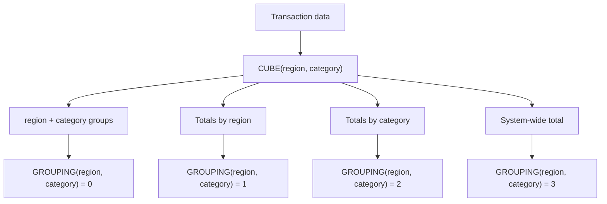

# GROUPING and Identifying Total Rows in PostgreSQL

When a PostgreSQL report needs to display detailed revenue, regional subtotals, and a system-wide grand total, result rows can look deceptively similar. A `region` column containing `NULL` may mean **the transaction's region is unknown**; it may also mean **the summary row across all regions**, because `region` was omitted from that grouping level. Checking `NULL` alone cannot distinguish the two cases.

The special **`GROUPING()`** function solves this problem. It reports whether a grouping expression **participates in the grouping set producing the current row** or was omitted to compute a subtotal or grand total. By combining `GROUPING()` with `ROLLUP`, `CUBE`, and `GROUPING SETS`, we can identify the level of every summary row, generate meaningful labels, sort hierarchical reports cleanly, and avoid double-counting.

This lesson belongs to the **Data Aggregation** chapter and focuses on **identifying total rows**; the examples below use a small sales dataset to explain the full semantics and practical query patterns.

## 1. When Do You Need to Identify Total Rows?

Suppose a sales report has these dimensions:

- `region`: sales region.
- `category`: product category.
- `sale_year`: transaction year.

Aggregating solely by `region` and `category`:

```sql
SELECT region, category, SUM(amount) AS revenue
FROM report_lab.sales
GROUP BY region, category;
```

produces two-dimensional detail groups. However, managers want to see all four levels:

1. Revenue for each category within each region.
2. Total revenue per region across all categories.
3. Total revenue per category across all regions.
4. System-wide grand total revenue.

PostgreSQL can produce these levels using:

```sql
SELECT region, category, SUM(amount) AS revenue
FROM report_lab.sales
GROUP BY CUBE (region, category);
```

The challenge is that at levels where `region` or `category` is omitted, PostgreSQL displays `NULL` in that column. Meanwhile, source data itself may contain genuine `NULL`s. We need a more reliable way to identify summary rows than `IS NULL`.



**Key idea:** `NULL` shows what value appears in the column; `GROUPING()` tells you **whether that column belongs to the current grouping level**.

## 2. Creating the Sample Dataset

Examples use a dedicated schema in a practice database. Never run the lesson's `CREATE`/`INSERT` statements against live production schemas.

```sql
CREATE SCHEMA IF NOT EXISTS report_lab;

CREATE TABLE report_lab.sales (
    sale_id integer PRIMARY KEY,
    sale_year integer NOT NULL,
    region text,
    category text NOT NULL,
    channel text NOT NULL,
    amount numeric(12, 2) NOT NULL CHECK (amount >= 0)
);

INSERT INTO report_lab.sales
    (sale_id, sale_year, region, category, channel, amount)
VALUES
    (1, 2025, 'North', 'Books',   'Online', 100.00),
    (2, 2025, 'North', 'Books',   'Store',   50.00),
    (3, 2025, 'North', 'Tech',    'Online', 300.00),
    (4, 2025, 'South', 'Books',   'Online',  80.00),
    (5, 2025, 'South', 'Tech',    'Store',  200.00),
    (6, 2026, 'North', 'Books',   'Online', 120.00),
    (7, 2026, 'South', 'Tech',    'Online', 250.00),
    (8, 2026, NULL,    'Books',  'Online',  40.00);
```

Row `sale_id = 8` intentionally has `region IS NULL`: a transaction with no assigned region. This is **missing source data**, not a grand total row.

Check the overall totals:

```sql
SELECT COUNT(*) AS transaction_count,
       SUM(amount) AS total_revenue
FROM report_lab.sales;
```

The dataset has **8 transactions** and total revenue **1140.00**. Regional totals are North = **570.00**, South = **530.00**, unspecified region = **40.00**. Category totals are Books = **390.00**, Tech = **750.00**.

These reference figures help verify outputs when multiple aggregation levels appear together.

## 3. How GROUPING() Works

Syntax:

```sql
GROUPING(grouping_expression [, ...])
```

`GROUPING()` returns an **integer bitmask** indicating which argument expressions were omitted from the grouping set that generated the current row.

With a single argument:

- `GROUPING(region) = 0`: `region` **is used** for grouping on this row.
- `GROUPING(region) = 1`: `region` **is not used** on this row; it was rolled up into a total level.

Example:

```sql
SELECT
    region,
    GROUPING(region) AS is_all_regions,
    SUM(amount) AS revenue
FROM report_lab.sales
GROUP BY ROLLUP (region)
ORDER BY GROUPING(region), region NULLS LAST;
```

Conceptual result:

| region | is_all_regions | revenue | Row Type |
| --- | ---: | ---: | --- |
| North | 0 | 570.00 | North region |
| South | 0 | 530.00 | South region |
| NULL | 0 | 40.00 | Region **unspecified in source data** |
| NULL | 1 | 1140.00 | **Total across all regions** |

The last two rows display the same value in `region`, yet `GROUPING(region)` differs. Therefore:

```sql
-- Wrong if trying to identify only the total row:
WHERE region IS NULL
```

cannot be used as a substitute check for `GROUPING(region) = 1`.

### 3.1. GROUPING Neither Counts Rows Nor Checks NULLs

Common misconceptions:

- `GROUPING(region) = 1` **does not mean** "there is one region" or "one data row."
- `GROUPING(region) = 0` **does not mean** "region is non-NULL."
- `GROUPING(region)` is **not equivalent** to `region IS NULL`.

This function answers a different question: *Is the `region` expression part of the grouping key of the grouping set that produced this row?*

### 3.2. GROUPING Is a Special SQL Construct

In PostgreSQL, `GROUPING()` uses function-like syntax, yet it is not a regular scalar function you can call arbitrarily on any column. It operates inside an aggregate query, and its arguments must match grouping expressions declared at that query level.

Valid example:

```sql
SELECT
    region,
    category,
    GROUPING(region) AS region_rolled_up,
    GROUPING(category) AS category_rolled_up,
    SUM(amount) AS revenue
FROM report_lab.sales
GROUP BY ROLLUP (region, category);
```

You cannot arbitrarily swap an argument for an expression absent from the grouping keys:

```sql
-- Invalid: upper(region) is not a grouping expression
-- declared in this query.
SELECT GROUPING(upper(region)), SUM(amount)
FROM report_lab.sales
GROUP BY ROLLUP (region);
```

If you want to group by `upper(region)`, that exact expression must appear appropriately in `GROUP BY`. This prevents confusing display expressions with semantically distinct grouping keys.

## 4. GROUPING with Two Arguments: Decoding Bitmasks 0, 1, 2, 3

`GROUPING(region, category)` combines the rolled-up flags of two expressions into a single integer.

Bit weights are assigned **from right to left**:

- The last argument `category` has weight **1** (least significant bit).
- The preceding argument `region` has weight **2**.
- A bit of 0 means the expression is present in the grouping set.
- A bit of 1 means the expression is omitted.

You can compute it directly:

\[
\operatorname{GROUPING}(region,category)
= 2\times\operatorname{GROUPING}(region)
+ \operatorname{GROUPING}(category).
\]

| GROUPING(region) | GROUPING(category) | Binary Bitmask | Code | Aggregation Level |
| ---: | ---: | --- | ---: | --- |
| 0 | 0 | `00` | 0 | By region and category |
| 0 | 1 | `01` | 1 | Subtotal by region |
| 1 | 0 | `10` | 2 | Subtotal by category |
| 1 | 1 | `11` | 3 | Grand total |

Illustrative query:

```sql
SELECT
    region,
    category,
    GROUPING(region) AS g_region,
    GROUPING(category) AS g_category,
    GROUPING(region, category) AS grouping_mask,
    SUM(amount) AS revenue
FROM report_lab.sales
GROUP BY CUBE (region, category)
ORDER BY
    grouping_mask,
    region NULLS LAST,
    category NULLS LAST;
```

In `CUBE(region, category)` all four levels are present, so all four codes—0, 1, 2, and 3—appear.

### 4.1. Result Table Containing Both Real NULLs and Rolled-Up NULLs

With the sample data, these rows represent all groups:

| region | category | grouping_mask | revenue | Meaning |
| --- | --- | ---: | ---: | --- |
| North | Books | 0 | 270.00 | Detail North / Books |
| North | Tech | 0 | 300.00 | Detail North / Tech |
| South | Books | 0 | 80.00 | Detail South / Books |
| South | Tech | 0 | 450.00 | Detail South / Tech |
| NULL | Books | 0 | 40.00 | Books, genuine missing region in source data |
| North | NULL | 1 | 570.00 | Total across all categories for North |
| South | NULL | 1 | 530.00 | Total across all categories for South |
| NULL | NULL | 1 | 40.00 | Total across all categories for genuine NULL region |
| NULL | Books | 2 | 390.00 | Total Books across all regions |
| NULL | Tech | 2 | 750.00 | Total Tech across all regions |
| NULL | NULL | 3 | 1140.00 | Grand total |

Looking only at `(region, category) = (NULL, NULL)`, there are **two rows** with different codes:

- Code **1**: `region` is still grouped; this is the genuine NULL-region group.
- Code **3**: both region and category are omitted; this is the **grand total**.

Looking only at `(NULL, Books)`, there are also **two rows** with different codes:

- Code **0**: Books transactions with an unknown region.
- Code **2**: all Books transactions across all regions.

If an application merges those rows based only on displayed column values, the report breaks.

### 4.2. Reordering Arguments Changes the Code

`GROUPING(category, region)` and `GROUPING(region, category)` describe the same two expressions with **different bit weights**.

```sql
SELECT
    region,
    category,
    GROUPING(region, category) AS region_first_mask,
    GROUPING(category, region) AS category_first_mask,
    SUM(amount) AS revenue
FROM report_lab.sales
GROUP BY CUBE (region, category);
```

On a region subtotal row, `GROUPING(region, category) = 1` whereas `GROUPING(category, region) = 2`. Therefore, a Java DTO or API decoding bitmasks must lock in a **fixed, documented argument order**, not merely know the two dimension names.

## 5. Identifying Subtotals and Grand Total in ROLLUP

`ROLLUP(region, category)` produces three grouping sets:

```text
(region, category)  -- two-dimensional detail
(region)            -- region subtotal
()                  -- grand total
```

Because `(category)` is never generated, `GROUPING(region, category) = 2` does not occur here.

```sql
SELECT
    region,
    category,
    GROUPING(region, category) AS grouping_mask,
    SUM(amount) AS revenue
FROM report_lab.sales
GROUP BY ROLLUP (region, category)
ORDER BY
    GROUPING(region),
    region NULLS LAST,
    GROUPING(category),
    category NULLS LAST;
```

Possible codes:

| grouping_mask | Row Type |
| ---: | --- |
| 0 | Detail region/category group |
| 1 | Region subtotal |
| 3 | Table-wide grand total |

Note: **code 3 does not mean "the third row."** It is the binary pattern `11` representing two omitted expressions.

### 5.1. Identifying Total Rows Across Three Dimensions

`ROLLUP(sale_year, region, category)` generates:

```text
(sale_year, region, category)
(sale_year, region)
(sale_year)
()
```

Query:

```sql
SELECT
    sale_year,
    region,
    category,
    GROUPING(sale_year, region, category) AS grouping_mask,
    SUM(amount) AS revenue
FROM report_lab.sales
GROUP BY ROLLUP (sale_year, region, category)
ORDER BY
    sale_year NULLS LAST,
    grouping_mask,
    region NULLS LAST,
    category NULLS LAST;
```

Bit weights are **4, 2, 1**:

| grouping_mask | Binary | Aggregation Level |
| ---: | --- | --- |
| 0 | `000` | By year, region, and category |
| 1 | `001` | Subtotal by year + region |
| 3 | `011` | Annual total per year |
| 7 | `111` | Grand total across all years |

In the sample data, 2025 totals **730.00**, 2026 totals **410.00**, and the grand total is **1140.00**.

Do not use a rule like "`grouping_mask > 0` means grand total"; here codes 1 and 3 are **subtotals**, while code 7 is the three-dimensional grand total.

### 5.2. Dimension Order Dictates Which Levels Exist

`ROLLUP(category, region)` produces `(category, region)`, `(category)`, and `()`. Then:

- Code 0 is the two-dimensional group.
- Code **1** in `GROUPING(category, region)` represents the category subtotal, because `region` is the trailing argument with bit weight 1 and was omitted from the grouping set.
- Code 3 is the grand total.

The key is **reading the exact argument order passed to `GROUPING()`**, rather than guessing from which column appears first on screen. With `GROUPING(category, region)`, a category total row has `GROUPING(category)=0` and `GROUPING(region)=1`, so its code is **1**.

## 6. Identifying Custom Levels in GROUPING SETS

`GROUPING SETS` lets you choose exact combinations:

```sql
SELECT
    region,
    category,
    GROUPING(region, category) AS grouping_mask,
    SUM(amount) AS revenue
FROM report_lab.sales
GROUP BY GROUPING SETS (
    (region, category),
    (category),
    ()
)
ORDER BY grouping_mask, region NULLS LAST, category NULLS LAST;
```

Here only codes **0, 2, and 3** appear—code 1 is absent because region-only subtotals were not requested.

Keep this in mind when building presentation logic:

- **Do not assume** every bitmask code from a fixed set always exists.
- Base expectations on the **actual grouping sets declared**.
- A code's meaning depends on **argument order**, regardless of whether you used `ROLLUP`, `CUBE`, or `GROUPING SETS`.

If you need only category totals and a grand total, use:

```sql
GROUP BY GROUPING SETS ((category), ())
```

and inspect `GROUPING(category)`: 0 means category, 1 means grand total across the observed dimension.

### 6.1. Duplicate GROUPING SETS Can Produce Duplicate Rows

`GROUPING SETS ((region), (region))` specifies the same level twice. Depending on syntax and combinations, PostgreSQL may emit duplicate summary rows with identical codes and figures. `GROUPING()` **does not turn them into distinct levels**.

Therefore, never use the bitmask as a unique key for **each row**. A bitmask identifies only the **aggregation level**; multiple distinct regions share code 1, and repeated grouping sets can even emit identical rows. Uniquely identifying an output row typically requires **the level code plus all retained dimension values**.

## 7. Building "Total" Labels Without Confusing Real NULLs

An incorrect approach is:

```sql
SELECT
    COALESCE(region, 'All regions') AS region_label,
    category,
    SUM(amount)
FROM report_lab.sales
GROUP BY ROLLUP (region, category);
```

This query applies the label `All regions` to both:

- Source transactions where `region IS NULL`.
- The true grand total row where `region` was rolled up.

The right approach checks `GROUPING()` first:

```sql
SELECT
    CASE
        WHEN GROUPING(region) = 1 THEN 'All regions'
        WHEN region IS NULL THEN 'Unknown region'
        ELSE region
    END AS region_label,
    CASE
        WHEN GROUPING(category) = 1 THEN 'All categories'
        ELSE category
    END AS category_label,
    GROUPING(region, category) AS grouping_mask,
    SUM(amount) AS revenue
FROM report_lab.sales
GROUP BY CUBE (region, category)
ORDER BY
    grouping_mask,
    region_label,
    category_label;
```

The two conditions must not be swapped arbitrarily:

1. `GROUPING(region) = 1`: NULL caused by omitting the `region` dimension.
2. `region IS NULL`: `region` is still grouped, yet source data lacks a value.
3. Otherwise: display the actual region name.

If a real data value also happened to be `'All regions'`, **display labels** could still collide with the total label. Hence APIs and applications should retain the bitmask or boolean flags rather than identifying levels from display strings.

### 7.1. Attaching a Dedicated Row Type Instead of Inferring from Labels

```sql
SELECT
    region,
    category,
    GROUPING(region, category) AS grouping_mask,
    CASE GROUPING(region, category)
        WHEN 0 THEN 'DETAIL'
        WHEN 1 THEN 'REGION_SUBTOTAL'
        WHEN 2 THEN 'CATEGORY_SUBTOTAL'
        WHEN 3 THEN 'GRAND_TOTAL'
    END AS row_type,
    SUM(amount) AS revenue
FROM report_lab.sales
GROUP BY CUBE (region, category)
ORDER BY grouping_mask, region NULLS LAST, category NULLS LAST;
```

`row_type` directly reflects the grouping level, making it easy for a frontend to style, bold, or export rows to Excel.

With more than two dimensions, never copy codes 0–3 blindly. Redefine the level mapping according to the new argument order.

## 8. Filtering Summary Levels via HAVING or an Outer Query

Suppose you evaluate `CUBE(region, category)` but want to return only **region subtotals** and the **grand total**.

Using `HAVING`:

```sql
SELECT
    region,
    category,
    GROUPING(region, category) AS grouping_mask,
    SUM(amount) AS revenue
FROM report_lab.sales
GROUP BY CUBE (region, category)
HAVING GROUPING(region, category) IN (1, 3)
ORDER BY grouping_mask, region NULLS LAST;
```

The output has totals for North, South, the real NULL region, and the grand total; two-dimensional details and category subtotals are excluded.

You can also use an intermediate query level:

```sql
WITH grouped AS (
    SELECT
        region,
        category,
        GROUPING(region, category) AS grouping_mask,
        SUM(amount) AS revenue
    FROM report_lab.sales
    GROUP BY CUBE (region, category)
)
SELECT region, category, grouping_mask, revenue
FROM grouped
WHERE grouping_mask IN (1, 3)
ORDER BY grouping_mask, region NULLS LAST;
```

In the **outer** query, `grouping_mask` is an ordinary input column from the CTE, so filtering with `WHERE` is valid.

### 8.1. Why Can't GROUPING() Be Used Directly in Same-Level WHERE?

`WHERE` filters rows **before** summary groups are formed. `GROUPING()` describes the grouping set used to form a **summary row**, so it makes no sense in `WHERE` at the same query level:

```sql
-- Invalid placement of GROUPING().
SELECT region, SUM(amount)
FROM report_lab.sales
WHERE GROUPING(region) = 1
GROUP BY ROLLUP (region);
```

Use `HAVING GROUPING(region) = 1`, or compute the bitmask in a CTE and filter outside.

### 8.2. HAVING on Metrics vs. HAVING on Grouping Level

These two predicates serve different goals:

```sql
HAVING SUM(amount) >= 200
```

filters **groups with revenue of at least 200**; whereas:

```sql
HAVING GROUPING(region, category) IN (1, 3)
```

filters **group type**. Both can be combined:

```sql
SELECT
    region,
    category,
    GROUPING(region, category) AS grouping_mask,
    SUM(amount) AS revenue
FROM report_lab.sales
GROUP BY CUBE (region, category)
HAVING GROUPING(region, category) IN (1, 3)
   AND SUM(amount) >= 200
ORDER BY grouping_mask, revenue DESC;
```

Note: `HAVING` removes **report rows** after aggregates are computed. It does not recompute subtotals from whichever detail rows survive.

## 9. Placing Subtotals in the Right Order

`ROLLUP` **does not automatically ensure** subtotals appear immediately after each group's detail rows. Without `ORDER BY`, SQL result order is never guaranteed.

A tree-like ordering for `ROLLUP(region, category)`:

```sql
SELECT
    region,
    category,
    GROUPING(region) AS region_rolled_up,
    GROUPING(category) AS category_rolled_up,
    GROUPING(region, category) AS grouping_mask,
    SUM(amount) AS revenue
FROM report_lab.sales
GROUP BY ROLLUP (region, category)
ORDER BY
    GROUPING(region),
    region NULLS LAST,
    GROUPING(category),
    category NULLS LAST;
```

This achieves:

1. Detailed regions appear before the grand total because `GROUPING(region)=0` precedes 1.
2. Within each region, detailed category rows (`GROUPING(category)=0`) appear before the region subtotal (`GROUPING(category)=1`).
3. Genuine `region IS NULL` rows appear at the end of the detailed regions, **without** mixing with the grand total.

If a report wants subtotals above details, reverse the sort order on the corresponding grouping flag. If sorting by revenue, add `SUM(amount)` or its alias in `ORDER BY` as required, taking care not to scramble summary levels unintentionally.

### 9.1. Sorting by Mask Differs from Tree Ordering

`ORDER BY GROUPING(region, category)` on a CUBE places all code 0 rows first, followed by 1, 2, and 3. That works well when displaying separate **summary-level blocks**.

In a hierarchical report table, however, you often want:

- North/Books
- North/Tech
- North Total
- South/Books
- South/Tech
- South Total
- ...
- Grand total

Here, sort by the parent dimension first and then by the child's rolled-up flag. The same bitmask supports multiple display layouts, as long as the **`ORDER BY` column sequence** reflects the structure you want.

## 10. Handling Grouping Levels with Three or More Dimensions

With three dimensions `sale_year`, `region`, `category`:

```sql
SELECT
    sale_year,
    region,
    category,
    GROUPING(sale_year, region, category) AS grouping_mask,
    SUM(amount) AS revenue
FROM report_lab.sales
GROUP BY CUBE (sale_year, region, category);
```

CUBE can produce all eight codes 0–7, each corresponding to a different set of omitted dimensions:

| Code | Binary | Omitted Dimensions | Retained Grouping Dimensions |
| ---: | --- | --- | --- |
| 0 | `000` | None | year, region, category |
| 1 | `001` | category | year, region |
| 2 | `010` | region | year, category |
| 3 | `011` | region, category | year |
| 4 | `100` | year | region, category |
| 5 | `101` | year, category | region |
| 6 | `110` | year, region | category |
| 7 | `111` | year, region, category | None — grand total |

With `ROLLUP(sale_year, region, category)` only codes **0, 1, 3, and 7** appear. The remaining codes represent combinations outside this hierarchy.

### 10.1. Testing Bits with Bitwise Operators

Instead of listing every code, test individual bits:

```sql
WITH grouped AS (
    SELECT
        sale_year,
        region,
        category,
        GROUPING(sale_year, region, category) AS grouping_mask,
        SUM(amount) AS revenue
    FROM report_lab.sales
    GROUP BY CUBE (sale_year, region, category)
)
SELECT
    sale_year,
    region,
    category,
    revenue,
    grouping_mask,
    (grouping_mask & 4) <> 0 AS all_years,
    (grouping_mask & 2) <> 0 AS all_regions,
    (grouping_mask & 1) <> 0 AS all_categories
FROM grouped
ORDER BY grouping_mask, sale_year, region, category;
```

PostgreSQL supports the bitwise `&` operator on integers. Here:

- `(grouping_mask & 4) <> 0`: year dimension omitted.
- `(grouping_mask & 2) <> 0`: region dimension omitted.
- `(grouping_mask & 1) <> 0`: category dimension omitted.

Whenever you change argument order in `GROUPING(...)`, **the bit weights change too**. That is why the data contract between SQL and application code must stay consistent.

### 10.2. Do Not Equate More 1-Bits with a "Higher" Level in Every Model

In a hierarchical `ROLLUP`, codes 0, 1, 3, 7 progress strictly toward broader totals. In a `CUBE`, code 3 and code 4 do not sit in a single parent–child relationship; they group along **different sets of dimensions**.

For instance, `grouping_mask = 3` totals by year; `grouping_mask = 4` totals by region/category (across all years). Neither is strictly "higher" without defining a business hierarchy.

Therefore, in independent multi-dimensional reports, interpret rows using the **set of retained dimensions** rather than sorting masks numerically and assuming larger means higher.

## 11. Detail Rows and Total Rows: Avoiding Double-Counting

A ROLLUP or CUBE query returns **multiple aggregation levels of the same source data**. If a client takes the entire output and computes:

```text
sum(revenue of every returned row)
```

it will **count revenue multiple times**.

For instance, `ROLLUP(region, category)` contains:

- Detail rows summing to **1140.00**.
- Region subtotal rows summing to **1140.00**.
- One grand total row of **1140.00**.

Summing every returned row yields **3420.00**, not real revenue. In a two-dimensional CUBE, four partitioning levels each sum to **1140.00**, so summing all rows produces **4560.00**.

The right choice depends on your goal:

- Want overall revenue: read **only the grand total row**.
- Want regional totals: read **only the region subtotal rows**.
- Want detailed breakdowns: read mask 0 rows.
- Never add rows from different levels into one metric.

```sql
WITH grouped AS (
    SELECT
        region,
        category,
        GROUPING(region, category) AS grouping_mask,
        SUM(amount) AS revenue
    FROM report_lab.sales
    GROUP BY CUBE (region, category)
)
SELECT
    SUM(revenue) FILTER (WHERE grouping_mask = 0) AS sum_detail,
    SUM(revenue) FILTER (WHERE grouping_mask = 1) AS sum_region_subtotals,
    SUM(revenue) FILTER (WHERE grouping_mask = 2) AS sum_category_subtotals,
    MAX(revenue) FILTER (WHERE grouping_mask = 3) AS grand_total
FROM grouped;
```

On the sample data, all four columns equal **1140.00**. They are four views of the exact same revenue, **not four separate revenue streams**.

### 11.1. SUM, AVG, and DISTINCT Have Different Rollup Rules

Not every measure can be summed across subtotal rows:

- `SUM(amount)` can be summed across **disjoint** groups to obtain a broader total.
- `COUNT(*)` can be summed when groups form a non-overlapping partition.
- `AVG(amount)` cannot be computed by taking a plain average of per-region AVGs when transaction counts differ.
- `COUNT(DISTINCT customer_id)` cannot be summed across regions if one customer buys in multiple regions.

`GROUPING()` identifies only the **grouping level**, not whether a measure is **additive**. Design both level labels and measure rollup logic carefully.

## 12. Identifying Total Rows with COUNT(*), FILTER, and Empty Data

Example: a report counting Online and Store transactions across grouping levels:

```sql
SELECT
    region,
    category,
    GROUPING(region, category) AS grouping_mask,
    COUNT(*) AS transaction_count,
    COUNT(*) FILTER (WHERE channel = 'Online') AS online_count,
    SUM(amount) FILTER (WHERE channel = 'Online') AS online_revenue
FROM report_lab.sales
GROUP BY ROLLUP (region, category)
ORDER BY grouping_mask, region NULLS LAST, category NULLS LAST;
```

`FILTER` scopes input rows for **that aggregate only**. `GROUPING()` still reflects the row's grouping set, while counts and revenue are computed over transactions matching each group.

If a group has transactions but zero Online transactions:

- `COUNT(*) FILTER (WHERE channel = 'Online')` is **0**.
- `SUM(amount) FILTER (WHERE channel = 'Online')` is **NULL** because SUM receives no inputs.

Use `COALESCE(..., 0)` if business rules display 0. Never use `COALESCE(region, 'All')` to identify subtotals.

### 12.1. Empty Input Dataset

`GROUPING SETS (())` specifies a single overall group across all input rows:

```sql
SELECT
    GROUPING(sale_year) AS year_rolled_up,
    COUNT(*) AS transaction_count,
    SUM(amount) AS revenue
FROM report_lab.sales
WHERE sale_year = 1900
GROUP BY GROUPING SETS ((sale_year), ());
```

Since the sample data has no 1900 rows, `(sale_year)` produces zero groups, while the empty grouping set `()` still returns one summary row with `transaction_count = 0`, `revenue = NULL`, and `year_rolled_up = 1`.

This means **a grand total row can still exist even when there are zero transactions**. Never treat `GROUPING(...) = 1` as proof that underlying data exists. To report "no transactions occurred," inspect `COUNT(*)` or the chosen measure.

## 13. Revenue Share by Level: Picking the Right Denominator Row

When showing each region's share of the grand total, never sum all `CUBE` rows as the denominator.

A clean approach:

```sql
WITH grouped AS (
    SELECT
        region,
        category,
        GROUPING(region, category) AS grouping_mask,
        SUM(amount) AS revenue
    FROM report_lab.sales
    GROUP BY ROLLUP (region, category)
)
SELECT
    region,
    revenue,
    ROUND(
        revenue * 100 /
        NULLIF(
            (SELECT revenue
             FROM grouped
             WHERE grouping_mask = 3),
            0
        ),
        2
    ) AS percentage_of_total
FROM grouped
WHERE grouping_mask = 1
ORDER BY region NULLS LAST;
```

Shares output:

| region | revenue | Share |
| --- | ---: | ---: |
| North | 570.00 | 50.00% |
| South | 530.00 | 46.49% |
| NULL (unspecified) | 40.00 | 3.51% |

The three region groups sum to 1140.00; shares sum to roughly 100% after rounding. `NULLIF(..., 0)` prevents division by zero if grand total revenue is 0.

If the report is filtered by year:

```sql
WHERE sale_year = 2026
```

**inside the CTE**, then every subtotal and grand total reflects **2026 only**, no longer the whole table. Never label a year-filtered total row as "all-years total."

## 14. Distinguishing WHERE and HAVING Filters

`WHERE` filters transaction rows **before grouping**. `HAVING` filters **summary rows** after groups are formed.

Example reporting only Online transactions:

```sql
SELECT
    region,
    GROUPING(region) AS is_grand_total,
    SUM(amount) AS online_revenue
FROM report_lab.sales
WHERE channel = 'Online'
GROUP BY ROLLUP (region)
ORDER BY is_grand_total, region NULLS LAST;
```

The grand total row here represents **Online revenue**, not combined Online and Store revenue.

Conversely, `HAVING GROUPING(region) = 1` keeps only **the total row** after processing inputs:

```sql
SELECT
    region,
    GROUPING(region) AS is_grand_total,
    SUM(amount) AS revenue
FROM report_lab.sales
GROUP BY ROLLUP (region)
HAVING GROUPING(region) = 1;
```

This returns one grand total row of 1140.00. It does not select transactions with a NULL region; those are two completely different concepts.

## 15. Bitmasks as Part of the Application Data Contract

APIs, dashboards, and CSV exports should expose grouping-level metadata. Example query:

```sql
SELECT
    region,
    category,
    GROUPING(region, category) AS grouping_mask,
    (GROUPING(region) = 1) AS all_regions,
    (GROUPING(category) = 1) AS all_categories,
    SUM(amount) AS revenue
FROM report_lab.sales
GROUP BY CUBE (region, category)
ORDER BY grouping_mask, region NULLS LAST, category NULLS LAST;
```

The API layer can expose:

- `groupingMask`: integer code for decoding and filtering.
- `allRegions`: `true` when `region` is rolled up.
- `allCategories`: `true` when `category` is rolled up.
- `region` and `category`: raw dimension values or NULL.
- `revenue`: aggregated measure.

Example Java DTO:

```java
import java.math.BigDecimal;

public record SalesAggregateRow(
        String region,
        String category,
        int groupingMask,
        BigDecimal revenue
) {
    public boolean isAllRegions() {
        return (groupingMask & 2) != 0;
    }

    public boolean isAllCategories() {
        return (groupingMask & 1) != 0;
    }

    public boolean isGrandTotal() {
        return groupingMask == 3;
    }

    public boolean isRegionSubtotal() {
        return groupingMask == 1;
    }

    public boolean isCategorySubtotal() {
        return groupingMask == 2;
    }

    public boolean isDetail() {
        return groupingMask == 0;
    }
}
```

This code matches `GROUPING(region, category)` with **two arguments in that exact order**. Adding `sale_year` or changing argument order requires updating bit logic and grand-total detection.

### 15.1. Reading from JDBC

```java
import java.sql.ResultSet;
import java.sql.SQLException;

public SalesAggregateRow toRow(ResultSet rs) throws SQLException {
    return new SalesAggregateRow(
        rs.getString("region"),
        rs.getString("category"),
        rs.getInt("grouping_mask"),
        rs.getBigDecimal("revenue")
    );
}
```

`ResultSet.getString` returns Java `null` when the SQL value is `NULL`. However, Java `null` cannot tell whether it is a genuine NULL or a rollup; **`groupingMask`** is required to decide.

Never treat `region == null` as `isGrandTotal()`. The sample dataset has a row with `region == null` and `groupingMask == 0`, which is definitely not a grand total.

### 15.2. When the Frontend Needs Labels and Formatting

A frontend can render:

- `isDetail()`: standard detail row.
- `isRegionSubtotal()`: bold, labeled "Region Total".
- `isCategorySubtotal()`: labeled "Category Total".
- `isGrandTotal()`: final row, labeled "Grand Total".
- `region == null` while `!isAllRegions()`: "Unknown region".

Separating **machine-readable codes** from **human-readable labels** supports localization and layout changes without corrupting calculations.

## 16. Tricky Edge Cases to Watch For

### 16.1. A Dimension Value Matching the "Grand Total" Label

Suppose source data literally contains `region = 'Grand total'`, while you also label subtotals `'Grand total'`. Two rows may look identical while representing completely different grouping levels. Therefore, **never use display labels as data keys**.

A unique identifier for report rows might look like:

```text
(grouping_mask, region, category)
```

paired with explicit NULL-handling rules for retained dimensions. If storing results in a summary table, consider encoding the level, time range, and dimension keys explicitly to avoid unexpected NULL semantics in unique constraints.

### 16.2. NULLs Introduced by a JOIN Before GROUP BY

If a `LEFT JOIN` before aggregation produces `NULL`s on the right-hand table, then even with `GROUPING(category) = 0`, `category` can still be `NULL` because **post-join data** had no match.

Semantic example:

```sql
SELECT
    c.region,
    p.category,
    GROUPING(c.region, p.category) AS grouping_mask,
    COUNT(*) AS joined_rows
FROM report_lab.customers AS c
LEFT JOIN report_lab.purchases AS p
    ON p.customer_id = c.customer_id
GROUP BY ROLLUP (c.region, p.category);
```

`report_lab.customers` and `report_lab.purchases` here are **hypothetical tables** for illustration, not part of the dataset created in Section 2.

`GROUPING()` distinguishes **whether a column was omitted from the grouping level**, not whether a `NULL` retained inside the level came from a source column, an outer join, or an earlier expression. To diagnose why data is missing, add source flags/metadata or inspect the relationship.

### 16.3. Grouping Key Expressions and Calling GROUPING

When grouping by an expression instead of a bare column:

```sql
SELECT
    COALESCE(region, 'Unknown') AS normalized_region,
    GROUPING(COALESCE(region, 'Unknown')) AS is_all_regions,
    SUM(amount) AS revenue
FROM report_lab.sales
GROUP BY ROLLUP (COALESCE(region, 'Unknown'));
```

The argument to `GROUPING(...)` matches the expression inside `ROLLUP`. Note that `COALESCE` turns real NULL regions into `'Unknown'`; if real data already contains a region named `'Unknown'`, both groups merge into one. Weigh the business meaning before normalizing grouping values.

### 16.4. Grouping Level vs. Security Scope

A grand total over access-filtered data is still the "total" of the **permitted dataset**, not automatically the entire company's total.

For example, with `WHERE tenant_id = ?` or Row-Level Security policies, `GROUPING(...) = all-ones` simply indicates all specified dimensions were rolled up across **the rows accessible to the query**.

Never treat a grand-total flag as proof that an API aggregated every tenant's data.

### 16.5. CUBE Has Overlapping Levels

In `CUBE(sale_year, region, category)`, a single transaction contributes to:

- Its specific year/region/category group.
- The year/region subtotal.
- The year/category subtotal.
- The region/category subtotal.
- Single-dimension totals and the grand total.

This is **correct by definition of CUBE**. However, if a downstream pipeline treats every summary row as a "new revenue" event and sums them up, figures get multiplied. Level metadata must always travel alongside the measure.

## 17. Verifying Figures and Statuses with Independent Queries

When designing a new report, cross-check grouping level meanings with simple standalone queries using the exact same filters.

By region:

```sql
SELECT region, SUM(amount) AS revenue
FROM report_lab.sales
GROUP BY region
ORDER BY region NULLS LAST;
```

By category:

```sql
SELECT category, SUM(amount) AS revenue
FROM report_lab.sales
GROUP BY category
ORDER BY category;
```

Grand total:

```sql
SELECT SUM(amount) AS revenue
FROM report_lab.sales;
```

These queries do not use `GROUPING()`, yet they verify which levels are being summarized. In production systems, weigh the cost of re-running multiple queries against data volume; validate on a replica or representative dataset.

Multi-level summary tables do not corrupt numbers on their own; bugs arise from **misreading a row's level** or **summing overlapping levels together**.

## 18. Common Mistakes When Using GROUPING

| Mistake | Why It Is Wrong | Fix |
| --- | --- | --- |
| `region IS NULL` means grand total | NULL can be real data or from a join | Use `GROUPING(region) = 1` |
| `COALESCE(region, 'All')` to detect totals | Merges real NULLs with rollup NULLs | Use `CASE WHEN GROUPING(region)=1 ...` |
| Thinking `GROUPING(a,b)` returns level count | Returns bitmask of omitted expressions, not a count | Read bit weights from right to left |
| Assuming bitmask always covers 0–3 | ROLLUP/GROUPING SETS may omit certain levels | Base logic on declared grouping sets |
| Thinking `GROUPING(a,b)` and `GROUPING(b,a)` match | Bit weights depend on argument order | Lock argument order across SQL and DTOs |
| Assuming larger mask always means "higher" | CUBE mixes non-hierarchical combinations | Inspect the set of retained dimensions |
| Expecting `HAVING SUM(...)` to recompute subtotals | HAVING only filters already computed groups | Never sum remaining visible rows to derive totals |
| Expecting `ORDER BY grouping_mask` to give tree order | Sorts by level block, not subtotals next to details | Sort by parent key then child GROUPING flag |
| Summing all rows from ROLLUP/CUBE | Each transaction appears at multiple levels | Pick one level or the grand total row only |
| Using `GROUPING()` in same-level WHERE | WHERE runs before aggregation | Use HAVING or filter in an outer query |
| Treating mask as a unique row key | Multiple regions share the same mask; sets can repeat | Use mask + retained dimension values |
| Assuming aggregated `NULL` always means 0 revenue | SUM of empty/null group can be NULL | Check COUNT and COALESCE policy |
| Assuming PostgreSQL has `GROUPING_ID()` like other RDBMSs | Function names vary across engines | Use `GROUPING(...)` in PostgreSQL to get bitmasks |

## 19. Comprehensive Practice Exercises

Exercises use the `report_lab` schema from Section 2.

### Exercise 1 — Distinguishing Real NULL from Grand Total

```sql
SELECT
    region,
    GROUPING(region) AS rollup_flag,
    SUM(amount) AS revenue
FROM report_lab.sales
GROUP BY ROLLUP(region)
ORDER BY rollup_flag, region NULLS LAST;
```

Find the two rows where `region IS NULL`, identify which one is source data with a missing region and which is the grand total. Read their revenues and explain the difference.

### Exercise 2 — Decoding All Four Codes in CUBE

```sql
SELECT
    region,
    category,
    GROUPING(region, category) AS grouping_mask,
    SUM(amount) AS revenue
FROM report_lab.sales
GROUP BY CUBE(region, category)
ORDER BY grouping_mask, region NULLS LAST, category NULLS LAST;
```

Describe what codes 0, 1, 2, and 3 mean and locate the rows with revenue 390.00, 750.00, and 1140.00.

### Exercise 3 — Accurate Summary Labels

Starting from Exercise 2's query, add `region_label` and `category_label` columns such that:

- Region bit omitted: display "All regions".
- Region still grouped but genuine NULL: display "Unknown region".
- Category omitted: display "All categories".
- All other cases: display the source value.

Explain why `COALESCE` alone cannot satisfy all requirements.

### Exercise 4 — Filtering Only Region Total Rows

```sql
SELECT
    region,
    GROUPING(region, category) AS grouping_mask,
    SUM(amount) AS revenue
FROM report_lab.sales
GROUP BY CUBE(region, category)
HAVING GROUPING(region, category) = 1
ORDER BY region NULLS LAST;
```

Predict the row count and revenues. If changed to `= 3`, how does the output change?

### Exercise 5 — Three-Dimensional ROLLUP

```sql
SELECT
    sale_year,
    region,
    category,
    GROUPING(sale_year, region, category) AS grouping_mask,
    SUM(amount) AS revenue
FROM report_lab.sales
GROUP BY ROLLUP(sale_year, region, category)
ORDER BY
    sale_year NULLS LAST,
    grouping_mask,
    region NULLS LAST,
    category NULLS LAST;
```

Locate codes 0, 1, 3, and 7. Identify the two annual subtotal rows (2025 = 730.00; 2026 = 410.00) and the grand total = 1140.00.

### Exercise 6 — Decoding Masks with Bitwise Operators

Use the Section 10 CTE with `GROUPING(sale_year, region, category)`. Filter in the outer query for rows **rolled up across regions** using `(grouping_mask & 2) <> 0`. Explain why this differs from `region IS NULL`.

### Exercise 7 — Avoiding Double-Counting Revenue

Run a two-dimensional CUBE and compute `SUM(revenue)` across **every returned row**. Why is the number larger than 1140.00? Then filter to `grouping_mask = 3` to obtain the table-wide revenue.

### Exercise 8 — Designing a Dashboard DTO

Design a DTO holding `region`, `category`, `groupingMask`, `revenue`, and helper methods `isDetail`, `isRegionSubtotal`, `isCategorySubtotal`, and `isGrandTotal`. Test specifically the case `region = null` with `groupingMask = 0` to ensure it is not mislabeled "Grand total."

## 20. Core Takeaways

- `GROUPING(expr)` returns **0** when the expression is used for grouping and **1** when it is omitted for a summary level. It does **not** test whether the expression's value is `NULL`.
- `GROUPING(a,b,...)` returns a **bitmask** where the last argument occupies the lowest bit. Keep argument order consistent across SQL, API, and frontend code.
- `ROLLUP` produces hierarchical prefix levels; `CUBE` produces all combinations; `GROUPING SETS` produces explicit chosen levels. Thus, which mask codes appear depends directly on the `GROUP BY` structure.
- To separate "All regions" from "Unknown region," check `GROUPING(region)` before checking `region IS NULL`.
- Use `HAVING GROUPING(...)` to filter levels in the same aggregate query, or project the mask into a CTE and filter with `WHERE` outside.
- Use `ORDER BY` on parent dimensions alongside `GROUPING` flags to place subtotals next to details; never assume ROLLUP sorts hierarchically on its own.
- Never sum rows across **multiple aggregation levels**. One transaction contributes simultaneously to detail rows, subtotals, and the grand total.
- Always include grouping-level metadata in DTOs or report outputs. A "Grand total" string is a display label, not a data identifier.

Understanding `GROUPING()` means knowing **along which dimensions a summary number was computed**. Once you can separate detail rows, subtotals, grand totals, and genuine missing values, you can build clear PostgreSQL reports without ambiguity and dramatically cut the risk of miscalculating metrics downstream.
