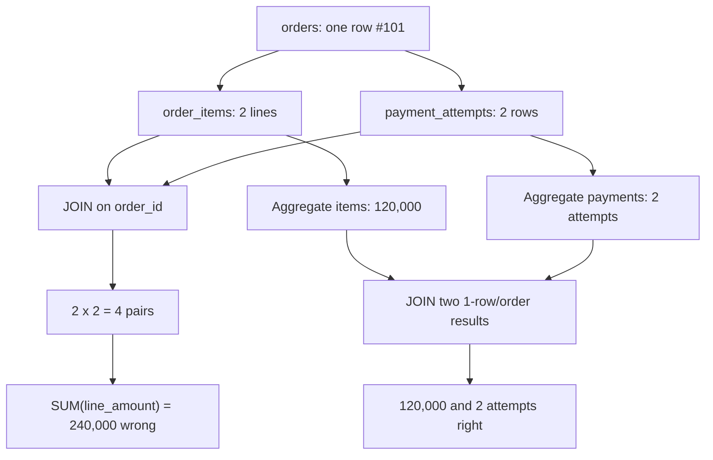

# Aggregating After a JOIN and Avoiding Duplicate Counting in PostgreSQL

SQL reports often pull data from multiple tables: customers, orders, order items, payments, and shipments. A `JOIN` makes combining these tables effortless, yet **aggregating after a JOIN** is where subtle data discrepancies frequently appear.

For example: an order has **two line items** and **two payment attempts**. Joining both child tables directly to the order and running `SUM(quantity * unit_price)` repeats each line item twice. Reported totals become **double the real value** even though the SQL runs without a single error.

This lesson focuses on **data grain**, **JOIN fan-out**, and anti-double-counting strategies when aggregating in PostgreSQL. We will distinguish:

- `COUNT(*)`, `COUNT(column)`, and `COUNT(DISTINCT column)`.
- Why `SUM(DISTINCT amount)` is **not** the fix for a row-multiplying JOIN.
- Pre-aggregating each child table with **CTEs, subqueries, or `LATERAL`**.
- Preserving entities with zero child rows using `LEFT JOIN` and `COALESCE`.
- Applying `FILTER (WHERE ...)` and `HAVING` once the input grain is right.
- Using `DISTINCT ON`, window functions, and JSON aggregation when picking or presenting child records.
- Verifying results and performance with SQL checks and `EXPLAIN`.

The ultimate goal is not slapping `DISTINCT` onto every report, but **defining precisely what entity each output row represents** and ensuring every quantity is computed **exactly once at its proper grain**.

## 1. Identify Each Table's Grain Before Joining

**Grain** is what **one row** represents in a table or intermediate result.

Examples in a sales system:

| Table | What One Row Represents | Identifying Key |
| --- | --- | --- |
| `customers` | One customer | `customer_id` |
| `orders` | One order | `order_id` |
| `order_items` | One line item within an order | `item_id` or `(order_id, line_no)` |
| `payment_attempts` | One payment attempt | `attempt_id` |
| Customer revenue report | One customer and summary metrics | `customer_id` |
| Monthly revenue report | One month in the business time zone | Month bucket |

If you want **one row per order**, `orders` already has the right grain. However, once you join `order_items`, an order with two products appears twice because the result's grain is now **one line item of an order**.

That is not a bug—it is the exact meaning of a one-to-many JOIN. The bug happens only when the author **keeps counting orders or summing order totals as if there were still one row per order**.

### 1.1. Questions to Answer Before Aggregating

1. What does one row in the base table represent?
2. At most **how many** right-side rows can match each left-side row?
3. Is the JOIN key genuinely unique on the expected side?
4. Does the metric being calculated belong to the **order, line item, or payment attempt**?
5. After joining, is that metric duplicated across unrelated relationships?
6. Should the final output have **one row per customer, per order, per day**, or another grain?

Whenever the answer to question 2 is "more than one," be extra careful before writing `COUNT(*)` or `SUM(...)`.

## 2. One-to-Many JOINs and Multiple One-to-Many Branches

Suppose:

```text
Order #101
  ├── Item #1: 60,000
  ├── Item #2: 60,000
  ├── Payment attempt #1001: FAILED
  └── Payment attempt #1002: SUCCEEDED
```

**The true merchandise value of order 101 = 120,000**. The order has **two** line items and **two** payment attempts.

When joining:

```sql
FROM orders AS o
JOIN order_items AS i ON i.order_id = o.order_id
JOIN payment_attempts AS p ON p.order_id = o.order_id
```

each `order_items` row pairs with **every** payment attempt sharing the same `order_id`:

| order_id | item_id | line_amount | attempt_id |
| ---: | ---: | ---: | ---: |
| 101 | 1 | 60000 | 1001 |
| 101 | 1 | 60000 | 1002 |
| 101 | 2 | 60000 | 1001 |
| 101 | 2 | 60000 | 1002 |

The output has **2 × 2 = 4 rows**. Summing `line_amount` across all four rows gives **240,000**, twice the true 120,000.



This is commonly called **JOIN fan-out** or **row multiplication**. If two child tables have `m` and `n` matching rows for a parent record, an INNER JOIN produces **`m × n`** rows. With `LEFT JOIN`, you also account for unmatched NULL-extended rows, yet the multiplication risk remains.

**Note:** A row-multiplying JOIN is not inherently wrong. If you want to list **every item–payment attempt pair**, four rows is the right output. If you want **one order's total amount**, that is a grain mismatch.

## 3. Setting Up the PostgreSQL Practice Environment

Use a **dedicated learning database**; never run this DDL on a production system. The statements below assume the schema and demo tables do not yet exist.

### 3.1. Customers and Orders Tables

```sql
CREATE SCHEMA IF NOT EXISTS join_aggregate_lab;

CREATE TABLE join_aggregate_lab.customers (
    customer_id INTEGER PRIMARY KEY,
    full_name   TEXT NOT NULL,
    city        TEXT NOT NULL
);

CREATE TABLE join_aggregate_lab.orders (
    order_id    INTEGER PRIMARY KEY,
    customer_id INTEGER NOT NULL
        REFERENCES join_aggregate_lab.customers (customer_id),
    order_date  DATE NOT NULL,
    status      TEXT NOT NULL
        CHECK (status IN ('PAID', 'PENDING', 'CANCELLED'))
);
```

For this lesson, an order has one overall status. Production systems may track separate statuses for ordering, capture, fulfillment, refunds, and financial events; never treat a single order status column as sole proof of financial settlement during accounting reconciliation.

### 3.2. Order Items Table

```sql
CREATE TABLE join_aggregate_lab.order_items (
    item_id    BIGINT GENERATED ALWAYS AS IDENTITY PRIMARY KEY,
    order_id   INTEGER NOT NULL
        REFERENCES join_aggregate_lab.orders (order_id),
    line_no    INTEGER NOT NULL CHECK (line_no > 0),
    sku        TEXT NOT NULL,
    quantity   INTEGER NOT NULL CHECK (quantity > 0),
    unit_price NUMERIC(12, 2) NOT NULL CHECK (unit_price >= 0),
    CONSTRAINT uq_order_items_line
        UNIQUE (order_id, line_no)
);
```

`unit_price` is the price snapshotted on the order line, since current catalog prices may differ later. Each `item_id` is a distinct line item; an order can have many lines.

### 3.3. Payment Attempts Table

```sql
CREATE TABLE join_aggregate_lab.payment_attempts (
    attempt_id        INTEGER PRIMARY KEY,
    order_id          INTEGER NOT NULL
        REFERENCES join_aggregate_lab.orders (order_id),
    gateway_reference TEXT NOT NULL UNIQUE,
    attempt_status    TEXT NOT NULL
        CHECK (attempt_status IN ('INITIATED', 'FAILED', 'SUCCEEDED')),
    requested_amount  NUMERIC(12, 2) NOT NULL
        CHECK (requested_amount > 0),
    attempted_at      TIMESTAMPTZ NOT NULL
);
```

One order can have multiple payment attempts, both failed and succeeded. Because `payment_attempts.order_id` is **not unique**, joining directly to this table multiplies rows.

`requested_amount` is the **amount requested in a single attempt**; never sum all attempts to derive revenue: one failed attempt and one retry may request the exact same amount.

### 3.4. Loading Customers and Orders

```sql
INSERT INTO join_aggregate_lab.customers
    (customer_id, full_name, city)
VALUES
    (1, 'An', 'Hà Nội'),
    (2, 'Bình', 'TP. Hồ Chí Minh'),
    (3, 'Chi', 'Hà Nội'),
    (4, 'Dũng', 'Huế'),
    (5, 'Em', 'TP. Hồ Chí Minh');

INSERT INTO join_aggregate_lab.orders
    (order_id, customer_id, order_date, status)
VALUES
    (101, 1, DATE '2026-01-05', 'PAID'),
    (102, 1, DATE '2026-01-06', 'PAID'),
    (103, 2, DATE '2026-01-15', 'PAID'),
    (104, 3, DATE '2026-01-17', 'PENDING'),
    (105, 3, DATE '2026-02-03', 'PAID'),
    (106, 4, DATE '2026-02-05', 'CANCELLED');
```

Customer **Em** has no orders yet. Chi has one PENDING and one PAID order, illustrating the difference between all-order totals and paid-order totals.

### 3.5. Loading Line Items

```sql
INSERT INTO join_aggregate_lab.order_items
    (order_id, line_no, sku, quantity, unit_price)
VALUES
    (101, 1, 'NOTE-A5',   2, 30000),
    (101, 2, 'PEN-BLUE',  3, 20000),
    (102, 1, 'NOTE-A5',   1, 50000),
    (103, 1, 'MUG-WHITE', 3, 30000),
    (104, 1, 'NOTE-A5',   1, 50000),
    (105, 1, 'PEN-BLUE',  2, 20000),
    (105, 2, 'MUG-WHITE', 1, 30000),
    (106, 1, 'MUG-WHITE', 1, 30000);
```

Both lines of order 101 **share the same line total of 60,000**, even though they are different products. This intentionally demonstrates why `SUM(DISTINCT line_amount)` loses valid money.

Exact values per order:

| order_id | Item Lines | Correct Merchandise Value | status |
| ---: | ---: | ---: | --- |
| 101 | 2 | 120000 | PAID |
| 102 | 1 | 50000 | PAID |
| 103 | 1 | 90000 | PAID |
| 104 | 1 | 50000 | PENDING |
| 105 | 2 | 70000 | PAID |
| 106 | 1 | 30000 | CANCELLED |

Total merchandise value **across all statuses** = **410,000**. Total merchandise value for **PAID** orders = **330,000**. These are two distinct metrics and should not share a vague "revenue" label without clear definitions.

### 3.6. Loading Payment Attempts

```sql
INSERT INTO join_aggregate_lab.payment_attempts
    (
        attempt_id,
        order_id,
        gateway_reference,
        attempt_status,
        requested_amount,
        attempted_at
    )
VALUES
    (1001, 101, 'GW-101-A', 'FAILED',    120000,
     TIMESTAMPTZ '2026-01-05 09:00:00+07'),
    (1002, 101, 'GW-101-B', 'SUCCEEDED', 120000,
     TIMESTAMPTZ '2026-01-05 09:03:00+07'),
    (1003, 102, 'GW-102-A', 'SUCCEEDED',  50000,
     TIMESTAMPTZ '2026-01-06 10:00:00+07'),
    (1004, 103, 'GW-103-A', 'FAILED',     90000,
     TIMESTAMPTZ '2026-01-15 11:00:00+07'),
    (1005, 103, 'GW-103-B', 'SUCCEEDED',  90000,
     TIMESTAMPTZ '2026-01-15 11:02:00+07'),
    (1006, 105, 'GW-105-A', 'SUCCEEDED',  70000,
     TIMESTAMPTZ '2026-02-03 12:00:00+07'),
    (1007, 106, 'GW-106-A', 'FAILED',     30000,
     TIMESTAMPTZ '2026-02-05 13:00:00+07');
```

Payment attempts per order:

| order_id | Attempts | Succeeded |
| ---: | ---: | ---: |
| 101 | 2 | 1 |
| 102 | 1 | 1 |
| 103 | 2 | 1 |
| 104 | 0 | 0 |
| 105 | 1 | 1 |
| 106 | 1 | 0 |

There are **7 payment attempts** in total. Note these are not **7 sales**, much less 7 independent revenue transactions.

## 4. Broken Report When Joining Two Child Tables Before GROUP BY

Try the following query:

```sql
SELECT
    o.order_id,
    COUNT(*) AS joined_rows,
    COUNT(i.item_id) AS counted_items,
    COUNT(p.attempt_id) AS counted_attempts,
    SUM(i.quantity * i.unit_price) AS reported_total
FROM join_aggregate_lab.orders AS o
LEFT JOIN join_aggregate_lab.order_items AS i
  ON i.order_id = o.order_id
LEFT JOIN join_aggregate_lab.payment_attempts AS p
  ON p.order_id = o.order_id
GROUP BY o.order_id
ORDER BY o.order_id;
```

Noteworthy result:

| order_id | joined_rows | counted_items | counted_attempts | reported_total |
| ---: | ---: | ---: | ---: | ---: |
| 101 | 4 | 4 | 4 | 240000 |
| 102 | 1 | 1 | 1 | 50000 |
| 103 | 2 | 2 | 2 | 180000 |
| 104 | 1 | 1 | 0 | 50000 |
| 105 | 2 | 2 | 2 | 70000 |
| 106 | 1 | 1 | 1 | 30000 |

For order 101, item count, attempt count, and total amount are all **counted per joined pair**, no longer per underlying entity:

- `COUNT(i.item_id) = 4`, yet there are only **2 items**.
- `COUNT(p.attempt_id) = 4`, yet there are only **2 attempts**.
- `SUM(i.quantity * i.unit_price) = 240000`, yet the true total is **120000**.

For order 103, one line item paired with two payment attempts inflates 90,000 into **180,000**.

For order 105, two line items pair with one attempt, so the sum happens to come out right by coincidence. **Some orders looking right does not prove the query is right**; the error depends on child row counts.

Summing the broken `reported_total` across all six orders gives **620,000**, whereas the true total is **410,000**.

### 4.1. Why Doesn't LEFT JOIN Prevent Multiplication?

`LEFT JOIN` only guarantees left-side rows stay in the result when **zero** matching right-side rows exist. It imposes no "at most one right-side row" limit.

With two child branches:

```text
orders
  LEFT JOIN order_items        -- 1 order -> 1..N items
  LEFT JOIN payment_attempts   -- 1 order -> 0..N attempts
```

item–attempt combinations are still produced for each order. When one branch has no rows, its columns receive NULL; e.g., order 104 has no payment attempts so `COUNT(p.attempt_id) = 0`, yet it still has one item row.

### 4.2. The Bug Happens Before HAVING and SUM

`GROUP BY o.order_id` simply gathers **already-joined rows**. It cannot tell that an item row was repeated across multiple payment attempts.

Thus, adding:

```sql
HAVING SUM(i.quantity * i.unit_price) >= 200000
```

keeps order 101 because its inflated 240,000 clears the threshold, even though its real item total is 120,000. `HAVING` cannot fix **the grain of the input set**.

## 5. COUNT(*) Is Not COUNT(Entity)

`COUNT(*)` counts **every joined row in the group**, including NULL-extended rows emitted by `LEFT JOIN`.

Three common counting forms:

| Expression | What Does It Count? |
| --- | --- |
| `COUNT(*)` | Every row in the current result set |
| `COUNT(i.item_id)` | Every row with `item_id IS NOT NULL`; **can double-count an item** if a JOIN multiplies rows |
| `COUNT(DISTINCT i.item_id)` | Every distinct non-NULL `item_id`; **never double-counts the same item** |

With primary key `item_id`, `COUNT(DISTINCT i.item_id)` recovers the count of **distinct line items** after a row-multiplying JOIN. Remember this is **line-item count**, not total units sold: one item line can have `quantity = 3`.

### 5.1. Using COUNT(DISTINCT ...) to Count Keys Accurately

```sql
SELECT
    o.order_id,
    COUNT(DISTINCT i.item_id) AS real_item_count,
    COUNT(DISTINCT p.attempt_id) AS real_attempt_count
FROM join_aggregate_lab.orders AS o
LEFT JOIN join_aggregate_lab.order_items AS i
  ON i.order_id = o.order_id
LEFT JOIN join_aggregate_lab.payment_attempts AS p
  ON p.order_id = o.order_id
GROUP BY o.order_id
ORDER BY o.order_id;
```

Result:

| order_id | real_item_count | real_attempt_count |
| ---: | ---: | ---: |
| 101 | 2 | 2 |
| 102 | 1 | 1 |
| 103 | 1 | 2 |
| 104 | 1 | 0 |
| 105 | 2 | 1 |
| 106 | 1 | 1 |

This works **for those two entity-count metrics** because each table has a stable primary key. Still, the query materializes intermediate item–attempt pairs. On large datasets, generating bloated intermediate rows only to deduplicate them with DISTINCT can burn significant memory and CPU.

### 5.2. Counting Orders After a JOIN Also Requires the Right Key

For example, counting orders per customer after joining down to line items:

```sql
SELECT
    o.customer_id,
    COUNT(*) AS joined_line_rows,
    COUNT(DISTINCT o.order_id) AS true_order_count
FROM join_aggregate_lab.orders AS o
JOIN join_aggregate_lab.order_items AS i
  ON i.order_id = o.order_id
GROUP BY o.customer_id
ORDER BY o.customer_id;
```

An has two orders totaling **three line items**, so:

```text
joined_line_rows = 3
true_order_count = 2
```

**Never** use `COUNT(DISTINCT o.customer_id)` to count orders, since one customer can place multiple orders. Always apply `DISTINCT` to the **exact key of the entity being counted**.

### 5.3. COUNT(DISTINCT ...) Has Limits

`COUNT(DISTINCT key)` is useful, yet should not be treated as a universal fix for all aggregates:

- It only removes **repeated keys** in that specific count.
- It does not fix inflated `SUM(amount)` or `AVG(amount)`.
- It adds deduplication and memory/sort/hash overhead.
- It cannot repair wrong JOINs caused by missing join key columns.

The core lesson is **counting the right key**—not sprinkling DISTINCT onto every expression and hoping the report turns out right.

## 6. Why Can SUM(DISTINCT amount) Corrupt Revenue?

A common reflex upon seeing a doubled `SUM(...)` is changing it to:

```sql
SUM(DISTINCT i.quantity * i.unit_price)
```

That **does not mean "count each item once."** It means "sum each **distinct monetary value** once."

For order 101:

| item_id | line_no | quantity | unit_price | line_amount |
| --- | ---: | ---: | ---: | ---: |
| Item A | 1 | 2 | 30000 | 60000 |
| Item B | 2 | 3 | 20000 | 60000 |

Both rows are **valid merchandise line items**, even though their amounts match. True total:

```text
60000 + 60000 = 120000
```

Yet:

```text
SUM(DISTINCT line_amount) = 60000
```

**One valid 60,000 line was silently dropped simply because it equaled another line's amount.**

### 6.1. Proving It in PostgreSQL

```sql
SELECT
    o.order_id,
    SUM(i.quantity * i.unit_price) AS sum_after_join,
    SUM(DISTINCT i.quantity * i.unit_price) AS sum_distinct_amount
FROM join_aggregate_lab.orders AS o
JOIN join_aggregate_lab.order_items AS i
  ON i.order_id = o.order_id
JOIN join_aggregate_lab.payment_attempts AS p
  ON p.order_id = o.order_id
WHERE o.order_id = 101
GROUP BY o.order_id;
```

Result:

| order_id | sum_after_join | sum_distinct_amount |
| ---: | ---: | ---: |
| 101 | 240000 | 60000 |

One approach is **too high**; the other is **too low**. The true total is **120,000**.

**Rule:** `SUM(DISTINCT value)` is appropriate only when business logic genuinely calls for **summing each unique value once**. It never replaces proper aggregation by record key.

### 6.2. Do Not Blindly Apply DISTINCT to the Whole SELECT Either

`SELECT DISTINCT o.order_id, i.quantity, i.unit_price` can collapse two valid items if they share quantity and unit price. Even if you include `item_id` to prevent collapsing distinct items, you still have to ensure **exactly one row per item** exists before summing.

So deduplicating by **item key** before `SUM` could work, yet in most multi-branch 1:N reports, a cleaner and safer pattern is **pre-aggregating each child table first**.

## 7. Primary Solution: Pre-Aggregate Each Child Table Before Joining

Instead of joining every item to every attempt and aggregating afterward, structure the query as:

```text
order_items:
    1..N rows / order
    -> GROUP BY order_id
    -> 1 row / order

payment_attempts:
    0..N rows / order
    -> GROUP BY order_id
    -> 1 row / order

orders:
    1 row / order
    LEFT JOIN item_totals (1 row / order)
    LEFT JOIN payment_stats (0..1 row / order)
    -> 1 row / order
```

This is the **pre-aggregation** strategy.

### 7.1. Aggregating Line Items to One Row per order_id

```sql
SELECT
    order_id,
    COUNT(*) AS item_count,
    SUM(quantity) AS unit_count,
    SUM(quantity * unit_price) AS items_total
FROM join_aggregate_lab.order_items
GROUP BY order_id
ORDER BY order_id;
```

Result:

| order_id | item_count | unit_count | items_total |
| ---: | ---: | ---: | ---: |
| 101 | 2 | 5 | 120000 |
| 102 | 1 | 1 | 50000 |
| 103 | 1 | 3 | 90000 |
| 104 | 1 | 1 | 50000 |
| 105 | 2 | 3 | 70000 |
| 106 | 1 | 1 | 30000 |

Now each `order_id` appears **once**. There are no payment attempts in the input to multiply items.

### 7.2. Aggregating Payment Attempts to One Row per order_id

```sql
SELECT
    order_id,
    COUNT(*) AS attempt_count,
    COUNT(*) FILTER (WHERE attempt_status = 'SUCCEEDED')
        AS successful_attempts,
    COUNT(*) FILTER (WHERE attempt_status = 'FAILED')
        AS failed_attempts,
    MAX(attempted_at) AS last_attempt_at
FROM join_aggregate_lab.payment_attempts
GROUP BY order_id
ORDER BY order_id;
```

Result per order:

| order_id | attempt_count | successful_attempts | failed_attempts |
| ---: | ---: | ---: | ---: |
| 101 | 2 | 1 | 1 |
| 102 | 1 | 1 | 0 |
| 103 | 2 | 1 | 1 |
| 105 | 1 | 1 | 0 |
| 106 | 1 | 0 | 1 |

There is no row for order **104** because it has no payment attempts yet. After a `LEFT JOIN`, use `COALESCE` to display counts as 0.

### 7.3. Joining Two Pre-Aggregated Sources Using CTEs

```sql
WITH item_totals AS (
    SELECT
        order_id,
        COUNT(*) AS item_count,
        SUM(quantity) AS unit_count,
        SUM(quantity * unit_price) AS items_total
    FROM join_aggregate_lab.order_items
    GROUP BY order_id
),
payment_stats AS (
    SELECT
        order_id,
        COUNT(*) AS attempt_count,
        COUNT(*) FILTER (WHERE attempt_status = 'SUCCEEDED')
            AS successful_attempts
    FROM join_aggregate_lab.payment_attempts
    GROUP BY order_id
)
SELECT
    o.order_id,
    o.status,
    COALESCE(i.item_count, 0) AS item_count,
    COALESCE(i.unit_count, 0) AS unit_count,
    COALESCE(i.items_total, 0) AS items_total,
    COALESCE(p.attempt_count, 0) AS attempt_count,
    COALESCE(p.successful_attempts, 0) AS successful_attempts
FROM join_aggregate_lab.orders AS o
LEFT JOIN item_totals AS i
  ON i.order_id = o.order_id
LEFT JOIN payment_stats AS p
  ON p.order_id = o.order_id
ORDER BY o.order_id;
```

Result:

| order_id | status | item_count | unit_count | items_total | attempt_count | successful_attempts |
| ---: | --- | ---: | ---: | ---: | ---: | ---: |
| 101 | PAID | 2 | 5 | 120000 | 2 | 1 |
| 102 | PAID | 1 | 1 | 50000 | 1 | 1 |
| 103 | PAID | 1 | 3 | 90000 | 2 | 1 |
| 104 | PENDING | 1 | 1 | 50000 | 0 | 0 |
| 105 | PAID | 2 | 3 | 70000 | 1 | 1 |
| 106 | CANCELLED | 1 | 1 | 30000 | 1 | 0 |

Each result row now genuinely represents **one order**. Joining payment stats cannot multiply `items_total` because each child source was reduced to at most **one row per `order_id`**.

### 7.4. CTEs Do Not Always Materialize Physical Temp Tables

`WITH ... AS (...)` defines a **CTE** to structure the query. In modern PostgreSQL, the planner may inline or materialize CTEs depending on query structure and usage; do not assume every CTE executes separately and spills to disk.

What makes the query above correct is **`GROUP BY order_id` producing one row per order**, not the `WITH` keyword itself.

## 8. Aggregating via Subqueries Inside JOIN

You do not have to use CTEs. You can write inline subqueries directly:

```sql
SELECT
    o.order_id,
    COALESCE(i.items_total, 0) AS items_total,
    COALESCE(p.attempt_count, 0) AS attempt_count
FROM join_aggregate_lab.orders AS o
LEFT JOIN (
    SELECT
        order_id,
        SUM(quantity * unit_price) AS items_total
    FROM join_aggregate_lab.order_items
    GROUP BY order_id
) AS i
  ON i.order_id = o.order_id
LEFT JOIN (
    SELECT
        order_id,
        COUNT(*) AS attempt_count
    FROM join_aggregate_lab.payment_attempts
    GROUP BY order_id
) AS p
  ON p.order_id = o.order_id
ORDER BY o.order_id;
```

The idea is identical: **turn each one-to-many relationship into one-to-one on `order_id`** before joining.

### 8.1. Why Not Use GROUP BY After Joining Instead of Subqueries?

If you write only:

```sql
SELECT o.order_id, SUM(i.quantity * i.unit_price)
FROM join_aggregate_lab.orders AS o
JOIN join_aggregate_lab.order_items AS i
  ON i.order_id = o.order_id
JOIN join_aggregate_lab.payment_attempts AS p
  ON p.order_id = o.order_id
GROUP BY o.order_id;
```

then `GROUP BY` operates over **item–attempt pairs**. Having the same grouping key does not stop items from being repeated. So the inflation bug persists.

### 8.2. Direct Aggregation Is Fine Along a Single Branch Without Fan-Out

When you only need line-item totals per order, this query is completely valid:

```sql
SELECT
    o.order_id,
    SUM(i.quantity * i.unit_price) AS items_total
FROM join_aggregate_lab.orders AS o
JOIN join_aggregate_lab.order_items AS i
  ON i.order_id = o.order_id
GROUP BY o.order_id;
```

Each item links to exactly one order via PK/FK, and no other branch multiplies items. You do not need extra CTEs just because a `JOIN` is present; examine the **actual cardinality of all joined sources**.

## 9. LEFT JOIN LATERAL: Correlated Per-Order Aggregation

PostgreSQL supports `LATERAL`, allowing a right-hand subquery to reference columns from the left-hand table. This is convenient when filtering a **small set of orders** and computing metrics per order.

```sql
SELECT
    o.order_id,
    COALESCE(i.item_count, 0) AS item_count,
    COALESCE(i.items_total, 0) AS items_total,
    COALESCE(p.attempt_count, 0) AS attempt_count
FROM join_aggregate_lab.orders AS o
LEFT JOIN LATERAL (
    SELECT
        COUNT(*) AS item_count,
        SUM(oi.quantity * oi.unit_price) AS items_total
    FROM join_aggregate_lab.order_items AS oi
    WHERE oi.order_id = o.order_id
) AS i ON TRUE
LEFT JOIN LATERAL (
    SELECT COUNT(*) AS attempt_count
    FROM join_aggregate_lab.payment_attempts AS pa
    WHERE pa.order_id = o.order_id
) AS p ON TRUE
WHERE o.order_id IN (101, 102, 104)
ORDER BY o.order_id;
```

Result:

| order_id | item_count | items_total | attempt_count |
| ---: | ---: | ---: | ---: |
| 101 | 2 | 120000 | 2 |
| 102 | 1 | 50000 | 1 |
| 104 | 1 | 50000 | 0 |

Each aggregate subquery has **no GROUP BY**, so for a given `o.order_id` it produces exactly **one summary row**, even with zero payment attempts: `COUNT(*)` is 0 and `SUM(...)` is NULL.

### 9.1. Is LATERAL Always Faster Than a CTE?

**No.** For a handful of selectively filtered orders backed by FK indexes, PostgreSQL can run correlated lateral lookups very efficiently. Conversely, when reporting across millions of orders, bulk pre-aggregation can be cheaper than millions of child-table lookups.

Choose based on:

- Number of parent rows returned.
- Selectivity of parent `WHERE` predicates.
- Child-table indexes, e.g., `order_items(order_id)`.
- Data volume and distribution.
- Actual `EXPLAIN (ANALYZE, BUFFERS)` plans.

Design for **correctness** first, then benchmark to pick the faster execution strategy.

## 10. Correlated Subqueries in SELECT

Another option is computing each metric with a scalar correlated subquery:

```sql
SELECT
    o.order_id,
    (
        SELECT COUNT(*)
        FROM join_aggregate_lab.order_items AS i
        WHERE i.order_id = o.order_id
    ) AS item_count,
    (
        SELECT COALESCE(SUM(i.quantity * i.unit_price), 0)
        FROM join_aggregate_lab.order_items AS i
        WHERE i.order_id = o.order_id
    ) AS items_total,
    (
        SELECT COUNT(*)
        FROM join_aggregate_lab.payment_attempts AS p
        WHERE p.order_id = o.order_id
    ) AS attempt_count
FROM join_aggregate_lab.orders AS o
ORDER BY o.order_id;
```

Advantage: independent calculations, each running at **its own source's grain**, avoiding fan-out between items and payments.

Drawback: repeated table accesses, especially when computing multiple metrics from the same child table. `LATERAL` lets you bundle multiple aggregates from one table into one subquery; pre-aggregation processes in bulk. PostgreSQL may optimize certain cases, though you should not assume three separate subqueries are always merged automatically.

## 11. From Accurate Per-Order Metrics to Accurate Per-Customer Metrics

Once you have **one row per order**, you can aggregate again to **one row per customer** without double-counting.

### 11.1. Two-Level Aggregation Query

```sql
WITH item_totals AS (
    SELECT
        order_id,
        SUM(quantity * unit_price) AS items_total
    FROM join_aggregate_lab.order_items
    GROUP BY order_id
),
order_facts AS (
    SELECT
        o.order_id,
        o.customer_id,
        o.status,
        COALESCE(i.items_total, 0) AS items_total
    FROM join_aggregate_lab.orders AS o
    LEFT JOIN item_totals AS i
      ON i.order_id = o.order_id
)
SELECT
    c.customer_id,
    c.full_name,
    COUNT(f.order_id) AS all_orders,
    COUNT(f.order_id) FILTER (WHERE f.status = 'PAID')
        AS paid_orders,
    COALESCE(
        SUM(f.items_total) FILTER (WHERE f.status = 'PAID'),
        0
    ) AS paid_items_total
FROM join_aggregate_lab.customers AS c
LEFT JOIN order_facts AS f
  ON f.customer_id = c.customer_id
GROUP BY c.customer_id, c.full_name
ORDER BY c.customer_id;
```

Result:

| customer_id | full_name | all_orders | paid_orders | paid_items_total |
| ---: | --- | ---: | ---: | ---: |
| 1 | An | 2 | 2 | 170000 |
| 2 | Bình | 1 | 1 | 90000 |
| 3 | Chi | 2 | 1 | 70000 |
| 4 | Dũng | 1 | 0 | 0 |
| 5 | Em | 0 | 0 | 0 |

The sum of `paid_items_total` is **330,000**, matching the sample dataset.

### 11.2. Why Choose COUNT(f.order_id) Over COUNT(*)?

`LEFT JOIN` preserves customer Em despite having zero orders. For Em, PostgreSQL emits one row **with `order_facts` columns set to NULL**. Therefore:

```text
COUNT(*)          = 1  -- counts the row emitted by LEFT JOIN
COUNT(f.order_id) = 0  -- no actual order_id exists
```

When counting child records that may not exist, `COUNT(non_NULL_child_key)` is the accurate pattern.

### 11.3. Why Not GROUP BY Customer Name?

Two customers can share the same name. If you only write:

```sql
GROUP BY c.full_name
```

different customers with the same `full_name` collapse into one group. Always group by a **stable identifier key** like `customer_id`, or `(tenant_id, customer_id)` in multi-tenant systems.

## 12. WHERE, ON, FILTER, and HAVING After a JOIN

When building reports, there are four common places for conditions, each with distinct effects.

| Placement | Effect | Example |
| --- | --- | --- |
| `ON` | Controls which right-side rows join; with LEFT JOIN, preserves unmatched left rows | `ON o.customer_id=c.customer_id AND o.status='PAID'` |
| `WHERE` | Filters **rows produced by FROM/JOIN** before GROUP BY | `WHERE o.order_date >= DATE '2026-01-01'` |
| `FILTER (WHERE ...)` | Filters input rows for **one specific aggregate** | `COUNT(*) FILTER (WHERE status='PAID')` |
| `HAVING` | Selects **groups** after aggregation | `HAVING COUNT(o.order_id) >= 2` |

### 12.1. When You Need to Keep Customers Without Orders

**Correct:** filter status in `ON` to preserve every customer.

```sql
SELECT
    c.customer_id,
    c.full_name,
    COUNT(o.order_id) AS paid_order_count
FROM join_aggregate_lab.customers AS c
LEFT JOIN join_aggregate_lab.orders AS o
  ON o.customer_id = c.customer_id
 AND o.status = 'PAID'
GROUP BY c.customer_id, c.full_name
ORDER BY c.customer_id;
```

Em and Dũng remain in the output with `paid_order_count = 0`.

**Different meaning:** placing the status condition in `WHERE`.

```sql
SELECT
    c.customer_id,
    c.full_name,
    COUNT(o.order_id) AS paid_order_count
FROM join_aggregate_lab.customers AS c
LEFT JOIN join_aggregate_lab.orders AS o
  ON o.customer_id = c.customer_id
WHERE o.status = 'PAID'
GROUP BY c.customer_id, c.full_name
ORDER BY c.customer_id;
```

Em/Dũng rows have `o.status IS NULL` or only `CANCELLED`; `WHERE` drops them. The report no longer includes "all customers" as requested.

### 12.2. When You Need Both All Orders and PAID Orders

```sql
SELECT
    c.customer_id,
    c.full_name,
    COUNT(o.order_id) AS all_orders,
    COUNT(o.order_id) FILTER (WHERE o.status = 'PAID')
        AS paid_orders
FROM join_aggregate_lab.customers AS c
LEFT JOIN join_aggregate_lab.orders AS o
  ON o.customer_id = c.customer_id
GROUP BY c.customer_id, c.full_name
ORDER BY c.customer_id;
```

Here we join **only one child table (`orders`)** at one-order grain, so `COUNT(o.order_id)` counts orders accurately. If summing line-item amounts too, pre-aggregate line items per order first to avoid fan-out.

### 12.3. Filtering Groups with PAID Total Above a Threshold

Once `order_totals` gives one row per order:

```sql
WITH order_totals AS (
    SELECT
        order_id,
        SUM(quantity * unit_price) AS items_total
    FROM join_aggregate_lab.order_items
    GROUP BY order_id
)
SELECT
    o.customer_id,
    COALESCE(
        SUM(t.items_total) FILTER (WHERE o.status = 'PAID'),
        0
    ) AS paid_total
FROM join_aggregate_lab.orders AS o
LEFT JOIN order_totals AS t
  ON t.order_id = o.order_id
GROUP BY o.customer_id
HAVING COALESCE(
    SUM(t.items_total) FILTER (WHERE o.status = 'PAID'),
    0
) >= 100000
ORDER BY o.customer_id;
```

Result: only **An** with **170,000**. Bình = 90,000, Chi = 70,000, and Dũng = 0 fall below the threshold.

Here `HAVING` runs **after each order's amount has been calculated accurately**. `HAVING` can never fix an upstream sum inflated by a JOIN.

## 13. COUNT(DISTINCT ...) and Multi-Column Keys

In PostgreSQL, records may be identified by a **composite key**, such as:

```text
(tenant_id, order_id)
```

If two tenants both have `order_id = 500`, `COUNT(DISTINCT order_id)` will **undercount** in cross-tenant reports.

### 13.1. Counting Composite Keys

PostgreSQL can count distinct row-constructor values:

```sql
WITH demo_orders(tenant_id, order_id) AS (
    VALUES
        (1, 500),
        (1, 501),
        (2, 500)
)
SELECT
    COUNT(DISTINCT order_id) AS distinct_local_ids,
    COUNT(DISTINCT (tenant_id, order_id)) AS distinct_scoped_orders
FROM demo_orders;
```

Result:

| distinct_local_ids | distinct_scoped_orders |
| ---: | ---: |
| 2 | 3 |

Two tenants can share the same local order ID. To get the true order count, identify the **full-scope business key**.

### 13.2. JOIN Conditions Must Also Include All Key Columns

If a child table is keyed by:

```text
orders(tenant_id, order_id)
order_items(tenant_id, order_id, line_no)
```

then the JOIN must use:

```sql
ON i.tenant_id = o.tenant_id
AND i.order_id = o.order_id
```

Joining only on `order_id` can match an item from tenant 1 onto tenant 2's order 500. That is a **JOIN relationship bug**; `COUNT(DISTINCT ...)` might make counts look plausible yet **fails to ensure values belong to the right tenant**.

### 13.3. Do Not Count Distinct Non-Unique Labels

Similarly:

```sql
COUNT(DISTINCT customer_name)
```

does not necessarily equal the true customer count because two people can share a name. Use `customer_id` or a composite key rather than a display field.

## 14. When You Only Need to Know Whether Child Rows Exist: EXISTS

If the question is **"how many customers have ever placed an order?"**, you do not need a JOIN followed by `COUNT(DISTINCT ...)`. Use `EXISTS` to test whether each customer has at least one order:

```sql
SELECT COUNT(*) AS customers_with_orders
FROM join_aggregate_lab.customers AS c
WHERE EXISTS (
    SELECT 1
    FROM join_aggregate_lab.orders AS o
    WHERE o.customer_id = c.customer_id
);
```

Result = **4** (An, Bình, Chi, Dũng).

Equivalent customer count:

```sql
SELECT COUNT(DISTINCT o.customer_id) AS customers_with_orders
FROM join_aggregate_lab.orders AS o;
```

Because `orders.customer_id` is `NOT NULL` with an FK to customers in our schema, this also returns 4. Still, `EXISTS` directly expresses "at least one related row exists," especially when adding conditions or customer-table permissions.

### 14.1. Finding Customers Without Orders

```sql
SELECT
    c.customer_id,
    c.full_name
FROM join_aggregate_lab.customers AS c
WHERE NOT EXISTS (
    SELECT 1
    FROM join_aggregate_lab.orders AS o
    WHERE o.customer_id = c.customer_id
);
```

The result is customer Em. There is no need for `GROUP BY ... HAVING COUNT(...) = 0` when the requirement simply checks existence. `EXISTS`/`NOT EXISTS` avoids generating unnecessary joined pairs.

## 15. Picking Exactly One Child Row with DISTINCT ON

We do not always want to **count or sum all** child records. Sometimes we need the **most recent payment attempt** for each order.

Joining all payment attempts repeats orders that have multiple attempts. In PostgreSQL, `DISTINCT ON` picks **the first row according to the specified order** for each group:

```sql
SELECT DISTINCT ON (p.order_id)
    p.order_id,
    p.attempt_id,
    p.attempt_status,
    p.attempted_at
FROM join_aggregate_lab.payment_attempts AS p
ORDER BY
    p.order_id,
    p.attempted_at DESC,
    p.attempt_id DESC;
```

Each `order_id` gets **one row for its latest payment attempt**. `attempt_id DESC` acts as a **tie-breaker** when two attempts share the same timestamp. Without an explicit deterministic `ORDER BY`, which row `DISTINCT ON` picks as "first" is undefined.

### 15.1. Joining the Latest Attempt Back to Orders

```sql
WITH latest_attempt AS (
    SELECT DISTINCT ON (order_id)
        order_id,
        attempt_id,
        attempt_status,
        attempted_at
    FROM join_aggregate_lab.payment_attempts
    ORDER BY order_id, attempted_at DESC, attempt_id DESC
)
SELECT
    o.order_id,
    o.status AS order_status,
    p.attempt_id,
    p.attempt_status
FROM join_aggregate_lab.orders AS o
LEFT JOIN latest_attempt AS p
  ON p.order_id = o.order_id
ORDER BY o.order_id;
```

Order 104 still appears with NULL payment columns. Each order matches at most one row from `latest_attempt`, so orders are never duplicated.

**Important:** "latest attempt" does not automatically equal **final valid payment state**, because callbacks can arrive out of order, refunds or multiple captures may happen, or states may update asynchronously. Always define the true source of truth in financial workflows.

### 15.2. DISTINCT ON Is Not a Revenue-Summing Technique

If you pick only the latest line item per order with `DISTINCT ON (order_id)` and run `SUM`, you drop all other line items. `DISTINCT ON` fits when you want **one representative row** (such as the latest attempt), not when summarizing multiple lines.

## 16. ROW_NUMBER() and LATERAL LIMIT 1

Two alternative ways to pick one representative child record:

### 16.1. Window Function ROW_NUMBER

```sql
WITH ranked_attempts AS (
    SELECT
        p.*,
        ROW_NUMBER() OVER (
            PARTITION BY order_id
            ORDER BY attempted_at DESC, attempt_id DESC
        ) AS rn
    FROM join_aggregate_lab.payment_attempts AS p
)
SELECT
    order_id,
    attempt_id,
    attempt_status
FROM ranked_attempts
WHERE rn = 1
ORDER BY order_id;
```

`ROW_NUMBER()` assigns sequence numbers within each order group. Filtering `rn = 1` requires a **CTE or subquery** because window functions cannot appear directly in same-level `WHERE`.

### 16.2. LEFT JOIN LATERAL ORDER BY ... LIMIT 1

```sql
SELECT
    o.order_id,
    last_payment.attempt_id,
    last_payment.attempt_status
FROM join_aggregate_lab.orders AS o
LEFT JOIN LATERAL (
    SELECT
        p.attempt_id,
        p.attempt_status
    FROM join_aggregate_lab.payment_attempts AS p
    WHERE p.order_id = o.order_id
    ORDER BY p.attempted_at DESC, p.attempt_id DESC
    LIMIT 1
) AS last_payment ON TRUE
ORDER BY o.order_id;
```

Each order gets at most one attempt; orders without attempts receive NULL. This pattern can leverage an index on `payment_attempts(order_id, attempted_at DESC, attempt_id DESC)`, especially when selecting a small set of orders.

Note: **picking one representative row** and **aggregating all child rows** are distinct requirements. Never slap `LIMIT 1` onto items just to stop a broken report from duplicating rows.

## 17. List Payloads: JSON Aggregation After a JOIN

APIs often want **one order with a list of line items** as JSON, rather than repeating order metadata across multiple rows.

PostgreSQL can aggregate rows into a JSON array:

```sql
SELECT
    o.order_id,
    COALESCE(
        jsonb_agg(
            jsonb_build_object(
                'lineNo', i.line_no,
                'sku', i.sku,
                'quantity', i.quantity,
                'unitPrice', i.unit_price
            )
            ORDER BY i.line_no
        ) FILTER (WHERE i.item_id IS NOT NULL),
        '[]'::jsonb
    ) AS items
FROM join_aggregate_lab.orders AS o
LEFT JOIN join_aggregate_lab.order_items AS i
  ON i.order_id = o.order_id
GROUP BY o.order_id
ORDER BY o.order_id;
```

The output has **one row per order**, with `items` holding a JSON array of line items. `FILTER (WHERE i.item_id IS NOT NULL)` prevents emitting a JSON element filled with NULLs from an unmatched `LEFT JOIN` row when an order has no items.

### 17.1. Do Not Carelessly Join payment_attempts Into the Same Aggregation

If you expand the query to:

```sql
FROM orders o
LEFT JOIN order_items i ON i.order_id = o.order_id
LEFT JOIN payment_attempts p ON p.order_id = o.order_id
```

and call `jsonb_agg(i...)`, each item can enter the array multiple times—once per payment attempt.

The clean fix is **building the items array and payments array independently** in separate CTEs or `LATERAL` subqueries before joining to orders. Using `jsonb_agg(DISTINCT jsonb_build_object(...))` might deduplicate identical JSON structures, yet risks collapsing distinct business records with identical content and fails to eliminate the underlying fan-out.

### 17.2. Does a JSON Array Need ORDER BY?

Element order in an aggregate should never be left to scan order or incidental JSON serialization. Whenever item sequence matters, put `ORDER BY i.line_no` **inside `jsonb_agg(...)`** as shown above for deterministic lists.

## 18. Multi-Level Aggregation: Day, Month, City

Once metrics are accurate at order grain, you can safely roll up to higher reporting grains.

### 18.1. Monthly Merchandise Revenue for PAID Orders

```sql
WITH item_totals AS (
    SELECT
        order_id,
        SUM(quantity * unit_price) AS items_total
    FROM join_aggregate_lab.order_items
    GROUP BY order_id
)
SELECT
    date_trunc('month', o.order_date::timestamp)::date
        AS month_start,
    COUNT(*) AS paid_order_count,
    SUM(i.items_total) AS paid_items_total
FROM join_aggregate_lab.orders AS o
JOIN item_totals AS i
  ON i.order_id = o.order_id
WHERE o.status = 'PAID'
GROUP BY date_trunc('month', o.order_date::timestamp)::date
ORDER BY month_start;
```

Result:

| month_start | paid_order_count | paid_items_total |
| --- | ---: | ---: |
| 2026-01-01 | 3 | 260000 |
| 2026-02-01 | 1 | 70000 |

Because `item_totals` has **one row per order**, `COUNT(*)` here actually counts **PAID orders that have items**. If a real schema allows PAID orders with zero line items (or data anomalies), an INNER JOIN drops them. To count all PAID orders regardless of line items, use `LEFT JOIN` and handle NULLs explicitly.

### 18.2. Revenue by City

```sql
WITH item_totals AS (
    SELECT
        order_id,
        SUM(quantity * unit_price) AS items_total
    FROM join_aggregate_lab.order_items
    GROUP BY order_id
)
SELECT
    c.city,
    COUNT(o.order_id) FILTER (WHERE o.status = 'PAID')
        AS paid_order_count,
    COALESCE(
        SUM(i.items_total) FILTER (WHERE o.status = 'PAID'),
        0
    ) AS paid_items_total
FROM join_aggregate_lab.customers AS c
LEFT JOIN join_aggregate_lab.orders AS o
  ON o.customer_id = c.customer_id
LEFT JOIN item_totals AS i
  ON i.order_id = o.order_id
GROUP BY c.city
ORDER BY c.city;
```

Result on the sample data:

| city | paid_order_count | paid_items_total |
| --- | ---: | ---: |
| Hà Nội | 3 | 240000 |
| Huế | 0 | 0 |
| TP. Hồ Chí Minh | 1 | 90000 |

In Hà Nội, An has two PAID orders (170,000) and Chi has one PAID order (70,000), totaling **240,000**. Huế still appears thanks to `LEFT JOIN` from customers, even though Dũng has only a CANCELLED order.

### 18.3. Choosing the Right Time Zone When Grouping by Date

The example uses `DATE`. When real systems store `TIMESTAMPTZ`, the same instant can fall into different calendar days or months depending on display time zone. Reports must specify the **reporting period's time zone**; never assume `TIMESTAMPTZ::date` means the same date across sessions with different `TimeZone` settings.

For reports pinned to a business time zone, apply `AT TIME ZONE` appropriately before truncating to day/month. When indexing or partitioning, consider expression sargability so predicates do not defeat index usage unnecessarily.

## 19. HAVING Is Valid Only When Input Data Is Already Right

`HAVING` filters **already-aggregated groups**. It has no awareness that a child record was multiplied by an upstream JOIN.

For example, finding customers with **PAID order value of 100,000 or more**. The right way computes each order's total first:

```sql
WITH order_totals AS (
    SELECT
        order_id,
        SUM(quantity * unit_price) AS items_total
    FROM join_aggregate_lab.order_items
    GROUP BY order_id
)
SELECT
    c.customer_id,
    c.full_name,
    COALESCE(
        SUM(t.items_total) FILTER (WHERE o.status = 'PAID'),
        0
    ) AS paid_total
FROM join_aggregate_lab.customers AS c
LEFT JOIN join_aggregate_lab.orders AS o
  ON o.customer_id = c.customer_id
LEFT JOIN order_totals AS t
  ON t.order_id = o.order_id
GROUP BY c.customer_id, c.full_name
HAVING COALESCE(
    SUM(t.items_total) FILTER (WHERE o.status = 'PAID'),
    0
) >= 100000
ORDER BY c.customer_id;
```

Result: only **An (170,000)**. Other customers fall below the threshold.

### 19.1. Separating Three Business Questions

| Question | Correct Logic |
| --- | --- |
| Which PAID orders enter the report? | `WHERE o.status='PAID'` or `FILTER` if other statuses must stay |
| What is each order's value? | Aggregate `order_items` **by `order_id`** |
| Which customers have PAID totals of at least 100,000? | Sum customer orders then `HAVING SUM(...) >= 100000` |

Lumping all three into one giant JOIN followed by `HAVING` easily produces SQL that executes cleanly yet returns wrong numbers.

## 20. Performance: Reduce Fan-Out Before Tuning Indexes

A multi-table JOIN report can run slowly because it generates a huge number of **intermediate paired rows**.

Suppose one order has:

- 15 line items.
- 8 payment attempts.
- 4 shipment events.

Joining all three child branches directly produces:

```text
15 × 8 × 4 = 480 intermediate rows per order
```

Across hundreds of thousands of similar orders, the rows fed into aggregation explode. A final `COUNT(DISTINCT ...)` might restore the count, yet the database still has to **process every multiplied row**.

Pre-aggregating each child table caps each branch at one row per parent key before joining:

```text
items        -> 1 row / order
attempts     -> 1 row / order
shipments    -> 1 row / order
JOIN to order -> 1 row / order
```

### 20.1. Do You Always Have to Pre-Aggregate Every Table?

No. The PostgreSQL planner executes simple queries very efficiently, and pre-aggregating an entire child table can do wasted work if the query selects only a handful of orders. Distinguish:

- **Logical correctness:** never let a metric be duplicated across unrelated relationships.
- **Execution speed:** pick join order and access methods aligned with filters, indexes, and data distribution.

For very few parent orders, `LEFT JOIN LATERAL` or correlated subqueries can work well. For bulk reporting, pre-aggregating each branch first keeps results demonstrably accurate and curbs fan-out.

### 20.2. Where Should Indexes Live?

PostgreSQL creates indexes for `PRIMARY KEY` and `UNIQUE` constraints, but **does not automatically index child-table foreign key columns**.

In the sample schema, these indexes can assist queries:

```sql
CREATE INDEX idx_agg_orders_customer
ON join_aggregate_lab.orders (customer_id);

CREATE INDEX idx_agg_items_order
ON join_aggregate_lab.order_items (order_id);

CREATE INDEX idx_agg_payment_order_time
ON join_aggregate_lab.payment_attempts
   (order_id, attempted_at DESC, attempt_id DESC);
```

These indexes help look up orders by customer, line items by order, and latest payment attempt per order. However, indexes consume storage and add write overhead; benchmark on representative workloads before adding them in production.

### 20.3. Using EXPLAIN to Spot Row Multiplication

```sql
EXPLAIN
SELECT
    o.order_id,
    SUM(i.quantity * i.unit_price)
FROM join_aggregate_lab.orders AS o
LEFT JOIN join_aggregate_lab.order_items AS i
  ON i.order_id = o.order_id
LEFT JOIN join_aggregate_lab.payment_attempts AS p
  ON p.order_id = o.order_id
GROUP BY o.order_id;
```

This shows the estimated plan. To inspect **actual** row counts at each node:

```sql
EXPLAIN (ANALYZE, BUFFERS)
SELECT
    o.order_id,
    SUM(i.quantity * i.unit_price)
FROM join_aggregate_lab.orders AS o
LEFT JOIN join_aggregate_lab.order_items AS i
  ON i.order_id = o.order_id
LEFT JOIN join_aggregate_lab.payment_attempts AS p
  ON p.order_id = o.order_id
GROUP BY o.order_id;
```

Watch for:

- Row counts at JOIN nodes compared to base order count.
- `estimated rows` vs. `actual rows`, which can reveal stale statistics.
- `HashAggregate`, `GroupAggregate`, and sort/hash steps.
- Memory/buffer usage and disk spills if reported.
- Execution time and filter impact.

**`EXPLAIN ANALYZE` executes the real SQL statement**; here it is a relatively safe read-only SELECT. Never run it casually on write statements or heavy production queries just to peek at a plan.

### 20.4. The Planner Cannot Fix Business-Logic Bugs

PostgreSQL can reorder JOINs, push predicates down, or pick Hash Join / Merge Join / Nested Loop as needed. However, **the planner must preserve the semantics of the SQL you wrote**.

If your SQL says "pair every item with every payment attempt and SUM each pair," the planner cannot guess you wanted each item summed once. That is an **expression/grain bug**, not a missing index.

## 21. Verifying Reports Using Data Invariants

When writing summary reports, do not eyeball a few rows and assume they are right. Cross-check against the lowest-grain source tables.

### 21.1. Direct Sum from Order Items: Baseline Reference

```sql
SELECT
    COUNT(*) AS raw_item_rows,
    SUM(quantity * unit_price) AS raw_items_total
FROM join_aggregate_lab.order_items;
```

Expected output:

```text
raw_item_rows   = 8
raw_items_total = 410000
```

If an unfiltered report produces any total other than **410,000**, inspect your JOINs and filters immediately.

### 21.2. Direct PAID Total from Items + Orders

```sql
SELECT
    COUNT(DISTINCT o.order_id) AS paid_order_count,
    SUM(i.quantity * i.unit_price) AS paid_items_total
FROM join_aggregate_lab.orders AS o
JOIN join_aggregate_lab.order_items AS i
  ON i.order_id = o.order_id
WHERE o.status = 'PAID';
```

Because each item belongs to one order and no other branch multiplies items, the true result is:

```text
paid_order_count = 4
paid_items_total = 330000
```

This serves as a solid reference check for multi-branch reports using the same status scope.

### 21.3. Counting Attempts Directly from the Base Table

```sql
SELECT
    COUNT(*) AS all_attempts,
    COUNT(*) FILTER (WHERE attempt_status = 'SUCCEEDED')
        AS successful_attempts
FROM join_aggregate_lab.payment_attempts;
```

Result:

```text
all_attempts        = 7
successful_attempts = 4
```

If a query joined with items returns 10 attempts, never conclude the system processed 10 payments: that is simply **how many times attempt rows appeared in the JOIN output**.

### 21.4. Detecting Orders with Unexpected Item Multiplicity

```sql
SELECT
    o.order_id,
    COUNT(DISTINCT i.item_id) AS true_item_count,
    COUNT(i.item_id) AS joined_item_rows
FROM join_aggregate_lab.orders AS o
LEFT JOIN join_aggregate_lab.order_items AS i
  ON i.order_id = o.order_id
LEFT JOIN join_aggregate_lab.payment_attempts AS p
  ON p.order_id = o.order_id
GROUP BY o.order_id
HAVING COUNT(i.item_id) > COUNT(DISTINCT i.item_id)
ORDER BY o.order_id;
```

On the sample data, this spots orders **101 and 103** whose items were repeated in the JOIN result. This **diagnoses query fan-out**, not duplicate items in the source table.

### 21.5. Reconciling Post-JOIN Totals Against Source Totals

```sql
WITH raw_per_order AS (
    SELECT
        order_id,
        SUM(quantity * unit_price) AS source_amount
    FROM join_aggregate_lab.order_items
    GROUP BY order_id
),
joined_per_order AS (
    SELECT
        o.order_id,
        SUM(i.quantity * i.unit_price) AS joined_amount
    FROM join_aggregate_lab.orders AS o
    LEFT JOIN join_aggregate_lab.order_items AS i
      ON i.order_id = o.order_id
    LEFT JOIN join_aggregate_lab.payment_attempts AS p
      ON p.order_id = o.order_id
    GROUP BY o.order_id
)
SELECT
    j.order_id,
    r.source_amount,
    j.joined_amount
FROM joined_per_order AS j
JOIN raw_per_order AS r
  ON r.order_id = j.order_id
WHERE j.joined_amount IS DISTINCT FROM r.source_amount
ORDER BY j.order_id;
```

This catches orders **101** and **103**, where post-JOIN sums exceed source totals. `IS DISTINCT FROM` is a null-safe comparison operator, handy if either value can be NULL.

## 22. Point-in-Time Accuracy: MVCC and Multi-Statement Reports

A report may run multiple SQL statements to fetch separate metrics. Under multiple transactions or default `READ COMMITTED` isolation, each statement can observe a **different** committed snapshot.

For example:

1. Statement A counts orders per customer.
2. Another transaction inserts a new order and commits.
3. Statement B sums line items.

The two numbers come from **two different points in time**, causing reconciliation mismatches even when every individual SQL statement is correct.

### 22.1. One SQL Statement with Multiple CTEs Shares One Snapshot

Computing all branches inside **a single statement** lets PostgreSQL evaluate the query against a single consistent MVCC snapshot. That is a major advantage of combining properly designed pre-aggregated CTEs in one query.

### 22.2. Multi-Statement Workflows Need a Stable Snapshot

When a workflow must run multiple queries against the exact same point in time, consider a `REPEATABLE READ` transaction per business needs:

```sql
BEGIN TRANSACTION ISOLATION LEVEL REPEATABLE READ READ ONLY;

-- Report SELECT statements requiring the same snapshot inside the transaction.
SELECT COUNT(*) FROM join_aggregate_lab.orders;

SELECT SUM(quantity * unit_price)
FROM join_aggregate_lab.order_items;

COMMIT;
```

In PostgreSQL, a `REPEATABLE READ` transaction takes its snapshot at the first eligible statement and holds it for subsequent queries in the transaction. However, long-running read transactions block MVCC cleanup of old row versions and impact operations; never leave transactions open for hours just to serve a dashboard.

**Remember:** a consistent snapshot does not fix **JOIN fan-out**. Snapshots prevent skew across concurrent writes, while grain/COUNT/SUM accuracy comes from query logic.

## 23. Common Mistakes and How to Avoid Them

| Mistake | Why It Is Wrong | Fix |
| --- | --- | --- |
| Joining two 1:N child tables then running `SUM` on one branch | Each branch row repeats across the other branch | Pre-aggregate each branch separately first |
| Using `COUNT(*)` after a JOIN to count orders | Counts joined pairs, not order keys | Use `COUNT(DISTINCT order_id)` or start at order grain |
| Using `COUNT(item_id)` after joining payments | An item row appears multiple times | Use `COUNT(DISTINCT item_id)` or pre-aggregate |
| Using `SUM(DISTINCT amount)` to remove duplicates | Collapses two valid transactions sharing an amount | Aggregate cleanly by item/order key |
| Slapping `SELECT DISTINCT` at the end | Can drop valid data or fail to fix broken aggregates | Fix JOINs and grain before aggregating |
| Counting payment attempts as sales orders | One order can retry multiple times | Separate attempts, orders, and successful payments |
| Summing `requested_amount` across all attempts as revenue | Failed + retried attempts double-count money | Use settled/reconciled payment records |
| Using `COUNT(*)` after LEFT JOIN to count child rows | NULL-extended placeholder rows are counted too | Use `COUNT(child.id)` |
| Putting child filters in WHERE after LEFT JOIN when keeping parents | Drops parents with zero matching children | Put condition in `ON` or use `FILTER` |
| Picking `LIMIT 1` from items to avoid multiple rows | Discards other valid line items | Aggregate all items per order |
| Using `DISTINCT ON` without deterministic ordering | Selected row is unpredictable | Add explicit `ORDER BY` and tie-breaker |
| Using `jsonb_agg` after joining multiple child tables | JSON array contains duplicated elements | Aggregate each collection independently |
| Joining on non-unique customer names or SKUs | Mismatches or multiplies rows | Join on PK/FK or true unique business keys |
| Omitting `tenant_id` from composite JOIN keys | Mixes data across tenants | Join all composite key columns; reinforce with FK/RLS |
| Grouping by customer name instead of `customer_id` | Merges distinct customers sharing a name | Group by stable identifier |
| Adding an unintended `status` column to GROUP BY | Splits each customer into multiple rows | Define final grain clearly |
| Filtering with `HAVING` on inflated metrics | Wrong groups pass or fail thresholds | Fix grain and pre-aggregation first |
| Expecting the optimizer to infer correct revenue | Planner must preserve the SQL semantics written | Express the calculation accurately in SQL |
| Testing only with 1-item / 1-attempt orders | Tests fail to expose fan-out | Test with 2×2 rows, tied amounts, and missing children |
| Assuming indexes ensure accurate counts | Indexes affect access paths, not query logic | Make SQL logically right first, then optimize |

## 24. Checklist for Auditing a Complex Reporting Query

A practical checklist when reviewing SQL with multiple JOINs and aggregates:

1. **State the output grain.** E.g., "one row per customer" or "one row per order."
2. **List every table's grain.** Items, payments, shipments, refunds, and events can all have multiple rows per parent.
3. **Map cardinalities.** Is each join 1:1, N:1, or 1:N?
4. **Verify JOIN keys.** Are composite/tenant key columns missing? Are non-unique columns used?
5. **Run direct COUNT checks on source tables.** Count orders, items, and attempts separately.
6. **Check row counts after each JOIN.** How much does each new JOIN multiply rows?
7. **Assign each metric to its grain.** Item quantities belong to items, order totals to orders, payment attempts to attempts.
8. **Pre-aggregate 1:N branches to the parent grain.** Use CTEs, derived tables, `LATERAL`, or subqueries.
9. **Join only single-row-per-parent results.** Each branch needs at most one row per join key if the output is one row per parent.
10. **Handle OUTER JOINs and NULLs deliberately.** Use `COUNT(child.id)` and `COALESCE(SUM(...), 0)` when 0 is desired.
11. **Place `FILTER`/`WHERE`/`HAVING` in the right scope.** Know whether you are filtering rows, individual aggregates, or groups.
12. **Test against edge-case data.** Include at least one order with 2 items × 2 attempts, two items with identical amounts, an order with zero attempts, and a customer with zero orders.
13. **Inspect `EXPLAIN` on representative data.** Optimize only after totals are verified; check indexes, hash/sort nodes, and JOIN row counts.
14. **Verify snapshot consistency and freshness.** Account for replica lag, caching, and transactions when numbers must align at one point in time.
15. **Document business definitions.** Does "revenue" mean PAID order value, captured cash, or net post-refunds? Valid SQL syntax never replaces metric definitions.

This checklist is a design workflow for building reports; formatting SQL or adding indexes alone will not turn an incorrect query into a correct one.

## 25. Practice Exercises

Use the tables in `join_aggregate_lab` created in Section 3. State the expected **grain** for every exercise.

1. **Identifying grain.** For `customers`, `orders`, `order_items`, and `payment_attempts`, state what one row represents and which key identifies it.
2. **Single-branch JOIN.** Join `orders` with `order_items` and count output rows. Explain why you get 8 rows instead of 6 orders.
3. **Two-branch JOIN.** Add `LEFT JOIN payment_attempts` to Exercise 2's query. Count total rows; why does the count become **11**?
4. **Order 101 multiplication.** List `item_id` and `attempt_id` for order 101. Explain why four pairs appear.
5. **Item counts.** Write a query returning `COUNT(i.item_id)` and `COUNT(DISTINCT i.item_id)` after the two-branch JOIN. How do the values differ for order 101?
6. **Attempt counts.** Write a query returning `COUNT(p.attempt_id)` and `COUNT(DISTINCT p.attempt_id)` after the two-branch JOIN. What happens for order 105?
7. **Broken revenue.** Compute `SUM(i.quantity * i.unit_price)` after joining payment attempts too. Show how orders 101 and 103 are overcounted.
8. **Broken SUM DISTINCT.** Run `SUM(DISTINCT i.quantity * i.unit_price)` for order 101. Explain why it returns 60,000 instead of 120,000.
9. **Pre-aggregating items.** Write an `item_totals` CTE with one row per `order_id` showing `item_count`, `unit_count`, and `items_total`. Cross-check all six order totals against Section 3's table.
10. **Pre-aggregating payments.** Write a `payment_stats` CTE with attempt count, succeeded count, failed count, and latest attempt timestamp per `order_id`.
11. **Joining two CTEs.** Join the CTEs from Exercises 9 and 10 onto `orders`. Verify there are still exactly six rows and order 104 has `attempt_count=0`.
12. **Replacing CTEs with subqueries.** Write a version using two derived tables inside `LEFT JOIN` and compare results.
13. **Using LATERAL.** Compute item totals and attempt counts for orders 101, 102, and 104 using two correlated `LEFT JOIN LATERAL` subqueries.
14. **Customer report.** Return every customer, total orders across all statuses, PAID orders, and PAID merchandise total. Verify Em returns `0,0,0` and An returns `2,2,170000`.
15. **COUNT on LEFT JOIN.** Explain the difference between `COUNT(*)` and `COUNT(o.order_id)` for Em, then fix the query to return accurate order counts.
16. **WHERE/ON/FILTER.** Write three ways to count PAID orders per customer; point out which one drops customers with zero PAID orders.
17. **HAVING.** Find customers whose PAID merchandise total is at least 100,000. Why must per-order totals be computed accurately before applying the threshold?
18. **By city.** Compute PAID order count and PAID merchandise total by city. Verify Hà Nội = 240,000, TP. Hồ Chí Minh = 90,000, and Huế = 0.
19. **By month.** Compute PAID merchandise total for January and February 2026; verify they are 260,000 and 70,000 respectively.
20. **JSON array.** Build a JSON array of items per order using `jsonb_agg`. Try joining `payment_attempts` as well, describe why elements repeat, and fix it with a CTE or `LATERAL`.
21. **Latest payment.** Fetch the single most recent attempt per order using `DISTINCT ON` or `ROW_NUMBER()`. Why is `attempt_id` needed as a tie-breaker on identical timestamps?
22. **Multi-tenant composite keys.** Create a CTE with two tenants sharing an `order_id`; compare `COUNT(DISTINCT order_id)` vs. `COUNT(DISTINCT (tenant_id,order_id))` and explain why they differ.
23. **Separating order existence from amounts.** If you only need how many customers ever placed an order, use `EXISTS` to count customers. Why avoid joining all `order_items`?
24. **EXPLAIN.** Run `EXPLAIN (ANALYZE, BUFFERS)` on a two-branch joined SELECT and compare against the pre-aggregated query. Inspect row counts at join/aggregate nodes and actual costs on representative data.
25. **Testing edge cases.** In your test database, insert an order with no items/attempts and a customer with no orders. Test `COUNT(*)`, `COUNT(child.id)`, and `COALESCE(SUM(...),0)`; document the semantics of showing 0.
26. **Multiple payment attempts per order.** If a payment is FAILED and then retried as SUCCEEDED for the same `requested_amount`, why isn't `SUM(requested_amount)` equal to collected money?
27. **Designing a new report.** A `projects` table has many `tasks`, and each task has many `time_entries`. You want total task count and total logged hours per project. Sketch the grain, pick pre-aggregation points, and write SQL avoiding multiplication if a `task_comments` table is also added.
28. **Consistency.** Explain the difference between a report skewed by JOIN fan-out and a report mismatched because two SELECTs read different snapshots. Propose the right fix for each.
29. **Query code-review.** Given a SQL query with five JOINs, create a review checklist covering join keys, row multiplicity, measures, GROUP BY, DISTINCT, NULLs, tenant scoping, and test cases.

## 26. Summary

**Aggregating after a JOIN** is reliable only when you control **data grain**. Look at how child tables attach to a parent:

```text
orders 1 ─── N order_items
   |
   +──────── N payment_attempts

Joining branches directly:
    N items × M attempts
    -> multiplies rows
    -> COUNT/SUM on source metrics breaks

Preferred pattern for accurate metrics:
    GROUP BY order_id in order_items
    GROUP BY order_id in payment_attempts
    JOIN 1-row/order summaries
    -> GROUP BY customer_id / month / city if needed
```

Key takeaways:

- **`COUNT(DISTINCT id)`** helps count records by a stable key after a JOIN, yet adds cost and does not fix other aggregates.
- **`SUM(DISTINCT amount)` does not mean summing each transaction once**; two distinct transactions sharing the same amount must both be summed.
- **Pre-aggregating each 1:N branch to its parent key** is the clearest, most provably correct pattern for multi-source reports; `LATERAL` and correlated subqueries are valid alternatives when appropriate.
- **`LEFT JOIN` preserves parent rows without capping child rows**; apply `COUNT(child.id)` and `COALESCE` carefully when NULLs appear.
- **`FILTER` and `HAVING`** scope aggregates and filter groups, yet work accurately only when input rows are free of unintended row multiplication.
- **EXPLAIN illuminates performance**, while aggregate correctness must come from keys and relationship cardinality.

The golden rule: **compute every metric at the grain it belongs to, and only then combine and roll up to the reporting grain**. Following that keeps PostgreSQL reports from turning two line items and two payment attempts into four business transactions.
