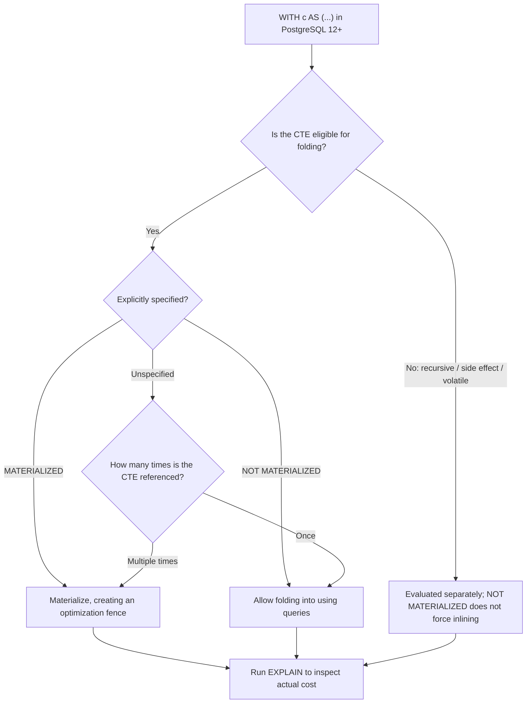

# MATERIALIZED, NOT MATERIALIZED, and CTE Execution Plans

In PostgreSQL, a Common Table Expression (**CTE**) declared with `WITH` often helps break a complex SQL statement into named, readable, reusable parts. However, the same CTE can lead to **very different execution plans** depending on whether PostgreSQL is allowed to fold the subquery into the parent query (**folding/inlining**) or keeps the CTE result as an intermediate set (**materialization**).

Starting in **PostgreSQL 12**, there are two important keywords:

- **`MATERIALIZED`**: requests keeping the CTE as an intermediate result, creating an optimization fence in cases where the mechanism applies.
- **`NOT MATERIALIZED`**: tells PostgreSQL it may fold the CTE definition into the using query, even when the CTE is referenced multiple times, **provided the CTE is eligible for folding**.

They are not switches for "turn on cache to go fast" vs. "turn off cache to go slow". Sometimes `MATERIALIZED` is very helpful because it avoids recomputing an expensive expression; other times it forces PostgreSQL to read far more rows than necessary and prevents using outer filters or indexes.

This lesson in the **Advanced Queries** chapter covers:

1. What a CTE is and how it differs from subqueries, views, and materialized views.
2. PostgreSQL 12+ default rules when a CTE is referenced once or multiple times.
3. When `MATERIALIZED` avoids recomputation, and when `NOT MATERIALIZED` enables predicate pushdown and index optimization.
4. How to read `EXPLAIN`, `CTE Scan`, `Hash Join`, `Nested Loop`, costs, and signs of disk spill.
5. Exceptions for recursive CTEs, `VOLATILE` functions, and data-modifying CTEs.
6. How to run controlled benchmarks, optimize safely, and apply decisions in SQL/JDBC code.

Examples target modern PostgreSQL, practicing SQL in a dedicated schema. **Do not apply table/index creation/drop commands or configuration changes to production without review and a change plan.**

## 1. Starting from an Ordinary CTE

A CTE is a **named query result scoped to a single statement**:

```sql
WITH paid_orders AS (
    SELECT
        order_id,
        customer_id,
        amount,
        ordered_at
    FROM demo_cte.sales_order
    WHERE status = 'PAID'
)
SELECT
    customer_id,
    COUNT(*) AS paid_order_count,
    SUM(amount) AS paid_amount
FROM paid_orders
GROUP BY customer_id
ORDER BY customer_id;
```

The `paid_orders AS (...)` part structures the query into:

- Logical step 1: select orders with `status = 'PAID'`.
- Logical step 2: aggregate order counts and amounts by customer.

Here **"logical step" does not necessarily mean "physical execution step"**. PostgreSQL can optimize the pieces into one unified plan rather than executing the whole CTE, storing the result, and only then running the outer query.

### 1.1. A CTE has a name, yet is not a persistent table

A CTE's result:

- Exists only within the **statement** containing `WITH`.
- Does not become a table in `pg_class` for other clients to SELECT.
- Has no periodic refresh policy.
- Does not outlive the statement for later queries to reuse.
- Has no automatically created indexes on the intermediate result set.
- May be folded by the planner into the parent query or evaluated via a tuplestore depending on the plan.

**`MATERIALIZED` on a CTE does not mean creating a `MATERIALIZED VIEW`.** The two concepts share the word "materialized" yet differ in lifecycle and administration.

### 1.2. WITH structures SQL; it does not make it faster by default

```sql
WITH candidates AS (
    SELECT *
    FROM demo_cte.sales_order
)
SELECT *
FROM candidates
WHERE customer_id = 42;
```

When eligible for folding, this form can yield a plan close to:

```sql
SELECT *
FROM demo_cte.sales_order
WHERE customer_id = 42;
```

Do not assume PostgreSQL is always forced to scan the whole table for the CTE first and filter the customer afterward. Since PostgreSQL 12, simple SELECT CTEs are usually **inlined** when used only once.

Conversely, do not assume `WITH` is automatically better than a subquery. Which form fits depends on SQL correctness and the execution plan.

## 2. Checking Your Version Before Using Both Keywords

The `AS MATERIALIZED` and `AS NOT MATERIALIZED` syntax was added in **PostgreSQL 12**.

```sql
SHOW server_version;

SELECT current_setting('server_version_num')::integer AS version_number;
```

Version rules matter:

| PostgreSQL Version | Typical SELECT CTE Behavior |
|---|---|
| PostgreSQL 11 and earlier | CTEs generally act as optimization fences; `MATERIALIZED`/`NOT MATERIALIZED` syntax is unsupported |
| PostgreSQL 12 and later | Non-recursive, side-effect-free SELECT CTEs can be folded; `MATERIALIZED` or `NOT MATERIALIZED` can be used |
| Newer versions | The planner keeps improving, yet you must still inspect actual `EXPLAIN`; never infer plans from version alone |

The exact same CTE query can perform differently between PostgreSQL 11 and 12, even with **no change to the SQL text**. This is an important item to test when upgrading PostgreSQL.

**Operational note:** never use `NOT MATERIALIZED` on PostgreSQL 11 systems. The server will reject the syntax.

## 3. Three Key Ways to Declare a CTE

### 3.1. Default: unspecified

```sql
WITH filtered_orders AS (
    SELECT *
    FROM demo_cte.sales_order
    WHERE status = 'PAID'
)
SELECT *
FROM filtered_orders
WHERE customer_id = 42;
```

PostgreSQL decides automatically using its folding/materialization rules and the CTE's properties.

### 3.2. Forcing MATERIALIZED

```sql
WITH filtered_orders AS MATERIALIZED (
    SELECT *
    FROM demo_cte.sales_order
    WHERE status = 'PAID'
)
SELECT *
FROM filtered_orders
WHERE customer_id = 42;
```

The intermediate set becomes an optimization fence. The outer query's planner cannot freely push `customer_id = 42` through the CTE the way it can when inlined.

### 3.3. Requesting NOT MATERIALIZED

```sql
WITH filtered_orders AS NOT MATERIALIZED (
    SELECT *
    FROM demo_cte.sales_order
    WHERE status = 'PAID'
)
SELECT *
FROM filtered_orders
WHERE customer_id = 42;
```

For an eligible CTE, PostgreSQL can fold the CTE definition into the outer query and optimize both conditions together:

```sql
WHERE status = 'PAID'
  AND customer_id = 42
```

**`NOT MATERIALIZED` is not a guarantee that an index will be used**, nor a guarantee that expressions run only once, nor does it force every kind of CTE to inline. It is a directive for handling eligible CTEs.

## 4. Default Rules in PostgreSQL 12+

For a **non-recursive, side-effect-free** CTE—typically a `SELECT` containing no `VOLATILE` functions—PostgreSQL applies a key default rule:

- A CTE **referenced once** is normally **folded into the parent query**.
- A CTE **referenced more than once** is normally **materialized** to avoid recomputing its definition multiple times.
- Using `MATERIALIZED` prevents folding even when referenced only once.
- Using `NOT MATERIALIZED` allows folding even with multiple references, trading off possible recomputation.

Diagram:



This is a **general rule to understand planner behavior**, not an exhaustive algorithm covering every edge case. For example, CTEs referenced across distinct query blocks or with additional factors affecting folding must be verified in actual plans.

### 4.1. "Once" refers to the number of references to the CTE name

```sql
WITH paid AS (
    SELECT order_id, customer_id, amount
    FROM demo_cte.sales_order
    WHERE status = 'PAID'
)
SELECT COUNT(*) FROM paid;
```

The name `paid` appears in one `FROM` clause, so that is one reference.

```sql
WITH paid AS (
    SELECT order_id, customer_id, amount
    FROM demo_cte.sales_order
    WHERE status = 'PAID'
)
SELECT
    (SELECT COUNT(*) FROM paid WHERE customer_id = 42) AS customer_42,
    (SELECT COUNT(*) FROM paid WHERE customer_id = 43) AS customer_43;
```

In the second query, `paid` is referenced **twice**, even though `WITH paid AS (...)` is declared once. That difference is why the default typically switches to materialization.

### 4.2. One CTE can depend on another CTE

```sql
WITH
base AS (
    SELECT order_id, customer_id, status, amount
    FROM demo_cte.sales_order
),
paid AS (
    SELECT *
    FROM base
    WHERE status = 'PAID'
)
SELECT *
FROM paid
WHERE customer_id = 42;
```

`base` and `paid` are two logical layers. PostgreSQL can fold eligible CTEs to form a plan close to a direct SELECT. Having two `WITH` layers does not automatically require two intermediate result buffers.

If you force `base AS MATERIALIZED`, the planner may lose the chance to push outer filters down to the base table. Thus, when reading layered SQL, look at **where materialization fences are placed**, not just the number of CTEs.

## 5. Preparing Practice Data and Indexes

Create a dedicated schema `demo_cte`. The examples below use deterministic generated data—small enough to learn on yet larger than a few rows so plan differences become visible.

### 5.1. Creating customer and order tables

```sql
CREATE SCHEMA IF NOT EXISTS demo_cte;

CREATE TABLE demo_cte.customer (
    customer_id INTEGER PRIMARY KEY,
    customer_name TEXT NOT NULL,
    segment TEXT NOT NULL
);

CREATE TABLE demo_cte.sales_order (
    order_id BIGINT GENERATED ALWAYS AS IDENTITY PRIMARY KEY,
    customer_id INTEGER NOT NULL,
    status TEXT NOT NULL,
    amount NUMERIC(12, 2) NOT NULL,
    ordered_at TIMESTAMPTZ NOT NULL,
    CONSTRAINT fk_sales_order_customer
        FOREIGN KEY (customer_id)
        REFERENCES demo_cte.customer(customer_id),
    CONSTRAINT ck_sales_order_status
        CHECK (status IN ('NEW', 'PAID', 'CANCELLED')),
    CONSTRAINT ck_sales_order_amount
        CHECK (amount >= 0)
);
```

### 5.2. Generating consistent data

```sql
INSERT INTO demo_cte.customer (customer_id, customer_name, segment)
SELECT
    g,
    'Customer ' || g::text,
    CASE
        WHEN g % 5 = 0 THEN 'ENTERPRISE'
        ELSE 'STANDARD'
    END
FROM generate_series(1, 2000) AS g;

INSERT INTO demo_cte.sales_order
    (customer_id, status, amount, ordered_at)
SELECT
    ((g - 1) % 2000) + 1,
    CASE
        WHEN g % 10 = 0 THEN 'CANCELLED'
        WHEN g % 3 = 0 THEN 'PAID'
        ELSE 'NEW'
    END,
    ((g % 500) + 1) * 1000.00,
    TIMESTAMPTZ '2026-01-01 00:00:00+00'
        + (g % 300) * INTERVAL '1 day'
FROM generate_series(1, 50000) AS g;
```

We have 2,000 customers and 50,000 orders in a fresh lab environment. `status` and `customer_id` follow deterministic distributions; they make examples reproducible and **should not be treated as production-representative benchmark data**.

Running inserts multiple times creates extra orders and alters results, so run the setup once when comparing plans on the same dataset.

### 5.3. Creating indexes and updating statistics

```sql
CREATE INDEX idx_demo_cte_order_customer_status
ON demo_cte.sales_order (customer_id, status);

CREATE INDEX idx_demo_cte_order_status_customer
ON demo_cte.sales_order (status, customer_id);

CREATE INDEX idx_demo_cte_order_customer_time
ON demo_cte.sales_order (customer_id, ordered_at DESC);

ANALYZE demo_cte.customer;
ANALYZE demo_cte.sales_order;
```

The three indexes illustrate different access paths. **Do not copy all three indexes verbatim onto a real table** without measuring your workload; they overlap in functionality and add INSERT/UPDATE, WAL, storage, and VACUUM overhead.

Check size and distribution:

```sql
SELECT
    COUNT(*) AS total_orders,
    COUNT(*) FILTER (WHERE status = 'PAID') AS paid_orders,
    COUNT(DISTINCT customer_id) AS customers_with_orders
FROM demo_cte.sales_order;

SELECT status, COUNT(*) AS row_count
FROM demo_cte.sales_order
GROUP BY status
ORDER BY status;
```

## 6. Single Reference: Outer Predicates Pushed Down When Folded

Consider the requirement: find up to 20 recent PAID orders for customer 42.

```sql
WITH paid_orders AS (
    SELECT order_id, customer_id, amount, ordered_at
    FROM demo_cte.sales_order
    WHERE status = 'PAID'
)
SELECT order_id, amount, ordered_at
FROM paid_orders
WHERE customer_id = 42
ORDER BY ordered_at DESC
LIMIT 20;
```

On PostgreSQL 12+ with an eligible CTE, the planner can usually fold this into:

```sql
SELECT order_id, amount, ordered_at
FROM demo_cte.sales_order
WHERE status = 'PAID'
  AND customer_id = 42
ORDER BY ordered_at DESC
LIMIT 20;
```

Potential benefits:

- `customer_id = 42` is evaluated alongside `status = 'PAID'` right at the base table.
- PostgreSQL can use the index on `(customer_id,status)` or another suitable access path.
- No need to materialize a large set containing PAID orders for all customers first.
- The planner can coordinate `ORDER BY`, `LIMIT`, and statistics in a single plan.

### 6.1. EXPLAIN to observe folding

```sql
EXPLAIN
WITH paid_orders AS (
    SELECT order_id, customer_id, amount, ordered_at
    FROM demo_cte.sales_order
    WHERE status = 'PAID'
)
SELECT order_id, amount, ordered_at
FROM paid_orders
WHERE customer_id = 42
ORDER BY ordered_at DESC
LIMIT 20;
```

If the CTE is completely folded, the plan will not show a `CTE Scan` node for `paid_orders`. You might see `Index Scan`, `Bitmap Heap Scan`, `Seq Scan`, `Sort`, or `Limit` depending on estimated costs.

**Do not assume "only an Index Scan is right"**. For small tables, skewed stats, or low-selectivity filters, `Seq Scan` can be cheaper; what matters is a plan that satisfies the query at low cost.

### 6.2. A single-reference CTE can still materialize when requested

```sql
EXPLAIN
WITH paid_orders AS MATERIALIZED (
    SELECT order_id, customer_id, amount, ordered_at
    FROM demo_cte.sales_order
    WHERE status = 'PAID'
)
SELECT order_id, amount, ordered_at
FROM paid_orders
WHERE customer_id = 42
ORDER BY ordered_at DESC
LIMIT 20;
```

This **intentionally prevents folding**. Inside the CTE, the planner sees only `status = 'PAID'`, while the `customer_id = 42` filter sits on the outer `CTE Scan`.

Compare both plans to see which filters sit at the base table scan versus on top of the CTE consumer node.

## 7. MATERIALIZED Acts as an "Optimization Fence" Here

An **optimization fence** is a boundary preventing certain outer query transformations from penetrating into the CTE the way they do when inlined.

```text
WITH filtered AS MATERIALIZED (
    SELECT ...
    FROM sales_order
    WHERE status = 'PAID'
)
SELECT ...
FROM filtered
WHERE customer_id = 42;

           ┌───────────────────────┐
           │     CTE producer      │
           │   WHERE status=PAID   │
           │ builds intermediate   │
           └──────────┬────────────┘
                      │
                      ▼
           ┌───────────────────────┐
           │       CTE Scan        │
           │  WHERE customer=42    │
           └───────────────────────┘
```

In this query shape, **the outer predicate is not pushed into the producer as it would be when folded**. As a result:

- PostgreSQL reads/processes many PAID rows belonging to other customers.
- The intermediate result consumes memory or spills to temp files.
- A condition that could have been satisfied quickly via an index is not applied at the earliest point.
- The overall plan becomes more expensive.

Even so, `MATERIALIZED` does not mean PostgreSQL **always** evaluates the entire CTE before the outer query reads its first row. PostgreSQL can evaluate CTEs lazily on demand in eligible plans; a `LIMIT` above can still stop reading early. However, if the outer query has an `ORDER BY`, join, or aggregate needing all rows, it often consumes the full CTE set.

**Key takeaway:** a fence restricts cross-CTE optimizer transformations—it is not necessarily a command to "immediately write everything to disk".

### 7.1. Why do people still use fences deliberately?

There are valid reasons:

- Avoid recomputing an expensive expression when the CTE is used multiple times.
- Preserve a proven plan shape under a specific workload.
- Partially isolate how the optimizer rewrites SQL across a boundary.
- Reuse an expensive intermediate computation in multiple consumers.

However, **MATERIALIZED is not an absolute plan-stability guarantee**; the planner can still change scans, joins, and sorts inside and outside the CTE. Never use it as a substitute for proper indexing, fresh statistics, or accurate predicates.

## 8. Two References: Why Might the Default Materialize?

Consider counting PAID orders for two different customers from the same logical set:

```sql
WITH paid_orders AS (
    SELECT order_id, customer_id, amount
    FROM demo_cte.sales_order
    WHERE status = 'PAID'
)
SELECT
    (SELECT COUNT(*) FROM paid_orders WHERE customer_id = 42) AS paid_42,
    (SELECT COUNT(*) FROM paid_orders WHERE customer_id = 43) AS paid_43;
```

`paid_orders` is referenced twice, so PostgreSQL 12+ usually shares the CTE result. This evaluates the producer only once, yet carries a potential drawback:

- The producer filters all PAID orders for **every customer**.
- Each consumer scans/filters that shared set for one customer.
- The selective filters `customer_id = 42` and `= 43` are not pushed back into the producer as two independent index lookups.

### 8.1. Inspecting the default plan

```sql
EXPLAIN
WITH paid_orders AS (
    SELECT order_id, customer_id, amount
    FROM demo_cte.sales_order
    WHERE status = 'PAID'
)
SELECT
    (SELECT COUNT(*) FROM paid_orders WHERE customer_id = 42) AS paid_42,
    (SELECT COUNT(*) FROM paid_orders WHERE customer_id = 43) AS paid_43;
```

When materialized, the plan may contain:

```text
CTE paid_orders
  -> ... scan sales_order ... status = 'PAID'
...
-> Aggregate
     -> CTE Scan on paid_orders ... customer_id = 42
-> Aggregate
     -> CTE Scan on paid_orders ... customer_id = 43
```

This is an **illustrative plan sketch**, not measured `EXPLAIN` output from a specific server. Node names, timings, and order can vary.

### 8.2. NOT MATERIALIZED when each consumer needs a small slice

```sql
EXPLAIN
WITH paid_orders AS NOT MATERIALIZED (
    SELECT order_id, customer_id, amount
    FROM demo_cte.sales_order
    WHERE status = 'PAID'
)
SELECT
    (SELECT COUNT(*) FROM paid_orders WHERE customer_id = 42) AS paid_42,
    (SELECT COUNT(*) FROM paid_orders WHERE customer_id = 43) AS paid_43;
```

When eligible for folding, PostgreSQL can generate two separate accesses to the base table, each optimized independently with its own filter.

One possible plan shape is:

```text
Aggregate
  -> Index Only Scan / Index Scan
       Index Cond: (customer_id = 42, status = 'PAID')
Aggregate
  -> Index Only Scan / Index Scan
       Index Cond: (customer_id = 43, status = 'PAID')
```

If each customer has only a few orders, reading a handful of relevant base-table pages twice **can be far cheaper** than materializing all PAID rows and scanning the intermediate set twice.

### 8.3. Trade-offs have no one-size-fits-all winner

| Scenario | Materialize may help | NOT MATERIALIZED may help |
|---|---|---|
| Small CTE used multiple times | Shares one intermediate result | May also be fine, depending on plan |
| Large CTE, each consumer filters a few distinct rows | May process many unneeded rows | Pushdown/indexes can save heavily |
| CTE computes CPU-heavy expressions and consumers need most rows | Avoids recomputation | May recompute expressions multiple times |
| CTE used once and eligible for inlining | Loses optimization if forced into a fence | Folding is usually sensible |
| Branches need very different selective slices | Consumers must filter behind fence | Each branch optimizes independently |
| CTE contains VOLATILE functions or recursion | May not fold regardless | NOT MATERIALIZED hint may be ignored |

**Do not choose mechanically by reference count.** Two references do not automatically mean materialization wins; how much data each consumer actually uses is what matters.

## 9. Downside of NOT MATERIALIZED: Recomputing Expensive Expressions

Now consider the opposite case: a CTE performs an expensive calculation, and multiple consumers need that exact calculated result.

Using a text-hashing expression more CPU-intensive than reading a plain column:

```sql
WITH transformed AS MATERIALIZED (
    SELECT
        order_id,
        customer_id,
        md5(repeat(order_id::text, 200)) AS fingerprint
    FROM demo_cte.sales_order
    WHERE order_id BETWEEN 1 AND 1000
)
SELECT COUNT(*)
FROM transformed AS left_part
JOIN transformed AS right_part
  ON left_part.fingerprint = right_part.fingerprint;
```

When materialized, each row's `fingerprint` generated by the producer can be reused by multiple references to `transformed` instead of necessarily repeating the hash everywhere.

Try writing:

```sql
WITH transformed AS NOT MATERIALIZED (
    SELECT
        order_id,
        customer_id,
        md5(repeat(order_id::text, 200)) AS fingerprint
    FROM demo_cte.sales_order
    WHERE order_id BETWEEN 1 AND 1000
)
SELECT COUNT(*)
FROM transformed AS left_part
JOIN transformed AS right_part
  ON left_part.fingerprint = right_part.fingerprint;
```

Because the CTE is eligible for folding, `md5(repeat(...))` can appear in multiple branches of the plan. Actual evaluation cost still depends on the optimizer, which may push, prune, or restructure expressions as needed. Thus **never infer function invocation counts just by reading SQL text**; check `EXPLAIN (ANALYZE, BUFFERS)` and time it in the lab.

### 9.1. Note on function volatility

In PostgreSQL, functions are categorized as `IMMUTABLE`, `STABLE`, or `VOLATILE`. Expressions like `md5(repeat(...))` illustrate pure calculations with no side effects, giving the planner freedom to fold.

If a CTE contains a `VOLATILE` function like `random()`, things differ: even if the author writes `NOT MATERIALIZED`, PostgreSQL will not freely fold it because doing so could alter invocation counts and observed results.

**Expensiveness and volatility are separate concepts.** A CPU-heavy yet pure/immutable function can still fold; a cheap yet volatile function remains constrained by side-effect/varying-result semantics.

## 10. CTEs with VOLATILE Functions: NOT MATERIALIZED Does Not Force Inlining

Consider:

```sql
WITH values_with_random AS (
    SELECT
        order_id,
        random() AS random_value
    FROM demo_cte.sales_order
    WHERE order_id BETWEEN 1 AND 5
)
SELECT
    a.order_id,
    a.random_value AS value_a,
    b.random_value AS value_b
FROM values_with_random AS a
JOIN values_with_random AS b USING (order_id)
ORDER BY a.order_id;
```

`random()` is `VOLATILE`. With a multi-reference CTE, sharing the result is semantically important: each row emitted by the CTE producer gets one `random_value`, and both consumers read that same value.

Try the same structure with the hint added:

```sql
WITH values_with_random AS NOT MATERIALIZED (
    SELECT
        order_id,
        random() AS random_value
    FROM demo_cte.sales_order
    WHERE order_id BETWEEN 1 AND 5
)
SELECT
    a.order_id,
    a.random_value AS value_a,
    b.random_value AS value_b
FROM values_with_random AS a
JOIN values_with_random AS b USING (order_id)
ORDER BY a.order_id;
```

In PostgreSQL, **`NOT MATERIALIZED` is ignored when a CTE is ineligible for folding**, notably when a SELECT CTE contains a volatile function. Do not expect two references to receive two independent random draws just because you wrote that keyword.

Examples of volatile functions:

- `random()`: pseudo-random numbers that can differ on every call.
- `clock_timestamp()`: real-time wall clock that can advance within a single statement.
- `nextval(...)`: advances a sequence, causing a side effect.
- User-defined functions declared `VOLATILE`.

Do not abuse `nextval()` or side-effecting functions to "probe" inlining: they can mutate data or sequences even if the transaction later rolls back (sequences follow non-transactional rules).

### 10.1. STABLE is not the same as VOLATILE

`now()` and `CURRENT_TIMESTAMP` return the transaction start timestamp under PostgreSQL rules and are classified as transaction-stable, unlike `clock_timestamp()`.

A SELECT CTE using only eligible operations and functions (no `VOLATILE` calls) **can still qualify for folding**, even if values are not SQL literals. Do not equate "contains a function" with "must materialize".

### 10.2. Why is PostgreSQL careful with volatile functions?

If a CTE calls `random()` or a state-mutating function, folding a twice-referenced CTE into two branches could invoke the function a different number of times or in a different order, changing observable results.

Restricting folding preserves proper CTE evaluation semantics. Hence `NOT MATERIALIZED` is a **conditional optimization hint**, never a license to break semantic rules.

## 11. Recursive CTEs: A Different Execution Model from Regular SELECT CTEs

A recursive CTE is typically written:

```sql
WITH RECURSIVE seq(n) AS (
    VALUES (1)
    UNION ALL
    SELECT n + 1
    FROM seq
    WHERE n < 10
)
SELECT n
FROM seq
ORDER BY n;
```

Result: numbers 1 through 10.

PostgreSQL evaluates recursion iteratively with a working table step by step, rather than flattening `seq` into a flat SELECT expression like a non-recursive CTE.

In `EXPLAIN`, you can see:

- `Recursive Union`.
- `WorkTable Scan`.
- `CTE Scan` or appropriate nodes reading the output.
- `Sort` if the outer query requires ordering.

### 11.1. NOT MATERIALIZED does not eliminate recursion

A **recursive** CTE is not eligible for ordinary folding. Even if an author writes `NOT MATERIALIZED` on a recursive CTE where syntax allows, that hint does not turn recursion into flat inline SQL.

For recursion, performance questions usually revolve around:

- Is the termination condition correct?
- Does `UNION ALL` or `UNION` match deduplication needs?
- Can the data contain cycles?
- Can depth or branching explode?
- Are there indexes supporting the recursive join edge?
- Does the outer query need sorting, distinct, or aggregation?

Never use `NOT MATERIALIZED` as a cure for non-terminating or row-exploding recursive queries.

### 11.2. Outer LIMIT can stop early in labs, yet is not a safety mechanism

In some recursive queries, PostgreSQL evaluates only as many rows as the outer query pulls. Thus an outer `LIMIT` can help during exploration. However, when the outer query has `ORDER BY`, `JOIN`, or an aggregate needing the full input, it can force recursion to compute many or all rows.

**Always put logical stopping conditions inside the recursive term**; never rely on an outer `LIMIT` to stop an infinite loop in production.

## 12. Data-Modifying CTEs: WITH Containing INSERT, UPDATE, DELETE, MERGE

PostgreSQL supports `WITH` containing data-modifying statements in valid contexts, typically using `RETURNING` to pass rows to the main query or another CTE.

Example on a lab table:

```sql
CREATE TABLE demo_cte.audit_event (
    audit_id BIGINT GENERATED ALWAYS AS IDENTITY PRIMARY KEY,
    event_code TEXT NOT NULL,
    created_at TIMESTAMPTZ NOT NULL DEFAULT now()
);
```

An operation using `INSERT ... RETURNING`:

```sql
WITH inserted AS (
    INSERT INTO demo_cte.audit_event (event_code)
    VALUES ('DEMO-CREATE')
    RETURNING audit_id, event_code, created_at
)
SELECT *
FROM inserted;
```

`inserted` is not a pure side-effect-free SELECT; it is a data-modifying CTE.

Important rules:

- Data-modifying CTEs have dedicated execution semantics and **are not freely inlined** like ordinary SELECT CTEs.
- In PostgreSQL, data-modifying statements in `WITH` are executed **once to completion** per their semantics, regardless of how many returned rows the outer query reads.
- `RETURNING` is the mechanism to pass affected rows from a DML sub-statement to another part of the statement.
- DML sub-statements within the same `WITH` follow PostgreSQL's statement-level snapshot and concurrency rules; **never assume an execution order between them** if they interact.
- Avoid designing two DML branches modifying the same row within one statement; outcomes may be undefined relative to your intent.
- DML in CTEs has placement and privilege rules; it cannot be dropped arbitrarily into any nested subquery as if it were a SELECT.

### 12.1. A DML CTE runs even if the consumer does not read all rows

Example:

```sql
BEGIN;

WITH updated AS (
    UPDATE demo_cte.sales_order
    SET status = 'CANCELLED'
    WHERE order_id BETWEEN 1 AND 3
    RETURNING order_id
)
SELECT COUNT(*)
FROM updated;

ROLLBACK;
```

This practice block **actually modifies data inside a transaction**, then rolls back so changes are discarded. It illustrates how a DML CTE yields rows via `RETURNING`.

Do not use `MATERIALIZED` or `NOT MATERIALIZED` thinking it promises an `UPDATE` CTE "runs only when read". DML side-effect rules differ from pure SELECT CTEs.

### 12.2. Do not confuse CTE optimization with materialized view operations

A `MATERIALIZED VIEW` is a persistent database object:

```sql
CREATE MATERIALIZED VIEW demo_cte.mv_paid_order_count AS
SELECT customer_id, COUNT(*) AS paid_count
FROM demo_cte.sales_order
WHERE status = 'PAID'
GROUP BY customer_id;
```

Once created, it stores its own data and can be queried in **other statements**:

```sql
SELECT * FROM demo_cte.mv_paid_order_count
WHERE customer_id = 42;
```

When base tables change, a materialized view **does not immediately reflect updates automatically**; it requires `REFRESH MATERIALIZED VIEW`, with its own locking, indexing, and refresh schedule.

In contrast, `WITH c AS MATERIALIZED (...)` only holds results for the **current statement** and creates no persistent view to refresh. Never use the two terms interchangeably.

## 13. In-Memory Materialization and Disk Spill Potential

When PostgreSQL materializes a SELECT CTE, the intermediate result is typically managed via an internal tuplestore/buffer mechanism. Depending on data volume and resources, this storage can:

- Stay in memory within configured limits.
- Spill to temporary files when exceeding thresholds.
- Be re-read by multiple `CTE Scan` nodes in the same statement.
- Incur extra I/O and intermediate-access overhead.

Do not interpret `MATERIALIZED` as "always writes to disk". The keyword denotes **retaining an intermediate result**, not forcing disk writes.

### 13.1. work_mem and temporary files

`work_mem` governs memory available to certain operations such as sorts, hashes, and intermediate storage including tuplestore buffers. When an operation or intermediate set exceeds memory limits, PostgreSQL may spill to temporary files.

Inspect settings:

```sql
SHOW work_mem;
SHOW temp_file_limit;
SHOW log_temp_files;
```

Do not impulsively raise cluster-wide `work_mem` just because CTE materialization spilled to temp files. A single query can have multiple memory-consuming nodes, and many concurrent connections can drive total RAM consumption dangerously high.

### 13.2. Observing in EXPLAIN

```sql
EXPLAIN (ANALYZE, BUFFERS, VERBOSE)
WITH all_paid AS MATERIALIZED (
    SELECT *
    FROM demo_cte.sales_order
    WHERE status = 'PAID'
)
SELECT
    COUNT(*),
    SUM(amount)
FROM all_paid;
```

`EXPLAIN ANALYZE` actually executes the `SELECT` and instruments the nodes. You may observe:

- `CTE all_paid`, the producer.
- `CTE Scan on all_paid`, the consumer.
- Timing, row counts, and loops.
- `Buffers`, potentially including `temp read`/`temp written` if temp files were used.

**Seeing `CTE Scan` does not prove temp files were used**, and seeing `temp read/written` does not prove the CTE caused it. Sorts, hash joins, and other nodes can also use temp files. Inspect the whole plan and temp logging to pinpoint causes.

### 13.3. LOG TEMP FILES aids diagnosis

PostgreSQL provides `log_temp_files` to log temporary files exceeding a configured size threshold. When investigating large CTEs, temp-file logs help uncover I/O pressure.

Changing production logging requires proper privileges, security approval, and log-volume budgeting. This lesson does not require altering server configuration to demonstrate the concepts; `EXPLAIN` on lab data is sufficient.

## 14. Reading CTEScan and the Producer in Execution Plans

An illustrative plan for a materialized CTE might look like:

```text
Aggregate
  CTE paid_orders
    -> Seq Scan on sales_order
         Filter: (status = 'PAID')
  -> CTE Scan on paid_orders
       Filter: (customer_id = 42)
```

This is an **illustrative diagram**, not literal PostgreSQL stdout.

How to read it:

1. **`CTE paid_orders`:** the subplan producing rows for the CTE.
2. **Inner scan node:** how data is read from the base table.
3. **`CTE Scan on paid_orders`:** reading the intermediate result.
4. **Filter on CTE Scan:** predicate applied after reading from the CTE, which was not pushed into the base-table scan.

Conversely, a folded plan can be as compact as:

```text
Index Scan on sales_order
  Index Cond: (customer_id = 42 ...)
  Filter: (status = 'PAID' ...)
```

The absence of `CTE Scan` signals folding likely occurred, though you must read the full version-specific plan to confirm where each predicate is evaluated. In some cases a Subquery Scan or other node fulfills the same semantics.

### 14.1. Rows Removed by Filter

If a huge materialized CTE is scanned only to keep a few rows, `EXPLAIN ANALYZE` may report high `Rows Removed by Filter` on the `CTE Scan`. That indicates many intermediate rows were produced and read only to be discarded by the consumer.

Check:

- How many rows does the producer emit?
- How many does the consumer retain?
- Are filters inside the producer or only in the consumer?
- How many `CTE Scan`s read that set?
- Do consumers share similar predicates or vastly different ones?
- Could an index on the base table push the filter down earlier?

A single metric is never enough on its own; evaluate timing, buffers, and data size together.

## 15. Hash Join, Nested Loop, and the Role of CTEs

A CTE inside a query with joins can influence join order and overall plan shape.

### 15.1. Folding gives the planner more freedom

```sql
WITH paid AS NOT MATERIALIZED (
    SELECT order_id, customer_id, amount
    FROM demo_cte.sales_order
    WHERE status = 'PAID'
)
SELECT c.customer_id, c.customer_name, SUM(p.amount)
FROM demo_cte.customer AS c
JOIN paid AS p
  ON p.customer_id = c.customer_id
WHERE c.segment = 'ENTERPRISE'
GROUP BY c.customer_id, c.customer_name;
```

When folded, the planner can combine the customer `segment` filter with the PAID order filter and available join paths to pick hash join, nested loop, or another strategy.

### 15.2. MATERIALIZED can alter valid join choices

```sql
WITH paid AS MATERIALIZED (
    SELECT order_id, customer_id, amount
    FROM demo_cte.sales_order
    WHERE status = 'PAID'
)
SELECT c.customer_id, c.customer_name, SUM(p.amount)
FROM demo_cte.customer AS c
JOIN paid AS p
  ON p.customer_id = c.customer_id
WHERE c.segment = 'ENTERPRISE'
GROUP BY c.customer_id, c.customer_name;
```

The CTE producer may have to collect PAID orders without knowing all outer constraints, and the consumer joins with Enterprise customers afterward. That can sometimes cost more; in other scenarios, fixing a shared PAID set can be handy if reused multiple times.

Never assume "more planner freedom is always better" without testing. Materialization can occasionally avoid bad plans or redundant work, which must be verified through proper measurement.

## 16. Predicate Pushdown: A Key Technique to Recognize

**Predicate pushdown** means pushing filters as close to the base data source as possible to reduce the volume of rows processed downstream.

Example:

```sql
WITH all_orders AS MATERIALIZED (
    SELECT order_id, customer_id, status, amount
    FROM demo_cte.sales_order
)
SELECT *
FROM all_orders
WHERE customer_id = 42
  AND status = 'PAID';
```

Here an overly broad CTE is forced to materialize: the producer fetches all orders, while two selective filters sit outside.

Rewritten with folding:

```sql
WITH all_orders AS NOT MATERIALIZED (
    SELECT order_id, customer_id, status, amount
    FROM demo_cte.sales_order
)
SELECT *
FROM all_orders
WHERE customer_id = 42
  AND status = 'PAID';
```

When eligible, PostgreSQL pushes both predicates down to the `sales_order` scan and can pick an appropriate index.

### 16.1. Another option: place filters directly inside the CTE

If the CTE is used exclusively for customer 42, you can write:

```sql
WITH customer_orders AS MATERIALIZED (
    SELECT order_id, customer_id, status, amount
    FROM demo_cte.sales_order
    WHERE customer_id = 42
      AND status = 'PAID'
)
SELECT *
FROM customer_orders;
```

Even when materialized, the producer already sees the narrow filter, avoiding unnecessary reads.

However, if the CTE serves **multiple consumers with different filters**, baking one fixed filter into the CTE changes meaning or breaks reusability. In that case, `NOT MATERIALIZED` or splitting the CTE appropriately is better.

### 16.2. Projection pushdown: select only needed columns

Avoid writing `SELECT *` mechanically in large CTEs:

```sql
WITH orders AS MATERIALIZED (
    SELECT *
    FROM demo_cte.sales_order
)
SELECT COUNT(*)
FROM orders
WHERE customer_id = 42;
```

The intermediate set may retain columns the consumer never uses, depending on optimization and expression needs. Listing output columns explicitly reduces intermediate width and clarifies intent:

```sql
WITH orders AS MATERIALIZED (
    SELECT customer_id, order_id
    FROM demo_cte.sales_order
)
SELECT COUNT(*)
FROM orders
WHERE customer_id = 42;
```

If the goal is merely counting orders for one customer, a direct query without a CTE is simpler still. **MATERIALIZED cannot cure a CTE that carries too many unneeded rows or columns.**

## 17. Aggregates in CTEs and the Impact of Materialization

An aggregating CTE can produce a compact reusable summary:

```sql
WITH customer_totals AS MATERIALIZED (
    SELECT
        customer_id,
        COUNT(*) AS order_count,
        SUM(amount) AS total_amount
    FROM demo_cte.sales_order
    GROUP BY customer_id
)
SELECT
    c.customer_id,
    c.customer_name,
    t.order_count,
    t.total_amount
FROM demo_cte.customer AS c
JOIN customer_totals AS t
  ON t.customer_id = c.customer_id
WHERE c.segment = 'ENTERPRISE';
```

The CTE producer aggregates orders for **every customer**, and then the consumer keeps only Enterprise customers.

If written with `NOT MATERIALIZED` or without a keyword on a single-reference CTE:

```sql
WITH customer_totals AS NOT MATERIALIZED (
    SELECT
        customer_id,
        COUNT(*) AS order_count,
        SUM(amount) AS total_amount
    FROM demo_cte.sales_order
    GROUP BY customer_id
)
SELECT
    c.customer_id,
    c.customer_name,
    t.order_count,
    t.total_amount
FROM demo_cte.customer AS c
JOIN customer_totals AS t
  ON t.customer_id = c.customer_id
WHERE c.segment = 'ENTERPRISE';
```

The planner gains more options for restructuring, joining, and pushing predicates, yet **there is no guarantee every outer filter can move across a `GROUP BY` boundary**. Certain transformations alter aggregate semantics or require special conditions to stay valid.

Therefore distinguish:

- **Folding a CTE:** bringing the subquery structure into the shared optimization scope.
- **Predicate pushdown past an aggregate:** valid only when grouping semantics remain unchanged.
- **Alternative query design:** sometimes rewriting SQL logic (e.g., filtering customers first, then aggregating orders only for selected customers) is what truly cuts rows processed.

Do not treat `NOT MATERIALIZED` as magic that automatically optimizes every aggregation.

## 18. CTEs Using ORDER BY, LIMIT, and DISTINCT

These clauses carry specific semantics and can restrict or alter certain optimizer transformations.

### 18.1. ORDER BY inside a CTE does not guarantee final order

```sql
WITH recent_orders AS (
    SELECT order_id, ordered_at
    FROM demo_cte.sales_order
    ORDER BY ordered_at DESC
)
SELECT *
FROM recent_orders;
```

If the final result requires ordering, put `ORDER BY` **in the outermost SELECT**:

```sql
WITH recent_orders AS (
    SELECT order_id, ordered_at
    FROM demo_cte.sales_order
)
SELECT *
FROM recent_orders
ORDER BY ordered_at DESC, order_id DESC;
```

An inner `ORDER BY` has meaning when paired with `LIMIT`/`OFFSET` or in specific constructs, yet should never be relied on as a durable output-ordering contract after joins, aggregates, or folding.

### 18.2. LIMIT inside a CTE changes the result set

```sql
WITH top_ten AS MATERIALIZED (
    SELECT order_id, customer_id, ordered_at
    FROM demo_cte.sales_order
    ORDER BY ordered_at DESC, order_id DESC
    LIMIT 10
)
SELECT *
FROM top_ten
WHERE customer_id = 42;
```

This asks: **among the 10 newest orders across the entire system, are any from customer 42?**

It **differs from**:

```sql
SELECT order_id, customer_id, ordered_at
FROM demo_cte.sales_order
WHERE customer_id = 42
ORDER BY ordered_at DESC, order_id DESC
LIMIT 10;
```

The second query asks for **customer 42's 10 newest orders**.

Customer predicates must never be pushed past `LIMIT` in a way that changes meaning. An optimization fence changes the plan, yet the logical boundary of `LIMIT` is paramount.

### 18.3. DISTINCT alters options without blocking all folding

```sql
WITH distinct_customers AS (
    SELECT DISTINCT customer_id
    FROM demo_cte.sales_order
    WHERE status = 'PAID'
)
SELECT *
FROM distinct_customers
WHERE customer_id BETWEEN 1 AND 100;
```

The planner may fold the query block while still respecting `DISTINCT` semantics. Depending on the structure, the filter may or may not run early; check `EXPLAIN` rather than guessing from the presence of `DISTINCT`.

## 19. Comparing CTEs, Derived Tables, LATERAL, and Views

These constructs can look similar while serving different purposes.

| Construct | Common purpose | Key takeaway |
|---|---|---|
| `WITH cte AS (...)` | Name and structure a query block within one statement | Subject to folding/materialization rules |
| `WITH cte AS MATERIALIZED (...)` | Force an intermediate result for an eligible CTE | Acts as an optimization fence |
| `WITH cte AS NOT MATERIALIZED (...)` | Allow folding the query block into call sites | May recompute if referenced multiple times |
| `FROM (SELECT ...) AS x` | Derived table inline in FROM | Has its own flattening/pushdown rules |
| `JOIN LATERAL (...)` | Subquery referencing rows from preceding FROM items | Ideal for per-row top-N queries |
| `CREATE VIEW` | Reusable query definition across statements | Ordinary views do not store results |
| `CREATE MATERIALIZED VIEW` | Persists view results | Requires refresh; has its own indexes/privileges/lifecycle |
| Temp table `CREATE TEMP TABLE` | Stores data across multiple statements in a session | Requires explicit DDL, indexes/stats/cleanup |

### 19.1. When per-customer top-N is needed

For example, fetching the 3 newest orders for each customer:

```sql
SELECT
    c.customer_id,
    c.customer_name,
    o.order_id,
    o.ordered_at
FROM demo_cte.customer AS c
LEFT JOIN LATERAL (
    SELECT order_id, ordered_at
    FROM demo_cte.sales_order AS o
    WHERE o.customer_id = c.customer_id
    ORDER BY ordered_at DESC, order_id DESC
    LIMIT 3
) AS o ON TRUE
ORDER BY c.customer_id, o.ordered_at DESC, o.order_id DESC;
```

This fits `LATERAL` because each customer needs its own top-3. Merely adding `MATERIALIZED` to a CTE over all orders will not turn a query into per-customer top-N.

### 19.2. When results must be reused across multiple statements

If an aggregated dataset is read by many different SQL queries throughout the day, `WITH ... MATERIALIZED` does not persist results across statements.

Evaluate:

- Materialized views and refresh schedules.
- Session-scoped temporary tables.
- Summary tables maintained by ETL/jobs.
- Application-level or external caches.
- Direct queries backed by proper indexes.

Choose based on **freshness requirements, reuse scope, transactions, and maintenance cost**—not simply because a keyword contains "materialized".

## 20. Does a Materialized CTE Always Execute Exactly Once?

A materialized CTE is normally **not recomputed from scratch every time its name is referenced** within the same statement. That is its main advantage for multiple consumers.

However, distinguish:

1. **CTE Producer:** the subplan generating intermediate rows.
2. **CTE Scan Consumer:** one or more places reading the intermediate rows.
3. **Plan node loops:** number of times a node is executed/scanned, which can exceed 1.
4. **Per-row/expression evaluation:** depends on execution, predicates, and how many rows the parent pulls.

A `CTE Scan` being looped over does not mean the producer re-ran from scratch. PostgreSQL can re-read the retained result, incurring scan cost.

Conversely, `NOT MATERIALIZED` on a multi-reference CTE can cause calculations to appear in **multiple plan branches**. Still, expressions are not guaranteed to evaluate twice if the optimizer eliminates redundant work.

**Measure with real plans and metrics rather than counting occurrences in SQL text.**

## 21. LIMIT in the Outer Query: On-Demand Evaluation and Exceptions

A common misconception is that materialization always means PostgreSQL computes the entire CTE before returning any row.

Example:

```sql
WITH numbers AS MATERIALIZED (
    SELECT g
    FROM generate_series(1, 1000000) AS g
)
SELECT *
FROM numbers
LIMIT 5;
```

For compatible query shapes, PostgreSQL can pull just five rows from the producer to satisfy `LIMIT 5`.

However, if the outer query must sort:

```sql
WITH numbers AS MATERIALIZED (
    SELECT g
    FROM generate_series(1, 1000000) AS g
)
SELECT *
FROM numbers
ORDER BY g DESC
LIMIT 5;
```

to find the five largest values, the sort must consume the full input set. `LIMIT` no longer guarantees only five rows are generated.

Similarly, joins, hashes, aggregates, or `DISTINCT` in the consumer can force reading most or all of the CTE.

**Never rely on an outer `LIMIT` to make recursive CTEs or side-effecting functions safe.**

## 22. Multi-Reference with Two Different Usage Patterns

Consider a CTE over all orders with two consumers:

- Consumer A counts orders for customer 42.
- Consumer B sums order amounts for customer 1988.

```sql
WITH order_base AS MATERIALIZED (
    SELECT order_id, customer_id, status, amount
    FROM demo_cte.sales_order
)
SELECT
    (SELECT COUNT(*) FROM order_base WHERE customer_id = 42) AS order_count_42,
    (SELECT SUM(amount) FROM order_base WHERE customer_id = 1988) AS amount_1988;
```

Because the CTE materializes the whole table, both consumers filter at the `CTE Scan` level.

Try:

```sql
WITH order_base AS NOT MATERIALIZED (
    SELECT order_id, customer_id, status, amount
    FROM demo_cte.sales_order
)
SELECT
    (SELECT COUNT(*) FROM order_base WHERE customer_id = 42) AS order_count_42,
    (SELECT SUM(amount) FROM order_base WHERE customer_id = 1988) AS amount_1988;
```

Both branches can optimize with their own predicates. If each customer has a couple dozen orders out of 50,000 rows and a suitable index exists, keyed lookups can save substantial work.

### 22.1. Why can't you always "just put WHERE inside the CTE"?

If you write:

```sql
WITH order_base AS MATERIALIZED (
    SELECT *
    FROM demo_cte.sales_order
    WHERE customer_id = 42
)
...
```

then consumer B requesting customer 1988 gets wrong data. A shared CTE serving multiple purposes often needs a broad definition; that is where **per-consumer folding** shines.

### 22.2. When both consumers need almost the same entire set

If both A and B process most PAID orders and compute an expensive field like a fingerprint, materialization can win by sharing the computed result. Weigh **duplicated computation** against **rows saved by early filtering** together.

## 23. Multi-Level CTE Example: Where to Place the Fence?

```sql
WITH
base AS MATERIALIZED (
    SELECT
        order_id, customer_id, status, amount, ordered_at
    FROM demo_cte.sales_order
),
paid AS NOT MATERIALIZED (
    SELECT *
    FROM base
    WHERE status = 'PAID'
),
recent AS NOT MATERIALIZED (
    SELECT *
    FROM paid
    WHERE ordered_at >= TIMESTAMPTZ '2026-09-01 00:00:00+00'
)
SELECT COUNT(*)
FROM recent
WHERE customer_id = 42;
```

Even though `paid` and `recent` say `NOT MATERIALIZED`, **`base AS MATERIALIZED` remains a fence**. Folding the upper CTEs cannot cross `base`'s boundary to push all filters directly into the base table scan as a fully flattened query.

If all layers are eligible for folding and have no fence, the planner can optimize deeper:

```sql
WITH
base AS NOT MATERIALIZED (
    SELECT
        order_id, customer_id, status, amount, ordered_at
    FROM demo_cte.sales_order
),
paid AS NOT MATERIALIZED (
    SELECT *
    FROM base
    WHERE status = 'PAID'
),
recent AS NOT MATERIALIZED (
    SELECT *
    FROM paid
    WHERE ordered_at >= TIMESTAMPTZ '2026-09-01 00:00:00+00'
)
SELECT COUNT(*)
FROM recent
WHERE customer_id = 42;
```

In multi-CTE SQL, **a fence placed too early** can block optimizations for all downstream layers.

Still, there is no need to put `NOT MATERIALIZED` on **every** CTE; for eligible single-reference CTEs, PostgreSQL 12+ folds by default. Add keywords only to state deliberate choices.

## 24. Limits of NOT MATERIALIZED

`NOT MATERIALIZED` does not arbitrarily override semantics. Know these cases:

| CTE Type | Eligible for normal folding? | Notes |
|---|---|---|
| Non-recursive `SELECT`, no volatile functions, single reference | Usually yes | Folded by default on PG12+ |
| Non-recursive `SELECT`, side-effect-free, multiple references | Eligible with `NOT MATERIALIZED` | Risks repeating computations |
| `SELECT` CTE containing `random()` or `VOLATILE` functions | Not via normal folding | `NOT MATERIALIZED` is ignored |
| Recursive CTE | Not via non-recursive folding | Must use recursive evaluation |
| CTE containing DML modifying data | Not treated as pure SELECT | Follows DML execution and side-effect rules |
| `SELECT` CTE with `GROUP BY`, `DISTINCT`, `LIMIT`, non-volatile | May be CTE-eligible | Inner clauses must still preserve semantics |
| `SELECT` CTE using `now()` or eligible stable functions | May be eligible | Do not confuse STABLE with VOLATILE |

Notice the last row: merely calling a function inside a CTE does not forbid folding. Check **actual volatility** and side effects.

### 24.1. Never label a side-effecting function IMMUTABLE just to force folding

When creating application-managed functions, `IMMUTABLE`, `STABLE`, and `VOLATILE` declarations must accurately reflect behavior. Falsely marking a table-reading or random function `IMMUTABLE` just to coax the planner into inlining can produce wrong results, especially with plan caching/reuse.

That is not a valid optimization trick. Data correctness and function contracts come first.

## 25. Benchmarking Performance Meaningfully

To compare CTE variants fairly, test on **the same data, same statistics, same predicates, and a reasonably stable workload environment**.

### 25.1. Three variants to compare

**A — Default:**

```sql
EXPLAIN (ANALYZE, BUFFERS)
WITH paid AS (
    SELECT order_id, customer_id, amount
    FROM demo_cte.sales_order
    WHERE status = 'PAID'
)
SELECT COUNT(*)
FROM paid
WHERE customer_id = 42;
```

**B — MATERIALIZED:**

```sql
EXPLAIN (ANALYZE, BUFFERS)
WITH paid AS MATERIALIZED (
    SELECT order_id, customer_id, amount
    FROM demo_cte.sales_order
    WHERE status = 'PAID'
)
SELECT COUNT(*)
FROM paid
WHERE customer_id = 42;
```

**C — NOT MATERIALIZED:**

```sql
EXPLAIN (ANALYZE, BUFFERS)
WITH paid AS NOT MATERIALIZED (
    SELECT order_id, customer_id, amount
    FROM demo_cte.sales_order
    WHERE status = 'PAID'
)
SELECT COUNT(*)
FROM paid
WHERE customer_id = 42;
```

Because the CTE is referenced once here, A and C **should produce the same plan**. B highlights the fence effect.

### 25.2. What to record from the plan?

| Observation field | Question |
|---|---|
| `Execution Time` | Total measured server execution time of the SELECT |
| `Planning Time` | Did planning overhead change significantly? |
| `actual rows` | How many rows did each node process? |
| `loops` | Was a node executed or scanned multiple times? |
| `Index Cond` | Which predicates actually drove index lookups? |
| `Filter` | Which predicates only filtered rows after fetching? |
| `Rows Removed by Filter` | Were too many rows discarded after an expensive step? |
| `Buffers: shared hit/read` | Cache hits vs. storage reads |
| `Buffers: temp read/written` | Was temp I/O triggered and by which node? |
| `CTE Scan` | Was an intermediate result scanned? |

**Never run a benchmark once and declare one variant always superior**. Cache state, background I/O, autovacuum, lock contention, and parallel workers all vary across runs.

### 25.3. Do not treat enable_seqscan=off as proof

PostgreSQL has planner knobs like `enable_seqscan` for investigating plans, yet toggling them forces unnatural plans. A forced test-session configuration does not represent default production behavior.

Before touching planner flags, inspect schema, data distribution, indexes, statistics, and predicates. Never alter server-wide planner settings just to make an `EXPLAIN` screenshot look pretty.

### 25.4. Application latency differs from server Execution Time

A JDBC SQL call experiences:

- Connection pool wait time.
- Network round-trip latency.
- Server parse/plan/execute time.
- Result-set streaming.
- Object mapping, serialization, and business logic.

`EXPLAIN ANALYZE` is great for inspecting server plans, not a replacement for end-to-end latency testing. After tuning a CTE, verify that the application actually improved.

## 26. When a Faster Plan Returns the Wrong Answer

Optimizations must never change query semantics.

Example:

```sql
WITH top_orders AS MATERIALIZED (
    SELECT order_id, customer_id, amount
    FROM demo_cte.sales_order
    ORDER BY amount DESC, order_id DESC
    LIMIT 100
)
SELECT COUNT(*)
FROM top_orders
WHERE customer_id = 42;
```

This counts orders for customer 42 **among the top 100 largest orders system-wide**.

Rewritten as:

```sql
SELECT COUNT(*)
FROM (
    SELECT order_id, customer_id, amount
    FROM demo_cte.sales_order
    WHERE customer_id = 42
    ORDER BY amount DESC, order_id DESC
    LIMIT 100
) AS top_customer_orders;
```

this counts orders **among customer 42's own top 100 largest orders**. Different results are expected because the requirements differ.

When optimizing CTEs by moving `WHERE` filters in or out, be extra careful around:

- `LIMIT`/`OFFSET`.
- `GROUP BY`/`HAVING`.
- `DISTINCT`.
- Window functions.
- Outer joins.
- Non-deterministic or side-effecting functions.

Never treat two fast plans as proof that two SQL queries are semantically equivalent.

## 27. CTEs with Window Functions

Consider ranking orders chronologically within each customer:

```sql
WITH ranked AS (
    SELECT
        order_id,
        customer_id,
        amount,
        ordered_at,
        ROW_NUMBER() OVER (
            PARTITION BY customer_id
            ORDER BY ordered_at DESC, order_id DESC
        ) AS rn
    FROM demo_cte.sales_order
)
SELECT order_id, customer_id, amount
FROM ranked
WHERE rn <= 3
  AND customer_id = 42
ORDER BY rn;
```

This fetches the top 3 orders for customer 42. When the CTE folds, the planner may optimize certain partition-aligned filters; `ROW_NUMBER()` still evaluates over properly ordered partitions.

If forced:

```sql
WITH ranked AS MATERIALIZED (
    SELECT
        order_id,
        customer_id,
        amount,
        ordered_at,
        ROW_NUMBER() OVER (
            PARTITION BY customer_id
            ORDER BY ordered_at DESC, order_id DESC
        ) AS rn
    FROM demo_cte.sales_order
)
SELECT order_id, customer_id, amount
FROM ranked
WHERE rn <= 3
  AND customer_id = 42;
```

the CTE producer may rank many or all customers before the consumer filters down to customer 42—often far costlier than a jointly optimized query.

However, **pushing filters into a window is not always valid**. For example, if `ROW_NUMBER()` ranks **system-wide** rather than partitioning by customer, filtering by customer first changes every rank. Optimize only when semantics are preserved.

## 28. Safety Rules for MVCC, Transactions, and Isolation

Folding vs. materialization is an **execution plan choice within one statement**; it does not create a separate transaction scope for the CTE.

In PostgreSQL, an ordinary SELECT reads data using a snapshot matching the active isolation level:

- Under `READ COMMITTED`, each statement takes a fresh snapshot.
- Under `REPEATABLE READ`, statements in the transaction share that transaction's snapshot.
- A SELECT CTE inside a statement follows the statement/transaction visibility rules; `MATERIALIZED` does not make a CTE see a different snapshot from its parent query.

Therefore **never choose `MATERIALIZED` trying to "freeze a snapshot against concurrent edits"**. To coordinate consistency across statements, design proper transactions, isolation levels, locks, or constraints.

### 28.1. A CTE's intermediate set is not a durable snapshot

A CTE tuplestore is merely computed state scoped to one statement. It is not a backup image, an exportable snapshot for other systems, or a copy usable in the next transaction.

Likewise, `NOT MATERIALIZED` does not mean PostgreSQL reads **multiple different snapshots** if the expression is folded into multiple places inside the same SELECT. Plan rewrites must preserve single-statement snapshot semantics.

## 29. Benchmarking with Parameters and Prepared Statements

In Java/JDBC applications, customer filters are typically parameters:

```java
String sql = """
    WITH paid AS NOT MATERIALIZED (
        SELECT order_id, customer_id, amount
        FROM demo_cte.sales_order
        WHERE status = 'PAID'
    )
    SELECT COUNT(*) AS paid_count
    FROM paid
    WHERE customer_id = ?
    """;

try (PreparedStatement statement = connection.prepareStatement(sql)) {
    statement.setInt(1, customerId);

    try (ResultSet rs = statement.executeQuery()) {
        if (rs.next()) {
            long paidCount = rs.getLong("paid_count");
            System.out.println(paidCount);
        }
    }
}
```

For a single-use CTE, `NOT MATERIALIZED` is redundant on PostgreSQL 12+, though the example illustrates JDBC syntax clearly.

### 29.1. Generic plans vs. custom plans can differ

PostgreSQL uses custom and generic plans for prepared statements where appropriate. If data distribution is heavily skewed across `customer_id`s, the right plan for a customer with a few orders may differ from one with millions of orders.

When benchmarking:

- Verify whether literals, bind parameters, or reused prepared statements are used.
- Compare plans across representative parameter values.
- Check statistics targets and `ANALYZE` freshness.
- Do not test only ID 42 if production has massive outlier customers.
- Never assume `NOT MATERIALIZED` guarantees the same optimal plan for every parameter.

### 29.2. plan_cache_mode is only for controlled investigation

In supported versions, PostgreSQL offers `plan_cache_mode` to inspect custom vs. generic plan behavior. It is a session-level diagnostic setting, not a cluster-wide switch to "make CTEs faster".

Never use it in production to force plans without a clear diagnosis. Start with `EXPLAIN` using actual queries and realistic parameter values.

## 30. Common Mistakes

| Symptom | Possible Cause | Fix |
|---|---|---|
| After upgrading PostgreSQL 11 → 12, CTE query performance changed | Single-reference SELECT CTEs now fold instead of fencing by default | Compare `EXPLAIN` before/after; evaluate `MATERIALIZED` if a fence is truly needed |
| Single-reference CTE scans lots of PAID rows before filtering one customer | `MATERIALIZED` or another optimization boundary present | Remove fence if semantically valid, or move selective filter into producer |
| Twice-referenced CTE shows multiple `CTE Scan`s | Default materialization on multiple references | Compare `NOT MATERIALIZED` if each consumer needs very few rows |
| NOT MATERIALIZED is slower than MATERIALIZED | Expensive expression evaluated repeatedly or worse join plan | Compare timings, nodes, and evaluation counts |
| NOT MATERIALIZED does not eliminate CTE Scan | CTE is recursive, contains `VOLATILE`, or is ineligible for folding | Check CTE properties; do not try to force it |
| Temp files spike after forcing MATERIALIZED | Large intermediate result spilled | Trim rows/columns, inspect `work_mem` and plan; avoid hasty global tuning |
| Plan ignores index despite NOT MATERIALIZED | Unsuitable index, low selectivity, tiny table, or stale stats | Run `ANALYZE`, inspect `Index Cond` and costs |
| Results change after moving filter into CTE | `LIMIT`/aggregate/window/outer join altered semantics | Re-verify predicates and output sets |
| EXPLAIN ANALYZE mutates data | Used on DML or side-effecting functions | Never run on production; use plain `EXPLAIN` for plan inspection |
| CTE named `foo` has no `foo` node in EXPLAIN | CTE was folded | Often the expected behavior |
| CTE with COUNT(*) in EXISTS returns TRUE when source is empty | Aggregate without GROUP BY still emits one row | Use `EXISTS (SELECT 1 FROM ... WHERE ...)` |
| VOLATILE CTE called in multiple consumers expected to give fresh draws | CTE did not fold under NOT MATERIALIZED | Distinguish side-effect-free from volatile functions |
| ORM/BI is slow while literal SQL EXPLAIN is fast | Parameters, plan choice, network, cache, or workload differ | Measure with bind variables and production-like conditions |

## 31. Practical Workflow for Deciding MATERIALIZED vs. NOT MATERIALIZED

### Step 1 — Confirm server version

```sql
SELECT version();
```

On PostgreSQL 11, the new keywords are invalid. During upgrades, treat CTE folding changes as an explicit regression check for critical queries.

### Step 2 — Clarify the CTE's purpose

Does the CTE:

- Improve SQL readability?
- Reuse a shared computation?
- Hold a small intermediate set?
- Prevent recomputing an expensive expression?
- Isolate a recursive step?
- Forward `RETURNING` rows from DML?

Not every CTE has the same requirements.

### Step 3 — Assess folding eligibility

- Is it recursive?
- Does it contain `INSERT`/`UPDATE`/`DELETE`/`MERGE`?
- Does it call `VOLATILE` functions?
- Does it contain side-effecting subqueries or expressions?
- How many times is the CTE name referenced?

If ineligible, `NOT MATERIALIZED` will not help.

### Step 4 — Inspect each consumer's filters

Does each usage need:

- Most of the dataset or only a few rows?
- Different filters?
- Different columns?
- Reuse of one expensive calculation?
- Base-table indexes matching those filters?

If multiple consumers read tiny, distinct slices, folding often helps. If all consumers share the bulk of an expensive computation, materialization often helps.

### Step 5 — Run EXPLAIN before optimizing

```sql
EXPLAIN
WITH ... AS MATERIALIZED (...)
SELECT ...;
```

```sql
EXPLAIN
WITH ... AS NOT MATERIALIZED (...)
SELECT ...;
```

The two snippets above are **syntax templates**, not complete runnable queries. In real SQL, replace `...` with valid definitions and SELECTs.

Inspect `CTE Scan` nodes, filters, index conditions, estimated rows/costs, and join orders.

### Step 6 — Measure on representative data

```sql
EXPLAIN (ANALYZE, BUFFERS)
WITH ... AS NOT MATERIALIZED (...)
SELECT ...;
```

Run this only on safe `SELECT`s or in authorized environments. A single run is never conclusive.

### Step 7 — Pick the simplest option meeting the goal

If a CTE is referenced once and eligible for folding, **leaving the default** is usually fine. If adding a fence to preserve a measured plan, add a brief comment explaining why.

If using `NOT MATERIALIZED` on a multi-reference CTE, document why recomputation is acceptable—e.g., "each consumer filters a single `customer_id`, so index lookups beat materializing all paid orders".

### Step 8 — Monitor after deployment

Watch latency, row estimates, temp I/O, index/bloat stats, and data-distribution shifts. What is optimal for 50,000 orders may not hold at 50 million orders or when one customer dominates the table.

## 32. Review Questions with Answers

### Question 1 — Single-reference CTE

```sql
WITH t AS (
    SELECT *
    FROM demo_cte.sales_order
    WHERE status = 'PAID'
)
SELECT *
FROM t
WHERE customer_id = 42;
```

**Question:** on PostgreSQL 12+, does the CTE necessarily materialize?

**Answer:** no. If the SELECT CTE is non-recursive, side-effect-free, and eligible, PostgreSQL normally folds it into the outer query. Check `EXPLAIN` to confirm the exact plan.

### Question 2 — Forcing an optimization fence

```sql
WITH t AS MATERIALIZED (
    SELECT *
    FROM demo_cte.sales_order
    WHERE status = 'PAID'
)
SELECT *
FROM t
WHERE customer_id = 42;
```

**Question:** what is the potential consequence?

**Answer:** the `customer_id = 42` filter is not pushed into the producer as in folding, so PostgreSQL may process many PAID orders belonging to other customers before filtering at `CTE Scan`.

### Question 3 — NOT MATERIALIZED with two references

```sql
WITH t AS NOT MATERIALIZED (
    SELECT order_id, customer_id
    FROM demo_cte.sales_order
)
SELECT
    (SELECT COUNT(*) FROM t WHERE customer_id = 1),
    (SELECT COUNT(*) FROM t WHERE customer_id = 2);
```

**Question:** why can this be faster than materialized?

**Answer:** each branch can optimize for its own `customer_id` and use an index to read very few rows, avoiding materializing the entire orders table. The trade-off is that source reads/computations can occur per branch.

### Question 4 — Compute-heavy CTE

A CTE computes a very expensive pure expression and is referenced three times over almost the entire row set.

**Solution:** `MATERIALIZED` can avoid recomputing the expensive result; measure tuplestore/temp-file cost and repeated scan time. Never pick `NOT MATERIALIZED` automatically just because it enables more optimizations.

### Question 5 — VOLATILE

```sql
WITH r AS NOT MATERIALIZED (
    SELECT random() AS x
)
SELECT a.x, b.x
FROM r AS a
CROSS JOIN r AS b;
```

**Question:** are both columns guaranteed to come from two independent `random()` calls?

**Answer:** no. The volatile `random()` makes the CTE ineligible for this folding mechanism, so `NOT MATERIALIZED` does not force two separate calls. When the producer emits one row and both consumers read it, they can see the same generated value.

### Question 6 — Recursive CTE

```sql
WITH RECURSIVE n(x) AS (
    VALUES (1)
    UNION ALL
    SELECT x + 1 FROM n WHERE x < 5
)
SELECT * FROM n;
```

**Question:** does adding `NOT MATERIALIZED` skip `Recursive Union`?

**Answer:** no. Recursive CTEs require recursive evaluation and do not fold under non-recursive SELECT CTE rules.

### Question 7 — Two different "materializations"

**Question:** does `WITH x AS MATERIALIZED (...)` persist results for another statement to SELECT?

**Answer:** no. A CTE lives only within the current statement. To reuse across statements, evaluate a materialized view, temp table, or managed cache table.

### Question 8 — temp read/written

In `EXPLAIN (ANALYZE, BUFFERS)`, a materialized query shows high `temp written`.

**Explanation:** temp-file spills are occurring; the CTE tuplestore is one possibility, though sorts and hashes can also spill. Inspect the specific plan nodes and memory settings before blaming the CTE alone.

### Question 9 — CTE containing LIMIT

```sql
WITH top_all AS MATERIALIZED (
    SELECT *
    FROM demo_cte.sales_order
    ORDER BY amount DESC
    LIMIT 10
)
SELECT *
FROM top_all
WHERE customer_id = 42;
```

**Question:** is this equivalent to filtering the customer first and then applying `LIMIT 10`?

**Answer:** no. The first filters customer 42 out of the system-wide top 10; the second gets customer 42's own top 10. Changing filter vs. LIMIT order changes the result.

### Question 10 — Materializing out of fear of concurrent changes

**Question:** does `MATERIALIZED` give an independent snapshot lasting across multiple statements?

**Answer:** no. Materialization relates to statement execution plans and intermediate results. Visibility is governed by PostgreSQL's MVCC and isolation rules.

### Question 11 — EXPLAIN does not show CTE Scan

**Question:** a CTE in SQL does not show up as a `CTE Scan` node in the plan. Did the server skip the CTE logic?

**Answer:** no. It was likely folded into another scan/join node. SQL semantics are preserved; only the execution structure changed.

### Question 12 — Choosing the default

A simple, non-volatile SELECT CTE used once, with no performance issues.

**Recommendation:** there is no need to add `MATERIALIZED` or `NOT MATERIALIZED` just to "optimize". Let the planner decide and keep SQL clean; add hints only with measured justification.

## 33. Hands-On SQL Exercises

### Exercise 1 — Comparing per-customer scans

Write the default, MATERIALIZED, and NOT MATERIALIZED variants for:

> What is the total amount of PAID orders for customer 100?

Hint:

```sql
EXPLAIN (ANALYZE, BUFFERS)
WITH paid AS MATERIALIZED (
    SELECT customer_id, amount
    FROM demo_cte.sales_order
    WHERE status = 'PAID'
)
SELECT COALESCE(SUM(amount), 0) AS paid_amount
FROM paid
WHERE customer_id = 100;
```

Replace `MATERIALIZED` with `NOT MATERIALIZED` or omit the keyword. Observe whether the customer filter runs on the base-table scan or on `CTE Scan`.

**Data note:** with modulo-generated data, some customers may have no PAID orders; `COALESCE` only turns a NULL sum into 0 for display without altering status definitions.

### Exercise 2 — Two consumers sharing a CTE

Requirement: count PAID orders for customers 100 and 101 in **one statement**.

```sql
WITH paid AS NOT MATERIALIZED (
    SELECT customer_id, order_id
    FROM demo_cte.sales_order
    WHERE status = 'PAID'
)
SELECT
    (SELECT COUNT(*) FROM paid WHERE customer_id = 100) AS count_100,
    (SELECT COUNT(*) FROM paid WHERE customer_id = 101) AS count_101;
```

Compare with `MATERIALIZED` using `EXPLAIN`. Look beyond total runtime to see whether PostgreSQL uses two per-customer access paths or scans one shared paid set.

### Exercise 3 — Logic independent of planner choices

```sql
WITH paid AS MATERIALIZED (
    SELECT customer_id, amount
    FROM demo_cte.sales_order
    WHERE status = 'PAID'
)
SELECT customer_id, SUM(amount)
FROM paid
GROUP BY customer_id
ORDER BY customer_id;
```

Change `MATERIALIZED` to `NOT MATERIALIZED`. Both queries must preserve **identical result semantics** on the same snapshot when the CTE is eligible and free of side effects. Differences should appear only in plans and costs, not in different totals.

### Exercise 4 — Spotting an overly early CTE fence

Given:

```sql
WITH
all_orders AS MATERIALIZED (
    SELECT order_id, customer_id, status, amount
    FROM demo_cte.sales_order
),
paid AS (
    SELECT * FROM all_orders WHERE status = 'PAID'
)
SELECT COUNT(*)
FROM paid
WHERE customer_id = 42;
```

**Requirement:** identify which layer blocks filters from reaching the base table via folding.

**Answer:** `all_orders AS MATERIALIZED` is the fence. Replace it with a foldable CTE (or remove the unnecessary CTE) so PostgreSQL can consider status/customer filters together in the overall plan.

### Exercise 5 — Choosing a plan for an expensive calculation

Write a CTE computing a fingerprint over 500 rows and reference it twice. Use `EXPLAIN (ANALYZE, BUFFERS)` to compare `MATERIALIZED` and `NOT MATERIALIZED`.

**Hint:** refer to `md5(repeat(order_id::text, 200))` from Section 9. Do not create a side-effecting UDF just to measure; start with a pure expression.

### Exercise 6 — Distinguishing VIEW from materialized CTE

```sql
CREATE MATERIALIZED VIEW demo_cte.mv_customer_count AS
SELECT customer_id, COUNT(*) AS order_count
FROM demo_cte.sales_order
GROUP BY customer_id;
```

**Question:** after inserting new orders, does `SELECT` on `mv_customer_count` immediately show updated counts?

**Answer:** no, an appropriate refresh is required. This contrasts with a `MATERIALIZED` CTE, which is evaluated per statement and does not persist results across statements.

### Exercise 7 — Recognizing limits of NOT MATERIALIZED

Write a CTE containing `random()` referenced twice with `NOT MATERIALIZED`. Inspect the plan and compare both outputs. Explain why you cannot expect two independent random draws.

**Guided answer:** a CTE with a volatile function is ineligible for this folding mechanism, so `NOT MATERIALIZED` does not force inlining.

### Exercise 8 — Controlling order

Create a CTE with `ORDER BY ordered_at DESC`, and have the outer query join with `customer`. Is the final returned row order guaranteed?

**Answer:** do not rely on internal ordering. Place an explicit `ORDER BY` on the outermost SELECT whenever consumers require deterministic order, including tie-breaker columns where needed.

## 34. Production CTE Review Checklist

1. **PostgreSQL version?** `MATERIALIZED`/`NOT MATERIALIZED` require PostgreSQL 12+.
2. **How many times is the CTE used?** Single reference normally folds; multiple references normally materialize by default when eligible.
3. **Any recursion, volatile functions, or DML?** If so, `NOT MATERIALIZED` may not behave as expected.
4. **How many rows does each consumer keep?** If only a tiny slice, materializing a large set can be costly.
5. **Are expensive CPU/I/O expressions reused?** Materialization can avoid recomputation.
6. **Are there outer WHERE predicates that should reach the base table?** Check predicate pushdown and indexes.
7. **Does the CTE carry too many columns?** Narrow intermediate width where appropriate.
8. **Any LIMIT/OFFSET/GROUP BY/window/outer join?** Never rewrite SQL in a way that alters the result set.
9. **Is CTE Scan in EXPLAIN?** Read producer and consumer nodes together.
10. **Any temp I/O?** Distinguish CTE tuplestore spills from sorts/hashes.
11. **Are statistics fresh?** Run `ANALYZE` after major data changes per operational procedure.
12. **Prepared statements with skewed parameters?** Test plans across multiple representative values.
13. **Any writes or side effects?** Never run EXPLAIN ANALYZE carelessly on production DML.
14. **Any post-upgrade regressions?** Default folding changed in PostgreSQL 12.
15. **Do numbers justify the hint?** Every optimization keyword needs evidence, not superstition.

## 35. Final Quick-Reference Table

| Question | Short Answer |
|---|---|
| Does `WITH` always create an intermediate table? | **No.** Side-effect-free CTEs can fold. |
| Is `MATERIALIZED` a persistent view? | **No.** It is scoped strictly to one statement. |
| PostgreSQL 12+ default for a single reference? | Usually folds eligible SELECT CTEs. |
| PostgreSQL 12+ default for multiple references? | Usually materializes eligible SELECT CTEs. |
| Why can `MATERIALIZED` be slow? | Optimization fence, blocks predicate pushdown/indexes, large intermediate sets. |
| Why can `NOT MATERIALIZED` be slow? | Computations/source reads may repeat across branches. |
| Does `NOT MATERIALIZED` force inlining on all CTEs? | **No.** Recursive/volatile/DML CTEs follow their own rules. |
| Does `CTE Scan` mean it always wrote to disk? | **No.** It may stay in RAM; temp I/O depends on plan and size. |
| Does missing `CTE Scan` mean the CTE didn't run? | **No.** It was likely folded into the plan. |
| Is `EXPLAIN ANALYZE` safe on UPDATE? | **Not by default.** It executes the statement. |
| Does `MATERIALIZED` freeze a snapshot across statements? | **No.** Snapshots follow MVCC/transaction rules. |
| For single-use CTEs, must I always write `NOT MATERIALIZED`? | **Unnecessary.** The default already folds when eligible. |

### Decision Diagram

```text
                  A CTE exists inside WITH
                             │
                             ▼
                    PostgreSQL >= 12?
                      ┌──────┴──────┐
                      │             │
                     No            Yes
                      │             │
                      ▼             ▼
              No MATERIALIZED/  Is the CTE eligible
              NOT MATERIALIZED   for folding?
                   syntax           │
                                 ┌──┴───┐
                                 │      │
                                No     Yes
                                 │      │
                                 ▼      ▼
                            Cannot   One or multiple
                            force     references?
                            inline        │
                                    ┌─────┴─────┐
                                    │           │
                                   One      Multiple
                                    │           │
                                    ▼           ▼
                             Default fold  Default materialize
                                    │           │
                                    ▼           ▼
                              Need fence?  Consumers filter tiny
                                    │      and distinct slices?
                                ┌───┴───┐       │
                                │       │       ▼
                               Yes     No  Consider NOT MATERIALIZED
                                │       │       │
                                ▼       ▼       ▼
                            MATERIALIZED  Keep default
                                    └───────┬───┘
                                            ▼
                                 EXPLAIN + real metrics
                                            │
                                            ▼
                               Preserve business semantics
```

## 36. Summary

CTEs in PostgreSQL are a tool for **organizing queries**, while `MATERIALIZED` and `NOT MATERIALIZED` let you steer parts of a CTE's **optimization boundary** when eligible.

Five key takeaways:

1. **Since PostgreSQL 12, a non-recursive, side-effect-free SELECT CTE referenced once is usually folded.** Writing `WITH` does not force PostgreSQL to materialize an intermediate table by default.
2. **`MATERIALIZED` helps when sharing results across multiple consumers or avoiding expensive recomputation**, yet it can block predicate pushdown, process extra rows, and consume memory or temp files.
3. **`NOT MATERIALIZED` helps when consumers apply different selective filters that can use base-table indexes independently**, yet it can repeat intermediate calculations; it never overrides rules for recursive or volatile CTEs.
4. **Only `EXPLAIN` reveals the actual plan shape.** Inspect the producer, `CTE Scan`, `Index Cond`, `Filter`, rows, loops, buffers, and temp I/O instead of guessing from SQL syntax.
5. **Correctness comes before speed.** Never move `LIMIT`, aggregates, windows, or filters carelessly; never confuse a materialized CTE with a materialized view; and never use optimization hints in place of constraints, indexes, or transactions.

The most sustainable workflow is starting with **clear, unhinted CTEs**. When measurements reveal a bottleneck, benchmark `MATERIALIZED` vs. `NOT MATERIALIZED` on representative data and filters, then keep the evidence-backed choice with a brief comment explaining why. That way CTEs keep SQL readable while giving PostgreSQL room to pick great plans without compromising business correctness.
