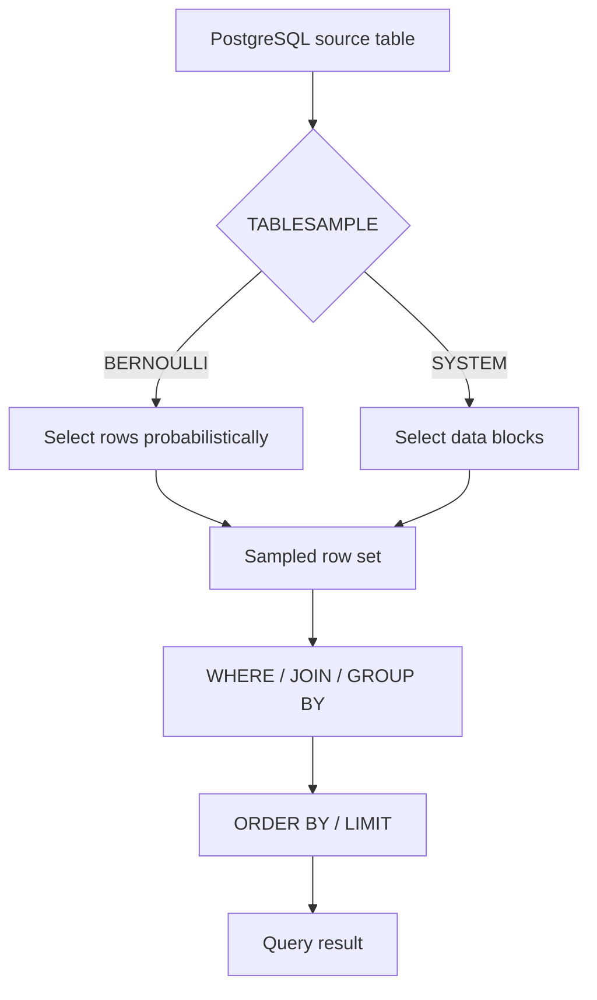

# TABLESAMPLE and the Limits of Sampling in PostgreSQL

In many PostgreSQL systems, an event or log table can hold tens of millions to billions of rows. When you need a quick look at a slice of data to explore its structure, estimate distributions, or test hypotheses, scanning the entire table can consume substantial resources. The **`TABLESAMPLE`** clause lets you ask PostgreSQL to sample rows from a source table before applying subsequent query operations.

However, sampling **does not guarantee a fast query in every case**, does not guarantee an exact fixed row count, and does not automatically make a sample representative of every business subgroup. In particular, `BERNOULLI` and `SYSTEM` differ in their sampling unit, performance, and result variance.

This lesson covers `TABLESAMPLE` syntax, the two built-in methods, `REPEATABLE`, statistical limitations, `WHERE`, `JOIN`, `LIMIT`, and design decisions when using PostgreSQL from a Java application.

## 1. What Problem Does TABLESAMPLE Solve?

Suppose an `events` table has 20 million rows. You want to inspect a small fraction to:

- View a few examples of newly ingested data.
- Roughly estimate the proportion of an event type.
- Explore common values before writing a full analytical query.
- Test a data display UI or prototype workflow that does not require every row.

The `TABLESAMPLE` clause attaches to **a table in the `FROM` clause**:

```sql
SELECT *
FROM some_table TABLESAMPLE BERNOULLI (5);
```

Meaning: request a sample of roughly **5%** of rows using the `BERNOULLI` method. It is not syntax for taking exactly 5 rows, nor is it a promise that the output has exactly 5% of rows.

Distinguish three goals:

| Goal | Usually suitable tool |
| --- | --- |
| Take a percentage sample for exploration | `TABLESAMPLE BERNOULLI` or `SYSTEM` |
| Take up to `N` arbitrary rows | `LIMIT N`, though non-random and potentially unstable without ordering |
| Take `N` random rows across all qualifying rows | `ORDER BY random() LIMIT N` or a tailored sampling algorithm, with corresponding cost |

Do not treat these three operations as interchangeable ways to write the same thing.

### Where does TABLESAMPLE sit in the logical model?

`TABLESAMPLE` belongs to reading **a source relation in `FROM`**. The sample is formed before a `WHERE` condition at the same query level filters the selected rows.



This diagram explains SQL semantics and does not replace the physical execution plan chosen by the planner. When multiple tables are present, join order and processing steps may be optimized under PostgreSQL's rules.

## 2. Creating Practice Data Large Enough to Observe Sampling

Practice on a dedicated database. For example, create `sample_lab.events` with 20,000 rows. This is synthetic data containing no real personal information.

```sql
CREATE SCHEMA IF NOT EXISTS sample_lab;

CREATE TABLE sample_lab.events (
    event_id bigint PRIMARY KEY,
    region text NOT NULL,
    event_type text NOT NULL,
    amount numeric(12, 2) NOT NULL,
    occurred_at timestamptz NOT NULL
);

INSERT INTO sample_lab.events
    (event_id, region, event_type, amount, occurred_at)
SELECT
    g,
    CASE
        WHEN g % 10 < 7 THEN 'North'
        WHEN g % 10 < 9 THEN 'South'
        ELSE 'Central'
    END,
    CASE
        WHEN g % 20 = 0 THEN 'purchase'
        ELSE 'view'
    END,
    (g % 1000 + 1)::numeric(12, 2),
    TIMESTAMPTZ '2026-01-01 00:00:00+00'
        + g * INTERVAL '1 minute'
FROM generate_series(1, 20000) AS g;

ANALYZE sample_lab.events;
```

The table intentionally gives `Central` fewer rows than `North`, and makes `purchase` rarer than `view`. When taking a small sample, proportions of smaller subgroups can fluctuate heavily or vanish altogether.

Before sampling, record the exact baseline numbers:

```sql
SELECT
    COUNT(*) AS total_rows,
    COUNT(*) FILTER (WHERE event_type = 'purchase') AS purchases,
    MIN(event_id) AS min_id,
    MAX(event_id) AS max_id
FROM sample_lab.events;
```

In this `generate_series` dataset, there are **20,000 rows** and **1,000 purchase events**. Because 1 in every 20 IDs is a purchase, the population purchase rate is 5%.

Distribution by region:

```sql
SELECT region, COUNT(*) AS row_count
FROM sample_lab.events
GROUP BY region
ORDER BY region;
```

Expected: North **14,000**, South **4,000**, Central **2,000**. These numbers serve as a reference baseline as sample results vary across runs.

## 3. TABLESAMPLE Syntax in PostgreSQL

Common syntax:

```sql
SELECT selected_columns
FROM schema_name.table_name
     TABLESAMPLE sampling_method (argument)
     [REPEATABLE (seed)]
WHERE some_condition;
```

`[REPEATABLE (seed)]` in the syntax sketch denotes an optional clause—**do not** type square brackets in actual SQL.

The two standard built-in methods are:

```sql
SELECT *
FROM sample_lab.events TABLESAMPLE BERNOULLI (5);

SELECT *
FROM sample_lab.events TABLESAMPLE SYSTEM (5);
```

The argument `5` means **5 percent**, not five rows and not probability 5.

Key notes about the argument:

- The percentage for `BERNOULLI` and `SYSTEM` ranges from **0 to 100**, and can be a decimal like `0.5`.
- `0` requests 0%; `100` requests the whole table per the sampling method's semantics.
- `TABLESAMPLE ... (1)` means 1%, **not 100%**.
- `REPEATABLE (seed)` is optional and requests that a given method, seed, and unchanged table return the same sample, subject to limits explained below.
- Additional sampling methods can be installed via extensions, with different arguments and `REPEATABLE` support than the two built-in methods.

Example sampling 0.5%:

```sql
SELECT COUNT(*) AS sampled_rows
FROM sample_lab.events
     TABLESAMPLE BERNOULLI (0.5);
```

Out of 20,000 rows, the expected mean is about 100 rows, yet any single run may return fewer or more than 100.

## 4. BERNOULLI: Per-Row Selection Probability

`TABLESAMPLE BERNOULLI (p)` uses row-level sampling: conceptually, **each visible eligible row has roughly a `p/100` probability of inclusion**, independently of whether other rows are selected.

```sql
SELECT event_id, region, event_type, amount
FROM sample_lab.events TABLESAMPLE BERNOULLI (5);
```

If a table has 20,000 rows, the selected row count `K` varies from run to run. Under an ideal Bernoulli model:

\[
E[K] = Np,\qquad
\operatorname{Var}(K) = Np(1-p),
\]

where `p` is the probability as a decimal from 0 to 1. Here `N = 20,000`, `p = 0.05`, so:

\[
E[K] = 1000,\qquad
\operatorname{SD}(K)
= \sqrt{20000 \times 0.05 \times 0.95}
\approx 30.8.
\]

That does not mean every run yields 1,000 rows. Even when the table is completely static, sampled row counts fluctuate noticeably.

### 4.1. Every row has a chance, yet the table still must be read

An important property of row-level sampling is that PostgreSQL generally must **visit the table's blocks** to decide for each row whether it enters the sample. Hence, `BERNOULLI (1)` does not mean reading only 1% of data pages.

On large tables, this method typically reduces **the number of rows passed upstream or sent to clients**, without necessarily reducing table-scan I/O proportionally. It fits when near-uniform per-row probability matters more than block-level sampling.

### 4.2. A BERNOULLI sample can be empty

If the percentage is tiny or the table has very few rows, getting 0 rows is completely possible:

```sql
SELECT COUNT(*)
FROM sample_lab.events TABLESAMPLE BERNOULLI (0.001);
```

Out of 20,000 rows, the expected count is only about 0.2 rows. Most runs return zero rows. An empty sample does not prove the source table is empty.

### 4.3. Using BERNOULLI to explore distributions

```sql
SELECT
    region,
    COUNT(*) AS sampled_rows
FROM sample_lab.events TABLESAMPLE BERNOULLI (5)
GROUP BY region
ORDER BY region;
```

An ideal sample averages around 700 North, 200 South, and 100 Central. Still, each group fluctuates independently according to the sampling rate and its actual size.

If a report requires exact group proportions, aggregate the full dataset or use statistical estimators with explicitly calculated margins of error. Sampling gives estimates, never exact population truth.

## 5. SYSTEM: Block-Level Sampling

`TABLESAMPLE SYSTEM (p)` selects **storage blocks/pages** rather than deciding row by row. Visible rows inside the chosen blocks form the sample.

```sql
SELECT event_id, region, event_type, amount
FROM sample_lab.events TABLESAMPLE SYSTEM (5);
```

Characteristics:

- Can read only a small fraction of blocks, so it is **usually much faster than BERNOULLI on huge tables** at low percentages.
- Rows residing in the same block are selected or skipped **together**.
- Returned row counts depend on row density per block and physical data layout.
- If similar rows cluster in the same blocks, the sample can over- or under-represent a business group.

### 5.1. Why might SYSTEM fail to represent every group?

Suppose rows were inserted sequentially:

```text
Block 1 .. 500   : North
Block 501 .. 700 : South
Block 701 .. 710 : Central
```

A `SYSTEM (1)` sample picking blocks at random might miss every Central block, even though Central exists in the table. Because all rows on a block enter together, observations in the sample are correlated by block.

This is a form of physical **cluster sampling**. It can yield **higher estimator variance** than independent row sampling, especially when rows in the same block share region, timestamp, or event type. Do not claim every `SYSTEM` estimate is mathematically biased in general; the issue is that **representativeness and variance depend on block layout**, requiring evaluation against real data and statistical assumptions.

### 5.2. Small tables can return 0 rows even at modest percentages

If a table spans only a handful of blocks, `SYSTEM (1)` may pick zero blocks. When it picks one block, it emits a whole batch of rows at once. Row count does not scale smoothly with the requested percentage.

Example:

```sql
SELECT COUNT(*) AS selected
FROM sample_lab.events TABLESAMPLE SYSTEM (1);
```

Running it multiple times reveals wider swings than `BERNOULLI (1)`. This is especially pronounced on small tables or very low percentages.

### 5.3. Speed is not guaranteed

`SYSTEM` can cut I/O dramatically, yet is not always faster in every scenario: tables already cached in RAM, high sampling percentages, planner choices, concurrent load, block density, and downstream processing costs all affect runtime.

Never use `SYSTEM` for estimates requiring high statistical confidence just because a quick test on a small table looked fast.

## 6. Comparing BERNOULLI and SYSTEM

| Criterion | `BERNOULLI` | `SYSTEM` |
| --- | --- | --- |
| Sampling unit | Row | Block / page |
| Per-row selection probability | Approximately `p` via row-level selection | Included if its containing block is chosen |
| Correlation among physically adjacent rows | Lower, per row-level selection | Higher: rows on the same block move together |
| I/O on large tables | Usually reads many/most blocks | Can read far fewer blocks |
| Sample size variance | Close to row-level Bernoulli model | Can be large and depends on block density |
| Risk of missing small groups | Possible if sample is tiny | Significant if the group clusters on few blocks |
| Use for exploratory checks | Suits when row-level uniformity matters | Suits when read speed is prioritized and physical clustering is acceptable |
| Exact row-count guarantee | No | No |

**Practical rule:** prefer `BERNOULLI` when per-row inclusion fairness and row-level sample quality matter; consider `SYSTEM` when speed matters and physical locality risks are understood. Neither replaces a validated statistical sampling design when results drive critical decisions.

## 7. REPEATABLE: Reproducing Samples with a Seed

The `REPEATABLE (seed)` clause asks a deterministic sampling method to return the same row set when re-run against an **unchanged table** with the same seed and matching execution conditions.

```sql
SELECT event_id
FROM sample_lab.events
     TABLESAMPLE BERNOULLI (5) REPEATABLE (2026)
ORDER BY event_id;
```

Re-running on the same snapshot/table yields the same `event_id`s. With `SYSTEM`:

```sql
SELECT event_id
FROM sample_lab.events
     TABLESAMPLE SYSTEM (5) REPEATABLE (2026)
ORDER BY event_id;
```

`REPEATABLE` **does not turn SYSTEM into BERNOULLI**, nor does it guarantee the same row set across different sampling methods or different percentages.

### 7.1. What the seed does not guarantee

`REPEATABLE` is not a promise of identical results across arbitrary changes:

- If rows are inserted, updated, or deleted, sampled results can change.
- Changes to physical table layout (such as table rewrites or certain maintenance operations) can especially alter `SYSTEM` samples.
- Different MVCC snapshots/visibility can change which rows are visible.
- `REPEATABLE` does not make output display order deterministic without `ORDER BY`.
- If the query also uses volatile or context-dependent functions like `random()` or `now()`, parts outside sampling can still vary.
- Extension-provided sampling methods may have their own repeatability limits.

Matching seeds are **reproducibility hints**, not a mechanism to freeze a dataset or snapshot.

### 7.2. A seed does not remove statistical randomness of the method

Using a fixed seed is handy for demos, debugging, or comparing two transformations on the same sample. However, inspecting **one fixed sample** tells you nothing about sampling variability across samples.

To gauge metric stability, take multiple independent samples with different seeds or use proper statistical error bounds; never conclude error is zero just because seed 2026 produces the same number every time.

### 7.3. Seeds and output order stability

`REPEATABLE` governs row selection only. To guarantee deterministic row order:

```sql
SELECT event_id, amount
FROM sample_lab.events
     TABLESAMPLE BERNOULLI (5) REPEATABLE (99)
ORDER BY event_id;
```

Without `ORDER BY`, SQL makes no guarantee about row return order even when the sampled row set stays identical.

## 8. TABLESAMPLE Does Not Return Exactly N Rows

One of the biggest misconceptions is treating:

```sql
SELECT *
FROM sample_lab.events TABLESAMPLE BERNOULLI (5);
```

as returning exactly 5% of 20,000 = 1,000 rows. In reality, the percentage is a **probability**, so actual row counts vary.

Similarly:

```sql
SELECT *
FROM sample_lab.events TABLESAMPLE SYSTEM (1)
LIMIT 100;
```

does not guarantee **100 rows**. If the sample only yields 60 rows, you get 60; if it yields over 100, `LIMIT` truncates to 100. `LIMIT` can also skew sample properties if PostgreSQL stops early after taking the first rows from the sample scan in execution order.

### 8.1. When you genuinely need N random rows

On moderately sized datasets, a random sample of at most N rows can be written:

```sql
SELECT event_id, region, amount
FROM sample_lab.events
ORDER BY random()
LIMIT 100;
```

This is a standard way to pick up to 100 rows uniformly at random from the qualifying set. However, PostgreSQL normally must scan **many or all rows** to compute random sort keys and pick the top N—expensive in CPU and sorting on huge tables.

If the table has fewer than 100 rows, it returns all available rows. If `WHERE` narrows the candidate set, row count depends on the filtered set.

Alternatives include reservoir sampling algorithms, partitioned-key sampling, or extensions designed for row counts. Each has its own assumptions and costs; there is no built-in `TABLESAMPLE BERNOULLI (N ROWS)` syntax returning an exact fixed N.

### 8.2. Extensions for row-count or time-bounded sampling

The `tsm_system_rows` and `tsm_system_time` extensions provide extra sampling methods in PostgreSQL environments where installed:

```sql
-- Requires extension availability and appropriate privileges.
CREATE EXTENSION IF NOT EXISTS tsm_system_rows;

-- SYSTEM_ROWS targets a specific number of rows.
SELECT *
FROM sample_lab.events
     TABLESAMPLE SYSTEM_ROWS (100);
```

`SYSTEM_ROWS` relies on block-level sampling to return the requested row count when enough rows exist, yet it is **not an independent uniform selection across rows** and should not be equated with `ORDER BY random() LIMIT 100`.

`tsm_system_time` samples within a target read-time budget (typically in milliseconds), making row counts even less fixed. These methods also carry specific `REPEATABLE` constraints; do not assume every extension supports it. Extension availability depends on PostgreSQL version, privileges, and managed hosting policies.

## 9. WHERE Is Applied After TABLESAMPLE

Consider sampling purchase events:

```sql
SELECT event_id, event_type, amount
FROM sample_lab.events
     TABLESAMPLE BERNOULLI (5)
WHERE event_type = 'purchase';
```

Semantically, `TABLESAMPLE` samples roughly 5% from **the entire `events` table**; then `WHERE` retains only sampled rows with `event_type = 'purchase'`.

Since the table has 1,000 purchases, the expected count of purchases in the sample is around 50, fluctuating across runs.

Do not assume PostgreSQL filters the 1,000 purchases first and then takes a 5% sample of that filtered subset. Under Bernoulli row selection, each purchase still has selection probability `p`, yet **the sample guarantees no dedicated quota for purchases**.

### 9.1. When rare groups can disappear

Suppose a real table has an event type occurring only 5 times. With `BERNOULLI (1)`, the probability that all 5 rows are missed is:

\[
(1-0.01)^5 = 0.99^5 \approx 95.1\%.
\]

Thus, in most runs, that rare event type **does not appear in the sample**, even though it exists in the table.

Observing "no rare events in the sample" does not mean "no rare events exist".

This is a major risk when using samples to check:

- Whether any constraint-violating records remain.
- Whether inappropriate sensitive data exists.
- Whether rare data corruption or anomalous sequences occurred.
- Whether a system truly generated zero critical events.

To prove an event **does not exist**, run a full verification query over the target dataset—never rely solely on a small sample.

### 9.2. Can you filter before sampling?

You cannot attach `TABLESAMPLE` directly to an arbitrary subquery like this:

```sql
-- Invalid TABLESAMPLE syntax on a derived table:
SELECT *
FROM (
    SELECT * FROM sample_lab.events
    WHERE event_type = 'purchase'
) AS filtered
TABLESAMPLE BERNOULLI (5);
```

`TABLESAMPLE` attaches only to base-table relations that support it, not to subquery/CTE outputs or joins as if they were physical tables.

Options when sampling after filtering include:

1. Use `WHERE predicate AND random() < 0.05` on candidates, paying the scan/filter cost.
2. Pick randomly from the filtered set via `ORDER BY random() LIMIT N` when N rows are needed and scale permits.
3. Materialize the filtered set into a **temporary table** where allowed, then run `TABLESAMPLE` on that temp table (incurring creation/storage cost).
4. Design physical layouts, partitions, or sampling workflows suited to operational requirements.

Simple example of Option 1:

```sql
SELECT event_id, event_type, amount
FROM sample_lab.events
WHERE event_type = 'purchase'
  AND random() < 0.05;
```

`random()` is volatile, providing per-row probabilistic selection over filtered rows; however, it **does not avoid scanning/finding purchase rows first**, nor does it guarantee a fixed row count.

## 10. JOIN with TABLESAMPLE: Which Table Are You Sampling?

`TABLESAMPLE` samples **the specific table it is attached to**, not automatically the final joined output.

Suppose there is a region lookup table:

```sql
CREATE TABLE sample_lab.regions (
    region_code text PRIMARY KEY,
    manager_name text NOT NULL
);

INSERT INTO sample_lab.regions (region_code, manager_name)
VALUES
    ('North', 'Manager N'),
    ('South', 'Manager S'),
    ('Central', 'Manager C');
```

To sample events and attach manager details:

```sql
SELECT
    e.event_id,
    e.region,
    r.manager_name
FROM sample_lab.events AS e
     TABLESAMPLE BERNOULLI (5)
JOIN sample_lab.regions AS r
    ON r.region_code = e.region;
```

Here `events` is sampled, and `regions` is joined to enrich each sampled event.

### 10.1. Sampling a parent table differs from sampling a fact table

If you sample **customers** and then join all orders belonging to those customers, a customer with 1,000 orders contributes 1,000 rows while a customer with 1 order contributes 1 row. The joined result is not a uniform random sample of **orders**.

Distinguish two goals:

- **Entity sampling:** pick customers randomly, then inspect all activity of the chosen customers.
- **Event/fact sampling:** pick individual orders or events probabilistically, then join their dimensions.

These produce different observation units. To estimate *order* rates, sample at the order grain and weight appropriately. To study *customer* behavior, sample customers and observe order-count distributions.

### 10.2. Sampling both tables before JOIN

```sql
-- Syntax illustration only; sampling both sides can drop many joined pairs.
SELECT e.event_id, r.manager_name
FROM sample_lab.events AS e TABLESAMPLE BERNOULLI (5)
JOIN sample_lab.regions AS r TABLESAMPLE BERNOULLI (50)
    ON r.region_code = e.region;
```

Sampling `regions` as well may drop a region entirely, causing **all sampled events in that region to vanish after the INNER JOIN**. That introduces error completely different from sampling only `events`.

When a dimension table is tiny and complete lookup attributes are needed, there is usually no good reason to sample the dimension.

## 11. Estimating Totals, Proportions, and Error from a Sample

A Bernoulli sample with a known inclusion probability `p` supports basic **estimators**. For instance, when each row is included with probability 5%, total rows can be estimated by:

\[
\widehat N = \frac{K}{p},
\]

where `K` is the sampled row count and `p = 0.05`.

```sql
WITH sampled AS (
    SELECT event_id
    FROM sample_lab.events
         TABLESAMPLE BERNOULLI (5) REPEATABLE (2026)
)
SELECT
    COUNT(*) AS sampled_rows,
    COUNT(*) / 0.05 AS estimated_total_rows
FROM sampled;
```

If the sample contains 980 rows, `estimated_total_rows` equals 19,600, whereas the actual table has 20,000 rows. That discrepancy is normal sampling variance, **not a PostgreSQL bug**.

If every row has equal inclusion probability and the metric is well-behaved, total `amount` can be estimated similarly:

```sql
SELECT
    SUM(amount) AS sample_amount_sum,
    SUM(amount) / 0.05 AS estimated_population_amount
FROM sample_lab.events
     TABLESAMPLE BERNOULLI (5) REPEATABLE (2026);
```

However, this naive point estimate comes without confidence intervals, ignores metric variance, and does not handle skewed real-world distributions. Never label a scaled-up sample sum as official financial revenue.

### 11.1. Sample proportions can differ from population proportions

```sql
SELECT
    COUNT(*) AS sampled_rows,
    COUNT(*) FILTER (WHERE event_type = 'purchase') AS purchase_rows,
    ROUND(
        COUNT(*) FILTER (WHERE event_type = 'purchase')::numeric
        / NULLIF(COUNT(*), 0) * 100,
        2
    ) AS purchase_percent
FROM sample_lab.events
     TABLESAMPLE BERNOULLI (5) REPEATABLE (2026);
```

The sampled purchase percentage may not equal 5.00% even though the full table is exactly 5%. On small samples, rare subgroups swing widely. If `COUNT(*) = 0`, `NULLIF` guards the division so the rate becomes `NULL` rather than raising a division-by-zero error.

### 11.2. Do not extrapolate BERNOULLI error formulas to SYSTEM

Under `SYSTEM`, rows in the same block are chosen together. Modeling `K` as a sum of independent row-level Bernoulli trials no longer describes the variance accurately. Computing valid confidence intervals requires accounting for **cluster/block structure**, data layout, and sampling design.

For formal reporting, use stratified sampling, probability-weighted estimators, and proper variance estimation. `TABLESAMPLE SYSTEM` does not automatically create a representative survey design across tenants or business segments.

## 12. Stratified Sampling and Critical Subgroups

When you must observe enough rows from every `region` or event type, a single uniform percentage across the whole table may not work.

### 12.1. Picking up to N random rows per group

PostgreSQL can use window functions:

```sql
WITH ranked AS (
    SELECT
        event_id,
        region,
        event_type,
        amount,
        ROW_NUMBER() OVER (
            PARTITION BY region
            ORDER BY random()
        ) AS rn
    FROM sample_lab.events
)
SELECT
    event_id,
    region,
    event_type,
    amount
FROM ranked
WHERE rn <= 20
ORDER BY region, rn;
```

This picks up to 20 rows per region. It is great for **exploring data within each group**, though it differs from a uniform table-wide sample: North, South, and Central receive roughly equal counts despite having very different sizes.

Therefore, never treat group shares inside an equal-quota sample as representative of table-wide proportions. Population estimates require **weighting by each group's true size**.

Also note that `ROW_NUMBER() ... ORDER BY random()` must sort candidates per group, which can be expensive on very large datasets.

### 12.2. Different sampling rates per group

You can vary selection probability by group to increase visibility of rare events:

```sql
SELECT event_id, event_type, amount
FROM sample_lab.events
WHERE random() <
    CASE
        WHEN event_type = 'purchase' THEN 0.50
        ELSE 0.02
    END;
```

This takes roughly 50% of purchases and 2% of views. It is an **unequal-probability sample across groups**. Calling `COUNT(*)` directly on this sample exaggerates the share of purchases relative to the actual table.

To estimate population totals or rates, apply inverse-probability weights or proper estimators—for example, weighting each selected purchase by 2 and each selected view by 50 when estimating total rows. Those weights illustrate the concept and do not by themselves guarantee tight confidence intervals.

### 12.3. Sampling and time-ordered data

Event tables are commonly appended roughly in `occurred_at` order. With `SYSTEM`, adjacent pages hold adjacent timestamps. A page sample can skip an entire short time window or miss an incident burst confined to a few pages.

When investigating events after a specific deployment, **filter the target time window explicitly** and inspect targeted records rather than relying on a small block sample of the entire table history.

## 13. TABLESAMPLE Is No Substitute for Exact Reporting

Some questions require exact answers:

- Total invoice amounts due for settlement.
- Number of transactions violating a business rule.
- Number of users who consented to a specific option.
- Number of records requiring controlled migration or deletion.
- Whether any orphan rows remain before adding a `FOREIGN KEY`.

Using `TABLESAMPLE` for these questions risks **missing rare records** or reporting wrong figures. Run full queries with proper predicates and indexes, or use audited reconciliation pipelines.

For instance, checking for invalid records should never rely solely on:

```sql
-- Insufficient to prove no invalid rows exist:
SELECT COUNT(*)
FROM sample_lab.events TABLESAMPLE SYSTEM (1)
WHERE amount < 0;
```

Even if this returns 0, you cannot conclude the full table has no negative amounts. Verify across the full dataset or enforce a validated `CHECK (amount >= 0)` constraint.

### 13.1. TABLESAMPLE does not protect privacy

A random subset **can still contain sensitive data**. Sampling 1% of customer records does not anonymize the personal records included in that 1%.

When sharing samples with development or QA teams, apply proper access controls, anonymization, aggregation, synthetic data generation, and retention policies. Never treat picking a few random rows as a privacy safeguard.

## 14. Restrictions Related to Source Tables, Subqueries, and Volatility

### 14.1. TABLESAMPLE binds to base-table relations

In PostgreSQL, `TABLESAMPLE` attaches directly to a table item supporting sampling in `FROM`:

```sql
SELECT e.event_id
FROM sample_lab.events AS e
     TABLESAMPLE SYSTEM (2);
```

It is not a generic operator you can append after arbitrary subqueries, CTEs, or `JOIN`s to sample arbitrary intermediate results. To sample the output of a complex query, adjust the query design or use post-filter sampling like `ORDER BY random()` or a `random()` predicate.

### 14.2. Never assume TABLESAMPLE bypasses MVCC rules

PostgreSQL uses MVCC to determine which row versions are visible to a statement. `TABLESAMPLE` cannot read row versions invisible to the active snapshot. Under concurrent writes, sampled results can change as visible data changes.

`REPEATABLE (seed)` does not alter isolation levels or hold a snapshot across multiple transactions.

### 14.3. No ordering guarantee

`TABLESAMPLE` returns an unordered set of rows, not a business-ordered list.

```sql
SELECT event_id, occurred_at
FROM sample_lab.events
     TABLESAMPLE SYSTEM (5)
ORDER BY occurred_at DESC, event_id DESC;
```

Here `ORDER BY` only sorts **the rows already sampled**—it does not select "the 5% newest events". To retrieve the newest events, write explicit time filters like `WHERE occurred_at >= ...` or `ORDER BY occurred_at DESC LIMIT ...` for top-N.

### 14.4. Using 100 percent does not make every query identical in performance

`TABLESAMPLE BERNOULLI (100)` means selecting all eligible rows, yet how PostgreSQL plans a query with `TABLESAMPLE` can still differ from a plain `SELECT` without it. Never use `TABLESAMPLE (100)` as an optimization trick or to signal "sampling disabled".

## 15. EXPLAIN: Measure Real I/O Instead of Guessing from Percentages

The reliable way to compare `BERNOULLI` and `SYSTEM` in a test environment is inspecting the execution plan and buffer reads.

```sql
EXPLAIN (ANALYZE, BUFFERS)
SELECT COUNT(*)
FROM sample_lab.events
     TABLESAMPLE BERNOULLI (5) REPEATABLE (77);
```

```sql
EXPLAIN (ANALYZE, BUFFERS)
SELECT COUNT(*)
FROM sample_lab.events
     TABLESAMPLE SYSTEM (5) REPEATABLE (77);
```

Depending on version, table size, and plan, you will see nodes involving `Sample Scan`. Key metrics to inspect:

- **Actual rows**: actual rows scanned/selected through the node.
- **Buffers shared hit/read**: buffers served from cache versus read from storage.
- **Execution Time**: measured execution duration.
- **Planning Time**: planner overhead.
- **Rows Removed by Filter**: rows discarded by additional filter predicates.

In particular, comparing **buffers/pages** between the two methods shows how much I/O `SYSTEM` can save. Note that a 20,000-row table easily fits in cache; benchmarks on tiny tables do not extrapolate directly to billion-row tables.

`EXPLAIN (ANALYZE, BUFFERS)` actually runs the statement. A read-only SELECT on a test table does not mutate data, yet still consumes resources; never run heavy measurements on production without a plan.

### 15.1. Checking row counts and variability

Test the same percentage with different seeds:

```sql
SELECT 'seed_10' AS experiment, COUNT(*)
FROM sample_lab.events
     TABLESAMPLE BERNOULLI (5) REPEATABLE (10)

UNION ALL

SELECT 'seed_20', COUNT(*)
FROM sample_lab.events
     TABLESAMPLE BERNOULLI (5) REPEATABLE (20)

UNION ALL

SELECT 'seed_30', COUNT(*)
FROM sample_lab.events
     TABLESAMPLE BERNOULLI (5) REPEATABLE (30);
```

Each seed yields a slightly different sample size. Repeat with `SYSTEM` to observe block-level variance. A handful of runs are purely illustrative, not enough to establish reliable error distributions.

## 16. Calling TABLESAMPLE from Java/JDBC

In Java applications, use sampling only when requirements genuinely allow approximate or exploratory results. Example internal tool fetching a small percentage of event IDs to inspect sample data:

```java
import java.sql.Connection;
import java.sql.PreparedStatement;
import java.sql.ResultSet;
import java.sql.SQLException;
import java.util.ArrayList;
import java.util.List;

public class EventSampler {
    public List<Long> sampleEventIds(
            Connection connection,
            double percent,
            double seed
    ) throws SQLException {
        if (!Double.isFinite(percent) || percent < 0 || percent > 100) {
            throw new IllegalArgumentException("percent must be 0..100");
        }
        if (!Double.isFinite(seed)) {
            throw new IllegalArgumentException("seed must be finite");
        }

        String sql = """
            SELECT event_id
            FROM sample_lab.events
                 TABLESAMPLE BERNOULLI (?)
                 REPEATABLE (?)
            ORDER BY event_id
            """;

        List<Long> ids = new ArrayList<>();
        try (PreparedStatement ps = connection.prepareStatement(sql)) {
            ps.setDouble(1, percent);
            ps.setDouble(2, seed);
            try (ResultSet rs = ps.executeQuery()) {
                while (rs.next()) {
                    ids.add(rs.getLong("event_id"));
                }
            }
        }
        return ids;
    }
}
```

This example uses `PreparedStatement` to separate parameters from SQL syntax and validates percentage and seed ranges before sending. PostgreSQL accepts valid sampling expressions; adjust parameter binding types if a specific driver or version expects exact numeric types.

Operational considerations:

- Cap the maximum percentage in internal tools intended only for exploratory sampling.
- Add `ORDER BY` when the API expects stable ordering, remembering sorting has a cost.
- Never use a small sample to make authorization, billing, or compliance decisions.
- Enforce the same access permissions and data protection as normal table queries; sampling does not narrow authorization scope.
- If a fixed seed comes from the client, results can be deterministic under stable conditions; never treat a seed as a security secret.

### 16.1. APIs should explicitly label results as sampled

When returning results from an API, include clear metadata:

```json
{
  "samplingMethod": "BERNOULLI",
  "requestedPercent": 5.0,
  "seed": 2026,
  "sampledRows": 987,
  "isExactPopulationReport": false
}
```

The number `987` is purely a **response format illustration**, not a count guaranteed by PostgreSQL. Never name a field `totalOrders` if it actually holds a sample count; use `sampledRows` or `estimatedOrders` paired with appropriate statistical metadata.

## 17. Comparing Techniques to "Quickly Grab a Few Rows"

| Technique | Key property | Limitations to remember |
| --- | --- | --- |
| `LIMIT N` | Returns up to N rows in plan/scan order | Non-random; order is unguaranteed without `ORDER BY` |
| `ORDER BY random() LIMIT N` | Picks top N by random key from candidates | Often processes nearly all candidates; CPU/sort heavy |
| `WHERE random() < p` | Probabilistic selection after query filters | Can still scan many rows; row count is not fixed |
| `TABLESAMPLE BERNOULLI(p)` | Row-level sampling directly on base table | Still reads most/all blocks; no exact N guarantee |
| `TABLESAMPLE SYSTEM(p)` | Block-level sampling | Can be fast, yet high group variance and layout-dependent |
| `TABLESAMPLE ... REPEATABLE(seed)` | Reproduces the same sample when table/conditions are unchanged | Does not freeze data, snapshot, or display order |
| `SYSTEM_ROWS(N)` via extension | Block-based sampling targeting N rows | Requires extension; block-clustered, not independent row-level |
| Stratified sampling | Selects separate sample sizes per group | Requires inclusion probabilities/weights for population estimates |

**No single method wins for every goal.** The observation unit and business question matter far more than picking the shortest syntax.

## 18. Common Misconceptions

| Misconception | Why it is wrong | Accurate view |
| --- | --- | --- |
| `BERNOULLI(5)` returns 5 rows | Argument is a percentage | 5% per-row selection probability |
| `BERNOULLI(5)` always returns exactly 5% of rows | Sample size fluctuates | Expected count is ~5%, not fixed |
| `SYSTEM(1)` always returns rows | It may pick zero pages | Tiny tables with few blocks can return empty |
| `BERNOULLI(1)` reads only 1% of disk | Per-row decisions usually inspect many blocks | Never infer I/O directly from returned row count |
| `SYSTEM` is always a representative sample | Rows on the same block are correlated | Account for physical layout and cluster variance |
| `REPEATABLE` acts like a frozen snapshot | Data, table layout, or visibility can change | Seed aids repeatability only under stable conditions |
| `TABLESAMPLE ... WHERE` means "filter then sample" | TABLESAMPLE binds to the FROM table | Same-level WHERE filters the already sampled rows |
| Sampling customers then joining orders gives a random order sample | Customers have unequal order counts | Choose the sampling unit matching the target question |
| `LIMIT` ensures TABLESAMPLE returns N rows | Sample itself can have fewer than N rows | LIMIT only caps at most N rows |
| No errors found in a sample means the table is clean | Rare errors are easily missed | Use full scans or constraints for correctness |
| Small samples cannot leak sensitive data | Selected rows still hold real values | Apply authorization, masking, and governance controls |
| Scaling `SUM(sample)/p` makes an official report | It is a noisy estimate | Label as an estimate with stated assumptions and uncertainty |
| `ORDER BY` after sampling selects the newest rows | It only sorts the already-sampled rows | To get newest top-N, use proper filtering/ordering predicates |

## 19. Scenario-Based Practice Exercises

These exercises use `sample_lab.events` and `sample_lab.regions` created earlier.

### Exercise 1 — Observing sampling rates and sample sizes

Run:

```sql
SELECT COUNT(*) AS n_bernoulli
FROM sample_lab.events TABLESAMPLE BERNOULLI (5);

SELECT COUNT(*) AS n_system
FROM sample_lab.events TABLESAMPLE SYSTEM (5);
```

Repeat several times and compare with the true 20,000 rows. Explain why neither guarantees 1,000 rows and why `SYSTEM` can fluctuate more widely.

### Exercise 2 — Using REPEATABLE

```sql
SELECT event_id
FROM sample_lab.events
     TABLESAMPLE BERNOULLI (1) REPEATABLE (171)
ORDER BY event_id;
```

Run twice on an unchanged table and verify whether IDs match. Change the seed to 172 and explain why the sample changes. Then explain why `REPEATABLE` does not replace transaction snapshots under concurrent writes.

### Exercise 3 — Rare subgroups and omission risk

```sql
SELECT
    event_type,
    COUNT(*) AS sampled_count
FROM sample_lab.events
     TABLESAMPLE BERNOULLI (0.1)
GROUP BY event_type
ORDER BY event_type;
```

Compute the expected number of purchases in the sample. With 1,000 purchases and probability `0.001`, the expected purchase count is **1**. Missing purchases in a small sample does not prove none exist if the query returns 0.

### Exercise 4 — Comparing filtering and sampling

```sql
SELECT COUNT(*)
FROM sample_lab.events
     TABLESAMPLE BERNOULLI (5)
WHERE event_type = 'purchase';

SELECT COUNT(*)
FROM sample_lab.events
WHERE event_type = 'purchase'
  AND random() < 0.05;
```

Both queries conceptually select purchases with ~5% probability under normal conditions, yet use different constructs and can incur different execution costs. Explain the logical placement of `TABLESAMPLE` versus `WHERE`.

### Exercise 5 — Sampling fact table then joining dimension

```sql
SELECT
    r.manager_name,
    COUNT(*) AS sampled_events
FROM sample_lab.events AS e
     TABLESAMPLE BERNOULLI (5)
JOIN sample_lab.regions AS r
    ON r.region_code = e.region
GROUP BY r.manager_name
ORDER BY r.manager_name;
```

From the query, identify whether you sampled `events` or `regions`. Why is there no good reason to sample the tiny `regions` table here?

### Exercise 6 — Picking at most 20 rows per region

Write a query using `ROW_NUMBER() OVER (PARTITION BY region ORDER BY random())` and filtering `rn <= 20` outside. Compare group shares in the result with the true 70%/20%/10% distribution. Why must an equal-quota sample across groups not be interpreted as a table-wide proportional sample?

### Exercise 7 — Benchmarking block reads

```sql
EXPLAIN (ANALYZE, BUFFERS)
SELECT COUNT(*)
FROM sample_lab.events TABLESAMPLE BERNOULLI (1);

EXPLAIN (ANALYZE, BUFFERS)
SELECT COUNT(*)
FROM sample_lab.events TABLESAMPLE SYSTEM (1);
```

Compare buffers and actual rows. If numbers on the small dataset show little difference, describe what needs to change in a test environment for a meaningful benchmark (table size, cache state, repeated runs, selectivity).

### Exercise 8 — Deciding whether to use sampling

For each requirement, accept or reject `TABLESAMPLE`:

1. Inspect a few sample events to understand the schema/data.
2. Check whether any customers lack valid foreign keys before a migration.
3. Roughly estimate group proportions before building a dashboard.
4. Compute exact revenue for financial reporting.
5. Select 100 random customers for a survey needing a clear sampling frame.
6. Fetch the three newest events by `occurred_at`.

Justify each choice based on **sampling unit, acceptable error, exact row-count requirements, and query cost**, not merely syntax.

## 20. Key Principles to Remember

- `TABLESAMPLE` samples a source table relation; the percentage is a **requested inclusion rate**, not a fixed row count.
- `BERNOULLI` samples by row and has cleaner statistical properties for many estimates, though it usually reads most blocks.
- `SYSTEM` samples by block; it can cut I/O dramatically, yet is sensitive to physical layout, clustering, and table size.
- `REPEATABLE(seed)` reproduces samples under stable conditions; it **does not** freeze table contents, snapshots, or display order.
- `WHERE` and `JOIN` operate on sampled data per query semantics; sampling the wrong table shifts the observation unit and distorts distributions.
- `LIMIT` does not guarantee `N` rows after sampling; `ORDER BY random() LIMIT N` is a separate strategy with different costs.
- Small samples easily miss rare groups. **Never use sampling to prove zero data errors, generate official financial numbers, or replace constraint checks.**
- When reporting sample-based estimates, clearly document method, percentage, seed, sample size, assumptions, and uncertainty.
- Use `EXPLAIN (ANALYZE, BUFFERS)` in an appropriate environment to measure real I/O instead of guessing I/O from sampling percentages.

`TABLESAMPLE` is a valuable tool for **data exploration and quick surveys**, provided it is used for the right goals. Distinguishing row-level randomness, block-level randomness, repeatable samples, and queries demanding exact accuracy is foundational to writing advanced PostgreSQL queries without sacrificing correctness.
