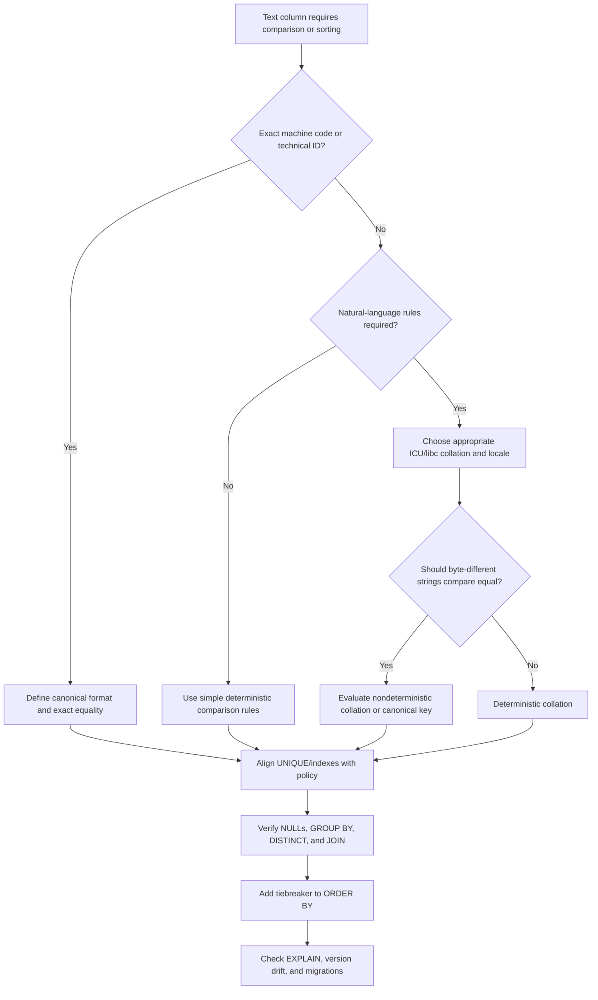

# Collation, Unicode, and Comparison Consistency in PostgreSQL

In PostgreSQL, two strings that look identical on screen are **not necessarily equal**, and two strings treated as equal under one comparison rule **do not necessarily share the same byte sequence**. Simply changing a *collation* (comparison and sorting rules) can alter `ORDER BY`, `=`, `DISTINCT`, `GROUP BY`, `UNIQUE`, JOIN results, or index eligibility across an entire system.

For example, consider the questions raised by these values:

- Are `'Alice'` and `'alice'` the same username?
- Are `'résumé'` and `'resume'` the same word when searching?
- Does a precomposed `é` equal the letter `e` followed by a combining acute accent?
- Does the order of `'A'`, `'a'`, `'Á'`, `'Z'` depend on language?
- After upgrading ICU or the operating system, are indexes ordered under an older collation still trustworthy?

The answer does not sit inside the `=` operator alone. You must examine **encoding**, **Unicode normalization**, **collation providers**, **deterministic vs. nondeterministic** behavior, operator types, and the application's **data policy**.

This lesson belongs to the **Functions and Expressions** chapter of the PostgreSQL module. The goal is to understand text comparison verifiably, write semantically sound SQL, select appropriate collations for multilingual data, and keep behavior consistent after migrations or upgrades.

The examples target modern PostgreSQL. **ICU and certain features depend on server version and build options**; those sections are clearly noted. Only run DDL examples against a test/lab database.

## 1. Conceptual Map: Five Layers You Must Not Mix Up

```text
  Data from users / APIs / files
                 │
                 ▼
  1. ENCODING
     UTF-8 representing Unicode in bytes
                 │
                 ▼
  2. UNICODE REPRESENTATION
     code points, combining characters, NFC/NFD...
                 │
                 ▼
  3. COLLATION
     comparison/sorting rules by locale/provider
                 │
                 ▼
  4. SQL OPERATORS
     =, <, >, ORDER BY, DISTINCT, GROUP BY, UNIQUE...
                 │
                 ▼
  5. INDEX / QUERY PLAN / APPLICATION CONTRACT
     B-tree, statistics, uniqueness, search, JDBC
```

A common mistake is fixing the wrong layer:

- Trying to make searches case-insensitive by setting `client_encoding` to UTF8.
- Expecting canonically equivalent Unicode forms to match by calling only `lower()`.
- Enforcing case-insensitive unique usernames only in Java without a matching database constraint/index.
- Updating OS locales or ICU and assuming existing indexes re-sort themselves.
- Using language-aware `ORDER BY` in one place while cursor pagination or comparison elsewhere uses raw byte order.

Ask first: **do you need exact byte storage, text normalization, equivalence comparison, human-friendly sorting, or business uniqueness?** Five goals may require five coordinated mechanisms.

## 2. UTF-8 and Collation Are Independent Concepts

**Encoding** governs how characters are encoded into bytes. **Collation** governs how strings are compared and ordered in linguistically meaningful contexts.

In a typical `UTF8` PostgreSQL database, Unicode characters are stored as UTF-8 bytes. Yet the exact same UTF-8 data can sort differently depending on collation:

- `"C"`: simple byte-based order, useful when stable technical rules are needed rather than natural dictionary order.
- `libc` collations: rely on operating-system C library locale rules.
- `ICU` collations: use International Components for Unicode rules, offering rich locale options and comparison strength levels.

**UTF-8 does not automatically make searches accent- or case-insensitive.** UTF-8 merely represents characters.

### 2.1. Inspecting server and client encoding

```sql
SHOW server_encoding;
SHOW client_encoding;

SELECT
    current_database() AS database_name,
    pg_encoding_to_char(encoding) AS database_encoding,
    datcollate,
    datctype
FROM pg_database
WHERE datname = current_database();
```

`datcollate` and `datctype` reflect part of a database's locale setup; when databases use other providers, inspect the corresponding provider/locale metadata supported by your PostgreSQL version.

In `psql`:

```text
\encoding
\encoding UTF8
```

The second line is a `psql` meta-command switching client encoding, not SQL. Configuring `client_encoding` ensures proper character conversion between client and server; it **does not change the collation** used for comparisons or sorting.

### 2.2. Do not confuse encoding display corruption with collation bugs

If a Vietnamese character renders as `?` or mojibake on the client, the cause usually lies in transcoding, wrong file encoding, font issues, or upstream corruption before reaching PostgreSQL.

If characters display cleanly yet `ORDER BY` looks "weird" or `UNIQUE` permits/rejects unexpected name pairs, examine **collation and equality policies**.

A system can suffer from both at once, yet you cannot fix encoding errors with `COLLATE` nor fix Unicode normalization by changing fonts.

## 3. Unicode: Code Points, Displayed Characters, and Bytes

Unicode defines code points. One user-perceived character can span **one or multiple code points**, and a single code point can occupy **multiple UTF-8 bytes**.

Consider two representations of "é":

1. Precomposed character: `U+00E9`.
2. Letter `e` (`U+0065`) followed by combining acute accent `U+0301`.

Both normally look identical on screen, yet their code-point sequences differ.

### 3.1. Constructing two visually equivalent strings

PostgreSQL supports Unicode escape strings `U&'...'`:

```sql
SELECT
    U&'\00E9' AS composed_e_acute,
    U&'\0065\0301' AS decomposed_e_acute,
    length(U&'\00E9') AS composed_length,
    length(U&'\0065\0301') AS decomposed_length,
    octet_length(U&'\00E9') AS composed_bytes,
    octet_length(U&'\0065\0301') AS decomposed_bytes;
```

Under UTF-8:

| Representation | Code point count (length) | UTF-8 bytes (octet_length) |
|---|---:|---:|
| `U&'\00E9'` | 1 | 2 |
| `U&'\0065\0301'` | 2 | 3 |

`length(text)` counts characters under PostgreSQL's text handling—practically code points for these Unicode strings. It is **not a complete grapheme-cluster counter** matching what users perceive visually; multi-code-point emoji or combining-mark sequences can have a `length` larger than the displayed character count.

`octet_length` counts bytes. Never conflate byte limits (such as default identifier limits) with code-point or visual character counts.

### 3.2. Inspecting raw bytes to see the difference

```sql
SELECT
    encode(convert_to(U&'\00E9', 'UTF8'), 'hex') AS nfc_like_hex,
    encode(convert_to(U&'\0065\0301', 'UTF8'), 'hex') AS decomposed_hex;
```

Expected distinct hex outputs:

- `U+00E9` → `c3a9`.
- `U+0065 U+0301` → `65cc81`.

Because their bytes differ, applications relying on signatures, byte hashes, cache keys, or byte-exact protocols cannot implicitly assume the two forms are interchangeable.

**Collation may treat them as equal during comparison**, yet never silently rewrites the bytes persisted in table rows.

## 4. Unicode Normalization Forms: NFC, NFD, NFKC, NFKD

Unicode normalization transforms strings into a **canonical or compatibility form** to unify equivalent representations.

| Form | Concept | Notes |
|---|---|---|
| **NFC** | Canonical decomposition followed by canonical composition | Commonly chosen to standardize stored text |
| **NFD** | Canonical decomposition | Can emit decomposed combining code-point sequences |
| **NFKC** | Compatibility decomposition followed by canonical composition | Collapses compatibility variants that may differ semantically or visually |
| **NFKD** | Compatibility decomposition | Compatibility breakdown; carefully assess data impact |

PostgreSQL provides `normalize(text, form)` on supported versions and `UTF8`-encoded databases.

```sql
SELECT
    normalize(U&'\00E9', NFC) AS composed,
    normalize(U&'\0065\0301', NFC) AS normalized_decomposed,
    normalize(U&'\0065\0301', NFC) =
        normalize(U&'\00E9', NFC) AS same_after_nfc;
```

The final expression evaluates to `TRUE` under ordinary deterministic comparison because both inputs have been normalized to the exact same sequence.

### 4.1. Normalization is not lowercasing

`normalize(..., NFC)` does **not**:

- Convert `A` to `a`.
- Strip Vietnamese diacritics.
- Transliterate non-Latin scripts to Latin.
- Strip control characters or invisible characters.
- Guarantee two lookalike strings are identical (*confusable* characters still differ).
- Validate emails, usernames, or personal names.

"Consistent Unicode representation" and "case-insensitive comparison" are separate requirements and must be designed explicitly.

### 4.2. Why not apply NFKC to all data?

NFKC folds compatibility variants into canonical characters—such as superscripts, presentation forms, or fullwidth digits. That helps for certain identifier profiles yet can **erase distinctions users or domain rules intentionally preserve**.

Never indiscriminately normalize legal text, archival text, passwords governed by another authentication policy, or arbitrary product codes just because "Unicode feels cleaner."

**Rule:** decide explicitly which columns require normalization; document storage format, legacy input handling, and uniqueness implications.

## 5. What Does Collation Govern?

Collation is the set of rules governing **comparison and ordering** of collatable data types—chiefly `text`, `varchar`, `char`, and text expressions.

Affected operations include:

```sql
SELECT name FROM people ORDER BY name;

SELECT * FROM people WHERE name = 'Alice';

SELECT DISTINCT name FROM people;

SELECT name, COUNT(*) FROM people GROUP BY name;

CREATE UNIQUE INDEX ... ON people (name);
```

Whether equality itself changes depends on the collation category—most critically **deterministic** vs. **nondeterministic**. Switching to another deterministic locale does not make PostgreSQL equate `'Alice'` and `'alice'`.

### 5.1. Collation does not alter stored bytes

If a column stores both `U+00E9` and `U+0065 U+0301`, choosing a collation can alter comparison results without rewriting any stored bytes into a unified Unicode form.

Two distinct strategies exist:

1. **Store normalized text**, such as enforcing NFC on lookup keys.
2. **Use a nondeterministic collation** to treat designated representations as equivalent during comparison.

They can complement each other, yet neither replaces the other everywhere: byte-exact signing or hashing still requires an explicit normalization policy independent of collation.

### 5.2. Related concepts at a glance

| Concept | Question it answers |
|---|---|
| Encoding | In what byte encoding are strings stored/exchanged? |
| Unicode normalization | Do equivalent representations share the same code-point form? |
| Collation provider | Are locale rules implemented by `libc`, `ICU`, or another supported provider? |
| Determinism | Can two byte-different strings compare equal under this collation? |
| Case sensitivity | Are uppercase and lowercase distinguished? |
| Accent sensitivity | Are diacritics distinguished? |
| Sorting | In what order are strings ranked? |
| Equality | Do two strings fall into the same equivalence class under operators? |
| Index support | Does the index share the query's comparison rules? |
| Collation version | Did underlying comparison rules change after library updates? |

## 6. Collation Providers in PostgreSQL

PostgreSQL supports multiple collation providers depending on version and build configuration; the most common are:

- **libc**: uses operating-system C library locales.
- **ICU**: International Components for Unicode, supporting rich locales and fine-grained collation strength controls.
- Newer releases also introduce specific built-in collations/providers. Check your actual server rather than assuming provider names match across environments.

### 6.1. Listing available collations

```sql
SELECT
    n.nspname AS schema_name,
    c.collname AS collation_name,
    c.collprovider AS provider,
    c.collisdeterministic AS deterministic,
    c.collversion AS recorded_version
FROM pg_collation AS c
JOIN pg_namespace AS n
    ON n.oid = c.collnamespace
ORDER BY n.nspname, c.collname
LIMIT 100;
```

`collisdeterministic` exists on modern releases supporting nondeterministic collations. On older PostgreSQL versions, tailor catalog queries to the version in use.

Provider codes in the catalog are stored as single characters; inspect your server's actual metadata rather than hardcoding ICU names copied from another environment.

### 6.2. C and POSIX: technical byte ordering

`"C"` and `"POSIX"` are used when you want ordering independent of natural-language rules.

```sql
SELECT
    value
FROM (
    VALUES ('A'), ('a'), ('Á'), ('Z'), ('0')
) AS t(value)
ORDER BY value COLLATE "C";
```

The order follows `"C"` rules rather than Vietnamese alphabetical rules. It works well for **machine/technical codes** needing simple deterministic order, yet is poorly suited for human names in user interfaces expecting natural locale sorting.

**Never call `"C"` an "optimal multilingual Unicode collation."** It is simple and effective for machine tokens, not accented natural-language names.

## 7. Database, Column, and Expression Collations

PostgreSQL selects collation across several levels:

1. Databases have a default locale/collation configuration.
2. Collatable columns can declare a column-specific collation.
3. Individual expressions can attach an explicit `COLLATE` clause.
4. When expressions combine, PostgreSQL applies collation derivation rules; conflicting explicit collations raise an error.

### 7.1. Column-level collation

Example DDL:

```sql
CREATE TABLE demo_unicode.sort_sample (
    id INTEGER PRIMARY KEY,
    machine_code TEXT COLLATE "C" NOT NULL,
    display_name TEXT NOT NULL
);
```

`machine_code` uses `"C"`, while `display_name` inherits the database default unless overridden. Two columns in the same table can use entirely different collation rules.

### 7.2. Expression-level collation

```sql
SELECT display_name
FROM demo_unicode.sort_sample
ORDER BY display_name COLLATE "C", id;
```

Here `COLLATE "C"` applies only to the **sort expression** without changing the column's default collation or modifying stored data.

### 7.3. Explicit collation in predicates

```sql
SELECT *
FROM demo_unicode.sort_sample
WHERE (display_name COLLATE "C") = 'Alice';
```

In this query, comparison evaluates under the explicit collation following expression collation rules.

If you compare two expressions carrying incompatible explicit collations, PostgreSQL raises a *collation mismatch* error. Choose one intentional rule rather than suppressing errors blindly.

### 7.4. Which types support collation?

`text`, `varchar`, and `char` are primary collatable types. Numeric, integer, and boolean columns have no linguistic sorting rules.

Do not expect:

```sql
ORDER BY order_id COLLATE "C"
```

to work on an integer `order_id`. `COLLATE` does not cast arbitrary types to text. Casting integers to text changes order too—lexicographically `'10'` precedes `'2'`, unlike numeric 10 and 2.

## 8. Lab Dataset for Unicode and Comparison

Create a standalone schema without requiring ICU so baseline queries run across diverse PostgreSQL builds.

```sql
CREATE SCHEMA IF NOT EXISTS demo_unicode;

CREATE TABLE demo_unicode.person (
    person_id INTEGER PRIMARY KEY,
    display_name TEXT NOT NULL,
    login_name TEXT,
    region_code TEXT
);
```

Insert sample rows:

```sql
INSERT INTO demo_unicode.person
    (person_id, display_name, login_name, region_code)
VALUES
    (1, 'Alice',   'Alice',      'US'),
    (2, 'alice',   'alice',      'US'),
    (3, 'Ánh',     'anh',        'VN'),
    (4, 'Anh',     'ANH',        'VN'),
    (5, 'Émile',   'emile',      'FR'),
    (6, 'Emile',   'EMILE',      'FR'),
    (7, U&'\00E9', 'composed_e', 'FR'),
    (8, U&'\0065\0301', 'decomposed_e', 'FR'),
    (9, 'Zoe',     'zoe',        NULL),
    (10, 'Zoë',    'zoe_umlaut', NULL);
```

This dataset exercises:

- Case pairs: `Alice`/`alice`.
- Accented vs. unaccented pairs: `Ánh`/`Anh` and `Émile`/`Emile`.
- Precomposed vs. decomposed `é` (NFC- vs. NFD-like).
- Strings with diacritics that locales order differently.

**This is test data for comparison semantics**, not a policy for modifying people's names. Applications should never strip diacritics from display names users entered.

### 8.1. Checking comparison under current defaults

```sql
SELECT
    person_id,
    display_name,
    length(display_name) AS text_length,
    octet_length(display_name) AS utf8_bytes
FROM demo_unicode.person
ORDER BY person_id;
```

```sql
SELECT
    (SELECT display_name FROM demo_unicode.person WHERE person_id = 7)
        = (SELECT display_name FROM demo_unicode.person WHERE person_id = 8)
        AS same_by_database_collation;
```

Whether equality evaluates true or false depends on the active collation. Under standard deterministic database collations, byte-different representations compare unequal.

Never assume a database named with `UTF8` automatically treats canonically equivalent Unicode sequences as equal.

## 9. Deterministic vs. Nondeterministic Collations

This distinction sits at the heart of case/accent-insensitive comparisons and Unicode equivalence.

### 9.1. Deterministic collations

With a **deterministic** collation, PostgreSQL breaks ties by comparing raw bytes whenever the collation provider assigns equal linguistic weight. Consequently, two byte-different strings remain unequal under deterministic equality.

Advantages:

- Preserves crisp equality boundaries when byte-distinct identifiers must remain distinct.
- Fits technical keys and applications relying on exact distinction.
- Often supports broader pattern-matching operators depending on version and collation.

Deterministic **does not mean** everything sorts in raw `"C"` byte order. A deterministic ICU collation still sorts linguistically on primary order while using byte order only as a tiebreaker when weights match.

### 9.2. Nondeterministic collations

With a **nondeterministic** collation, PostgreSQL treats byte-different strings as equal **whenever the collation rules consider them equivalent**.

This enables:

- Case-insensitive comparison.
- Accent-insensitive comparison.
- Equivalence across canonically equivalent Unicode forms per ICU rules.
- `UNIQUE` enforcement by linguistic equivalence class rather than raw bytes.

Trade-offs include:

- Certain operations and index optimizations have restrictions or special behavior.
- B-tree indexes may not apply deduplication the way deterministic collations do.
- Pattern-matching operator support under nondeterministic collations **varies by PostgreSQL version and operator**.
- ICU collation behavior can shift across library/locale upgrades, requiring index and consistency management.
- Existing pairs may collide as "duplicates" under new rules, requiring careful uniqueness audit during migration.

**Nondeterministic does not mean random query results.** The term refers to omitting byte-level tiebreaking equality, not random sorting.

## 10. Creating Purpose-Built ICU Collations

Examples in this section **only run if PostgreSQL is built with ICU support and your role holds creation privileges**. Inspect available ICU collations first:

```sql
SELECT
    collname,
    collprovider
FROM pg_collation
WHERE collprovider = 'i'
ORDER BY collname
LIMIT 20;
```

If your server lacks ICU, skip the ICU DDL below; continue with Unicode normalization and deterministic `"C"` rules, and practice ICU on a compatible build.

### 10.1. Language-neutral ICU locales

ICU supports locale tags specifying collation strength. Two illustrative examples:

```sql
CREATE COLLATION demo_unicode.und_primary (
    provider = icu,
    locale = 'und-u-ks-level1',
    deterministic = false
);

CREATE COLLATION demo_unicode.und_secondary (
    provider = icu,
    locale = 'und-u-ks-level2',
    deterministic = false
);
```

Common interpretation of ICU strength levels:

- `level1` (*primary strength*): compares primary base characters, generally ignoring diacritic and case differences.
- `level2` (*secondary strength*): generally distinguishes diacritic differences while remaining case-insensitive.
- `level3` (*tertiary strength*): typically distinguishes case and finer variants as well.

Exact behavior depends on data, locale, ICU version, and options. **Never assume `level1` fits every language or identifier type** just because a few English examples behave nicely.

### 10.2. Testing equality with nondeterministic ICU collations

```sql
SELECT
    ('Alice' COLLATE demo_unicode.und_secondary)
        = 'alice' AS same_case_insensitive,
    ('resume' COLLATE demo_unicode.und_primary)
        = 'résumé' AS same_accent_insensitive,
    (U&'\00E9' COLLATE demo_unicode.und_secondary)
        = U&'\0065\0301' AS same_unicode_representation;
```

These pairs compare equivalent under the respective collation rules. For real datasets, always test non-ASCII edge characters on the **exact ICU version running on your target server**.

### 10.3. COLLATE scopes only the compared expression

```sql
SELECT person_id, display_name
FROM demo_unicode.person
WHERE (display_name COLLATE demo_unicode.und_secondary) = 'alice'
ORDER BY person_id;
```

This finds both `Alice` and `alice` even though they are stored as distinct byte sequences.

It modifies only **how the expression compares**, never lowercasing `person.display_name` in the table.

### 10.4. Mind collation names across environments

A created collation is a **named database object**. Running the same SQL against a server without ICU—or with a different ICU version/rules—can fail or behave differently.

Manage collation DDL inside migrations alongside tables and indexes; never hand-create experimental collations in production and let application code depend on them unmanaged.

## 11. Equality, Inequality, and Ordering Under Collation

### 11.1. Applying intentional equality rules

```sql
SELECT
    ('Alice' COLLATE demo_unicode.und_secondary) = 'alice'
        AS eq_case_insensitive,
    ('Alice' COLLATE "C") = 'alice'
        AS eq_binary_style;
```

Under nondeterministic ICU secondary strength, case-insensitive equality yields TRUE; under `"C"`, differing case compares unequal.

### 11.2. IS DISTINCT FROM also respects comparison semantics

`IS DISTINCT FROM` adds null-safe semantics on top of equality:

```sql
SELECT
    ('Alice' COLLATE demo_unicode.und_secondary)
        IS NOT DISTINCT FROM 'alice' AS same_under_ci,
    (NULL::text COLLATE demo_unicode.und_secondary)
        IS NOT DISTINCT FROM NULL::text AS both_null,
    (NULL::text COLLATE demo_unicode.und_secondary)
        IS DISTINCT FROM 'Alice' AS null_vs_value;
```

NULL rules:

- Two NULLs are not distinct.
- One NULL and one non-NULL value are distinct.
- Two non-NULL values compare under the effective collation's equality semantics.

**Do not use `IS DISTINCT FROM` as a fix for collation mismatches.** It solves three-valued NULL logic, while collation still determines how non-NULL strings compare.

### 11.3. ORDER BY depends on collation

```sql
SELECT person_id, display_name
FROM demo_unicode.person
ORDER BY display_name COLLATE "C", person_id;
```

With ICU:

```sql
SELECT person_id, display_name
FROM demo_unicode.person
ORDER BY display_name COLLATE demo_unicode.und_secondary,
         person_id;
```

The two queries can produce different sequences. Never hardcode expected orderings for accented names without specifying locale and provider.

**Important:** under a nondeterministic collation, multiple byte-different strings rank equally at the primary sort key. Without a tiebreaker like `person_id`, relative order among equivalent rows can vary across runs or plans.

## 12. Consistency in Sorting and Pagination

Suppose an application lists people sorted by name:

```sql
SELECT person_id, display_name
FROM demo_unicode.person
ORDER BY display_name COLLATE demo_unicode.und_secondary;
```

If `Alice` and `alice` rank equally under that collation, their relative positions are unspecified.

To stabilize ordering within **the same collation rule**:

```sql
SELECT person_id, display_name
FROM demo_unicode.person
ORDER BY
    display_name COLLATE demo_unicode.und_secondary,
    person_id;
```

`person_id` provides a unique tiebreaker defining total order across equivalent rows.

### 12.1. Offset pagination

```sql
SELECT person_id, display_name
FROM demo_unicode.person
ORDER BY
    display_name COLLATE demo_unicode.und_secondary,
    person_id
LIMIT 10 OFFSET 20;
```

Without a unique tiebreaker, pages can skip or duplicate rows even on static data because the planner does not guarantee stable order among tied strings.

Even with a tiebreaker, **concurrent data writes or collation version updates** can shift `OFFSET` pages. For large datasets, keyset pagination is often preferable—and must use the exact same `ORDER BY` expression, collation, and tiebreaker key in the cursor predicate.

### 12.2. Keyset pagination must use matching collation

Illustrative cursor logic for the matching sort keys:

```sql
SELECT person_id, display_name
FROM demo_unicode.person
WHERE
    (display_name COLLATE demo_unicode.und_secondary)
        > ('Alice'::text COLLATE demo_unicode.und_secondary)
    OR (
        (display_name COLLATE demo_unicode.und_secondary)
            = ('Alice'::text COLLATE demo_unicode.und_secondary)
        AND person_id > 1
    )
ORDER BY display_name COLLATE demo_unicode.und_secondary,
         person_id
LIMIT 10;
```

This illustrates continuing after cursor `('Alice', 1)` under the exact same collation. Do not copy this snippet verbatim into production without handling nullable text columns, updates, cursor encoding, and snapshot consistency.

**Core rule:** cursor comparisons must match `ORDER BY` semantics. Comparing cursors in Java with `String.compareTo` while PostgreSQL sorts with ICU creates subtle page mismatches.

## 13. DISTINCT, GROUP BY, and COUNT(DISTINCT)

Collation affects more than display sorting. Under nondeterministic collations, equivalent strings merge into the same `GROUP BY` bucket or deduplicate under `DISTINCT`.

### 13.1. DISTINCT under case-insensitive collation

```sql
SELECT DISTINCT
    display_name COLLATE demo_unicode.und_secondary AS key_name
FROM demo_unicode.person
ORDER BY key_name;
```

When `Alice` and `alice` compare equal under that collation, `DISTINCT` keeps only one representative value from the equivalence class.

**Which representative spelling appears is not necessarily under your control** when multiple byte sequences collapse together. If you need deterministic representative display values, standardize a canonical column or pick representatives explicitly with `ORDER BY` and a tiebreaker.

### 13.2. GROUP BY and collation equivalence

```sql
SELECT
    display_name COLLATE demo_unicode.und_secondary AS name_group,
    COUNT(*) AS person_count
FROM demo_unicode.person
GROUP BY display_name COLLATE demo_unicode.und_secondary
ORDER BY name_group;
```

`Alice` and `alice` group together. That reflects **grouping by equivalence class**, not proof that two rows represent the same real-world person.

If a report needs byte-exact distinction, apply a deterministic collation such as `"C"` explicitly. Never group case-insensitively in one report and byte-exactly in another while expecting matching group counts.

### 13.3. COUNT(DISTINCT) depends on equivalence rules too

```sql
SELECT
    COUNT(DISTINCT display_name COLLATE "C")
        AS distinct_byte_oriented_names,
    COUNT(DISTINCT display_name COLLATE demo_unicode.und_secondary)
        AS distinct_icu_names
FROM demo_unicode.person;
```

The two counts can differ. Never treat `COUNT(DISTINCT)` as an absolute fact independent of collation; it measures **equivalence classes under the chosen comparison rule**.

## 14. UNIQUE Constraints and Business Keys: Collation Defines "Duplicate"

This is where collation mistakes turn into hard-to-repair data integrity bugs.

Suppose requirements specify **case-insensitive unique login names**.

If you only define:

```sql
CREATE TABLE demo_unicode.account_basic (
    account_id BIGINT GENERATED ALWAYS AS IDENTITY PRIMARY KEY,
    login_name TEXT NOT NULL UNIQUE
);
```

under standard deterministic defaults, `'Alice'` and `'alice'` remain distinct strings and can coexist. Checking uniqueness only in Java is unsafe under concurrency.

### 14.1. Enforcing uniqueness with an ICU collation

Using the nondeterministic ICU collation from Section 10:

```sql
CREATE TABLE demo_unicode.account_ci (
    account_id BIGINT GENERATED ALWAYS AS IDENTITY PRIMARY KEY,
    login_name TEXT COLLATE demo_unicode.und_secondary NOT NULL,
    CONSTRAINT uq_account_ci_login_name UNIQUE (login_name)
);
```

Test it:

```sql
INSERT INTO demo_unicode.account_ci (login_name)
VALUES ('Alice');

-- INTENTIONALLY FAILS UNIQUE CHECK if collation treats both as equal:
INSERT INTO demo_unicode.account_ci (login_name)
VALUES ('alice');
```

When the collation equates both strings, the unique constraint enforces the rule safely under concurrency.

**Note:** any case-insensitive username collation must be vetted against non-Latin scripts and special characters. ICU secondary strength generally preserves accent sensitivity, yet exact alignment with organizational rules requires testing. Never adopt a generic locale as an identifier validation policy without input rules.

### 14.2. Unique index with an explicit collation expression

To keep the column's default collation for general queries while enforcing a dedicated uniqueness rule:

```sql
CREATE TABLE demo_unicode.account_expression (
    account_id BIGINT GENERATED ALWAYS AS IDENTITY PRIMARY KEY,
    login_name TEXT NOT NULL
);

CREATE UNIQUE INDEX uq_account_expression_login_ci
ON demo_unicode.account_expression
    (login_name COLLATE demo_unicode.und_secondary);
```

Queries wishing to use that unique index must specify the compatible collation expression.

**A unique index differs from a unique constraint in declaration syntax and certain DDL/ORM dependencies**, though both enforce uniqueness within their scope.

### 14.3. Auditing existing duplicates before tightening policy

If an existing table contains both `Alice` and `alice`, creating a case-insensitive unique index fails.

Detect colliding groups under the target policy first:

```sql
SELECT
    login_name COLLATE demo_unicode.und_secondary AS normalized_group,
    COUNT(*) AS rows_in_group,
    array_agg(account_id ORDER BY account_id) AS account_ids
FROM demo_unicode.account_expression
GROUP BY login_name COLLATE demo_unicode.und_secondary
HAVING COUNT(*) > 1;
```

This query flags **rows equivalent under the candidate collation**. Deciding whether to rename, merge, or notify owners is a business decision—never delete rows arbitrarily just to make index creation succeed.

## 15. Real-World Nuance: Names, Emails, Machine Codes, and Financial Keys

No single collation fits every text column.

| Data | Policy to consider | Why |
|---|---|---|
| User display name | Locale/language collation | Readable sorting |
| Username | Explicit normalization + case policy, DB uniqueness | Identity and anti-duplication |
| Product code / SKU | Exact technical comparison | Prevent accidentally merging distinct codes |
| ISO country code | Canonical uppercase + validation | Standardized code, not natural prose |
| Hash / signature / token | Exact byte representation/comparison | Locale must never alter meaning |
| Email | Dedicated local-part/domain and normalization rules | Emails follow domain-specific conventions |
| Descriptive prose | Preserve original text + dedicated search | Avoid losing user accents or formatting |
| Password | Specific auth/Unicode policy before hashing | Changing normalization can break existing logins |

### 15.1. Do not make machine codes case-insensitive blindly

If external systems treat product codes `AB12` and `ab12` as distinct SKUs, a case-insensitive nondeterministic unique key could reject valid inventory items.

Conversely, if your domain mandates strictly uppercase codes, normalize validated input to uppercase, enforce format with `CHECK`, and add a deterministic unique constraint.

### 15.2. Email handling is not just lower() everywhere

Domain parts of emails follow case-insensitive conventions, whereas local parts have nuanced standards and provider-specific rules—plus IDNs and internationalized domains.

Applications typically define a canonical lookup policy for login emails, yet **it must be specified deliberately**. Never assume `lower(email)`, an arbitrary ICU collation, or accent stripping works for every email system.

## 16. lower(), upper(), ILIKE, and CITEXT Are Not Equivalent to Nondeterministic ICU

### 16.1. lower() and upper()

```sql
SELECT
    lower('Alice') AS lower_name,
    upper('Alice') AS upper_name;
```

Case-conversion functions follow PostgreSQL's locale/collation/Unicode rules and may not match full **Unicode case folding** across all languages.

Example:

```sql
SELECT *
FROM demo_unicode.person
WHERE lower(display_name) = lower('ALICE');
```

This works for basic case-insensitive lookups, yet:

- It does not strip accents.
- It does not unify canonically equivalent Unicode forms automatically.
- Language-specific casing rules can behave subtly.
- Calling a function in the predicate prevents ordinary column indexes from matching unless backed by an expression index.

### 16.2. Expression index on lower()

```sql
CREATE INDEX idx_person_display_name_lower
ON demo_unicode.person (lower(display_name));
```

Query:

```sql
SELECT person_id, display_name
FROM demo_unicode.person
WHERE lower(display_name) = lower('ALICE');
```

can leverage the expression index depending on selectivity, statistics, collation, and cost. **Do not build an index and assume PostgreSQL must use it** on a 10-row table.

### 16.3. ILIKE

`ILIKE` performs case-insensitive pattern matching according to PostgreSQL's locale handling:

```sql
SELECT person_id, display_name
FROM demo_unicode.person
WHERE display_name ILIKE 'ali%'
ORDER BY person_id;
```

In many setups, this matches both `Alice` and `alice`. However, `ILIKE` **does not mean "full Unicode, accent-, and canonical-equivalence-insensitive matching."**

With nondeterministic collations, pattern-matching support has evolved across PostgreSQL releases. Never assume all `ILIKE` or regex variants work identically with nondeterministic collations; verify compatibility on your target server.

### 16.4. The CITEXT extension

`citext` is an extension offering a case-insensitive text data type.

```sql
-- Run only if the extension is available and permitted:
CREATE EXTENSION IF NOT EXISTS citext;
```

Illustrative table:

```sql
CREATE TABLE demo_unicode.account_citext (
    account_id BIGINT GENERATED ALWAYS AS IDENTITY PRIMARY KEY,
    login_name citext NOT NULL UNIQUE
);
```

`citext` is convenient when you want case-insensitive equality without sprinkling `lower()` everywhere, yet understand its limits:

- Relies on its case-conversion comparison logic rather than full configurable ICU collation strength levels.
- Does not provide accent insensitivity automatically.
- Depends on database locale settings and environment support.
- Operator/function behavior and index usage have specific rules.
- Does not replace an application Unicode normalization policy where needed.

**Choose between `citext`, unique expression indexes, and nondeterministic ICU based on data rules**, not merely shorter syntax.

## 17. LIKE, ILIKE, SIMILAR TO, and Regular Expressions: Version Checks

Pattern matching follows different rules from `=` and `<`. This frequently trips up teams migrating columns from deterministic to nondeterministic collations.

- `LIKE`: pattern matching with `%` and `_`.
- `ILIKE`: PostgreSQL's case-insensitive `LIKE` variant.
- `SIMILAR TO`: SQL-standard pattern syntax.
- `~`, `~*`: POSIX regular expressions.

### 17.1. Pattern matching does not automatically share `=` semantics

```sql
SELECT
    'Alice' LIKE 'Ali%' AS matches_prefix,
    'Alice' ILIKE 'ali%' AS matches_ignoring_case;
```

Typical output: TRUE and TRUE for these ASCII inputs.

Under nondeterministic collations, do not assume every pattern operator behaves like `=`. Earlier PostgreSQL releases lacked support for pattern matching on nondeterministic collations; newer releases (notably expanded in PostgreSQL 18 for `LIKE`) improved support, though not every regex or `ILIKE` variant behaves identically.

**Safe rule:** test your exact PostgreSQL version, operator, and collation in the target environment. Seeing `"nondeterministic collations are not supported for ..."` indicates an operator/version constraint, not corrupted data.

### 17.2. When accent-insensitive search is needed

One clean approach is maintaining a dedicated **search key** built per business rules: NFC, chosen case folding, optional accent stripping, and special-case mapping. The `unaccent` extension may help when appropriate.

```sql
-- Illustrative only; requires the extension and privileges.
CREATE EXTENSION IF NOT EXISTS unaccent;

SELECT unaccent('Đường Nguyễn Trãi') AS search_example;
```

`unaccent` uses dictionary/mapping rules rather than universal Unicode normalization or multilingual case folding. Never label an `unaccent` wrapper as `IMMUTABLE` solely to force an index if dictionary rules or data could change.

For full-text search, prefix search, or fuzzy matching, evaluate **PostgreSQL full-text search**, `pg_trgm`, or a dedicated search engine. Collation alone does not replace every search technique.

## 18. B-Tree Indexes and Collation Compatibility

An index on `text` commits to a specific comparison rule. If a query specifies a different collation than the index, PostgreSQL generally **cannot use that index directly for ordering or indexed comparisons** as expected.

### 18.1. Index using the column's default collation

```sql
CREATE INDEX idx_person_display_default
ON demo_unicode.person (display_name);
```

Query:

```sql
SELECT person_id, display_name
FROM demo_unicode.person
ORDER BY display_name;
```

can use the index to avoid sorting when cost favors it.

### 18.2. Index with an explicit ICU collation

```sql
CREATE INDEX idx_person_display_icu
ON demo_unicode.person
    (display_name COLLATE demo_unicode.und_secondary);
```

And query:

```sql
SELECT person_id, display_name
FROM demo_unicode.person
WHERE (display_name COLLATE demo_unicode.und_secondary) = 'alice'
ORDER BY display_name COLLATE demo_unicode.und_secondary,
         person_id;
```

The index matches the query's collation. Still, whether the planner picks it depends on:

- Table size and value distribution.
- Predicate selectivity.
- Fresh `ANALYZE` statistics.
- Whether the index satisfies the full `ORDER BY` (here including `person_id`).
- Index type and operator class.
- PostgreSQL version and operator implementation.
- Heap fetch cost, caching, and visibility map state.

Creating an index on a text column never guarantees `Index Only Scan` or zero `Sort` steps.

### 18.3. Composite indexes with tiebreakers

If pagination frequently sorts by `display_name` then `person_id`:

```sql
CREATE INDEX idx_person_display_icu_id
ON demo_unicode.person
    (display_name COLLATE demo_unicode.und_secondary, person_id);
```

This composite index aligns better with the two-column sort. Still, avoid keeping redundant overlapping indexes like both `idx_person_display_icu` and `idx_person_display_icu_id` unless workload telemetry proves both earn their keep.

In production, every index incurs write amplification, WAL overhead, bloat, VACUUM work, and update maintenance cost.

## 19. Pattern Indexes, Collations, and Prefix Search

A B-tree index built for linguistic ordering is not automatically usable for `LIKE 'abc%'` under every locale.

Example:

```sql
SELECT *
FROM demo_unicode.person
WHERE display_name LIKE 'Ali%';
```

In certain locale configurations, PostgreSQL may need a pattern-matching operator class such as `text_pattern_ops`, or a specialized index strategy—though exact behavior varies by server version and collation.

```sql
-- Illustrative example on a text column with compatible collation:
CREATE INDEX idx_person_display_pattern
ON demo_unicode.person
    (display_name text_pattern_ops);
```

Do not blindly apply `text_pattern_ops` to a nondeterministic-collation column expecting full pattern indexing without checking operator-class compatibility, PostgreSQL version, and query plans.

For substring contains queries:

```sql
WHERE display_name ILIKE '%ali%'
```

leading wildcards cannot use standard B-tree prefix scans directly. Consider `pg_trgm` with GIN/GiST when appropriate, while verifying search semantics stay aligned with your Unicode policy.

**Optimizations must preserve search semantics.** Adding an index that speeds up queries by silently switching from accent-insensitive to byte-exact matching introduces serious product bugs.

## 20. Using EXPLAIN to Verify Index Access Paths

```sql
ANALYZE demo_unicode.person;

EXPLAIN
SELECT person_id
FROM demo_unicode.person
WHERE (display_name COLLATE demo_unicode.und_secondary) = 'alice';
```

To measure execution in the lab:

```sql
EXPLAIN (ANALYZE, BUFFERS)
SELECT person_id
FROM demo_unicode.person
WHERE (display_name COLLATE demo_unicode.und_secondary) = 'alice';
```

With only ten rows, `Seq Scan` is usually cheaper than an index scan. Never conclude an index "is broken" from a tiny dataset.

Key plan items to inspect:

| EXPLAIN item | Meaning |
|---|---|
| `Index Cond` | Predicate evaluated directly via index lookup |
| `Filter` | Predicate checked after rows are fetched from a scan/node |
| `Sort Key` | Sort expression and active collation |
| `Rows Removed by Filter` | Rows discarded after scanning/fetching |
| `actual rows` | Actual row count emitted under `ANALYZE` |
| `Buffers` | Shared/local buffer hits and disk reads |
| `Execution Time` | Server execution duration with timing instrumentation |

`EXPLAIN ANALYZE` **actually runs the SQL**, so never run it on write queries in production without wrapping safely in an appropriate lab/rollback transaction.

## 21. Consistency Between JOIN and GROUP BY

A subtle bug arises when joining under one comparison policy and grouping under another.

Suppose two tables hold strings equivalent linguistically yet differing in bytes/case:

```sql
CREATE TABLE demo_unicode.alias_source (
    source_id INTEGER PRIMARY KEY,
    alias_name TEXT NOT NULL
);

CREATE TABLE demo_unicode.alias_target (
    target_id INTEGER PRIMARY KEY,
    canonical_name TEXT NOT NULL
);

INSERT INTO demo_unicode.alias_source VALUES
    (1, 'Alice'),
    (2, 'alice');

INSERT INTO demo_unicode.alias_target VALUES
    (10, 'ALICE');
```

Case-insensitive join:

```sql
SELECT s.source_id, t.target_id
FROM demo_unicode.alias_source AS s
JOIN demo_unicode.alias_target AS t
  ON (s.alias_name COLLATE demo_unicode.und_secondary)
      = t.canonical_name
ORDER BY s.source_id;
```

Both source rows match target `10` because the collation equates them.

If you subsequently group by `s.alias_name COLLATE "C"`, `Alice` and `alice` split into two groups; grouping by nondeterministic ICU merges them into one group. Neither SQL result is "wrong," yet **they define "same name" differently**.

### 21.1. Never join entities by personal names

Display names are unreliable entity identifiers. Two distinct people can share an identical spelling, and one person can change spelling.

Join using stable primary/foreign keys or canonical IDs. Reserve collations for **search, sorting, and explicitly defined matching rules**—never to deduce identity equality between people.

### 21.2. GROUP BY under nondeterministic collations needs clear reporting intent

If a report counts **case-distinct spellings**, use a deterministic policy. If it counts **case-folded labels**, use the matching collation or canonical key.

Document the exact policy explicitly so two dashboards never claim "unique names" while computing different equivalence classes.

## 22. Collation and NULL

`NULL` is not a character string for linguistic ordering. `COLLATE` never converts `NULL` into an empty string or enforces a business-defined sort position by itself.

```sql
SELECT person_id, region_code
FROM demo_unicode.person
ORDER BY region_code COLLATE "C" NULLS LAST,
         person_id;
```

`NULLS FIRST` and `NULLS LAST` determine where `NULL` values appear, independently of non-null text ordering.

### 22.1. IS NULL and IS NOT NULL

```sql
SELECT person_id
FROM demo_unicode.person
WHERE region_code IS NULL
ORDER BY person_id;
```

Null checks need no collation because they ask purely whether **a value is absent**.

### 22.2. COALESCE can silently shift semantics

```sql
SELECT
    COALESCE(region_code, 'UNKNOWN') AS region_group,
    COUNT(*)
FROM demo_unicode.person
GROUP BY COALESCE(region_code, 'UNKNOWN');
```

Substituting a sentinel like `'UNKNOWN'` risks merging genuine rows storing `'UNKNOWN'` with missing `NULL` rows. Check domain constraints or separate `IS NULL` explicitly when precision matters.

When combining text expressions carrying different explicit collations inside `COALESCE`, `CASE`, or concatenation, understand PostgreSQL's collation precedence rules so downstream comparisons do not inherit an unexpected collation.

## 23. Unicode Confusables: Visually Identical Does Not Mean Equal Data

Unicode spans multiple scripts containing **visually near-identical characters** (*homoglyphs*). For example, Latin `a` and a visually indistinguishable character from another script have different code points.

NFC/NFD **do not** merge cross-script homoglyphs, and ICU collations treat them differently depending on locale. This creates security risks in:

- Usernames and domain names.
- Role/privilege names shown in admin UIs.
- User-entered coupon codes or transaction references.
- URL slugs and resource paths.
- Identity-verification prompts.

### 23.1. Two lookalike identities can still be separate accounts

Absence of a unique violation does not mean two usernames cannot visually spoof one another. Conversely, indiscriminately merging similar characters can break legitimate names in other scripts.

Anti-spoofing systems require a dedicated **identifier profile policy**:

- Allowed character sets and scripts.
- Explicit Unicode normalization form.
- Profile-specific case folding.
- Confusable/mixed-script checks where appropriate.
- Clear display of canonical IDs and verification paths.
- Database uniqueness enforced on the canonical key.

Collation is only one piece of that strategy, never a complete anti-phishing defense.

### 23.2. Invisible controls and zero-width characters

Strings can embed zero-width joiners or invisible control characters that alter display and lookup. Some are valid in certain scripts; many are disallowed in technical identifiers.

Avoid blindly stripping all invisible characters across arbitrary user prose. Select per-field character profiles and retain raw input diagnostics when troubleshooting.

## 24. Unicode Normalization in Java Applications

Java `String` uses UTF-16 code units, whereas PostgreSQL `UTF8` stores UTF-8 bytes. Consequently:

- `String.length()` counts UTF-16 code units.
- PostgreSQL `length(text)` counts characters/code points in these cases.
- `octet_length(text)` counts UTF-8 bytes.
- Perceived grapheme clusters can differ from all three when combining marks or multi-code-point emoji appear.

Java normalization example:

```java
import java.text.Normalizer;

String raw = inputFromUser;
String normalized = Normalizer.normalize(raw, Normalizer.Form.NFC);
```

This is a **data-policy choice**, not an unconditional filter for every string. If usernames standardize on NFC, apply NFC consistently across every ingress point: REST APIs, CSV imports, background jobs, admin tools, and data migrations.

### 24.1. Never use Java String.compareTo to paginate an ICU-sorted PostgreSQL query

```java
int relation = left.compareTo(right);
```

`String.compareTo` compares UTF-16 code units and does not replicate PostgreSQL ICU `ORDER BY` rules. Generating cursor boundaries using Java's comparator while sorting on PostgreSQL via ICU leads to skipped or repeated pages.

Keep both `ORDER BY` and cursor comparisons inside PostgreSQL using the same collation. If client-side sorting is unavoidable, align comparator implementations and versions explicitly and verify consistency.

### 24.2. JDBC binds values, not collation identifiers

```java
String sql = """
    SELECT person_id, display_name
    FROM demo_unicode.person
    WHERE (display_name COLLATE demo_unicode.und_secondary) = ?
    ORDER BY person_id
    """;

try (PreparedStatement ps = connection.prepareStatement(sql)) {
    ps.setString(1, requestedName);
    try (ResultSet rs = ps.executeQuery()) {
        while (rs.next()) {
            System.out.println(rs.getInt("person_id"));
        }
    }
}
```

The `?` placeholder binds a **string value**; a collation name is a SQL identifier/clause and cannot be supplied via `PreparedStatement#setString`.

If users can choose a sort language, map selections against an explicit server-side allowlist rather than interpolating raw request input.

## 25. Collation Versions: Why Library Upgrades Affect Stored Data

PostgreSQL tracks collation version metadata because ICU and `libc` comparison rules can evolve across library upgrades.

Suppose a B-tree index was built when `A` and `B` ordered one way under an older library. After an upgrade, the library changes the relative weight of certain character pairs:

- Existing index entries remain ordered under the old rules.
- The planner and operators evaluate searches under the new rules.
- Range queries, `ORDER BY`, or uniqueness checks may violate index ordering invariants.
- Indexed queries can return different or incomplete results compared with sequential table scans.

This is an **index consistency risk**, not merely cosmetic UI sorting drift.

### 25.1. Checking recorded vs. actual collation versions

```sql
SELECT
    n.nspname AS schema_name,
    c.collname,
    c.collprovider,
    c.collversion AS recorded_version,
    pg_collation_actual_version(c.oid) AS actual_version
FROM pg_collation AS c
JOIN pg_namespace AS n
    ON n.oid = c.collnamespace
WHERE n.nspname = 'demo_unicode'
ORDER BY c.collname;
```

`pg_collation_actual_version` and version tracking exist on PostgreSQL versions supporting collation versioning. Some providers/collations may report NULL rather than a version string; a NULL value never proves an upgrade is automatically risk-free.

Query to detect version mismatches:

```sql
SELECT
    c.oid::regcollation AS collation_name,
    c.collversion AS recorded_version,
    pg_collation_actual_version(c.oid) AS current_version
FROM pg_collation AS c
WHERE c.collversion IS NOT NULL
  AND pg_collation_actual_version(c.oid) IS NOT NULL
  AND c.collversion IS DISTINCT FROM
      pg_collation_actual_version(c.oid);
```

This step flags **metadata mismatches**. Never rely on it alone as proof that all dependent indexes have been rebuilt or every hazard resolved.

### 25.2. Inspect database default collation versions too

When the database's default collation version changes, PostgreSQL provides database-level metadata tracking and commands such as `ALTER DATABASE ... REFRESH COLLATION VERSION` on supported releases.

Do not inspect only custom collations in `pg_collation`. Objects relying on the **database default collation** are equally exposed.

## 26. REFRESH COLLATION VERSION Does Not Rebuild Indexes

Here is a critical operational warning:

> **`ALTER COLLATION ... REFRESH VERSION` updates version metadata; it does NOT rebuild dependent indexes.**

Example syntax for a specific collation:

```sql
-- Do not run blindly just because you see it in an example:
ALTER COLLATION demo_unicode.und_secondary
REFRESH VERSION;
```

Running that command alone is **not a complete remediation for ICU ordering changes**.

A controlled remediation workflow requires:

1. Identifying old vs. new versions and affected collations.
2. Enumerating all dependent objects: B-tree indexes, unique constraints, expression indexes, and structures storing or relying on string ordering.
3. Taking backups and planning maintenance windows around locks, WAL volume, and replication impact.
4. Rebuilding affected indexes/objects using `REINDEX` or an equivalent strategy.
5. Auditing for newly colliding duplicates under updated equality rules before or during migration.
6. Refreshing collation version metadata **only after dependent objects have been handled**.
7. Verifying query plans, data integrity, and clearing version warnings from logs.

### 26.1. Controlled REINDEX usage

Example syntax:

```sql
REINDEX INDEX demo_unicode.idx_person_display_icu;
```

On large tables, evaluate `REINDEX CONCURRENTLY` if supported by your PostgreSQL version, object type, and operational constraints, keeping in mind its transaction and runtime characteristics.

Never run `REINDEX DATABASE` haphazardly in production solely to silence a version warning without planning scope, disk space, privileges, locks, and replication lag.

### 26.2. Unique indexes can surface new duplicates after collation upgrades

After an ICU upgrade, two strings previously treated as distinct can become **equivalent** under updated rules. Rebuilding a unique index may fail on newly discovered duplicates.

That is a **data and business-rule conflict**, never something to brush aside with `REFRESH VERSION`. Analyze colliding rows and resolve them intentionally before completing the upgrade.

### 26.3. Check beyond obvious directly collated columns

Expression indexes like `lower(name)`, collated unique keys, and partitioned/derived structures can all depend on collation order/equality. Never search only for index names containing `"icu"`; index naming proves nothing about actual dependencies.

PostgreSQL system catalogs expose dependency metadata and DBA tools help trace references, while a thorough upgrade checklist covers column collations, index expressions, database defaults, and downstream consumers.

## 27. Inspecting Column Collations in System Catalogs

Query joining `pg_attribute`, `pg_class`, `pg_namespace`, and `pg_collation`:

```sql
SELECT
    n.nspname AS schema_name,
    rel.relname AS table_name,
    att.attname AS column_name,
    coll.collname AS column_collation,
    coll.collprovider,
    coll.collisdeterministic
FROM pg_attribute AS att
JOIN pg_class AS rel
    ON rel.oid = att.attrelid
JOIN pg_namespace AS n
    ON n.oid = rel.relnamespace
JOIN pg_collation AS coll
    ON coll.oid = att.attcollation
WHERE n.nspname = 'demo_unicode'
  AND rel.relkind IN ('r', 'p')
  AND att.attnum > 0
  AND NOT att.attisdropped
ORDER BY rel.relname, att.attnum;
```

This shows collations recorded on table columns. For indexes using explicit per-key collations or expressions, inspect **index definitions directly** rather than assuming every index inherits the column's collation.

```sql
SELECT
    schemaname,
    tablename,
    indexname,
    indexdef
FROM pg_indexes
WHERE schemaname = 'demo_unicode'
ORDER BY tablename, indexname;
```

In `psql`:

```text
\d+ demo_unicode.person
\d+ demo_unicode.account_ci
```

Commands beginning with `\` belong to `psql` and are not sent as standard SQL over JDBC.

## 28. Migrating from Deterministic Comparison to Case-Insensitive Uniqueness

Suppose an application originally allowed `Alice` and `alice` as separate usernames, and later decides **two accounts must not share the same name case-insensitively**.

This is never a one-line `ALTER COLUMN COLLATE` fix.

### 28.1. Step 1 — Define the exact new contract

Answer up front:

- Are accents significant? Should `Anh` and `Ánh` match or differ?
- Is case ignored?
- Should NFC and NFD be treated as equal?
- Are non-Latin Unicode scripts allowed?
- How is leading/trailing whitespace handled?
- Are certain characters banned for spoofing/confusable reasons?
- What display form will historical accounts keep?

Without clear answers, you cannot pick the right ICU locale, normalization policy, or unique index.

### 28.2. Step 2 — Detect existing collisions

Create the target collation in testing and find colliding groups:

```sql
SELECT
    login_name COLLATE demo_unicode.und_secondary AS policy_key,
    COUNT(*) AS duplicated_count,
    array_agg(account_id ORDER BY account_id) AS matching_accounts
FROM demo_unicode.account_expression
GROUP BY login_name COLLATE demo_unicode.und_secondary
HAVING COUNT(*) > 1;
```

If two distinct users collide under the new key, establish a business resolution process (renames, user outreach, grace periods). Never delete or merge accounts silently just to get a `UNIQUE` index built.

### 28.3. Step 3 — Guard the write path

During transition, older application writers might still register values that collide under the new policy. Update writers or introduce intermediate guards before enforcing the final unique constraint.

Checking with `SELECT` before `INSERT` in application code never replaces a database unique constraint under concurrency.

### 28.4. Step 4 — Build the index/constraint and monitor impact

Once existing rows comply, create the unique index or column change under the target policy. On large tables, plan concurrent builds, build duration, in-flight conflicts, lock queues, WAL bursts, and replica lag.

Failed concurrent index builds can leave `INVALID` indexes behind in catalogs. Deployment procedures should verify index validity and clean up/retry safely.

### 28.5. Step 5 — Verify every downstream consumer

Check all dependent components:

- Registration and login APIs.
- Account lookup queries.
- ORM mappings and prepared statements.
- `GROUP BY` and `DISTINCT` reports.
- Cache keys, search indexes, and external integrations.
- Pagination and list sort order.
- Backup/restore compatibility across target environments.
- Multi-region replicas with potentially differing ICU/`libc` versions.

Mismatching equality rules between Java, PostgreSQL, and caches cause bugs where "the database allows duplicates yet the API rejects them" or vice versa.

## 29. Multilingual Applications: Per-User Name Ordering

An international application may need to sort names in the user's preferred language. One database-wide default collation cannot fit every locale simultaneously.

Considerations:

- Pre-create and validate ICU collations for supported locales.
- Apply `ORDER BY ... COLLATE ...` safely using server-side allowlists.
- Add a unique tiebreaker column.
- Scope keyset cursors and caches by locale and collation version.
- Keep natural-language collations off technical PK/FK identifiers when unnecessary.

Example deterministic English sorting collation (where ICU is available):

```sql
CREATE COLLATION demo_unicode.en_sort (
    provider = icu,
    locale = 'en-US',
    deterministic = true
);
```

Query:

```sql
SELECT person_id, display_name
FROM demo_unicode.person
ORDER BY display_name COLLATE demo_unicode.en_sort,
         person_id;
```

Never assume `en-US` suits Vietnamese, Swedish, or Turkish names equally well. Multilingual apps must decide intentionally: **sort by viewer locale, by data language, or by one uniform system rule?**

### 29.1. Long-term ordering stability is not guaranteed automatically

Even under the same collation name, **ICU version updates** can shift how specific characters sort. If ordering stability is needed for signing, checksums, ordered IDs, or cross-region replication invariants, choose a technical ordering scheme rather than relying on natural-language sort locales.

## 30. COPY, CSV Imports, and Consistent Normalization

A CSV file can hold the same visual name in multiple Unicode forms:

```text
record_id,name
1,é
2,é
```

Both lines look identical yet contain different byte sequences. When importing:

```text
\copy demo_unicode.import_staging(record_id, name) FROM 'names.csv' WITH (FORMAT csv, HEADER true, ENCODING 'UTF8')
```

This snippet illustrates syntax only; `demo_unicode.import_staging` was not created in our lab schema. Create a staging table with appropriate column types before running it.

Setting `ENCODING 'UTF8'` decodes the CSV bytes as UTF-8; it **does not automatically NFC-normalize text**.

### 30.1. Staging workflow

A resilient ingestion pipeline looks like:

```text
UTF-8 file / API input
        │
        ▼
Staging table: raw input + source metadata
        │
        ▼
Validate encoding, data types, and canonical policy
        │
        ▼
Canonical search key column + original/display text
        │
        ▼
Constraints/unique indexes per chosen policy
        │
        ▼
Production domain tables and reconciliation
```

Not every system must store both raw and normalized copies; weigh search needs, auditing, privacy, and storage. Still, retaining source input helps diagnose or re-backfill data if normalization policies evolve.

### 30.2. Pattern storing both display name and canonical key

```sql
CREATE TABLE demo_unicode.user_profile (
    user_id BIGINT GENERATED ALWAYS AS IDENTITY PRIMARY KEY,
    display_name TEXT NOT NULL,
    username_key TEXT NOT NULL UNIQUE,
    created_at TIMESTAMPTZ NOT NULL DEFAULT now()
);
```

Applications can store:

- `display_name`: exact presentation preferred by the user.
- `username_key`: canonical key computed according to the documented naming profile.

With this model, maintain one single source of truth when computing/updating `username_key`, and ensure the unique index enforces the intended comparison policy. If key derivation relies on Java case folding/normalization, version the algorithm and plan backfills whenever the policy changes.

## 31. Permissions and Ownership of Collation Objects

Collations are schema-qualified objects with owners and schema creation rules. Creating an ICU collation in an application schema does not necessarily require superuser privileges, provided the provider is supported and the role holds `CREATE` privilege on the schema.

Avoid treating `public` as a dumping ground where arbitrary services create shared collations that critical queries depend on.

### 31.1. Never interpolate user-supplied collation names into SQL

This pattern is **dangerous** and must be avoided:

```java
String sql = "SELECT ... ORDER BY name COLLATE " + request.getParameter("collation");
```

A collation name is a **SQL identifier**, not a bindable literal value via `PreparedStatement#setString`. When switching collations dynamically, map requests on the server via an explicit allowlist:

```java
String collationSql = switch (requestedLocale) {
    case "en" -> "demo_unicode.en_sort";
    case "machine" -> "\"C\"";
    default -> throw new IllegalArgumentException("Unsupported sort locale");
};

String sql = "SELECT person_id, display_name "
        + "FROM demo_unicode.person "
        + "ORDER BY display_name COLLATE " + collationSql
        + ", person_id";
```

This illustrates a **fixed allowlist**. Never concatenate raw client locale or identifier strings directly into SQL.

## 32. Practice Exercise 1: Visually Identical Unicode with Different Bytes

Run:

```sql
SELECT
    length(U&'\00E9') AS len_a,
    length(U&'\0065\0301') AS len_b,
    octet_length(U&'\00E9') AS bytes_a,
    octet_length(U&'\0065\0301') AS bytes_b,
    encode(convert_to(U&'\00E9', 'UTF8'), 'hex') AS hex_a,
    encode(convert_to(U&'\0065\0301', 'UTF8'), 'hex') AS hex_b;
```

**Question:** why do two visually identical strings differ in `length` and hex output?

**Answer:** they contain different code-point sequences; one uses precomposed `U+00E9`, while the other uses `U+0065` plus combining `U+0301`. UTF-8 encodes those two code-point sequences into different byte arrays.

## 33. Practice Exercise 2: NFC Normalization

```sql
SELECT
    normalize(U&'\0065\0301', NFC)
        = normalize(U&'\00E9', NFC) AS same_nfc,
    encode(
        convert_to(normalize(U&'\0065\0301', NFC), 'UTF8'),
        'hex'
    ) AS normalized_hex;
```

**Answer:** after NFC normalization, both strings produce the same canonical representation; the normalized decomposed string yields hex `c3a9`.

**Lesson:** value normalization differs from switching collations—it transforms the string itself for storage or comparison.

## 34. Practice Exercise 3: Comparing Two Collations

Run the ICU portion only if supported by your server:

```sql
SELECT
    ('Alice' COLLATE "C") = 'alice' AS equal_c,
    ('Alice' COLLATE demo_unicode.und_secondary)
        = 'alice' AS equal_ci;
```

**Answer:** under `"C"`, the two strings differ; under nondeterministic ICU secondary strength, they compare equal case-insensitively as configured.

**Follow-up question:** should you use a case-insensitive collation like this for a case-sensitive secret token?

**No.** Secret codes and tokens require exact comparison policies aligned with security specifications, never natural-language collations.

## 35. Practice Exercise 4: DISTINCT Depends on Equality Rules

```sql
SELECT DISTINCT
    display_name COLLATE demo_unicode.und_secondary
FROM demo_unicode.person;
```

**Question:** will `DISTINCT` always preserve both `Alice` and `alice`?

**Answer:** no, if both belong to the same equivalence class under nondeterministic ICU secondary strength. `DISTINCT` deduplicates according to the active collation's equality semantics, not universally by raw bytes.

## 36. Practice Exercise 5: Resolving Duplicate Usernames

A table contains:

```text
account_id | login_name
-----------+-----------
1          | Alice
2          | alice
3          | ALICE
```

The business now requires **case-insensitive unique** usernames.

**Resolution approach:**

1. Define the exact Unicode and case-folding policy.
2. Create the matching collation or canonical key logic in staging/testing.
3. Group by the new equality key to list all colliding accounts.
4. Confirm and migrate/rename conflicting accounts through proper business communication.
5. Deploy updated application writers, then apply the `UNIQUE` constraint/index.
6. Verify rollback paths, lookups, caches, and online index creation impact.

Never run `DELETE FROM ... WHERE ...` arbitrarily discarding accounts merely to force unique index creation through.

## 37. Practice Exercise 6: ORDER BY with a Tiebreaker

```sql
SELECT person_id, display_name
FROM demo_unicode.person
ORDER BY
    display_name COLLATE demo_unicode.und_secondary,
    person_id;
```

**Question:** why is `person_id` needed?

**Answer:** multiple byte-different names can compare equal under the collation; `person_id` establishes a deterministic secondary ordering across equivalent rows and stabilizes pagination within the same data and collation version.

## 38. Practice Exercise 7: Diagnosing Indexes After a Collation Upgrade

After an ICU upgrade, PostgreSQL warns about a collation version mismatch, and operations proposes running only:

```sql
ALTER COLLATION demo_unicode.und_secondary REFRESH VERSION;
```

**Question:** is that sufficient by itself?

**Answer:** no. That statement only updates version metadata and does not rebuild dependent indexes. You must identify affected objects, rebuild indexes as needed, resolve any newly exposed unique conflicts, and only then refresh version metadata while monitoring logs.

## 39. Practice Exercise 8: Search Semantics vs. Uniqueness Semantics

An application needs:

- Case-insensitive unique usernames.
- Accent-insensitive search across personal names.
- Exact preserved display names with original accents.
- Case-sensitive product SKU codes.

**Design guidance:** do not force one global nondeterministic collation onto all four fields. Use a dedicated canonical username key/unique index per policy, a separate search key or targeted ICU strength for search, untouched display names for presentation, and exact technical rules for SKUs.

This demonstrates why **schemas should model business rules** rather than mirroring a single cluster locale setting.

## 40. Practice Exercise 9: Divergence Between Java and SQL

Suppose Java evaluates:

```java
"alice".compareTo("Alice")
```

while PostgreSQL queries:

```sql
ORDER BY display_name COLLATE demo_unicode.und_secondary
```

**Question:** can `String.compareTo` safely determine the "next cursor row"?

**Answer:** no. The two comparators follow unrelated rules. Keyset cursors should rely on PostgreSQL's own SQL comparison and collation alongside a consistent tiebreaker key.

## 41. Practice Exercise 10: Unicode Normalization vs. unaccent

```sql
SELECT
    normalize(U&'\0065\0301', NFC) AS nfc_example;
```

Compared with:

```sql
SELECT unaccent('résumé') AS unaccent_example;
```

The second command requires the `unaccent` extension to be installed. **Question:** do these two operations share the same goal?

**Answer:** no. NFC standardizes Unicode representations under canonical equivalence while preserving accents; `unaccent` strips diacritics using dictionary rules to assist search use cases. `unaccent` neither replaces NFC normalization nor performs universal Unicode case folding.

## 42. Checklist for Reviewing Collation on a New Table

Before creating a text column requiring search, sorting, or uniqueness, check:

1. **What kind of text is it?** Display name, machine code, username, email, token, or free-form prose?
2. **What are server and client encodings?** Are all needed scripts supported?
3. **Is Unicode normalization required on write?** NFC or a custom profile, and why?
4. **What equality semantics are required?** Case sensitivity, accent sensitivity, canonical equivalence?
5. **What sort order is desired?** Viewer locale, data language, or technical byte order?
6. **Should the collation be deterministic or nondeterministic?** What constitutes a duplicate?
7. **Is the collation provider available across all environments?** Are ICU/`libc` versions aligned?
8. **Does `UNIQUE` match lookup semantics?** Are concurrency and legacy duplicates addressed?
9. **Do `GROUP BY`, `DISTINCT`, and `JOIN` share consistent equivalence policies?** Avoid contradictory reports.
10. **Does `ORDER BY` include a unique tiebreaker?** Especially for pagination.
11. **Are pattern-matching operators supported?** Test `LIKE`/`ILIKE`/regex on the target version.
12. **Do indexes match query collations?** Avoid unused indexes caused by mismatched `COLLATE`.
13. **Is there a version-drift plan?** Plan `REINDEX` and monitor version mismatches.
14. **Do Java, ETL, and search services agree on rules?** Never compare ICU-sorted SQL cursors using Java `compareTo`.
15. **Is there a migration and rollback plan?** Changing equality semantics can surface `UNIQUE` conflicts or break logins.

## 43. Practical Decision Flowchart



Do not treat this flowchart as an automatic rubber stamp. For human names, internationalized usernames, and compliance rules, define specific characters, locales, and data scope before locking in policy.

## 44. Tool Reference Summary

| Tool | Purpose | What it does NOT solve alone |
|---|---|---|
| `server_encoding / client_encoding` | Byte encoding and transport of text | Case-insensitive equality |
| `normalize(text, NFC)` | Canonical Unicode normalization | Stripping all accents or case |
| `COLLATE "C"` | Technical byte-order comparison/sorting | Natural-language ordering |
| Deterministic ICU | Locale sorting with byte tiebreaking | Case/accent-insensitive equality |
| Nondeterministic ICU | Linguistic equivalence classes via ICU | Byte signatures or confusable security |
| `lower()` | Locale-based case conversion | Full Unicode case folding/normalization |
| `ILIKE` | Case-insensitive pattern matching where supported | Universal accent-insensitive search |
| `citext` | Convenient case-insensitive text type | Full ICU/Unicode nuance |
| `unaccent` | Dictionary-based accent stripping extension | NFC or universal transliteration |
| `IS DISTINCT FROM` | Null-safe equality comparison | Selecting a collation policy |
| `UNIQUE` / unique index | Database-level uniqueness enforcement | Defining business identity policies |
| `EXPLAIN` | Inspect query execution plans | Guaranteeing business correctness |
| `REINDEX` | Rebuild indexes against current environment rules | Resolving conflicting duplicate rows |
| `REFRESH COLLATION VERSION` | Update tracked collation version metadata | Rebuilding indexes |

## 45. Summary

Collation and Unicode go far beyond **sorting accented words neatly**. They shape **what equality means**, which records count as duplicates, how aggregates group rows, what `JOIN` returns, how pagination behaves, which indexes planners can use, and whether databases stay consistent across upgrades.

Five core principles to remember:

1. **UTF-8, Unicode normalization, and collation are three distinct layers.** UTF-8 encodes characters; NFC/NFD standardizes code-point form; collation defines comparison and sorting rules.
2. **Deterministic vs. nondeterministic directly changes equality.** Under nondeterministic ICU, byte-different strings can compare equal, requiring careful review of `DISTINCT`, `GROUP BY`, and `UNIQUE`.
3. **One text rule cannot fit every column.** Display names, usernames, emails, SKUs, and security tokens have distinct needs; design collation and normalization per field.
4. **Queries, indexes, and clients must share semantics.** Whatever collation governs `ORDER BY`, cursors, and `JOIN`, consumers must respect the same rules, using a unique tiebreaker whenever deterministic ordering matters.
5. **Collations are versioned operational dependencies.** ICU/`libc` upgrades can shift sorting or equality; handle them through dependency audits, planned `REINDEX`, and refreshing version metadata only after dependent objects are updated.

When troubleshooting **"two identical-looking strings do not compare equal,"** inspect code points, raw bytes, and normalization first, then check expression collation. When troubleshooting **"UNIQUE or ORDER BY changed after an upgrade,"** check collation providers/versions, dependent indexes, and data policies. Following these layers keeps text comparison in PostgreSQL consistent across SQL, application code, and long-term operations.
