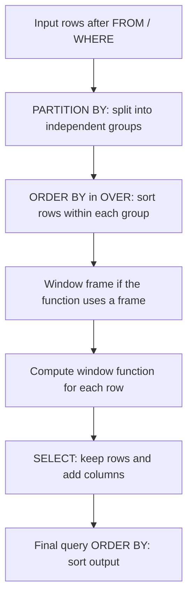

# OVER, PARTITION BY, and ORDER BY in PostgreSQL Window Functions

In PostgreSQL, a **window function** performs calculations across a set of rows related to the current row without **forcing rows to be collapsed into a single row** like `GROUP BY`. For example, you can display each order alongside the seller's total revenue, the chronological order sequence number, the order rank by amount, and the cumulative revenue.

The three components that determine how a window function views data are:

- **`OVER`**: specifies that the function is evaluated over a window rather than as a standard aggregate.
- **`PARTITION BY`**: divides rows into independent partitions; each row is only compared against rows within its own partition.
- **`ORDER BY` inside `OVER`**: defines the logical ordering of rows within each partition; critical for `ROW_NUMBER`, `RANK`, `LAG`, `LEAD`, and cumulative calculations.

Beyond these three components, the **window frame** concept must be understood from the start: if you write `ORDER BY` in a window, many window aggregate functions use a **default frame**, and the result can differ from an expected "entire partition total".

This lesson uses self-contained PostgreSQL SQL examples, an orders dataset, and query organization patterns so you can clearly distinguish **partitioning**, **ordering**, **frame**, and **output presentation order**.

## 1. How do window functions differ from GROUP BY?

Suppose you have a table containing multiple orders per seller. You need to know the total amount for each seller.

Using `GROUP BY`:

```sql
SELECT seller_id, SUM(amount) AS seller_total
FROM window_lab.orders
GROUP BY seller_id;
```

The result has only **one row per `seller_id`**. Individual `order_id` values no longer appear unless grouped or aggregated appropriately.

Using a window function:

```sql
SELECT
    order_id,
    seller_id,
    amount,
    SUM(amount) OVER (PARTITION BY seller_id) AS seller_total
FROM window_lab.orders
ORDER BY seller_id, order_id;
```

The result still keeps **each order as one row**. The `seller_total` column repeats the same value across all orders of a seller.

| Characteristic | `GROUP BY` | Window function |
| --- | --- | --- |
| Result row count | Usually reduced to one row per group | Usually preserves the input row count of the window evaluation stage |
| Goal | Aggregate into groups | Enrich each row with related information |
| Declaration | `GROUP BY seller_id` | `OVER (PARTITION BY seller_id)` |
| Can display detailed `order_id`? | Not without handling it according to grouping rules | Yes |
| Can compute per-order running total? | Not directly with standard GROUP BY alone | Yes, with `ORDER BY` and an appropriate frame |

Window functions do not automatically replace every need for `GROUP BY`. Both mechanisms can be combined: aggregate data first, then compute rankings or shares over those aggregated rows.

## 2. General syntax of OVER

Common form:

```sql
window_function(arguments)
OVER (
    PARTITION BY partition_expression [, ...]
    ORDER BY sort_expression [ASC | DESC] [NULLS FIRST | NULLS LAST] [, ...]
    ROWS BETWEEN frame_start AND frame_end
)
```

The `PARTITION BY`, `ORDER BY`, and `ROWS ...` clauses are all optional depending on the function type. You can also use a window name declared with `WINDOW`:

```sql
window_function(arguments) OVER window_name
```

These components answer different questions:

| Component | Question it answers |
| --- | --- |
| `OVER (...)` | Is this function operating over a window? |
| `PARTITION BY seller_id` | Which seller's rows is the current row compared against? |
| `ORDER BY booked_at, order_id` | What is the order of rows within the partition? |
| `ROWS BETWEEN ...` | Which rows belong to the frame processed by the function at the current position? |
| Final query `ORDER BY` | In what order are the output rows **displayed**? |

Two `ORDER BY` clauses in the same SQL statement can have **completely different** meanings. `ORDER BY` inside `OVER` serves the window calculation; `ORDER BY` at the end of `SELECT` serves the output ordering.



This is a semantic diagram for learning SQL, **not** a guarantee that PostgreSQL must execute in that exact physical order. The planner can choose sorts, index scans, or other execution steps as long as it preserves the query's semantics.

## 3. Orders dataset used throughout

Create a schema and table on a PostgreSQL instance for practice:

```sql
CREATE SCHEMA IF NOT EXISTS window_lab;

CREATE TABLE window_lab.orders (
    order_id integer PRIMARY KEY,
    seller_id integer NOT NULL,
    region text NOT NULL,
    booked_at timestamptz NOT NULL,
    amount numeric(12, 2) NOT NULL CHECK (amount >= 0),
    status text NOT NULL
        CHECK (status IN ('paid', 'pending', 'cancelled'))
);

INSERT INTO window_lab.orders
    (order_id, seller_id, region, booked_at, amount, status)
VALUES
    (101, 1, 'North', '2026-01-01 09:00:00+07', 100.00, 'paid'),
    (102, 1, 'North', '2026-01-01 09:00:00+07',  50.00, 'paid'),
    (103, 1, 'North', '2026-01-03 10:00:00+07',  80.00, 'pending'),
    (104, 2, 'South', '2026-01-02 11:00:00+07', 200.00, 'paid'),
    (105, 2, 'South', '2026-01-02 11:00:00+07', 200.00, 'paid'),
    (106, 2, 'South', '2026-01-04 09:00:00+07',  40.00, 'cancelled'),
    (107, 3, 'North', '2026-01-01 12:00:00+07',  70.00, 'paid'),
    (108, 3, 'North', '2026-01-05 08:00:00+07', 130.00, 'paid'),
    (109, 4, 'Central','2026-01-03 08:00:00+07', 90.00, 'pending'),
    (110, 4, 'Central','2026-01-06 10:00:00+07', 30.00, 'paid'),
    (111, 5, 'North', '2026-01-07 09:00:00+07', 60.00, 'paid'),
    (112, 5, 'North', '2026-01-07 09:00:00+07', 90.00, 'paid');
```

The data includes **tied timestamps** (`101` and `102`; `104` and `105`; `111` and `112`). This is an important case when learning `ORDER BY`, peer rows, and the default frame.

Verify the data:

```sql
SELECT
    COUNT(*) AS order_count,
    SUM(amount) AS amount_all_statuses,
    COUNT(*) FILTER (WHERE status = 'paid') AS paid_count,
    SUM(amount) FILTER (WHERE status = 'paid') AS paid_amount
FROM window_lab.orders;
```

Expected: 12 orders, total across all statuses 1140.00, 9 paid orders, total paid amount 930.00.

Totals by seller:

| seller_id | Order count | Total all statuses |
| ---: | ---: | ---: |
| 1 | 3 | 230.00 |
| 2 | 3 | 440.00 |
| 3 | 2 | 200.00 |
| 4 | 2 | 120.00 |
| 5 | 2 | 150.00 |

From here on, every window example can be explained using concrete rows rather than abstract definitions alone.

## 4. OVER (): a single unpartitioned window

When you write `OVER ()`, the entire set of rows received by the window function at that query level forms **a single partition**:

```sql
SELECT
    order_id,
    seller_id,
    amount,
    SUM(amount) OVER () AS global_total,
    COUNT(*) OVER () AS global_order_count
FROM window_lab.orders
ORDER BY order_id;
```

Every row displays:

- `global_total = 1140.00`.
- `global_order_count = 12`.

Regardless of which seller the current row belongs to, the sum and count are still across the **entire set of rows fed into the window**.

### 4.1. OVER () does not mean the entire table in every query

If there is a `WHERE` clause:

```sql
SELECT
    order_id,
    status,
    amount,
    SUM(amount) OVER () AS paid_total
FROM window_lab.orders
WHERE status = 'paid'
ORDER BY order_id;
```

`paid_total` is now **930.00** because `WHERE` filtered out `pending` and `cancelled` orders before the window evaluation stage.

Therefore, "the entire partition" always means **all remaining rows at the query level evaluating the window**, not necessarily every row in the physical table.

### 4.2. OVER () is not limited to SUM

```sql
SELECT
    order_id,
    amount,
    AVG(amount) OVER () AS average_amount,
    MIN(amount) OVER () AS smallest_amount,
    MAX(amount) OVER () AS largest_amount
FROM window_lab.orders
ORDER BY order_id;
```

Standard aggregates such as `SUM`, `AVG`, `MIN`, `MAX`, and `COUNT` can be used as window functions when given an appropriate `OVER` clause.

## 5. PARTITION BY: splitting rows into independent windows

`PARTITION BY` defines the partition key. Each partition contains rows sharing the same value for the partition expression; the window calculation does not cross that boundary.

```sql
SELECT
    order_id,
    seller_id,
    amount,
    SUM(amount) OVER (PARTITION BY seller_id) AS seller_total,
    COUNT(*) OVER (PARTITION BY seller_id) AS seller_order_count
FROM window_lab.orders
ORDER BY seller_id, order_id;
```

For example:

| order_id | seller_id | amount | seller_total | seller_order_count |
| ---: | ---: | ---: | ---: | ---: |
| 101 | 1 | 100.00 | 230.00 | 3 |
| 102 | 1 | 50.00 | 230.00 | 3 |
| 103 | 1 | 80.00 | 230.00 | 3 |
| 104 | 2 | 200.00 | 440.00 | 3 |
| 105 | 2 | 200.00 | 440.00 | 3 |
| 106 | 2 | 40.00 | 440.00 | 3 |

Each row retains its own `order_id`; only the total and order count columns repeat per seller.

### 5.1. Partitioning by multiple columns

If each seller can operate across multiple regions, you can choose:

```sql
SELECT
    order_id,
    seller_id,
    region,
    amount,
    SUM(amount) OVER (
        PARTITION BY seller_id, region
    ) AS seller_region_total
FROM window_lab.orders
ORDER BY seller_id, region, order_id;
```

The partition is determined by the **combination `(seller_id, region)`**. It is not one sum by seller and another sum by region: it is a single window with a two-column key.

Appropriate expressions can also be used:

```sql
SELECT
    order_id,
    booked_at,
    SUM(amount) OVER (
        PARTITION BY date_trunc('month', booked_at)
    ) AS total_in_month
FROM window_lab.orders;
```

In real-world queries spanning multiple time zones, `date_trunc('month', booked_at)` on `timestamptz` depends on the time zone used to determine the calendar month. Normalize the time boundary according to reporting requirements before grouping.

### 5.2. PARTITION BY is not physical table partitioning

These two terms are different:

- **Window partition:** a logical group of rows defined by `PARTITION BY` inside `OVER` for calculation.
- **Table partitioning:** splitting physical data into partitions using `PARTITION BY` in `CREATE TABLE` and its corresponding partitioning rules.

Window functions work on regular tables, partitioned tables, views, or join results; they **do not require the table to be physically partitioned**. Conversely, a table physically partitioned by date does not automatically cause `SUM(...) OVER (...)` to split by date unless you specify it.

### 5.3. NULL in the partition key

If the partition key allows `NULL`, rows whose key evaluates to `NULL` belong to the same partition under grouping/window semantics. This does not turn the SQL comparison `NULL = NULL` into `TRUE`; the grouping mechanism has its own rules for handling missing values.

With multiple columns, the entire partition key combination is evaluated. A non-null `seller_id` with a null `region` still forms a separate partition from `region = 'North'`.

## 6. ORDER BY inside OVER: defining the calculation sequence

To number each seller's orders chronologically:

```sql
SELECT
    order_id,
    seller_id,
    booked_at,
    ROW_NUMBER() OVER (
        PARTITION BY seller_id
        ORDER BY booked_at, order_id
    ) AS order_sequence
FROM window_lab.orders
ORDER BY seller_id, order_sequence;
```

How to read this:

1. `PARTITION BY seller_id`: each seller gets an independent sequence.
2. `ORDER BY booked_at, order_id`: older orders before newer orders; `order_id` breaks ties when timestamps are equal.
3. `ROW_NUMBER()`: assigns numbers 1, 2, 3... according to the defined order.

For seller 1: order 101 gets 1, 102 gets 2, 103 gets 3. For seller 2: order 104 gets 1, 105 gets 2, 106 gets 3.

### 6.1. Omitting PARTITION BY means the sequence does not reset

```sql
SELECT
    order_id,
    seller_id,
    ROW_NUMBER() OVER (
        ORDER BY booked_at, order_id
    ) AS global_sequence
FROM window_lab.orders
ORDER BY global_sequence;
```

Without `PARTITION BY`, all orders are numbered in a single sequence. This is appropriate when you want to rank or sequence all events across the entire system chronologically.

### 6.2. What does omitting ORDER BY mean?

```sql
SELECT
    order_id,
    seller_id,
    ROW_NUMBER() OVER (
        PARTITION BY seller_id
    ) AS unspecified_sequence
FROM window_lab.orders;
```

The query can still be valid, but within a partition, there is **no guaranteed ordering criterion** determining which order receives `ROW_NUMBER = 1`. The result depends on the execution plan and can vary across runs.

If the sequence number carries business meaning (first order, latest order, Nth service request), always specify `ORDER BY` with sufficient criteria to break ties.

### 6.3. ASC, DESC, and NULLS FIRST/LAST

```sql
SELECT
    order_id,
    seller_id,
    booked_at,
    ROW_NUMBER() OVER (
        PARTITION BY seller_id
        ORDER BY booked_at DESC NULLS LAST, order_id DESC
    ) AS latest_first
FROM window_lab.orders
ORDER BY seller_id, latest_first;
```

In this example, `booked_at` is `NOT NULL` so `NULLS LAST` makes no difference; however, for nullable columns, `NULL` placement affects the ordering inside the window.

Default rules in PostgreSQL: `ASC` defaults to `NULLS LAST` and `DESC` defaults to `NULLS FIRST`. Specify it explicitly when the placement of missing values has business significance.

## 7. ORDER BY inside a window does not sort the final result

A common mistake:

```sql
SELECT
    order_id,
    seller_id,
    ROW_NUMBER() OVER (
        PARTITION BY seller_id
        ORDER BY booked_at DESC, order_id DESC
    ) AS rn
FROM window_lab.orders;
```

You must not assume that the first row returned will be the latest order or that sellers will appear consecutively in order. `ORDER BY` inside `OVER` is used to compute `rn`; it **does not guarantee the order of output rows**.

To view the output in a readable order:

```sql
SELECT
    order_id,
    seller_id,
    ROW_NUMBER() OVER (
        PARTITION BY seller_id
        ORDER BY booked_at DESC, order_id DESC
    ) AS rn
FROM window_lab.orders
ORDER BY seller_id, rn;
```

Or sort the final result in a different order while keeping the same `rn`:

```sql
SELECT
    order_id,
    seller_id,
    amount,
    ROW_NUMBER() OVER (
        PARTITION BY seller_id
        ORDER BY booked_at DESC, order_id DESC
    ) AS rn
FROM window_lab.orders
ORDER BY amount DESC, order_id;
```

In the second query, the display order is by `amount`; `rn` is still calculated chronologically within each seller.

**Rule:** to guarantee return order for an API or pagination, use `ORDER BY` at the outer output query level. Do not rely on incidental ordering emitted by `WindowAgg` or `Sort` in the execution plan.

## 8. Peer rows: when ORDER BY keys are equal

Within a partition, two rows that share the same values across all `ORDER BY` expressions of the window are called **peers**.

Consider seller 2's two orders:

| order_id | seller_id | booked_at | amount |
| ---: | ---: | --- | ---: |
| 104 | 2 | 2026-01-02 11:00+07 | 200.00 |
| 105 | 2 | 2026-01-02 11:00+07 | 200.00 |

If sorted only by `booked_at`, the two rows are peers:

```sql
SELECT
    order_id,
    seller_id,
    booked_at,
    ROW_NUMBER() OVER (
        PARTITION BY seller_id
        ORDER BY booked_at
    ) AS rn,
    RANK() OVER (
        PARTITION BY seller_id
        ORDER BY booked_at
    ) AS rnk,
    DENSE_RANK() OVER (
        PARTITION BY seller_id
        ORDER BY booked_at
    ) AS dense_rnk
FROM window_lab.orders
WHERE seller_id = 2
ORDER BY booked_at, order_id;
```

`RANK` and `DENSE_RANK` give peers the same rank; `ROW_NUMBER` still assigns a distinct number to each row, but without a tiebreaker key, whether row 104 or 105 gets number 1 can be non-deterministic.

### 8.1. ROW_NUMBER, RANK, and DENSE_RANK

| Function | Behavior on tied ORDER BY keys |
| --- | --- |
| `ROW_NUMBER()` | Different number per row; order among peers can be non-deterministic |
| `RANK()` | Same rank for peers, leaves a **gap** in the next rank |
| `DENSE_RANK()` | Same rank for peers, leaves **no** gap |

Example for seller 2 with `ORDER BY amount DESC`: amounts are 200, 200, 40.

| order_id | amount | ROW_NUMBER (without tiebreaker) | RANK | DENSE_RANK |
| ---: | ---: | --- | ---: | ---: |
| 104 | 200.00 | 1 or 2 | 1 | 1 |
| 105 | 200.00 | 1 or 2 | 1 | 1 |
| 106 | 40.00 | 3 | 3 | 2 |

If you add `order_id` directly to `RANK`'s `ORDER BY`, the two rows with amount 200 are no longer peers; the ranks will change. Therefore:

- When you want to **rank by amount and keep tied values at the same rank**, use only `ORDER BY amount DESC` inside `RANK`.
- When you want to **pick a single row deterministically by clear rules**, use `ROW_NUMBER() OVER (... ORDER BY amount DESC, order_id)`.

## 9. Window frame: the scope of rows actually aggregated

This is the most commonly misunderstood part. **Partition** defines the larger group a row belongs to; **frame** defines a subset of that group at the current position for certain functions to evaluate over.

Example:

```sql
SELECT
    order_id,
    seller_id,
    amount,
    SUM(amount) OVER (
        PARTITION BY seller_id
    ) AS full_partition_total
FROM window_lab.orders;
```

Without an `ORDER BY` or explicit frame, the default frame includes the **entire partition**; therefore seller 1 always gets a total of 230.00 across all three rows.

However, when `ORDER BY` is added:

```sql
SELECT
    order_id,
    seller_id,
    booked_at,
    amount,
    SUM(amount) OVER (
        PARTITION BY seller_id
        ORDER BY booked_at
    ) AS cumulative_by_time
FROM window_lab.orders
ORDER BY seller_id, booked_at, order_id;
```

For an aggregate like `SUM`, a window with `ORDER BY` uses the **default frame** equivalent to:

```sql
RANGE BETWEEN UNBOUNDED PRECEDING AND CURRENT ROW
```

With `RANGE` and `CURRENT ROW`, the frame also includes **peers sharing the same ORDER BY value**, not solely the current individual row.

### 9.1. Difference between "full partition total" and "cumulative total"

| SQL inside OVER | Meaning with SUM |
| --- | --- |
| `PARTITION BY seller_id` | Total across the entire seller, repeated on every row |
| `PARTITION BY seller_id ORDER BY booked_at` | Cumulative total by timestamp and peers, using the default frame |
| `PARTITION BY seller_id ORDER BY booked_at ROWS BETWEEN UNBOUNDED PRECEDING AND UNBOUNDED FOLLOWING` | Total across the entire seller despite having ORDER BY |
| `PARTITION BY seller_id ORDER BY booked_at, order_id ROWS BETWEEN UNBOUNDED PRECEDING AND CURRENT ROW` | **Row-by-row** cumulative total with tie-broken ordering |

When you need the total across the entire partition, the shortest way is usually to **omit ORDER BY**:

```sql
SUM(amount) OVER (PARTITION BY seller_id)
```

If ordering is required because of other window functions, you can still explicitly specify the full-partition frame, though choosing the clearest form is best.

## 10. ROWS vs. RANGE with tied timestamps

To observe the difference, consider seller 2 having two 200.00 orders with the same `booked_at`.

### 10.1. Default RANGE includes peer groups

```sql
SELECT
    order_id,
    booked_at,
    amount,
    SUM(amount) OVER (
        ORDER BY booked_at
    ) AS running_range
FROM window_lab.orders
WHERE seller_id = 2
ORDER BY booked_at, order_id;
```

Orders 104 and 105 have the same timestamp. Because the default `RANGE ... CURRENT ROW` frame includes peers, **both get `running_range = 400.00`**. Row 106 (40.00) gets `running_range = 440.00`.

This is not an accumulation bug; two rows sharing the sort key are treated as a single peer group at the frame's end boundary.

### 10.2. ROWS evaluates by individual row position

```sql
SELECT
    order_id,
    booked_at,
    amount,
    SUM(amount) OVER (
        ORDER BY booked_at, order_id
        ROWS BETWEEN UNBOUNDED PRECEDING AND CURRENT ROW
    ) AS running_rows
FROM window_lab.orders
WHERE seller_id = 2
ORDER BY booked_at, order_id;
```

Result:

| order_id | amount | running_rows |
| ---: | ---: | ---: |
| 104 | 200.00 | 200.00 |
| 105 | 200.00 | 400.00 |
| 106 | 40.00 | 440.00 |

Because the ordering includes `order_id` as a secondary key, the cumulative result is unambiguous.

**Warning:** if you use `ROWS` with only `ORDER BY booked_at`, two rows with the same timestamp can swap order across executions. One of the two rows will get 200 and the other 400, with no guarantee which ID gets which value.

### 10.3. Direct comparison in a single query

```sql
SELECT
    order_id,
    booked_at,
    amount,
    SUM(amount) OVER (
        ORDER BY booked_at
    ) AS cumulative_range_default,
    SUM(amount) OVER (
        ORDER BY booked_at, order_id
        ROWS BETWEEN UNBOUNDED PRECEDING AND CURRENT ROW
    ) AS cumulative_rows_deterministic
FROM window_lab.orders
WHERE seller_id = 2
ORDER BY booked_at, order_id;
```

This is a key example showing that **`ORDER BY` inside a window not only affects ordering; it also affects the default frame when the function uses a frame**.

## 11. ROWS, RANGE, and GROUPS: three ways to define a frame

PostgreSQL supports three common frame units:

| Unit | Based on | When useful |
| --- | --- | --- |
| `ROWS` | Relative physical row count in window order | Row-by-row running totals, moving average of last N rows |
| `RANGE` | Interval of **ORDER BY key values**, handling peers | Totals over time/value intervals, cumulative totals by peer key groups |
| `GROUPS` | Number of **peer groups** in window order | Calculations over the last N distinct ordering value groups |

A frame is written inside `OVER`, for example:

```sql
SUM(amount) OVER (
    PARTITION BY seller_id
    ORDER BY booked_at, order_id
    ROWS BETWEEN 2 PRECEDING AND CURRENT ROW
)
```

Here, the frame consists of at most **three rows**: the current row and the two preceding rows for the same seller. When fewer than two preceding rows exist, the frame has fewer than three rows.

### 11.1. Moving average of the last three orders

```sql
SELECT
    seller_id,
    order_id,
    amount,
    AVG(amount) OVER (
        PARTITION BY seller_id
        ORDER BY booked_at, order_id
        ROWS BETWEEN 2 PRECEDING AND CURRENT ROW
    ) AS moving_avg_last_3_orders
FROM window_lab.orders
ORDER BY seller_id, booked_at, order_id;
```

For seller 1:

- Order 101: average 100.
- Order 102: average of 100 and 50 = 75.
- Order 103: average of 100, 50, 80 = 76.666...

In this example, `AVG` over `numeric` returns an exact numeric value that can have many decimal places; use `ROUND(..., 2)` when two decimal places are needed for display.

### 11.2. RANGE over a time interval

Suppose you want revenue **within 1 day leading up to the current order's timestamp**:

```sql
SELECT
    seller_id,
    order_id,
    booked_at,
    amount,
    SUM(amount) OVER (
        PARTITION BY seller_id
        ORDER BY booked_at
        RANGE BETWEEN INTERVAL '1 day' PRECEDING AND CURRENT ROW
    ) AS revenue_in_previous_day
FROM window_lab.orders
ORDER BY seller_id, booked_at, order_id;
```

For `RANGE` with a time offset like this, `ORDER BY` must satisfy the rule requiring **a single sort expression supporting offsets**, here `timestamptz`. You cannot arbitrarily add multiple `ORDER BY` keys to a `RANGE` frame with an offset and expect the syntax to remain valid.

For two rows sharing the same `booked_at`, both fall within each other's interval and are included in the result according to `RANGE` semantics.

### 11.3. GROUPS by peer groups

```sql
SELECT
    seller_id,
    order_id,
    booked_at,
    amount,
    SUM(amount) OVER (
        PARTITION BY seller_id
        ORDER BY booked_at
        GROUPS BETWEEN 1 PRECEDING AND CURRENT ROW
    ) AS current_and_previous_time_group
FROM window_lab.orders
ORDER BY seller_id, booked_at, order_id;
```

If a timestamp has multiple orders, they form **one peer group** by `booked_at`. The frame above sums data from the current timestamp group and the previous timestamp group, not just "one preceding row".

`GROUPS` is supported in modern PostgreSQL versions; on very old systems, verify server support. Do not adopt a newer frame feature without confirming the environment.

## 12. LAST_VALUE: an easy pitfall due to the default frame

`FIRST_VALUE` and `LAST_VALUE` operate over the **window frame**, not implicitly over the entire partition.

Suppose an author wants to display the amount of each seller's last order:

```sql
SELECT
    seller_id,
    order_id,
    amount,
    LAST_VALUE(amount) OVER (
        PARTITION BY seller_id
        ORDER BY booked_at, order_id
    ) AS last_value_default
FROM window_lab.orders
ORDER BY seller_id, booked_at, order_id;
```

Because `ORDER BY` is present and no frame is specified, the default frame ends at the current row (plus peers if any). With a unique `(booked_at, order_id)` key per seller, `LAST_VALUE(amount)` usually just returns **the current row's own amount**, rather than the seller's final order amount.

To actually retrieve the last order in the **entire partition**, extend the frame:

```sql
SELECT
    seller_id,
    order_id,
    amount,
    LAST_VALUE(amount) OVER (
        PARTITION BY seller_id
        ORDER BY booked_at, order_id
        ROWS BETWEEN UNBOUNDED PRECEDING AND UNBOUNDED FOLLOWING
    ) AS last_amount_in_partition
FROM window_lab.orders
ORDER BY seller_id, booked_at, order_id;
```

In the sample dataset, seller 1 gets last amount 80.00, seller 2 gets 40.00, seller 3 gets 130.00, seller 4 gets 30.00, and seller 5 gets 90.00.

Summary table:

| Expression | Typical behavior |
| --- | --- |
| `LAST_VALUE(amount) OVER (PARTITION BY seller_id ORDER BY booked_at, order_id)` | Last row of the **default frame**; with a unique key, usually the current row |
| `LAST_VALUE(amount) OVER (... ROWS BETWEEN UNBOUNDED PRECEDING AND UNBOUNDED FOLLOWING)` | Last row of the **entire partition** in the chosen order |

`NTH_VALUE` also depends on the frame. Conversely, `LAG` and `LEAD` look up relative positions within the partition according to the window order and do not use the frame in the same way aggregates/`LAST_VALUE` do.

## 13. LAG and LEAD: looking at preceding/following rows in a partition

`LAG` returns a value from a preceding row in window order; `LEAD` returns a value from a following row.

```sql
SELECT
    seller_id,
    order_id,
    booked_at,
    amount,
    LAG(amount) OVER (
        PARTITION BY seller_id
        ORDER BY booked_at, order_id
    ) AS previous_amount,
    LEAD(amount) OVER (
        PARTITION BY seller_id
        ORDER BY booked_at, order_id
    ) AS next_amount
FROM window_lab.orders
ORDER BY seller_id, booked_at, order_id;
```

For seller 1:

| order_id | amount | previous_amount | next_amount |
| ---: | ---: | ---: | ---: |
| 101 | 100.00 | NULL | 50.00 |
| 102 | 50.00 | 100.00 | 80.00 |
| 103 | 80.00 | 50.00 | NULL |

`LAG` and `LEAD` default to an offset of 1; you can pass an offset and a default value:

```sql
SELECT
    seller_id,
    order_id,
    LAG(amount, 2, 0) OVER (
        PARTITION BY seller_id
        ORDER BY booked_at, order_id
    ) AS amount_two_orders_ago
FROM window_lab.orders;
```

The value `0` is returned when no row exists at offset 2; it does not mean the earlier order actually had `amount = 0`. Choose the default value according to business requirements, keeping `NULL` if you want to indicate "no preceding row".

### 13.1. Computing the difference between consecutive orders

```sql
SELECT
    seller_id,
    order_id,
    booked_at,
    amount,
    amount - LAG(amount) OVER (
        PARTITION BY seller_id
        ORDER BY booked_at, order_id
    ) AS delta_from_previous_order
FROM window_lab.orders
ORDER BY seller_id, booked_at, order_id;
```

Each seller's first order has a `NULL` delta because there is no preceding order. Do not automatically coerce it to 0 if the report needs to distinguish "no data to compare" from "no change".

### 13.2. LAG/LEAD do not inherently represent real time intervals

`LAG(amount)` returns **the preceding row according to ORDER BY**, not "the row exactly one day earlier". If you need to compare exact consecutive calendar days, normalize timestamps, aggregate by day, and decide how to handle days with no transactions.

In particular, if you use `ORDER BY booked_at` when multiple rows share the same timestamp, the "before/after" relationship among peers can be unstable. Add `order_id` or an appropriate tiebreaker key.

## 14. Filtering "the latest order per seller": why an outer query level is needed

A common requirement: retrieve only **one latest order** per seller.

You cannot filter the `rn` alias directly in the same-level `WHERE`:

```sql
-- Wrong: rn does not exist in the same-level WHERE.
SELECT
    order_id,
    seller_id,
    ROW_NUMBER() OVER (
        PARTITION BY seller_id
        ORDER BY booked_at DESC, order_id DESC
    ) AS rn
FROM window_lab.orders
WHERE rn = 1;
```

Nor can you put a window function directly inside `WHERE` at that same query level.

Use a CTE:

```sql
WITH ranked_orders AS (
    SELECT
        order_id,
        seller_id,
        booked_at,
        amount,
        ROW_NUMBER() OVER (
            PARTITION BY seller_id
            ORDER BY booked_at DESC, order_id DESC
        ) AS rn
    FROM window_lab.orders
)
SELECT
    seller_id,
    order_id,
    booked_at,
    amount
FROM ranked_orders
WHERE rn = 1
ORDER BY seller_id;
```

Result on the sample data:

| seller_id | order_id | Explanation |
| ---: | ---: | --- |
| 1 | 103 | Latest timestamp for seller 1 |
| 2 | 106 | Latest timestamp for seller 2 |
| 3 | 108 | Latest timestamp for seller 3 |
| 4 | 110 | Latest timestamp for seller 4 |
| 5 | 112 | Tied timestamp with 111, ID 112 is larger |

The query inside the CTE produces `rn`; to the outer query, `rn` is already a valid input column for filtering.

### 14.1. Selecting top 2 instead of top 1

Replace `WHERE rn = 1` with:

```sql
WHERE rn <= 2
```

Then each seller returns at most two orders. If the goal is to retrieve **all orders tied within the top 2 amount values**, `RANK`/`DENSE_RANK` may be more suitable than `ROW_NUMBER`, though the number of rows returned per seller may exceed two due to ties.

### 14.2. WHERE before vs. after the window behaves differently

Query A ranks only paid orders:

```sql
WITH ranked_paid AS (
    SELECT
        order_id,
        seller_id,
        status,
        booked_at,
        ROW_NUMBER() OVER (
            PARTITION BY seller_id
            ORDER BY booked_at DESC, order_id DESC
        ) AS rn
    FROM window_lab.orders
    WHERE status = 'paid'
)
SELECT *
FROM ranked_paid
WHERE rn = 1
ORDER BY seller_id;
```

Query B ranks **all orders**, then keeps the latest row only if it is paid:

```sql
WITH ranked_all AS (
    SELECT
        order_id,
        seller_id,
        status,
        booked_at,
        ROW_NUMBER() OVER (
            PARTITION BY seller_id
            ORDER BY booked_at DESC, order_id DESC
        ) AS rn
    FROM window_lab.orders
)
SELECT *
FROM ranked_all
WHERE rn = 1
  AND status = 'paid'
ORDER BY seller_id;
```

For seller 1, the latest order is 103 which is `pending`. Query A returns the latest paid order 102; Query B **does not return seller 1**. For seller 2, the latest order 106 is `cancelled`; Query A returns 105, whereas Query B does not return seller 2.

These two queries solve **two different business requirements**. Where `WHERE` is placed relative to the window is part of the semantics, not merely an optimization.

## 15. Valid positions for window functions in SELECT

In PostgreSQL, window functions are allowed in appropriate positions in the **`SELECT` list and `ORDER BY`** clause of a query level. They cannot be used directly in `WHERE`, `GROUP BY`, or `HAVING` at the same level because those clauses are logically evaluated before window results exist.

Valid example:

```sql
SELECT
    order_id,
    seller_id,
    ROW_NUMBER() OVER (
        PARTITION BY seller_id ORDER BY booked_at, order_id
    ) AS rn
FROM window_lab.orders
ORDER BY
    ROW_NUMBER() OVER (
        PARTITION BY seller_id ORDER BY booked_at, order_id
    ),
    seller_id;
```

Using the alias in `ORDER BY` is usually easier to read:

```sql
SELECT
    order_id,
    seller_id,
    ROW_NUMBER() OVER (
        PARTITION BY seller_id ORDER BY booked_at, order_id
    ) AS rn
FROM window_lab.orders
ORDER BY rn, seller_id;
```

You cannot directly nest one window function inside another window function at the same query level. When you need two steps such as "compute total per seller -> rank seller totals", use query levels or combine aggregate and window functions according to the rules.

## 16. Combining GROUP BY and window functions

Window functions are evaluated after `GROUP BY` and `HAVING` have formed and filtered the aggregated result rows at that query level. Therefore, they can **rank groups**.

```sql
WITH seller_totals AS (
    SELECT
        seller_id,
        SUM(amount) AS seller_revenue
    FROM window_lab.orders
    WHERE status = 'paid'
    GROUP BY seller_id
)
SELECT
    seller_id,
    seller_revenue,
    RANK() OVER (
        ORDER BY seller_revenue DESC
    ) AS revenue_rank
FROM seller_totals
ORDER BY revenue_rank, seller_id;
```

The step inside the CTE creates one row per seller; the outer step ranks these aggregated rows. This does not rank individual orders.

PostgreSQL also allows writing an aggregate inside a window aggregate's argument in valid situations:

```sql
SELECT
    region,
    seller_id,
    SUM(amount) AS seller_revenue,
    SUM(SUM(amount)) OVER (
        PARTITION BY region
    ) AS region_revenue
FROM window_lab.orders
GROUP BY region, seller_id
ORDER BY region, seller_id;
```

How to read this:

1. `GROUP BY region, seller_id` produces one revenue row for each seller in each region.
2. `SUM(SUM(amount)) OVER (PARTITION BY region)` sums the aggregated seller rows within the same region.

This is a valid case of an **aggregate nested inside a window aggregate** because the two aggregations operate at two distinct logical stages. It does not mean you can directly nest **two window functions** inside each other.

## 17. Naming windows with WINDOW

When multiple expressions use the same `PARTITION BY` and `ORDER BY`, repeating the entire `OVER (...)` makes SQL verbose and prone to omitting a key.

PostgreSQL supports declaring named windows in a `WINDOW` clause:

```sql
SELECT
    seller_id,
    order_id,
    amount,
    ROW_NUMBER() OVER seller_timeline AS seq_no,
    LAG(amount) OVER seller_timeline AS previous_amount,
    LEAD(amount) OVER seller_timeline AS next_amount
FROM window_lab.orders
WINDOW seller_timeline AS (
    PARTITION BY seller_id
    ORDER BY booked_at, order_id
)
ORDER BY seller_id, seq_no;
```

Meaning: all three functions share the same partition/order definition. `WINDOW` is written **after `HAVING` and before the final query `ORDER BY`** in PostgreSQL's `SELECT` structure.

### 17.1. Reusing a definition and adding a frame to one sum

Suppose you want to simultaneously assign sequence numbers and calculate a two-order rolling sum:

```sql
SELECT
    seller_id,
    order_id,
    amount,
    ROW_NUMBER() OVER seller_timeline AS seq_no,
    SUM(amount) OVER (
        seller_timeline
        ROWS BETWEEN 1 PRECEDING AND CURRENT ROW
    ) AS last_two_amount
FROM window_lab.orders
WINDOW seller_timeline AS (
    PARTITION BY seller_id
    ORDER BY booked_at, order_id
)
ORDER BY seller_id, seq_no;
```

Here, the named window defines the partition and order; the `SUM` expression **extends** it by adding a `ROWS` frame.

Note PostgreSQL's rules when referencing a named window:

- You can use `OVER window_name` directly.
- You can use `OVER (window_name ... )` to append certain clauses where permitted.
- You cannot arbitrarily **override** an existing `PARTITION BY` or `ORDER BY` of the referenced window.
- If the named window already includes a frame, copying/extending it in parenthesized form has restrictions; define separate named windows when independent frames are needed.

Naming windows helps avoid accidental discrepancies between `ROW_NUMBER`, `LAG`, and cumulative calculations.

## 18. FILTER with window aggregates

In PostgreSQL, certain aggregates can take a `FILTER (WHERE ...)` clause, even when used with `OVER`.

For example, keep **all orders** while summing the amount of `paid` orders per seller:

```sql
SELECT
    order_id,
    seller_id,
    status,
    amount,
    SUM(amount) FILTER (WHERE status = 'paid')
        OVER (PARTITION BY seller_id) AS paid_total_for_seller
FROM window_lab.orders
ORDER BY seller_id, order_id;
```

Here:

- The result set still has 12 orders.
- `PARTITION BY seller_id` groups by seller.
- `FILTER (WHERE status = 'paid')` only determines **which rows contribute to the SUM aggregate**; it does not remove `pending`/`cancelled` rows from the output.

Paid totals per seller:

| seller_id | paid_total_for_seller |
| ---: | ---: |
| 1 | 150.00 |
| 2 | 400.00 |
| 3 | 200.00 |
| 4 | 30.00 |
| 5 | 150.00 |

Compare with:

```sql
SELECT
    order_id,
    seller_id,
    SUM(amount) OVER (
        PARTITION BY seller_id
    ) AS paid_partition_total
FROM window_lab.orders
WHERE status = 'paid';
```

The second query **keeps only paid rows**, so rows with other statuses are gone. Even though the paid total values per seller are the same here, the result row set and reporting intent are not identical.

**Note:** `FILTER` is syntax for aggregates that support `FILTER`, not an option applicable to all window functions like `ROW_NUMBER` or `LAG`.

## 19. Distinguishing ROWS, PARTITION, and post-JOIN results

When a query includes a `JOIN`, the input to a window function may contain **more rows than the source table**. For example, an order with three line items; joining `orders` to `order_lines` produces three rows carrying the same `order_id`.

If you write:

```sql
SELECT
    o.seller_id,
    o.order_id,
    COUNT(*) OVER (
        PARTITION BY o.seller_id
    ) AS joined_rows_of_seller
FROM window_lab.orders AS o
JOIN window_lab.order_lines AS l
    ON l.order_id = o.order_id;
```

then `COUNT(*) OVER (...)` counts **post-JOIN rows**, not necessarily distinct orders. The `window_lab.order_lines` table here is a **hypothetical table** not created in the practice dataset; the SQL illustrates how joining can multiply rows.

If the goal is to count distinct orders, aggregate `order_id` properly or create a query layer normalized to one row per order before applying window functions.

### 19.1. LEFT JOIN and unmatched rows

With `LEFT JOIN`, a left-side record with no match still produces a row with `NULL` values for right-side columns. Therefore:

- `COUNT(*) OVER (PARTITION BY ...)` includes null-extended rows.
- `COUNT(right_table.id) OVER (...)` does not count NULL ID values.
- Adding `WHERE right_table.some_col = ...` after a `LEFT JOIN` can eliminate unmatched rows before the window function runs.

Placing right-side table conditions in `ON` vs. `WHERE` must be based on whether unmatched rows should be preserved or excluded.

## 20. Performance and indexes when using PARTITION BY / ORDER BY

Window functions may require PostgreSQL to organize rows by partition and window order. On large tables, this can be an expensive operation in terms of CPU, memory, and I/O.

Example:

```sql
EXPLAIN
SELECT
    seller_id,
    order_id,
    ROW_NUMBER() OVER (
        PARTITION BY seller_id
        ORDER BY booked_at DESC, order_id DESC
    ) AS rn
FROM window_lab.orders;
```

In the execution plan, `WindowAgg` and `Sort` nodes or ordered access paths may appear. PostgreSQL does not promise that every window function scans the table only once, or that a single sort suffices for multiple windows with different orderings.

### 20.1. An appropriate index can reduce sort cost

For queries that frequently fetch orders by seller and then by latest timestamp, you might consider:

```sql
CREATE INDEX idx_orders_seller_booked_id
ON window_lab.orders (
    seller_id,
    booked_at DESC,
    order_id DESC
);
```

This index can support reading in the matching order, but **does not guarantee** the planner will always use the index instead of a sort. The plan depends on row count, `WHERE` selectivity, cache, heap fetch costs, statistics, and PostgreSQL version.

In some queries, PostgreSQL can use `Incremental Sort` when input is already sorted by a prefix of the sort key. Do not design indexes solely based on whether a node appears in `EXPLAIN` on a 12-row table.

### 20.2. Multiple window orderings can increase sort steps

```sql
SELECT
    order_id,
    seller_id,
    ROW_NUMBER() OVER (
        PARTITION BY seller_id ORDER BY booked_at
    ) AS by_time,
    ROW_NUMBER() OVER (
        PARTITION BY seller_id ORDER BY amount DESC
    ) AS by_amount
FROM window_lab.orders;
```

Two window definitions require two different sort orders. The planner may need separate sort/evaluation steps; do not assume putting them in a single `SELECT` is always cheaper than every alternative.

### 20.3. What does EXPLAIN ANALYZE measure?

```sql
EXPLAIN (ANALYZE, BUFFERS)
SELECT
    seller_id,
    order_id,
    SUM(amount) OVER (
        PARTITION BY seller_id
        ORDER BY booked_at, order_id
        ROWS BETWEEN UNBOUNDED PRECEDING AND CURRENT ROW
    ) AS running_amount
FROM window_lab.orders;
```

`ANALYZE` actually executes the query to record row counts and timings. For a `SELECT` query on test data this typically does not modify data, though it still consumes resources. If applied to a data-modifying statement, execution effects must be controlled separately.

When processing millions of rows, you also need to observe sort time, memory usage, temp files, partition/order design, and joins preceding the window. There is no universal rule that "adding an index to every PARTITION BY column" is always right.

## 21. Windows and pagination: which order determines the page?

Suppose an API needs the 20 highest-value orders, while also displaying each order's chronological position within its seller:

```sql
SELECT
    order_id,
    seller_id,
    amount,
    ROW_NUMBER() OVER (
        PARTITION BY seller_id
        ORDER BY booked_at, order_id
    ) AS seller_sequence
FROM window_lab.orders
ORDER BY amount DESC, order_id
LIMIT 20;
```

`seller_sequence` is calculated over the **query level's row set before the outermost `LIMIT` truncates the output**, while `LIMIT 20` picks 20 rows by `amount DESC, order_id`. Thus, for a given seller, `seller_sequence` could be 3 even if the two earlier orders are not among the 20 displayed rows.

If you want to **number only within the selected top 20 amount rows**, restrict the row set in an **inner query level**, then run the window function in the outer query:

```sql
WITH top_orders AS (
    SELECT
        order_id, seller_id, booked_at, amount
    FROM window_lab.orders
    ORDER BY amount DESC, order_id
    LIMIT 20
)
SELECT
    order_id,
    seller_id,
    amount,
    ROW_NUMBER() OVER (
        PARTITION BY seller_id
        ORDER BY booked_at, order_id
    ) AS sequence_within_top_20
FROM top_orders
ORDER BY amount DESC, order_id;
```

The two queries have different meanings: one calculates the position across the **entire order set**, while the other calculates the position within the **selected 20 orders**.

The final `ORDER BY` must be specified explicitly because row order returned from a CTE is not guaranteed for the outer query.

## 22. Example usage from a Java/JDBC application

When JDBC reads a query containing a window function, the result is still a standard `ResultSet`; each row simply has additional computed columns.

```sql
SELECT
    order_id,
    seller_id,
    amount,
    ROW_NUMBER() OVER (
        PARTITION BY seller_id
        ORDER BY booked_at DESC, order_id DESC
    ) AS seller_rank,
    SUM(amount) OVER (
        PARTITION BY seller_id
    ) AS seller_total
FROM window_lab.orders
WHERE status = 'paid'
ORDER BY seller_id, seller_rank;
```

It can be mapped to a Java record:

```java
import java.math.BigDecimal;

public record SellerOrderRow(
        long orderId,
        long sellerId,
        BigDecimal amount,
        long sellerRank,
        BigDecimal sellerTotal
) {
}
```

Reading fields from JDBC:

```java
import java.sql.ResultSet;
import java.sql.SQLException;

public SellerOrderRow mapOrder(ResultSet rs) throws SQLException {
    return new SellerOrderRow(
        rs.getLong("order_id"),
        rs.getLong("seller_id"),
        rs.getBigDecimal("amount"),
        rs.getLong("seller_rank"),
        rs.getBigDecimal("seller_total")
    );
}
```

Since `order_id` and `seller_id` in the sample table are `NOT NULL`/PK, `getLong` does not lose NULL state in this example. If a real table uses nullable IDs or outer join results, Java code must handle `wasNull()` or use an appropriate wrapper type.

### 22.1. Parameterizing filters

Example finding the two latest paid orders for a seller:

```sql
WITH ranked AS (
    SELECT
        order_id,
        seller_id,
        amount,
        booked_at,
        ROW_NUMBER() OVER (
            PARTITION BY seller_id
            ORDER BY booked_at DESC, order_id DESC
        ) AS rn
    FROM window_lab.orders
    WHERE seller_id = ?
      AND status = 'paid'
)
SELECT order_id, seller_id, amount, booked_at
FROM ranked
WHERE rn <= 2
ORDER BY rn;
```

The `?` is a placeholder used via `PreparedStatement` in JDBC. You must bind `seller_id` as a parameter rather than concatenating user input into the SQL string. Understand that this result retrieves the **seller's two latest paid orders**, not any two latest orders filtered to paid afterward.

### 22.2. Returning accurate semantics via API

If an API returns `sellerRank` or `sellerSequence`, clearly document:

- Is the rank computed by **amount** or by **booked_at**?
- Is it partitioned by seller, region, or system-wide?
- Which statuses are retained before numbering?
- When timestamps tie, which tiebreaker key is used?
- When a user requests pagination, is the rank computed over the full matching set or per page?

Names like `rank`, `rowNumber`, or `latest` without documented rules easily lead to frontend and backend interpreting them differently.

## 23. Common misconceptions

| Misconception | What can happen | How to handle it |
| --- | --- | --- |
| `OVER ()` is like `GROUP BY` | Confusion about why the row count stays the same | Window functions add values onto each row |
| `PARTITION BY` must match physical table partitioning | Unnecessary index/table design | Window partitions are logical groupings |
| `ORDER BY` inside `OVER` sorts the final result | API returns unstable ordering | Use an outermost `ORDER BY` |
| `ROW_NUMBER()` is stable on tied timestamps | Which ID gets numbered first can change | Add a unique, semantically sound tiebreaker key |
| `RANK` and `DENSE_RANK` are identical | Misunderstanding rank gaps | `RANK` leaves gaps; `DENSE_RANK` leaves no gaps |
| `SUM(...) OVER (PARTITION BY seller_id ORDER BY booked_at)` is the full seller total | Result becomes a cumulative sum via default frame | Omit `ORDER BY` or specify a full-partition frame |
| `ROWS` and `RANGE` are the same | Cumulative sums differ at peer rows | `ROWS` counts rows; `RANGE` uses key values/peers |
| `LAST_VALUE` always returns the last row of the partition | Only receives the last value of the default frame | Extend the frame to `UNBOUNDED FOLLOWING` |
| `ROW_NUMBER()` can be filtered in the same-level `WHERE` | PostgreSQL throws an error | Use a CTE/subquery and filter outside |
| `WHERE status='paid'` does not affect window totals | Partition/window totals actually only include paid rows | Clearly decide whether filtering happens before or after the window |
| `COUNT(*) OVER` after a join counts original entities | Counts rows multiplied by the join | Establish the row set grain before applying window functions |
| `LIMIT` before vs. after a window is always equivalent | Ranks may be computed over a different row set | Order and place `LIMIT` at the right query level |
| An index on seller guarantees no sort is needed | Planner may still choose another sort/scan | Check `EXPLAIN` with representative data |
| `FILTER` works with `ROW_NUMBER()` | Wrong function type for `FILTER` | Use `FILTER` with supported aggregates |
| Changing `ORDER BY amount DESC` to `amount DESC, order_id` in `RANK` preserves ties | Peers get split into distinct ranks | Choose ranking criteria and tiebreakers per requirements |

## 24. Guided exercises

The following exercises use the `window_lab.orders` table created in Section 3. Predict the results before running them to understand differences in partitioning, ordering, and frames.

### Exercise 1 — Global total and per-seller total

```sql
SELECT
    order_id,
    seller_id,
    amount,
    SUM(amount) OVER () AS grand_total,
    SUM(amount) OVER (PARTITION BY seller_id) AS seller_total
FROM window_lab.orders
ORDER BY seller_id, order_id;
```

Why does every row have `grand_total = 1140.00`, while `seller_total` varies by `seller_id`? Compare the result row count with `GROUP BY seller_id`.

### Exercise 2 — Numbering orders chronologically

```sql
SELECT
    seller_id,
    order_id,
    booked_at,
    ROW_NUMBER() OVER (
        PARTITION BY seller_id
        ORDER BY booked_at, order_id
    ) AS seq_no
FROM window_lab.orders
ORDER BY seller_id, seq_no;
```

Find the `seq_no` values for sellers 1 and 2. Remove `order_id` from the `ORDER BY` inside `OVER` and explain why orders with tied timestamps can swap sequence numbers.

### Exercise 3 — Ranking by amount and handling ties

```sql
SELECT
    order_id,
    seller_id,
    amount,
    RANK() OVER (
        PARTITION BY seller_id
        ORDER BY amount DESC
    ) AS amount_rank,
    DENSE_RANK() OVER (
        PARTITION BY seller_id
        ORDER BY amount DESC
    ) AS dense_amount_rank
FROM window_lab.orders
WHERE seller_id = 2
ORDER BY amount DESC, order_id;
```

Why does seller 2 have two orders ranked 1, yet order 106 has `amount_rank = 3` and `dense_amount_rank = 2`?

### Exercise 4 — Cumulative totals and peers

Compare the two calculations:

```sql
SELECT
    order_id,
    booked_at,
    amount,
    SUM(amount) OVER (
        ORDER BY booked_at
    ) AS default_range_sum,
    SUM(amount) OVER (
        ORDER BY booked_at, order_id
        ROWS BETWEEN UNBOUNDED PRECEDING AND CURRENT ROW
    ) AS row_by_row_sum
FROM window_lab.orders
WHERE seller_id = 2
ORDER BY booked_at, order_id;
```

Predict the output for orders 104 and 105. Why do both have `default_range_sum = 400`, whereas `row_by_row_sum` is 200 and 400 respectively?

### Exercise 5 — LAST_VALUE and frames

```sql
SELECT
    seller_id,
    order_id,
    amount,
    LAST_VALUE(amount) OVER (
        PARTITION BY seller_id
        ORDER BY booked_at, order_id
    ) AS default_last,
    LAST_VALUE(amount) OVER (
        PARTITION BY seller_id
        ORDER BY booked_at, order_id
        ROWS BETWEEN UNBOUNDED PRECEDING AND UNBOUNDED FOLLOWING
    ) AS real_partition_last
FROM window_lab.orders
ORDER BY seller_id, booked_at, order_id;
```

Identify which orders show different values between the two columns, then explain why using the default frame definition.

### Exercise 6 — Retrieving top 1 and top 2 per seller

Write a CTE using `ROW_NUMBER() OVER (PARTITION BY seller_id ORDER BY booked_at DESC, order_id DESC)`. Retrieve:

1. Only `rn = 1`.
2. The two most recent rows `rn <= 2`.

Identify which order is selected for seller 5 when both orders share the same timestamp. Try switching to `RANK()` ordered only by timestamp and explain why the top 1 row count can be greater than one.

### Exercise 7 — Comparing pre-window and post-window filtering

Find the latest order per seller across all statuses and then keep only `paid` rows. Next, compare this with filtering to `paid` before computing `ROW_NUMBER`. Contrast sellers 1 and 2, where the latest current order is not `paid`.

### Exercise 8 — Group totals and group ranking

Compute `SUM(amount)` per seller for `paid` orders, then use `RANK() OVER (ORDER BY seller_revenue DESC)` to rank sellers. Explain why sellers 1 and 5 tie if both have a paid total of 150.

### Exercise 9 — Named windows and moving averages

Use:

```sql
WINDOW w AS (PARTITION BY seller_id ORDER BY booked_at, order_id)
```

to write a `SELECT` containing `ROW_NUMBER() OVER w` and `AVG(amount) OVER (w ROWS BETWEEN 1 PRECEDING AND CURRENT ROW)`. Predict the moving average of the last two orders for seller 1.

### Exercise 10 — Observing performance

Run `EXPLAIN` on the query `ROW_NUMBER() OVER (PARTITION BY seller_id ORDER BY booked_at DESC, order_id DESC)`. Check whether PostgreSQL uses a `Sort` or `WindowAgg` node. If a small table uses a sequential scan, why can you not conclude that indexes are useless in every workload?

## 25. Summary

- **`OVER`** places a function into a window context, returning related information on each row without collapsing rows into one per group.
- **`PARTITION BY`** defines independent groups within the window; it is not physical table partitioning.
- **`ORDER BY` inside `OVER`** defines the evaluation sequence for ranking, numbering, accessing preceding/following rows, and many cumulative sums. It **does not replace the final query `ORDER BY`**.
- **Peer rows** are rows sharing identical values across the window's ORDER BY expressions. When stable per-row results are needed, add an appropriate tiebreaker key; when ties should share the same rank, avoid inadvertently adding a tiebreaker to the ranking criteria.
- **Window frame** can be smaller than the partition. When a window aggregate has `ORDER BY` without an explicit frame, PostgreSQL defaults to `RANGE UNBOUNDED PRECEDING ... CURRENT ROW`, which includes the current row's peers.
- **`ROWS`, `RANGE`, and `GROUPS`** express three different frame units: by row count, by value range, and by peer groups.
- **`LAST_VALUE`** is easily misapplied if the default frame is overlooked; to get the final value across the entire partition, the frame usually needs to extend to `UNBOUNDED FOLLOWING`.
- **`WHERE` at the same query level executes before window functions**. To filter by `ROW_NUMBER`, `RANK`, or window results, use a CTE/subquery and filter outside.
- **`WINDOW`** lets you name and reuse window definitions; `FILTER` applies to supported window aggregates.
- For large queries, evaluate partition ordering, indexes, joins, frames, multiple windows, and execution plans using `EXPLAIN` rather than relying on guesswork.

Understanding `OVER`, `PARTITION BY`, and `ORDER BY` properly turns a PostgreSQL query from a plain row listing into a row-level contextual report: group totals, sequence numbers, ranks, deltas, and cumulative totals. **Always clearly identify the input row set, partitioning, ordering, and frame** before drawing conclusions about what a window value means.
