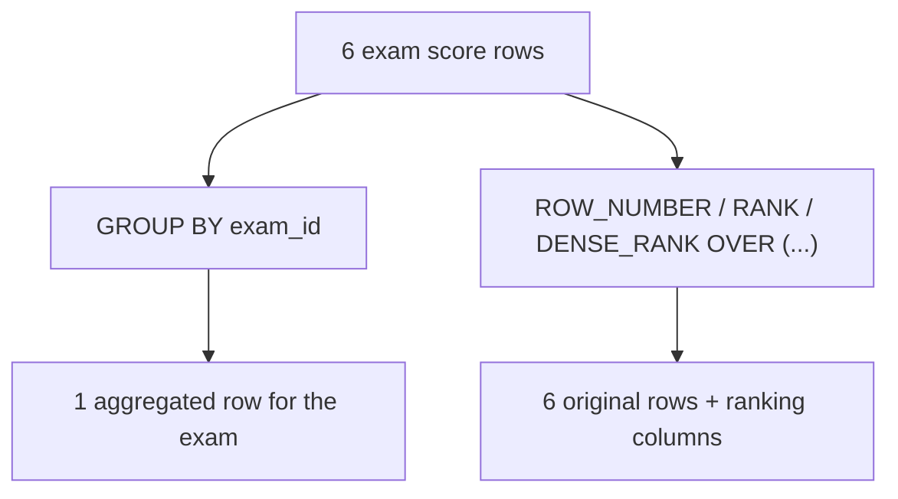

# row_number, rank, dense_rank, and Tie Handling in PostgreSQL

When building leaderboards for exam scores, best-selling products, top-performing sales reps, or each account's latest transaction, the question is often not just **"which row comes first?"** but also **"do two tied rows receive the same rank?"**.

PostgreSQL provides three very important window functions:

- `ROW_NUMBER()`: assigns a **unique sequential number to each row**, even when multiple rows share the same sort value.
- `RANK()`: tied rows receive the **same rank**, after which ranking numbers **leave gaps**.
- `DENSE_RANK()`: tied rows receive the **same rank**, yet subsequent rank numbers **do not leave gaps**.

They all belong to the family of **window functions**. Instead of collapsing multiple rows into one like `GROUP BY`, they **preserve every row in the result** and compute an extra value based on rows in the same group (*partition*) and the window's ordering rules.

For example, with scores ordered from highest to lowest:

```text
Student     Score   ROW_NUMBER    RANK    DENSE_RANK
An           95         1          1          1
Bình         95         2          1          1
Chi          90         3          3          2
Dũng         90         4          3          2
Em           90         5          3          2
Giang        75         6          6          3
```

**The same six people, three columns giving three different meanings.** Picking the wrong function can exclude a tied candidate from a Top N list, or cause a display position to be mistaken for an official competition rank.

This lesson explains syntax, the *peer group* concept, `PARTITION BY` and `ORDER BY`, how to select Top N with or without ties, `NULL` handling rules, tie-breaker selection, PostgreSQL performance, and practical SQL exercises.

## 1. How do window functions differ from GROUP BY?

An aggregate query:

```sql
SELECT exam_id, COUNT(*) AS participant_count
FROM exam_results
GROUP BY exam_id;
```

returns **one row per `exam_id`**. Information about individual students no longer appears separately in the result.

Meanwhile:

```sql
SELECT
    exam_id,
    candidate_id,
    score,
    ROW_NUMBER() OVER (
        PARTITION BY exam_id
        ORDER BY score DESC
    ) AS row_no
FROM exam_results;
```

still returns **one row per exam/student**, while attaching a sequence number to each student **within their respective exam**.

The two statements above use the table name `exam_results` as a **conceptual model**. A runnable dataset will be created in the `ranking_lab` schema in Section 3.

### 1.1. Structure of OVER

Window functions use the syntax:

```sql
window_function() OVER (
    PARTITION BY partition_column
    ORDER BY sort_expression DESC
)
```

| Component | Meaning |
| --- | --- |
| `ROW_NUMBER()` / `RANK()` / `DENSE_RANK()` | The numbering or ranking calculation |
| `OVER (...)` | Specifies the window applied to the function |
| `PARTITION BY exam_id` | Splits rows into independent groups; restarts numbering in each group |
| `ORDER BY score DESC` | Defines the ordering used to rank **within each group** |
| Outermost `ORDER BY ...` | Governs the **display order** of final result rows |

**Without `PARTITION BY`**: the entire participating row set is treated as one partition. **Without `ORDER BY` inside `OVER`**: the function has no explicit sorting criterion; for `RANK` and `DENSE_RANK`, all rows in the same partition form one peer group, while `ROW_NUMBER` ordering is non-deterministic.

### 1.2. Window functions do not reduce row count on their own



That is why window functions fit reports that need to show each person, order, or product while also reporting their **relative position within a group**.

## 2. Three numbering rules to remember

Suppose an exam has 6 students with scores:

```text
95, 95, 90, 90, 90, 75
```

When ranking scores **descending**:

| Value | Tied row count | `ROW_NUMBER` | `RANK` | `DENSE_RANK` |
| ---: | ---: | --- | --- | --- |
| 95 | 2 | 1, 2 | 1, 1 | 1, 1 |
| 90 | 3 | 3, 4, 5 | 3, 3, 3 | 2, 2, 2 |
| 75 | 1 | 6 | 6 | 3 |

Exact interpretation:

**`ROW_NUMBER()`**

- Always assigns a **distinct** positive integer to each row in a partition.
- Continuous sequence `1, 2, 3, ...`, with no duplicates or gaps.
- Two people with 95 still receive two different numbers, e.g., 1 and 2.
- If the `ORDER BY` clause is insufficient to distinguish two people, **who gets 1 vs. 2 can be unstable**.

**`RANK()`**

- Rows considered **tied across all `ORDER BY` expressions of the window** receive the same rank.
- The next rank equals **1 + number of preceding rows with a better ranking value**.
- Two people tied at rank 1 with 95 occupy two positions; the 90 group starts at **rank 3**, not rank 2.
- Five people across the 95 and 90 groups occupy five positions; the person with 75 gets **rank 6**.

**`DENSE_RANK()`**

- Tied rows also receive the same rank.
- The next rank equals **1 + number of distinct better ranking value tiers**.
- After the rank-1 group scoring 95, the 90 group receives **rank 2**, regardless of how many people scored 95.
- The 75 group receives **rank 3**, not rank 6.

A quick mnemonic:

```text
ROW_NUMBER: per-person sequence number
RANK:       competition rank; leaves gaps after ties
DENSE_RANK: score-tier rank; leaves no gaps
```

## 3. PostgreSQL dataset for practice

The following examples use a **practice database**, never touching real production user data. Create a separate `ranking_lab` schema and two tables: exams and results.

### 3.1. Exams table

```sql
CREATE SCHEMA IF NOT EXISTS ranking_lab;

CREATE TABLE ranking_lab.exams (
    exam_id   INTEGER PRIMARY KEY,
    exam_name TEXT NOT NULL
);
```

### 3.2. Results table

```sql
CREATE TABLE ranking_lab.results (
    exam_id        INTEGER NOT NULL
        REFERENCES ranking_lab.exams (exam_id),
    candidate_id   INTEGER NOT NULL,
    candidate_name TEXT NOT NULL,
    score          NUMERIC(5, 2),
    graded_at      TIMESTAMPTZ,
    CONSTRAINT pk_exam_results
        PRIMARY KEY (exam_id, candidate_id),
    CONSTRAINT chk_exam_score
        CHECK (score BETWEEN 0 AND 100),
    CONSTRAINT chk_exam_grade_state
        CHECK (
            (score IS NULL AND graded_at IS NULL)
            OR
            (score IS NOT NULL AND graded_at IS NOT NULL)
        )
);
```

Explanation:

- `(exam_id, candidate_id)` is a **composite key**: one candidate has only one result row per exam in this model.
- `score NUMERIC(5,2)` permits values from 0–100 including decimal scores.
- `score IS NULL` means **not yet graded or no score yet**, not defaulting to 0.
- `graded_at` records when the result was logged; in examples it is also used as a **secondary criterion** when a single representative row must be chosen.
- The state check constraint ensures `score` and `graded_at` are **both present or both absent**.

This learning model assumes **one result per candidate per exam**. If business rules allow multiple retakes, the table should have an `attempt_id` and a dedicated rule determining which attempt is ranked. Never delete other attempts just to force data to fit a window function.

### 3.3. Inserting exams

```sql
INSERT INTO ranking_lab.exams (exam_id, exam_name)
VALUES
    (101, 'SQL Fundamentals'),
    (102, 'Practical PostgreSQL'),
    (103, 'Exam without results');
```

Exam 103 has **no result records yet**. It illustrates the difference between **a partition that is not created** and **a row with a NULL score**.

### 3.4. Inserting results with intentional ties

```sql
INSERT INTO ranking_lab.results
    (exam_id, candidate_id, candidate_name, score, graded_at)
VALUES
    (101, 1, 'An',    95, TIMESTAMPTZ '2026-04-01 09:10:00+07'),
    (101, 2, 'Bình',  95, TIMESTAMPTZ '2026-04-01 09:05:00+07'),
    (101, 3, 'Chi',   90, TIMESTAMPTZ '2026-04-01 09:20:00+07'),
    (101, 4, 'Dũng',  90, TIMESTAMPTZ '2026-04-01 09:15:00+07'),
    (101, 5, 'Em',    90, TIMESTAMPTZ '2026-04-01 09:25:00+07'),
    (101, 6, 'Giang', 75, TIMESTAMPTZ '2026-04-01 09:30:00+07'),
    (101, 7, 'Hòa', NULL, NULL),

    (102, 8,  'Hà',    100, TIMESTAMPTZ '2026-04-02 10:01:00+07'),
    (102, 9,  'Khoa',   98, TIMESTAMPTZ '2026-04-02 10:03:00+07'),
    (102, 10, 'Lan',    98, TIMESTAMPTZ '2026-04-02 10:02:00+07'),
    (102, 11, 'Minh',   88, TIMESTAMPTZ '2026-04-02 10:04:00+07'),
    (102, 12, 'Ngọc',   80, TIMESTAMPTZ '2026-04-02 10:06:00+07'),
    (102, 13, 'Phúc',   80, TIMESTAMPTZ '2026-04-02 10:05:00+07'),
    (102, 14, 'Quỳnh', NULL, NULL);
```

The dataset has **14 rows** across two exams: **12 graded candidates** and **2 ungraded candidates**.

Summary of graded scores:

| exam_id | Scores descending | Graded count | Distinct score tiers |
| ---: | --- | ---: | ---: |
| 101 | 95, 95, 90, 90, 90, 75 | 6 | 3 |
| 102 | 100, 98, 98, 88, 80, 80 | 6 | 4 |
| 103 | No results yet | 0 | 0 |

**Do not confuse two ungraded candidates with two candidates scoring 0.** A score of 0 is a measured value and can be ranked; `NULL` in this table indicates grading data is not yet available.

### 3.5. Viewing the source data

```sql
SELECT
    exam_id,
    candidate_id,
    candidate_name,
    score,
    graded_at
FROM ranking_lab.results
ORDER BY exam_id, candidate_id;
```

Having `ORDER BY exam_id, candidate_id` here only makes viewing the source data readable. It **does not compute ranks**, nor does it replace `ORDER BY` inside a window when ranking.

## 4. Three functions on the same results table

First, rank only candidates **who have scores**:

```sql
SELECT
    exam_id,
    candidate_id,
    candidate_name,
    score,
    ROW_NUMBER() OVER (
        PARTITION BY exam_id
        ORDER BY score DESC, candidate_id ASC
    ) AS row_no,
    RANK() OVER (
        PARTITION BY exam_id
        ORDER BY score DESC
    ) AS competition_rank,
    DENSE_RANK() OVER (
        PARTITION BY exam_id
        ORDER BY score DESC
    ) AS dense_rank
FROM ranking_lab.results
WHERE score IS NOT NULL
ORDER BY exam_id, row_no;
```

Result for exam **101**:

| candidate_id | candidate_name | score | row_no | competition_rank | dense_rank |
| ---: | --- | ---: | ---: | ---: | ---: |
| 1 | An | 95 | 1 | 1 | 1 |
| 2 | Bình | 95 | 2 | 1 | 1 |
| 3 | Chi | 90 | 3 | 3 | 2 |
| 4 | Dũng | 90 | 4 | 3 | 2 |
| 5 | Em | 90 | 5 | 3 | 2 |
| 6 | Giang | 75 | 6 | 6 | 3 |

Result for exam **102**:

| candidate_id | candidate_name | score | row_no | competition_rank | dense_rank |
| ---: | --- | ---: | ---: | ---: | ---: |
| 8 | Hà | 100 | 1 | 1 | 1 |
| 9 | Khoa | 98 | 2 | 2 | 2 |
| 10 | Lan | 98 | 3 | 2 | 2 |
| 11 | Minh | 88 | 4 | 4 | 3 |
| 12 | Ngọc | 80 | 5 | 5 | 4 |
| 13 | Phúc | 80 | 6 | 5 | 4 |

### 4.1. Why does ROW_NUMBER include candidate_id while RANK does not?

This is the most important aspect of the query:

```sql
ROW_NUMBER() OVER (
    PARTITION BY exam_id
    ORDER BY score DESC, candidate_id ASC
)
```

with the extra `candidate_id`, it **picks a deterministic order for two people with the same score**. Both `score = 95` rows are numbered according to `candidate_id = 1, 2`.

However:

```sql
RANK() OVER (
    PARTITION BY exam_id
    ORDER BY score DESC
)
```

evaluates only `score`, so An and Bình **genuinely tie for 1st**. If `candidate_id` were added to `RANK`'s `ORDER BY`, they would no longer be peers and would **no longer tie**. Distinguish **ordering for stable display** from **criteria that determine rank**.

### 4.2. The same partition can have multiple different WINDOW specs

A single query is allowed to invoke multiple window functions with different `ORDER BY` rules:

- `ROW_NUMBER` by score and ID for a unique sequence number.
- `RANK` by score to preserve ties.
- `DENSE_RANK` by score to number score tiers.

Not all window functions in one `SELECT` have to share the same sort column list.

## 5. Peer groups: what counts as a tie?

In PostgreSQL, rows with **equal values across all `ORDER BY` expressions of the window** are called **peers**. With:

```sql
ORDER BY score DESC
```

An and Bình are peers because both have `score = 95`. Chi, Dũng, and Em form a peer group because all have `score = 90`.

However, with:

```sql
ORDER BY score DESC, candidate_id ASC
```

no two rows share the exact same `(score, candidate_id)` pair in the sample table, so **there are no ties** under that window configuration.

`RANK` and `DENSE_RANK` are based on **peer groups**, not merely a column named `score`. If the business rule says "tie when scores are equal", keep **only `score`** as the window ranking criterion.

### 5.1. Meaning formulas

Consider a group containing all graded candidates:

- **`ROW_NUMBER`:** row sequence number from 1 to N in a deterministic order.
- **`RANK`:** `1 + number of rows with a better ranking value than the current row`.
- **`DENSE_RANK`:** `1 + number of distinct better ranking value tiers than the current row`.

In exam 101:

- Score 90 has **2 people with better scores** → `RANK = 1 + 2 = 3`.
- There is only **1 better score tier** (95) → `DENSE_RANK = 1 + 1 = 2`.
- Score 75 has **5 people with better scores** → `RANK = 6`; yet only **2 better score tiers** (95 and 90) → `DENSE_RANK = 3`.

### 5.2. Does RANK have "gaps"?

More accurately, these are **rank offsets caused by ties occupying positions**. No data is missing:

```text
RANK:
1, 1, 3, 3, 3, 6

DENSE_RANK:
1, 1, 2, 2, 2, 3
```

When two people share 1st place, the next rank in **competition ranking** is 3rd. In dense ranking, the rank represents **ordered score tiers**, so it steps from 1st to 2nd.

## 6. PARTITION BY: restarting numbering per group

`PARTITION BY exam_id` divides the row set into independent groups:

```text
exam_id = 101 -> ROW_NUMBER 1..6
exam_id = 102 -> ROW_NUMBER 1..6
```

If `PARTITION BY` is omitted:

```sql
SELECT
    exam_id,
    candidate_name,
    score,
    ROW_NUMBER() OVER (
        ORDER BY score DESC, exam_id, candidate_id
    ) AS global_row_no,
    RANK() OVER (
        ORDER BY score DESC
    ) AS global_rank
FROM ranking_lab.results
WHERE score IS NOT NULL
ORDER BY global_row_no;
```

then all 12 graded candidates across both exams are ranked in **one combined leaderboard**. Exam 102's score of 100 comes before exam 101's 95, though whether comparing scores across two different exams is valid is a **business decision**, not a default property of SQL.

### 6.1. PARTITION BY does not have to match the primary key

You can partition by class, branch, department, or year:

```sql
PARTITION BY region_id, report_month
```

The partition is then defined by the **combination of both columns**. `ROW_NUMBER`/`RANK`/`DENSE_RANK` all reset to 1 for each distinct combination of partition values.

If you write only `PARTITION BY region_id` and forget the month, rankings from last month and this month **get mixed into the same partition**. This is analogous to forgetting `tenant_id` in a composite join key.

### 6.2. Partitions do not invent missing data rows

Exam 103 exists in `ranking_lab.exams` but has **no results** in `ranking_lab.results`. A query reading only from `results` **cannot fabricate** a ranking group for exam 103.

To show exams with no participants yet, start from `exams` and `LEFT JOIN` statistics or pre-ranked results.

## 7. ORDER BY inside OVER vs. final query ORDER BY

The two `ORDER BY` placements serve two purposes:

```sql
SELECT
    exam_id,
    candidate_name,
    score,
    ROW_NUMBER() OVER (
        PARTITION BY exam_id
        ORDER BY score DESC, candidate_id
    ) AS row_no
FROM ranking_lab.results
WHERE score IS NOT NULL
ORDER BY exam_id, candidate_name;
```

- `ORDER BY score DESC, candidate_id` **inside `OVER`** determines `row_no`.
- `ORDER BY exam_id, candidate_name` **at the outermost level** determines the order users see in the result table.

Therefore, when sorted by name, the `row_no` column may show 2, 3, 1, 4… depending on names. **The numbering function is not wrong**: display order simply differs from ranking order.

To display the table in rank order, write:

```sql
ORDER BY exam_id, row_no
```

Without an outer-query `ORDER BY`, PostgreSQL **does not guarantee the final row order**, even if the window declares `ORDER BY`.

### 7.1. Is ROW_NUMBER without a tie-breaker stable?

```sql
ROW_NUMBER() OVER (
    PARTITION BY exam_id
    ORDER BY score DESC
)
```

With An and Bình tied at 95, one run might number An 1 and Bình 2; another query plan might flip them. PostgreSQL **promises no deterministic order among peers** when the sort key does not distinguish them.

If an API needs pagination, a single winner, or positional persistence, use a **stable tie-breaker**, such as:

```sql
ORDER BY score DESC, graded_at ASC, candidate_id ASC
```

In the sample data, Bình scored 95 and was graded at 09:05, earlier than An at 09:10, so Bình can take first place under an **earlier grading timestamp** secondary criterion.

**Use `graded_at` as a priority criterion only if business rules genuinely intend earlier-graded candidates to win.** If it is merely when a background job processed grading, that would be unfair. When only technical stability is needed, use a unique identifier such as `candidate_id` without presenting it as a winning rule.

## 8. Distinguishing technical tie-breakers from ranking criteria

Two requirements are frequently confused:

**Requirement A: preserve ties by score**, while keeping the display list stable.

```sql
SELECT
    exam_id,
    candidate_id,
    candidate_name,
    score,
    RANK() OVER (
        PARTITION BY exam_id
        ORDER BY score DESC
    ) AS official_rank,
    ROW_NUMBER() OVER (
        PARTITION BY exam_id
        ORDER BY score DESC, candidate_id
    ) AS display_position
FROM ranking_lab.results
WHERE score IS NOT NULL
ORDER BY exam_id, display_position;
```

An and Bình both keep `official_rank = 1`, while `display_position` is 1 and 2.

**Requirement B: genuinely break ties by score, then completion time**.

```sql
SELECT
    exam_id,
    candidate_name,
    score,
    graded_at,
    RANK() OVER (
        PARTITION BY exam_id
        ORDER BY score DESC, graded_at ASC
    ) AS score_time_rank
FROM ranking_lab.results
WHERE score IS NOT NULL
ORDER BY exam_id, score_time_rank, candidate_id;
```

With the sample data, Bình and An both have 95 yet **differ in `graded_at`**, so under the new rule they **no longer tie**.

Do not automatically append `candidate_id` to `RANK() OVER(ORDER BY score DESC, ...)` just to stabilize the plan or output. Since IDs are unique, doing so turns most ranks into sequential numbers and eliminates the ties users expect.

### 8.1. What if there is still a tie on the secondary criterion?

Suppose two candidates have the same score **and** the same qualifying timestamp. Under `RANK() OVER(ORDER BY score DESC, finished_at ASC)`, they remain peers. If deterministic display ordering is needed, create a separate `ROW_NUMBER()` with a unique key in its own window; there is no need to inject that key into the official rank.

### 8.2. There is no single "most correct" way to handle ties

Different policies are all valid:

- **Competition:** two tied people share a rank, next rank skips → `RANK`.
- **Proficiency levels or score tiers:** distinct score values receive tiers 1, 2, 3… → `DENSE_RANK`.
- **Picking strictly one winner for a single prize:** requires an explicit tie-breaker and `ROW_NUMBER`.
- **Selecting everyone in prize-winning positions with ties:** `RANK` or a specifically defined score threshold.

SQL functions should reflect the **agreed-upon rules**, not the other way around.

## 9. Top 1 per group: one person or all tied winners?

The request **"get the top performer per exam"** can be interpreted in two ways.

### 9.1. Taking strictly one row per exam

Use `ROW_NUMBER` with deterministic sorting criteria:

```sql
WITH numbered AS (
    SELECT
        exam_id,
        candidate_id,
        candidate_name,
        score,
        ROW_NUMBER() OVER (
            PARTITION BY exam_id
            ORDER BY score DESC, candidate_id ASC
        ) AS rn
    FROM ranking_lab.results
    WHERE score IS NOT NULL
)
SELECT
    exam_id, candidate_id, candidate_name, score
FROM numbered
WHERE rn = 1
ORDER BY exam_id;
```

Result:

| exam_id | candidate_name | score |
| ---: | --- | ---: |
| 101 | An | 95 |
| 102 | Hà | 100 |

Exam 101 has two people with 95, yet `candidate_id ASC` picks An as the **first representative row**. This **does not mean Bình placed lower**; it is simply a single-row selection policy.

### 9.2. Taking everyone tied for first place

Use `RANK`:

```sql
WITH ranked AS (
    SELECT
        exam_id,
        candidate_id,
        candidate_name,
        score,
        RANK() OVER (
            PARTITION BY exam_id
            ORDER BY score DESC
        ) AS rnk
    FROM ranking_lab.results
    WHERE score IS NOT NULL
)
SELECT
    exam_id, candidate_id, candidate_name, score
FROM ranked
WHERE rnk = 1
ORDER BY exam_id, candidate_id;
```

Result:

| exam_id | candidate_name | score |
| ---: | --- | ---: |
| 101 | An | 95 |
| 101 | Bình | 95 |
| 102 | Hà | 100 |

**Both first-place ties are preserved.** For `rank = 1`, `DENSE_RANK() = 1` returns the exact same set; differences between the two functions become clear when selecting Top 2, Top 3, or further tiers.

## 10. Top N with ROW_NUMBER: at most N rows if sufficient data exists

Example selecting the **first two people per exam**, applying `candidate_id` as tie-breaker:

```sql
WITH numbered AS (
    SELECT
        exam_id,
        candidate_id,
        candidate_name,
        score,
        ROW_NUMBER() OVER (
            PARTITION BY exam_id
            ORDER BY score DESC, candidate_id
        ) AS rn
    FROM ranking_lab.results
    WHERE score IS NOT NULL
)
SELECT
    exam_id, candidate_name, score, rn
FROM numbered
WHERE rn <= 2
ORDER BY exam_id, rn;
```

Result:

| exam_id | candidate_name | score | rn |
| ---: | --- | ---: | ---: |
| 101 | An | 95 | 1 |
| 101 | Bình | 95 | 2 |
| 102 | Hà | 100 | 1 |
| 102 | Khoa | 98 | 2 |

Lan, who tied Khoa at 98, **is excluded**, because `ROW_NUMBER` assigns her position 3 via the tie-breaker. If the product requires **always at most two people per exam**, that is the right behavior. If you must **not drop tied people at the Top 2 boundary**, a different rule is required.

### 10.1. When a partition has fewer than N rows

If an exam only has one graded candidate and you filter `rn <= 3`, the result has one row—it does not pad two blank rows. If an exam has no records at all, querying `results` returns no rows for that exam.

`ROW_NUMBER` guarantees **at most N rows per partition**, not always exactly N rows.

## 11. Top N with RANK: by competition standing

Example retrieving all candidates whose **competition rank is at most 2**:

```sql
WITH ranked AS (
    SELECT
        exam_id,
        candidate_id,
        candidate_name,
        score,
        RANK() OVER (
            PARTITION BY exam_id
            ORDER BY score DESC
        ) AS competition_rank
    FROM ranking_lab.results
    WHERE score IS NOT NULL
)
SELECT
    exam_id, candidate_name, score, competition_rank
FROM ranked
WHERE competition_rank <= 2
ORDER BY exam_id, competition_rank, candidate_id;
```

Result:

| exam_id | candidate_name | score | competition_rank |
| ---: | --- | ---: | ---: |
| 101 | An | 95 | 1 |
| 101 | Bình | 95 | 1 |
| 102 | Hà | 100 | 1 |
| 102 | Khoa | 98 | 2 |
| 102 | Lan | 98 | 2 |

In exam **101**, two people tied for 1st place **occupied the top two spots**. The next rank is **3**, so `competition_rank <= 2` **excludes the 90-point group**.

In exam **102**, Hà is rank 1 while Khoa and Lan tie at rank 2, so the query returns **three people** for Top 2.

This expresses the policy "everyone holding competition rank 1 or 2 wins a prize".

## 12. Top N with DENSE_RANK: N highest score tiers

Example selecting the **top two score tiers** per exam:

```sql
WITH ranked AS (
    SELECT
        exam_id,
        candidate_id,
        candidate_name,
        score,
        DENSE_RANK() OVER (
            PARTITION BY exam_id
            ORDER BY score DESC
        ) AS score_level
    FROM ranking_lab.results
    WHERE score IS NOT NULL
)
SELECT
    exam_id, candidate_name, score, score_level
FROM ranked
WHERE score_level <= 2
ORDER BY exam_id, score_level, candidate_id;
```

Result:

| exam_id | candidate_name | score | score_level |
| ---: | --- | ---: | ---: |
| 101 | An | 95 | 1 |
| 101 | Bình | 95 | 1 |
| 101 | Chi | 90 | 2 |
| 101 | Dũng | 90 | 2 |
| 101 | Em | 90 | 2 |
| 102 | Hà | 100 | 1 |
| 102 | Khoa | 98 | 2 |
| 102 | Lan | 98 | 2 |

Exam 101 returns **five people** because there are **two score tiers**: 95 and 90. This is **neither Top 2 people** nor Top 2 competition spots. It is the **Top 2 distinct score values**.

### 12.1. Top N decision table

| Business requirement | Suitable function | Exam 101 with N = 2 |
| --- | --- | --- |
| Strictly at most 2 people, deterministic tie-breaker | `ROW_NUMBER() <= 2` | An, Bình |
| Everyone with competition rank <= 2 | `RANK() <= 2` | An, Bình |
| Everyone in the 2 highest score tiers | `DENSE_RANK() <= 2` | An, Bình, Chi, Dũng, Em |

For exam 102, `ROW_NUMBER() <= 2` returns only Hà and Khoa, whereas both tie-preserving approaches also include Lan. This is a great example for verifying whether "Top 2" **permits more than two rows**.

## 13. What if there is a tie at the Top N boundary?

Consider exam 102's scores:

```text
100  -> Hà
98   -> Khoa
98   -> Lan
88   -> Minh
80   -> Ngọc
80   -> Phúc
```

If picking "**top 2 people**", either Khoa or Lan must be chosen as the second person using a secondary criterion.

If picking "**2 spots including ties**", Hà (rank 1) and both Khoa and Lan (rank 2) are selected.

If picking "**2 highest score tiers**", in this exam it also selects 100 and 98 (three people); however, in exam 101, this picks five people due to tiers 95 and 90.

**No SQL formula inherently knows whether organizers want to award 2 prizes, award everyone tied at the boundary, or award every score tier.** Clarify the rules before writing the query.

### 13.1. Be careful with "WITH TIES"

PostgreSQL supports syntax for limiting results while **keeping tied rows at the boundary**:

```sql
SELECT
    candidate_id,
    candidate_name,
    score
FROM ranking_lab.results
WHERE exam_id = 102
  AND score IS NOT NULL
ORDER BY score DESC
FETCH FIRST 2 ROWS WITH TIES;
```

In PostgreSQL versions supporting `FETCH FIRST ... WITH TIES`, the result has **three people**: Hà (100), Khoa and Lan (98). This syntax relies on the **query-level ORDER BY list**, and does not automatically compute Top N per partition.

If you add `candidate_id` to `ORDER BY`:

```sql
ORDER BY score DESC, candidate_id
FETCH FIRST 2 ROWS WITH TIES
```

then each `(score, candidate_id)` pair is unique in the sample data; Khoa and Lan **are no longer ties under ORDER BY**, and the result has only two rows. This is the exact same issue of **tie-breakers breaking ties** seen with `RANK()`.

### 13.2. Per-group Top N requires PARTITION BY

`FETCH FIRST 2 ROWS WITH TIES` limits the **entire result** of a query like the one above, rather than independently limiting exam 101 and exam 102.

To get Top N **within each exam** with ties, the clear method is computing `RANK() OVER(PARTITION BY exam_id ORDER BY score DESC)` in a CTE/subquery and filtering at the outer level.

## 14. Why is a CTE or subquery required to filter ranks?

Window functions are evaluated at a logical stage after `WHERE`, `GROUP BY`, and `HAVING` of the **same query level** have processed the input. Consequently, you **cannot place a window function directly inside `WHERE`** of that same `SELECT`.

Invalid example:

```sql
-- Does NOT run: window functions cannot be used directly
-- in WHERE at the same query level.
SELECT exam_id, candidate_name, score
FROM ranking_lab.results
WHERE ROW_NUMBER() OVER (
    PARTITION BY exam_id
    ORDER BY score DESC
) <= 2;
```

Solution:

```sql
WITH numbered AS (
    SELECT
        exam_id,
        candidate_name,
        candidate_id,
        score,
        ROW_NUMBER() OVER (
            PARTITION BY exam_id
            ORDER BY score DESC, candidate_id
        ) AS rn
    FROM ranking_lab.results
    WHERE score IS NOT NULL
)
SELECT exam_id, candidate_name, score, rn
FROM numbered
WHERE rn <= 2
ORDER BY exam_id, rn;
```

In the outer query, `rn` **has become an output column of the CTE**, so using it in `WHERE` is valid.

### 14.1. A derived table can be used

```sql
SELECT
    r.exam_id,
    r.candidate_name,
    r.score,
    r.rnk
FROM (
    SELECT
        exam_id,
        candidate_name,
        candidate_id,
        score,
        RANK() OVER (
            PARTITION BY exam_id
            ORDER BY score DESC
        ) AS rnk
    FROM ranking_lab.results
    WHERE score IS NOT NULL
) AS r
WHERE r.rnk <= 2
ORDER BY r.exam_id, r.rnk, r.candidate_id;
```

The semantics are equivalent to a CTE. Use a CTE when you want clearly named stages; use a subquery when requirements are simple and the codebase prefers concise phrasing.

### 14.2. Inner WHERE and outer WHERE are not equivalent

`WHERE score IS NOT NULL` **inside** the CTE removes ungraded candidates **before ranking**, so only graded candidates are numbered.

`WHERE rnk <= 2` **outside** the CTE picks rows that have already been assigned ranks.

If you place conditions like `status = 'PAID'`, `region = ...`, or `score >= ...` at different levels, consider whether they **alter the set of competing rows in the partition** or merely filter displayed results. A filter changing ranking inputs can **shift every rank**.

## 15. NULLs in ORDER BY: who gets ranked first?

PostgreSQL has default rules worth memorizing:

- `ORDER BY score ASC` places `NULL` **last** by default.
- `ORDER BY score DESC` places `NULL` **first** by default.

Thus, if you write:

```sql
SELECT
    exam_id,
    candidate_name,
    score,
    ROW_NUMBER() OVER (
        PARTITION BY exam_id
        ORDER BY score DESC
    ) AS rn
FROM ranking_lab.results
ORDER BY exam_id, rn;
```

then in each exam, an **ungraded** candidate can receive `rn = 1`, because `score NULL` precedes numeric scores under default `DESC` sorting. This is usually **wrong for leaderboard logic**.

### 15.1. Approach 1: exclude ungraded candidates

```sql
SELECT
    exam_id,
    candidate_name,
    score,
    RANK() OVER (
        PARTITION BY exam_id
        ORDER BY score DESC
    ) AS rnk
FROM ranking_lab.results
WHERE score IS NOT NULL;
```

This fits when only graded candidates should be ranked.

### 15.2. Approach 2: keep rows but sort NULLs last

```sql
SELECT
    exam_id,
    candidate_name,
    score,
    RANK() OVER (
        PARTITION BY exam_id
        ORDER BY score DESC NULLS LAST
    ) AS rnk
FROM ranking_lab.results
ORDER BY exam_id, rnk, candidate_id;
```

In exam 101, after all graded candidates comes Hòa, with rank **7** because six graded candidates precede him. Quỳnh in exam 102 also comes after six graded candidates, at rank 7.

**However:** sorting `NULL` last does not mean "ungraded" should receive an official rank. If the application needs to display ungraded candidates without assigning a rank, combine with `CASE`:

```sql
SELECT
    exam_id,
    candidate_name,
    score,
    CASE
        WHEN score IS NOT NULL THEN
            RANK() OVER (
                PARTITION BY exam_id
                ORDER BY score DESC NULLS LAST
            )
        ELSE NULL
    END AS official_rank
FROM ranking_lab.results
ORDER BY exam_id, official_rank NULLS LAST, candidate_id;
```

In this case, `RANK` is still computed over all partition rows, yet ungraded candidates **display a NULL official rank**. That avoids misinterpreting "rank 7" as an achievement.

### 15.3. Multiple NULLs will tie when using RANK

If an exam has three `score IS NULL` rows sorted with `NULLS LAST`, all three are peers on `score` and receive the **same RANK/DENSE_RANK**.

To distinguish each person when a distinct order is needed, `ROW_NUMBER ... ORDER BY score DESC NULLS LAST, candidate_id` numbers them uniquely. Still, ungraded rows generally shouldn't appear on an "official leaderboard" without an explicit policy.

### 15.4. Do not blindly COALESCE NULL to 0 when 0 is a valid score

```sql
ORDER BY COALESCE(score, 0) DESC
```

treats an ungraded candidate identically to someone who **scored 0**. The two states have different business meanings; merging them can misreport statuses.

Prefer `WHERE score IS NOT NULL`, `NULLS LAST`, or separating the "ungraded" section per requirements.

## 16. ASC, DESC, and defining "better"

Larger is not always better across all metrics:

| Metric | Typical direction | Example |
| --- | --- | --- |
| Exam score | `ORDER BY score DESC` | 100 is better than 90 |
| Revenue | `ORDER BY revenue DESC` | 1 billion is higher than 500 million |
| Race completion time | `ORDER BY duration_ms ASC` | 45,000 ms is better than 60,000 ms |
| Error rate | `ORDER BY error_rate ASC` | 0.1% is better than 1% |
| Distance to target | `ORDER BY distance ASC` | Closer to target ranks higher |

Time-ranking example:

```sql
WITH race_times(name, duration_ms) AS (
    VALUES
        ('An', 45000),
        ('Bình', 45000),
        ('Chi', 48000),
        ('Dũng', 49000)
)
SELECT
    name,
    duration_ms,
    RANK() OVER (ORDER BY duration_ms ASC) AS race_rank,
    DENSE_RANK() OVER (ORDER BY duration_ms ASC) AS time_level
FROM race_times
ORDER BY race_rank, name;
```

Result:

| name | duration_ms | race_rank | time_level |
| --- | ---: | ---: | ---: |
| An | 45000 | 1 | 1 |
| Bình | 45000 | 1 | 1 |
| Chi | 48000 | 3 | 2 |
| Dũng | 49000 | 4 | 3 |

If you mistakenly use `DESC`, the slowest runner gets ranked 1st. Neither priorities nor ranking functions can fix picking the wrong sort direction.

## 17. Intentional multi-criteria ranking

Suppose the rules state:

> Higher score wins. If scores tie, whoever finished earlier wins. If both score and completion time tie, they **remain tied**.

Then:

```sql
RANK() OVER (
    PARTITION BY exam_id
    ORDER BY score DESC, graded_at ASC
)
```

matches the **two-criterion ranking** policy. Two rows tie only when **both `score` and `graded_at` are equal** under comparison rules.

If the rules merely state:

> Equal scores always tie. Grading time and student ID are for display only.

then the policy differs:

```sql
RANK() OVER (
    PARTITION BY exam_id
    ORDER BY score DESC
)
```

and to keep the list stable:

```sql
ROW_NUMBER() OVER (
    PARTITION BY exam_id
    ORDER BY score DESC, graded_at ASC, candidate_id ASC
)
```

**There is no conflict between the two functions**: they measure different concepts. You can return both `official_rank` and `display_position` in the same query.

### 17.1. Comparing floating-point numbers and rounded scores

Another pitfall: scores are stored at high precision while the UI displays one decimal place. For example, 89.94 and 89.96 may look identical or different when displayed depending on rounding rules.

If the rule **ranks by raw score**, use:

```sql
ORDER BY raw_score DESC
```

If the rule **ranks by score rounded to one decimal place**, use:

```sql
ORDER BY round(raw_score, 1) DESC
```

The snippet above is a **hypothetical SQL fragment assuming column `raw_score` exists**. What matters is storing separately and defining clearly **raw score**, **display score**, and **tie-evaluation score**. Never arbitrarily round inside a ranking query just to produce more or fewer tie groups.

## 18. Ranking over aggregated metrics

Ranking functions are often applied **after aggregating revenue, purchases, or points from multiple records**.

Suppose a sales line table has multiple rows for the same product. If you apply:

```sql
RANK() OVER (ORDER BY amount DESC)
```

directly on each line item, you rank **individual transactions**, not **total revenue per product**.

### 18.1. Aggregate first, rank afterward

```sql
WITH sale_lines(product_id, amount) AS (
    VALUES
        (10, 100000::numeric),
        (10, 50000::numeric),
        (20, 150000::numeric),
        (30, 90000::numeric),
        (40, 20000::numeric)
),
product_totals AS (
    SELECT
        product_id,
        SUM(amount) AS total_revenue
    FROM sale_lines
    GROUP BY product_id
)
SELECT
    product_id,
    total_revenue,
    RANK() OVER (
        ORDER BY total_revenue DESC
    ) AS revenue_rank,
    DENSE_RANK() OVER (
        ORDER BY total_revenue DESC
    ) AS revenue_level
FROM product_totals
ORDER BY revenue_rank, product_id;
```

Result:

| product_id | total_revenue | revenue_rank | revenue_level |
| ---: | ---: | ---: | ---: |
| 10 | 150000 | 1 | 1 |
| 20 | 150000 | 1 | 1 |
| 30 | 90000 | 3 | 2 |
| 40 | 20000 | 4 | 3 |

Products 10 and 20 have **equal total revenue**, even though product 10 has two transaction rows and product 20 has only one. The result accurately reflects **one row per product** thanks to aggregating beforehand.

### 18.2. Avoid JOIN fan-out before summing

If a product has multiple sales lines and multiple reviews, joining both child tables directly can **multiply rows** and sum revenue repeatedly. Aggregate each branch down to **product granularity** before joining and ranking.

`RANK` or `DENSE_RANK` simply orders whatever figures it receives; **it cannot detect inflated totals caused by a JOIN**.

## 19. Multi-column PARTITION BY: Top N per tenant and month

In multi-tenant systems, the same local product code may exist across different tenants. If you need Top products by **tenant and month**, the partition must include **both dimensions**.

Standalone example:

```sql
WITH monthly_sales(tenant_id, month_start, product_id, revenue) AS (
    VALUES
        (1, DATE '2026-01-01', 10, 100000::numeric),
        (1, DATE '2026-01-01', 20, 100000::numeric),
        (1, DATE '2026-01-01', 30,  50000::numeric),
        (1, DATE '2026-02-01', 10, 180000::numeric),
        (1, DATE '2026-02-01', 20, 140000::numeric),
        (2, DATE '2026-01-01', 10,  30000::numeric),
        (2, DATE '2026-01-01', 20,  90000::numeric)
),
ranked AS (
    SELECT
        tenant_id,
        month_start,
        product_id,
        revenue,
        RANK() OVER (
            PARTITION BY tenant_id, month_start
            ORDER BY revenue DESC
        ) AS rnk
    FROM monthly_sales
)
SELECT
    tenant_id,
    month_start,
    product_id,
    revenue,
    rnk
FROM ranked
WHERE rnk = 1
ORDER BY tenant_id, month_start, product_id;
```

Result:

| tenant_id | month_start | product_id | revenue | rnk |
| ---: | --- | ---: | ---: | ---: |
| 1 | 2026-01-01 | 10 | 100000 | 1 |
| 1 | 2026-01-01 | 20 | 100000 | 1 |
| 1 | 2026-02-01 | 10 | 180000 | 1 |
| 2 | 2026-01-01 | 20 | 90000 | 1 |

Tenant 1 in January has **two products tied for 1st place**. February is a new partition so rank resets to 1. Tenant 2 in January is also a separate partition.

Using only `PARTITION BY month_start` causes both tenants to compete together within the same month—which both produces wrong reports and risks leaking sensitive cross-tenant information.

**Composite keys and RLS/authorization are two separate concerns.** Proper partitioning ensures correct ranking scope; it does not prevent a user from viewing another tenant's data if their role holds broad `SELECT` privileges.

## 20. When you want strictly one representative row: DISTINCT ON

In PostgreSQL, `DISTINCT ON` is a handy syntax when you need **the first row per group**.

Example retrieving **one highest-scoring student per exam**, preferring the smaller ID on ties:

```sql
SELECT DISTINCT ON (exam_id)
    exam_id,
    candidate_id,
    candidate_name,
    score
FROM ranking_lab.results
WHERE score IS NOT NULL
ORDER BY
    exam_id,
    score DESC,
    candidate_id ASC;
```

The result is An for exam 101 and Hà for exam 102.

### 20.1. Comparing DISTINCT ON and ROW_NUMBER

| Goal | Suitable approach |
| --- | --- |
| Get the first row per group | `DISTINCT ON (group_key)` or `ROW_NUMBER() = 1` |
| Get top N rows per group | `ROW_NUMBER() <= N` |
| Get everyone tied for first place | `RANK() = 1` or `DENSE_RANK() = 1` |
| Get the top two score tiers | `DENSE_RANK() <= 2` |
| Display everyone and their rank | Window functions |

`DISTINCT ON` keeps only **one representative row** and cannot return all tied candidates on its own. Using it to build a list of first-place winners when ties exist can **miss eligible candidates**.

### 20.2. ORDER BY rule for DISTINCT ON

The expressions in `DISTINCT ON` must match the **leftmost** part of `ORDER BY` as required by PostgreSQL. Therefore:

```sql
DISTINCT ON (exam_id)
...
ORDER BY exam_id, score DESC, candidate_id
```

clearly expresses "group by exam, within each exam pick the best score, then the smallest ID". Without a deterministic `ORDER BY`, the chosen row is **unstable**.

## 21. Another way to keep all first-place ties: MAX(score)

If you only need the highest score per exam and **everyone who achieved that score**, you can use two steps:

```sql
WITH max_scores AS (
    SELECT
        exam_id,
        MAX(score) AS best_score
    FROM ranking_lab.results
    WHERE score IS NOT NULL
    GROUP BY exam_id
)
SELECT
    r.exam_id,
    r.candidate_id,
    r.candidate_name,
    r.score
FROM ranking_lab.results AS r
JOIN max_scores AS m
  ON m.exam_id = r.exam_id
 AND m.best_score = r.score
ORDER BY r.exam_id, r.candidate_id;
```

Result: An and Bình in exam 101, Hà in exam 102.

Compared with `RANK() = 1`:

- `MAX(score) + JOIN` directly expresses "every row matching the maximum score".
- `RANK()` is convenient when you also need **ranks 2, 3, Top N**, or to show everyone's rank.
- Both must explicitly handle **NULLs** and groups with no scores.

### 21.1. Using MAX on an all-NULL group

`MAX(score)` returns NULL if a group has no non-NULL scores. The join condition `m.best_score = r.score` will not match two NULLs as equal. In academic results tables, you should normally exclude ungraded records before finding top performers.

Do not "fix" this by treating NULL as 0 when 0 is a valid score.

## 22. Ungraded candidates vs. exams without results

Distinguish between:

1. **Hòa** in exam 101 and **Quỳnh** in exam 102: have rows in `results` with `score IS NULL`.
2. **Exam 103**: has a row in `exams`, yet **has zero rows** in `results`.

These two cases require different reporting logic.

### 22.1. Counting graded and ungraded candidates

```sql
SELECT
    e.exam_id,
    e.exam_name,
    COUNT(r.candidate_id) AS registered_candidates,
    COUNT(r.score) AS graded_candidates,
    COUNT(r.candidate_id) - COUNT(r.score)
        AS ungraded_candidates
FROM ranking_lab.exams AS e
LEFT JOIN ranking_lab.results AS r
  ON r.exam_id = e.exam_id
GROUP BY e.exam_id, e.exam_name
ORDER BY e.exam_id;
```

Result:

| exam_id | registered_candidates | graded_candidates | ungraded_candidates |
| ---: | ---: | ---: | ---: |
| 101 | 7 | 6 | 1 |
| 102 | 7 | 6 | 1 |
| 103 | 0 | 0 | 0 |

`COUNT(r.candidate_id)` counts candidates who have a result record. Do not use `COUNT(*)` to count registrants after a `LEFT JOIN` if exam 103 should return 0: exam 103 still has one row in the join result with NULL right-side columns, so `COUNT(*)` would return 1.

### 22.2. Including exams with no results on a leaderboard

```sql
WITH ranked AS (
    SELECT
        exam_id,
        candidate_id,
        candidate_name,
        score,
        RANK() OVER (
            PARTITION BY exam_id
            ORDER BY score DESC
        ) AS rnk
    FROM ranking_lab.results
    WHERE score IS NOT NULL
)
SELECT
    e.exam_id,
    e.exam_name,
    r.candidate_name,
    r.score,
    r.rnk
FROM ranking_lab.exams AS e
LEFT JOIN ranked AS r
  ON r.exam_id = e.exam_id
 AND r.rnk = 1
ORDER BY e.exam_id, r.candidate_id;
```

The result includes first-place winners for exams 101 and 102, **plus one row for exam 103** with NULL candidate and rank columns.

**Placing the `r.rnk = 1` filter inside the `ON` clause of the LEFT JOIN** preserves exams with no results. Moving this condition down into the outermost `WHERE` would drop exam 103 because `r.rnk IS NULL`.

### 22.3. Do not compute ranks on NULL rows generated by LEFT JOIN

A pitfall:

```sql
SELECT
    e.exam_id,
    r.candidate_id,
    RANK() OVER (
        PARTITION BY e.exam_id
        ORDER BY r.score DESC NULLS LAST
    ) AS rnk
FROM ranking_lab.exams AS e
LEFT JOIN ranking_lab.results AS r
  ON r.exam_id = e.exam_id;
```

Exam 103 has **one NULL-extended row produced by LEFT JOIN**; if `RANK` is evaluated directly over that set, this placeholder row receives `rnk = 1` even though no candidate exists.

To distinguish empty exams properly, **rank valid `results` first**, then `LEFT JOIN` back to `exams` as in Section 22.2.

## 23. Names, data types, and collations can also create ties

Ranking is not restricted to numbers. PostgreSQL can `ORDER BY` strings, timestamps, or expressions with appropriate comparison and ordering operators.

Example:

```sql
SELECT
    candidate_name,
    RANK() OVER (
        ORDER BY candidate_name ASC
    ) AS name_rank
FROM ranking_lab.results
WHERE exam_id = 101;
```

Name ordering can depend on **collation**, case sensitivity, and Unicode rules of the database/column. If a business rule requires text-based ranking, specify the collation and normalization strategy.

### 23.1. Values that display identically may not compare equal

Consider two raw scores:

```text
89.94
89.96
```

If the UI displays each number with **one decimal place**, viewers seeing identical text does not mean the raw values are equal. `RANK() OVER(ORDER BY raw_score DESC)` only ties values that comparison/`ORDER BY` treats as peers.

Similarly with names/strings: two strings that appear visually identical yet differ in Unicode normalization or collation may not behave as expected if design is inconsistent.

### 23.2. NULLS FIRST and NULLS LAST

Do not rely on defaults when policy is sensitive:

```sql
ORDER BY score DESC NULLS LAST
```

explicitly expresses "highest scores first, missing values at the end".

Besides the rank column, a tie-breaker can also be nullable. For example:

```sql
ORDER BY score DESC NULLS LAST,
         graded_at ASC NULLS LAST,
         candidate_id ASC
```

This ordering is clearer when handling both missing scores and missing timestamps simultaneously.

## 24. Percent rank, cume_dist, and ntile: extending the ranking concept

PostgreSQL also provides related window functions:

| Function | Meaning |
| --- | --- |
| `PERCENT_RANK()` | Rank-based ratio computed as `(rank - 1) / (N - 1)`, returning 0 for a single-row group |
| `CUME_DIST()` | Fraction of rows standing **no later than** the current peer position in sort order, divided by N |
| `NTILE(k)` | Divides rows into k buckets with roughly balanced row counts |

Example:

```sql
SELECT
    exam_id,
    candidate_name,
    score,
    RANK() OVER (
        PARTITION BY exam_id ORDER BY score DESC
    ) AS rnk,
    PERCENT_RANK() OVER (
        PARTITION BY exam_id ORDER BY score DESC
    ) AS percent_rank_value,
    CUME_DIST() OVER (
        PARTITION BY exam_id ORDER BY score DESC
    ) AS cume_dist_value
FROM ranking_lab.results
WHERE score IS NOT NULL
ORDER BY exam_id, score DESC, candidate_id;
```

For exam 101 with 6 graded candidates:

- Score 95 has `rank = 1`, so `percent_rank = 0`.
- Score 90 has `rank = 3`, so `percent_rank = (3 - 1)/(6 - 1) = 0.4`.
- With `CUME_DIST` ordered by `score DESC`, the 95 group accounts for 2/6 rows at or before that group; the 90 group accounts for 5/6.

**Note:** these values are not "percentage of exam score". They are **relative row position metrics** within an ordered set.

### 24.1. NTILE does not protect score ties

`NTILE(3)` splits rows into three buckets in order. If a peer group straddles a bucket boundary, students with the **exact same score** can land in **different buckets**.

Therefore, if business rules require **everyone with the same score to be in the same tier**, do not use `NTILE` assuming it preserves ties. Group by score tiers first or use `DENSE_RANK` with an explicit tier-splitting policy.

## 25. Window frames do not govern RANK and DENSE_RANK

In PostgreSQL window functions, you may see clauses like:

```sql
ROWS BETWEEN UNBOUNDED PRECEDING AND CURRENT ROW
```

That is a **window frame**. It is crucial for functions like `SUM(...) OVER(...)`, `FIRST_VALUE`, or `LAST_VALUE`, because it restricts the range of rows inside the partition used for evaluation.

However, **`ROW_NUMBER`, `RANK`, and `DENSE_RANK` derive their semantics from the partition and ordering/peer groups, not from frame boundaries**.

Example:

```sql
SELECT
    exam_id,
    candidate_name,
    score,
    RANK() OVER (
        PARTITION BY exam_id
        ORDER BY score DESC
        ROWS BETWEEN UNBOUNDED PRECEDING AND CURRENT ROW
    ) AS rnk_with_frame
FROM ranking_lab.results
WHERE score IS NOT NULL
ORDER BY exam_id, score DESC, candidate_id;
```

Adding such a frame **does not turn RANK into ROW_NUMBER** and does not alter score ties.

**Do not overgeneralize:** if you later use `LAST_VALUE(score) OVER(ORDER BY score DESC)`, the default or explicit frame can dramatically change the output. Each category of window function has its own frame rules.

## 26. Values computed by window functions are not immutable data

Ranks are calculated against the **currently available dataset**. If a new candidate is inserted into exam 101 with a score of 99:

```text
99
95, 95
90, 90, 90
75
```

then:

- The 99 entry takes rank 1.
- The 95 group shifts from rank 1 to rank 2.
- The 90 group shifts from rank 3 to rank 4 under `RANK`.
- The 75 entry shifts from rank 6 to rank 7 under `RANK`.

Therefore, storing a static `current_rank` column inside the results table **becomes stale** as soon as scores or participants change.

### 26.1. Usually compute ranks at query time

Advantages:

- Reflects committed data as of the corresponding snapshot.
- No need to update many rows' ranks whenever a new score arrives.
- Easy to switch policies between `RANK` and `DENSE_RANK` without altering base tables.

Trade-offs:

- Large ranking queries can incur sorting and window computation overhead.
- If a leaderboard is queried very frequently, optimize indexes or apply proper caching/materialization.

### 26.2. When should ranks be persisted?

A competition that has **finalized results and awarded prizes** may require an official rank record for auditing. In that case, do not store only the rank integer; also record:

- Policy version and tie-breaker criteria.
- Input result set used, cutoff timestamp, and data snapshot/version.
- Approval timestamp and authorized approver.
- Amendment/revocation workflow if results change after finalization.

An official finalized rank is a **frozen business decision**, unlike dynamically computed dashboard rankings.

## 27. Reading EXPLAIN: how does PostgreSQL evaluate windows?

PostgreSQL typically uses plan nodes such as `WindowAgg`, `Sort`, `Incremental Sort`, and table access nodes, depending on version, data, and optimizer choices.

Try:

```sql
EXPLAIN
SELECT
    exam_id,
    candidate_id,
    score,
    RANK() OVER (
        PARTITION BY exam_id
        ORDER BY score DESC
    ) AS rnk
FROM ranking_lab.results
WHERE score IS NOT NULL;
```

Key plan concepts to read:

| Plan component | Meaning |
| --- | --- |
| `Seq Scan` | Sequential table scan when the planner deems it suitable |
| `Index Scan` / `Index Only Scan` | Reading via an index when predicates and data favor it |
| `Sort` | Orders rows by the keys needed for the window |
| `Incremental Sort` | Exploits partial pre-existing order to perform additional sorting when appropriate |
| `WindowAgg` | Evaluates window functions over an appropriately organized row stream |
| `Filter` | `WHERE` predicate or filter inside another node depending on planner representation |

Plans are **not fixed**. On a 14-row demo table, PostgreSQL may sensibly pick `Seq Scan + Sort` even if an index exists. Never treat seeing `Seq Scan` on tiny tables as a bug that must be fixed.

### 27.1. Measuring actual execution

```sql
EXPLAIN (ANALYZE, BUFFERS)
SELECT
    exam_id,
    candidate_id,
    score,
    ROW_NUMBER() OVER (
        PARTITION BY exam_id
        ORDER BY score DESC, candidate_id
    ) AS rn
FROM ranking_lab.results
WHERE score IS NOT NULL;
```

`EXPLAIN ANALYZE` **executes the query** to collect timing, row counts, and buffer stats. It is great for learning on small `SELECT` examples, whereas on multi-million-row production reports you must weigh CPU, I/O, sort, and connection impact.

### 27.2. Indexes matching partition and ordering

For ranking queries by exam and score:

```sql
CREATE INDEX idx_ranking_results_exam_score
ON ranking_lab.results
    (exam_id, score DESC NULLS LAST, candidate_id)
WHERE score IS NOT NULL;
```

This index can help because:

- `exam_id` is the partition/filter key.
- `score DESC NULLS LAST` matches the score sort order.
- `candidate_id` supplies a stable tie-break order for `ROW_NUMBER` if the query uses the same criteria.
- The `WHERE score IS NOT NULL` predicate restricts the index to graded candidates.

However, having an index **does not guarantee** PostgreSQL will always skip `Sort` or use `Index Scan`; the planner weighs data size, statistics, heap fetch cost, and other factors. The query must also have predicates compatible with the partial index and matching order specifications.

### 27.3. Multiple window orderings in one query

In this lesson, `ROW_NUMBER` may use:

```sql
ORDER BY score DESC, candidate_id
```

while `RANK` uses:

```sql
ORDER BY score DESC
```

PostgreSQL may need to organize the data stream accordingly for different windows; do not assume one index eliminates every `Sort` in every plan. Measure with `EXPLAIN (ANALYZE, BUFFERS)` when performance truly matters.

### 27.4. Ranking only relevant rows

For example, if you only need exam 101:

```sql
SELECT
    candidate_name,
    score,
    RANK() OVER (ORDER BY score DESC) AS rnk
FROM ranking_lab.results
WHERE exam_id = 101
  AND score IS NOT NULL
ORDER BY rnk, candidate_id;
```

Filtering `exam_id` before the window shrinks the row set to process when indexes and data align. However, if the task is "rank system-wide and display only exam 101", do not push a filter that alters the competition scope ahead of ranking without reviewing semantics.

## 28. Transactions, snapshots, and ranking stability

PostgreSQL uses **MVCC** so queries read data according to a snapshot appropriate for the isolation level.

Suppose:

1. Query A returns exam 101 with An/Bình tied for 1st.
2. Another transaction updates a score or inserts a candidate and commits.
3. Query B recomputes the leaderboard.

Result B may show different ranks from Result A. This is normal behavior when underlying data changes.

### 28.1. Multiple windows in one statement see the same data

Within a single `SELECT`, `ROW_NUMBER`, `RANK`, and `DENSE_RANK` are computed over data read under the statement's snapshot, allowing metrics to be compared consistently within the same result.

### 28.2. Multiple statements needing the same snapshot

If a workflow runs several separate `SELECT` statements that require the same point-in-time view, consider a transaction:

```sql
BEGIN TRANSACTION ISOLATION LEVEL REPEATABLE READ READ ONLY;

SELECT COUNT(*)
FROM ranking_lab.results
WHERE exam_id = 101 AND score IS NOT NULL;

SELECT
    candidate_name,
    score,
    RANK() OVER (ORDER BY score DESC) AS rnk
FROM ranking_lab.results
WHERE exam_id = 101 AND score IS NOT NULL;

COMMIT;
```

In PostgreSQL, a `REPEATABLE READ` transaction uses a stable snapshot per its snapshot rules. However, long-running read transactions can impact row version management and `VACUUM`; do not hold transactions open just while a user views a dashboard.

**A stable snapshot does not guarantee ROW_NUMBER order among peers** if `ORDER BY` lacks a distinguishing key. Those are two separate concerns:

- Snapshot: **which rows** are read.
- Tie-breaker: **which row comes first** among equal ranking values.

## 29. Common ranking mistakes

| Mistake | Consequence | How to fix |
| --- | --- | --- |
| Treating `ROW_NUMBER` as a tie-aware rank | Two equal scores receive different ranks | Use `RANK` or `DENSE_RANK` when business rules allow ties |
| Treating `RANK` and `DENSE_RANK` as identical | Wrong Top N when preceding tiers have ties | Understand gap vs. no-gap numbering |
| Using `RANK() OVER(ORDER BY score DESC, candidate_id)` for score ranking | `candidate_id` breaks ties | `ORDER BY` score only in official rank; use a separate column for display position |
| Omitting a tie-breaker in `ROW_NUMBER` | Selected Top 1 row can fluctuate | Add a unique key to `ROW_NUMBER`'s `ORDER BY` |
| Forgetting `PARTITION BY exam_id` | Mixes results across exams | Partition by the exact competition scope |
| Partitioning by name instead of ID | Two people with the same name get merged or misgrouped | Use a stable identifier key |
| Omitting `NULLS LAST` with `ORDER BY score DESC` | Ungraded candidates can rank 1st | Filter out NULLs or specify `NULLS LAST` |
| Using `COALESCE(score,0)` blindly | Confuses ungraded with scoring 0 | Separate missing-data state |
| Assuming `ORDER BY` in `OVER` sorts final output | Displayed output order is erratic | Put `ORDER BY` in the outer query |
| Writing a window function in same-level `WHERE` | SQL error | Use a CTE/subquery and filter outside |
| Using `LIMIT N` to get Top N per exam | Limits only the global result | Use `PARTITION BY` and filter `rn`/`rank` |
| Using `FETCH FIRST N WITH TIES` with a unique key at the end of `ORDER BY` | Ties are broken | Separate tie criteria from display position |
| Thinking `RANK <= 2` means top two score tiers | May skip the second score tier due to gaps | Use `DENSE_RANK <= 2` |
| Thinking `DENSE_RANK <= 2` returns at most two people | Can return many rows sharing tied scores | Use `ROW_NUMBER <= 2` to cap row count |
| Using `DISTINCT ON` to keep all first-place ties | Picks only one row per group | Use `RANK = 1` or `MAX(score) + JOIN` |
| Using `NTILE` thinking it never splits ties | Peers can fall into different buckets | Design tier bucketing explicitly |
| Ranking individual transactions when ranking total product revenue | Ranks the wrong entity | `GROUP BY` to the right grain before the window |
| Summing after joining multiple child tables then ranking | Ranks multiplied revenue totals | Pre-aggregate each branch first |
| Ranking immediately after `LEFT JOIN exams -> results` | Empty exams may show rank 1 | Rank `results` first, then `LEFT JOIN` back to `exams` |
| Using system timestamp as tie-breaker without policy approval | Unfair, distorts business outcomes | Separate official rules from technical ordering |
| Persisting static ranks without updating when scores change | Ranks become stale | Compute dynamically or freeze official snapshot versions |
| Believing an index eliminates `Sort` | Planner may still sort | Inspect `EXPLAIN` and measure on real data |
| Using ranking output in place of tenant access control | Risk of cross-tenant data exposure | Enforce tenant scoping, privileges, and RLS where needed |

## 30. Process for designing a reliable leaderboard

When asked for "Top N per group", clarify these decisions:

1. **Entity being ranked:** person, product, store, order, or transaction?
2. **Input granularity:** is data already one row per entity, or must it be aggregated first?
3. **Competition scope:** system-wide, per exam, per tenant, per month?
4. **Metric:** score, revenue, duration, error rate; is larger or smaller better?
5. **NULL handling:** exclude from ranking, place last, or display "no data yet"?
6. **Tie policy:** do equal values share a rank? Do subsequent ranks leave gaps or not?
7. **Tie-breaker:** when a single row is required, use a business criterion or an ID for technical stability?
8. **Meaning of Top N:** N people, N competition spots, or N distinct score tiers?
9. **Filtering method:** compute the window in an inner query and filter `rn`/`rnk` in the outer query.
10. **Stability:** is the window's `ORDER BY` specific enough if deterministic results are required?
11. **Boundary test cases:** two tied for 1st, three tied at the next rank, score of 0, NULLs, and empty groups.
12. **Performance:** do partitions, sorts, and indexes match real data scale and distribution?
13. **Authorization:** is the viewer allowed to see every partition and every participant?
14. **Result finality:** live dynamic ranking or finalized ranking requiring versioning/audit?

Missing answers to items 5–8 can leave a query syntactically valid yet **misaligned with prize or reporting rules**.

## 31. Practice exercises

Use the `ranking_lab.exams` and `ranking_lab.results` tables from Section 3. Before running each query, predict the row count and ranks of tied groups.

1. **Basics:** write a query returning `candidate_name`, `score`, and `ROW_NUMBER()` for exam 101 only, ordered by score descending then `candidate_id` ascending.
2. **Ties:** add `RANK()` and `DENSE_RANK()` ordered by `score DESC`. Why do An and Bình share rank 1 while Chi gets `RANK = 3` and `DENSE_RANK = 2`?
3. **Score tiers:** explain why Giang gets `RANK = 6` yet `DENSE_RANK = 3` in exam 101.
4. **Second exam:** list the ranks of Hà, Khoa, Lan, Minh, Ngọc, and Phúc. Why is Minh rank 4 under `RANK` yet rank 3 under `DENSE_RANK`?
5. **PARTITION:** add `PARTITION BY exam_id` to rank both exam 101 and 102 in one query. Which columns reset to 1 at the new exam?
6. **Global ranking:** remove `PARTITION BY`. Why are the exams mixed together and why might the result lack business meaning?
7. **Without tie-breaker:** use only `ROW_NUMBER() OVER(ORDER BY score DESC)`. Why is An not guaranteed to precede Bình across executions?
8. **Technical tie-breaker:** add `candidate_id` to `ROW_NUMBER`, while keeping `RANK` ordered only by `score`. Explain how the two columns answer different questions.
9. **Business tie-breaker:** rank by `score DESC, graded_at ASC`. In exam 101, who comes first between the two candidates with 95 if timestamp breaks ties?
10. **Top 1 single person:** use `ROW_NUMBER` to get strictly one top-scoring candidate per exam; exam 101 should return An if the tie-breaker is `candidate_id ASC`.
11. **Top 1 with ties:** use `RANK = 1` to retrieve everyone tied for 1st. How many people appear in exams 101 and 102?
12. **Top 2 people:** use `ROW_NUMBER <= 2`. In exam 102, is Lan included? Explain.
13. **Top 2 spots:** use `RANK <= 2`. Compare the row counts across both exams.
14. **Top 2 score tiers:** use `DENSE_RANK <= 2`. Why does exam 101 return five people?
15. **WITH TIES:** run `FETCH FIRST 2 ROWS WITH TIES` for exam 102 ordered by `score DESC`. Then add `candidate_id` to `ORDER BY`; observe why the row count changes.
16. **Window in WHERE:** try writing `ROW_NUMBER` directly inside `WHERE`, note the error, then fix it with a CTE.
17. **Final query ORDER BY:** compute `row_no` by score while displaying ordered by `candidate_name`. Why doesn't `row_no` on screen necessarily appear as 1, 2, 3…?
18. **Default NULLs:** use `score DESC` without `NULLS LAST` to rank ungraded candidates too. Where do Hòa and Quỳnh appear?
19. **NULLS LAST:** use `ORDER BY score DESC NULLS LAST`. What `RANK` does Hòa get in exam 101? Should it be called an official rank?
20. **Keep ungraded without assigning rank:** write a `CASE` returning `NULL` `official_rank` for rows with `score IS NULL`, and `RANK` by score for others.
21. **Empty groups:** `LEFT JOIN` `exams` to `results` to count graded candidates. Why is `COUNT(*)` wrong for exam 103?
22. **Show empty exams:** compute `RANK` in a CTE only over graded results, then `LEFT JOIN` back to `exams` so exam 103 still appears.
23. **DISTINCT ON:** retrieve one top-scoring candidate per exam using `DISTINCT ON (exam_id)`. Compare with `ROW_NUMBER = 1`.
24. **MAX(score) + JOIN:** retrieve everyone achieving the highest score per exam without using a window function. Compare with `RANK = 1`.
25. **Ranking aggregated totals:** use the `sale_lines` CTE in Section 18, sum revenue per product, then apply `RANK` and `DENSE_RANK`. Why do products 10 and 20 tie?
26. **Multi-dimensional partitioning:** use `monthly_sales` in Section 19; write Top 1 by `(tenant_id, month_start)`. What happens if `tenant_id` is dropped from `PARTITION BY`?
27. **Race times:** use the `race_times` CTE in Section 16 and rank by `duration_ms ASC`. Explain why 45,000 ms gets rank 1.
28. **Percent rank:** for exam 101 with six graded candidates, calculate `PERCENT_RANK` for the 90-point group and verify the value 0.4.
29. **CUME_DIST:** calculate `CUME_DIST` for the 95-point group in exam 101. Why is the value 2/6 rather than 1/6?
30. **NTILE:** divide exam 101 into three buckets ordered by `score DESC, candidate_id`. Observe whether tied candidates are split across buckets; explain why `NTILE` is not a tie-preserving mechanism.
31. **EXPLAIN:** run `EXPLAIN` on a `RANK` query partitioned by `exam_id` ordered by `score DESC`. Identify sort/window nodes if they appear in the plan.
32. **Index:** try creating index `(exam_id, score DESC NULLS LAST, candidate_id) WHERE score IS NOT NULL`. Why can an index help yet not guarantee the planner skips `Sort`?
33. **Changing data:** insert a 99-point result into exam 101 in the test environment. Predict how `RANK` for the 95 and 90 groups will change before running the query.
34. **Finalizing results:** design a leaderboard closing workflow for prize distribution, including cutoff time, tie policy, source data, and approval authority. Why is storing only the rank number insufficient for auditing?
35. **Top N API design:** write a response contract containing `officialRank`, `displayPosition`, `score`, and `isGraded`. Explain the difference between display position and official rank.
36. **Boundary testing:** create an exam with one person, an exam with three tied people, and an exam with no results. Predict `ROW_NUMBER`, `RANK`, `DENSE_RANK`, and row counts when filtering Top 2.

## 32. Summary

All three window functions share the same shape:

```sql
ROW_NUMBER() OVER (PARTITION BY group_key ORDER BY metric DESC)
RANK()       OVER (PARTITION BY group_key ORDER BY metric DESC)
DENSE_RANK() OVER (PARTITION BY group_key ORDER BY metric DESC)
```

yet the core difference is:

```text
Score:         95  95  90  90  90  75
ROW_NUMBER:     1   2   3   4   5   6
RANK:           1   1   3   3   3   6
DENSE_RANK:     1   1   2   2   2   3
```

Remember:

- **`ROW_NUMBER` gives each row a unique position.** When stable output on ties is required, supply an appropriate tie-breaker.
- **`RANK` preserves ties and leaves gaps after tied groups.** It reflects competition standings where tied competitors occupy multiple slots.
- **`DENSE_RANK` preserves ties without skipping numbers.** It reflects the ordering of distinct value tiers.
- **`PARTITION BY` defines who competes against whom.** Missing a partition key can mix exams, months, or tenants.
- **`ORDER BY` inside the window governs ranking; outermost `ORDER BY` governs display order.** A unique secondary key inside `RANK` breaks ties.
- **Top N has multiple meanings.** N people, N competition spots, and N score tiers can return very different row counts.
- **Handle NULLs deliberately.** For exam scores, either exclude ungraded candidates or keep them separated without assigning an official rank.
- **Aggregate data properly before ranking.** Window functions do not fix inflated metrics from multi-row JOINs or poorly scoped partitions.

Once you clearly define the **entity, partition scope, sort criteria, and tie policy**, you can use `ROW_NUMBER()`, `RANK()`, and `DENSE_RANK()` to build PostgreSQL leaderboards that are both accurate and easy to explain to users and auditors.
