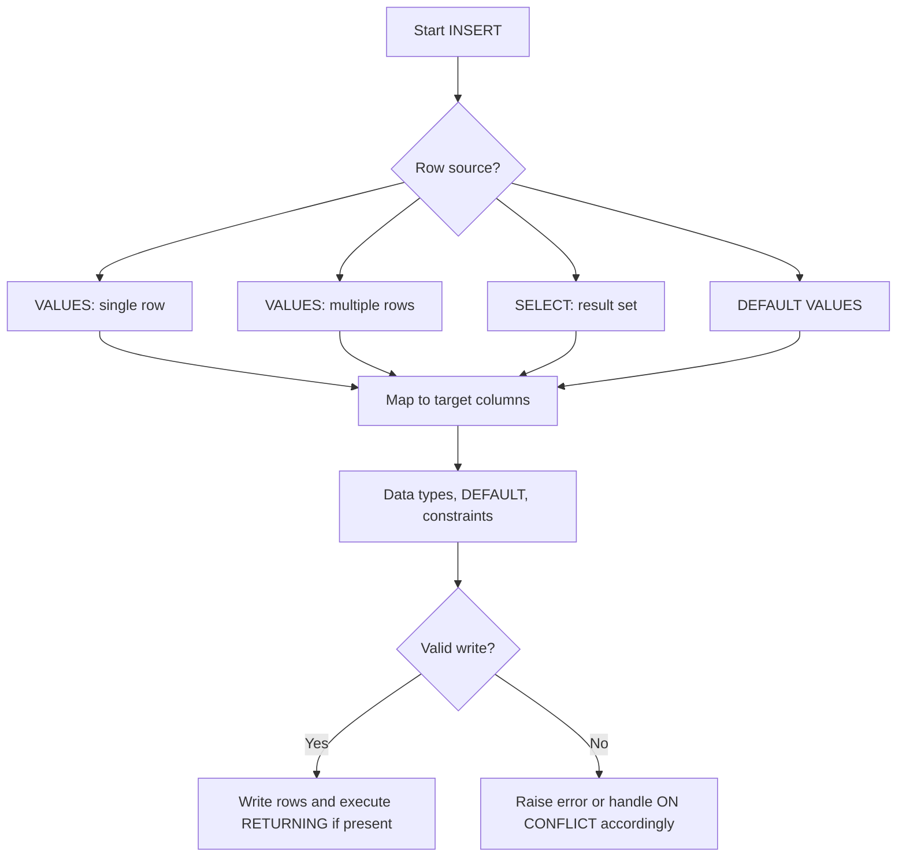

# Single-Row, Multi-Row, and SELECT-Based INSERT in PostgreSQL

In PostgreSQL, `INSERT` is the SQL statement used to add new rows to a table. The same statement can create **a single row with `VALUES`**, **multiple rows with a `VALUES` list**, or **a set of rows generated from a `SELECT` result**. All three forms share essential requirements: the data must match the column types, satisfy the table's constraints, and be written within an appropriate transaction scope.

Real-world scenarios:

- Registering a new customer and receiving the newly generated `customer_id`.
- Importing a batch of products from a form or an application batch job.
- Enrolling all VIP customers into a campaign using `INSERT ... SELECT`.
- Copying data from a staging table into a business table after validation and type conversion.
- Creating an order along with its line items using the data returned from a previous `INSERT`.

This lesson focuses on **single-row, multi-row, and `SELECT`-based `INSERT`** in the **Data Modification** chapter, while explaining frequently used components: column lists, `DEFAULT`, `NULL`, `RETURNING`, constraints, `ON CONFLICT`, transactions, and Java/JDBC.

## 1. Syntax Overview and the Three Data Sources of INSERT

General structure:

```sql
INSERT INTO schema_name.table_name (column_1, column_2, ...)
VALUES (value_1, value_2, ...);
```

Replacing the `VALUES` part with multiple tuples:

```sql
INSERT INTO schema_name.table_name (column_1, column_2)
VALUES
    (value_1a, value_2a),
    (value_1b, value_2b),
    (value_1c, value_2c);
```

Or using a query result:

```sql
INSERT INTO schema_name.destination_table (column_1, column_2)
SELECT expression_1, expression_2
FROM schema_name.source_table
WHERE some_condition;
```

The three forms differ in their **row source**:

| Form | Data Source | When to Use |
| --- | --- | --- |
| `INSERT ... VALUES (...)` | A single explicitly written tuple of expressions | Writing a single entity from an API or form |
| `INSERT ... VALUES (...), (...)` | Multiple tuples of expressions with the same structure | Writing a small or medium batch in one statement |
| `INSERT ... SELECT ...` | Rows generated by a query | Copying, aggregating, filtering, and transforming data directly in the database |
| `INSERT ... DEFAULT VALUES` | Default values for all columns | Creating a row where every required column has a default or is system-generated |

In PostgreSQL, `INSERT` also provides options such as `ON CONFLICT` to handle uniqueness conflicts, `RETURNING` to return the data actually written, and `WITH` to organize complex operations.



This diagram describes the semantics. PostgreSQL may choose different execution plans for `INSERT ... SELECT`, especially when the `SELECT` part includes `JOIN`, `GROUP BY`, or subqueries.

## 2. Preparing the Practice Database

All of the following examples use a dedicated schema named `insert_lab`. Run these only on a learning database. Do not recreate existing production schemas or insert sample data into tables serving real customers.

### 2.1. The customers Table

```sql
CREATE SCHEMA IF NOT EXISTS insert_lab;

CREATE TABLE insert_lab.customers (
    customer_id bigint GENERATED ALWAYS AS IDENTITY PRIMARY KEY,
    email text NOT NULL UNIQUE,
    full_name text NOT NULL,
    customer_tier text NOT NULL DEFAULT 'standard'
        CHECK (customer_tier IN ('standard', 'vip')),
    joined_at timestamptz NOT NULL DEFAULT now()
);
```

Important rules:

- `customer_id` is automatically generated by PostgreSQL via `IDENTITY`; normal applications **do not pass** an ID.
- `email` is required and must be unique.
- `full_name` is required.
- `customer_tier` defaults to `'standard'` and only accepts `'standard'`/`'vip'`.
- `joined_at` defaults to the current transaction timestamp when `now()` is used.

### 2.2. The products Table

```sql
CREATE TABLE insert_lab.products (
    sku text PRIMARY KEY,
    product_name text NOT NULL,
    unit_price numeric(12, 2) NOT NULL CHECK (unit_price >= 0),
    is_active boolean NOT NULL DEFAULT TRUE,
    updated_at timestamptz NOT NULL DEFAULT now()
);
```

`sku` is the product code used as the primary key. `unit_price` uses `numeric(12,2)` instead of a floating-point type to store monetary prices with exact decimal precision.

### 2.3. The orders and order_items Tables

```sql
CREATE TABLE insert_lab.orders (
    order_id bigint GENERATED ALWAYS AS IDENTITY PRIMARY KEY,
    customer_id bigint NOT NULL
        REFERENCES insert_lab.customers(customer_id),
    status text NOT NULL DEFAULT 'draft'
        CHECK (status IN ('draft', 'confirmed', 'cancelled')),
    source text NOT NULL DEFAULT 'web',
    placed_at timestamptz NOT NULL DEFAULT now()
);

CREATE TABLE insert_lab.order_items (
    line_id bigint GENERATED ALWAYS AS IDENTITY PRIMARY KEY,
    order_id bigint NOT NULL
        REFERENCES insert_lab.orders(order_id),
    sku text NOT NULL
        REFERENCES insert_lab.products(sku),
    quantity integer NOT NULL CHECK (quantity > 0),
    sold_unit_price numeric(12, 2) NOT NULL
        CHECK (sold_unit_price >= 0),
    CONSTRAINT uq_order_item_sku UNIQUE (order_id, sku)
);
```

`sold_unit_price` is the price at the time the order line was recorded, stored separately rather than always reading the current price from `products`. When the list price changes, prices in older orders must still preserve accurate business history.

In the sections below, the data-creation examples are designed to be practiced in order. **Do not repeatedly run `INSERT` statements without conflict handling** on the same data unless you want to encounter unique/primary key errors.

## 3. Single-Row INSERT with VALUES

Basic statement:

```sql
INSERT INTO insert_lab.customers (email, full_name)
VALUES ('alice@example.test', 'Alice Nguyen');
```

PostgreSQL creates a new row:

- `email` receives `'alice@example.test'`.
- `full_name` receives `'Alice Nguyen'`.
- `customer_id` is generated automatically.
- `customer_tier` receives `'standard'` via `DEFAULT`.
- `joined_at` receives the timestamp of `now()`.

When run in a SQL tool, the command typically returns a command tag like `INSERT 0 1`, where the last number indicates how many rows were inserted. To retrieve the actual generated ID instead of inferring from the command tag, use `RETURNING` as shown later.

### 3.1. Always Specify Target Column Names

Prefer writing:

```sql
INSERT INTO insert_lab.customers
    (email, full_name, customer_tier)
VALUES
    ('bob@example.test', 'Bob Tran', 'vip');
```

Avoid relying on column declaration order like this:

```sql
-- Not recommended: depends on table structure and column order.
INSERT INTO insert_lab.products
VALUES ('BOOK-001', 'PostgreSQL Guide', 150.00, TRUE, now());
```

If the schema changes, a column is added, or column order changes during a table rebuild, omitting the column list easily becomes semantically wrong or fails.

With an explicit column list, **the first value maps to the first column in the list**, regardless of the physical column order in the table.

### 3.2. DEFAULT Differs from NULL

`DEFAULT` is used when a column is omitted from the `INSERT` column list or when the `DEFAULT` keyword is written in the value position:

```sql
INSERT INTO insert_lab.customers
    (email, full_name, customer_tier)
VALUES
    ('carol@example.test', 'Carol Le', DEFAULT);
```

This is equivalent in `customer_tier` value to omitting the column from `INSERT`.

However:

```sql
-- Error demonstration: violates NOT NULL.
INSERT INTO insert_lab.customers
    (email, full_name, customer_tier)
VALUES
    ('invalid@example.test', 'Invalid Example', NULL);
```

The statement above does not apply `DEFAULT 'standard'`. It attempts to store **SQL NULL** into a `NOT NULL` column and is rejected.

Rules:

| Situation | How PostgreSQL Chooses the Value |
| --- | --- |
| Column omitted from INSERT list | Uses column default; if no default exists, uses NULL |
| `DEFAULT` written in `VALUES` | Uses column default |
| `NULL` written explicitly | Uses NULL, does not substitute default |
| Expression evaluates to NULL | Remains NULL, must pass NOT NULL constraint |
| Auto-generated `IDENTITY` column | Generates ID when no explicit ID value is supplied/allowed |

A `NOT NULL` column without a default must receive a valid value. Do not rely on defaults to mask missing application data.

### 3.3. DEFAULT VALUES When No Columns Are Passed

If every required column has a default or is auto-generated, PostgreSQL can create a row using:

```sql
CREATE TABLE insert_lab.import_runs (
    run_id bigint GENERATED ALWAYS AS IDENTITY PRIMARY KEY,
    started_at timestamptz NOT NULL DEFAULT now(),
    state text NOT NULL DEFAULT 'started'
);

INSERT INTO insert_lab.import_runs
DEFAULT VALUES;
```

For `customers`, `DEFAULT VALUES` is unsuitable because `email` and `full_name` have no defaults yet are `NOT NULL`.

### 3.4. Data Types and Input Casting

The string literal `'199.50'` can be interpreted according to the `numeric` column type in `INSERT`:

```sql
INSERT INTO insert_lab.products
    (sku, product_name, unit_price)
VALUES
    ('BOOK-001', 'PostgreSQL Guide', '150.00');
```

Even though it is entered in quotes, the actual value stored in `unit_price` is `numeric(12,2)`.

That does not mean every string is valid:

```sql
-- Type conversion error; for illustration only, do not run in a real data batch.
INSERT INTO insert_lab.products
    (sku, product_name, unit_price)
VALUES
    ('BAD-PRICE', 'Invalid price', 'one hundred');
```

PostgreSQL must convert the value to the target type and check constraints before completing the insert. Do not rely on the "database figuring it out" with inconsistent input formats.

## 4. Multi-Row INSERT with a Single VALUES Clause

Instead of calling one `INSERT` per product, we can supply multiple value tuples in **a single statement**:

```sql
INSERT INTO insert_lab.products
    (sku, product_name, unit_price)
VALUES
    ('PEN-002', 'Ballpoint Pen', 10.00),
    ('BAG-003', 'Canvas Bag', 90.00),
    ('USB-004', 'USB Cable', 45.00);
```

Each row in the `VALUES` list must have **the same number of expressions** matching the target column list. Expressions at the same position must have types convertible to the corresponding column type.

Example with two customer rows:

```sql
INSERT INTO insert_lab.customers
    (email, full_name, customer_tier)
VALUES
    ('dana@example.test', 'Dana Pham', 'vip'),
    ('eva@example.test', 'Eva Vo', DEFAULT);
```

Both rows are inserted in a single SQL statement. `DEFAULT` can appear in individual row positions; Dana receives `vip`, Eva receives `standard`.

### 4.1. One Error in a Multi-Row INSERT Affects the Entire Statement

Suppose you submit:

```sql
-- Expected error: the second row duplicates the email of existing Alice.
INSERT INTO insert_lab.customers (email, full_name)
VALUES
    ('frank@example.test', 'Frank'),
    ('alice@example.test', 'Another Alice');
```

Without appropriate conflict handling, PostgreSQL rejects **the entire statement** due to the `UNIQUE(email)` violation; Frank's row is **not inserted by this failed statement either**.

This is **statement atomicity**: individual `VALUES` tuples are not independent transactions. When multiple statements run within the same transaction, error handling and `ROLLBACK` also depend on the state of that transaction.

### 4.2. Single-Statement INSERT vs. Multiple Separate Statements

Compare:

```sql
INSERT INTO insert_lab.customers (email, full_name)
VALUES ('gwen@example.test', 'Gwen');

INSERT INTO insert_lab.customers (email, full_name)
VALUES ('hank@example.test', 'Hank');
```

and:

```sql
INSERT INTO insert_lab.customers (email, full_name)
VALUES
    ('gwen@example.test', 'Gwen'),
    ('hank@example.test', 'Hank');
```

Both snippets can insert the same data into a clean database, but they differ in the number of statements, client–server round trips, error handling, and atomicity scope when the client has auto-commit enabled.

In PostgreSQL, **multi-row `VALUES` is generally more efficient than many single-row `INSERT` statements** because it reduces network round trips and planning/execution overhead. However, there is no single fixed optimal batch size for every workload.

### 4.3. Large Row Counts and Practical Limits

An overly large `INSERT ... VALUES` statement can:

- Produce huge SQL text, consuming parse/plan memory.
- Put pressure on the network and transaction resources.
- Force reprocessing of the entire large statement if an error occurs.
- Hit driver/protocol bind-parameter limits or statement-size limits.

In applications, **split into reasonable batches** or use `COPY` for very large imports. Choose the batch size by measuring in a realistic environment rather than treating a number like "1000 rows" as a mandatory rule for all systems.

## 5. RETURNING: Retrieving the Data Actually Written

PostgreSQL provides the `RETURNING` clause to return values from inserted rows **without writing an extra `SELECT` based on guessing the ID**.

```sql
INSERT INTO insert_lab.customers
    (email, full_name, customer_tier)
VALUES
    ('iris@example.test', 'Iris Do', 'vip')
RETURNING customer_id, email, customer_tier, joined_at;
```

`customer_id` is generated via `IDENTITY`. `joined_at` is the default value that was applied. `RETURNING` is very useful for entity-creation APIs or when the new ID is needed for the next operation.

### 5.1. RETURNING with Multiple Rows

```sql
INSERT INTO insert_lab.customers
    (email, full_name)
VALUES
    ('jack@example.test', 'Jack'),
    ('kate@example.test', 'Kate')
RETURNING customer_id, email;
```

The clause returns one result row for each row actually inserted. Do not rely on the row order in the `RETURNING` result as a guaranteed mapping contract to the order in `VALUES`, unless you have designed an explicit joining key. In applications, you can use `email` or an appropriate natural key to match generated IDs back to input objects.

### 5.2. RETURNING Expressions

```sql
INSERT INTO insert_lab.products
    (sku, product_name, unit_price)
VALUES
    ('NOTE-005', 'Notebook', 35.00)
RETURNING
    sku,
    unit_price,
    unit_price * 1.10 AS price_plus_ten_percent;
```

`RETURNING` can return computed expressions from the values of the written row. Column names and expressions can be used to build the application payload without having to add a new stored column.

### 5.3. Considerations with RETURNING *

```sql
INSERT INTO insert_lab.products
    (sku, product_name, unit_price)
VALUES
    ('CASE-006', 'Tablet Case', 75.00)
RETURNING *;
```

`RETURNING *` is convenient during schema exploration, but production applications should usually specify only the needed columns to avoid returning unnecessary data and breaking contracts when the schema evolves.

## 6. INSERT ... SELECT: Inserting Rows Produced by a Query

General form:

```sql
INSERT INTO destination_table (target_a, target_b, ...)
SELECT source_expression_a, source_expression_b, ...
FROM source_table
WHERE condition;
```

PostgreSQL executes the `SELECT` part to determine the data rows and maps them **by column position** to the target table, then checks constraints and writes them.

This is not a "run SELECT to display and then copy manually" syntax: the entire operation executes in **a single SQL statement**, with the atomicity of that statement.

### 6.1. Example: Enrolling VIP Customers into a Campaign List

Create the target table:

```sql
CREATE TABLE insert_lab.campaign_members (
    campaign_code text NOT NULL,
    customer_id bigint NOT NULL
        REFERENCES insert_lab.customers(customer_id),
    enrolled_at timestamptz NOT NULL DEFAULT now(),
    PRIMARY KEY (campaign_code, customer_id)
);
```

Then insert the VIP customers:

```sql
INSERT INTO insert_lab.campaign_members
    (campaign_code, customer_id)
SELECT
    'WELCOME_2026',
    c.customer_id
FROM insert_lab.customers AS c
WHERE c.customer_tier = 'vip'
RETURNING campaign_code, customer_id, enrolled_at;
```

This is a very common pattern:

- `campaign_code` is a literal applied to every selected row.
- `c.customer_id` comes from the source table.
- `WHERE` determines **which customers are added to the campaign**.
- `enrolled_at` is omitted, so it receives the default.
- `RETURNING` returns the inserted members.

If the `SELECT` part returns 0 rows, the statement succeeds without inserting any rows. That is a valid outcome and should be distinguished from a SQL error.

### 6.2. If SELECT Returns Multiple Rows, INSERT Inserts Multiple Rows

```sql
SELECT c.customer_id
FROM insert_lab.customers AS c
WHERE c.customer_tier = 'vip';
```

Suppose there are three VIP customers in the current data; `INSERT ... SELECT` will attempt to insert three rows, except for cases skipped by conflict handling or resulting in constraint errors.

Therefore, when using `INSERT ... SELECT` for high-impact writes, verify the **expected row count** and the correctness of the `WHERE` condition; never assume a query with `WHERE` always selects a single row.

### 6.3. Inserting with Data Transformations

Using `SELECT` lets you compute target values from expressions:

```sql
CREATE TABLE insert_lab.customer_labels (
    customer_id bigint PRIMARY KEY
        REFERENCES insert_lab.customers(customer_id),
    display_label text NOT NULL,
    prepared_at timestamptz NOT NULL DEFAULT now()
);

INSERT INTO insert_lab.customer_labels
    (customer_id, display_label)
SELECT
    c.customer_id,
    upper(c.full_name) || ' <' || c.email || '>'
FROM insert_lab.customers AS c
WHERE c.customer_tier = 'vip';
```

Here `upper` and `||` compute a label string from the customer data. Even though the expression is valid, do not use this formatted label as a business key or as a replacement for the typed source data.

### 6.4. Inserting Data from a JOIN

`INSERT ... SELECT` can also select from multiple tables:

```sql
CREATE TABLE insert_lab.order_export_queue (
    order_id bigint PRIMARY KEY
        REFERENCES insert_lab.orders(order_id),
    recipient_email text NOT NULL,
    queued_at timestamptz NOT NULL DEFAULT now()
);

INSERT INTO insert_lab.order_export_queue
    (order_id, recipient_email)
SELECT
    o.order_id,
    c.email
FROM insert_lab.orders AS o
JOIN insert_lab.customers AS c
    ON c.customer_id = o.customer_id
WHERE o.status = 'confirmed';
```

Only `confirmed` orders with a matching customer are inserted. If there are no `confirmed` orders in the dataset at execution time, the result is **0 rows**; this is not an error.

When a `JOIN` **multiplies one source row into multiple rows**, `INSERT` will also attempt to write each resulting row. If the target table has a unique key, the query may fail with a duplicate key error. Hence, you must understand the grain of the `SELECT` query before inserting.

## 7. SELECT Columns Must Match INSERT Columns

For:

```sql
INSERT INTO insert_lab.campaign_members
    (campaign_code, customer_id)
SELECT 'WELCOME_2026', c.customer_id
FROM insert_lab.customers AS c;
```

each `SELECT` row has two expressions; they are assigned in order to `campaign_code` and `customer_id`.

Example of a column-count error:

```sql
-- Wrong: the target table specifies two columns, but SELECT returns only one column.
INSERT INTO insert_lab.campaign_members
    (campaign_code, customer_id)
SELECT customer_id
FROM insert_lab.customers;
```

Example of a column-order error:

```sql
-- Semantically wrong: the first expression is bigint,
-- but the first target column is campaign_code (text).
INSERT INTO insert_lab.campaign_members
    (campaign_code, customer_id)
SELECT c.customer_id, 'WELCOME_2026'
FROM insert_lab.customers AS c;
```

Even if one position can be cast, the second expression will fail when assigning a non-numeric string to `customer_id bigint`. **PostgreSQL maps by position, not by matching aliases**.

### 7.1. Avoid SELECT * When Inserting into Another Table

Avoid writing:

```sql
-- Fragile when the schema changes:
INSERT INTO some_destination
SELECT *
FROM some_source;
```

If the source or destination adds columns, changes column order, or has incompatible types, the statement may fail or assign values to the wrong meaning. Explicitly list the target columns and corresponding `SELECT` expressions.

### 7.2. Casting in INSERT ... SELECT

Suppose a staging table stores prices as text:

```sql
CREATE TABLE insert_lab.staging_products (
    load_id bigint GENERATED ALWAYS AS IDENTITY PRIMARY KEY,
    sku text NOT NULL,
    product_name text NOT NULL,
    price_text text NOT NULL,
    active_text text NOT NULL,
    received_at timestamptz NOT NULL DEFAULT now()
);

INSERT INTO insert_lab.staging_products
    (sku, product_name, price_text, active_text)
VALUES
    ('BOOK-001', 'PostgreSQL Guide, edition 2', '165.00', 'true'),
    ('MOUSE-007', 'Wireless Mouse', '210.00', 'true');
```

An intentional conversion:

```sql
SELECT
    sku,
    product_name,
    price_text::numeric(12, 2) AS unit_price,
    active_text::boolean AS is_active
FROM insert_lab.staging_products;
```

Those expressions can be placed into `INSERT ... SELECT`. **Only do this when the staging data has already been validated**: malformed price strings or invalid booleans cause the statement to fail. `COALESCE` does not catch cast errors.

When the data contains multiple updates for the same SKU, deduplicate the source before upserting (Section 10).

## 8. INSERT ... SELECT with GROUP BY and DISTINCT

The `SELECT` clause can use `GROUP BY` to generate **aggregated rows** for a target table. For example, populating each customer's order count:

```sql
CREATE TABLE insert_lab.customer_order_stats (
    customer_id bigint PRIMARY KEY
        REFERENCES insert_lab.customers(customer_id),
    order_count integer NOT NULL,
    calculated_at timestamptz NOT NULL DEFAULT now()
);

INSERT INTO insert_lab.customer_order_stats
    (customer_id, order_count)
SELECT
    c.customer_id,
    COUNT(o.order_id)::integer
FROM insert_lab.customers AS c
LEFT JOIN insert_lab.orders AS o
    ON o.customer_id = c.customer_id
GROUP BY c.customer_id;
```

Key details:

- `LEFT JOIN` ensures customers with no orders still appear.
- `COUNT(o.order_id)` returns 0 when there are no matching orders; `COUNT(*)` would return 1 from the null-extended row.
- `COUNT` returns `bigint`; casting to `integer` is only reasonable when the actual count is guaranteed to fit in the target type's range. For very large summary tables, declare `order_count bigint`.
- Because `customer_id` is the primary key in the target table, each customer is inserted at most once in the statement.

If you also join `order_items` into the aggregation, an order with multiple product lines can appear multiple times. In that case, `COUNT(o.order_id)` is no longer the number of orders; you may need `COUNT(DISTINCT o.order_id)` or to aggregate at the order level first.

### 8.1. SELECT DISTINCT to Avoid Duplicate Rows

Suppose a staging source contains multiple rows with the same customer identifier. `DISTINCT` removes rows that are **completely identical across all selected columns**:

```sql
SELECT DISTINCT email
FROM insert_lab.customers
WHERE customer_tier = 'vip';
```

However, thinking in terms of `DISTINCT(email, name)` (properly written in SQL as `SELECT DISTINCT email, name`) does **not** guarantee a single row per email if the names differ. When you need the "latest record per key", PostgreSQL supports `DISTINCT ON` with `ORDER BY` to specify which row is kept:

```sql
SELECT DISTINCT ON (sku)
    sku, product_name, price_text, active_text
FROM insert_lab.staging_products
ORDER BY sku, received_at DESC, load_id DESC;
```

The `ORDER BY` here uses `load_id DESC` as a tiebreaker when two imports share the same timestamp. The selected dataset has one row per SKU, matching the `products.sku` primary key.

## 9. INSERT ... SELECT from the Same Table and from a CTE

PostgreSQL allows an `INSERT ... SELECT` statement to read from the same target table within a single statement.

Illustrative example only:

```sql
-- Hypothetical example assuming a table insert_lab.message_templates
-- with columns template_code, language_code, body.
INSERT INTO insert_lab.message_templates
    (template_code, language_code, body)
SELECT
    template_code || '_copy',
    language_code,
    body
FROM insert_lab.message_templates
WHERE template_code = 'welcome';
```

`insert_lab.message_templates` is **not created** in the practice dataset. When using this pattern on a real table, examine unique keys, source conditions, and new code generation to avoid infinite duplicate inserts on repeated runs.

You can use a CTE to organize the source selection:

```sql
WITH vip_customers AS (
    SELECT customer_id
    FROM insert_lab.customers
    WHERE customer_tier = 'vip'
)
INSERT INTO insert_lab.campaign_members
    (campaign_code, customer_id)
SELECT 'LOYALTY_2026', customer_id
FROM vip_customers
RETURNING campaign_code, customer_id;
```

A `SELECT` CTE is not necessarily materialized into a temporary table; PostgreSQL can optimize it as appropriate. Placing `WITH` before `INSERT` primarily helps break logic into readable sections.

## 10. Key Conflicts and ON CONFLICT

When inserting a row with the same primary key or unique key value as an existing row, PostgreSQL normally raises error `23505 unique_violation`. There are two common ways to handle this:

### 10.1. DO NOTHING: Skip Conflicting Rows

```sql
INSERT INTO insert_lab.campaign_members
    (campaign_code, customer_id)
SELECT
    'WELCOME_2026',
    c.customer_id
FROM insert_lab.customers AS c
WHERE c.customer_tier = 'vip'
ON CONFLICT (campaign_code, customer_id) DO NOTHING
RETURNING campaign_code, customer_id;
```

This example can be re-run after the campaign already has members. Existing key pairs are skipped; new pairs can be inserted.

`RETURNING` only returns rows **actually inserted** in a statement with `DO NOTHING`, not rows that were skipped.

**Do not treat `DO NOTHING` as a catch-all for every error**: it only handles matching unique/exclusion constraint conflicts. `NOT NULL`, `CHECK`, `FOREIGN KEY`, or invalid data type errors will still occur.

### 10.2. DO UPDATE: Upsert

For products with `sku` as the primary key, an upsert can insert a new row or update an existing one:

```sql
INSERT INTO insert_lab.products
    (sku, product_name, unit_price, is_active)
VALUES
    ('BOOK-001', 'PostgreSQL Guide, edition 2', 165.00, TRUE)
ON CONFLICT (sku) DO UPDATE
SET
    product_name = EXCLUDED.product_name,
    unit_price = EXCLUDED.unit_price,
    is_active = EXCLUDED.is_active,
    updated_at = now()
RETURNING sku, product_name, unit_price, updated_at;
```

`EXCLUDED` represents the values **proposed for insertion** before the conflict was resolved. It is not a real table that can be queried independently.

If `sku = 'BOOK-001'` already exists, PostgreSQL updates that row. If it does not exist, PostgreSQL inserts a new row. `ON CONFLICT (sku) DO UPDATE` requires a matching unique index/constraint as the conflict arbiter.

### 10.3. Upsert from a SELECT Result

Using the staging source created in Section 7, you can select the latest record per SKU and upsert:

```sql
WITH latest_per_sku AS (
    SELECT DISTINCT ON (sku)
        sku,
        product_name,
        price_text,
        active_text
    FROM insert_lab.staging_products
    ORDER BY sku, received_at DESC, load_id DESC
)
INSERT INTO insert_lab.products
    (sku, product_name, unit_price, is_active)
SELECT
    s.sku,
    s.product_name,
    s.price_text::numeric(12, 2),
    s.active_text::boolean
FROM latest_per_sku AS s
WHERE TRUE
ON CONFLICT (sku) DO UPDATE
SET
    product_name = EXCLUDED.product_name,
    unit_price = EXCLUDED.unit_price,
    is_active = EXCLUDED.is_active,
    updated_at = now()
RETURNING sku, product_name, unit_price;
```

Notable details:

1. `DISTINCT ON (sku)` selects **one row** per SKU according to the defined ordering.
2. `WHERE TRUE` in `SELECT` is an always-true condition. In `INSERT ... SELECT ... ON CONFLICT`, it also helps the parser clearly recognize `ON CONFLICT` as part of `INSERT` rather than confusing it with a `JOIN ... ON`.
3. `ON CONFLICT (sku) DO UPDATE` resolves conflicts against the `products` table.
4. `RETURNING` returns rows that were either inserted **or updated**.

If the `SELECT` part supplies multiple rows with the same SKU to `ON CONFLICT DO UPDATE`, PostgreSQL raises an error because a single statement cannot update the same target row twice. Therefore, controlling duplicates **at the source** is crucial.

### 10.4. Idempotency Does Not Come Automatically Without Key Design

A plain `INSERT ... SELECT` can create new duplicates on every run. If a system requires safe retries, decide:

- Which key identifies whether a source record has already been imported?
- On key conflict, should the system skip, update, or raise an error?
- How should cases with the same key but different content be handled?
- Do you need to store `source_event_id`, `batch_id`, or a source version marker to prevent duplicate imports?

`ON CONFLICT` is the SQL tool to enforce part of that policy, but it does not replace business decisions about how to handle duplicates or late-arriving data.

## 11. Combining INSERT and RETURNING in a Data-Modifying CTE

A practical scenario: create an order and then create its line items, when `order_id` is auto-generated by PostgreSQL and unknown beforehand.

You can use a **data-modifying CTE**:

```sql
WITH new_order AS (
    INSERT INTO insert_lab.orders
        (customer_id, status, source)
    SELECT
        c.customer_id,
        'draft',
        'training'
    FROM insert_lab.customers AS c
    WHERE c.email = 'alice@example.test'
    RETURNING order_id
)
INSERT INTO insert_lab.order_items
    (order_id, sku, quantity, sold_unit_price)
SELECT
    no.order_id,
    p.sku,
    lines.quantity,
    p.unit_price
FROM new_order AS no
CROSS JOIN (
    VALUES
        ('BOOK-001'::text, 2),
        ('PEN-002'::text, 3)
) AS lines(sku, quantity)
JOIN insert_lab.products AS p
    ON p.sku = lines.sku
RETURNING order_id, sku, quantity, sold_unit_price;
```

Explanation:

1. The `new_order` CTE creates **one order** for Alice's email and returns `order_id`.
2. The derived-table `VALUES` produces two proposed product lines.
3. `JOIN products` looks up valid SKUs and retrieves the current list price to record as a snapshot.
4. `INSERT ... SELECT` creates two `order_items` rows using the newly generated `order_id`.
5. The entire query is **one SQL statement**; if the statement fails, no partial changes from the statement are committed.

### 11.1. Warning When JOIN Silently Drops Line Items

If a SKU in `VALUES` does not exist in `products`, `INNER JOIN` will **drop that row** instead of raising an error. For example, a typo like `'PEN-999'` could result in an order being created with only the BOOK line.

In a real system, validate the SKU list beforehand or use a query/logic that detects row-count mismatches; do not rely solely on the `order_items` foreign key to catch SKUs that were silently filtered out by a `JOIN`.

One controllable approach is to check beforehand:

```sql
SELECT v.sku
FROM (VALUES
    ('BOOK-001'::text),
    ('PEN-002'::text)
) AS v(sku)
LEFT JOIN insert_lab.products AS p
    ON p.sku = v.sku
WHERE p.sku IS NULL;
```

If any row is returned, at least one SKU does not exist. Under concurrent writes, pre-checking and inserting happen at two different points in time; transactions, constraints, and error handling are still required if underlying data changes.

### 11.2. Data-Modifying CTEs Differ from SELECT-Only CTEs

With data-modifying CTEs, `RETURNING` is the **data bridge** between operations. Do not assume you can directly reference newly inserted rows in another query part merely by re-reading the base table in an imagined execution order.

DML sub-statements within a single statement follow specific snapshot and evaluation rules; only use `RETURNING` values to link operations with clear data dependencies. Avoid designing multiple DML CTEs that modify the same row and depend on a specific execution order.

## 12. Multi-Row INSERT from SELECT Can Use Aggregated Data

Suppose the system needs to store a daily revenue snapshot per customer in a summary table:

```sql
CREATE TABLE insert_lab.customer_revenue_snapshot (
    snapshot_date date NOT NULL,
    customer_id bigint NOT NULL
        REFERENCES insert_lab.customers(customer_id),
    revenue numeric(14, 2) NOT NULL,
    PRIMARY KEY (snapshot_date, customer_id)
);
```

Populate it from order line items:

```sql
INSERT INTO insert_lab.customer_revenue_snapshot
    (snapshot_date, customer_id, revenue)
SELECT
    CURRENT_DATE,
    o.customer_id,
    COALESCE(SUM(oi.quantity * oi.sold_unit_price), 0)
FROM insert_lab.orders AS o
LEFT JOIN insert_lab.order_items AS oi
    ON oi.order_id = o.order_id
WHERE o.status <> 'cancelled'
GROUP BY o.customer_id
ON CONFLICT (snapshot_date, customer_id) DO UPDATE
SET revenue = EXCLUDED.revenue
RETURNING snapshot_date, customer_id, revenue;
```

This problem differs from inserting one entity at a time: each summary row is computed from **many business rows**.

Keep these points in mind:

- `WHERE o.status <> 'cancelled'` determines which orders count toward revenue. In a real system, you might include only `confirmed` or other statuses per accounting rules.
- `LEFT JOIN` keeps orders without items yet; `SUM` can return NULL for groups with no item values, so `COALESCE(..., 0)` represents zero revenue in this example.
- Customers **with no orders** are absent from the result because the query starts from `orders`, not `customers`.
- This snapshot reflects only the data at the moment the statement runs; if historical reconciliation or period closing is needed, build a dedicated process.

`CURRENT_DATE` depends on the session time zone when determining the date. For multi-timezone reporting, define the business date explicitly.

## 13. RETURNING Does Not Replace Checking Affected Row Counts

A successful statement can write fewer rows than expected:

- The `SELECT` part matches no rows.
- `ON CONFLICT DO NOTHING` skips duplicate rows.
- `INNER JOIN` drops rows without a match.
- `WHERE` or `HAVING` is too restrictive.
- Tenant, status, or time-range filtering logic is wrong.

Example:

```sql
INSERT INTO insert_lab.campaign_members
    (campaign_code, customer_id)
SELECT 'EMPTY_CAMPAIGN', c.customer_id
FROM insert_lab.customers AS c
WHERE c.customer_tier = 'not-a-valid-tier'
RETURNING customer_id;
```

The query creates no members on the sample data because no such tier exists. It has no syntax error and violates no constraints, yet it may **violate business expectations**.

In applications, check the `RETURNING` row count or JDBC update count when an operation expects a specific number of rows. For operations requiring "all or nothing" across both the batch and the expected row count, design the SQL/transaction with an appropriate verification step.

## 14. Transactions and Atomicity Across Multiple INSERTs

A single `INSERT` statement is an atomic unit. However, a business workflow often spans **multiple statements**:

1. Create the order.
2. Create order items.
3. Write an audit/log entry.
4. Update related status or balance.

If these steps must succeed or fail together, place them inside a transaction:

```sql
BEGIN;

INSERT INTO insert_lab.orders
    (customer_id, status, source)
SELECT customer_id, 'draft', 'manual'
FROM insert_lab.customers
WHERE email = 'bob@example.test'
RETURNING order_id;

-- Subsequent statements must use the exact order_id returned
-- via the application or an appropriate data-modifying CTE.

COMMIT;
```

This is a **transaction skeleton**, not a complete order-item creation example, because the application still needs to capture and pass `order_id`. If any statement raises an error inside a PostgreSQL transaction, the transaction enters an aborted state and requires `ROLLBACK` (except when savepoints are intentionally used for controlled recovery).

### 14.1. Savepoints for Selective Error Handling

```sql
BEGIN;

SAVEPOINT before_optional_insert;

-- An optional statement that might fail.
-- If an error occurs: ROLLBACK TO SAVEPOINT before_optional_insert;
-- Afterward, you can decide to continue the transaction.

RELEASE SAVEPOINT before_optional_insert;
COMMIT;
```

This illustrates transaction structure and should not be run verbatim expecting automatic error handling: `ROLLBACK TO SAVEPOINT` must be executed when an error occurs, after the application catches the SQL error.

### 14.2. A Failed Multi-Row INSERT Does Not Partially Insert

In:

```sql
INSERT INTO insert_lab.products
    (sku, product_name, unit_price)
VALUES
    ('OK-100', 'Good Item', 5.00),
    ('BAD-200', 'Invalid Item', -1.00);
```

the second row violates `CHECK (unit_price >= 0)`. Since no `ON CONFLICT` handles a `CHECK` error, the statement does not insert the first row either. This is a vital data-integrity safeguard during batch imports.

### 14.3. Concurrent Inserts and Unique Constraints

Two transactions can concurrently attempt to insert the same `email` or `sku`. Running a query like:

```sql
SELECT 1
FROM insert_lab.customers
WHERE email = 'same@example.test';
```

before `INSERT` **is not sufficient** to guarantee there will be no conflict, because another transaction can insert right after the check. `UNIQUE` constraints and `ON CONFLICT` are the proper database-level controls for concurrency.

Do not rely on the "SELECT to verify non-existence, then INSERT" pattern as your sole duplicate-prevention mechanism. The application must still handle unique violations or use upsert according to the defined policy.

## 15. Constraints That Can Cause INSERT to Fail

| Common SQLSTATE Code | Error Type | Example |
| --- | --- | --- |
| `23502` | `not_null_violation` | Omitting required `full_name` |
| `23505` | `unique_violation` | Inserting an existing email/SKU |
| `23503` | `foreign_key_violation` | `order_items.order_id` does not exist in `orders` |
| `23514` | `check_violation` | Negative/zero quantity or negative price |
| `22P02` | `invalid_text_representation` | Casting a non-numeric string to `numeric` |
| `22003` | `numeric_value_out_of_range` | Value exceeds target numeric type range |

When an error occurs:

- Read the error message and SQLSTATE, not just the first line of the stack trace.
- Identify which source data caused the failure, especially in multi-row `VALUES` or `INSERT ... SELECT`.
- Never disable constraints just to "force the insert through."
- Fix the input data, column mapping, or upsert policy as appropriate.
- Keep all related business changes within a consistent transaction.

### 15.1. INSERT from SELECT Can Encounter Dirty Data

For example, if staging has `price_text = 'invalid'`, the query:

```sql
INSERT INTO insert_lab.products
    (sku, product_name, unit_price)
SELECT sku, product_name, price_text::numeric(12, 2)
FROM insert_lab.staging_products;
```

will fail when it tries to cast an invalid value. Using `COALESCE(price_text::numeric, 0)` does **not** prevent the error because the cast executes before `COALESCE` receives the result.

In ETL pipelines, include a **data validation/rule-checking** stage and quarantine bad rows for handling. Even a regex checking digits does not guarantee against numeric overflow or every valid/invalid number format.

## 16. INSERT and IDENTITY/SEQUENCE

With:

```sql
customer_id bigint GENERATED ALWAYS AS IDENTITY PRIMARY KEY
```

PostgreSQL generates the ID when inserting a row without providing `customer_id`. This avoids computing `MAX(customer_id) + 1` in the application.

Do not write:

```sql
-- Flawed concurrency design; MAX(id)+1 can collide under parallel writes.
INSERT INTO insert_lab.customers
    (customer_id, email, full_name)
SELECT
    COALESCE(MAX(customer_id), 0) + 1,
    'manual-id@example.test',
    'Manual ID'
FROM insert_lab.customers;
```

With `GENERATED ALWAYS AS IDENTITY`, supplying an explicit ID is normally rejected by the identity mechanism unless an allowed overriding option is used.

### 16.1. OVERRIDING SYSTEM VALUE for Special Imports

During controlled migrations, PostgreSQL supports:

```sql
INSERT INTO insert_lab.customers
    (customer_id, email, full_name)
OVERRIDING SYSTEM VALUE
VALUES
    (9001, 'legacy-9001@example.test', 'Legacy Customer')
RETURNING customer_id;
```

This syntax lets you specify a value for a `GENERATED ALWAYS AS IDENTITY` column in special import cases. Do not use it in normal customer creation flows.

**Note:** inserting an explicit ID does not automatically advance the underlying sequence past the newly inserted ID. Migrations with custom IDs must account for resetting/adjusting the identity sequence state to avoid ID collisions on subsequent inserts; follow a dedicated plan and never arbitrarily alter sequence values in production.

### 16.2. Sequences Can Have Gaps

Do not expect generated IDs to:

- Always be contiguous with no gaps.
- Reflect the exact commit order of transactions.
- Increment strictly by one in the exact order rows are returned by `RETURNING`.

Sequences can consume values even if a statement later fails or a transaction rolls back. IDs are for identification, not a guaranteed gapless business sequence number.

## 17. Performance: Multi-Row VALUES, INSERT SELECT, and COPY

### 17.1. Multi-Row VALUES

Suitable for inserting a batch of new rows with data coming from an application. It typically reduces round trips compared to row-by-row calls while keeping transactions manageable.

```sql
INSERT INTO insert_lab.products
    (sku, product_name, unit_price)
VALUES
    ('A-101', 'Product A', 10),
    ('B-102', 'Product B', 20),
    ('C-103', 'Product C', 30);
```

However, do not concatenate user values into SQL strings to build batches; prefer bind parameters through the driver or batch APIs.

### 17.2. INSERT ... SELECT

Suitable when the source data **is already inside PostgreSQL** and needs filtering, joining, computation, or copying to another table. It avoids looping to pull every row into Java and send it back to the database.

```sql
INSERT INTO insert_lab.campaign_members
    (campaign_code, customer_id)
SELECT 'SECOND_WAVE', customer_id
FROM insert_lab.customers
WHERE customer_tier = 'standard'
ON CONFLICT (campaign_code, customer_id) DO NOTHING;
```

The more complex the `SELECT`, the higher the query cost; inspect the execution plan and row counts rather than assuming `INSERT ... SELECT` is automatically faster than every alternative.

### 17.3. COPY for Bulk Imports

When loading data from files, PostgreSQL provides the `COPY` command and `psql` provides `\copy`:

```sql
-- Example COPY syntax; file path and read permissions are on the server side.
COPY insert_lab.staging_products
    (sku, product_name, price_text, active_text)
FROM '/path/on/database/server/products.csv'
WITH (FORMAT csv, HEADER true);
```

`COPY FROM '/path/...'` reads a file on the **PostgreSQL server** and requires appropriate privileges. `\copy` is a **psql client** command that reads a file on the client machine and streams it over the connection.

Import into a **staging** table to validate data before using `INSERT ... SELECT`/upsert into business tables. `COPY` must still satisfy the target table's constraints; it is not a mechanism to bypass constraints.

### 17.4. Write Amplification and Side Effects

Every `INSERT` method on a table with indexes, foreign keys, or triggers incurs costs:

- Updating related indexes.
- Checking NOT NULL/UNIQUE/CHECK/FK constraints and firing triggers if present.
- Writing WAL according to PostgreSQL configuration.
- Holding locks and consuming transaction resources.
- Potentially increasing latency for concurrent transactions when batches are too large.

Measure throughput and latency on representative data and consider batch sizing, staging, indexes, transaction boundaries, and execution timing.

## 18. INSERT from Java Using JDBC PreparedStatement

In Java applications, single-entity inserts should use parameterized SQL with placeholders to separate **SQL structure** from **input data**.

Example creating a customer and retrieving the ID:

```java
import java.sql.Connection;
import java.sql.PreparedStatement;
import java.sql.ResultSet;
import java.sql.SQLException;

public long createCustomer(
        Connection connection,
        String email,
        String fullName,
        String tier
) throws SQLException {
    String sql = """
        INSERT INTO insert_lab.customers
            (email, full_name, customer_tier)
        VALUES (?, ?, ?)
        RETURNING customer_id
        """;

    try (PreparedStatement ps = connection.prepareStatement(sql)) {
        ps.setString(1, email);
        ps.setString(2, fullName);
        ps.setString(3, tier);

        try (ResultSet rs = ps.executeQuery()) {
            if (!rs.next()) {
                throw new SQLException("INSERT returned no customer_id");
            }
            return rs.getLong("customer_id");
        }
    }
}
```

Key points:

- `ps.setString` safely binds client-supplied values.
- `RETURNING` retrieves the PostgreSQL-generated ID instead of using `SELECT MAX(customer_id)`.
- Unique violations can still occur on duplicate emails; the application must handle them and return an appropriate message.
- Database constraints must still exist even when Java validates inputs.

### 18.1. JDBC Batch for Multiple Rows

When inserting multiple customers from Java:

```java
import java.sql.Connection;
import java.sql.PreparedStatement;
import java.sql.SQLException;
import java.util.List;

public record NewCustomer(String email, String fullName, String tier) {}

public void insertCustomerBatch(
        Connection connection,
        List<NewCustomer> customers
) throws SQLException {
    String sql = """
        INSERT INTO insert_lab.customers
            (email, full_name, customer_tier)
        VALUES (?, ?, ?)
        """;

    // Illustrative method assuming ownership of this connection's transaction.
    boolean oldAutoCommit = connection.getAutoCommit();
    connection.setAutoCommit(false);
    try (PreparedStatement ps = connection.prepareStatement(sql)) {
        for (NewCustomer customer : customers) {
            ps.setString(1, customer.email());
            ps.setString(2, customer.fullName());
            ps.setString(3, customer.tier());
            ps.addBatch();
        }

        ps.executeBatch();
        connection.commit();
    } catch (SQLException ex) {
        connection.rollback();
        throw ex;
    } finally {
        connection.setAutoCommit(oldAutoCommit);
    }
}
```

`executeBatch()` does not necessarily generate a single `VALUES(...), (...)` SQL statement; the driver may send or rewrite the batch in its own way. PostgreSQL JDBC offers batch optimization options, though exact behavior depends on the driver version and configuration.

This example applies when **the method owns the connection**. In applications using a connection pool, Spring `@Transactional`, or a transaction manager, do not manually modify `autoCommit`, `commit`, or `rollback` on a framework-managed connection; let the application's transaction layer control boundaries.

### 18.2. Inserting Multiple Rows from SELECT Without Looping in Java

When the source data resides in the database, you usually do not need to load the customer list into Java and issue individual `INSERT`s. You can run a single `PreparedStatement` for `INSERT ... SELECT`:

```java
String sql = """
    INSERT INTO insert_lab.campaign_members
        (campaign_code, customer_id)
    SELECT ?, customer_id
    FROM insert_lab.customers
    WHERE customer_tier = ?
    ON CONFLICT (campaign_code, customer_id) DO NOTHING
    """;

try (PreparedStatement ps = connection.prepareStatement(sql)) {
    ps.setString(1, "AUTUMN_2026");
    ps.setString(2, "vip");

    int inserted = ps.executeUpdate();
    // inserted is the actual number of rows inserted by the statement.
}
```

`executeUpdate()` returns an update count, not individual row IDs. If you need IDs back, add `RETURNING` and use `executeQuery()` to read the `ResultSet`.

### 18.3. Never Concatenate User Input into SQL Strings

Avoid:

```java
// Error-prone syntax and vulnerable to SQL injection.
String sql = "INSERT INTO insert_lab.customers (email, full_name) VALUES ('"
        + email + "', '" + fullName + "')";
```

Use prepared statements and placeholders for **values**. Table and column names cannot be bound as ordinary parameter values; if dynamic SQL with identifiers is needed, use an allowlist and proper identifier quoting—never accept raw strings directly from users.

## 19. UPSERT, Retries, and RETURNING Results in Applications

When an API can be retried after a network timeout, a creation request may be re-sent after the first attempt already committed while the response was lost. If the application uses a plain `INSERT`, the second attempt can hit a `UNIQUE` error.

Choose the strategy based on the goal:

| Requirement | Approach |
| --- | --- |
| Insert new row and treat duplicates as errors | Plain `INSERT` + unique constraint + error handling |
| Insert if absent, keep existing row unchanged if present | `ON CONFLICT (...) DO NOTHING` |
| Insert or update data by valid key | `ON CONFLICT (...) DO UPDATE` |
| Return the new row's ID | `INSERT ... RETURNING id` |
| Return data after upsert | `INSERT ... ON CONFLICT ... RETURNING ...` |
| Ensure idempotent requests across retries | Idempotency key/unique constraint and clear business policy |

A common misconception: when `ON CONFLICT DO NOTHING` skips a row, `RETURNING` does not return the ID of the existing row. If the API must return the existing entity on key conflict, design a separate query/flow that accounts for concurrency; do not assume `RETURNING` always yields a row.

Also, not every `ON CONFLICT DO UPDATE` should overwrite newer data with stale retried data. For versioned or event-timestamped imports, add an explicit conditional update predicate.

## 20. INSERT from SELECT and Source Data Verification

Before a major import, ask yourself:

1. Does the `SELECT` return the expected **source row count**?
2. Can a target key appear **multiple times** in the source?
3. Does any `INNER JOIN` silently drop unmatched data?
4. Does any `LEFT JOIN` introduce invalid `NULL` values for the target table?
5. Have column types, monetary amounts, time zones, and statuses been converted properly?
6. Could retries or duplicate job runs occur?
7. Do you need to preserve history or only store the latest state?
8. If one bad row rolls back the entire statement, how will you detect and fix that record?

Example previewing the data to be inserted:

```sql
SELECT
    c.customer_id,
    c.email
FROM insert_lab.customers AS c
WHERE c.customer_tier = 'vip'
ORDER BY c.customer_id;
```

Counting candidates:

```sql
SELECT COUNT(*) AS expected_candidates
FROM insert_lab.customers
WHERE customer_tier = 'vip';
```

Previewing helps verify scope, but it is **not a transactional guarantee** if data changes between previewing and inserting. Unique keys, transactions, appropriate snapshots/isolation, and conflict handling remain essential parts of the workflow.

### 20.1. Do Not Use INSERT SELECT as a "Move" Without Deleting the Source

`INSERT INTO archive SELECT ... FROM active_table` only **copies** rows to the target table; it does not remove rows from the source table.

To actually move rows, design an atomic flow, account for FKs/triggers, and ensure all data has been copied properly before deleting from the source. For many systems, status flags or history tables are safer than copy-then-delete.

## 21. Common Errors and Troubleshooting

| Symptom | Cause | Fix |
| --- | --- | --- |
| `INSERT has more expressions than target columns` | Number of VALUES/SELECT expressions does not match target column list | List and align columns by position |
| `NOT NULL` violation | Omitted required column without default or passed NULL | Provide a valid value; use default only if business rules allow |
| `UNIQUE` violation on second run | Key already exists, job is not idempotent | Design `ON CONFLICT` or retry policy |
| `FOREIGN KEY` violation | Referenced ID does not exist | Ensure valid relationships; do not create dummy records to bypass the error |
| `CHECK` violation | Negative/zero quantity or invalid status | Fix data according to business rules |
| `INSERT SELECT` inserts 0 rows | WHERE matches nothing or JOIN filters out source | Inspect the SELECT query and candidate row count |
| `INSERT SELECT` inserts more rows than expected | JOIN multiplies rows or source has duplicate keys | Verify grain; aggregate/deduplicate by key |
| `ON CONFLICT DO UPDATE` error affecting a row twice | Multiple source rows conflict on the same target key | Deduplicate source with `DISTINCT ON`/`GROUP BY` using clear rules |
| `RETURNING` yields no rows with DO NOTHING | Conflicting row was skipped | Design a separate fetch path for the existing row when needed |
| Cannot retrieve new ID in Java | Not using RETURNING/getGeneratedKeys | Use `RETURNING id` with `ResultSet` |
| Wrong prices loaded from staging | Malformed text or cast failure | Validate data before casting |
| Batch too large, increased locks/WAL | Transaction holds too many changes or SQL too huge | Split into batches, benchmark, consider COPY |
| Gaps in IDs | Sequences do not roll back allocated values | Never use identity IDs as gapless sequence numbers |
| Upsert overwrites newer data with older data | Source version/timestamp not checked | Add update condition and handle late-arriving data |
| INSERT followed by SELECT MAX(id) returns wrong ID | Another transaction also inserted data | Use `RETURNING`/ID returned directly by the statement |

## 22. Practice Exercises

These exercises use the `insert_lab` schema created in Section 2. Execute them in order or use a fresh practice database to avoid key conflicts when re-running.

### Exercise 1 — Insert One Customer, Retrieve the ID

```sql
INSERT INTO insert_lab.customers (email, full_name)
VALUES ('practice1@example.test', 'Practice One')
RETURNING customer_id, email, customer_tier, joined_at;
```

Explain why `customer_tier` equals `standard` and why `customer_id` does not need to be passed by the client.

### Exercise 2 — Insert Three Products in One Statement

```sql
INSERT INTO insert_lab.products
    (sku, product_name, unit_price)
VALUES
    ('PRA-001', 'Practice Item 1', 11.00),
    ('PRA-002', 'Practice Item 2', 22.00),
    ('PRA-003', 'Practice Item 3', 33.00)
RETURNING sku, is_active, unit_price;
```

Predict the number of `RETURNING` rows and the value of `is_active` when that column is omitted.

### Exercise 3 — One Row Violating CHECK in a Batch

```sql
-- Demonstrates a rejected statement.
INSERT INTO insert_lab.products
    (sku, product_name, unit_price)
VALUES
    ('PRA-004', 'Valid Item', 44.00),
    ('PRA-005', 'Invalid Item', -5.00);
```

Check why `PRA-004` is also not inserted. Compare this with running two separate statements in auto-commit mode.

### Exercise 4 — From SELECT into campaign_members

```sql
INSERT INTO insert_lab.campaign_members
    (campaign_code, customer_id)
SELECT 'PRACTICE_CAMPAIGN', customer_id
FROM insert_lab.customers
WHERE customer_tier = 'vip'
RETURNING campaign_code, customer_id;
```

Explain why the number of inserted rows depends on the `SELECT` result.

### Exercise 5 — Safe Rerun with DO NOTHING

Re-run the idea from Exercise 4 with:

```sql
ON CONFLICT (campaign_code, customer_id) DO NOTHING
```

and inspect `RETURNING`: when all key pairs already exist, the query can return 0 rows even though the statement succeeds.

### Exercise 6 — Staging and Upsert

Create the staging table from Section 7; insert a new record for SKU `'BOOK-001'` with a newer `received_at` timestamp. Use `DISTINCT ON (sku)` to select the newest record and then `INSERT ... SELECT ... ON CONFLICT (sku) DO UPDATE`. Explain why two rows with the same SKU must not enter a single `DO UPDATE` in the same statement.

### Exercise 7 — Create an Order and Items Without Hardcoding order_id

Use `WITH new_order AS (INSERT ... RETURNING order_id) INSERT INTO order_items ... SELECT ... FROM new_order ...` from Section 11. Verify with:

```sql
SELECT
    o.order_id,
    o.status,
    oi.sku,
    oi.quantity,
    oi.sold_unit_price
FROM insert_lab.orders AS o
JOIN insert_lab.order_items AS oi
    ON oi.order_id = o.order_id
WHERE o.source = 'training'
ORDER BY o.order_id DESC, oi.line_id;
```

Based on the example schema, explain the roles of `RETURNING`, `CROSS JOIN (VALUES ...)`, and `JOIN products`.

### Exercise 8 — Order Statistics from SELECT

Execute the `INSERT INTO customer_order_stats ... SELECT ... GROUP BY` statement from Section 8. Identify customers with no orders: why should their order count be 0, and why must you use `COUNT(o.order_id)` instead of `COUNT(*)` with `LEFT JOIN`?

### Exercise 9 — Transactions and Unique Violation

```sql
BEGIN;

INSERT INTO insert_lab.customers (email, full_name)
VALUES ('practice-tx@example.test', 'Practice TX');

-- Try INSERT with the same email again to observe unique_violation.
-- After the error, ROLLBACK or intentionally handle with a savepoint.

ROLLBACK;
```

Describe the transaction state after the unique violation, then verify after `ROLLBACK` that the row inserted within the transaction was not committed.

### Exercise 10 — Build a Java API

Write a Java method using `PreparedStatement`:

1. Accept `email`, `fullName`, and `tier`.
2. Insert a customer using `INSERT ... RETURNING customer_id`.
3. Return the ID and handle unique violations.
4. Never build SQL by concatenating user input strings.

Extend this with another method running `INSERT ... SELECT` to enroll VIP customers into a campaign, returning the actual number of inserted rows.

## 23. Key Takeaways

- **Single-row `INSERT ... VALUES`** fits single-entity creation; **multi-tuple `VALUES`** writes a batch in one statement; **`INSERT ... SELECT`** inserts a set of rows produced by a query.
- **Explicitly list target columns.** PostgreSQL maps `VALUES`/`SELECT` expressions to target columns **by position**, not by alias.
- **`DEFAULT` is not `NULL`.** Omitting a column or using `DEFAULT` triggers the column default; explicitly passing `NULL` still enforces `NOT NULL`.
- **`RETURNING`** is the accurate way to retrieve identity IDs and inserted values; never guess with `SELECT MAX(id)`.
- **One statement is an atomic unit.** A multi-row `INSERT` failing on one row does not partially insert the rest, unless explicitly handled such as with `ON CONFLICT`.
- **`INSERT ... SELECT` can insert 0, 1, or many rows.** Understand the source grain, the effect of `WHERE`/`JOIN`, and the expected row count.
- **`ON CONFLICT`** resolves matching unique conflicts, but it does not fix invalid data types, `NOT NULL`, `CHECK`, or `FOREIGN KEY` errors.
- **Data-modifying CTEs with `RETURNING`** allow passing newly generated IDs from one `INSERT` to another `INSERT ... SELECT` within the same statement.
- For large imports, consider **staging, `COPY`, batching, and transactions** instead of sending a single massive SQL statement.
- In Java/JDBC, **`PreparedStatement`** and bind parameters pass data safely; let the transaction manager handle commit/rollback when using a framework.

Writing `INSERT` properly is not just about putting values into a table. You need to define the **row source**, **column mapping**, **constraints**, **key conflict policy**, **transaction scope**, and **results the application needs back**. Once those factors are clear, PostgreSQL's three `INSERT` forms can consistently handle both small API writes and bulk data transformation pipelines.
