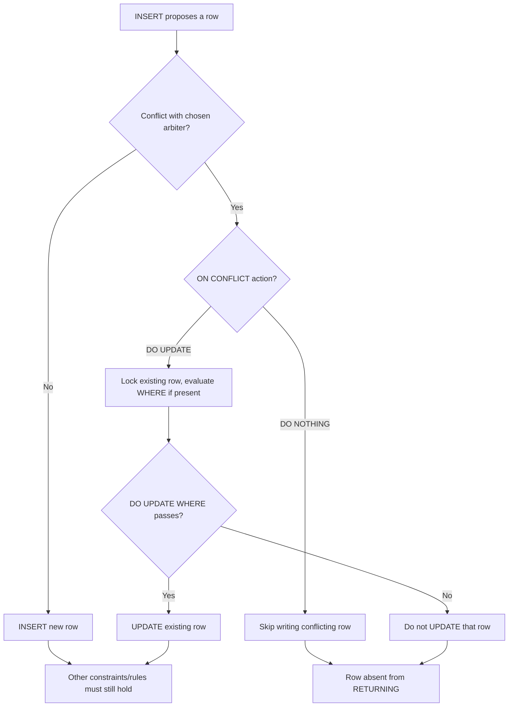
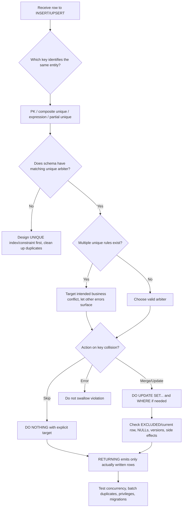

# INSERT ON CONFLICT and Choosing the Conflict Target Key

In PostgreSQL, `INSERT ... ON CONFLICT` handles cases where a new row violates a **unique constraint** or another supported conflict constraint, rather than letting the entire `INSERT` immediately fail with an error. The two common actions are:

- **`DO NOTHING`:** skip writing the conflicting row.
- **`DO UPDATE`:** update the existing row that caused the conflict, commonly called **UPSERT** (*UPDATE or INSERT*).

Yet the most important question is not "what is the UPSERT syntax?" but:

> **Which key defines the conflict, and when that key collides, do business rules really require skipping, updating, or raising an error?**

A table may have an auto-generated primary key, a business unique key, and a partial unique index. Picking the wrong key causes PostgreSQL to handle **a different kind of duplicate than the application intended**. Worse, an untargeted `ON CONFLICT DO NOTHING` can silently swallow an error the application actually needs to surface.

This lesson belongs to the **Data Modification** chapter of the PostgreSQL module. It focuses on write semantics, choosing the *conflict arbiter* (the key/index used to detect conflicts), concurrent behavior, handling nullable columns, returning results, and Java/JDBC usage.

## 1. What Problem Does UPSERT Solve?

Suppose a `customer` table has a unique constraint on `(tenant_id, email)`:

```sql
CREATE TABLE customer (
    customer_id BIGINT GENERATED ALWAYS AS IDENTITY PRIMARY KEY,
    tenant_id BIGINT NOT NULL,
    email TEXT NOT NULL,
    full_name TEXT NOT NULL,
    CONSTRAINT uq_customer_tenant_email UNIQUE (tenant_id, email)
);
```

A service repeatedly receives customer-creation events with the same tenant and email. If it only inserts:

```sql
INSERT INTO customer (tenant_id, email, full_name)
VALUES (10, 'lan@example.test', 'Lan');
```

the first run succeeds, and the next run with the same key hits `unique_violation` (SQLSTATE `23505`).

If business rules state "the same email in the same tenant is the same customer; update the name when a new record arrives," you can write:

```sql
INSERT INTO customer AS c (tenant_id, email, full_name)
VALUES (10, 'lan@example.test', 'Lan Nguyen')
ON CONFLICT (tenant_id, email)
DO UPDATE SET
    full_name = EXCLUDED.full_name;
```

Logical outcome:

- **Key does not exist yet:** insert one row.
- **Key already exists:** update `full_name` on the existing row.
- **Violation of another constraint outside the chosen target:** still raises an error.

This implements "create or update by key," though it is not an automatic solution for every synchronization, idempotency, or write-contention problem.

### 1.1. Decision Flowchart



This diagram illustrates the main logical flow, not every detail of index insertion, row locking, triggers, partition routing, or PostgreSQL MVCC.

### 1.2. What ON CONFLICT Does Not Replace

`ON CONFLICT` is **not** a mechanism for fixing every write error. It never turns:

- A `NOT NULL` violation into a default value.
- A `CHECK` violation into a valid value.
- A foreign-key violation into a real parent relationship.
- Malformed input into valid data types.
- Two events with the same key but different payloads into a safely idempotent transaction.
- A prior existence check into a lock preventing concurrent changes.

Understand which constraints can act as an *arbiter*, which constraints are still checked independently, and which business rules must be handled explicitly.

## 2. General Syntax

Basic forms:

```sql
INSERT INTO table_name [AS alias] (column_1, column_2, ...)
VALUES (...)
ON CONFLICT [conflict_target]
DO NOTHING
[RETURNING ...];
```

Or:

```sql
INSERT INTO table_name [AS alias] (column_1, column_2, ...)
VALUES (...)
ON CONFLICT conflict_target
DO UPDATE SET
    column_1 = expression,
    column_2 = expression
[WHERE condition]
[RETURNING ...];
```

In PostgreSQL, a conflict target takes one of two common forms:

1. **Unique index inference** from columns or expressions, optionally with a partial index predicate.
2. **`ON CONSTRAINT constraint_name`** naming a compatible constraint explicitly.

Examples:

```sql
ON CONFLICT (tenant_id, email) DO UPDATE ...

ON CONFLICT ON CONSTRAINT uq_customer_tenant_email DO UPDATE ...
```

**`DO UPDATE` requires a conflict target.** With `DO NOTHING`, the target may be omitted, yet omitting it carries much broader semantics and must be an intentional decision.

## 3. Distinguishing Key Types: Primary Key, Unique Key, Natural Key

A table often has several candidate identifiers:

| Key Type | Example | Meaning |
|---|---|---|
| Auto-generated primary key | `customer_id` identity | Stable internal row ID |
| Business unique key | `(tenant_id, email)` | One unique email per tenant |
| Global unique key | `external_event_id` | Partner event ID already processed |
| Scoped unique key | `(warehouse_id, sku)` | Each SKU has one inventory row per warehouse |
| Partial unique index | Unique email among non-deleted accounts | Enforces uniqueness only on rows matching predicate |
| Expression unique index | `(tenant_id, lower(email))` | Comparison key computed from an expression |

Not every "identifying-looking" key has a unique index. PostgreSQL requires a **schema-backed arbiter**, not a verbal guarantee in application code.

### 3.1. Choose the Key According to Request Semantics

If a request supplies a confirmed `customer_id`, upserting by PK can fit that data contract.

If a request supplies only `tenant_id` and `email` while the database generates a new `customer_id`, upserting by PK **will not** match an existing customer by email:

```sql
-- Unsuitable for matching customers by tenant/email:
INSERT INTO customer (tenant_id, email, full_name)
VALUES (10, 'lan@example.test', 'Lan')
ON CONFLICT (customer_id) DO UPDATE
SET full_name = EXCLUDED.full_name;
```

Because `customer_id` is omitted and generated fresh by identity, no PK conflict occurs. If `(tenant_id, email)` already exists, PostgreSQL throws a unique violation on the business key; `DO UPDATE` targeted **a different PK**, so it never intercepts that conflict.

**Principle:** choose the conflict key matching **how the request identifies the same entity**, not whichever column is easiest to type.

## 4. Preparing the Test Database

The examples below use the `demo_upsert` schema in a lab database. Do not run directly on production. Create these tables once on a clean schema for predictable results.

```sql
CREATE SCHEMA IF NOT EXISTS demo_upsert;

CREATE TABLE demo_upsert.customer (
    customer_id BIGINT GENERATED ALWAYS AS IDENTITY PRIMARY KEY,
    tenant_id BIGINT NOT NULL,
    email TEXT NOT NULL,
    full_name TEXT NOT NULL,
    phone TEXT,
    updated_at TIMESTAMPTZ NOT NULL DEFAULT statement_timestamp(),
    CONSTRAINT uq_customer_tenant_email UNIQUE (tenant_id, email),
    CONSTRAINT ck_customer_email_nonblank CHECK (length(btrim(email)) > 0),
    CONSTRAINT ck_customer_name_nonblank CHECK (length(btrim(full_name)) > 0)
);

CREATE TABLE demo_upsert.inventory (
    warehouse_id INTEGER NOT NULL,
    sku TEXT NOT NULL,
    available_qty INTEGER NOT NULL DEFAULT 0,
    updated_at TIMESTAMPTZ NOT NULL DEFAULT statement_timestamp(),
    CONSTRAINT pk_inventory PRIMARY KEY (warehouse_id, sku),
    CONSTRAINT ck_inventory_qty_nonnegative CHECK (available_qty >= 0)
);

CREATE TABLE demo_upsert.api_request (
    tenant_id BIGINT NOT NULL,
    idempotency_key TEXT NOT NULL,
    payload_hash TEXT NOT NULL,
    processed_at TIMESTAMPTZ NOT NULL DEFAULT statement_timestamp(),
    CONSTRAINT pk_api_request PRIMARY KEY (tenant_id, idempotency_key)
);
```

Three scenarios:

- `customer`: auto-generated PK, while business key is `(tenant_id, email)`.
- `inventory`: composite key `(warehouse_id, sku)`; one SKU can exist across multiple warehouses.
- `api_request`: idempotency keys must be **tenant-scoped** so a request from tenant A never collides with tenant B.

### 4.1. Insert Initial Rows

```sql
INSERT INTO demo_upsert.customer
    (tenant_id, email, full_name, phone)
VALUES
    (10, 'lan@example.test', 'Lan', NULL),
    (10, 'minh@example.test', 'Minh', '0900000001'),
    (20, 'lan@example.test', 'Lan in tenant 20', NULL);

INSERT INTO demo_upsert.inventory
    (warehouse_id, sku, available_qty)
VALUES
    (1, 'SKU-BOOK', 12),
    (1, 'SKU-PEN', 30),
    (2, 'SKU-BOOK', 5);
```

Having the same `email` in tenants 10 and 20 is valid because uniqueness is scoped to `(tenant_id, email)`. Having `SKU-BOOK` in two warehouses is likewise valid.

### 4.2. Inspect Data Without Guessing Identity IDs

```sql
SELECT
    customer_id, tenant_id, email, full_name, phone
FROM demo_upsert.customer
ORDER BY tenant_id, email;

SELECT warehouse_id, sku, available_qty
FROM demo_upsert.inventory
ORDER BY warehouse_id, sku;
```

Never assume identity IDs always start at 1 in a previously used database or remain contiguous after failed statements. Throughout this lesson, we identify customers by tenant/email so examples never depend on specific ID numbers.

## 5. DO NOTHING with an Explicit Key

To insert a customer if the tenant/email pair does not exist yet, while **leaving any existing customer untouched**:

```sql
INSERT INTO demo_upsert.customer
    (tenant_id, email, full_name)
VALUES
    (10, 'lan@example.test', 'Second submitted name')
ON CONFLICT (tenant_id, email)
DO NOTHING
RETURNING customer_id, tenant_id, email, full_name;
```

This row conflicts on `uq_customer_tenant_email`, so it is neither inserted nor updates the existing name. `RETURNING` emits nothing for the skipped input.

Try a new email:

```sql
INSERT INTO demo_upsert.customer
    (tenant_id, email, full_name)
VALUES
    (10, 'hoa@example.test', 'Hoa')
ON CONFLICT (tenant_id, email)
DO NOTHING
RETURNING customer_id, email, full_name;
```

The first run inserts and returns the row; re-running the same SQL skips and returns nothing.

### 5.1. DO NOTHING Does Not Mean "Return the Existing Row"

When `DO NOTHING` fires, PostgreSQL does not return the existing row in `RETURNING`. If the application needs the old ID, it must use an **appropriate read step** or a different query/transaction design.

Never assume:

```java
if (!rs.next()) {
    // PostgreSQL returned the old customer_id
}
```

An empty branch only tells you **this `INSERT` neither inserted nor updated a row**; it does not supply the old ID.

### 5.2. DO NOTHING Without a Target

```sql
INSERT INTO demo_upsert.customer
    (tenant_id, email, full_name)
VALUES
    (10, 'lan@example.test', 'New name')
ON CONFLICT DO NOTHING;
```

For `DO NOTHING`, omitting `conflict_target` is syntactically valid. PostgreSQL then handles conflicts on **any eligible unique index or exclusion constraint**, not just one intended business key.

This helps when the true goal is "ignore any row violating any supported conflict constraint." However, it **can mask data bugs** if you only meant to ignore duplicate emails yet accidentally hid a duplicate external ID on another constraint.

Errors such as `CHECK`, `NOT NULL`, and foreign key violations are still not ignored by `DO NOTHING`.

## 6. DO UPDATE: Updating the Exact Conflicting Row

Example syncing customer name and phone by tenant/email:

```sql
INSERT INTO demo_upsert.customer AS c
    (tenant_id, email, full_name, phone)
VALUES
    (10, 'lan@example.test', 'Lan Nguyen', '0900000009')
ON CONFLICT (tenant_id, email)
DO UPDATE SET
    full_name = EXCLUDED.full_name,
    phone = EXCLUDED.phone,
    updated_at = statement_timestamp()
RETURNING
    c.customer_id, c.tenant_id, c.email,
    c.full_name, c.phone, c.updated_at;
```

In the `DO UPDATE` branch:

- `c` is the alias for **the existing row in the target table**.
- `EXCLUDED` represents the row **proposed for `INSERT`** that hit the conflict.
- `EXCLUDED.full_name` is the new value passed in `VALUES`.
- `c.customer_id` remains the existing row's ID when conflicting on the business key.

Business result: tenant 10's customer Lan is updated without creating a new customer.

### 6.1. Why Is It Named EXCLUDED?

The row from `VALUES` was **excluded from direct insertion** once the conflict was detected. PostgreSQL lets you reference its proposed values inside the update branch via the special qualifier `EXCLUDED`.

```text
Existing row c:
  tenant_id = 10
  email = lan@example.test
  full_name = Lan

Proposed row EXCLUDED:
  tenant_id = 10
  email = lan@example.test
  full_name = Lan Nguyen

Arbiter (tenant_id, email) detects collision.
DO UPDATE:
  c.full_name = EXCLUDED.full_name

Result:
  same customer_id, new name = Lan Nguyen
```

`EXCLUDED` is not a physical table, does not exist outside the statement, and never needs to be created.

### 6.2. When the Target Table Is Named "excluded"

`EXCLUDED` is a special name; if a target table itself is named `excluded`, referencing columns becomes ambiguous. PostgreSQL lets you alias the target table to avoid collisions:

```sql
INSERT INTO excluded AS e (...) VALUES (...)
ON CONFLICT (...) DO UPDATE SET
    column_name = EXCLUDED.column_name;
```

This is a **syntax template**; there is no `excluded` table in the lab. Do not run that snippet verbatim as a standalone example.

### 6.3. EXCLUDED Can Reflect BEFORE INSERT Triggers

In PostgreSQL, **row-level `BEFORE INSERT` triggers** can modify proposed values in `EXCLUDED` before the conflict action uses them.

Thus `EXCLUDED.email` is not guaranteed to match the raw input string if a trigger normalizes emails or alters columns.

Understand the full pipeline of defaults, triggers, constraints, and upserts; never assume `EXCLUDED = raw HTTP JSON` when the schema has triggers.

## 7. Choosing the Conflict Target: Index Inference or ON CONSTRAINT?

PostgreSQL supports two common ways to specify the arbiter.

### 7.1. Unique Index Inference by Column List

```sql
INSERT INTO demo_upsert.customer
    (tenant_id, email, full_name)
VALUES
    (10, 'minh@example.test', 'Minh updated')
ON CONFLICT (tenant_id, email)
DO UPDATE SET
    full_name = EXCLUDED.full_name;
```

PostgreSQL locates a matching unique index over the listed columns/expressions to arbitrate conflicts. With `uq_customer_tenant_email`, this works cleanly.

Advantages:

- Does not couple application SQL to a **constraint name**.
- Works seamlessly when unique indexes are rebuilt/swapped while preserving the key rule.
- Makes the business key self-documenting in SQL.

### 7.2. Specifying a Constraint by Name

```sql
INSERT INTO demo_upsert.customer
    (tenant_id, email, full_name)
VALUES
    (10, 'minh@example.test', 'Minh updated again')
ON CONFLICT ON CONSTRAINT uq_customer_tenant_email
DO UPDATE SET
    full_name = EXCLUDED.full_name;
```

This explicitly names the constraint, fitting cases where you want SQL tied strictly to a named constraint contract.

However, renaming or dropping that constraint breaks the SQL. PostgreSQL generally recommends **unique-index inference** when flexibility across index migrations is desired.

### 7.3. Never Pass Arbitrary Index Names to ON CONSTRAINT

A **standalone unique index** created via `CREATE UNIQUE INDEX` does not automatically have a constraint of the same name for `ON CONSTRAINT`. In particular, **partial unique indexes** and **expression unique indexes** must typically be targeted via **index inference**, not `ON CONSTRAINT index_name`.

Rule of thumb:

- `ON CONFLICT (col, expr, ...) [WHERE predicate]`: unique index inference.
- `ON CONFLICT ON CONSTRAINT constraint_name`: explicit compatible constraint name.
- Never use `ON CONSTRAINT` as if it were `ON INDEX index_name`; PostgreSQL has no general `ON INDEX` syntax.

## 8. A Table with Multiple Unique Keys: Pick the Right Conflict

Suppose we store products synced from a partner system:

```sql
CREATE TABLE demo_upsert.partner_product (
    product_id BIGINT GENERATED ALWAYS AS IDENTITY PRIMARY KEY,
    tenant_id BIGINT NOT NULL,
    sku TEXT NOT NULL,
    external_id TEXT NOT NULL,
    product_name TEXT NOT NULL,
    CONSTRAINT uq_partner_product_tenant_sku UNIQUE (tenant_id, sku),
    CONSTRAINT uq_partner_product_tenant_external UNIQUE (tenant_id, external_id)
);
```

This table has at least three uniqueness rules:

1. `product_id` is the PK.
2. `(tenant_id, sku)` is unique.
3. `(tenant_id, external_id)` is unique.

Insert one row:

```sql
INSERT INTO demo_upsert.partner_product
    (tenant_id, sku, external_id, product_name)
VALUES
    (10, 'SKU-BOOK', 'EXT-100', 'Book');
```

If we receive:

```sql
INSERT INTO demo_upsert.partner_product
    (tenant_id, sku, external_id, product_name)
VALUES
    (10, 'SKU-BOOK', 'EXT-200', 'Book renamed externally')
ON CONFLICT (tenant_id, sku)
DO UPDATE SET
    external_id = EXCLUDED.external_id,
    product_name = EXCLUDED.product_name;
```

The matching SKU row updates `external_id` to `EXT-200`, **provided** that value does not violate uniqueness on `(tenant_id, external_id)`.

If a record arrives with the same `external_id` yet a different `sku`:

```sql
-- Deliberately causes a unique conflict OUTSIDE the target:
INSERT INTO demo_upsert.partner_product
    (tenant_id, sku, external_id, product_name)
VALUES
    (10, 'SKU-OTHER', 'EXT-200', 'Another record')
ON CONFLICT (tenant_id, sku)
DO UPDATE SET
    product_name = EXCLUDED.product_name;
```

Given the update above, this violates `uq_partner_product_tenant_external` and raises SQLSTATE `23505`. `ON CONFLICT (tenant_id, sku)` does not redirect to handle the external ID conflict.

### 8.1. Why Is This Good Behavior?

When two keys represent distinct identities that **contradict each other**, silently picking one row to overwrite is dangerous:

- It could merge two distinct products.
- It could steal an external ID from one product and assign it to another.
- It could overwrite a reconciled mapping.
- It could report transaction success while corrupting data.

PostgreSQL forces you to declare **which conflict you intend to resolve**. Collisions on other unique rules should surface as signals requiring business investigation.

### 8.2. Untargeted DO NOTHING Can Mask Bugs

```sql
INSERT INTO demo_upsert.partner_product
    (tenant_id, sku, external_id, product_name)
VALUES
    (10, 'SKU-OTHER', 'EXT-200', 'Another record')
ON CONFLICT DO NOTHING;
```

This silently drops the row due to the external ID collision, even when the application really needed to flag a mapping error. That is why you should **never use untargeted `DO NOTHING` as a blanket cure for `23505`**.

## 9. Composite Keys: Never Lose Tenant or Warehouse Scope

Per-warehouse inventory:

```sql
CONSTRAINT pk_inventory PRIMARY KEY (warehouse_id, sku)
```

Receiving 4 more units of `SKU-BOOK` into warehouse 1:

```sql
INSERT INTO demo_upsert.inventory AS i
    (warehouse_id, sku, available_qty)
VALUES
    (1, 'SKU-BOOK', 4)
ON CONFLICT (warehouse_id, sku)
DO UPDATE SET
    available_qty = i.available_qty + EXCLUDED.available_qty,
    updated_at = statement_timestamp()
RETURNING warehouse_id, sku, available_qty;
```

Starting from 12, warehouse 1 becomes 16. Warehouse 2 stays at 5.

If you specify `(sku)` when the schema only has PK `(warehouse_id, sku)`, PostgreSQL finds no matching unique arbiter and errors:

```text
ERROR: there is no unique or exclusion constraint matching the ON CONFLICT specification
```

That signals your chosen conflict key **does not match the actual uniqueness rule**.

### 9.1. Dropping tenant_id Is a Data-Isolation Bug

If you enforce global email uniqueness in a multi-tenant system where uniqueness belongs **per tenant**, customers with the same email in different tenants block each other wrongly.

Conversely, if business rules require globally unique emails, targeting `(tenant_id, email)` lets unwanted duplicates slip through. Match the conflict key to **the true identity scope**, not habit.

### 9.2. Key Order in Index Inference

In unique index inference, the column/expression list is not matched as a literal text string; PostgreSQL infers any matching unique index covering the same key set per its inference rules.

Still, **never assume two indexes with different column orders perform identically**. `(tenant_id, email)` and `(email, tenant_id)` have different access patterns when filtering on just one component. Design indexes for both uniqueness and query workload.

## 10. DO UPDATE SET: Replace or Increment?

Two updates can look similar syntactically while differing completely in business semantics.

### 10.1. Replace: New Source Represents Final State

```sql
INSERT INTO demo_upsert.inventory AS i
    (warehouse_id, sku, available_qty)
VALUES
    (1, 'SKU-PEN', 25)
ON CONFLICT (warehouse_id, sku)
DO UPDATE SET
    available_qty = EXCLUDED.available_qty,
    updated_at = statement_timestamp()
RETURNING available_qty;
```

This **overwrites** quantity to 25. Appropriate when the source event is a verified stock-level snapshot.

### 10.2. Increment: Event Represents an Additive Delta

```sql
INSERT INTO demo_upsert.inventory AS i
    (warehouse_id, sku, available_qty)
VALUES
    (1, 'SKU-PEN', 5)
ON CONFLICT (warehouse_id, sku)
DO UPDATE SET
    available_qty = i.available_qty + EXCLUDED.available_qty,
    updated_at = statement_timestamp()
RETURNING available_qty;
```

This **adds 5** to the current quantity. Appropriate when the event is an **unapplied** stock receipt.

### 10.3. Why Isn't Increment Automatically Idempotent?

If the same "receive +5" event is delivered twice, the additive update adds 5 twice. `ON CONFLICT` makes the addition on **that row** atomic upon key conflict, yet **does not recognize whether two requests represent the same event**.

To prevent double-applying an event, pair an idempotency key/event ledger with the stock update in the same transaction. Never treat `ON CONFLICT ... SET qty = qty + EXCLUDED.qty` alone as an exactly-once guarantee.

### 10.4. Never Use Additive UPSERT for Unchecked Stock Deductions

Deducting stock must verify availability:

```sql
UPDATE demo_upsert.inventory AS i
SET available_qty = i.available_qty - 3,
    updated_at = statement_timestamp()
WHERE warehouse_id = 1
  AND sku = 'SKU-BOOK'
  AND i.available_qty >= 3
RETURNING i.warehouse_id, i.sku, i.available_qty;
```

`UPDATE ... WHERE available_qty >= 3` checks and deducts atomically on the locked row. Inspect affected rows or `RETURNING` to verify success.

Using UPSERT with a negative delta would hit `CHECK available_qty >= 0` in the `INSERT` branch if the warehouse/SKU didn't exist yet, or behave unexpectedly. Do not pick UPSERT merely because it handles both insert and update when the operation is strictly a guarded deduction.

## 11. EXCLUDED Differs from the Existing Table Row

Inside `DO UPDATE`, keep data sources clear:

| Expression | Source |
|---|---|
| `i.available_qty` | Existing value on the conflicting row |
| `EXCLUDED.available_qty` | Proposed value submitted to `INSERT` |
| `i.available_qty + EXCLUDED.available_qty` | Combines both sources when business rules allow |
| `statement_timestamp()` | Statement start time in PostgreSQL |
| `DEFAULT` in `INSERT` | Default expression when omitted or assigned `DEFAULT` |

Example:

```sql
INSERT INTO demo_upsert.customer AS c
    (tenant_id, email, full_name, phone)
VALUES
    (10, 'minh@example.test', 'Minh New', NULL)
ON CONFLICT (tenant_id, email)
DO UPDATE SET
    full_name = EXCLUDED.full_name,
    phone = EXCLUDED.phone;
```

This **clears Minh's existing phone number** to `NULL` because the client explicitly supplied `NULL`.

If business rules say "keep the old phone if omitted," never conflate **an omitted JSON field** with **an explicit `NULL`**. Define the update contract explicitly.

### 11.1. COALESCE Works When Used with the Right Meaning

```sql
ON CONFLICT (tenant_id, email)
DO UPDATE SET
    phone = COALESCE(EXCLUDED.phone, c.phone)
```

Here `NULL` from the request means "preserve existing phone." This pattern **prevents clients from clearing `phone` by passing `NULL`**. If clearing is needed, the API needs a separate signal or `UPDATE` path.

No single `COALESCE` formula fits every PATCH/PUT API. Design nullable-column update rules explicitly.

### 11.2. Defaults Apply Only When Requested in INSERT

If a column has `DEFAULT 'NEW'`:

- Omit column from `INSERT` → PostgreSQL applies default.
- Pass `DEFAULT` where allowed → applies default.
- Pass explicit `NULL` → **does not** apply default; may violate `NOT NULL`.
- In `DO UPDATE`, referencing `EXCLUDED.column` reads the proposed value after `INSERT` defaults/triggers, with no automatic "`NULL` becomes `DEFAULT`" rule.

That is why you should inspect the **actual SQL generated by your ORM**, not just Java annotations.

## 12. DO UPDATE WHERE: Update Only When Actually Needed

A common optimization avoids rewriting rows when incoming values match existing ones:

```sql
INSERT INTO demo_upsert.customer AS c
    (tenant_id, email, full_name, phone)
VALUES
    (10, 'lan@example.test', 'Lan Nguyen', '0900000009')
ON CONFLICT (tenant_id, email)
DO UPDATE SET
    full_name = EXCLUDED.full_name,
    phone = EXCLUDED.phone,
    updated_at = statement_timestamp()
WHERE
    (c.full_name, c.phone)
    IS DISTINCT FROM
    (EXCLUDED.full_name, EXCLUDED.phone)
RETURNING c.customer_id, c.full_name, c.phone, c.updated_at;
```

`IS DISTINCT FROM` compares null-safely:

- Two `NULL`s → not distinct.
- One `NULL` and one non-`NULL` → distinct.
- Two different values → distinct.

The `DO UPDATE` `WHERE` clause executes the update only when at least one compared field differs.

### 12.1. When Is WHERE Evaluated?

PostgreSQL has already located the conflicting row and may **lock the existing row** before evaluating `DO UPDATE`'s `WHERE` clause. When `WHERE` evaluates to `FALSE`, the row is not updated, yet **it may still have been locked** during the statement/transaction.

Under concurrency, `DO UPDATE ... WHERE FALSE` is not necessarily "free" or "lock-free."

### 12.2. RETURNING When WHERE Evaluates to False

A conflicting row that is **not updated because `WHERE` is `FALSE`** does not appear in `RETURNING`—just like `DO NOTHING`.

Thus clients cannot interpret fewer `RETURNING` rows than inputs as "all remaining rows already exist with identical data" without accounting for all branches.

### 12.3. Avoid Pointless Updates Without Breaking Audit Rules

Unchanged `UPDATE`s still fire triggers, generate WAL, and create new row versions. `IS DISTINCT FROM` suppresses redundant writes.

Yet if business rules require **recording the timestamp of every received message even when payload is unchanged**, skipping the update suppresses that timestamp/audit trail. Decide whether "data changed" or "event processed" is what needs recording.

## 13. RETURNING to Observe Actual Outcomes

`RETURNING` returns data for rows **inserted or updated**:

```sql
INSERT INTO demo_upsert.inventory AS i
    (warehouse_id, sku, available_qty)
VALUES
    (3, 'SKU-BOOK', 7)
ON CONFLICT (warehouse_id, sku)
DO UPDATE SET
    available_qty = EXCLUDED.available_qty
RETURNING
    i.warehouse_id, i.sku, i.available_qty, i.updated_at;
```

If warehouse 3 lacks this SKU, the row is inserted and returned. If it exists, the row is updated and returned.

### 13.1. RETURNING Does Not Automatically Provide a Portable Inserted/Updated Flag

Never assume PostgreSQL always exposes a standard `inserted = true/false` column across all versions and drivers just because `ON CONFLICT` was used.

Some articles inspect system columns like `xmax` to infer whether a row was inserted or updated. That is an **MVCC implementation-detail trick**, unsafe to bake into a long-term API contract without understanding version-specific behavior and future changes.

If the application must reliably distinguish "created" from "updated," design an explicit mechanism (such as status/event tracking, application workflow, or verified version-specific `RETURNING` capabilities).

### 13.2. Counting Succeeded Rows

With multi-row inputs, `RETURNING` emits rows for executed inserts/updates, omitting:

- Rows skipped by `DO NOTHING`.
- Conflicting rows suppressed by `DO UPDATE WHERE`.

Thus the returned count measures **rows actually written**, not necessarily valid inputs or total existing entities afterward.

## 14. Inferring Conflict Keys from an Expression Unique Index

Suppose business rules require case-insensitive emails **per tenant**. A direct unique constraint on `(tenant_id, email)` in `customer` is case-sensitive under default deterministic collations. Create a **separate lab table** to avoid mixing policies:

```sql
CREATE TABLE demo_upsert.account (
    account_id BIGINT GENERATED ALWAYS AS IDENTITY PRIMARY KEY,
    tenant_id BIGINT NOT NULL,
    email TEXT NOT NULL,
    display_name TEXT NOT NULL
);

CREATE UNIQUE INDEX ux_account_tenant_lower_email
ON demo_upsert.account (tenant_id, lower(email));
```

The effective unique key is `(tenant_id, lower(email))`. The upsert must infer the matching expression:

```sql
INSERT INTO demo_upsert.account AS a
    (tenant_id, email, display_name)
VALUES
    (10, 'LAN@example.test', 'Lan')
ON CONFLICT (tenant_id, (lower(email)))
DO UPDATE SET
    display_name = EXCLUDED.display_name
RETURNING a.account_id, a.email, a.display_name;
```

Resubmit `lan@example.test`:

```sql
INSERT INTO demo_upsert.account AS a
    (tenant_id, email, display_name)
VALUES
    (10, 'lan@example.test', 'Lan Nguyen')
ON CONFLICT (tenant_id, (lower(email)))
DO UPDATE SET
    display_name = EXCLUDED.display_name
RETURNING a.account_id, a.email, a.display_name;
```

Because the expression index treats both keys as equivalent, the existing row updates. Since this example **does not** overwrite `a.email`, the original email casing is preserved while only `display_name` updates.

### 14.1. ON CONSTRAINT Cannot Reference a Standalone Expression Index

Syntax like:

```sql
-- DO NOT use when ux_account_tenant_lower_email is only an index:
ON CONFLICT ON CONSTRAINT ux_account_tenant_lower_email
DO UPDATE ...
```

fails because that is an **expression index name**, not a compatible constraint name. Use index inference: `(tenant_id, (lower(email)))`.

### 14.2. An Expression Index Is Not a Complete Unicode Canonicalization Policy

`lower(email)` does not automatically resolve all Unicode forms, diacritics, internationalized email rules, or identifier security concerns. If the system needs specific case-folding/normalization, define one explicit policy and enforce it consistently in both unique keys and lookup queries.

Also note: changing collations or normalization rules later can surface pairs of existing rows that now collide; resolve those in migrations beforehand.

## 15. Partial Unique Indexes: Soft-Deleted Records

An application allows multiple historical records with the same email, yet at most **one active (non-soft-deleted) account** per tenant/email:

```sql
CREATE TABLE demo_upsert.soft_account (
    account_id BIGINT GENERATED ALWAYS AS IDENTITY PRIMARY KEY,
    tenant_id BIGINT NOT NULL,
    email TEXT NOT NULL,
    full_name TEXT NOT NULL,
    deleted_at TIMESTAMPTZ
);

CREATE UNIQUE INDEX ux_soft_account_active_email
ON demo_upsert.soft_account (tenant_id, lower(email))
WHERE deleted_at IS NULL;
```

The unique index covers only rows with `deleted_at IS NULL`. Soft-deleted rows lie outside it.

### 15.1. Create an Active Account

```sql
INSERT INTO demo_upsert.soft_account
    (tenant_id, email, full_name, deleted_at)
VALUES
    (10, 'lan@example.test', 'Lan', NULL);
```

### 15.2. Upsert Matching the Partial Index

```sql
INSERT INTO demo_upsert.soft_account AS a
    (tenant_id, email, full_name, deleted_at)
VALUES
    (10, 'LAN@example.test', 'Lan Nguyen', NULL)
ON CONFLICT (tenant_id, (lower(email)))
WHERE deleted_at IS NULL
DO UPDATE SET
    full_name = EXCLUDED.full_name
RETURNING a.account_id, a.email, a.full_name, a.deleted_at;
```

**`WHERE deleted_at IS NULL` right after the conflict target** is the **arbiter inference predicate**, not an update filter condition.

### 15.3. Two WHERE Clauses with Two Different Roles

```sql
INSERT INTO demo_upsert.soft_account AS a
    (tenant_id, email, full_name, deleted_at)
VALUES
    (10, 'LAN@example.test', 'Another Lan', NULL)
ON CONFLICT (tenant_id, (lower(email)))
WHERE deleted_at IS NULL         -- (A) infer partial unique index
DO UPDATE SET
    full_name = EXCLUDED.full_name
WHERE a.full_name IS DISTINCT FROM EXCLUDED.full_name  -- (B) gate UPDATE
RETURNING a.account_id, a.full_name;
```

- **(A)** after `ON CONFLICT (...)`: selects **which unique index acts as the arbiter**.
- **(B)** after `DO UPDATE SET`: decides whether to actually **UPDATE the conflicting row**.

Both look similar syntactically yet serve totally different roles. Misplacing them prevents PostgreSQL from finding the index or updates rows unintentionally.

### 15.4. Understand Partial Index Limitations

Inserting a row with `deleted_at IS NOT NULL` places it **outside the active partial unique index**, so it does not conflict with an active row sharing the email—matching the "multiple historical records" design.

However, if the goal is to **restore a soft-deleted row** instead of inserting a new active account, upserting on the active partial unique key **cannot find or update the soft-deleted row** because it is excluded from that index.

Build a dedicated restore workflow keyed by `account_id` or an explicit history policy.

### 15.5. Non-Partial Indexes Can Also Be Inferred

During unique index inference with a predicate, PostgreSQL can also match a **non-partial unique index** over the same key set even when a predicate is specified.

So never assume "writing `WHERE deleted_at IS NULL` guarantees PostgreSQL ignores all other unique indexes." If the schema also has a full unique constraint on the same keys, its uniqueness still applies and can block historical inserts.

**Inspect all unique constraints and indexes on the table**—never infer schema rules from a single UPSERT query.

## 16. UNIQUE and NULL: Why "Duplicate NULLs" Do Not Automatically Conflict

Under standard unique constraints, PostgreSQL treats `NULL` values as **distinct for uniqueness checks**. Consequently, multiple rows sharing the same non-`NULL` keys and a `NULL` column can be inserted without conflict, depending on key combinations.

Example:

```sql
CREATE TABLE demo_upsert.external_mapping (
    mapping_id BIGINT GENERATED ALWAYS AS IDENTITY PRIMARY KEY,
    tenant_id BIGINT NOT NULL,
    external_code TEXT,
    source_name TEXT NOT NULL,
    CONSTRAINT uq_external_mapping
        UNIQUE (tenant_id, external_code)
);
```

Insert:

```sql
INSERT INTO demo_upsert.external_mapping
    (tenant_id, external_code, source_name)
VALUES
    (10, NULL, 'source-A'),
    (10, NULL, 'source-B')
ON CONFLICT (tenant_id, external_code)
DO NOTHING
RETURNING mapping_id, source_name;
```

With standard uniqueness, both rows **are inserted**, because `NULL` `external_code`s do not trigger a unique conflict as many expect.

### 16.1. UNIQUE NULLS NOT DISTINCT (PostgreSQL 15+)

When business rules require treating `NULL` as equal for uniqueness:

```sql
CREATE TABLE demo_upsert.external_mapping_strict (
    mapping_id BIGINT GENERATED ALWAYS AS IDENTITY PRIMARY KEY,
    tenant_id BIGINT NOT NULL,
    external_code TEXT,
    source_name TEXT NOT NULL,
    CONSTRAINT uq_external_mapping_strict
        UNIQUE NULLS NOT DISTINCT (tenant_id, external_code)
);
```

Here, two rows with `tenant_id = 10` and `external_code = NULL` cannot coexist.

```sql
INSERT INTO demo_upsert.external_mapping_strict
    (tenant_id, external_code, source_name)
VALUES
    (10, NULL, 'source-A');

INSERT INTO demo_upsert.external_mapping_strict
    (tenant_id, external_code, source_name)
VALUES
    (10, NULL, 'source-B')
ON CONFLICT ON CONSTRAINT uq_external_mapping_strict
DO UPDATE SET
    source_name = EXCLUDED.source_name;
```

The second insert detects the conflict via the constraint and updates `source-A` to `source-B`.

**Business caution:** "unknown `external_code`" does not automatically mean "all sources missing `external_code` are the same entity." Use `NULLS NOT DISTINCT` only when you genuinely want at most one codeless row per tenant.

### 16.2. Never Replace NULL with Fake Sentinel Strings

A default like `'UNKNOWN'` lumps all codeless rows into one shared key, causing false collisions or misleading readers into thinking it is a real code. When uniqueness or idempotency is needed, design meaningful keys instead of arbitrary sentinels.

## 17. When No Compatible Unique Arbiter Exists

Writing:

```sql
ON CONFLICT (tenant_id, email)
DO UPDATE ...
```

works only if the schema has a **compatible unique index or constraint** on that key pair (per supported inference and constraint rules).

If those columns only have a non-unique index:

```sql
CREATE INDEX idx_customer_tenant_email_nonunique
ON some_table (tenant_id, email);
```

that is **not** a valid arbiter for conflict handling. (This DDL is illustrative; `some_table` is not in the lab schema.)

### 17.1. CHECK Constraints Are Not Enough

```sql
CHECK (length(email) > 0)
```

enforces value validity, not uniqueness. Never use `ON CONFLICT (email)` expecting to catch `CHECK` violations.

### 17.2. Foreign Keys Are Not Targets of ON CONFLICT

Foreign keys verify referenced parent rows exist, whereas unique arbiters detect duplicates among rows in the same table by key. A `23503 foreign_key_violation` never routes to `DO UPDATE`.

### 17.3. Exclusion Constraints and ON CONFLICT

PostgreSQL supports exclusion constraints (such as preventing overlapping time ranges) with specific conflict rules:

- `ON CONFLICT DO NOTHING` can handle compatible exclusion constraints per PostgreSQL support.
- **`ON CONFLICT DO UPDATE` does not support exclusion constraints as arbiters.**
- Arbiters must satisfy immediate/`NOT DEFERRABLE` rules; never assume deferred constraints work as regular unique arbiters.

For non-overlapping booking intervals, design exclusion constraints and transaction/application flows properly rather than trying to force UPSERT to update an arbitrary overlapping booking.

## 18. Deferrable Constraints: When Are They Checked?

Unique constraints can sometimes be declared `DEFERRABLE`, postponing uniqueness checks until later in the transaction. However, `ON CONFLICT` must know **at write time** whether a conflicting row exists to pick its branch.

Therefore PostgreSQL requires compatible arbiters to be **immediate/`NOT DEFERRABLE`**; you cannot arbitrarily use a deferrable constraint as an UPSERT arbiter.

### 18.1. Design for the Actual Requirement

If swapping two unique values inside one transaction relies on a deferrable constraint, do not switch blindly to `ON CONFLICT` expecting identical semantics.

Conversely, for idempotent insert/update by business key, an immediate unique constraint is the natural choice.

## 19. DO UPDATE Can Violate Other Constraints

An UPSERT might conflict on Key A and then update a column belonging to Key B. PostgreSQL still enforces Key B:

```sql
-- Example on partner_product:
INSERT INTO demo_upsert.partner_product AS p
    (tenant_id, sku, external_id, product_name)
VALUES
    (10, 'SKU-BOOK', 'EXT-100', 'New Book')
ON CONFLICT (tenant_id, sku)
DO UPDATE SET
    external_id = EXCLUDED.external_id,
    product_name = EXCLUDED.product_name;
```

If `external_id` is already used by another row in the same tenant, the `UPDATE` branch still raises a unique violation on `uq_partner_product_tenant_external`.

Similarly, `DO UPDATE SET available_qty = -1` on `inventory` fails the `CHECK` constraint. There is no "constraint-free zone" inside UPSERT.

### 19.1. Constraint Check Order Is Not Guaranteed

If a proposed row violates multiple constraints, PostgreSQL may report one error before another depending on execution paths. Never build business logic assuming "Constraint A always fires before Constraint B."

Applications should inspect SQLSTATE and, if needed, structured constraint names provided by the driver rather than parsing English error text.

## 20. Multi-Row INSERT: Each Proposed Row Is Evaluated, with Limits

You can UPSERT multiple rows at once:

```sql
INSERT INTO demo_upsert.inventory AS i
    (warehouse_id, sku, available_qty)
VALUES
    (1, 'SKU-BOOK', 3),
    (2, 'SKU-PEN', 6),
    (3, 'SKU-ERASER', 10)
ON CONFLICT (warehouse_id, sku)
DO UPDATE SET
    available_qty = i.available_qty + EXCLUDED.available_qty
RETURNING warehouse_id, sku, available_qty;
```

Each input row is either inserted or updated according to the arbiter. Non-conflicting rows insert normally.

### 20.1. Cardinality Error When One Target Row Is Affected Twice

PostgreSQL forbids a single `INSERT ... ON CONFLICT DO UPDATE` statement from updating **the same existing row more than once**.

Example **designed to fail**:

```sql
INSERT INTO demo_upsert.inventory AS i
    (warehouse_id, sku, available_qty)
VALUES
    (1, 'SKU-BOOK', 2),
    (1, 'SKU-BOOK', 3)
ON CONFLICT (warehouse_id, sku)
DO UPDATE SET
    available_qty = i.available_qty + EXCLUDED.available_qty;
```

Two input rows share the key `(1, 'SKU-BOOK')`. PostgreSQL raises:

```text
ERROR: ON CONFLICT DO UPDATE command cannot affect row a second time
HINT: Ensure that no rows proposed for insertion within the same command
      have duplicate constrained values.
SQLSTATE: 21000 (cardinality_violation)
```

This is not caused by a missing index. It happens because **the batch contains duplicate keys** and `DO UPDATE` cannot modify the same target row twice.

### 20.2. Fix: Aggregate or Deduplicate Source Data Before UPSERT

When rows represent stock receipts whose quantities should be summed:

```sql
WITH incoming(warehouse_id, sku, qty_delta) AS (
    VALUES
        (1, 'SKU-BOOK'::text, 2),
        (1, 'SKU-BOOK'::text, 3),
        (2, 'SKU-PEN'::text, 6)
),
aggregated AS (
    SELECT
        warehouse_id,
        sku,
        SUM(qty_delta)::integer AS total_delta
    FROM incoming
    GROUP BY warehouse_id, sku
)
INSERT INTO demo_upsert.inventory AS i
    (warehouse_id, sku, available_qty)
SELECT warehouse_id, sku, total_delta
FROM aggregated
ON CONFLICT (warehouse_id, sku)
DO UPDATE SET
    available_qty = i.available_qty + EXCLUDED.available_qty
RETURNING warehouse_id, sku, available_qty;
```

The source now contains **one row per conflict key**, avoiding `21000`. Also guard `SUM(...)::integer` against integer overflow on real datasets.

### 20.3. INSERT ... SELECT and ON CONFLICT Syntax

When using `INSERT ... SELECT`, the parser can occasionally confuse `ON` with a `JOIN ... ON` clause inside `SELECT` if boundaries are ambiguous. PostgreSQL recommends adding a `WHERE` clause (even `WHERE true`) when needed to disambiguate:

```sql
INSERT INTO demo_upsert.inventory
    (warehouse_id, sku, available_qty)
SELECT 5, 'SKU-NEW', 10
WHERE TRUE
ON CONFLICT (warehouse_id, sku)
DO NOTHING;
```

This is purely a syntax disambiguation technique. Do not add `WHERE true` expecting a performance trick; it simply helps the parser separate `SELECT` from `ON CONFLICT` in `INSERT ... SELECT`.

## 21. DO NOTHING with Duplicate Keys in a Batch

`DO NOTHING` behaves differently from `DO UPDATE` when multiple input rows share a key: conflicting rows are skipped rather than trying to update the same target row repeatedly.

```sql
INSERT INTO demo_upsert.inventory
    (warehouse_id, sku, available_qty)
VALUES
    (8, 'SKU-ONE', 2),
    (8, 'SKU-ONE', 3)
ON CONFLICT (warehouse_id, sku)
DO NOTHING
RETURNING warehouse_id, sku, available_qty;
```

If warehouse 8 lacks `SKU-ONE`, one row inserts and the duplicate is skipped. **Never design business logic around which duplicate input "wins" without explicit ordering/pre-processing rules.**

If source inputs carry different payloads for the same key, decide beforehand:

- Keep the latest by event timestamp?
- Keep the highest version?
- Sum quantities?
- Prioritize a specific source?
- Reject and require reconciliation?

`DO NOTHING` only skips conflicts; it does not reconcile two conflicting events.

## 22. ON CONFLICT Under Concurrency: Atomic Yet Does Not Solve Every Race

If two transactions concurrently attempt to insert a customer with `(tenant_id, email)`, PostgreSQL's unique index and UPSERT coordinate the race.

Under `READ COMMITTED`, `INSERT ... ON CONFLICT DO UPDATE` ensures either the `INSERT` or `UPDATE` path runs cleanly per rules even when a concurrent transaction inserts the same key simultaneously. This is vastly superior to manual check-then-insert:

```text
SELECT ... WHERE NOT EXISTS (...)
if absent -> INSERT ...
```

Two sessions can both observe "absent" and both `INSERT`, causing a unique violation without UPSERT/constraints.

### 22.1. The Unique Index Is the Real Guard

`ON CONFLICT` does not invent uniqueness on its own. **The unique constraint/index** enforces uniqueness; `ON CONFLICT` defines what to do when the arbiter detects a conflict.

If a business key lacks a unique index, two sessions can insert business-level duplicates without PostgreSQL ever treating it as a conflict.

### 22.2. Concurrency Still Involves Locks and Waits

UPSERT may wait on another transaction modifying the same key/row. When multiple transactions update multiple keys in different orders, deadlocks or serialization failures can still occur under certain isolation levels.

Never claim "`ON CONFLICT` never needs retries." Applications should handle retries for:

- `40001` — serialization failure.
- `40P01` — deadlock detected.

Retries must wrap the **entire business transaction** with proper idempotency and backoff—never blindly replay one isolated DML statement if earlier statements in the transaction modified state.

### 22.3. Two Concurrent Transactions Incrementing Stock

In:

```sql
INSERT INTO demo_upsert.inventory AS i
    (warehouse_id, sku, available_qty)
VALUES (1, 'SKU-PEN', 1)
ON CONFLICT (warehouse_id, sku)
DO UPDATE SET available_qty =
    i.available_qty + EXCLUDED.available_qty;
```

two concurrent sessions safely increment stock for the same key via row locking and re-evaluation rather than overwriting from stale application snapshots.

Still, a retry of **the same stock-receipt event** will increment twice. That is the difference between **atomic concurrent increments** and **exactly-once event processing**.

## 23. Idempotency Keys: Choosing the Key and Checking Payloads

For payment or order-creation APIs, timeouts can cause the same request to be retried. A common design uses tenant-scoped idempotency keys:

```sql
CONSTRAINT pk_api_request PRIMARY KEY (tenant_id, idempotency_key)
```

Receiving a request:

```sql
INSERT INTO demo_upsert.api_request
    (tenant_id, idempotency_key, payload_hash)
VALUES
    (10, 'REQ-2026-001', 'sha256:example-hash-001')
ON CONFLICT (tenant_id, idempotency_key)
DO NOTHING
RETURNING tenant_id, idempotency_key, payload_hash;
```

The first call inserts; subsequent calls with the same key skip via `DO NOTHING`.

### 23.1. Same Key with Different Payload Must Be Detected

If the second call sends `REQ-2026-001` with a different payload, `DO NOTHING` quietly skips without warning.

A complete idempotency system usually requires:

1. Defining uniqueness scope (`tenant_id`, user, endpoint, etc.).
2. Storing a **canonical payload** hash or comparison fingerprint.
3. Detecting replays with the same key but different payload and returning a conflict error.
4. Storing processing status and reusable response/result.
5. Atomically synchronizing business side effects with the idempotency record inside one transaction.
6. Handling crashes between reserving a key and completing side effects.
7. Setting retention and cleanup policies for old keys.

A unique index plus `DO NOTHING` is a **foundation**, not a complete API idempotency system.

### 23.2. Reading Existing Rows Requires Understanding MVCC

After `DO NOTHING` returns no row, the application may need to read the existing `payload_hash`:

```sql
SELECT payload_hash, processed_at
FROM demo_upsert.api_request
WHERE tenant_id = 10
  AND idempotency_key = 'REQ-2026-001';
```

Under concurrency in `READ COMMITTED`, `INSERT ... ON CONFLICT DO NOTHING` can skip due to a concurrent transaction whose row isn't visible yet to a same-statement `SELECT` snapshot. A **subsequent `SELECT` statement** under `READ COMMITTED` takes a fresh snapshot and can see the committed row, though proper locking, transactions, and error handling are still essential.

Never rely on tricks like `WITH ins AS (INSERT ... DO NOTHING RETURNING ...), ... UNION ALL SELECT existing ...` assuming it always returns a row under every race condition. Understand visibility rules before using it in critical APIs.

### 23.3. Avoid Dummy UPDATEs Just to Get RETURNING ID Without Weighing Costs

A common trick is:

```sql
ON CONFLICT (...) DO UPDATE
SET some_column = target.some_column
RETURNING id
```

This retrieves the ID via the `UPDATE` branch, yet **it is still a real `UPDATE`** in PostgreSQL: it locks the row, writes WAL and new row versions, fires update triggers, alters audits, and impacts performance.

If no update is needed and you only want to read the ID, evaluate a clean read design instead of abusing no-op updates.

## 24. Choosing DO NOTHING vs. DO UPDATE by Scenario

| Scenario | Recommended Direction | Why |
|---|---|---|
| Importing immutable codes; ignore existing duplicates | `DO NOTHING` on exact unique key | Preserves existing data untouched |
| Syncing customer info under "last accepted update wins" | `DO UPDATE` on business key | Updates permitted fields |
| Adding stock from a deduplicated receipt event | `DO UPDATE SET qty = current + incoming` | Atomic row-level increment |
| Stock snapshot from authoritative source | `DO UPDATE SET qty = incoming` | Overwrites with latest verified version |
| Data must remain immutable after initial insert | `DO NOTHING` or raise conflict | Prevents accidentally altering history |
| Two different business keys collide | Raise error / reconcile | Never merge distinct entities automatically |
| Monotonic event versions | `DO UPDATE ... WHERE incoming.version > current.version` | Prevents stale events from overwriting newer state |
| Single active row while keeping soft-delete history | Partial unique index + target predicate | Uniqueness scoped to active subset |
| API must return existing ID on duplicate | Dedicated read/transaction flow | `DO NOTHING RETURNING` omits existing IDs |

Avoid writing one "generic UPSERT" for every table because every entity has different merge rules.

## 25. Last-Write-Wins Can Lose Newer Updates

In data synchronization, **arriving later does not mean created later**. Suppose a source emits versioned events, and network reordering delivers version 5 before version 4.

If UPSERT blindly overwrites:

```sql
DO UPDATE SET
    status = EXCLUDED.status
```

the late-arriving version 4 overwrites version 5 with stale state.

### 25.1. Use Versions to Guard Against Stale Overwrites

```sql
CREATE TABLE demo_upsert.sync_record (
    record_key TEXT PRIMARY KEY,
    data_version BIGINT NOT NULL,
    payload TEXT NOT NULL
);
```

Conditional UPSERT:

```sql
INSERT INTO demo_upsert.sync_record AS r
    (record_key, data_version, payload)
VALUES
    ('REC-001', 5, 'value-v5')
ON CONFLICT (record_key)
DO UPDATE SET
    data_version = EXCLUDED.data_version,
    payload = EXCLUDED.payload
WHERE EXCLUDED.data_version > r.data_version
RETURNING record_key, data_version, payload;
```

If version 4 arrives afterward:

```sql
INSERT INTO demo_upsert.sync_record AS r
    (record_key, data_version, payload)
VALUES
    ('REC-001', 4, 'stale-v4')
ON CONFLICT (record_key)
DO UPDATE SET
    data_version = EXCLUDED.data_version,
    payload = EXCLUDED.payload
WHERE EXCLUDED.data_version > r.data_version
RETURNING record_key, data_version, payload;
```

Version 5 is preserved without reverting to 4, and the second statement emits no rows from `RETURNING`.

### 25.2. Versions Must Have Stable Business Semantics

If versions are generated by uncoordinated systems, "greater" does not automatically mean "newer." Likewise, client timestamps suffer clock skew and are unsafe for event ordering.

Clarify:

- Is the version scoped per entity or global?
- Can two events arrive with the same version and different payloads?
- Should same-version payload mismatches raise a conflict?
- If a higher version omits fields, how should merging work?

`WHERE EXCLUDED.data_version > r.data_version` enforces one comparison guard; it does not validate payload integrity automatically.

## 26. ON CONFLICT and Partitioned Tables

When upserting into a partitioned table, note that **unique constraints on partitioned tables** in PostgreSQL generally must include all partition key columns so uniqueness can be enforced across partitions. Never assume you can create an arbitrary global unique index solely on `email` omitting the partition key.

For example, if partitioned by `tenant_id`, `(tenant_id, email)` fits naturally. If partitioned by time, a unique key on `external_event_id` alone cannot span all partitions directly; redesign uniqueness or maintain a shared lookup/registry table.

### 26.1. DO UPDATE Does Not Arbitrarily Move Rows Across Partitions

PostgreSQL restricts `ON CONFLICT DO UPDATE` when updating a conflicting row's partition key would require moving it to another partition. Never assume the update branch handles cross-partition row movement identically to a standalone `UPDATE`.

If changing a tenant or partition key is a real workflow, build an explicit workflow rather than relying on a generic UPSERT over partition keys.

### 26.2. Match the Arbiter to Table Topology

Before targeting a partitioned table, check:

- Which valid unique constraints/indexes exist on the parent?
- Are all partition key columns included in the unique key?
- Which partition receives the insert?
- Could "business duplicates" live in two different partitions?
- Is global idempotency required or only per-partition?

A unique design that works "per partition" does not guarantee "system-wide uniqueness."

## 27. ON CONFLICT, Triggers, and Audit Logs

UPSERT can interact with:

- `BEFORE INSERT` triggers.
- `BEFORE UPDATE` and `AFTER UPDATE` triggers.
- `AFTER INSERT` triggers.
- Generated columns and default expressions.
- Row-level security and privileges.
- Audit systems or change data capture (CDC).

Which branch executes determines which triggers fire. For instance, if `updated_at` is maintained by an `UPDATE` trigger, an UPSERT taking the `DO UPDATE` path refreshes it, whereas `DO NOTHING` fires no row-level update trigger.

### 27.1. Avoid Uncontrolled Triggers Mutating Business Keys

A `BEFORE INSERT` trigger normalizing email can map two inputs to the same key, which may fit policy. Yet if a trigger mutates `tenant_id` or `external_id`, that alters entity identity and demands strict control.

When debugging a surprising conflict, inspect post-trigger values and actual unique indexes—not only the raw input JSON.

### 27.2. Auditing a Request Differs from Auditing a Row Mutation

If an API receives a duplicate request and `DO NOTHING` skips it, the main entity table does not change. Still, business requirements may mandate auditing that duplicate attempt. In that case, log at the API/event layer or in a dedicated log table rather than relying on an `INSERT` trigger on the entity table.

Never perform dummy updates solely to trigger an audit if "request received" and "entity modified" mean different things.

## 28. SQL Privileges and Row-Level Security

`INSERT ... ON CONFLICT DO UPDATE` is not merely an `INSERT`. When a conflict occurs, the statement needs privilege to **`UPDATE`** target columns and read columns referenced in expressions, `WHERE`, and `RETURNING` per PostgreSQL rules.

With **Row-Level Security (RLS)**, both `INSERT` and `UPDATE` policies plus visibility/`WITH CHECK` checks can affect execution. Never assume having `INSERT` privilege allows a service to update any conflicting row.

Illustrative grants for an existing role:

```sql
-- Permission template; do not run verbatim if the role does not exist:
GRANT INSERT, UPDATE ON demo_upsert.customer TO app_writer;
GRANT SELECT ON demo_upsert.customer TO app_writer;
```

Production policies should follow least privilege, granting access to appropriate columns/sequences/identities alongside RLS. The broad grant above simply highlights that `DO UPDATE` requires different privileges than `DO NOTHING`.

### 28.1. Conflict Targets Do Not Enforce Tenant Boundaries

When a service connects via a shared role, queries must bind `tenant_id` from an authenticated server context—never trust arbitrary client-supplied tenant IDs assuming the unique key protects tenant isolation.

A unique key guarantees no two rows share a key pair; **it does not grant ownership** of that key pair to a user.

## 29. SQLSTATE: Handle Errors Properly Instead of Swallowing Exceptions

Common codes:

| SQLSTATE | Error Name | Scenario |
|---|---|---|
| `23505` | `unique_violation` | Non-targeted unique key violated, or `INSERT` without `ON CONFLICT` |
| `23502` | `not_null_violation` | `NULL` passed to a required column |
| `23514` | `check_violation` | Value failed a `CHECK` constraint |
| `23503` | `foreign_key_violation` | Invalid foreign key reference |
| `21000` | `cardinality_violation` | Batch UPSERT `DO UPDATE` tried to affect the same row twice |
| `40001` | `serialization_failure` | Serialization conflict; retry entire transaction |
| `40P01` | `deadlock_detected` | Deadlock under concurrency |
| `42P10` | `invalid_column_reference` | Often seen when conflict target cannot infer a matching arbiter |

Never parse English error strings like `"duplicate key value violates..."` assuming every duplicate error can be ignored. Drivers expose structured SQLSTATE and constraint metadata for proper classification.

### 29.1. Aborted Transactions Require Rollback After Errors

In PostgreSQL, when any statement inside a transaction block fails, the transaction enters an aborted state. Subsequent SQL commands fail with:

```text
ERROR: current transaction is aborted, commands ignored
       until end of transaction block
```

To recover, `ROLLBACK` the transaction or roll back to a valid savepoint. `ON CONFLICT` does not rescue a transaction already aborted by an earlier error.

## 30. JDBC: UPSERT with PreparedStatement and RETURNING

Java example using bind parameters, never concatenating user input into SQL:

```java
String sql = """
    INSERT INTO demo_upsert.customer AS c
        (tenant_id, email, full_name, phone)
    VALUES (?, ?, ?, ?)
    ON CONFLICT (tenant_id, email)
    DO UPDATE SET
        full_name = EXCLUDED.full_name,
        phone = EXCLUDED.phone,
        updated_at = statement_timestamp()
    WHERE (c.full_name, c.phone)
        IS DISTINCT FROM
          (EXCLUDED.full_name, EXCLUDED.phone)
    RETURNING c.customer_id, c.email, c.full_name, c.phone
    """;

try (PreparedStatement ps = connection.prepareStatement(sql)) {
    ps.setLong(1, tenantId);
    ps.setString(2, email);
    ps.setString(3, fullName);

    if (phone == null) {
        ps.setNull(4, java.sql.Types.VARCHAR);
    } else {
        ps.setString(4, phone);
    }

    try (ResultSet rs = ps.executeQuery()) {
        if (rs.next()) {
            long id = rs.getLong("customer_id");
            String storedEmail = rs.getString("email");
            // Row was INSERTed or actually UPDATEd.
        } else {
            // Possible conflict where DO UPDATE WHERE did not pass.
            // Do not assume the customer does not exist.
        }
    }
}
```

Because the SQL has `RETURNING`, call `executeQuery()` to read the result set. Without `RETURNING`, `executeUpdate()` returns the affected count, though counts alone cannot distinguish every business outcome.

### 30.1. Structured Error Handling

```java
try {
    // Execute statement and manage transaction.
} catch (SQLException ex) {
    String state = ex.getSQLState();

    if ("23505".equals(state)) {
        // An untargeted unique constraint was violated
        // or a write branch collided with another unique key.
    } else if ("21000".equals(state)) {
        // Batch contains two inputs sharing the arbiter key;
        // pre-process/deduplicate source data.
    } else if ("40001".equals(state) || "40P01".equals(state)) {
        // Retry the entire transaction under a safe retry policy.
    } else {
        throw ex;
    }
}
```

This is an illustrative skeleton. Production code must manage `commit`/`rollback`, connections, retry/backoff, observability, and API error mapping.

### 30.2. JDBC Placeholders Are Values, Not SQL Identifiers

`?` binds **values** only. You cannot write:

```sql
ON CONFLICT (?) DO UPDATE ...
```

and pass a column or index name from client input. The conflict target is part of SQL structure, fixed in advance by the business contract.

If an application supports multiple UPSERT variants, define **explicit allowlisted statements** per entity—never interpolate constraint names from HTTP requests.

### 30.3. ORMs May Generate SQL Different from Your Intent

With JPA/Hibernate or upsert libraries, verify:

- Is the actual conflict target the PK or the business key?
- Does generated SQL omit columns or send explicit `NULL`s?
- Does the ORM preserve existing fields when omitted from requests?
- Are partial unique indexes and expression indexes supported?
- Does it read `RETURNING`/generated IDs accurately?
- How do batches handle two entities sharing the same business key?
- Are SQLSTATE codes preserved or stripped by exception wrappers?

An `@Id` annotation never proves business logic wants UPSERT by PK.

## 31. EXPLAIN and UPSERT Performance

UPSERT performance depends on:

- Number of unique indexes checked on every write.
- Ratio of new inserts vs. conflicting updates.
- Distribution and hotspots of conflict keys.
- Cost of row updates, triggers, WAL, and `VACUUM`.
- Table and index bloat.
- Concurrent transactions contending on the same keys.
- Batch size and in-batch deduplication strategy.
- Selectivity of unique, partial, or expression arbiters.

### 31.1. EXPLAIN Does Not Execute Writes

```sql
EXPLAIN
INSERT INTO demo_upsert.customer
    (tenant_id, email, full_name)
VALUES
    (99, 'new@example.test', 'Test Customer')
ON CONFLICT (tenant_id, email)
DO NOTHING;
```

`EXPLAIN` without `ANALYZE` prints the estimated plan without running the DML, showing arbiter/conflict details depending on server version and plan shape.

### 31.2. EXPLAIN ANALYZE Actually Mutates Data

```sql
-- Run ONLY in a lab environment:
BEGIN;

EXPLAIN (ANALYZE, BUFFERS)
INSERT INTO demo_upsert.customer
    (tenant_id, email, full_name)
VALUES
    (99, 'new@example.test', 'Test Customer')
ON CONFLICT (tenant_id, email)
DO NOTHING;

ROLLBACK;
```

`EXPLAIN ANALYZE` executes the `INSERT`. Wrapping in `BEGIN ... ROLLBACK` in a lab prevents persisting rows, yet **does not roll back all side effects**, such as consumed sequence numbers or external effects.

Never run this in production just to grab timings. Benchmark real workloads in controlled environments with proper timing and privileges.

### 31.3. Avoid Redundant Indexes

Every unique index adds validation and write overhead. A table with 8 unique indexes does not make UPSERT "stronger"—it makes writes expensive, widens deadlock surfaces, and complicates maintenance.

Create unique indexes only for genuine data invariants, then add read indexes selectively based on workload.

## 32. Why Doesn't ON CONFLICT Cover Every MERGE Pattern?

Modern PostgreSQL supports `MERGE` for multi-branch data synchronization. However, `MERGE` and `INSERT ... ON CONFLICT` do not share identical concurrency or arbiter semantics in all situations.

| Need | Typical Tool |
|---|---|
| Insert or update one row by unique index | `INSERT ... ON CONFLICT DO UPDATE` |
| Insert if absent, skip duplicates | `INSERT ... ON CONFLICT DO NOTHING` |
| Multiple conditional branches over source/target | `MERGE` when version and semantics fit |
| Update existing rows by PK without inserting | `UPDATE ... WHERE ... RETURNING` |
| Transactional multi-table writes/deletes | Multi-statement DML transaction with constraints |

Never swap `ON CONFLICT` for `MERGE` merely because the syntax looks similar and assume identical atomic UPSERT guarantees under concurrency. Check exact semantics for your PostgreSQL version.

## 33. Choosing Keys with Soft Deletes and Multiple Statuses

A system stores:

```text
user_id
tenant_id
email
deleted_at
is_verified
```

There are at least three possible uniqueness policies:

1. `(tenant_id, email)` unique forever, including soft-deleted accounts.
2. `(tenant_id, email)` unique only while `deleted_at IS NULL`.
3. Emails may repeat while a separate login-identity table holds the canonical unique key.

No single policy is universally right. Choose based on re-registration rules, transaction history, authorization, legal compliance, and account recovery.

A partial unique index `WHERE deleted_at IS NULL` supports option (2), yet if a user wants to restore an old account, an UPSERT creating a new active row **will not** restore the old row. Align with product/business owners before choosing the target.

### 33.1. Never Stuff Arbitrary Statuses into an Unclear Unique Key

For instance, adding `status` to a unique key:

```sql
UNIQUE (tenant_id, email, status)
```

means one tenant can hold the same email across **different statuses**. If business rules allow only one active account yet unlimited historical ones, this key fails both ways: it allows multiple accounts with distinct non-active statuses while blocking two historical deleted records with the same status.

A partial unique index scoped to the exact "active" predicate is far clearer than stuffing mutable status into a business key.

## 34. Changing or Migrating Business Keys Inside DO UPDATE

When a row conflicts on email yet the client attempts to change the email to another value, a second conflict with a third row can occur.

Imagine Customer A with an old email and Customer B with a new email in the same tenant. An UPSERT matching A that runs `DO UPDATE SET email = 'B-email'` violates B's unique key.

The first `ON CONFLICT` cannot "chain forward" to resolve a second conflict by merging B. Identity changes need dedicated workflows:

- Verify authorization to change identity.
- Check availability of the new key/entity.
- Update under appropriate constraints.
- On conflict, raise an error or run a deliberate account-merge workflow.
- Never silently move balances, permissions, or history between accounts.

**UPSERT is not a general-purpose entity-merge algorithm.**

## 35. Migrating from Check-Then-INSERT to UPSERT

Legacy code often looks like:

```text
SELECT id FROM customer WHERE tenant_id=? AND email=?
if absent:
    INSERT customer(...)
if present:
    UPDATE customer WHERE id=...
```

This has a race condition between `SELECT` and `INSERT` without locking or unique constraints.

Migration roadmap:

1. Define the exact business key and update rules.
2. Audit existing duplicates under that key.
3. Clean up/reconcile duplicates according to business rules.
4. Add the unique constraint/index in a controlled migration.
5. Deploy `INSERT ... ON CONFLICT` with explicit target and `RETURNING`.
6. Handle conflicts on **other** unique constraints properly.
7. Test concurrent requests, SQLSTATE handling, retries, and idempotency.
8. Monitor insert/update/skip counts, row locks, and error rates.
9. Remove legacy check-then-insert paths once all clients migrate.

### 35.1. Never Add a Unique Index onto Dirty Duplicate Data Expecting It to Pass

If two rows already share `(tenant_id, email)`, `CREATE UNIQUE INDEX` or `ALTER TABLE ADD CONSTRAINT UNIQUE` fails.

Query duplicates first:

```sql
SELECT
    tenant_id,
    email,
    COUNT(*) AS duplicate_count,
    array_agg(customer_id ORDER BY customer_id) AS ids
FROM demo_upsert.customer
GROUP BY tenant_id, email
HAVING COUNT(*) > 1;
```

Deciding which record survives, which IDs stay, and how FKs remap are business decisions. Never delete duplicates blindly just to unblock a migration.

### 35.2. CREATE INDEX CONCURRENTLY Is Not Magic

On large tables, `CREATE UNIQUE INDEX CONCURRENTLY` reduces write locking, yet carries transaction restrictions, build duration, live duplicate-write risks, and the possibility of leaving behind an `INVALID` index on failure.

Never run it ad-hoc in production. Plan writer coordination, check index validity afterward, and prepare fallback steps.

## 36. Exercise 1: Choosing the Right Key for Multi-Tenant Customers

Given:

```text
customer_id | tenant_id | email
------------+-----------+----------------
101         | 10        | a@example.test
102         | 20        | a@example.test
```

An API wants to update customer names by `tenant_id` and `email` without knowing `customer_id`.

**Question:** choose `ON CONFLICT (customer_id)`, `(email)`, or `(tenant_id, email)`?

**Answer:** `(tenant_id, email)` with a matching unique constraint/index. Auto-generated `customer_id` cannot identify the row, and `email` alone loses tenant isolation.

SQL:

```sql
INSERT INTO demo_upsert.customer (tenant_id, email, full_name)
VALUES (10, 'a@example.test', 'New Name')
ON CONFLICT (tenant_id, email)
DO UPDATE SET full_name = EXCLUDED.full_name;
```

## 37. Exercise 2: Distinguishing INSERT vs. UPDATE Values with EXCLUDED

Suppose existing stock is:

```text
warehouse_id = 1
sku = SKU-BOOK
available_qty = 12
```

Execute:

```sql
INSERT INTO demo_upsert.inventory AS i
    (warehouse_id, sku, available_qty)
VALUES (1, 'SKU-BOOK', 4)
ON CONFLICT (warehouse_id, sku)
DO UPDATE SET available_qty =
    i.available_qty + EXCLUDED.available_qty;
```

**Answer:** resulting quantity is 16 (assuming no concurrent writes). `i.available_qty` is the existing 12, and `EXCLUDED.available_qty` is the proposed 4.

Replacing `+` with `= EXCLUDED.available_qty` sets quantity to 4 (a **replace**, not a restock).

## 38. Exercise 3: RETURNING with DO NOTHING

```sql
INSERT INTO demo_upsert.customer
    (tenant_id, email, full_name)
VALUES (10, 'lan@example.test', 'Resubmitted')
ON CONFLICT (tenant_id, email)
DO NOTHING
RETURNING customer_id;
```

**Question:** if Lan already exists in tenant 10, does `RETURNING` return her old ID?

**Answer:** no. The skipped row was neither inserted nor updated, so nothing appears in `RETURNING`. To retrieve the existing ID, use a dedicated read query and transaction design.

## 39. Exercise 4: Partial Unique Index

Given index:

```sql
CREATE UNIQUE INDEX ux_soft_account_active_email
ON demo_upsert.soft_account (tenant_id, lower(email))
WHERE deleted_at IS NULL;
```

**Question:** what is the right target for an active-account UPSERT?

```sql
ON CONFLICT (tenant_id, (lower(email)))
WHERE deleted_at IS NULL
DO UPDATE SET ...
```

**Answer:** it must include both the `lower(email)` expression and the matching partial-index predicate. Do not use `ON CONSTRAINT ux_soft_account_active_email` when it is only a standalone index.

## 40. Exercise 5: Two Different WHERE Clauses

```sql
ON CONFLICT (tenant_id, (lower(email)))
WHERE deleted_at IS NULL
DO UPDATE SET full_name = EXCLUDED.full_name
WHERE a.full_name IS DISTINCT FROM EXCLUDED.full_name
```

**Question:** do both `WHERE` clauses serve the same purpose?

**Answer:** no. The first `WHERE` belongs to the conflict target for **index inference**. The second `WHERE` gates **whether the conflicting row gets updated**, evaluated after identifying the conflicting row.

## 41. Exercise 6: NULL and UNIQUE

A table has:

```sql
UNIQUE (tenant_id, external_code)
```

where `external_code` is nullable. Can two rows be inserted with the same tenant and `NULL` `external_code`?

**Answer:** under standard uniqueness, yes. From PostgreSQL 15 onward, if business rules require treating `NULL`s as non-distinct for uniqueness, declare `UNIQUE NULLS NOT DISTINCT`.

Never assume two `NULL` external codes automatically denote the same entity.

## 42. Exercise 7: Batch Failing with 21000

```sql
INSERT INTO demo_upsert.inventory AS i
    (warehouse_id, sku, available_qty)
VALUES
    (1, 'SKU-PEN', 2),
    (1, 'SKU-PEN', 3)
ON CONFLICT (warehouse_id, sku)
DO UPDATE SET
    available_qty = i.available_qty + EXCLUDED.available_qty;
```

**Question:** why does it fail, and how do you fix it?

**Answer:** two input rows share the same arbiter key, causing `DO UPDATE` to attempt modifying the same target row twice. Aggregate or deduplicate the source by `(warehouse_id, sku)` first—e.g. `SUM(available_qty)` for restocks—then UPSERT one row per key.

## 43. Exercise 8: Late-Arriving Stale Event

The table currently holds:

```text
record_key = REC-001
data_version = 8
payload = value-v8
```

An event with `data_version = 7` arrives later.

**Question:** which UPSERT prevents reverting data backward?

```sql
INSERT INTO demo_upsert.sync_record AS r
    (record_key, data_version, payload)
VALUES ('REC-001', 7, 'value-v7')
ON CONFLICT (record_key)
DO UPDATE SET
    data_version = EXCLUDED.data_version,
    payload = EXCLUDED.payload
WHERE EXCLUDED.data_version > r.data_version;
```

**Answer:** the `WHERE` predicate evaluates to `FALSE` since 7 is not greater than 8, so the row is left untouched. Add rules if same-version payload differences can happen.

## 44. Exercise 9: Choosing DO NOTHING vs. Error

An import encounters a duplicate on `external_id` mapped to a different `sku`.

**Question:** should you use untargeted `ON CONFLICT DO NOTHING` so the import "finishes without errors"?

**Answer:** usually no, because the discrepancy may indicate two entities mis-mapped. Target the right business key and surface/reconcile violations on other unique constraints. Swallowing all conflicts easily hides business-level corruption.

## 45. Exercise 10: Why a Dummy Update Is Not Harmless

An application wants the existing customer ID on conflict, so it writes:

```sql
ON CONFLICT (tenant_id,email)
DO UPDATE SET full_name = c.full_name
RETURNING c.customer_id
```

**Question:** why should you think twice about this?

**Answer:** even when values do not change, taking the `UPDATE` path generates WAL, fires update triggers, alters audits/timestamps, takes locks, and impacts CDC. If you only need to read the existing ID, evaluate a dedicated read/transaction flow or intentionally accept those write costs.

## 46. Exercise 11: Analyzing SQLSTATE Codes

Match each scenario to its SQLSTATE:

| Scenario | SQLSTATE |
|---|---|
| A non-targeted unique constraint was violated | `23505` |
| A `NOT NULL` column received `NULL` | `23502` |
| `CHECK available_qty >= 0` failed | `23514` |
| Two source rows hit the same `DO UPDATE` target in one statement | `21000` |
| Deadlock between concurrent transactions | `40P01` |
| Serialization failure | `40001` |

**Lesson:** never return a generic "duplicate email" message for every exception thrown by an UPSERT; inspect SQLSTATE, constraint name, and transaction context.

## 47. Exercise 12: Scoped Idempotency Design

An API receives `tenant_id`, `idempotency_key`, and `payload_hash`.

**Question:** why can a unique key on `idempotency_key` alone be wrong?

**Answer:** if keys are only guaranteed unique **per tenant**, two tenants may reuse the same string key and must not collide as one request. Key on `(tenant_id, idempotency_key)`.

**Follow-up:** what if the same key arrives with a different hash?

**Answer:** detect and reject with a request-conflict error per policy—never silently apply `DO NOTHING` pretending the retry is equivalent.

## 48. Pre-Deployment UPSERT Review Checklist

1. **What is the entity grain?** Customer, warehouse-SKU inventory, event, or snapshot?
2. **Which business key identifies the same entity?** Auto-generated PK or business unique key?
3. **Does a matching unique index/constraint actually exist?** Verify in catalog metadata, don't guess from column names.
4. **Does the target preserve tenant/warehouse/source scope?**
5. **Are there expression or partial indexes?** Write matching expressions and predicates.
6. **Are there other unique indexes on the table?** How should non-target collisions behave?
7. **Is `DO NOTHING` permitted to drop data?** Or must mismatches raise errors?
8. **Which fields does `DO UPDATE` modify?** Replace, increment, merge, or version-gated?
9. **What does `NULL` in input mean?** Clear value, keep old value, or default?
10. **Must historical data stay immutable?** Guard against overwriting newer state with stale events.
11. **Could a batch contain duplicate arbiter keys?** Deduplicate/aggregate beforehand.
12. **Does `RETURNING` suffice for the API response?** Skipped rows emit nothing.
13. **Are triggers, RLS, and `UPDATE` privileges accounted for?**
14. **Are concurrency and SQLSTATE-based retries handled?**
15. **Do additive events carry idempotency keys?**
16. **Is the table partitioned?** Do table-wide unique keys include partition keys?
17. **Do redundant indexes or high conflict rates create hotspots?**
18. **Have migrations resolved existing historical duplicates?**
19. **Has `EXPLAIN` been inspected in a lab and monitored post-deploy?**
20. **Are write outcomes verified within the same business transaction?**

Even a short UPSERT encodes critical decisions about **identity, immutability, concurrency, and update authority**. This checklist keeps a convenient SQL feature from turning into a source of silent data corruption.

## 49. Conflict Target Selection Diagram



## 50. Final Cheat Sheet

| Syntax / Concept | Key Takeaway |
|---|---|
| `ON CONFLICT (col)` | Infer unique arbiter by column |
| `ON CONFLICT (tenant_id,email)` | Infer composite business key |
| `ON CONFLICT ON CONSTRAINT name` | Explicit named constraint only, not arbitrary indexes |
| `ON CONFLICT ((lower(email)))` | Infer matching expression index |
| `ON CONFLICT (...) WHERE predicate` | Infer partial unique index |
| `DO NOTHING` | Skip rows hitting matching conflicts; no `UPDATE` |
| Untargeted `DO NOTHING` | Matches broadly across arbiters; risks masking errors |
| `DO UPDATE` | Requires target; updates conflicting row |
| `EXCLUDED.column` | Proposed `INSERT` value, not old table data |
| `target_alias.column` | Existing row's value |
| `DO UPDATE ... WHERE` | Gates `UPDATE`; may still lock row when `FALSE` |
| `IS DISTINCT FROM` | Null-safe inequality comparison |
| `RETURNING` | Rows actually `INSERT`ed/`UPDATE`d; omits skipped rows |
| `UNIQUE NULLS NOT DISTINCT` | PostgreSQL 15+, treats `NULL`s as equal for uniqueness |
| `21000` | Multi-row UPSERT touched the same target row twice |
| `23505` | Unique violation unhandled by chosen conflict action |
| `40001`/`40P01` | Retry entire transaction safely |
| `UNIQUE`/PK | True concurrency guard for uniqueness |
| `ON CONFLICT` | Conflict resolution action, not complete idempotency |

## 51. Summary

Five core takeaways from this lesson:

1. **Choose the conflict key before writing UPSERT.** Auto-generated PKs, business keys, and composite keys mean different things. In multi-tenant schemas, never drop scoping columns.
2. **`ON CONFLICT` only handles conflicts backed by a supported arbiter.** `DO UPDATE` requires a target; untargeted `DO NOTHING` can skip more broadly than intended. Other constraints can still fail.
3. **`EXCLUDED` is the proposed row, while the target alias is the existing row.** Choose replace, increment, or merge based on business rules; use `WHERE` and `IS DISTINCT FROM` to skip redundant writes or block stale events.
4. **Unique indexes can be composite, expression-based, or partial.** Especially with soft deletes, distinguish the arbiter-inference predicate from `DO UPDATE`'s `WHERE`; remember `NULL` uniqueness rules and `UNIQUE NULLS NOT DISTINCT`.
5. **Statement atomicity is not full idempotency.** UPSERT resolves concurrent same-key races, yet locks, deadlocks, serialization failures, retries, batch duplicates, side effects, and event replays still require careful engineering.

A durable habit is starting with three questions: **"By which key does this incoming row identify the entity?", "If that key already exists, which fields are allowed to change?", and "If two requests arrive concurrently or replay, what invariants must hold?"** When those three answers are clear, `INSERT ... ON CONFLICT` becomes a reliable modification tool rather than a shortcut to hide duplicate-key errors.
