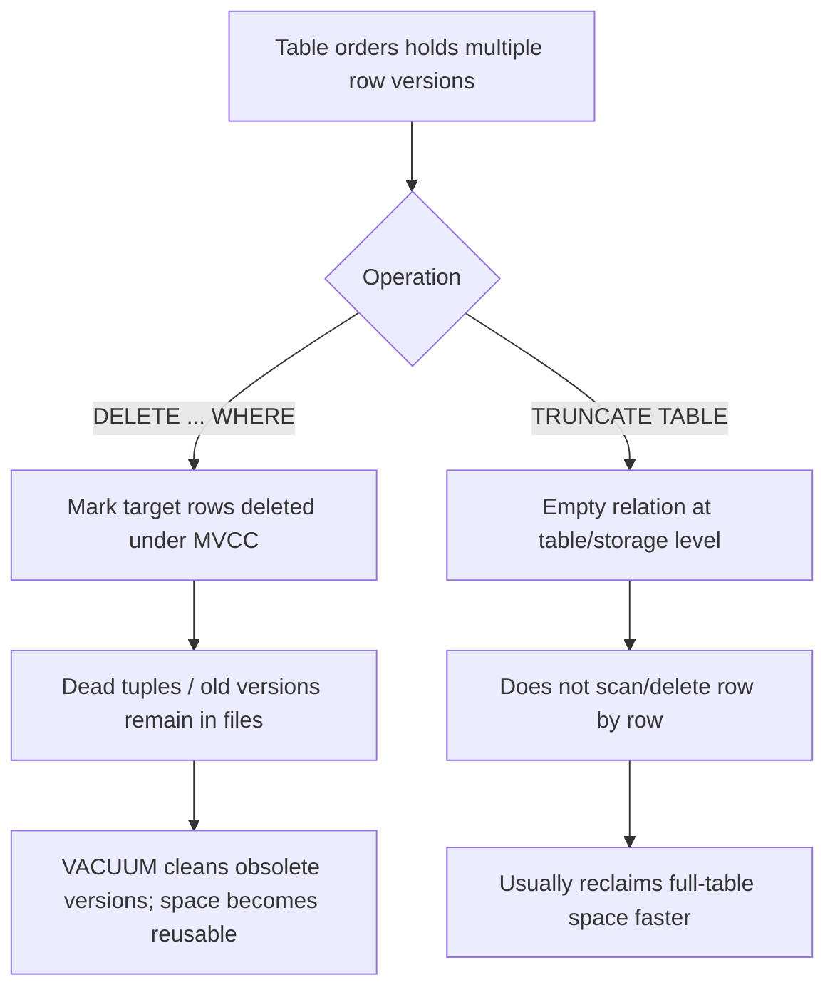

# TRUNCATE, DELETE, and Differences in Locks, Triggers, and Storage in PostgreSQL

When clearing data in PostgreSQL, two commands are easily mistaken as equivalent:

```sql
DELETE FROM some_table;
```

and:

```sql
TRUNCATE TABLE some_table;
```

In simple cases, after running and committing, both leave the table with zero rows. Yet **the two commands operate through completely different mechanisms** and differ significantly in **locks, transactions, MVCC, triggers, foreign keys, identity sequences, and disk storage**.

For example, if `orders` is referenced by `order_items`:

- `DELETE FROM orders WHERE order_id = 101` deletes one specific order; child-line behavior follows foreign-key actions such as `ON DELETE CASCADE`.
- `TRUNCATE orders` does not support `WHERE`. PostgreSQL will **reject** the command if another table holds a foreign key referencing it.
- `TRUNCATE orders CASCADE` empties **the entire referencing table**, not merely rows linked to selected orders.
- `DELETE` fires applicable `DELETE` triggers; `TRUNCATE` fires statement-level `ON TRUNCATE` triggers and **never fires row-level `ON DELETE` triggers**.
- `TRUNCATE` usually reclaims table storage faster when emptying an entire table, yet takes an `ACCESS EXCLUSIVE` lock that can block even plain `SELECT` queries.

Therefore, the right question is not simply **"which command is faster?"**—it is **"which data do you want to modify, which relationships must remain intact, what locking level is acceptable, and which side effects must run?"**

This lesson belongs to the **Data Modification** chapter, guiding command selection and safe practice in PostgreSQL.

## 1. Quick Comparison: DELETE vs. TRUNCATE

| Criterion | `DELETE` | `TRUNCATE` |
| --- | --- | --- |
| Purpose | Deletes **rows** matching a condition | Empties **entire tables** or specified relations |
| `WHERE` | Yes | **No** |
| `RETURNING` | Yes, returns deleted row data | **No** |
| Mechanism | Row-version manipulation under MVCC | Relation-level / storage-level truncation |
| Primary table lock on target | `ROW EXCLUSIVE` at table level plus row locks as needed | `ACCESS EXCLUSIVE` on truncated tables |
| Concurrent `SELECT` reads | Normally not blocked by `DELETE`'s table lock; uses MVCC snapshots | Can be blocked while `ACCESS EXCLUSIVE` is held |
| Triggers | Row-level and/or statement-level `ON DELETE` | Statement-level `ON TRUNCATE`; **no row-level `TRUNCATE` triggers** |
| Foreign keys | Honors `ON DELETE` actions, affecting only related child rows | Must cover all referencing relations; `CASCADE` can truncate entire referencing tables |
| Storage | Deleted rows become dead tuples; requires `VACUUM` to reclaim/reuse space | Normally reclaims table space immediately without post-op `VACUUM` |
| Identity/sequence | Does not reset sequences | Defaults to `CONTINUE IDENTITY`; optional `RESTART IDENTITY` |
| Transactions/`ROLLBACK` | Supports rollback | **Also supports rollback in PostgreSQL** |
| RLS | Enforces applicable `DELETE` row-level policies | Not filtered by row-level policies; requires `TRUNCATE` privilege |
| Best suited for | Conditional deletion, per-row auditing, business deletions | Clearing staging/temp/import tables, resetting test tables, controlled maintenance |

**Avoid this misconception:** never claim "`TRUNCATE` cannot be rolled back" based on experience with other databases. **In PostgreSQL, `TRUNCATE` is transactional and rollbackable.** However, that does not make running it by mistake on production safe—a committed truncate still wipes the entire table.

## 2. Basic Syntax

### 2.1. DELETE

```sql
DELETE FROM table_name
WHERE condition
RETURNING column_name;
```

Example deleting only audit events past retention:

```sql
DELETE FROM audit_events
WHERE created_at < TIMESTAMPTZ '2026-01-01 00:00:00+00'
RETURNING event_id, created_at;
```

This is an **illustrative SQL snippet** assuming a hypothetical `audit_events` table. `WHERE` constrains scope conditionally; `RETURNING` tells the application which rows were actually deleted.

If `WHERE` is omitted:

```sql
DELETE FROM table_name;
```

every row accessible to the `DELETE` statement is deleted, subject to privileges, RLS, constraints, and triggers. **Omitting `WHERE` is a massive operation** that must always be verified before execution.

### 2.2. TRUNCATE

```sql
TRUNCATE TABLE table_name;
```

PostgreSQL syntax supports these options:

```sql
TRUNCATE [ TABLE ] [ ONLY ] name [ * ] [, ...]
    [ RESTART IDENTITY | CONTINUE IDENTITY ]
    [ CASCADE | RESTRICT ];
```

Meaning:

- `name [, ...]`: one or more target tables.
- `ONLY`: restricts to the named relation without child inheritance tables; partitioned tables have specific structural rules and limits.
- `RESTART IDENTITY`: restarts sequences **owned by columns** of the truncated tables.
- `CONTINUE IDENTITY`: leaves sequence states untouched; **this is the default**.
- `CASCADE`: automatically truncates tables referencing the target via foreign keys, potentially cascading across dependency chains.
- `RESTRICT`: rejects the command if any external table has a foreign key referencing a target table; **this is the default**.

Invalid syntax:

```sql
-- INVALID: TRUNCATE does not support WHERE.
-- TRUNCATE TABLE orders WHERE status = 'CANCELLED';

-- INVALID: TRUNCATE does not support RETURNING.
-- TRUNCATE TABLE orders RETURNING order_id;
```

To delete a subset of rows or return deleted records, use `DELETE`.

## 3. Understanding Tables, Rows, and Storage Files

In PostgreSQL, a regular table is stored on disk as heap files and associated indexes. Under **MVCC**, `DELETE` does not immediately erase every byte of a row from the underlying file.

Conceptually:



This diagram is a mental model, not a complete representation of PostgreSQL memory buffers and write-ahead logging (WAL).

Key principles:

1. **`DELETE`** modifies **per-row** visibility under MVCC and must still process indexes, constraints, triggers, WAL, and row versions.
2. **`TRUNCATE`** empties the relation at a table-wide level without issuing per-row `DELETE` operations.
3. **Indexes and constraints remain intact after `TRUNCATE`**; unlike `DROP TABLE`, it preserves the table definition.
4. WAL-logged systems still emit required WAL records. **`TRUNCATE` must not be assumed to be "zero-WAL" by default.**
5. Storage reclamation differences between `DELETE` and `TRUNCATE` show up most dramatically on huge tables; on small tables, runtime is dominated by locks, triggers, FKs, and other overhead.

## 4. Test SQL Environment

To observe differences clearly, we create two foreign-key-linked tables, two trigger audit tables, and PL/pgSQL functions. **Run only in a learning or expendable database.** This script assumes the tables do not yet exist in `truncate_delete_lab`.

### 4.1. Create Schema and Parent Table

```sql
CREATE SCHEMA IF NOT EXISTS truncate_delete_lab;

CREATE TABLE truncate_delete_lab.projects (
    project_id BIGINT GENERATED ALWAYS AS IDENTITY PRIMARY KEY,
    project_name TEXT NOT NULL
);
```

`project_id` is an identity column backed by a sequence. Deleting rows **does not automatically re-issue old IDs**, because sequences operate independently of currently stored rows.

### 4.2. Create Child Table with ON DELETE CASCADE

```sql
CREATE TABLE truncate_delete_lab.tasks (
    task_id BIGINT GENERATED ALWAYS AS IDENTITY PRIMARY KEY,
    project_id BIGINT NOT NULL,
    task_name TEXT NOT NULL,
    CONSTRAINT fk_tasks_project
        FOREIGN KEY (project_id)
        REFERENCES truncate_delete_lab.projects (project_id)
        ON DELETE CASCADE
);
```

Here:

- One project has many tasks.
- Each task must reference an existing project.
- When a **project row** is `DELETE`d, **task rows referencing that project** follow `ON DELETE CASCADE`.
- `ON DELETE CASCADE` **does not** mean `TRUNCATE projects` deletes tasks row by row.

### 4.3. Create Independent Audit Tables

```sql
CREATE TABLE truncate_delete_lab.delete_audit (
    audit_id BIGINT GENERATED ALWAYS AS IDENTITY PRIMARY KEY,
    table_name TEXT NOT NULL,
    deleted_id BIGINT NOT NULL,
    operation TEXT NOT NULL,
    recorded_at TIMESTAMPTZ NOT NULL DEFAULT clock_timestamp()
);

CREATE TABLE truncate_delete_lab.truncate_audit (
    audit_id BIGINT GENERATED ALWAYS AS IDENTITY PRIMARY KEY,
    table_name TEXT NOT NULL,
    operation TEXT NOT NULL,
    recorded_at TIMESTAMPTZ NOT NULL DEFAULT clock_timestamp()
);
```

Neither audit table holds a foreign key to `projects` or `tasks`. This is **intentional for the demo**, allowing trigger logs to stay intact when test rows are deleted.

In production, an audit system often needs actor, request ID, effective timestamp, data version, before/after payloads, and retention policies. Here we focus specifically on trigger differences.

### 4.4. Create Row-Level DELETE Trigger

```sql
CREATE OR REPLACE FUNCTION truncate_delete_lab.log_row_delete()
RETURNS trigger
LANGUAGE plpgsql
AS $function$
BEGIN
    INSERT INTO truncate_delete_lab.delete_audit
        (table_name, deleted_id, operation)
    VALUES
        (TG_TABLE_NAME, OLD.project_id, TG_OP);

    RETURN OLD;
END;
$function$;

CREATE TRIGGER trg_project_delete_audit
AFTER DELETE ON truncate_delete_lab.projects
FOR EACH ROW
EXECUTE FUNCTION truncate_delete_lab.log_row_delete();
```

Here, the function reads `OLD.project_id`, so it is **bound specifically to `projects`**. To reuse across tables with different primary key names, write dedicated functions or controlled key-extraction logic.

The `AFTER DELETE FOR EACH ROW` trigger fires for **each project row actually deleted** by `DELETE`. It does not fire on `TRUNCATE`.

### 4.5. Create Statement-Level TRUNCATE Triggers

```sql
CREATE OR REPLACE FUNCTION truncate_delete_lab.log_truncate()
RETURNS trigger
LANGUAGE plpgsql
AS $function$
BEGIN
    INSERT INTO truncate_delete_lab.truncate_audit
        (table_name, operation)
    VALUES
        (TG_TABLE_NAME, TG_OP);

    RETURN NULL;
END;
$function$;

CREATE TRIGGER trg_project_truncate_audit
AFTER TRUNCATE ON truncate_delete_lab.projects
FOR EACH STATEMENT
EXECUTE FUNCTION truncate_delete_lab.log_truncate();

CREATE TRIGGER trg_task_truncate_audit
AFTER TRUNCATE ON truncate_delete_lab.tasks
FOR EACH STATEMENT
EXECUTE FUNCTION truncate_delete_lab.log_truncate();
```

PostgreSQL supports `TRUNCATE` triggers **at the statement level** (`FOR EACH STATEMENT`); there are no `BEFORE`/`AFTER TRUNCATE FOR EACH ROW` triggers. `BEFORE TRUNCATE` triggers can also be defined for pre-truncate checks.

The trigger function logs table name and operation; `RETURN NULL` in a statement-level trigger is ignored as a row value.

### 4.6. Seed Data

```sql
INSERT INTO truncate_delete_lab.projects (project_name)
VALUES
    ('Project A'),
    ('Project B'),
    ('Project C')
RETURNING project_id, project_name;

INSERT INTO truncate_delete_lab.tasks (project_id, task_name)
VALUES
    (1, 'A - Design'),
    (1, 'A - Testing'),
    (2, 'B - Deployment'),
    (3, 'C - Documentation');
```

In a **newly created schema with an unused sequence**, the projects receive IDs 1, 2, and 3. If you re-ran the script or altered sequences/data, **never assume IDs are still 1–3**; check `RETURNING` and adjust child inserts accordingly.

Count rows:

```sql
SELECT COUNT(*) AS project_count
FROM truncate_delete_lab.projects;

SELECT COUNT(*) AS task_count
FROM truncate_delete_lab.tasks;
```

Initial counts are **3 projects** and **4 tasks**. No trigger logs are produced by these initial `INSERT`s because our triggers only listen for `DELETE` and `TRUNCATE`.

## 5. DELETE with WHERE: Deleting Exact Target Rows

Requirement: delete **Project B** where `project_id = 2`.

```sql
BEGIN;

DELETE FROM truncate_delete_lab.projects
WHERE project_id = 2
RETURNING project_id, project_name;

SELECT project_id, project_name
FROM truncate_delete_lab.projects
ORDER BY project_id;

SELECT project_id, task_name
FROM truncate_delete_lab.tasks
ORDER BY project_id, task_id;

SELECT audit_id, table_name, deleted_id, operation
FROM truncate_delete_lab.delete_audit
ORDER BY audit_id;

ROLLBACK;
```

Inside the transaction before `ROLLBACK`:

- `DELETE ... RETURNING` returns exactly one row: Project B.
- `projects` retains A and C.
- Task `'B - Deployment'` is deleted via `ON DELETE CASCADE`.
- Project A's two tasks and Project C's task **remain intact**.
- The `AFTER DELETE` trigger on `projects` writes one audit row for `project_id = 2`.
- After `ROLLBACK`, the project deletion, cascaded task deletion, and trigger audit entry are all **reverted**.

**Takeaway:** `DELETE` acts **selectively per row**, and foreign-key cascades follow only the matching child rows.

### 5.1. DELETE Without WHERE

```sql
-- Run ONLY inside a test transaction!
BEGIN;

DELETE FROM truncate_delete_lab.projects;

SELECT COUNT(*) FROM truncate_delete_lab.projects;
SELECT COUNT(*) FROM truncate_delete_lab.tasks;

ROLLBACK;
```

Without blocking triggers, this deletes all three projects; via `ON DELETE CASCADE`, all four tasks are deleted as well. The `AFTER DELETE FOR EACH ROW` trigger on `projects` writes **three audit rows** in the same transaction.

Key difference from `TRUNCATE`: PostgreSQL still executes **row-level `DELETE`**, preserving per-row trigger and FK semantics.

### 5.2. DELETE RETURNING to Verify Deletion Scope

```sql
BEGIN;

DELETE FROM truncate_delete_lab.tasks
WHERE project_id = 1
RETURNING task_id, project_id, task_name;

ROLLBACK;
```

`RETURNING` returns **Project A's two tasks**. This lets you inspect affected rows **inside the transaction** before deciding to commit or roll back.

**Note:** `RETURNING` itself does not protect you if you run the wrong `DELETE` on production and commit it. Enforce least-privilege roles, verify `WHERE`, keep backups, and require reviews.

## 6. TRUNCATE Does Not Filter Rows: Emptying Whole Tables

Consider the illustration:

```sql
-- REJECTED in the demo schema because tasks holds an FK
-- referencing projects and is not in the TRUNCATE list.
-- TRUNCATE TABLE truncate_delete_lab.projects;
```

PostgreSQL rejects truncating a table referenced by a foreign key from another table not included in the `TRUNCATE` list, unless handled appropriately.

This **does not depend** on whether `tasks` currently contains any rows: PostgreSQL enforces referential integrity at the relation level because it skips row-by-row checks. Never assume "emptying `tasks` first lets `TRUNCATE parent` succeed" while the FK still exists.

### 6.1. Truncating a Standalone Child Table

Since `tasks` references `projects` and nothing references `tasks` in our example, `tasks` can be truncated alone:

```sql
BEGIN;

TRUNCATE TABLE truncate_delete_lab.tasks;

SELECT COUNT(*) AS remaining_tasks
FROM truncate_delete_lab.tasks;

SELECT COUNT(*) AS remaining_projects
FROM truncate_delete_lab.projects;

ROLLBACK;
```

Inside the transaction:

- `remaining_tasks = 0`.
- `remaining_projects = 3`.
- `TRUNCATE tasks` fires `tasks`'s `ON TRUNCATE` trigger.
- `ROLLBACK` restores the rows and reverts the audit row.

### 6.2. Truncating Both Tables Together

If the true goal is emptying both `projects` and `tasks`:

```sql
BEGIN;

TRUNCATE TABLE
    truncate_delete_lab.tasks,
    truncate_delete_lab.projects;

SELECT COUNT(*) AS remaining_projects
FROM truncate_delete_lab.projects;

SELECT COUNT(*) AS remaining_tasks
FROM truncate_delete_lab.tasks;

SELECT table_name, operation
FROM truncate_delete_lab.truncate_audit
ORDER BY audit_id;

ROLLBACK;
```

Inside the transaction, both tables are empty. With our triggers, `truncate_audit` records **one event per truncated table**, not one row per project/task.

Because of `ROLLBACK` at the end, both original data and audit state return to pre-demo state.

### 6.3. TRUNCATE ... CASCADE

PostgreSQL allows:

```sql
BEGIN;

TRUNCATE TABLE truncate_delete_lab.projects CASCADE;

SELECT COUNT(*) AS remaining_projects
FROM truncate_delete_lab.projects;

SELECT COUNT(*) AS remaining_tasks
FROM truncate_delete_lab.tasks;

ROLLBACK;
```

Because `tasks` references `projects`, `CASCADE` empties **the entire `tasks` table** too. It **does not** inspect individual tasks belonging to deleted projects; it truncates every dependent relation.

In complex schemas, `CASCADE` can fan out across tables in **other schemas** and through multi-hop foreign-key chains. Never add `CASCADE` just to "silence an error" without knowing every single table it will wipe.

### 6.4. TRUNCATE RESTRICT

`RESTRICT` is the default:

```sql
TRUNCATE TABLE truncate_delete_lab.projects RESTRICT;
```

In the demo schema, this is rejected because `tasks` references `projects` via FK and is omitted from the `TRUNCATE` list.

To avoid unintended blast radius, **explicitly list every table intended to be emptied** and let PostgreSQL reject unexpected dependencies instead of defaulting to `CASCADE`.

## 7. TRUNCATE CASCADE Differs from ON DELETE CASCADE

This is the single biggest difference for data safety.

Suppose:

```text
projects
  #1 Project A
  #2 Project B
  #3 Project C

tasks
  A-1 -> project #1
  A-2 -> project #1
  B-1 -> project #2
  C-1 -> project #3
```

**`DELETE FROM projects WHERE project_id = 2`**:

- Deletes Project B.
- With FK `ON DELETE CASCADE`, deletes **only tasks referencing B**.
- Projects A/C and tasks A/C stay intact.

**`TRUNCATE projects CASCADE`**:

- Empties **all of `projects`**.
- Empties **all of `tasks`**, because `tasks` references `projects`.
- Never filters tasks by any `project_id`.

| Command | Remaining Projects in Tx | Remaining Tasks in Tx |
| --- | --- | --- |
| `DELETE ... WHERE project_id=2` | A, C | A-1, A-2, C-1 |
| `DELETE FROM projects` | None | None, via `ON DELETE CASCADE` |
| `TRUNCATE tasks` | A, B, C | None |
| `TRUNCATE tasks, projects` | None | None |
| `TRUNCATE projects CASCADE` | None | None |

In the lab, these `DELETE`/`TRUNCATE` tests run inside rolled-back transactions to keep the practice dataset intact.

### 7.1. What If the Foreign Key Is Not ON DELETE CASCADE?

Suppose the FK uses `ON DELETE RESTRICT` or `NO ACTION`:

- `DELETE FROM projects WHERE ...` is rejected if referencing tasks remain, per constraint checking rules.
- `TRUNCATE projects RESTRICT` is rejected if another table references it without being listed.
- `TRUNCATE projects CASCADE` still empties the referencing table **at the table level**, ignoring individual `ON DELETE` rules.

Therefore, **never infer `TRUNCATE` behavior from a foreign key's `ON DELETE` action**.

### 7.2. Inspect Dependent Tables

Start with a metadata query to find foreign keys referencing a table:

```sql
SELECT
    con.conname AS constraint_name,
    con.conrelid::regclass AS referencing_table,
    con.confrelid::regclass AS referenced_table
FROM pg_constraint AS con
WHERE con.contype = 'f'
  AND con.confrelid = 'truncate_delete_lab.projects'::regclass
ORDER BY con.conrelid::regclass::text, con.conname;
```

On the demo schema, this shows FK `fk_tasks_project` from `tasks` to `projects`.

This is only a **starting point**. Production environments can also have multi-level dependencies, partitions, custom triggers, replication, or indirect references. Audit the full dependency graph before using `CASCADE`.

## 8. Locking Differences

Both commands modify data, yet their impact on concurrent traffic differs dramatically.

### 8.1. DELETE Takes ROW EXCLUSIVE at Table Level

An ordinary `DELETE` acquires a `ROW EXCLUSIVE` table-level lock on the target table, along with necessary **row locks** and locks on related objects to maintain consistency.

This means:

- Ordinary `SELECT` queries can **read concurrently** via MVCC snapshots without being blocked by `DELETE`'s `ROW EXCLUSIVE` table lock.
- Another transaction attempting to modify or lock **the same rows** must wait.
- FK cascades and triggers can acquire locks on other tables/rows.
- Deleting a huge number of rows still puts pressure on WAL, I/O, and transaction duration.

Do not confuse the lock name `ROW EXCLUSIVE` with "only takes row locks": it is **the name of a table-level lock mode**. `DELETE` also acquires row-level locks separately.

### 8.2. TRUNCATE Takes ACCESS EXCLUSIVE

`TRUNCATE` requires an `ACCESS EXCLUSIVE` lock on truncated tables. This is the strongest table-level lock mode, conflicting even with the `ACCESS SHARE` lock needed by plain `SELECT`.

Consequences:

- An active transaction holding `ACCESS SHARE` from a `SELECT` causes `TRUNCATE` to **wait**.
- Once `TRUNCATE` holds `ACCESS EXCLUSIVE`, any new `SELECT` against that table **blocks** until the truncating transaction commits or rolls back.
- With `CASCADE`, every cascaded table also needs `ACCESS EXCLUSIVE`.
- If a transaction runs `TRUNCATE` and waits minutes for an application or operator before committing, that exclusive lock stalls all reads and writes.

### 8.3. Lock Comparison Table

| Operation | Primary Target Table-Level Lock | Can Plain `SELECT` Reads Be Blocked by This Lock? |
| --- | --- | --- |
| `SELECT` | `ACCESS SHARE` | `SELECT`s are mutually compatible |
| `DELETE` | `ROW EXCLUSIVE` | **Normally no** |
| `TRUNCATE` | `ACCESS EXCLUSIVE` | **Yes**, while the lock is held |

This summarizes **main-table lock modes**, not every secondary lock arising from FKs, triggers, indexes, schemas, or application logic.

### 8.4. Two-Session Experiment Showing TRUNCATE Blocking SELECT

Open **Session A**:

```sql
BEGIN;

TRUNCATE TABLE
    truncate_delete_lab.tasks,
    truncate_delete_lab.projects;

-- Keep transaction open to observe.
-- Do NOT COMMIT / ROLLBACK yet.
```

Open **Session B**:

```sql
SELECT COUNT(*)
FROM truncate_delete_lab.projects;
```

Without a short timeout or other interruption, Session B **waits on the lock** because Session A holds `ACCESS EXCLUSIVE`. Next, in **Session A**:

```sql
ROLLBACK;
```

Session B unblocks and reads the restored data. Had Session A run `COMMIT` instead of `ROLLBACK`, Session B would read an empty table under its snapshot.

**Never run this experiment on production.** Leaving Session A open stalls live traffic. Practice on a dedicated database, set `lock_timeout`, and monitor sessions so transactions aren't left dangling.

### 8.5. Inspecting Blocked Sessions

With appropriate monitoring privileges, query:

```sql
SELECT
    a.pid,
    a.state,
    a.wait_event_type,
    a.wait_event,
    pg_blocking_pids(a.pid) AS blocked_by,
    a.query
FROM pg_stat_activity AS a
WHERE a.datname = current_database()
  AND a.wait_event_type = 'Lock'
ORDER BY a.pid;
```

`pg_blocking_pids(pid)` reports the exact PIDs blocking a backend—never guess blockers by wait duration alone. Query text and session details may be restricted depending on caller privileges.

In operations, never label a lock "safe" just because the statement looks short: **transaction hold time** and cascaded tables matter just as much as the command itself.

## 9. MVCC and Differences When Other Transactions Are Reading

PostgreSQL uses **Multi-Version Concurrency Control (MVCC)** to manage snapshot visibility per statement or transaction.

### 9.1. DELETE Follows Row-Versioning Semantics

When a transaction `DELETE`s a row and has not committed yet:

- That transaction sees its own deletion per PostgreSQL rules.
- Other transactions with active snapshots still see the old committed row version.
- After `DELETE` commits, snapshots taken afterward no longer see the deleted row.
- Old physical versions remain in the heap until `VACUUM` cleans them up.

Thus `DELETE` preserves consistent snapshot reads across row versions.

### 9.2. TRUNCATE Is Not Fully MVCC-Safe

An advanced PostgreSQL nuance: **`TRUNCATE` is not MVCC-safe in the same way `DELETE` is**. Under PostgreSQL behavior, a concurrent transaction using a snapshot taken **before `TRUNCATE`** that had not yet accessed or locked that table can observe the table as **empty** after `TRUNCATE` commits, instead of seeing the pre-truncate rows as it would with `DELETE`.

This does not contradict `TRUNCATE` being rollbackable. Those are two separate properties:

- **Transactional rollback:** uncommitted `TRUNCATE` changes can be undone.
- **MVCC visibility:** how older snapshots view the table after a `TRUNCATE` transaction commits differs from `DELETE`.

If another transaction already accessed the table and holds `ACCESS SHARE` before `TRUNCATE` requests `ACCESS EXCLUSIVE`, `TRUNCATE` must wait for that transaction to finish and release its lock. Design MVCC experiments carefully; **never test race conditions on production**.

### 9.3. When Does This MVCC Difference Matter?

- Long-running analytical reports using old snapshots.
- ETL jobs running concurrently with staging-table resets.
- Multi-`SELECT` transactions under `REPEATABLE READ`.
- Systems expecting older readers to keep seeing pre-maintenance data.

When you need strict per-row snapshot semantics or partial deletion, `DELETE` is the right mechanism. When swapping whole staging datasets, consider table/partition rotation architectures rather than truncating a live table actively being read.

## 10. Triggers: ON DELETE and ON TRUNCATE Are Distinct Events

### 10.1. Row-Level DELETE Triggers

A trigger:

```sql
CREATE TRIGGER trg_project_delete_audit
AFTER DELETE ON truncate_delete_lab.projects
FOR EACH ROW
EXECUTE FUNCTION truncate_delete_lab.log_row_delete();
```

fires once per `projects` row deleted by `DELETE`.

Inside the trigger:

- `TG_OP` equals `'DELETE'`.
- `OLD` holds the pre-deletion row values.
- `NEW` is undefined for `DELETE`.
- In our `AFTER DELETE` example, `RETURN OLD` does not undo the deletion.

A `BEFORE DELETE FOR EACH ROW` trigger can also inspect, suppress, or alter row handling via its return value. Thus running `DELETE` on a table with custom triggers can have broader effects than simply removing heap tuples.

### 10.2. Statement-Level DELETE Triggers

PostgreSQL also supports:

```sql
CREATE TRIGGER trg_delete_statement_example
AFTER DELETE ON some_table
FOR EACH STATEMENT
EXECUTE FUNCTION some_statement_trigger_function();
```

This is an **illustrative DDL snippet**, not runnable without creating the referenced table/function. A statement-level trigger fires **once per statement**, even if `DELETE ... WHERE` matches zero rows—whereas a `FOR EACH ROW` trigger does not fire when zero rows match.

### 10.3. Statement-Level TRUNCATE Triggers

```sql
CREATE TRIGGER trg_project_truncate_audit
AFTER TRUNCATE ON truncate_delete_lab.projects
FOR EACH STATEMENT
EXECUTE FUNCTION truncate_delete_lab.log_truncate();
```

With `TRUNCATE`:

- `TG_OP` equals `'TRUNCATE'`.
- Triggers support **`FOR EACH STATEMENT` only**, never iterating over `OLD` rows.
- There is no per-row `OLD.project_id`, and no deleted row count is emitted through row-level `TRUNCATE` events.
- When truncating multiple tables that each have `TRUNCATE` triggers, each affected table's triggers fire per command rules.

### 10.4. Testing the Difference via Audit Logs

Test `DELETE`:

```sql
BEGIN;

DELETE FROM truncate_delete_lab.projects
WHERE project_id = 1;

SELECT COUNT(*) AS delete_events
FROM truncate_delete_lab.delete_audit;

SELECT COUNT(*) AS truncate_events
FROM truncate_delete_lab.truncate_audit;

ROLLBACK;
```

Starting with empty audit tables, inside the transaction before rollback there is **1 delete event** and **0 truncate events**.

Test `TRUNCATE`:

```sql
BEGIN;

TRUNCATE TABLE
    truncate_delete_lab.projects,
    truncate_delete_lab.tasks;

SELECT table_name, operation
FROM truncate_delete_lab.truncate_audit
ORDER BY audit_id;

SELECT COUNT(*) AS delete_events
FROM truncate_delete_lab.delete_audit;

ROLLBACK;
```

Inside the transaction, `truncate_audit` records `TRUNCATE` events for `projects` and `tasks`; **no per-row `DELETE` events are emitted**. If `delete_audit` started empty, `delete_events` remains 0.

### 10.5. Same-Transaction Audit Triggers Roll Back Too

In our examples, audit tables are populated via regular `INSERT`s inside the same transaction. On `ROLLBACK`, those audit rows roll back too.

That suits **transactionally consistent auditing**, yet if requirements demand **logging even failed/rolled-back deletion attempts**, use an independent logging channel. Never assume a same-transaction audit table preserves immutable logs of failed transactions.

## 11. Storage: Why Doesn't DELETE Immediately Return Space to the OS?

PostgreSQL retains multiple row versions for MVCC. When deleting large volumes of data:

1. Deleted rows are marked with transaction deletion metadata.
2. Older row versions may still be needed by active snapshots.
3. Once no longer visible to any snapshot, `VACUUM` cleans them, updates visibility/free-space maps, and makes **space reusable internally**.
4. Heap and index files **do not necessarily shrink immediately** after `DELETE` or even normal `VACUUM`.

This leads to a common surprise: **`SELECT COUNT(*)` dropped sharply, yet table disk usage did not shrink proportionally**.

### 11.1. Inspecting Relation Sizes

PostgreSQL size functions:

```sql
SELECT
    pg_size_pretty(
        pg_relation_size('truncate_delete_lab.projects')
    ) AS heap_size,
    pg_size_pretty(
        pg_indexes_size('truncate_delete_lab.projects')
    ) AS indexes_size,
    pg_size_pretty(
        pg_total_relation_size('truncate_delete_lab.projects')
    ) AS total_size;
```

Distinction:

- `pg_relation_size(...)`: size of the relation's main fork as invoked above.
- `pg_indexes_size(...)`: total size of all indexes on the table.
- `pg_total_relation_size(...)`: table plus associated structures such as indexes and TOAST tables if present.

These are high-level observation tools, not exact measurements of "how many bytes belong to dead tuples." Deep bloat inspection requires dedicated diagnostics or extensions.

### 11.2. VACUUM After DELETE

```sql
VACUUM (ANALYZE) truncate_delete_lab.projects;
```

Regular `VACUUM` removes obsolete tuple versions, making space reusable and keeping MVCC healthy. `ANALYZE` refreshes planner statistics.

However:

- Regular `VACUUM` **must not be assumed to return every deleted byte to the OS**.
- Most freed space stays allocated inside table pages for future `INSERT`/`UPDATE` reuse.
- Dead tuples cannot be vacuumed while older snapshots or transactions still need them.
- PostgreSQL runs **autovacuum** in the background; avoid running manual `VACUUM` after every tiny `DELETE`.

### 11.3. VACUUM FULL Is a Different Operation

```sql
-- Illustrates a maintenance operation requiring careful planning.
-- VACUUM FULL truncate_delete_lab.projects;
```

`VACUUM FULL` rewrites the entire table into a compact copy and can return substantial space to the OS, yet it takes an `ACCESS EXCLUSIVE` lock and requires enough free disk space for the temporary rewrite.

**Never run `VACUUM FULL` as a routine post-`DELETE` step** on live traffic tables. Plan maintenance windows, monitor storage/transactions, and consider partitioning.

### 11.4. TRUNCATE Usually Reclaims Space Immediately

Once `TRUNCATE` commits, the table is emptied at the storage level, reclaiming space from old data much faster than row-by-row `DELETE` plus `VACUUM`. This is a primary reason to use `TRUNCATE` on large staging tables needing **complete emptying**.

Still:

- Space reclamation depends on transaction commit, storage layer, and related structures.
- `TRUNCATE` cannot answer "delete rows older than date X."
- `ACCESS EXCLUSIVE` locking and cascading impacts can outweigh speed gains.
- After `TRUNCATE`, table and index definitions persist, unlike `DROP TABLE`.

### 11.5. Comparing Three Perspectives on Table State

| State | `COUNT(*)` | Table Files | Notes |
| --- | --- | --- | --- |
| Before deletion | N | Populated | Initial state |
| After committed full-table `DELETE` | 0 | Often still large | Dead tuples; space reusable after `VACUUM` |
| After regular `VACUUM` | 0 | Often still large | Files do not necessarily shrink |
| After `VACUUM FULL` | 0 | Significantly smaller | Full table rewrite, strong lock |
| After committed `TRUNCATE` | 0 | Usually shrinks sharply | Relation-level empty, requires `ACCESS EXCLUSIVE` |

These are typical patterns, not guaranteed measurements across all PostgreSQL versions, storage backends, or database states.

## 12. Sequences and IDENTITY: Does TRUNCATE Reset Keys?

In:

```sql
project_id BIGINT GENERATED ALWAYS AS IDENTITY PRIMARY KEY
```

the identity column is backed by a sequence. Separate two concepts:

- **`PRIMARY KEY`:** enforces uniqueness and non-NULL across **rows currently in the table**.
- **Sequence/identity:** allocates new values on `INSERT`; it **does not reset to `MAX(id) + 1` after `DELETE`**.

### 12.1. DELETE Never Resets Sequences

In our test schema:

```sql
BEGIN;

DELETE FROM truncate_delete_lab.tasks;
DELETE FROM truncate_delete_lab.projects;

-- projects is empty, yet the project_id sequence
-- does not reset to 1 just because of DELETE.

ROLLBACK;
```

Rolling back restores the rows. To observe sequence behavior on a **committed** `DELETE`, test on expendable data you can reset afterward—do not draw conclusions about committed sequence state solely from a rolled-back transaction.

In principle, `DELETE` **never restarts sequences**.

### 12.2. TRUNCATE CONTINUE IDENTITY Is the Default

```sql
TRUNCATE TABLE
    truncate_delete_lab.tasks,
    truncate_delete_lab.projects
CONTINUE IDENTITY;
```

This empties the tables while leaving sequence progression intact. Subsequent `INSERT`s continue issuing IDs higher than those used before truncation.

In this lesson, **never run this on a database holding data you wish to keep**, unless an intentional full reset is planned.

### 12.3. TRUNCATE RESTART IDENTITY

```sql
TRUNCATE TABLE
    truncate_delete_lab.tasks,
    truncate_delete_lab.projects
RESTART IDENTITY;
```

`RESTART IDENTITY` restarts sequences **owned by columns of the truncated tables**. For our schema's identity columns, their bound sequences reset to their configured start values.

Do not assume `RESTART IDENTITY` resets every sequence randomly called by triggers or defaults on the table. Unowned standalone sequences are not automatically reset.

### 12.4. Testing with Transactions and ROLLBACK

```sql
BEGIN;

TRUNCATE TABLE
    truncate_delete_lab.tasks,
    truncate_delete_lab.projects
RESTART IDENTITY;

INSERT INTO truncate_delete_lab.projects (project_name)
VALUES ('Post-reset project')
RETURNING project_id;

ROLLBACK;
```

On a fresh schema starting at 1, the `INSERT` inside this transaction returns `project_id = 1`. On `ROLLBACK`, **both the `TRUNCATE` and the owned-sequence restart roll back** per PostgreSQL semantics.

**Advanced note:** if a session calls `currval()` on a restarted sequence and then rolls back, the session-local `currval` cache does not necessarily reflect the reverted global sequence state. Never use `currval` after rollback as sole proof of global sequence state.

### 12.5. nextval and Rollback

Normally, `nextval()` allocates a sequence value that **is not reclaimed** when an `INSERT` transaction rolls back; ID gaps are expected.

That does not contradict PostgreSQL's ability to **roll back `TRUNCATE ... RESTART IDENTITY` itself**. Distinguish:

- "A sequence issued a number during `INSERT` and the transaction rolled back."
- "`TRUNCATE` requested restarting the sequence and `TRUNCATE` itself rolled back."

In design, **IDs are identifiers**, never guaranteed gapless business counters. Never assume gapless IDs to count records or orders.

## 13. Primary Key Constraints and Indexes After TRUNCATE

`TRUNCATE` **does not drop the table schema**.

For example:

```sql
-- After TRUNCATE, definitions remain intact:
-- project_id BIGINT GENERATED ALWAYS AS IDENTITY PRIMARY KEY
-- project_name TEXT NOT NULL
```

Preserved properties include:

- Table name, columns, data types, and `DEFAULT` expressions.
- `PRIMARY KEY`, `UNIQUE`, `CHECK`, and `FOREIGN KEY` constraints.
- Index and trigger definitions.
- Table privileges and catalog metadata.

Only the stored rows become empty. That is why `TRUNCATE` differs from `DROP TABLE`:

```sql
-- COMPLETELY DIFFERENT FROM TRUNCATE: drops the entire relation definition.
-- DROP TABLE truncate_delete_lab.projects;
```

Once a table is dropped, queries against it fail until it is recreated. After `TRUNCATE`, applications can immediately continue querying and inserting once the lock releases.

### 13.1. TRUNCATE Does Not Check FKs Row by Row

PostgreSQL enforces `RESTRICT`/`CASCADE` for `TRUNCATE` at **the table level**, rather than checking or cascading child rows per `ON DELETE`.

By contrast, `DELETE` enforces constraints on **individual rows**. Even `DEFERRABLE` foreign keys do not turn `TRUNCATE` into a row-level `DELETE`.

## 14. Privileges and Row-Level Security (RLS)

Production systems should never grant table-wide destructive privileges to every application role.

### 14.1. DELETE Privilege

To delete rows, a role needs `DELETE` privilege per PostgreSQL rules; when `WHERE` or `RETURNING` reads columns, `SELECT` privilege is also required. If RLS is enabled, applicable policies filter `DELETE`.

Example:

```sql
-- Illustrative syntax; requires proper GRANT privileges to execute.
GRANT DELETE ON TABLE truncate_delete_lab.tasks TO app_writer;
```

`app_writer` is an illustrative role name not created in this lesson. Real `GRANT` statements must be reviewed against your security model.

### 14.2. TRUNCATE Privilege Is Separate

`TRUNCATE` requires the dedicated `TRUNCATE` privilege on affected tables. Granting `DELETE` **does not** grant `TRUNCATE`.

```sql
-- Illustrative syntax; rarely appropriate to grant broadly in production.
GRANT TRUNCATE ON TABLE truncate_delete_lab.tasks TO maintenance_role;
```

`maintenance_role` is likewise illustrative.

### 14.3. TRUNCATE Is Not DELETE with RLS

Row-Level Security limits which rows can be read or modified by `SELECT`/`INSERT`/`UPDATE`/`DELETE`. However, `TRUNCATE` is a table-wide operation and **does not enforce row-level RLS filtering**.

Thus if a role holds `TRUNCATE` on a multi-tenant table, never assume RLS restricts it to deleting only the current tenant's rows.

In multi-tenant architectures:

- Never grant `TRUNCATE` to request-handling application roles.
- Grant it only to tightly controlled maintenance roles operating across all tenants.
- To delete data for **a single tenant**, use `DELETE` with explicit tenant predicates or a dedicated controlled process.
- Even when partitioned by tenant, verify table/partition privileges and exact `TRUNCATE` behavior.

**Valid SQL syntax alone does not prove an operation is access-control safe.**

## 15. Conditional DELETE: Filtering, Auditing, and Affected Row Counts

In most business workflows, deletion targets specific rows via conditions.

### 15.1. Delete by Primary Key

```sql
DELETE FROM truncate_delete_lab.tasks
WHERE task_id = 42
RETURNING task_id, project_id, task_name;
```

If `task_id = 42` does not exist, it returns **0 rows** without syntax error. The application inspects the affected row count to return 404, idempotent success, or a warning per its API contract.

### 15.2. Delete Using Relations (DELETE ... USING)

PostgreSQL supports `DELETE ... USING ...` to delete rows based on related tables:

```sql
-- Illustrative logic snippet; runnable in a demo transaction.
BEGIN;

DELETE FROM truncate_delete_lab.tasks AS t
USING truncate_delete_lab.projects AS p
WHERE t.project_id = p.project_id
  AND p.project_name = 'Project C'
RETURNING t.task_id, t.task_name;

ROLLBACK;
```

Here only **`tasks` rows** belonging to Project C are deleted; Project C itself stays untouched. Verify `JOIN` and `WHERE` predicates carefully so scope does not widen unexpectedly.

### 15.3. Batch Deletion

PostgreSQL lacks direct `DELETE ... LIMIT 1000` syntax supported by some other engines. To delete in batches, pick target keys in a CTE:

```sql
WITH candidates AS (
    SELECT task_id
    FROM truncate_delete_lab.tasks
    WHERE project_id = 1
    ORDER BY task_id
    LIMIT 100
)
DELETE FROM truncate_delete_lab.tasks AS t
USING candidates AS c
WHERE t.task_id = c.task_id
RETURNING t.task_id;
```

This deletes up to 100 tasks for Project A ordered by ID. Real cleanup jobs loop across transactions, handle concurrent inserts/updates, monitor locks, use stable keys, and implement retries.

**Never assume batched `DELETE` is lock-free or error-free.** When properly designed, it simply bounds per-transaction work and lock duration compared to one massive `DELETE`.

## 16. Batched DELETE and Bloat Risk

A single `DELETE` removing millions of rows can:

- Generate massive WAL.
- Leave millions of dead tuples awaiting `VACUUM`.
- Hold locks and transactions open for a long time.
- Increase index maintenance overhead.
- Introduce replica lag or downstream consumer delays depending on architecture.

Smaller batches committed iteratively bound transaction duration and give `VACUUM` room to work. Still, total WAL and write I/O are not necessarily smaller, and data can change between batches.

### 16.1. Batching Strategy

A cleanup job can:

1. Select old records via an index such as `created_at` or an identity key.
2. Delete a bounded batch.
3. Inspect deleted count and performance.
4. Commit.
5. Repeat until no eligible rows remain.

With multiple concurrent workers, `FOR UPDATE SKIP LOCKED` can coordinate rows consistently—while remembering it skips locked rows and batches observe changing snapshots. Never slap `SKIP LOCKED` onto every cleanup without checking completeness requirements.

### 16.2. When Old Data Is Partitioned by Time

If data is partitioned by month or day and an **entire expired partition** must be dropped, consider **detaching/dropping the partition** via maintenance procedures instead of row-by-row `DELETE` across a whole month.

This does not eliminate checking locks, FKs, replication, and retention, yet time-based partitioning makes large-scale purging far cleaner and more predictable.

## 17. TRUNCATE with Partitioned and Inherited Tables

A PostgreSQL table can be a **partitioned table** or part of table inheritance.

Key rules:

- Specifying a **parent table** in `TRUNCATE` without `ONLY` applies truncation to child tables/partitions per inheritance rules.
- `ONLY` adjusts inheritance scope, not row filtering. A partitioned parent holds no heap rows of its own, so `TRUNCATE ONLY` on it has restrictions.
- Truncating **a single partition** does not truncate sibling partitions under the same parent.
- With foreign-key dependencies and `CASCADE`, truncation can fan out to related tables; inspect FKs on partitioned tables carefully.

Conceptual example:

```sql
-- Illustrating a system with existing monthly partitions:
-- TRUNCATE TABLE events_2026_01;
```

This cannot run unless `events_2026_01` exists.

**Recommendation:** on partitioned data, verify **whether the target is the parent or a specific partition**, FK structure, and retention scope before running `TRUNCATE`. Never assume `TRUNCATE parent CASCADE` touches only one month.

## 18. Safe Practice with Transactions and Timeouts

Both `DELETE` and `TRUNCATE` are transactional, allowing uncommitted dry runs in test sessions. However, **holding an open `TRUNCATE` transaction holds an exclusive lock**, so keep test transactions brief and strictly in non-production environments.

### 18.1. Inspect Before Deleting

```sql
SELECT COUNT(*) AS target_rows
FROM truncate_delete_lab.tasks
WHERE project_id = 1;

SELECT task_id, project_id, task_name
FROM truncate_delete_lab.tasks
WHERE project_id = 1
ORDER BY task_id;
```

With two tasks under Project A in our sample data, this confirms the expected scope.

### 18.2. DELETE Inside a Transaction

```sql
BEGIN;

SET LOCAL lock_timeout = '3s';
SET LOCAL statement_timeout = '15s';

DELETE FROM truncate_delete_lab.tasks
WHERE project_id = 1
RETURNING task_id, task_name;

-- Verify actually affected rows.
SELECT COUNT(*) AS remaining_tasks
FROM truncate_delete_lab.tasks;

ROLLBACK;
```

`SET LOCAL` applies only to the current transaction. These timeout values are **strictly illustrative**, not universal production settings.

To actually commit in real operations, do so only after proper review/approval. Never swap `ROLLBACK` for `COMMIT` on critical data just because "the SQL looks fine."

### 18.3. TRUNCATE Inside a Transaction

```sql
BEGIN;

SET LOCAL lock_timeout = '3s';
SET LOCAL statement_timeout = '15s';

TRUNCATE TABLE
    truncate_delete_lab.tasks,
    truncate_delete_lab.projects
CONTINUE IDENTITY;

SELECT COUNT(*) AS projects_after_truncate
FROM truncate_delete_lab.projects;

SELECT COUNT(*) AS tasks_after_truncate
FROM truncate_delete_lab.tasks;

ROLLBACK;
```

Key points:

- `lock_timeout` prevents waiting indefinitely for locks.
- `statement_timeout` bounds statement runtime.
- Neither prevents unintended data loss nor replaces checking FKs and triggers.
- Keep `TRUNCATE` transactions **extremely short** because exclusive table locks block all traffic.

### 18.4. Never Treat Transactions as a Backup Strategy

`ROLLBACK` helps **only before `COMMIT` while the transaction is still open**. After committing a `TRUNCATE` in production, there is no undo `ROLLBACK` button.

Recovery then depends entirely on backups, PITR, replicas, or tested restore procedures. Verify recoverability before destructive maintenance—do not rely solely on `BEGIN ... COMMIT`.

## 19. DELETE in a Transaction vs. TRUNCATE in a Transaction

Compare two scenarios:

**Transaction A:**

```sql
BEGIN;
DELETE FROM truncate_delete_lab.tasks
WHERE project_id = 1;
-- Uncommitted.
```

**Transaction B:**

```sql
SELECT COUNT(*)
FROM truncate_delete_lab.tasks;
```

Under normal snapshots, B's `SELECT` is not blocked by A's uncommitted `DELETE` and reads pre-deletion data. Transactions trying to modify **the same rows** wait.

By contrast:

**Transaction A:**

```sql
BEGIN;
TRUNCATE TABLE truncate_delete_lab.tasks;
-- Uncommitted.
```

**Transaction B:**

```sql
SELECT COUNT(*)
FROM truncate_delete_lab.tasks;
```

B **blocks at the table-lock level** until A commits or rolls back.

Never run both experiments simultaneously on the same schema while the prior Transaction A remains open. Always `ROLLBACK` cleanly before switching scenarios.

## 20. Triggers, FKs, and Other Side Effects on Deletion

In real applications, `DELETE` can trigger:

- Per-row audit triggers.
- Triggers maintaining summary tables or caches.
- Foreign-key actions (`ON DELETE CASCADE` / `SET NULL` / `SET DEFAULT`) and `RESTRICT`/`NO ACTION` checks.
- Replication or change data capture (CDC) events as configured.
- Application code consuming `RETURNING` lists to emit notifications downstream.

`TRUNCATE` skips per-row `ON DELETE` triggers and emits no `RETURNING` rows. Therefore, if workflows rely on `DELETE` side effects, **swapping in `TRUNCATE` can break system invariants** even though both leave the table empty.

### 20.1. Audit TRUNCATE Separately

If maintenance operations must be audited, attach `ON TRUNCATE` triggers or centralize logging at the controlled execution layer. Logs should record **all truncated tables**, actor, reason, approval ticket, and timestamp.

Never assume `ON DELETE FOR EACH ROW` audits a role that holds `TRUNCATE` privilege.

### 20.2. Verify Replication and CDC Specifically

PostgreSQL logical replication supports replicating `TRUNCATE` events under matching publication/subscription settings. External CDC pipelines, consumers, or search indexes may handle them very differently.

Before running `TRUNCATE` on replicated tables:

1. Verify the publication publishes `TRUNCATE` events if intended.
2. Verify subscribers/consumers support `TRUNCATE` and target relations.
3. Check FK/trigger differences between source and destination.
4. Confirm that replicating a **full-table wipe** matches operational expectations.

Never assume downstream systems turn `TRUNCATE` into individual `DELETE` events or synchronize it identically everywhere.

## 21. Performance: Which Command Is Faster?

When **emptying all rows of a large table, needing no per-row `DELETE` triggers, and able to tolerate exclusive locking**, `TRUNCATE` is usually dramatically faster because it avoids row-by-row processing.

Yet never claim "`TRUNCATE` is always better than `DELETE`":

| Scenario | Typical Fit | Reason |
|---|---|---|
| Delete a few rows by ID | `DELETE ... WHERE id IN (...)` | Exact scope, uses indexes |
| Purge old records by timestamp | `DELETE WHERE created_at < ...`, optionally batched | Conditional; preserves newer rows |
| Clear a single-batch staging table | `TRUNCATE` when privileges and FKs allow | Avoids scanning rows |
| Huge table serving continuous `SELECT`s | Consider batched `DELETE` or partition switch/detach instead of `TRUNCATE` | `ACCESS EXCLUSIVE` stalls readers |
| Need per-row deletion audits | `DELETE` | Provides `OLD`, row triggers, and `RETURNING` |
| Preserve sequence progression | `DELETE` or `TRUNCATE CONTINUE IDENTITY` | Leaves identity untouched |
| Reset test data and IDs | `TRUNCATE ... RESTART IDENTITY` | Clears rows and resets owned sequences |
| Table referenced by FKs | Check FKs and scope; usually conditional `DELETE` | `TRUNCATE CASCADE` wipes entire child tables |
| Tenant/RLS-scoped cleanup | `DELETE` with proper policies and predicates | `TRUNCATE` ignores row-level filters |
| Worried about post-purge bloat | Plan `VACUUM`, partitioning, or maintenance | Never replace partial `DELETE` with `TRUNCATE` |

### 21.1. Never Benchmark by Client Wall Time Alone

A `DELETE` or `TRUNCATE` benchmark depends on:

- Lock wait time.
- Trigger execution cost.
- FKs and referencing tables.
- Number of indexes on the table.
- Row count and row/TOAST sizes.
- WAL volume, synchronous commit, and replication.
- Buffer cache, checkpoints, and disk I/O.
- Autovacuum and long-running readers.

Fair comparisons use realistic datasets and also measure aftermath: bloat, concurrent query latency, replica lag, and recoverability—not just statement milliseconds.

## 22. Real-World "Wrong Command" Examples

### 22.1. Purging Expired Orders

Requirement: delete orders before 2024 while keeping newer orders.

**Wrong:**

```sql
-- Wipes the entire table, including new orders:
-- TRUNCATE TABLE orders;
```

**Scope-appropriate:**

```sql
DELETE FROM orders
WHERE ordered_at < TIMESTAMPTZ '2024-01-01 00:00:00+00';
```

Assumes `orders` and `ordered_at` exist. Account for FKs, retention, and auditing before running.

### 22.2. Resetting a Staging Table After Import

Requirement: a staging table holds only the previous batch, all rows are disposable, and no FKs/triggers require per-row `DELETE`.

```sql
TRUNCATE TABLE import_stage;
```

Appropriate when the job exclusively owns the table, no readers need older snapshots, and brief locking is acceptable.

### 22.3. Resetting Test Tables and Restarting IDs from Scratch

```sql
TRUNCATE TABLE
    truncate_delete_lab.tasks,
    truncate_delete_lab.projects
RESTART IDENTITY;
```

Great in expendable test databases. In production, resetting identities can collide with IDs already referenced in external systems even though the local table is empty.

### 22.4. Deleting One Customer's Data in a Multi-Tenant Table

```sql
DELETE FROM customer_events
WHERE tenant_id = 12
  AND customer_id = 345;
```

The goal is deleting **one specific customer in one specific tenant**, not the whole table. Guard with authorization, composite keys, RLS, and dependent-data handling.

### 22.5. Resetting a Table with Downstream Consumers

If a table has event triggers, CDC, search indexes, or caches keyed per row, `TRUNCATE` may bypass the usual `DELETE` pipeline.

The solution isn't always "ban `TRUNCATE` forever"; you can build a **maintenance workflow** that audits and emits a full-reset event to consumers. Just **design it explicitly** instead of expecting `DELETE` side effects to fire automatically.

## 23. Decision Workflow Before Deleting Data

<u>Recommended checklist for operators and migration reviewers:</u>

1. **State the goal:** deleting a few rows, a slice of data, or the entire table?
2. **Identify target tables:** schema-qualified names to avoid wrong environment/`search_path`.
3. **Check privileges:** does the role have `DELETE` only or `TRUNCATE` too? Is RLS enabled?
4. **Count target rows:** run `SELECT COUNT(*) ... WHERE ...` with the exact planned predicates.
5. **Inspect FK relationships:** which tables reference the target? What are their `ON DELETE` rules?
6. **Inspect triggers:** are there row-level `DELETE`, statement `DELETE`, or `TRUNCATE` triggers?
7. **Check downstream systems:** replication, CDC, caches, external indexes, audits, event pipelines.
8. **Assess locking:** `ROW EXCLUSIVE` + row locks or `ACCESS EXCLUSIVE`? Who could block?
9. **Assess storage:** `DELETE` creates dead tuples/`VACUUM` work; `TRUNCATE` empties storage immediately.
10. **Check identity:** need `CONTINUE IDENTITY` or `RESTART IDENTITY`? Are IDs referenced externally?
11. **Plan transaction:** low-traffic window, appropriate timeouts, commit/rollback, batching if needed.
12. **Verify recovery:** tested backups/PITR and awareness of post-commit impact.
13. **Verify post-op:** row counts, FK integrity, audits, replica lag, and application health.
14. **Document the decision:** rationale for command choice and approved scope.

This workflow is vital whenever someone asks to "quickly wipe old data" on a table that actually holds mixed old/new data or serves multiple teams.

## 24. Common Misconceptions

| Misconception | Why It Is Wrong | Reality |
|---|---|---|
| "`TRUNCATE` is just a fast `DELETE` without `WHERE`" | Differs in locks, triggers, FKs, MVCC, and storage | Choose based on semantics and side effects |
| "`TRUNCATE` cannot roll back in PostgreSQL" | PostgreSQL supports transactional `TRUNCATE` | Can `ROLLBACK` before `COMMIT` |
| "`TRUNCATE` deletes row by row so `ON DELETE` triggers fire" | No per-row `DELETE` occurs | Uses statement-level `ON TRUNCATE` triggers |
| "`ON DELETE CASCADE` behaves the same under `TRUNCATE`" | `TRUNCATE` checks/cascades at the table level | `TRUNCATE ... CASCADE` empties entire referencing tables |
| "As long as the child table is empty, `TRUNCATE parent` works" | FK enforcement checks relation definitions | Must include child tables or change design |
| "`DELETE` never locks the table" | Takes table-level `ROW EXCLUSIVE` plus row locks | Concurrent reads/writes depend on lock compatibility |
| "`TRUNCATE` never blocks `SELECT`" | `ACCESS EXCLUSIVE` conflicts with `ACCESS SHARE` | `SELECT` must wait while lock is held |
| "`DELETE` immediately shrinks files on disk" | Dead tuples remain under MVCC | `VACUUM` enables reuse; `VACUUM FULL` rewrites |
| "Normal `VACUUM` shrinks every file to minimum size" | Does not always shrink OS file size | Freed space stays inside pages for reuse |
| "`TRUNCATE` writes no WAL" | Durability and recovery still require WAL | Logged per PostgreSQL WAL rules |
| "`TRUNCATE` resets identity by default" | Defaults to `CONTINUE IDENTITY` | Specify `RESTART IDENTITY` explicitly when wanted |
| "`DELETE` resets `SERIAL`/`IDENTITY` when the table becomes empty" | Sequences are independent of remaining row count | Never auto-resets |
| "`RESTART IDENTITY` resets every sequence called anywhere" | Affects only sequences owned by truncated columns | Check sequence ownership |
| "`TRUNCATE` drops columns, indexes, and constraints" | Only removes stored rows | `DROP TABLE` removes the table definition |
| "Conditional `DELETE` obeys RLS, so `TRUNCATE` does too" | `TRUNCATE` ignores row-level RLS policies | Restrict `TRUNCATE` privileges tightly |
| "`TRUNCATE CASCADE` deletes only matching child rows" | Operates at table level | Audit every dependent table |
| "Running `TRUNCATE` after `DELETE` is routine maintenance" | Wipes remaining newer rows and takes heavy locks | Use `VACUUM`/partitioning to reclaim space |
| "`VACUUM FULL` should run after every `DELETE`" | Exclusive lock, full rewrite, heavy I/O | Run only when genuinely needed and scheduled |
| "Having a transaction equals having a backup" | Cannot `ROLLBACK` after `COMMIT` | Verify backups/PITR before destructive operations |
| "Running `TRUNCATE` in multi-tenant tables clears only my tenant" | Has no `WHERE` and ignores row-level RLS | Use `DELETE` with tenant predicates or isolated tables |

## 25. PostgreSQL Practice Exercises

These exercises use the `truncate_delete_lab` schema from Section 4. Run potentially destructive steps inside **transactions ending with `ROLLBACK`** before trying variations. Reload clean fixtures in a test database between runs if needed.

1. **Compare syntax:** write a `DELETE` removing only tasks in Project 1, and a `TRUNCATE` on `tasks`. Which accepts `WHERE`, and which does not?
2. **Scope verification:** `SELECT` Project 2's tasks before deleting. Use `DELETE RETURNING` and `ROLLBACK` to verify exact affected rows.
3. **`ON DELETE CASCADE`:** `DELETE` Project 2 in a transaction; count `tasks` before and after. Why did only Task B disappear?
4. **`DELETE` without `WHERE`:** delete all `projects` in a transaction and inspect `delete_audit`. Why are there three row events?
5. **Truncate child table:** truncate `tasks`; check how many `projects` remain and what appears in `truncate_audit`.
6. **FK `RESTRICT`:** try truncating `projects` alone while `tasks` holds an FK. Explain the error and why it doesn't depend solely on whether `tasks` has rows.
7. **Truncate multiple tables:** truncate both `projects` and `tasks` in one statement. Why is `CASCADE` unnecessary when all referencing tables are listed?
8. **`CASCADE`:** run `TRUNCATE projects CASCADE` in a transaction. Contrast with `DELETE ... WHERE project_id = 2`.
9. **Audit triggers:** compare rows in `delete_audit` and `truncate_audit` across `DELETE` and `TRUNCATE` tests. Why does `TRUNCATE` lack per-row `deleted_id`?
10. **`ROLLBACK`:** after truncating both tables in a transaction, `ROLLBACK` and recount. What was restored?
11. **Blocking `SELECT`:** using Sessions A and B, have A hold an uncommitted `TRUNCATE` while B runs `SELECT COUNT(*) FROM projects`. Describe the wait state.
12. **Concurrent `DELETE`:** replace `TRUNCATE` with `DELETE` on Project 1 and leave the transaction open; run `SELECT` on `projects` in Session B. Why doesn't it block like `TRUNCATE`?
13. **Distinguish locks:** explain `ROW EXCLUSIVE` on `DELETE` vs. `ACCESS EXCLUSIVE` on `TRUNCATE`.
14. **Monitor blockers:** use `pg_stat_activity` and `pg_blocking_pids` to find lock-waiting sessions in a test environment.
15. **Storage:** inspect `pg_relation_size`, `pg_indexes_size`, and `pg_total_relation_size` before/after `DELETE`/`ROLLBACK` and `TRUNCATE`/`ROLLBACK`. What can you *not* conclude from a tiny table with just a few rows?
16. **`VACUUM`:** explain why a full-table `DELETE` can leave large files behind and why regular `VACUUM` does not guarantee returning every byte to the OS.
17. **`VACUUM FULL`:** list the locking and I/O costs of `VACUUM FULL` compared to regular `VACUUM`.
18. **`CONTINUE IDENTITY`:** write `TRUNCATE` on both `projects` and `tasks` while preserving sequence progression.
19. **`RESTART IDENTITY`:** write `TRUNCATE` on both `projects` and `tasks` resetting owned sequences. Test with `INSERT RETURNING` inside a transaction.
20. **Sequence rollback:** explain why rolling back `TRUNCATE ... RESTART IDENTITY` differs from rolling back an `INSERT` that called `nextval`.
21. **Privileges:** why doesn't `DELETE` privilege automatically grant `TRUNCATE`? Propose privilege separation for `app_writer` and `maintenance_role`.
22. **RLS:** a shared multi-tenant table uses row-level policies. Why can't `TRUNCATE` delete only tenant 12's data?
23. **`DELETE USING`:** delete `tasks` filtered by `project_name` from `projects`, using `RETURNING` to inspect removed tasks.
24. **Batched `DELETE`:** write a CTE selecting 100 tasks by `task_id` to delete in one batch. Why can't `TRUNCATE` delete just 100 tasks?
25. **Statement triggers:** contrast `DELETE FOR EACH ROW` vs. `DELETE FOR EACH STATEMENT` when zero rows match.
26. **`TRUNCATE` triggers:** build a `BEFORE TRUNCATE` trigger in a test environment to log or guard truncation. Why can't you read per-row `OLD.project_id`?
27. **FK metadata lookup:** query `pg_constraint` for tables referencing `projects`. If `sub_tasks` also references `tasks`, how does `CASCADE` scope expand?
28. **Partitioning:** on a monthly partitioned `events` table, choose how to purge an old month. Compare timestamp `DELETE`, partition `TRUNCATE`, and `DETACH`/`DROP PARTITION`.
29. **Side effects:** a table has a `DELETE` trigger maintaining a summary table. What breaks if you swap `DELETE` for `TRUNCATE` without handling summary resets?
30. **Replicated tables:** list checks required before running `TRUNCATE` on tables tracked by logical replication or CDC.
31. **PITR:** why doesn't transaction rollback replace backups and point-in-time recovery after `COMMIT`?
32. **Choose command:** clearing `import_stage` every batch with no FKs and a single owning job—which command fits better?
33. **Choose command:** deleting data before `2025-01-01` while retaining `2026`—why doesn't `TRUNCATE` work?
34. **Migration review:** build a checklist covering schema, FKs, triggers, privileges, lock timeouts, identity, backups, affected row counts, and downstream consumers.
35. **Two-session MVCC:** describe how snapshot visibility differs between `DELETE` and `TRUNCATE` for older transactions, and why never to reproduce that race in production.
36. **Operations report:** after a large `DELETE`, row count dropped while file size stayed large; propose investigating `VACUUM`, autovacuum, long transactions, and partitioning instead of blindly running `TRUNCATE`.

## 26. Summary

Comparing the two ways to clear data:

```text
DELETE FROM table WHERE condition
    -> Selects individual rows
    -> Per-row MVCC, DELETE triggers, FK ON DELETE
    -> ROW EXCLUSIVE table lock + row locks
    -> Creates dead tuples; VACUUM cleans/reuses space
    -> Supports RETURNING and rollback

TRUNCATE TABLE table
    -> Empties entire table; no WHERE / RETURNING
    -> ACCESS EXCLUSIVE; can block SELECT
    -> Statement-level TRUNCATE triggers; no per-row DELETE triggers
    -> Table-level RESTRICT / CASCADE for FKs
    -> Usually reclaims full-table space faster
    -> CONTINUE IDENTITY by default; optional RESTART IDENTITY
    -> Rollbackable in PostgreSQL
```

**Three most important differences:**

1. **Locks and concurrency:** `TRUNCATE` takes `ACCESS EXCLUSIVE`; `DELETE` lets concurrent reads proceed normally under MVCC.
2. **Triggers and foreign keys:** `DELETE` operates on specific rows and honors `ON DELETE` rules; `TRUNCATE` fires separate statement triggers and `CASCADE` wipes entire referencing tables.
3. **Storage and identity:** `DELETE` leaves dead row versions for `VACUUM`, while `TRUNCATE` empties storage quickly and can optionally restart owned sequences.

**Safe selection never rests on speed alone.** When deleting conditionally, auditing per row, or enforcing business deletion rules, choose `DELETE`. When you truly need to empty **an entire** staging or test table—and have accounted for FKs, triggers, privileges, replication, and lock downtime—`TRUNCATE` can be the right tool. In either case, verify scope, use transactions wisely, and confirm recoverability before committing.
