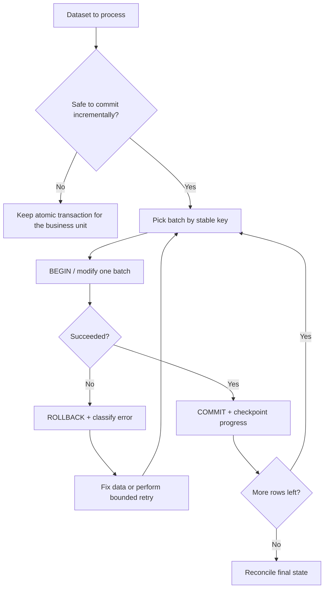

# Batch Data Modification and Transaction Size Limits in PostgreSQL

In PostgreSQL applications, updating a single record is straightforward: execute one `INSERT`, `UPDATE`, or `DELETE` and commit. When you need to import millions of rows, normalize a column across an entire table, or purge expired records, the problem changes completely. An overly large statement or transaction can generate massive WAL volume, hold locks for a long time, bloat row versions managed by MVCC, and stall replication, autovacuum, or active queries.

**Batch data modification (batch processing)** splits a large workload into smaller chunks that can be monitored, resource-bounded, retried, and resumed if interrupted. The challenge goes beyond writing `LIMIT 500`: you must pick a stable pagination key, define transaction boundaries, handle concurrency, and ensure business invariants are not broken when work commits incrementally.

This lesson explains three common patterns:

- **Batch `INSERT`:** inserting multiple rows in one statement or across statements, or using `COPY` for very large loads.
- **Batch `UPDATE`:** picking a group of keys to modify, updating them, and looping until done.
- **Batch `DELETE`/archive:** deleting or archiving old data in chunks rather than one table-wide transaction.

We also analyze **practical transaction size limits** in PostgreSQL: there is no universal hard row limit, yet there are very real resource constraints and operational boundaries.

## 1. Why Can One Massive Transaction Cause Problems?

Suppose the `events` table has 50 million rows and you want to normalize `event_code`:

```sql
UPDATE app.events
SET normalized_code = upper(trim(event_code))
WHERE normalized_code IS NULL;
```

The statement is semantically valid SQL, yet updating 50 million rows in a single transaction forces the system to:

1. Create new row versions under **MVCC**.
2. Generate **WAL** for crash recovery and replication.
3. Hold relevant locks for the entire transaction duration.
4. Update affected indexes or write extra heap tuple versions.
5. Clean up millions of dead tuples via vacuum after the transaction completes.
6. Keep certain resources and lock relationships held until the long transaction finishes.
7. Incur massive rework cost if the job fails late and must retry.

A huge transaction **does not necessarily fail**; PostgreSQL can process transactions modifying vast numbers of rows given sufficient resources. Yet "the database can execute it" differs from "it is safe to operate during peak traffic."

### 1.1. Two Competing Goals

| Small Batches / Transactions | Large Batches / Transactions |
| --- | --- |
| Shorter lock-hold time per batch | Lower per-row commit and round-trip overhead |
| Easy to pause, observe, and retry partially | Ideal when the entire change must be atomic |
| Spreads WAL and vacuum load over time | Higher raw throughput when resources allow |
| Can expose intermediate partial states | Preserves "all-or-nothing" consistency in one transaction |
| More transactions and progress checkpoints needed | Late failure forces reprocessing the entire chunk |

There is no single optimal batch size for every table. Balance **correctness**, **throughput**, **latency impact on concurrent queries**, **WAL**, **replication lag**, and **recovery on interruption**.

## 2. Distinguishing Statement, Batch, and Transaction

These three concepts are often confused:

- **Statement:** a single SQL command, such as `UPDATE ... WHERE ...`.
- **Batch:** a group of records processed together; may execute via one or multiple statements.
- **Transaction:** the database's commit/rollback unit, containing one or more statements.

Example of one statement inserting three rows:

```sql
INSERT INTO app.labels (label_code, label_name)
VALUES
    ('A', 'Alpha'),
    ('B', 'Beta'),
    ('C', 'Gamma');
```

Meanwhile, a transaction can contain multiple statements:

```sql
BEGIN;

UPDATE app.accounts
SET balance = balance - 100
WHERE account_id = 1;

UPDATE app.accounts
SET balance = balance + 100
WHERE account_id = 2;

COMMIT;
```

Both balance updates must live in **the same transaction** for a money transfer, because splitting them into two transactions exposes an imbalanced intermediate state or fails to roll back the first step if the second fails.

**Batching is never an excuse to break a business invariant requiring atomicity.** Before splitting work into batches, distinguish changes that must commit together from changes safe to commit incrementally.



This diagram illustrates **multiple sequential transactions**, not a single PostgreSQL transaction auto-committing batches internally.

## 3. Preparing the Practice Dataset

We create the `batch_lab` schema and 12,000 test rows. Never run these table-creation or cleanup commands on production tables.

```sql
CREATE SCHEMA IF NOT EXISTS batch_lab;

CREATE TABLE batch_lab.events (
    event_id bigint PRIMARY KEY,
    account_id integer NOT NULL,
    event_code text NOT NULL,
    normalized_code text,
    status text NOT NULL CHECK (status IN ('new', 'processed')),
    event_at timestamptz NOT NULL
);

INSERT INTO batch_lab.events
    (event_id, account_id, event_code, normalized_code, status, event_at)
SELECT
    g::bigint,
    (g % 200 + 1)::integer,
    ' code-' || (g % 25)::text || ' ',
    NULL::text,
    CASE WHEN g % 4 = 0 THEN 'processed' ELSE 'new' END,
    TIMESTAMPTZ '2026-01-01 00:00:00+00'
        + (g % 90) * INTERVAL '1 day'
FROM generate_series(1, 12000) AS g;

CREATE INDEX idx_events_need_backfill
    ON batch_lab.events (event_id)
    WHERE normalized_code IS NULL;

CREATE INDEX idx_events_archive_candidates
    ON batch_lab.events (event_at, event_id)
    WHERE status = 'processed';

ANALYZE batch_lab.events;
```

Inspect:

```sql
SELECT
    COUNT(*) AS total_events,
    COUNT(*) FILTER (WHERE normalized_code IS NULL)
        AS waiting_for_backfill,
    COUNT(*) FILTER (WHERE status = 'processed')
        AS processed_events
FROM batch_lab.events;
```

The sample dataset has **12,000 rows**, all initially missing `normalized_code`, of which **3,000 rows** have `status = 'processed'`.

### 3.1. Inbox Table with Idempotency Key

```sql
CREATE TABLE batch_lab.inbox (
    source_event_id text PRIMARY KEY,
    payload text NOT NULL,
    received_at timestamptz NOT NULL DEFAULT now()
);
```

`source_event_id` is a producer-supplied key identifying whether an event was already ingested. Choose real keys according to business semantics; never use batch run sequence numbers as IDs if retries can alter ordering.

### 3.2. Archive Table for Processed Events

```sql
CREATE TABLE batch_lab.events_archive (
    event_id bigint PRIMARY KEY,
    account_id integer NOT NULL,
    event_code text NOT NULL,
    normalized_code text,
    status text NOT NULL,
    event_at timestamptz NOT NULL,
    archived_at timestamptz NOT NULL DEFAULT now()
);
```

This archive table supports batch-migration examples. In production, an archive table may have different privileges, indexes, partitioning, and retention rules than the live table.

## 4. Batch INSERT with Multiple VALUES Tuples

The simplest way to cut statement count is inserting multiple rows in one `INSERT`:

```sql
INSERT INTO batch_lab.inbox (source_event_id, payload)
VALUES
    ('src-001', '{"kind":"created"}'),
    ('src-002', '{"kind":"updated"}'),
    ('src-003', '{"kind":"deleted"}');
```

Compared to three separate single-row `INSERT`s, this reduces network round trips and parse/plan overhead. All tuples execute in **one atomic statement**: if one row violates an unhandled constraint, the whole statement fails rather than silently inserting a subset.

To make it safely re-runnable:

```sql
INSERT INTO batch_lab.inbox (source_event_id, payload)
VALUES
    ('src-001', '{"kind":"created"}'),
    ('src-004', '{"kind":"exported"}')
ON CONFLICT (source_event_id) DO NOTHING
RETURNING source_event_id;
```

`RETURNING` emits only rows **actually inserted**. It does not return rows skipped by `DO NOTHING`.

### 4.1. A Single-Statement Batch Differs from a Multi-Statement Transaction

Compare:

```sql
-- One statement containing multiple rows.
INSERT INTO batch_lab.inbox (source_event_id, payload)
VALUES ('src-101', 'a'), ('src-102', 'b');
```

and:

```sql
-- One transaction containing two statements.
BEGIN;
    INSERT INTO batch_lab.inbox
        (source_event_id, payload)
    VALUES ('src-201', 'a');

    INSERT INTO batch_lab.inbox
        (source_event_id, payload)
    VALUES ('src-202', 'b');
COMMIT;
```

Both produce the same rows, yet differ in client–server round trips and per-statement cost. In JDBC, `executeBatch()` also does not guarantee the server receives a single `INSERT ... VALUES (...), (...)`; the driver may send or rewrite batches depending on configuration.

### 4.2. Never Build Unbounded VALUES Lists

SQL statements tens of megabytes long consume parse/plan memory and bandwidth, and easily hit driver or protocol parameter-count limits. A 10,000-row batch is not automatically better than a 500-row batch.

When inputs reside in application memory and require many bind parameters, benchmark at realistic scale. When inputs are massive or file-based, consider `COPY`.

## 5. INSERT ... SELECT: Batch Processing Directly Inside the Database

When source data already lives in PostgreSQL, insert subsets using `INSERT ... SELECT` without pulling everything into the application:

```sql
INSERT INTO batch_lab.inbox
    (source_event_id, payload)
SELECT
    'event-' || event_id::text,
    event_code
FROM batch_lab.events
WHERE event_id BETWEEN 1 AND 100
ON CONFLICT (source_event_id) DO NOTHING;
```

This single statement inserts up to 100 rows from an illustrative key range. If `SELECT` returns 0 rows, the statement succeeds with 0 rows inserted.

To process the whole source across transactions, loop over **non-overlapping key ranges**. Still, fixed ranges like `BETWEEN 1 AND 100` work well only when ID distribution and chunk density fit the data.

### 5.1. INSERT ... SELECT Over Many Rows Can Still Be Huge

```sql
INSERT INTO batch_lab.inbox
    (source_event_id, payload)
SELECT 'event-' || event_id::text, event_code
FROM batch_lab.events
ON CONFLICT (source_event_id) DO NOTHING;
```

On 12,000 test rows, this is tiny. On 500 million rows, it becomes a massive transaction even though the SQL is just four lines long.

**SQL text length does not determine workload size.** Evaluate actual rows read/written, row width, indexes, and triggers.

## 6. COPY: Option for Massive Bulk Imports

PostgreSQL provides `COPY` for streaming bulk loads, especially when data is already staged in files or external streams.

Server-side syntax example:

```sql
COPY batch_lab.inbox (source_event_id, payload)
FROM '/path/on/database/server/inbox.csv'
WITH (FORMAT csv, HEADER true);
```

This requires the file to exist **on the PostgreSQL server** with appropriate read permissions. The `psql` client supports `\copy` to stream a file from the **client machine**:

```text
\copy batch_lab.inbox (source_event_id, payload)
FROM 'inbox.csv' WITH (FORMAT csv, HEADER true)
```

`\copy` is a `psql` meta-command, not raw SQL sent over JDBC.

`COPY` is typically far faster than repeating single-row `INSERT`s. However:

- `COPY` still enforces table constraints.
- A huge `COPY` is still a single large transaction.
- If a bad row aborts `COPY FROM`, handle transactional rollback and partial-batch state.
- `COPY` does not resolve business-key conflicts with `INSERT ... ON CONFLICT` syntax directly.

A safe import pipeline typically follows **`COPY` into staging → validate/cast → batched `INSERT ... SELECT`/upsert into target**.

## 7. Batched UPDATE: PostgreSQL Has No Direct UPDATE ... LIMIT

Many people try writing:

```sql
-- Not valid PostgreSQL syntax:
UPDATE batch_lab.events
SET normalized_code = upper(trim(event_code))
WHERE normalized_code IS NULL
LIMIT 500;
```

PostgreSQL does not support `LIMIT` directly on `UPDATE`. Instead, **select a batch of keys** in a subquery or CTE and update matching rows.

### 7.1. One Batch Using a Primary-Key CTE

```sql
WITH picked AS (
    SELECT event_id
    FROM batch_lab.events
    WHERE normalized_code IS NULL
    ORDER BY event_id
    LIMIT 500
)
UPDATE batch_lab.events AS e
SET normalized_code = upper(trim(e.event_code))
FROM picked AS p
WHERE e.event_id = p.event_id
  AND e.normalized_code IS NULL
RETURNING e.event_id, e.normalized_code;
```

This updates **at most 500 events**. If only 123 events remain un-normalized, it returns 123 rows. After each committed batch, repeat for the next batch.

Why use `event_id`?

- It is a unique, immutable primary key in this dataset.
- Indexed for fast lookup of selected rows.
- `ORDER BY` makes batch selection predictable.

`RETURNING` lets you inspect **actually modified rows**. In production backfills, avoid streaming hundreds of thousands of `RETURNING` rows across the network unnecessarily; use update counts or summary metrics when sufficient.

### 7.2. FOR UPDATE SKIP LOCKED for Multiple Workers

When multiple workers process the same table, keep them from waiting on each other at the head of the queue:

```sql
WITH picked AS (
    SELECT e.event_id
    FROM batch_lab.events AS e
    WHERE e.normalized_code IS NULL
    ORDER BY e.event_id
    LIMIT 500
    FOR UPDATE SKIP LOCKED
)
UPDATE batch_lab.events AS e
SET normalized_code = upper(trim(e.event_code))
FROM picked AS p
WHERE e.event_id = p.event_id
  AND e.normalized_code IS NULL
RETURNING e.event_id;
```

`FOR UPDATE` locks selected rows; `SKIP LOCKED` skips rows already locked by other transactions. Each statement locks and updates cleanly.

Important caveats:

- `SKIP LOCKED` produces an **incomplete point-in-time view** of pending rows, suited for queues/backfill workers rather than business reporting.
- Two workers process different batches with no strict guarantee on ID completion order.
- A **0-row** result does not guarantee the entire table is clean if remaining rows are locked by other transactions.
- `SKIP LOCKED` does not replace unique keys, processing states, or idempotency.
- `SELECT ... FOR UPDATE` holds locks on selected rows until transaction commit/rollback per PostgreSQL rules.

### 7.3. When Only One Worker Runs

A single worker can use `picked` without `SKIP LOCKED`, committing each batch in a loop. If live application writers also update `normalized_code`, guard update conditions and semantics so the backfill never overwrites newer writes.

Even a single worker can use `SKIP LOCKED` to avoid stalling behind live row locks—just run a **final verification scan after concurrent transactions finish** so nothing is missed.

## 8. Stopping Conditions and Progress in Batched UPDATEs

A simple workflow:

1. Run an update for up to 500 rows.
2. Commit the transaction.
3. Log processed row count and duration.
4. If work remains, run the next batch.
5. Reconcile the full predicate once all workers finish.

Check progress:

```sql
SELECT
    COUNT(*) FILTER (
        WHERE normalized_code IS NULL
    ) AS remaining,
    COUNT(*) FILTER (
        WHERE normalized_code IS NOT NULL
    ) AS completed
FROM batch_lab.events;
```

Full-table `COUNT(*)` can be expensive on huge tables. In routine operations, combine batch metrics, statistical estimates, and periodic exact checks.

**A reliable stopping condition** depends on business rules. If live writers keep inserting rows with `normalized_code IS NULL`, remaining counts can grow during the backfill. Decide whether to bound a fixed range, use a high-water mark, or switch new writers first.

### 8.1. Never Infer Progress from Batch Sequence Numbers

If a batch picks fewer than 500 rows, it could mean:

- Unprocessed rows are nearly exhausted.
- Many rows are locked and skipped by `SKIP LOCKED`.
- Filters match a sparse range.
- Other transactions are modifying row states.

Hence "batch 24 finished" never proves "exactly 12,000 rows processed." Track actual counts, progress checkpoints, and final reconciliation.

## 9. Keyset Batching: Navigating by Key Instead of OFFSET

A common batching anti-pattern:

```sql
SELECT event_id
FROM batch_lab.events
ORDER BY event_id
OFFSET 100000
LIMIT 500;
```

Large `OFFSET`s force PostgreSQL to scan and discard prior rows. Moreover, while rows are being updated or deleted, offsets shift, causing "page 2, page 3" to skip or duplicate rows.

**Keyset batching** is far better:

```sql
SELECT event_id
FROM batch_lab.events
WHERE event_id > 5000
ORDER BY event_id
LIMIT 500;
```

Here `5000` is the last key from the previous batch. The application persists `last_event_id` and passes it to the next batch.

### 9.1. High-Water Mark to Bound Backfill Scope

When new rows arrive continuously, capture an initial ID boundary:

```sql
SELECT MAX(event_id) AS high_water_id
FROM batch_lab.events;
```

Then process only:

```sql
SELECT event_id
FROM batch_lab.events
WHERE event_id > 5000
  AND event_id <= 12000
ORDER BY event_id
LIMIT 500;
```

Here `12000` represents the high-water mark captured at startup, not a row count. Persist this marker in the job coordinator so runs can resume after interruption.

Limitations of a high-water mark:

- IDs do not strictly commit in ascending order; an open transaction can allocate a lower ID and commit after a higher-ID transaction.
- Rows below the cursor can be updated to "needs backfill" **after** the cursor passed them.
- Special imports might insert older IDs.
- ID sequences have gaps; never infer row counts from ID differences.

To guarantee zero missed rows under concurrent writes, combine business boundaries, queryable state predicates, final verification scans, and/or dual-writing.

### 9.2. Cursor Columns Must Be Stable

Never use a frequently mutated column like `updated_at` as a sole cursor without rules. Updating a row moves its position in the sort order, causing skipped or repeated rows.

If sorting by timestamp, pair it with a unique tiebreaker:

```sql
SELECT event_id, event_at
FROM batch_lab.events
WHERE (event_at, event_id) >
      (TIMESTAMPTZ '2026-02-01 00:00:00+00', 1000)
ORDER BY event_at, event_id
LIMIT 500;
```

This works when `event_at` is an immutable event timestamp and `event_id` breaks ties. It still does not eliminate late-committing transactions or backdated inserts falling behind the cursor.

## 10. Batched DELETE: Avoiding Deleting Millions of Rows at Once

PostgreSQL lacks direct `DELETE ... LIMIT 1000`. A safe approach picks keys to delete first:

```sql
WITH picked AS (
    SELECT event_id
    FROM batch_lab.events
    WHERE status = 'processed'
      AND event_at < TIMESTAMPTZ '2026-02-01 00:00:00+00'
    ORDER BY event_id
    LIMIT 200
    FOR UPDATE SKIP LOCKED
)
DELETE FROM batch_lab.events AS e
USING picked AS p
WHERE e.event_id = p.event_id
RETURNING e.event_id;
```

This deletes up to 200 eligible rows per iteration. `event_at < ...` is an illustrative retention predicate, not a universal threshold for real systems.

### 10.1. Large DELETEs Create Dead Tuples and VACUUM Work

PostgreSQL `DELETE` does not immediately return freed bytes to the OS. Under MVCC, deleted row versions wait for vacuum once no active snapshot needs them.

A massive `DELETE` leaves huge dead tuples, increases WAL, strains autovacuum, and slows subsequent scans reading pages full of dead tuples. Batching smooths peak load, yet **does not make the total volume of deleted tuples disappear**.

### 10.2. TRUNCATE and DELETE Are Different Tools

`TRUNCATE` empties an entire table faster than a full-table `DELETE`, yet:

- Supports no `WHERE` filtering.
- Acquires stronger locks, typically `ACCESS EXCLUSIVE`.
- Has different trigger, foreign-key, sequence, and MVCC semantics.
- Cannot be used when some rows must be kept or continuous queries cannot tolerate exclusive table locks.

Never swap a retention deletion strategy for `TRUNCATE` without verifying references and business rules.

### 10.3. Partitioning Changes the Retention Equation

When large tables are partitioned by day or month and retention deletes **an entire expired partition**, detaching/dropping that partition beats row-by-row deletion. Still, it is a DDL operation with its own locks, constraints, and replication considerations, viable only when partitioning and retention boundaries align.

For unpartitioned tables or partial-partition cleanups, batched `DELETE` remains essential.

## 11. Archive Then Delete: Never Lose Data Between Steps

An unsafe two-step flow:

1. `INSERT INTO archive SELECT ... FROM source`.
2. Commit.
3. `DELETE FROM source WHERE ...`.
4. Commit.

If a failure hits after step 2, rows exist in both places; if source rows change in between, they diverge. If you delete first and insert second in **two separate transactions**, a failure in step 2 causes permanent data loss.

Wrapping **delete and archive insertion in one statement** via a data-modifying CTE with `DELETE ... RETURNING`:

```sql
WITH picked AS (
    SELECT e.event_id
    FROM batch_lab.events AS e
    WHERE e.status = 'processed'
      AND e.event_at < TIMESTAMPTZ '2026-02-01 00:00:00+00'
    ORDER BY e.event_id
    LIMIT 200
    FOR UPDATE SKIP LOCKED
),
moved AS (
    DELETE FROM batch_lab.events AS e
    USING picked AS p
    WHERE e.event_id = p.event_id
    RETURNING
        e.event_id,
        e.account_id,
        e.event_code,
        e.normalized_code,
        e.status,
        e.event_at
)
INSERT INTO batch_lab.events_archive
    (event_id, account_id, event_code, normalized_code, status, event_at)
SELECT
    event_id,
    account_id,
    event_code,
    normalized_code,
    status,
    event_at
FROM moved
RETURNING event_id, archived_at;
```

If inserting into the archive fails, the entire statement fails; deleted rows are not committed into a partial data-loss state.

**Never slap `ON CONFLICT DO NOTHING` onto the archive `INSERT` blindly.** If the archive already holds the same ID with different data, skipping the insert would delete the row from the source while failing to preserve the intended version. Design archive conflict policies explicitly.

### 11.1. Check FKs and Dependent Data

When child tables reference `events`, `DELETE` can be blocked by FKs or cascade. A 200-event batch does not necessarily modify only 200 rows when cascades or triggers exist.

Before deploying in production, map every table to archive/delete and their atomicity boundaries. Never disable constraints just to bypass errors.

## 12. Size Batches by Resource Metrics, Not Folklore

Starting around a few hundred to a few thousand rows per batch is just an **initial experiment**, not an official PostgreSQL limit.

For narrow rows with few indexes, 5,000 rows per batch may be comfortable. For wide rows with large JSONB, many indexes, or heavy triggers, even a few dozen rows can create noticeable load.

Measurement signals:

| Monitoring Signal | Symptom of Oversized Batches |
| --- | --- |
| Transaction duration | Slow commits, long lock holds |
| Application p95/p99 latency | Live business queries slow down |
| WAL generated per second | Spikes straining disk or replication |
| Replication lag | Replicas fall behind |
| Dead tuples and autovacuum | Heavy cleanup backlog after `UPDATE`/`DELETE` |
| CPU, I/O, buffer hit/read | Sustained saturation |
| Lock waits, deadlocks | Frequent session contention |
| Retry duration on error | Failed batches redo huge amounts of work |

### 12.1. Controlled Batch-Size Tuning

Experimental approach:

1. Start with batches of 200 rows.
2. Record p50/p95 duration, rows/second, WAL rate, and replication lag.
3. If batch duration is low and the system stays healthy, try 500 rows.
4. If live latency rises or replicas lag, shrink the batch and add brief pauses between batches.
5. Test on representative production-like data, not empty local tables.

No single number must fit the whole system: batch `INSERT`s into a staging table can usually be larger than `UPDATE`s on a heavily indexed table with FKs.

### 12.2. Time-Budgeted Targets Often Beat Fixed Row Counts

A worker can target completing each transaction within an acceptable operational window (e.g., under a couple seconds on low-latency systems) and adapt batch row counts from observed timings.

This is an **application design target**, not an automatic PostgreSQL timer. `statement_timeout` and `lock_timeout` remain safety nets, not substitutes for load testing.

## 13. Does PostgreSQL Have a Per-Transaction Row Limit?

**There is no universal rule such as "PostgreSQL allows at most 10,000 updated rows per transaction."** Practical limits come from resources, DML type, table design, and system configuration.

Distinguish these constraints:

### 13.1. WAL and Disk Capacity

A transaction writing huge volumes generates massive WAL. PostgreSQL retains WAL for crash recovery, checkpoints, and replication as configured.

**`max_wal_size` is not a hard cap on single-transaction size.** It is primarily a checkpoint-pacing target; actual WAL can exceed it under heavy write bursts.

If the WAL disk fills up, the database can crash or halt severely. With replication slots, WAL is also retained for lagging subscribers—monitor retention and disk headroom closely.

### 13.2. Locks

Longer transactions hold locks longer. However, **`max_locks_per_transaction` does not mean each transaction can lock only that many rows**. It sizes the shared-memory lock hash table for lock objects, not a hard per-row-lock ceiling.

Row-level locks in PostgreSQL are tracked differently from relation-level locks, so never derive batch row counts from `max_locks_per_transaction`.

### 13.3. Client and Server Memory

Giant `INSERT ... VALUES` statements or huge parameter arrays consume client, driver, parser, and executor RAM. Queries also face protocol/driver limits, data-type overhead, `RETURNING` buffer size, and memory settings.

Do not assume the server holds **every updated row** in RAM until commit; PostgreSQL uses shared buffers, WAL, and disk storage structures. Measure limits for your actual workload.

### 13.4. Duration, MVCC, and Replication

There is no default per-transaction time limit in seconds. Still, very long transactions degrade concurrency and vacuuming. Configure appropriate timeouts to stop runaway transactions.

### 13.5. Transaction ID Lifetime

Long-running transactions and stale snapshots block MVCC tuple cleanup. PostgreSQL must also advance transaction ID age via vacuum/freeze to prevent wraparound. That is a major operational reason to avoid transactions lasting hours or days unnecessarily.

**Conclusion:** treat "transaction size limit" as an **operational budget per job**, not a fixed PostgreSQL row constant.

## 14. MVCC and Dead Tuples After Large UPDATE/DELETE Runs

PostgreSQL uses **Multi-Version Concurrency Control (MVCC)**. An `UPDATE` normally writes a new row version instead of overwriting versions still visible to active snapshots.

When millions of rows are updated:

- Table size can grow as both old and new versions coexist.
- Indexes incur write overhead or bloat depending on whether HOT updates apply.
- Vacuum must reclaim obsolete versions once safe.
- Any long-lived old snapshot prevents vacuum from freeing dead versions.

### 14.1. HOT Updates Do Not Always Happen

PostgreSQL uses **Heap-Only Tuple (HOT)** updates when no indexed column changes and free space exists on the same heap page, avoiding index updates. However, HOT is an optimization, never a guarantee.

In our example where `normalized_code` starts as `NULL`, the table has a partial index `WHERE normalized_code IS NULL`. Updating `normalized_code` from `NULL` to a string **removes the row from that partial index**, requiring index maintenance and disqualifying HOT. That is a classic trade-off: partial indexes speed up finding pending rows while adding update cost when status flips.

### 14.2. Batching Does Not Eliminate Total Dead Tuples

Updating 12,000 rows in 24 batches of 500 still writes the same total changes. Batching bounds **peak load and lock hold duration**, not total work.

After large jobs finish, monitor autovacuum and table stats; schedule maintenance if needed per operational policy, while avoiding knee-jerk `VACUUM FULL` in production because it takes exclusive locks and rewrites the table.

## 15. WAL, Checkpoints, and Replication Lag

Every modification writes WAL per PostgreSQL rules. Large batch `UPDATE`/`DELETE` runs generate substantial WAL, especially on wide rows or heavily indexed tables.

In streaming replication:

1. Primary writes changes and WAL.
2. WAL ships to replicas.
3. Replicas replay changes.
4. Writing batches too fast causes replicas to lag behind.

Large transactions or sustained write bursts also impact logical replication and apply latency. In logical decoding, huge transactions can require spilling/streaming depending on version and configuration; never assume every replica keeps identical latency.

### 15.1. Throttle by WAL and Lag, Not Just Rows/Sec

Suppose a worker processes 30,000 rows/sec while replicas lag 20 minutes behind. That throughput is unacceptable if read-heavy APIs on replicas need fresh data.

Monitor:

- WAL bytes generated per second.
- Retained WAL and free disk space.
- Sender/receiver status and lag on replicas.
- Replica apply/flush throughput, not just primary commit speed.

Reducing worker count, shrinking batch sizes, or adding inter-batch sleep improves overall cluster stability.

## 16. Locks, Lock Waits, and Isolation Across Multiple Workers

A batch DML statement can block behind another transaction holding a row lock—or conversely, block live user transactions.

### 16.1. Why Are Short Transactions Usually Better?

Committing batches quickly releases row locks sooner. Still, if too many workers hammer contended tables or indexes simultaneously, even tiny batches create contention.

Never assume "more workers = faster." Optimal concurrency depends on disk, CPU, WAL, indexes, and lock contention.

### 16.2. READ COMMITTED and Data Changes Between Batches

Under PostgreSQL's default `READ COMMITTED` isolation, each statement sees a fresh snapshot at execution time. Between Batch 1 and Batch 2, concurrent transactions can insert, update, or delete rows.

Thus a multi-transaction backfill is not a "single frozen table snapshot." If strict dataset consistency is required, define business boundaries, stronger isolation, or freeze candidate keys beforehand.

### 16.3. FOR UPDATE SKIP LOCKED Is Not for Every Workload

`SKIP LOCKED` excels when workers pull independent work items. For complete reports or workflows requiring strict sequential coverage of all rows, skipping locked rows yields incomplete views.

With competing workers, always run a final verification pass after workers stop and locks clear.

### 16.4. Maintain Consistent Lock Ordering

If one transaction updates Table A then Table B while another updates Table B then Table A, deadlocks occur. Small batches shorten lock holds without eliminating deadlocks completely.

Enforce consistent table/key locking order, proper indexes, and deadlock retries where needed.

## 17. Timeouts for Operational Protection

PostgreSQL provides protective timeout settings:

| Setting | Primary Effect |
| --- | --- |
| `lock_timeout` | Aborts a statement waiting too long for a lock |
| `statement_timeout` | Aborts a statement running past the time limit |
| `idle_in_transaction_session_timeout` | Terminates sessions sitting idle inside an open transaction |
| `transaction_timeout` | Bounds total transaction duration in supported PostgreSQL versions |

Not every PostgreSQL version supports `transaction_timeout`; check your server major version first. Tune `lock_timeout` and `statement_timeout` to realistic load—setting them arbitrarily too low causes every batch to fail.

Example using timeouts inside a transaction:

```sql
BEGIN;

SET LOCAL lock_timeout = '2s';
SET LOCAL statement_timeout = '30s';

WITH picked AS (
    SELECT event_id
    FROM batch_lab.events
    WHERE normalized_code IS NULL
    ORDER BY event_id
    LIMIT 500
    FOR UPDATE SKIP LOCKED
)
UPDATE batch_lab.events AS e
SET normalized_code = upper(trim(e.event_code))
FROM picked AS p
WHERE e.event_id = p.event_id;

COMMIT;
```

`SET LOCAL` applies only to the current transaction. If a statement fails and aborts the transaction, the application must `ROLLBACK` rather than issuing more statements as if nothing happened.

### 17.1. A Timeout Does Not Auto-Commit Partially Processed Rows

If a large `UPDATE` is aborted by `statement_timeout`, it does not commit "the first 500 rows touched." All changes from that failed statement roll back per PostgreSQL transaction semantics.

Previously committed independent batches **remain persisted**. That is the core difference between looping across multiple transactions and wrapping all batches in one giant transaction.

## 18. Monitoring Progress and Load During Batch Runs

A production worker should log:

- Start and end IDs/markers when using a keyset cursor.
- Actual rows inserted, updated, or deleted.
- SQL execution time and commit duration.
- Retry counts and error SQLSTATEs.
- Throughput (rows/sec) and p95 batch latency.
- WAL rate, replication lag, and resource alerts.
- Stop time, stop reason, and reconciliation status.

Avoid logging sensitive row payloads for batch diagnostics; technical keys, counts, and permitted metadata are usually enough.

### 18.1. Inspecting Active Transactions

```sql
SELECT
    pid,
    usename,
    state,
    now() - xact_start AS transaction_age,
    now() - query_start AS query_age,
    wait_event_type,
    wait_event,
    pg_blocking_pids(pid) AS blocking_pids,
    left(query, 150) AS query_sample
FROM pg_stat_activity
WHERE datname = current_database()
  AND xact_start IS NOT NULL
ORDER BY xact_start;
```

Watch out for old `idle in transaction` sessions, as they hold locks/snapshots and block vacuuming. Visibility into other sessions' query strings depends on monitoring privileges.

Never kill backends automatically solely because a transaction looks old; inspect owner, active work, and impact first.

### 18.2. Checking Dead Tuples and Table Statistics

```sql
SELECT
    schemaname,
    relname,
    n_live_tup,
    n_dead_tup,
    n_tup_ins,
    n_tup_upd,
    n_tup_del,
    last_autovacuum,
    last_autoanalyze
FROM pg_stat_user_tables
WHERE schemaname = 'batch_lab'
ORDER BY relname;
```

`n_live_tup` and `n_dead_tup` are **statistical estimates**, not exact `COUNT(*)` values. They are great for tracking trends after backfills/deletes, not proof every row was processed.

### 18.3. Monitoring WAL When Permitted

```sql
SELECT
    wal_records,
    wal_fpi,
    wal_bytes,
    stats_reset
FROM pg_stat_wal;
```

`wal_bytes` is cumulative since stats reset; measure **deltas over time** rather than reading the cumulative counter as one batch's WAL. Note this reflects all server workloads, not solely your job.

### 18.4. Monitoring Replication

On a primary with streaming replication:

```sql
SELECT
    application_name,
    state,
    sync_state,
    sent_lsn,
    write_lsn,
    flush_lsn,
    replay_lsn,
    write_lag,
    flush_lag,
    replay_lag
FROM pg_stat_replication;
```

Without replicas or monitoring privileges, results may be empty or restricted. Lag columns can be `NULL`; examine LSN backlogs alongside lag metrics.

For replication slots:

```sql
SELECT
    slot_name,
    slot_type,
    active,
    restart_lsn,
    confirmed_flush_lsn
FROM pg_replication_slots;
```

Never drop a replication slot just to free WAL without verifying which downstream consumer depends on it.

## 19. Retries, SQLSTATE, and Idempotency

Batch jobs face transient errors from deadlocks, lock timeouts, or network drops. Never retry every error identically.

| SQLSTATE | Error Class | Typical Handling |
| --- | --- | --- |
| `40P01` | Deadlock detected | Roll back transaction and retry entire unit of work with limit/backoff |
| `40001` | Serialization failure | Retry transaction from start if business logic allows |
| `55P03` | Lock not available / lock timeout | Reschedule, back off, avoid tight retry loops |
| `57014` | Query canceled / statement timeout | Check batch size, server load, and query predicates |
| `23505` | Unique violation | Check business key; use upsert if policy allows |
| `23503` | Foreign key violation | Fix insertion order/dependencies; never blindly retry |
| `23514` | Check violation | Fix invalid input data; never retry raw payload |

### 19.1. Why Are Idempotency Keys Necessary?

Suppose a worker sends a batch `INSERT`, PostgreSQL commits it, and the network drops before the client receives the response. The client cannot tell whether the batch committed.

Retrying with freshly generated IDs duplicates business data. Unique keys like `source_event_id` paired with `ON CONFLICT` turn retries into safely repeatable operations within designed boundaries.

```sql
INSERT INTO batch_lab.inbox (source_event_id, payload)
VALUES
    ('external-123', 'payload-v1')
ON CONFLICT (source_event_id) DO NOTHING;
```

**Note:** `DO NOTHING` does not verify that the duplicate's payload matches the original row. If the same source ID arrives with a different payload, log a conflict or reconcile instead of ignoring silently.

### 19.2. Are UPDATEs Idempotent?

The update:

```sql
UPDATE batch_lab.events
SET normalized_code = upper(trim(event_code))
WHERE normalized_code IS NULL;
```

is naturally re-runnable because it only touches `NULL` rows; once committed, those rows no longer match. (Though if code or source data changes later, sync rules may differ.)

By contrast:

```sql
UPDATE batch_lab.counters
SET total = total + 1
WHERE counter_id = 10;
```

is **not idempotent**: retrying after commit increments it a second time. (`batch_lab.counters` is a hypothetical table just to contrast both `UPDATE` types, not created in the lab dataset.)

For monetary accumulations or counters, track event keys and business-level idempotency—batch size alone won't save you.

## 20. Coordinating Multiple Workers: Avoiding Duplicate Claims

`SELECT ... FOR UPDATE SKIP LOCKED` is widely used for PostgreSQL job queues.

Example jobs table:

```sql
CREATE TABLE batch_lab.jobs (
    job_id bigint GENERATED ALWAYS AS IDENTITY PRIMARY KEY,
    payload text NOT NULL,
    status text NOT NULL DEFAULT 'pending'
        CHECK (status IN ('pending', 'running', 'done', 'failed')),
    started_at timestamptz,
    finished_at timestamptz
);

CREATE INDEX idx_jobs_pending
ON batch_lab.jobs (job_id)
WHERE status = 'pending';
```

A worker **claims up to 50 jobs** in one statement:

```sql
WITH claimed AS (
    SELECT j.job_id
    FROM batch_lab.jobs AS j
    WHERE j.status = 'pending'
    ORDER BY j.job_id
    LIMIT 50
    FOR UPDATE SKIP LOCKED
)
UPDATE batch_lab.jobs AS j
SET
    status = 'running',
    started_at = now()
FROM claimed AS c
WHERE j.job_id = c.job_id
RETURNING j.job_id, j.payload;
```

Once committed, claimed jobs have `status = 'running'`, so other workers querying `'pending'` do not pick them up.

### 20.1. Never Hold Transactions Open Across Slow External Calls

If a job calls an external API taking minutes, **never hold PostgreSQL row locks and transactions open across the API call** without an extraordinary reason.

Standard pattern:

1. Claim jobs in a short transaction.
2. Commit `running` status.
3. Execute external work outside any DB transaction.
4. Record `done` or `failed` in another short transaction.

Handle worker crashes after claim so jobs don't get stuck in `running`. Production queues add **leases/heartbeats/timeouts**, ownership tokens, and requeue policies rather than just four bare statuses.

### 20.2. Exactly-Once Requires More Than Row Locks

If a worker succeeds in calling a payment API and crashes before marking `done`, retrying the job may call the payment API again. PostgreSQL row locks cannot make external side effects execute exactly once.

Use idempotency keys with downstream APIs, outboxes, or distributed coordination. `SKIP LOCKED` solves **concurrent job claiming**, not every distributed-systems problem.

## 21. Java/JDBC Batching: executeBatch and Incremental Commits

For application-driven imports, JDBC provides `PreparedStatement.addBatch()` and `executeBatch()`, combined with explicit transaction commits every N rows.

The example below intentionally **commits per batch**, relying on a source key for safe retries:

```java
import java.sql.Connection;
import java.sql.PreparedStatement;
import java.sql.SQLException;
import java.util.List;
import javax.sql.DataSource;

public class InboxImporter {
    public record Message(String sourceId, String payload) {}

    public void importMessages(
            DataSource dataSource,
            List<Message> messages,
            int batchSize
    ) throws SQLException {
        if (batchSize <= 0) {
            throw new IllegalArgumentException("batchSize must be positive");
        }

        String sql = """
            INSERT INTO batch_lab.inbox (source_event_id, payload)
            VALUES (?, ?)
            ON CONFLICT (source_event_id) DO NOTHING
            """;

        try (Connection connection = dataSource.getConnection()) {
            // This example owns the connection and transaction.
            connection.setAutoCommit(false);

            try (PreparedStatement ps =
                         connection.prepareStatement(sql)) {
                int buffered = 0;

                for (Message message : messages) {
                    ps.setString(1, message.sourceId());
                    ps.setString(2, message.payload());
                    ps.addBatch();
                    buffered++;

                    if (buffered == batchSize) {
                        ps.executeBatch();
                        connection.commit();
                        buffered = 0;
                    }
                }

                if (buffered > 0) {
                    ps.executeBatch();
                    connection.commit();
                }
            } catch (SQLException | RuntimeException failure) {
                try {
                    connection.rollback();
                } catch (SQLException rollbackError) {
                    failure.addSuppressed(rollbackError);
                }
                throw failure;
            }
        }
    }
}
```

Key notes on this example:

- Each successful batch **commits independently**, so if batch 8 fails, the first 7 committed batches stay persisted.
- `ON CONFLICT DO NOTHING` makes inserts retryable when `source_event_id` is stable and matches business rules.
- `executeBatch()` may be sent or rewritten into varying server statements by the driver; never assume it always becomes one single `INSERT VALUES`.
- Choose `batchSize` via benchmarking, not a mythical PostgreSQL row cap.
- Passing `List<Message>` keeps the snippet concise; for millions of records, stream via an iterator instead of loading everything into Java heap.
- If the connection drops right after `commit()`, the client may be unsure whether commit succeeded; rely on idempotency and reconciliation.

### 21.1. Framework-Managed Connections

With Spring `@Transactional` or a transaction manager, never call `connection.commit()` or toggle `autoCommit` inside a framework-managed transaction.

To give each batch its own transaction, design **real transaction boundaries** at the service layer (understanding framework propagation and proxy rules)—calling an `@Transactional` method in a loop inside an outer transaction does not automatically commit each iteration independently.

### 21.2. JDBC Batches and RETURNING

To retrieve generated IDs per row, use `RETURNING` or driver-supported generated keys. However, mapping IDs back to input order in large batches requires a clear contract: drivers can rewrite batches, and `ON CONFLICT DO NOTHING` changes returned row counts.

For imports with business keys, reconciling by stable source keys and `RETURNING` those keys is usually far more reliable than assuming sequence ID order.

## 22. Backfilling a New Column During Migration

A classic migration sequence:

1. Add the new column to a large table.
2. Deploy application code writing the new column for newly created/updated rows.
3. Backfill historical rows across many small transactions.
4. Verify zero rows remain missing.
5. Apply the final constraint.

Example on `batch_lab.events` with `normalized_code`:

```sql
-- Pre-backfill check:
SELECT COUNT(*) AS remaining
FROM batch_lab.events
WHERE normalized_code IS NULL;
```

Run batched `UPDATE`s as in Section 7. Afterward, inspect:

```sql
SELECT event_id, event_code
FROM batch_lab.events
WHERE normalized_code IS NULL
ORDER BY event_id
LIMIT 20;
```

This quickly spots **any** remaining gaps; to verify completion across the entire scope, use `NOT EXISTS`:

```sql
SELECT NOT EXISTS (
    SELECT 1
    FROM batch_lab.events
    WHERE normalized_code IS NULL
) AS backfill_complete;
```

### 22.1. Do Not Rush SET NOT NULL Mid-Migration

If every row must have `normalized_code`, setting `NOT NULL` before the backfill finishes fails immediately. On huge tables where you want to minimize heavy lock duration, consider version-supported staged constraint patterns such as adding `CHECK (normalized_code IS NOT NULL) NOT VALID`, backfilling, and running `VALIDATE CONSTRAINT` before `SET NOT NULL` where applicable.

Keep in mind that **`NOT VALID` still enforces the constraint on all new writes**, and adding `SET NOT NULL` itself still involves DDL locking. Make sure all writers populate the new column before enforcing constraints.

### 22.2. Dual-Writing During Transitions

If legacy writers still emit `normalized_code = NULL`, backfills chase a moving target forever. Roll out in order:

- Deploy updated writers first.
- Add backward-compatible columns/features.
- Backfill historical rows.
- Audit all writers, ETL jobs, and late inputs.
- Tighten constraints once data complies.

This is the **expand → backfill → contract** pattern: phased schema evolution that avoids massive transactions and deployment downtime.

## 23. Operational Runbook for Batched UPDATE/DELETE

For large production modifications, prepare before running:

**Step 1 — Define data scope**

Document the `WHERE` predicate, source/target states, high-water mark, and business invariants. Confirm incremental commits are safe.

**Step 2 — Estimate volume**

Measure candidate row count, row width, indexes/triggers/FKs, and target duration. Never judge by row count alone—wide JSONB rows behave very differently from integer tables.

**Step 3 — Prepare indexes and batch SQL**

Use stable primary keys and appropriate partial/composite indexes. Remember `CREATE INDEX CONCURRENTLY` has its own transaction restrictions; never run it inside an open migration transaction.

**Step 4 — Dry-run with a small batch**

Measure rows, duration, WAL, lock waits, p95/p99 latency impact, and replica lag. Test rollbacks and retries in a staging environment.

**Step 5 — Execute transaction by transaction**

Per batch: begin transaction, claim/select keys, modify, commit, checkpoint progress. Use `SKIP LOCKED` with multiple workers only when job semantics allow.

**Step 6 — Pause or throttle on threshold breaches**

Reduce batch size, worker count, or pacing whenever locks, replica lag, WAL/disk, CPU, or I/O cross operational thresholds. Support clean stops between transactions.

**Step 7 — Reconcile**

Verify remaining rows matching the predicate, before/after business aggregates, and archived/deleted counts. Never rely on "worker found no more batches" as sole proof.

**Step 8 — Clean up per plan**

Monitor vacuum, bloat, replication, and temporary backfill indexes. Never drop helper indexes, staging tables, or checkpoint logs until stakeholders sign off.

### 23.1. Store Progress Markers Safely

When using a keyset cursor, persist `last_event_id`, `high_water_id`, transform logic version, and run status. If markers live outside PostgreSQL, handle the case where the DB commits yet marker persistence fails.

Making operations **idempotent** ensures re-processing a cursor window never corrupts data. If exact progress tracking is critical, store progress **in the same DB transaction** as the data update.

### 23.2. Progress Is More Than a Percentage

`processed / estimated_total` helps dashboards, yet in live systems total eligible rows can shift. Report progress with context: time range, high-water mark, committed batches, and reconciliation checks.

## 24. Common Mistakes

| Mistake | Why It Is Dangerous | Fix |
| --- | --- | --- |
| Full-table `UPDATE` during peak traffic | Huge WAL, locks, MVCC bloat, costly retries | Batch incrementally when business rules allow |
| Thinking PostgreSQL caps transactions at 1,000 rows | No such universal limit exists | Size by resources and SLAs |
| Writing `UPDATE ... LIMIT` directly | Invalid PostgreSQL syntax | Pick keys in a CTE/subquery, then `UPDATE` |
| Using `OFFSET` over mutating datasets | Slow scans, skipped or duplicated rows | Use state predicates and keyset pagination |
| Committing after every single row | Massive commit and round-trip overhead | Group into reasonably sized batches |
| Committing all 50 million rows at once | Long lock holds, huge resource risk | Commit per batch if atomicity permits |
| Assuming `SKIP LOCKED` returning 0 means all done | Locked rows may still remain | Run final reconciliation once contention clears |
| Treating high-water mark ID as row count | IDs have gaps and out-of-order commits | Use as an ID boundary, never a count |
| Blindly retrying `SET counter = counter + 1` | Double-increments after silent commit | Use event keys / idempotency |
| Using `ON CONFLICT DO NOTHING` for every error | Doesn't catch `CHECK`/FK/type errors and hides conflicts | Handle each error class explicitly |
| Splitting archive `INSERT` and `DELETE` across transactions | Duplicates or data loss on mid-way failure | Use atomic `DELETE ... RETURNING` CTE |
| Ignoring replication lag | Stale replicas, growing WAL retention | Monitor lag and throttle pace |
| Treating `max_wal_size` as a hard transaction cap | WAL can exceed checkpoint targets | Monitor actual WAL and disk space |
| Treating `max_locks_per_transaction` as max row locks | Misunderstands lock types and shared memory | Evaluate locking properly |
| Holding transactions open during slow external API calls | Holds locks/snapshots, worsens bloat | Claim quickly, commit, call API, record result |
| Skipping post-backfill verification queries | Leaves locked or newly arrived rows unfixed | Reconcile predicates and business totals |

## 25. Practice Exercises

These exercises use the `batch_lab` schema created in Section 3. Run them in a dedicated database and log actual row counts after each batch.

### Exercise 1 — Multi-Row Insert and Safe Reruns

```sql
INSERT INTO batch_lab.inbox (source_event_id, payload)
VALUES
    ('exercise-001', 'A'),
    ('exercise-002', 'B'),
    ('exercise-003', 'C')
ON CONFLICT (source_event_id) DO NOTHING
RETURNING source_event_id;
```

Run twice. What does the second run return? Why can `RETURNING` yield 0 rows even when the statement succeeds?

### Exercise 2 — UPDATE Up to 500 Rows

```sql
WITH picked AS (
    SELECT event_id
    FROM batch_lab.events
    WHERE normalized_code IS NULL
    ORDER BY event_id
    LIMIT 500
)
UPDATE batch_lab.events AS e
SET normalized_code = upper(trim(e.event_code))
FROM picked AS p
WHERE e.event_id = p.event_id
  AND e.normalized_code IS NULL
RETURNING e.event_id;
```

Predict how many rows still remain un-normalized after one run on the initial dataset. Why does one successful batch not mean the whole backfill is complete?

### Exercise 3 — Observing Multiple Batches

Repeat Exercise 2 until zero rows remain un-normalized. After each batch, record modified rows and run:

```sql
SELECT COUNT(*) AS remaining
FROM batch_lab.events
WHERE normalized_code IS NULL;
```

Explain the cost of full-table `COUNT(*)` when rows grow into the hundreds of millions.

### Exercise 4 — Two Workers and SKIP LOCKED

Open two sessions in the test database. In Session A:

```sql
BEGIN;

SELECT event_id
FROM batch_lab.events
WHERE normalized_code IS NULL
ORDER BY event_id
LIMIT 20
FOR UPDATE;
```

Before committing Session A, run in Session B:

```sql
SELECT event_id
FROM batch_lab.events
WHERE normalized_code IS NULL
ORDER BY event_id
LIMIT 20
FOR UPDATE SKIP LOCKED;
```

Compare the selected IDs. **Close transactions in both sessions** with `COMMIT` or `ROLLBACK`—never leave dangling transactions.

If you already finished Exercise 3's backfill, reset some rows to `normalized_code = NULL` in your lab before running this exercise.

### Exercise 5 — DELETE Limited to 200 Rows

```sql
WITH picked AS (
    SELECT event_id
    FROM batch_lab.events
    WHERE status = 'processed'
      AND event_at < TIMESTAMPTZ '2026-02-01 00:00:00+00'
    ORDER BY event_id
    LIMIT 200
)
DELETE FROM batch_lab.events AS e
USING picked AS p
WHERE e.event_id = p.event_id
RETURNING e.event_id;
```

Before running, count rows matching `WHERE`. Afterward compare remaining rows and explain why `DELETE` does not immediately shrink table file size by the exact deleted bytes.

### Exercise 6 — Safe Archival with DELETE RETURNING

Replace Exercise 5 with `WITH picked, moved AS (DELETE ... RETURNING) INSERT INTO events_archive ... SELECT ... FROM moved` from Section 11. Explain:

1. Why data movement is never half-committed if the statement fails.
2. Why adding `ON CONFLICT DO NOTHING` on the archive insert can be dangerous.
3. How to handle child tables holding foreign keys to the source.

### Exercise 7 — WAL and Dead Tuples

Before and after a series of batch `UPDATE`/`DELETE`s, inspect:

```sql
SELECT
    relname,
    n_live_tup,
    n_dead_tup,
    n_tup_upd,
    n_tup_del
FROM pg_stat_user_tables
WHERE schemaname = 'batch_lab';
```

Explain why these are statistical estimates, not proof that all dead tuples have been cleaned.

### Exercise 8 — Transaction Boundaries

Design a hypothetical program running 5 batches of 500 rows each, committing after each batch. If batch 4 fails, which batches remain committed? Compare with wrapping all 5 batches in one `BEGIN ... COMMIT`.

### Exercise 9 — Retry Idempotency

Compare two operations:

```sql
UPDATE batch_lab.events
SET normalized_code = upper(trim(event_code))
WHERE normalized_code IS NULL;
```

and:

```sql
-- counters table is a hypothetical example.
UPDATE batch_lab.counters
SET total = total + 1
WHERE counter_id = 10;
```

Which is naturally safer to re-run? If a counter-increment request loses its response after commit, what mechanism prevents incrementing twice?

### Exercise 10 — Java/JDBC Batch Importer

Write a method using `PreparedStatement.addBatch()` and `executeBatch()` to insert messages into `batch_lab.inbox` in chunks of 200 rows, using one transaction per batch, handling rollbacks on error, and logging processed counts.

Explain why committing batch 1 means its rows **do not** roll back if batch 3 fails.

### Exercise 11 — Evaluating a Production Backfill Plan

Suppose a 100-million-row table serves read APIs from a replica, and a new column needs backfilling via a non-trivial expression. Propose:

- Batch key and supporting index.
- Initial batch size and metrics to tune it.
- Worker concurrency limit.
- How to monitor WAL, replica lag, lock waits, and vacuum.
- Pause/resume controls and idempotency guarantees.
- Completion criteria and when to apply the final constraint.

Your plan must explicitly justify **why incremental commits are permitted** or when business invariants forbid splitting.

## 26. Conclusion

Batch data modification in PostgreSQL is not merely slapping `LIMIT` onto a query to make it "lighter." It means designing **units of work and transactions** so every chunk can complete, be observed, retry safely, and be reconciled without breaking business integrity.

Key principles:

- **PostgreSQL has no universal per-transaction row cap.** Real limits come from WAL, disk, locks, MVCC, replication, duration, and latency SLAs.
- **A statement and a transaction are distinct.** Multi-row `INSERT` is atomic; multiple batches commit separately only when your program actually runs separate transactions.
- **Batched `UPDATE`/`DELETE`** in PostgreSQL selects keys via CTE/subquery and modifies matching rows; never write `UPDATE ... LIMIT` or `DELETE ... LIMIT` directly.
- **Keysets and state predicates** outperform `OFFSET` on mutating data. With multiple workers, `FOR UPDATE SKIP LOCKED` helps, yet always requires final reconciliation because it skips locked rows.
- **Small commits have trade-offs:** shorter locks and better resumability, at the cost of exposing partial progress. Never split operations that must remain atomic.
- **Batching does not erase total write cost.** `UPDATE`/`DELETE` still emit WAL and row versions; monitor autovacuum, bloat, replicas, and disk.
- **Retries require idempotency.** Unique keys, progress markers, version guards, and conflict policies matter just as much as batch size.
- **Choose batch sizes by measurement.** Start small, watch duration, p95/p99, locks, WAL, and replication lag, then tune on real load.
- **Always reconcile afterward.** A worker finding no more batches does not prove every eligible row was processed.

By combining batched SQL, explicit transaction boundaries, and operational monitoring, PostgreSQL handles large-scale backfills, imports, cleanups, and archiving while minimizing risk to live applications and data integrity.
