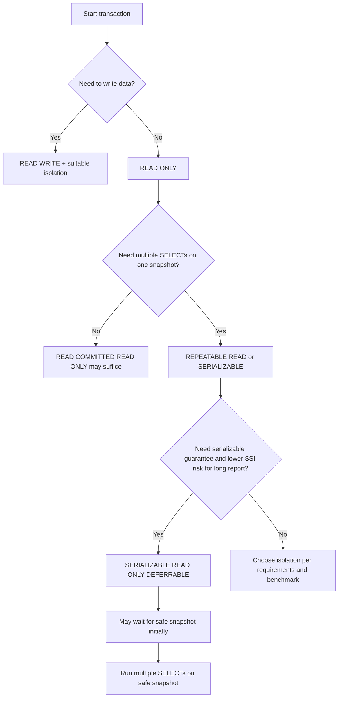

# Read-Only Transactions and DEFERRABLE Mode in PostgreSQL

Financial reports, long-running analytical queries, data reconciliations, and logical backups share a common need: **reading a consistent picture of data without accidentally modifying business records**. PostgreSQL provides transaction modes such as `READ ONLY`, `READ WRITE`, and `DEFERRABLE` to serve these distinct needs.

The most important takeaway of this lesson:

> **`READ ONLY` restricts which write operations are allowed; `SERIALIZABLE` is a transaction isolation level; and `DEFERRABLE` (when combined with `SERIALIZABLE READ ONLY`) allows PostgreSQL to wait for a safe snapshot before starting a long read.**

These three concepts are related, yet **not synonymous**:

- A `READ ONLY` transaction does not automatically get a single fixed snapshot across all statements if it still runs under `READ COMMITTED`.
- A `SERIALIZABLE` transaction is not automatically read-only; it can still update data if declared `READ WRITE`.
- `DEFERRABLE` **has no** safe-snapshot optimization effect when either `SERIALIZABLE` or `READ ONLY` is missing.
- Transaction `DEFERRABLE` is completely unrelated to `DEFERRABLE` on `UNIQUE`/`FOREIGN KEY` constraints.

This lesson belongs to the **Transactions** chapter of the *Database Engine Relational PostgreSQL* module. It focuses on practical SQL, understanding snapshots and Serializable Snapshot Isolation (SSI), observing snapshot waits, read-only limits, JDBC integration, operational impact, and when to use or avoid this mode.

All table-creation and update snippets use a **test database**, never production directly. Multi-session scenarios require separate connections, and wait timings vary depending on live workload.

## 1. Three Distinct Attributes of a Transaction

A PostgreSQL transaction can be described by at least three key attributes:

| Attribute | Question It Answers | Examples |
|---|---|---|
| Isolation level | How does the transaction observe concurrent data and protect against anomalies? | `READ COMMITTED`, `REPEATABLE READ`, `SERIALIZABLE` |
| Access mode | Is the transaction permitted to run restricted write operations? | `READ ONLY`, `READ WRITE` |
| Deferrability | For serializable read-only, may it wait for a safe snapshot before reading? | `DEFERRABLE`, `NOT DEFERRABLE` |

Typical combined syntax:

```sql
BEGIN TRANSACTION
    ISOLATION LEVEL SERIALIZABLE,
    READ ONLY,
    DEFERRABLE;

-- SELECT queries needing the same consistent snapshot.
SELECT current_setting('transaction_isolation') AS isolation_level;
SELECT current_setting('transaction_read_only') AS read_only;
SELECT current_setting('transaction_deferrable') AS deferrable;

COMMIT;
```

The `BEGIN` statement sets all three attributes up front. PostgreSQL **acquires the snapshot** when the first data-reading query starts; do not assume waiting for a snapshot necessarily occurs right at `BEGIN`.

### 1.1. Overview Diagram



This diagram is only a selection guide. Business consistency requirements also depend on how write transactions across the system are designed and which isolation level they use.

## 2. READ ONLY: Restricts Writes, Not an Isolation Level

`READ ONLY` is a **transaction access mode**. It tells PostgreSQL to reject commands that could modify persistent database tables or objects within the transaction.

```sql
BEGIN READ ONLY;

SELECT 1 AS read_is_allowed;

COMMIT;
```

The transaction above makes no write requests. However, `READ ONLY` **does not establish a fixed or SSI-safe snapshot on its own**. If the default isolation level is `READ COMMITTED`, different statements can still see different snapshots.

### 2.1. READ WRITE Is the Alternative Mode

```sql
BEGIN READ WRITE;

-- Subject to privileges and constraints, INSERT/UPDATE/DELETE are allowed.
SELECT 1;

ROLLBACK;
```

`READ WRITE` permits only writes already allowed by roles, security policies, and constraints. It does not mean a user can arbitrarily modify any table.

### 2.2. READ ONLY Is Not a Read Replica

A `READ ONLY` transaction can run on the **primary**. Conversely, a standby in hot standby mode generally permits only read transactions and carries separate restrictions on isolation levels and features.

Do not equate:

- **Read-only transaction:** a transaction access-mode setting on an eligible server.
- **Read-only database role:** role privilege design, not merely a transaction flag.
- **Read replica / standby:** replication/recovery topology with its own visibility and lag traits.
- **`default_transaction_read_only`:** session default for new transactions, not an authorization system.

## 3. Three Isolation Levels to Distinguish for Reports

PostgreSQL supports the SQL isolation levels. In PostgreSQL, `READ UNCOMMITTED` behaves essentially like `READ COMMITTED` because MVCC does not support dirty reads as defined by the SQL standard.

### 3.1. READ COMMITTED

Under `READ COMMITTED`, each normal read statement acquires a snapshot as of the start of that statement. Two `SELECT` statements in the same transaction can see different data if another transaction commits in between.

```sql
BEGIN TRANSACTION
    ISOLATION LEVEL READ COMMITTED,
    READ ONLY;

SELECT ...; -- First snapshot.
SELECT ...; -- May see newer commits.

COMMIT;
```

`READ ONLY` does not change this behavior.

### 3.2. REPEATABLE READ

`REPEATABLE READ` gives a stable transaction-wide snapshot for normal reads, fixed at the first statement requiring a snapshot.

```sql
BEGIN TRANSACTION
    ISOLATION LEVEL REPEATABLE READ,
    READ ONLY;

SELECT ...;
SELECT ...; -- Uses the transaction's snapshot.

COMMIT;
```

This is very useful when a multi-SELECT report needs a single MVCC picture.

Still, **`REPEATABLE READ` is not fully equivalent to `SERIALIZABLE`**: when concurrent write transactions interact, snapshot isolation can permit anomalies such as write skew. A single read-only transaction cannot "fix" invariants that earlier writers were allowed to break.

### 3.3. SERIALIZABLE

`SERIALIZABLE` in modern PostgreSQL uses **Serializable Snapshot Isolation (SSI)** to detect concurrent dependencies that could make committed outcomes non-equivalent to any valid serial ordering.

```sql
BEGIN TRANSACTION
    ISOLATION LEVEL SERIALIZABLE,
    READ ONLY;

SELECT ...;

COMMIT;
```

A standard `SERIALIZABLE` transaction can be rejected with `serialization_failure` (SQLSTATE `40001`) when SSI detects an anomaly risk. Under certain concurrent schedules, this can hit read-only transactions too, not only write transactions.

### 3.4. Comparison Table

| Isolation + Access | Writes to Normal Tables Allowed? | Multi-SELECT Snapshot | Characteristics |
|---|---|---|---|
| `READ COMMITTED READ ONLY` | No | Can change per statement | Write-safe reads without holding one shared snapshot |
| `REPEATABLE READ READ ONLY` | No | Stable across transaction | Fits multi-step reports needing a fixed snapshot |
| `SERIALIZABLE READ ONLY NOT DEFERRABLE` | No | Stable | Subject to SSI tracking and `40001` errors |
| `SERIALIZABLE READ ONLY DEFERRABLE` | No | Stable, may wait initially | Waits for safe snapshot; afterward avoids SSI serialization failures from these reads |
| `SERIALIZABLE READ WRITE` | Yes per privileges | Stable with SSI rules | Protects serializability for writes per system rules |

**Do not choose isolation based solely on whether a transaction writes or not.** First determine whether the report needs cross-statement consistency and which guarantees are needed alongside concurrent writers.

## 4. What Is DEFERRABLE?

In a transaction context, `DEFERRABLE` allows PostgreSQL to **delay acquiring the snapshot** of a `SERIALIZABLE READ ONLY` transaction until a **safe snapshot** can be established.

Core syntax:

```sql
BEGIN TRANSACTION
    ISOLATION LEVEL SERIALIZABLE,
    READ ONLY,
    DEFERRABLE;

SELECT ...;

COMMIT;
```

Meaning:

1. The transaction reads at `SERIALIZABLE` isolation.
2. It cannot run write commands forbidden by `READ ONLY`.
3. It accepts **waiting** for a snapshot deemed safe under SSI logic.
4. Once the safe snapshot is acquired, reads execute without normal non-deferrable SSI tracking overhead and without risking SSI `serialization_failure` under those conditions.

**The benefit comes at the cost of startup latency.** Especially for very long reports, waiting once up front to avoid aborting and restarting the whole report due to serialization failure can be a worthwhile trade-off.

### 4.1. Conditions for DEFERRABLE to Take Effect

`DEFERRABLE` activates safe-snapshot behavior **only when all three hold together**:

- `ISOLATION LEVEL SERIALIZABLE`.
- `READ ONLY`.
- `DEFERRABLE`.

If combined with a lower isolation level or a read–write transaction, this flag **does not trigger serializable read-only safe-snapshot waiting**.

Examples missing the required combination:

```sql
BEGIN ISOLATION LEVEL READ COMMITTED, READ ONLY, DEFERRABLE;
-- Does not provide SERIALIZABLE READ ONLY safe-snapshot behavior.
COMMIT;
```

```sql
BEGIN ISOLATION LEVEL SERIALIZABLE, READ WRITE, DEFERRABLE;
-- Write transactions do not get read-only safe-snapshot benefits.
ROLLBACK;
```

These examples show **three syntactically independent clauses that depend on each other for DEFERRABLE's effect**.

### 4.2. NOT DEFERRABLE

`NOT DEFERRABLE` means do not wait for a safe snapshot:

```sql
BEGIN TRANSACTION
    ISOLATION LEVEL SERIALIZABLE,
    READ ONLY,
    NOT DEFERRABLE;

SELECT ...;

COMMIT;
```

Without `DEFERRABLE`, the default is typically `NOT DEFERRABLE`. Therefore, a serializable read-only transaction **does not automatically wait for a safe snapshot**.

## 5. Safe Snapshot: What Makes It "Safe"?

PostgreSQL SSI tracks read–write dependencies among concurrent transactions to detect patterns that could violate serializability. A long-running read-only transaction can participate in dependency chains that SSI must monitor.

A **safe snapshot** is a snapshot where PostgreSQL can determine that a serializable read-only transaction reading from it **cannot participate in a dangerous SSI cycle that breaks serializability** under system conditions.

If a safe snapshot is not immediately available, the `SERIALIZABLE READ ONLY DEFERRABLE` transaction waits.

```text
  BEGIN SERIALIZABLE READ ONLY DEFERRABLE
                    │
                    ▼
       Request snapshot on first read
                    │
                    ▼
     PostgreSQL inspects concurrent transactions
                    │
        ┌───────────┴───────────┐
        │                       │
      Safe                   Not yet safe
        │                       │
        │                       ▼
        │                  Wait for safe
        │                   snapshot condition
        │                       │
        └───────────┬───────────┘
                    ▼
             Acquire snapshot
                    │
                    ▼
         Run SELECTs / long report
                    │
                    ▼
                  COMMIT
```

### 5.1. Waiting Does Not Mean a Global Lock Blocking All Writers

Safe-snapshot waiting should not be pictured as PostgreSQL locking the entire database and halting all new writes.

SSI/snapshot mechanics allow concurrent activity per MVCC rules; waiting depends on dependency conditions of currently active transactions, **not a stop-the-world system freeze**.

### 5.2. "Safe" Does Not Mean Absolute Latest Data

A safe snapshot guarantees transaction serializability; it **does not promise to include commits occurring after the snapshot was taken**.

Once reading begins on the safe snapshot:

- Other write transactions continue committing.
- The report keeps reading its MVCC snapshot rather than refreshing for newer commits.
- Rows committed after the snapshot will not appear in the report.
- `DEFERRABLE` does not guarantee data "fresh to the current millisecond."

To establish data currency, design explicit cutoff timestamps, watermarks, business cutoffs, or confirmation rules.

### 5.3. Waits Are Not Always Noticeable

On lightly loaded systems or when SSI conditions are already safe, acquiring the snapshot can be nearly instant. Conversely, when overlapping write transactions are active, the deferrable transaction may wait.

**Never build benchmarks expecting a fixed wait duration**; wait time depends on concurrent transaction state and execution schedules.

## 6. Transaction DEFERRABLE vs. DEFERRABLE Constraints

PostgreSQL uses the same word "deferrable" for two **completely unrelated** concepts.

### 6.1. Deferrable Transaction

```sql
BEGIN TRANSACTION
    ISOLATION LEVEL SERIALIZABLE,
    READ ONLY,
    DEFERRABLE;
```

Purpose: wait for a safe snapshot for a serializable read-only report.

### 6.2. Deferrable Constraint

Examples use test schema `demo_tx`; if following sequentially from the start, create the schema first.

```sql
CREATE SCHEMA IF NOT EXISTS demo_tx;
```

```sql
CREATE TABLE demo_tx.deferred_reference (
    reference_id BIGINT PRIMARY KEY,
    external_code TEXT NOT NULL,
    CONSTRAINT uq_deferred_external_code
        UNIQUE (external_code) DEFERRABLE INITIALLY DEFERRED
);
```

Purpose: postpone certain constraint checks until later in the transaction per constraint/transaction settings. For instance:

```sql
SET CONSTRAINTS uq_deferred_external_code IMMEDIATE;
```

This controls **when uniqueness is checked**, and has nothing to do with PostgreSQL waiting for an SSI safe snapshot.

| Phrase | Applies To | Purpose |
|---|---|---|
| `BEGIN ... DEFERRABLE` | Transaction attribute | Safe snapshot under SERIALIZABLE READ ONLY |
| `UNIQUE ... DEFERRABLE` | Constraint | Allows deferring constraint validation |
| `SET CONSTRAINTS ... DEFERRED` | Constraints in transaction | Controls when deferrable checks run |
| `NOT DEFERRABLE` on transaction | Transaction attribute | Do not wait for safe snapshot |
| `NOT DEFERRABLE` on constraint | Constraint | Disallow deferring constraint checks |

**Never run `SET CONSTRAINTS ALL DEFERRED` to "enable" safe snapshots**, and never add `DEFERRABLE` to a unique constraint hoping a report will avoid `40001`.

## 7. BEGIN, START TRANSACTION, and SET TRANSACTION Syntax

There are several ways to declare these attributes. View them as **equivalent SQL ways to specify transaction characteristics**, not client-UI-dependent modes.

### 7.1. BEGIN with Attributes

```sql
BEGIN TRANSACTION
    ISOLATION LEVEL SERIALIZABLE,
    READ ONLY,
    DEFERRABLE;

SELECT COUNT(*) FROM pg_catalog.pg_class;

COMMIT;
```

Prefer this form in SQL scripts because all three attributes appear right at transaction start.

### 7.2. START TRANSACTION

```sql
START TRANSACTION
    ISOLATION LEVEL SERIALIZABLE,
    READ ONLY,
    DEFERRABLE;

SELECT current_timestamp;

COMMIT;
```

`START TRANSACTION` is equivalent to `BEGIN` in PostgreSQL.

### 7.3. BEGIN Followed by SET TRANSACTION

```sql
BEGIN;

SET TRANSACTION
    ISOLATION LEVEL SERIALIZABLE,
    READ ONLY,
    DEFERRABLE;

SELECT COUNT(*) FROM pg_catalog.pg_class;

COMMIT;
```

Place `SET TRANSACTION` **before the first query or data-modifying statement** in the transaction. PostgreSQL restricts changing isolation levels and transaction characteristics after a transaction has already run queries/DML.

Avoid code where an ORM/pool runs a health-check SELECT first and then tries to switch to SERIALIZABLE inside the same transaction.

### 7.4. Order of Modes in Declarations

`transaction_mode` clauses appear comma-separated as shown above. Place them on separate lines for readability:

```sql
BEGIN
    ISOLATION LEVEL SERIALIZABLE,
    READ ONLY,
    DEFERRABLE;
```

Each transaction gets one effective access mode/isolation level according to declaration rules. Avoid repeating conflicting modes in one statement.

## 8. Reading Effective Transaction State

Run:

```sql
BEGIN TRANSACTION
    ISOLATION LEVEL SERIALIZABLE,
    READ ONLY,
    DEFERRABLE;

SHOW transaction_isolation;
SHOW transaction_read_only;
SHOW transaction_deferrable;

COMMIT;
```

Expected values:

| Parameter | Expected |
|---|---|
| `transaction_isolation` | `serializable` |
| `transaction_read_only` | `on` |
| `transaction_deferrable` | `on` |

You can also read via function:

```sql
SELECT
    current_setting('transaction_isolation') AS isolation_level,
    current_setting('transaction_read_only') AS read_only,
    current_setting('transaction_deferrable') AS deferrable;
```

This inspects the transaction configuration as of that statement. **It does not prove a safe snapshot was acquired before other statements ran**, nor does it replace tracking when PostgreSQL took the snapshot or how long it waited.

### 8.1. Checking Session Defaults

```sql
SHOW default_transaction_isolation;
SHOW default_transaction_read_only;
SHOW default_transaction_deferrable;
```

`default_transaction_*` parameters define **defaults for future transactions** (within their config scope), without retroactively changing already open transactions.

## 9. Setting Session Defaults

If a connection is dedicated exclusively to reporting:

```sql
SET SESSION CHARACTERISTICS AS TRANSACTION
    ISOLATION LEVEL SERIALIZABLE,
    READ ONLY,
    DEFERRABLE;
```

Subsequent transactions in that session inherit those defaults unless overridden explicitly.

```sql
BEGIN;
SELECT current_setting('transaction_isolation'),
       current_setting('transaction_read_only'),
       current_setting('transaction_deferrable');
COMMIT;
```

### 9.1. Caveats with Connection Pools

**Session settings can linger when a connection returns to the pool.** If a reporting request sets session defaults to `READ ONLY DEFERRABLE` and returns the connection to a shared pool that does not reset session state, a subsequent write request may fail unexpectedly.

Options to consider:

- Use a dedicated connection pool for reporting.
- Specify transaction modes explicitly per transaction.
- Ensure the pool resets session state cleanly.
- Never issue `SET SESSION CHARACTERISTICS` on shared pooled connections without a reset mechanism.
- With proxies/poolers using transaction pooling, understand which settings are session-scoped and how physical connections are reused.

### 9.2. default_transaction_read_only Is Not Security

```sql
SET default_transaction_read_only = on;
```

This is a session default for new transactions. It does not replace `REVOKE INSERT/UPDATE/DELETE` or proper authorization policies.

On a primary, a role with write privileges can still explicitly start a `READ WRITE` transaction; hence **never treat `default_transaction_read_only` as a security barrier for untrusted accounts**.

## 10. Setting Up the Transaction Lab Environment

Create a schema and two accounts with a known initial total balance.

```sql
CREATE SCHEMA IF NOT EXISTS demo_tx;

CREATE TABLE demo_tx.account (
    account_id INTEGER PRIMARY KEY,
    account_name TEXT NOT NULL,
    balance NUMERIC(14, 2) NOT NULL,
    CONSTRAINT ck_demo_tx_balance_nonnegative CHECK (balance >= 0)
);

INSERT INTO demo_tx.account (account_id, account_name, balance)
VALUES
    (1, 'A', 1000.00),
    (2, 'B', 1000.00);
```

At this point, the total balance across both accounts is `2000.00`.

```sql
SELECT account_id, account_name, balance
FROM demo_tx.account
ORDER BY account_id;

SELECT SUM(balance) AS total_balance
FROM demo_tx.account;
```

### 10.1. Sample Transfer Transaction

Transfer 100 from A to B:

```sql
BEGIN;

UPDATE demo_tx.account
SET balance = balance - 100
WHERE account_id = 1
  AND balance >= 100;

UPDATE demo_tx.account
SET balance = balance + 100
WHERE account_id = 2;

COMMIT;
```

This is a **snapshot-learning simulation**, not production-grade transfer code. Real financial systems must verify updated row counts, insufficient funds, auditing, idempotency, ledger entries, concurrency, and full rollback if any step fails.

Assuming both updates succeed and commit, A has 900 and B has 1100; total remains 2000.

### 10.2. Controlled Lab Reset

To restore initial balances on the lab database:

```sql
BEGIN;

UPDATE demo_tx.account
SET balance = CASE account_id
    WHEN 1 THEN 1000.00
    WHEN 2 THEN 1000.00
END
WHERE account_id IN (1, 2);

COMMIT;
```

Never run this reset script while multiple sessions are actively testing on the same data, or timings will become confusing.

## 11. READ COMMITTED READ ONLY Can Still See Two Snapshots

Open **two separate psql sessions**, A and B, connected to the same lab database. Ensure the table is at its initial state.

### 11.1. Session A: Start Read-Only Report

```sql
BEGIN TRANSACTION
    ISOLATION LEVEL READ COMMITTED,
    READ ONLY;

SELECT balance AS balance_a
FROM demo_tx.account
WHERE account_id = 1;
-- Before writer commits: 1000.00.
```

Keep Transaction A open, **do not read account B yet**.

### 11.2. Session B: Transfer and Commit

```sql
BEGIN;

UPDATE demo_tx.account
SET balance = balance - 100
WHERE account_id = 1
  AND balance >= 100;

UPDATE demo_tx.account
SET balance = balance + 100
WHERE account_id = 2;

COMMIT;
```

Assume Transaction B succeeds and commits before A runs its next query.

### 11.3. Session A: Read Account B After Commit

```sql
SELECT balance AS balance_b
FROM demo_tx.account
WHERE account_id = 2;
-- Now sees 1100.00 after B committed.

COMMIT;
```

If the application adds the two values read at different instants, it erroneously computes `1000 + 1100 = 2100`. PostgreSQL **did not** create 100 units out of thin air; this happened because two `SELECT`s under `READ COMMITTED` saw two different snapshots.

### 11.4. One SELECT Still Has Statement-Level Snapshot Consistency

If A runs only:

```sql
SELECT SUM(balance) AS total_balance
FROM demo_tx.account;
```

once, a standard SELECT under `READ COMMITTED` uses one statement-level snapshot, so it never mixes one row before commit with another row after commit like two separate statements do. Special constructs calling external data sources or volatile functions have their own semantics.

**If a report consists of a single simple SELECT**, `READ COMMITTED` often satisfies statement-level consistency without escalating to `SERIALIZABLE DEFERRABLE`.

## 12. REPEATABLE READ READ ONLY Holds One Snapshot Across Statements

Reset initial balances, then start:

### 12.1. Session A

```sql
BEGIN TRANSACTION
    ISOLATION LEVEL REPEATABLE READ,
    READ ONLY;

SELECT balance AS balance_a
FROM demo_tx.account
WHERE account_id = 1;
-- 1000.00 if snapshot was taken before Transaction B.
```

### 12.2. Session B

```sql
BEGIN;

UPDATE demo_tx.account
SET balance = balance - 100
WHERE account_id = 1
  AND balance >= 100;

UPDATE demo_tx.account
SET balance = balance + 100
WHERE account_id = 2;

COMMIT;
```

### 12.3. Session A Continues

```sql
SELECT balance AS balance_b
FROM demo_tx.account
WHERE account_id = 2;
-- Since A's snapshot preceded B's commit: 1000.00.

SELECT SUM(balance) AS total_at_snapshot
FROM demo_tx.account;
-- 2000.00 in this simulation.

COMMIT;
```

Even after B committed, A continues seeing its earlier snapshot. This is the primary benefit of `REPEATABLE READ` for multi-query reports.

**A stable snapshot does not mean seeing the latest committed data.** The report is consistent as of one point in time, not real-time refreshed.

## 13. SERIALIZABLE READ ONLY Without DEFERRABLE

```sql
BEGIN TRANSACTION
    ISOLATION LEVEL SERIALIZABLE,
    READ ONLY,
    NOT DEFERRABLE;

SELECT SUM(balance)
FROM demo_tx.account;

COMMIT;
```

This read-only transaction follows standard PostgreSQL `SERIALIZABLE` rules. Under SSI:

- PostgreSQL may need to track read–write dependencies.
- Dangerous dependency cycles can trigger `serialization_failure`.
- A long report could spend substantial work only to be aborted by SSI and require retrying.
- Being read-only avoids modifying business tables, yet does not eliminate all serializable conflicts.

A `SERIALIZABLE READ ONLY DEFERRABLE` transaction flips that trade-off: **wait for a safe snapshot up front** so the report avoids SSI serialization conflicts once it holds a safe snapshot.

### 13.1. SERIALIZABLE Does Not Lock the Whole Table

PostgreSQL SSI does not turn every SELECT into `SELECT FOR UPDATE`. It still uses MVCC plus dependency tracking (including predicate/`SIReadLock` tracking per SSI design) to decide which transactions can commit.

A serializable transaction runs concurrently alongside others; certain conflicting schedules result in abort/retry rather than permitting anomalies.

## 14. SERIALIZABLE READ ONLY DEFERRABLE in Practice

Core SQL form:

```sql
BEGIN TRANSACTION
    ISOLATION LEVEL SERIALIZABLE,
    READ ONLY,
    DEFERRABLE;

SELECT account_id, account_name, balance
FROM demo_tx.account
ORDER BY account_id;

SELECT SUM(balance) AS total_balance
FROM demo_tx.account;

COMMIT;
```

If PostgreSQL does not yet have an eligible safe snapshot when the first read begins, it waits. Once the snapshot is acquired, both SELECT statements observe a stable snapshot.

### 14.1. Why Is This Helpful for Long Reports?

Suppose a report performs:

1. Querying 100,000 customers and segments.
2. Aggregating monthly revenue.
3. Reconciling inventory.
4. Exporting CSV via the application.
5. Computing checksums.
6. Writing an output file outside the database.

If the report aborts with `40001` after 25 minutes, the application must **discard all work and rerun from scratch**. With deferrable mode, waiting briefly at the start for a safe snapshot can be far preferable to failing mid-run with a serialization failure.

This does not guarantee zero errors afterward: queries can still time out, be canceled, lose connections, run out of resources, or hit application bugs.

### 14.2. Not Intended as Default for Ultra-Low-Latency Requests

An interactive endpoint with tight latency SLAs cannot afford **unbounded startup waits for a snapshot**. If it runs a single SELECT and does not need full report-wide serializable guarantees, `READ COMMITTED` or `REPEATABLE READ` is usually better.

Choose modes by **latency budget and consistency contract**, not simply "sounds safer."

## 15. Observing a Snapshot Wait Scenario

Experiment with **two or three connections** in the lab. No short fixed command sequence guarantees triggering a wait every single time, because SSI waits depend on exact active transaction schedules.

### 15.1. Session W: Active Serializable Writer

```sql
BEGIN TRANSACTION ISOLATION LEVEL SERIALIZABLE, READ WRITE;

UPDATE demo_tx.account
SET balance = balance + 1
WHERE account_id = 1;

-- Keep transaction open briefly for observation.
-- Do not COMMIT yet.
```

Never hold update transactions open in production. Even in the lab, an open writer **does not guarantee** the deferrable reader will wait; it depends on SSI dependency graphs and other active transactions.

### 15.2. Session R: Serializable, Read-Only, Deferrable Reader

```sql
BEGIN TRANSACTION
    ISOLATION LEVEL SERIALIZABLE,
    READ ONLY,
    DEFERRABLE;

SELECT COUNT(*)
FROM demo_tx.account;

SELECT SUM(balance)
FROM demo_tx.account;

COMMIT;
```

The reader may receive a snapshot immediately or pause briefly. If it waits, do not assume PostgreSQL deadlocked merely because the query did not return instantaneously.

### 15.3. Session M: Monitor State

```sql
SELECT
    pid,
    usename,
    state,
    wait_event_type,
    wait_event,
    xact_start,
    query_start,
    left(query, 160) AS query_excerpt
FROM pg_stat_activity
WHERE datname = current_database()
ORDER BY query_start NULLS LAST;
```

Depending on version and timing, a reader waiting for a safe snapshot may show wait event **`SafeSnapshot`** under the IPC group. Whether this event appears depends on sampling timing and PostgreSQL version, so never expect it unconditionally in output.

### 15.4. Finish the Writer and Clean Up Sessions

In Session W:

```sql
ROLLBACK;
```

Confirm the reader is not left open unintentionally. After multiple runs, reset balances using Section 10's lab script.

**Never practice holding write transactions open in production**: row locks block other traffic and retain old row versions.

## 16. SafeSnapshot Waits Differ from Regular Lock Waits

Distinguish wait sources when a query appears "stuck":

| Wait Type | Cause | Signal |
|---|---|---|
| Safe snapshot | PostgreSQL waiting for safe snapshot conditions for SERIALIZABLE READ ONLY DEFERRABLE | May show wait event `SafeSnapshot` |
| Row lock | Transaction trying to update/lock a row held by another transaction | `Lock` with tuple/transactionid wait events |
| Table lock | DDL or transaction holding a lock conflicting with SELECT | `Lock` on the relation/object |
| Disk I/O | Reading data or temp files from storage | I/O wait events depending on version |
| Client | Server waiting for client to send/receive data | Client wait events |
| CPU | Query actively computing | `active` with empty `wait_event` |

`pg_locks` helps inspect regular locks, yet **never assume every safe-snapshot wait shows up as a row lock in `pg_locks`**.

### 16.1. Never Kill Blockers Based on Superficial Diagnosis

When investigating a waiting report, identify the PID, transaction, wait type, business owner, and impact of canceling/terminating. Killing an active writer handling critical business data can cause production incidents.

In production, follow proper investigation and escalation procedures; never call `pg_terminate_backend` just because a deferrable transaction is waiting.

## 17. Which Commands Does READ ONLY Forbid?

PostgreSQL's read-only mode restricts writes to **non-temporary tables** and DDL operations. Key examples:

| Command / Group | Inside a Normal READ ONLY Transaction |
|---|---|
| Read-only `SELECT` | Allowed |
| `INSERT` into persistent table | Forbidden |
| `UPDATE` persistent table | Forbidden |
| `DELETE` persistent table | Forbidden |
| `MERGE` writing persistent table | Forbidden |
| `COPY ... FROM` writing persistent table | Forbidden |
| `CREATE`, `ALTER`, `DROP`, and similar DDL | Restricted / forbidden |
| `TRUNCATE` | Forbidden |
| `SELECT ... FOR UPDATE` | Incompatible and forbidden in READ ONLY |
| `EXPLAIN` (without ANALYZE) on DML | Planning only, subject to command and privileges; does not execute DML |
| `EXPLAIN ANALYZE` on forbidden DML | Cannot be used to bypass READ ONLY |
| DML on existing temporary tables | Exception permitted by PostgreSQL for eligible temp tables |

Understand the temporary-table exception accurately: DML on an **already created temporary table** differs from persistent tables, yet **that does not allow arbitrary DDL creating temporary tables** inside READ ONLY. Create temporary tables before entering the read-only transaction or adjust design per version and privileges.

### 17.1. Testing UPDATE Inside READ ONLY

Run separately in the lab:

```sql
BEGIN READ ONLY;

UPDATE demo_tx.account
SET balance = balance + 1
WHERE account_id = 1;
-- Expected error because this is a read-only transaction.

ROLLBACK;
```

After the error, the transaction enters the aborted state; `ROLLBACK` is required to recover the session.

**Do not keep running SELECTs inside the failed transaction assuming READ ONLY auto-recovers.** PostgreSQL requires ending the transaction or rolling back to a valid savepoint.

### 17.2. SELECT FOR UPDATE Is Not a Read-Only Inspection Pattern

```sql
BEGIN READ ONLY;

SELECT *
FROM demo_tx.account
WHERE account_id = 1
FOR UPDATE;
-- Acquiring this row-level lock is forbidden in READ ONLY.

ROLLBACK;
```

If business logic needs to lock rows in preparation for state changes, that is a write workflow requiring a `READ WRITE` transaction.

### 17.3. SELECT Is Not Guaranteed Pure in Every Dimension

A `SELECT` can invoke functions, external connectors, mutate session state, or trigger external side effects depending on extensions and privileges.

`READ ONLY` is **not an absolute security sandbox** nor a guarantee that every callable function has zero side effects.

For untrusted read-only roles, manage function execution privileges, extensions, network access, sensitive columns, and resource quotas separately.

## 18. Temporary Tables and the Exception to Understand

In certain cases, PostgreSQL allows DML on existing **temporary tables** inside a read-only transaction, because session-local temporary data is distinct from shared persistent data.

Illustrative scenario:

```sql
-- Create temp table before starting the READ ONLY transaction.
CREATE TEMP TABLE IF NOT EXISTS tmp_report_note (
    note_id INTEGER,
    note_text TEXT
) ON COMMIT PRESERVE ROWS;

BEGIN READ ONLY;

INSERT INTO tmp_report_note (note_id, note_text)
VALUES (1, 'Session temporary note');

SELECT * FROM tmp_report_note;

COMMIT;
```

Check exact privilege, version, and command rules in your environment, and **never infer that READ ONLY is just a no-op comment**. It strictly blocks changes to persistent tables and most DDL.

### 18.1. Should a Serializable Read-Only Deferrable Transaction Write Temp Tables?

If a job truly needs to stage/write intermediate data inside the same transaction, `SERIALIZABLE READ ONLY DEFERRABLE` may be an awkward fit or face command restrictions.

A cleaner approach is:

- Read data via a read-only transaction with an appropriate snapshot.
- Perform intermediate transformations in the application or a dedicated staging step.
- Open a read–write transaction only when writing persistent DB data.
- Keep transaction boundaries and input snapshot consistency documented.

Never turn a long-running reporting transaction into a hybrid read/write workflow just because temp tables have an exception.

## 19. Default READ ONLY Can Be Overridden If Privileges Allow

Example:

```sql
SET SESSION CHARACTERISTICS AS TRANSACTION READ ONLY;

BEGIN;
SHOW transaction_read_only;
COMMIT;
```

On a primary, a role with write privileges allowed to specify transaction modes can still start an explicit `READ WRITE` transaction. Therefore:

> **`READ ONLY` is an execution attribute of a transaction, not a replacement for GRANT/REVOKE and RLS.**

To set up a reporting account, configure privileges explicitly:

```sql
-- Illustrative admin sample; do not run unless role/schema exist.
REVOKE INSERT, UPDATE, DELETE ON ALL TABLES
    IN SCHEMA demo_tx FROM reporting_role;

GRANT USAGE ON SCHEMA demo_tx TO reporting_role;
GRANT SELECT ON ALL TABLES
    IN SCHEMA demo_tx TO reporting_role;
```

This assumes `reporting_role` already exists. Default privileges for future tables, ownership, function privileges, role inheritance, and other schemas must also be managed. Do not treat a few `GRANT`/`REVOKE` lines as a complete production security setup.

## 20. How Does DEFERRABLE Affect Latency?

A reporting transaction has two time components:

```text
Total processing time =
    Snapshot wait time (if any)
  + SQL execution time
  + Network transfer / application processing time
  + Transaction closing time
```

With `SERIALIZABLE READ ONLY DEFERRABLE`, initial snapshot wait time can increase, yet afterward the report avoids SSI serialization failures that would discard all work.

### 20.1. Qualitative Examples

- Report A runs in 2 seconds with a sub-3-second SLA. Waiting for a safe snapshot may hurt the SLA.
- Report B runs for 45 minutes; aborting costs nearly an hour to rerun. Waiting a few seconds up front for a safe snapshot delivers huge value.
- A large logical export needs one consistent state; safe-snapshot waiting is worth more than instant first-byte latency.

**There is no universal wait-time formula** for every server. Measure on real workloads and inspect which concurrent write transactions delay safe snapshots.

### 20.2. Setting DEFERRABLE Alone Does Not Fix Slow Queries

If the bottleneck is:

- Missing indexes.
- Multiplying joins.
- Huge sorts or temp I/O.
- Heavy aggregations.
- Stale statistics.
- Slow disk I/O.
- Network or Java serialization bottlenecks.

`DEFERRABLE` fixes none of those. It addresses **SSI/safe-snapshot risk** for a specific class of transactions.

## 21. Report Timeouts: Wait Safely Within Bounds

Production reports usually need overall time limits so they never hang indefinitely.

### 21.1. statement_timeout

```sql
BEGIN TRANSACTION
    ISOLATION LEVEL SERIALIZABLE,
    READ ONLY,
    DEFERRABLE;

SET LOCAL statement_timeout = '30s';

SELECT SUM(balance)
FROM demo_tx.account;

COMMIT;
```

`statement_timeout` bounds statement duration per PostgreSQL version/protocol rules, including wait time before the statement completes. If it expires while waiting for a snapshot, the client receives an error and the transaction must roll back.

Careful: a 30-second per-statement timeout **does not** cap a multi-statement report at 30 seconds total. Enforce an application-tier time budget and, where supported by your version, transaction-level timeouts.

### 21.2. lock_timeout Does Not Replace statement_timeout

`lock_timeout` bounds **lock acquisition waits**, not every wait type. Waiting on `SafeSnapshot` is a different wait mechanism; do not rely on `lock_timeout` to bound snapshot waits.

```sql
BEGIN TRANSACTION
    ISOLATION LEVEL SERIALIZABLE,
    READ ONLY,
    DEFERRABLE;

SET LOCAL statement_timeout = '60s';
SET LOCAL lock_timeout = '5s';

SELECT COUNT(*) FROM demo_tx.account;

COMMIT;
```

For fast queries, setting `lock_timeout` shorter than `statement_timeout` catches table-lock contention early, though it never speeds up safe-snapshot acquisition.

### 21.3. idle_in_transaction_session_timeout

If an application opens a reporting transaction and stalls in slow Java processing **without sending SQL**, the transaction keeps holding its snapshot and locks.

`idle_in_transaction_session_timeout` terminates sessions sitting idle inside a transaction past a threshold, reducing "forgotten open transaction" risk. Because it directly impacts long workflows, size it intentionally rather than setting an arbitrarily tiny global value.

## 22. Read-Only Transactions Still Hold MVCC Resources

A read-only transaction never modifies persistent rows, yet holding a snapshot open for a long time impacts:

- When obsolete row versions can be reclaimed by VACUUM.
- Snapshot age and pinning `xmin` horizons.
- Table bloat generated by writers while old versions stay pinned for the reader.
- Relation/DDL lock conflicts during long SELECTs.
- System memory, connections, CPU, and I/O.

### 22.1. Symptoms of a Forgotten Reporting Transaction

An application runs:

```sql
BEGIN TRANSACTION ISOLATION LEVEL REPEATABLE READ, READ ONLY;
SELECT ...
-- Forgot COMMIT or ROLLBACK, keeping the connection in the pool.
```

even with zero INSERT/UPDATEs, the session sits `idle in transaction`, pinning snapshots/resources and causing operational harm.

`SERIALIZABLE READ ONLY DEFERRABLE` does not exempt you from **closing the transaction promptly once the snapshot is no longer needed**.

### 22.2. Never Keep a Snapshot Open During Slow Post-Query Work

Exporting millions of rows over a network can take time. If the transaction stays open throughout compression, disk writes, or uploads, snapshots and locks stay held.

Architectural considerations:

- Stream data cleanly and close the transaction promptly.
- Stage exports with clear lifecycle boundaries.
- Offload heavy post-processing until after data extraction finishes when possible.
- Never paginate across multiple transactions and claim it is "one consistent snapshot" unless using a properly designed shared-snapshot mechanism.

## 23. Read-Only Transactions and Locks

Even a plain `SELECT` acquires a **table-level `AccessShareLock`** on queried relations. This rarely blocks regular DML, yet conflicts with strong DDL locks.

Therefore:

- `READ ONLY` does not mean "lock-free."
- `DEFERRABLE` does not mean "immune to DDL blocking."
- Safe snapshots let serializable reads skip normal SSI tracking overhead once safe, without removing other database synchronization locks.

### 23.1. Planning Can Also Require Locks

Even query planning and validation touch system catalogs and relations per locking rules. Never promise a report will never pause merely because it does not write data.

### 23.2. Cancel and Terminate

Canceling a long `SELECT` can leave its transaction needing a rollback. Terminating a session affects connection pools and adjacent work.

Operational runbooks should prefer timeouts, owner-initiated cancellation, and clean rollbacks before resorting to termination.

## 24. Monitoring State via pg_stat_activity

In a sufficiently privileged monitoring session:

```sql
SELECT
    pid,
    datname,
    usename,
    application_name,
    state,
    wait_event_type,
    wait_event,
    xact_start,
    query_start,
    now() - xact_start AS transaction_age,
    left(query, 200) AS query_excerpt
FROM pg_stat_activity
WHERE datname = current_database()
  AND pid <> pg_backend_pid()
ORDER BY xact_start NULLS LAST;
```

Inspect:

- `state = 'active'` and `wait_event` to see whether a query is running or waiting.
- `state = 'idle in transaction'` when a transaction is open yet idle.
- `xact_start` to spot long-running transactions.
- `application_name` to identify which service/job holds the connection.
- `wait_event = 'SafeSnapshot'` when the version/state indicates a reader waiting for a safe snapshot.

**Not every role can see full query text of other sessions.** PostgreSQL enforces statistics-visibility rules; use a dedicated monitoring role with appropriate privileges.

### 24.1. Logging Snapshot Acquisition Time in the Application

To separate snapshot wait time from heavy SQL execution, applications can record timestamps:

```text
T0: BEGIN SERIALIZABLE READ ONLY DEFERRABLE
T1: start first SELECT needing snapshot
T2: first SELECT returns
T3: finish remaining SELECTs
T4: COMMIT
```

The interval T1–T2 includes **any snapshot wait time** plus execution cost of the first SELECT. Never treat `T2 - T1` alone as pure "snapshot wait" if that SELECT also consumes significant CPU/I/O. Correlate with `pg_stat_activity`, wait events, and telemetry during deep investigations.

## 25. EXPLAIN Does Not Show Snapshot Wait Time Directly

`EXPLAIN` shows the execution plan. `EXPLAIN (ANALYZE, BUFFERS)` measures SQL execution and buffer activity, helping diagnose slow scans, sorts, or joins.

However, answering:

> "Did the report take 20 seconds waiting for a safe snapshot or scanning tables?"

requires combining multiple signals:

1. Application-side statement start timestamps.
2. `pg_stat_activity.wait_event` while running.
3. `EXPLAIN` plans and statistics for the query.
4. Locks, logs, CPU, and I/O metrics.
5. Duration of concurrent write transactions.

`DEFERRABLE` does not eliminate SQL tuning. A SELECT scanning 500 million rows will still scan 500 million rows after acquiring its safe snapshot.

## 26. Distinguishing READ ONLY Transactions from SELECT Statements

Two distinct consistency scopes exist:

- **Statement:** one normal SELECT under `READ COMMITTED` reads from a statement-level snapshot.
- **Transaction:** multiple statements under `REPEATABLE READ`/`SERIALIZABLE` share a transaction-level snapshot per isolation rules.

If a workflow runs:

```text
SELECT total_accounts;
SELECT total_balance;
SELECT total_debt;
SELECT total_payment;
```

and all four must reflect the exact same data instant, choosing the right transaction isolation matters far more than merely adding `READ ONLY`.

If a workflow runs just one query:

```sql
SELECT COUNT(*), SUM(balance)
FROM demo_tx.account;
```

then `READ COMMITTED`'s statement snapshot already gives a consistent picture for that single query. Never attach `SERIALIZABLE READ ONLY DEFERRABLE` blindly to "upgrade" every SELECT without a concrete requirement.

## 27. SERIALIZABLE and Cross-Transaction Invariants

Systems enforcing invariants like "at least one person on shift" or "total charges never exceed limit" normally require coordination across **write transactions**.

Two writers under `REPEATABLE READ` can read the same stale data and make disjoint writes causing **write skew**. PostgreSQL `SERIALIZABLE` detects and aborts one transaction to preserve a valid serial schedule.

A `SERIALIZABLE READ ONLY DEFERRABLE` reader cannot repair invariants already broken by buggy writers.

### 27.1. Caveat When Writers Do Not Run SERIALIZABLE

Serializability guarantees across an **entire business workflow** depend on how all participating transactions access data. If writers run at weaker isolation levels or assemble non-atomic updates, raising only the reporting transaction to `SERIALIZABLE` does not make the whole system serializable.

Setting isolation on a reader protects **that reader transaction's** semantics, without replacing invariants or proper transaction strategies on writers.

## 28. Do Not Confuse Read-Only with Standby SELECTs

PostgreSQL standbys / hot standbys have distinct rules for read-only queries, MVCC snapshots, WAL replay, replication conflicts, and replication lag.

### 28.1. Standbys Can Lag

A query on a replica can read an older state than recent commits on the primary. `READ ONLY` on a replica **does not** guarantee seeing the latest primary commits.

Design around replica lag SLAs, replay LSN checks, or consistency requirements per workload.

### 28.2. SERIALIZABLE on Hot Standby Has Limitations

Never assume `SERIALIZABLE READ ONLY DEFERRABLE` works identically on every standby. PostgreSQL has historical and version-specific limitations for serializable isolation on hot standbys; many setups support only recovery-compatible read isolation levels.

Before deploying this mode against a replica, verify your PostgreSQL version and standby capabilities rather than inferring from "replicas are read-only."

### 28.3. Standby Queries Can Be Canceled by Replay Conflicts

A long query on a hot standby can be canceled due to conflicts with WAL replay/recovery per configuration. That is **not** an SSI serialization failure on the primary. `DEFERRABLE` is not a general cure for replica cancellation errors.

## 29. Application to pg_dump and Logical Backups

PostgreSQL's `pg_dump` supports the `--serializable-deferrable` flag when a dump requires a serializable safe snapshot.

Syntax example:

```bash
pg_dump \
  --dbname="postgresql://backup_user@db-host:5432/appdb" \
  --format=custom \
  --file="appdb.dump" \
  --serializable-deferrable
```

This example omits passwords; never embed real credentials in shared scripts. In production, manage secrets and backup privileges securely.

Idea: open a serializable, read-only, deferrable transaction to wait for an eligible safe snapshot so the dump reflects serializable consistency. This is a specialized option; **not every backup needs this flag**.

### 29.1. Snapshot-Consistent Dump vs. Safe Serializable Snapshot

Standard `pg_dump` already takes a consistent snapshot so half-committed transactions never leak into a dump.

`--serializable-deferrable` targets the stronger **serializable safe snapshot** property relative to concurrent transactions, not basic "snapshot consistency."

### 29.2. DEFERRABLE Does Not Verify Restorability

A dump exiting cleanly does not prove:

- The dump includes all intended objects, roles, or tablespaces.
- The backup account had sufficient privileges.
- The file transferred or uploaded intact.
- It restores cleanly on the target version/environment.
- The application runs properly after restore.
- RPO and RTO targets are satisfied.

Regular restore drills and holistic backup policies remain essential. `DEFERRABLE` governs only how the transaction acquires its snapshot.

## 30. JDBC: Explicitly Choosing Transaction Modes

In Java applications, a transparent approach sets transaction modes via SQL **before the first SELECT**.

```java
import java.sql.Connection;
import java.sql.PreparedStatement;
import java.sql.ResultSet;
import java.sql.SQLException;
import java.sql.Statement;

public final class ReportReader {
    public static void readConsistentReport(Connection connection)
            throws SQLException {

        boolean oldAutoCommit = connection.getAutoCommit();

        try {
            connection.setAutoCommit(false);

            // Must be the first statement in the transaction regarding data queries.
            try (Statement mode = connection.createStatement()) {
                mode.execute("""
                    SET TRANSACTION
                        ISOLATION LEVEL SERIALIZABLE,
                        READ ONLY,
                        DEFERRABLE
                    """);
            }

            try (PreparedStatement ps = connection.prepareStatement("""
                SELECT account_id, account_name, balance
                FROM demo_tx.account
                ORDER BY account_id
                """);
                 ResultSet rs = ps.executeQuery()) {

                while (rs.next()) {
                    int id = rs.getInt("account_id");
                    String name = rs.getString("account_name");
                    java.math.BigDecimal balance =
                            rs.getBigDecimal("balance");
                    System.out.println(id + ": " + name + "=" + balance);
                }
            }

            connection.commit();
        } catch (SQLException | RuntimeException ex) {
            try {
                connection.rollback();
            } catch (SQLException rollbackError) {
                ex.addSuppressed(rollbackError);
            }
            throw ex;
        } finally {
            // Production pools require an explicit connection-reset strategy.
            connection.setAutoCommit(oldAutoCommit);
        }
    }
}
```

This illustrates JDBC on a dedicated connection; before combining with pools or ORMs, ensure **no hidden query runs inside the same transaction before `SET TRANSACTION`**, including framework ping queries.

### 30.1. Why Not Use Connection.setReadOnly(true) Alone?

JDBC offers:

```java
connection.setReadOnly(true);
```

However, exact behavior depends on the JDBC driver, settings, and connection state. In pgJDBC, read-only hints can map to transaction modes under specific options, yet **`setReadOnly(true)` does not enable `SERIALIZABLE DEFERRABLE`**.

For strict "SERIALIZABLE + READ ONLY + DEFERRABLE" guarantees, explicit SQL at transaction start is easiest to verify. You can also use `Connection.setTransactionIsolation(Connection.TRANSACTION_SERIALIZABLE)` and driver APIs, provided you still verify `DEFERRABLE`, transaction start timing, and pool state reset.

### 30.2. Never Change Isolation After the First Query

Pitfall:

```java
connection.setAutoCommit(false);

// Framework runs SELECT 1 or metadata queries here.

// Now attempts to set isolation:
statement.execute(
    "SET TRANSACTION ISOLATION LEVEL SERIALIZABLE, READ ONLY, DEFERRABLE"
);
```

Once a transaction has executed a query, PostgreSQL rejects changing isolation or transaction characteristics. Structure connection flows so modes run **before any snapshot-using query**, or configure dedicated reporting pool defaults.

### 30.3. Streaming Results Keeps the Transaction Open

If Java uses a server-side cursor / `fetchSize` to stream large result sets, the transaction must stay open until reading finishes, holding its snapshot and locks/resources the entire time.

Consider:

- `fetchSize` and driver cursor behavior.
- Network/streaming duration.
- Connection pool and server timeouts.
- Client cancellation/exception handling and rollback.
- Never keeping the transaction open once the app no longer needs to read.

## 31. Retrying on Errors: Never Retry Blindly

A `SERIALIZABLE READ ONLY NOT DEFERRABLE` transaction can hit `40001` due to SSI. `DEFERRABLE` prevents those SSI serialization errors once a safe snapshot is acquired, yet **other errors can still happen**.

SQLSTATE codes to distinguish:

| SQLSTATE | Issue Category | Handling |
|---|---|---|
| `40001` | Serialization failure | Retry entire transaction per policy |
| `40P01` | Deadlock detected | Investigate; eligible for full-transaction retry |
| `57014` | Query canceled, often `statement_timeout` or cancel | Review time budget, wait cause, and retry suitability |
| `25006` | Read-only SQL transaction | Query attempted a forbidden write; fix workflow/code |
| `25P02` | In failed SQL transaction | Must roll back transaction or valid savepoint before reuse |
| `42501` | Insufficient privilege | Fix role/RLS permissions; not a transient error |

### 31.1. Why Shouldn't You Auto-Retry Every Timeout?

If safe-snapshot waits grow long under heavy writer activity, immediate infinite retries pile up more waiting connections and worsen overload.

Include:

- Maximum retry limits.
- Exponential backoff with jitter where suitable.
- Overall request/report time budget.
- Telemetry on retry counts and causes.
- Separating async background reports from latency-sensitive interactive requests.
- Ensuring file exports or external notifications do not duplicate uncontrollably.

## 32. READ ONLY Does Not Replace Snapshot Export or Multi-Connection Coordination

An export job might need multiple workers reading different partitions from the **exact same snapshot**. Simply marking each worker `READ ONLY` does not make them see the same state.

PostgreSQL offers **snapshot export/import** for such cases—via `pg_export_snapshot()` and `SET TRANSACTION SNAPSHOT`—subject to isolation, timing, and exporting-transaction lifetime rules.

### 32.1. Concept

```text
Connection A: begin transaction, acquire suitable snapshot
              │
              ├── export snapshot ID
              │
              ├── connection B imports snapshot before reading
              │
              └── connection C imports snapshot before reading

B and C share the same snapshot point per PostgreSQL rules.
A must stay open keeping the exported snapshot alive during import.
```

This is an advanced workflow and cannot be replaced by `DEFERRABLE` in three separate sessions. Three workers each running `SERIALIZABLE READ ONLY DEFERRABLE` can still acquire **different snapshots** if they start or obtain snapshots at different moments.

### 32.2. Never Use Snapshot Export Without Understanding Lifetimes

A snapshot ID is not a token you can store for days and import later. PostgreSQL enforces strict lifetime, transaction state, and isolation rules on import.

For parallel exports/backups, use tools with built-in synchronized snapshot support or follow the exact PostgreSQL documentation for your deployed version.

## 33. READ ONLY, Autocommit, and Statement Scope

With default autocommit clients, each standalone SQL statement runs in its own separate transaction unless wrapped in an explicit transaction block.

If an application runs:

```sql
SELECT COUNT(*) FROM demo_tx.account;
SELECT SUM(balance) FROM demo_tx.account;
```

without `BEGIN`, the two statements can receive different snapshots even though both are read-only.

To share one transaction and snapshot across both queries:

```sql
BEGIN TRANSACTION
    ISOLATION LEVEL REPEATABLE READ,
    READ ONLY;

SELECT COUNT(*) FROM demo_tx.account;
SELECT SUM(balance) FROM demo_tx.account;

COMMIT;
```

Never assume a JDBC connection with `readOnly=true` or statements being `SELECT` causes separate statements to share one snapshot automatically.

## 34. When to Choose DEFERRABLE

### 34.1. Long Reports Needing Serializable Semantics

For example, multi-group financial reconciliations where writers also run serializable workflows and the report requires contract-level serializable consistency.

`SERIALIZABLE READ ONLY DEFERRABLE` prevents wasting long runtime only to fail midway with an SSI serialization error.

### 34.2. Logical Backups/Snapshots Needing Serializability

`pg_dump --serializable-deferrable` is a supported use case when a safe serializable snapshot is genuinely required.

### 34.3. Non-Interactive Jobs Tolerating Startup Waits

A nightly batch report with a generous schedule can tolerate waiting for a safe snapshot up front. Interactive endpoints with tight SLAs usually cannot.

### 34.4. Multi-Table / Multi-Statement Reads Sharing One Picture

If the requirement is simply one consistent snapshot across multiple queries, start with `REPEATABLE READ READ ONLY`; escalate to `SERIALIZABLE DEFERRABLE` only when SSI guarantees are needed and trade-offs are understood.

## 35. When Not to Choose DEFERRABLE by Habit

- **A single simple SELECT** needing no cross-statement serializable semantics.
- **Ultra-low-latency endpoints** unable to tolerate safe-snapshot waits.
- **Workflows needing INSERT/UPDATE** in the same transaction.
- **Standby jobs** where serializable mode is unsupported in that topology.
- **Performance bottlenecks from missing indexes**, unrelated to SSI.
- **Simply blocking user writes**, which requires proper role permissions and can use READ ONLY without SERIALIZABLE.
- **Needing to see the absolute latest primary commits immediately**, whereas a fixed snapshot ignores commits after snapshot start.
- **Trying to bypass DDL lock waits**: DEFERRABLE does not resolve lock conflicts.

No single "strongest" isolation level fits every request. Stronger guarantees bring latency and operational trade-offs.

## 36. Selection Process for a Reporting Service

### Step 1 — Define the Required Consistency Scope

- One SQL statement?
- Multiple SQL statements in one transaction?
- Multiple sessions/workers?
- Multiple data sources (other databases, APIs, caches)?
- Multiple days/runs needing a shared business cutoff?

A PostgreSQL transaction never creates an atomic snapshot across external non-PostgreSQL systems.

### Step 2 — Ask Whether Any Writes Are Mandatory

If the job must update job status, save checkpoints, or mark records exported, place those writes in a **separate transaction** or a dedicated write workflow with its own locks/constraints.

Never attempt persistent table writes inside a `READ ONLY` transaction.

### Step 3 — Choose Isolation

- `READ COMMITTED`: sufficient for independent single SELECTs.
- `REPEATABLE READ`: one MVCC snapshot shared across multiple SELECTs.
- `SERIALIZABLE`: serializable semantics required across related transactions.

### Step 4 — Evaluate DEFERRABLE When Using SERIALIZABLE READ ONLY

If the report is long and serialization-failure retries are costly, `DEFERRABLE` is worth considering. Confirm whether initial snapshot waits fit the SLA.

### Step 5 — Set Modes Before Any Query

```sql
BEGIN
    ISOLATION LEVEL SERIALIZABLE,
    READ ONLY,
    DEFERRABLE;
```

Prevent frameworks from issuing hidden SELECTs before `SET TRANSACTION`.

### Step 6 — Measure and Monitor

Track total latency, snapshot waits, `SafeSnapshot` events if shown, transaction age, locks, temp I/O, and timeouts. Keep transaction safety distinct from query-plan tuning.

### Step 7 — Close Transactions Decisively

`COMMIT` on success; `ROLLBACK` on failure or cancellation. Never leave connections `idle in transaction` in the pool.

## 37. Exercise 1: Identifying the Three Attributes

Given SQL:

```sql
BEGIN TRANSACTION
    ISOLATION LEVEL SERIALIZABLE,
    READ ONLY,
    DEFERRABLE;
```

**Question:** what do these three attributes represent?

**Answer:**

- `SERIALIZABLE` is the isolation level.
- `READ ONLY` is the access mode.
- `DEFERRABLE` enables waiting for a safe snapshot for serializable read-only transactions.

None of these attributes defers unique constraint validation.

## 38. Exercise 2: Does READ ONLY Hold a Snapshot?

```sql
BEGIN ISOLATION LEVEL READ COMMITTED, READ ONLY;

SELECT balance FROM demo_tx.account WHERE account_id = 1;
-- Another session COMMITs updates to both accounts.
SELECT balance FROM demo_tx.account WHERE account_id = 2;

COMMIT;
```

**Question:** are both SELECTs guaranteed to see the same snapshot?

**Answer:** no. `READ COMMITTED` allows snapshots to advance between statements. `READ ONLY` only restricts writes; for a shared snapshot across queries, choose `REPEATABLE READ` or `SERIALIZABLE` as needed.

## 39. Exercise 3: Which Combination Activates Safe Snapshots?

Evaluate four cases:

| Transaction | Waits for Safe Snapshot via DEFERRABLE? |
|---|---|
| `READ COMMITTED READ ONLY DEFERRABLE` | No |
| `SERIALIZABLE READ WRITE DEFERRABLE` | No |
| `SERIALIZABLE READ ONLY NOT DEFERRABLE` | Does not request waiting for a safe snapshot |
| `SERIALIZABLE READ ONLY DEFERRABLE` | Can wait for a safe snapshot |

**Lesson:** all three conditions must be present together; `DEFERRABLE` alone provides no safe-snapshot guarantee.

## 40. Exercise 4: Why Does a Report See Older Data?

A reader runs:

```sql
BEGIN ISOLATION LEVEL REPEATABLE READ, READ ONLY;

SELECT SUM(balance) FROM demo_tx.account;

-- Writer transaction commits new data.

SELECT SUM(balance) FROM demo_tx.account;
COMMIT;
```

**Question:** why didn't the second query see the new commit?

**Answer:** the reader continues reading its earlier transaction snapshot. This is the intended consistent behavior, not replication lag.

## 41. Exercise 5: SELECT FOR UPDATE Inside READ ONLY

```sql
BEGIN READ ONLY;

SELECT *
FROM demo_tx.account
WHERE account_id = 1
FOR UPDATE;
```

**Answer:** forbidden in a read-only transaction. If locking rows is needed for a write workflow, use a read–write transaction with appropriate privileges.

After the error, run `ROLLBACK` to clear the failed transaction state.

## 42. Exercise 6: Distinguishing DEFERRABLE Constraints

Compare:

```sql
BEGIN TRANSACTION ISOLATION LEVEL SERIALIZABLE, READ ONLY, DEFERRABLE;
```

and:

```sql
UNIQUE (external_code) DEFERRABLE INITIALLY DEFERRED
```

**Question:** are these directly tied to the same mechanism?

**Answer:** no. The first is a transaction mode for safe snapshots; the second controls constraint-check timing. They only share a keyword.

## 43. Exercise 7: Report Takes 15 Seconds Before Returning Rows

A `SERIALIZABLE READ ONLY DEFERRABLE` transaction has not returned its first SELECT yet while many writers are active.

**Question:** is concluding "the query is missing an index" justified?

**Answer:** not yet. The query may be waiting for a safe snapshot. Check `pg_stat_activity.wait_event` and telemetry; then inspect `EXPLAIN` to check SQL execution cost. Both factors can coexist.

## 44. Exercise 8: Querying on a Standby

A job runs on a hot standby and tries to request `SERIALIZABLE READ ONLY DEFERRABLE`.

**Question:** can you assume it works identically to the primary?

**Answer:** no. Hot-standby serializable support and WAL-replay conflicts have distinct rules. Verify server version and topology; on standbys, design around supported isolation and replica consistency.

## 45. Exercise 9: Setting Mode Too Late in JDBC

Java snippet:

```java
connection.setAutoCommit(false);
statement.executeQuery("SELECT count(*) FROM demo_tx.account");
statement.execute(
    "SET TRANSACTION ISOLATION LEVEL SERIALIZABLE, READ ONLY, DEFERRABLE");
```

**Question:** where is the bug?

**Answer:** the transaction already executed a query before setting isolation/transaction mode. Set modes right at transaction start before the first SELECT, or configure connection/session defaults before starting the transaction.

## 46. Exercise 10: Does a Single-Query Report Need Serializable?

An endpoint runs only:

```sql
SELECT COUNT(*), SUM(balance)
FROM demo_tx.account;
```

and returns immediately, without comparing against other statements.

**Suggested answer:** `READ COMMITTED` with its statement-level snapshot is usually sufficient; use `SERIALIZABLE READ ONLY DEFERRABLE` only if additional serializable semantics are required. "Stronger" does not automatically mean "better."

## 47. Exercise 11: Why Doesn't READ ONLY Replace Security?

A user has `UPDATE` privileges, yet the app runs:

```sql
SET default_transaction_read_only = on;
```

**Question:** is the account guaranteed unable to write data?

**Answer:** no. This is only a transaction default, not `GRANT`/`REVOKE`/RLS. Security requires database permissions plus restricting function/extension execution.

## 48. Exercise 12: Long-Running Transactions and VACUUM

A `REPEATABLE READ READ ONLY` report finishes its SQL in 10 minutes yet stays `idle in transaction` for hours.

**Question:** is it harmless because it only reads?

**Answer:** no. Its open snapshot pins old row versions, hurting VACUUM and causing bloat, while tying up connections/locks. Close transactions immediately once finished.

## 49. Exercise 13: Does DEFERRABLE Prevent All Errors?

A serializable read-only deferrable transaction acquires a safe snapshot and then hits `statement_timeout` on a massive aggregate.

**Question:** does DEFERRABLE conflict with timeouts?

**Answer:** no. Safe snapshots mitigate SSI serialization risk. Queries can still hit timeouts, cancellations, resource exhaustion, or other system errors.

## 50. Exercise 14: Designing a Three-SELECT Report

Requirement: a report computing:

- Total customers.
- Total account balances.
- Total transfers.

All three simply need the same MVCC snapshot, with no special serializable requirements.

**Guided solution:**

```sql
BEGIN TRANSACTION
    ISOLATION LEVEL REPEATABLE READ,
    READ ONLY;

SELECT COUNT(*) FROM demo_tx.account;
SELECT SUM(balance) FROM demo_tx.account;
SELECT COUNT(*) FROM demo_tx.account;

COMMIT;
```

Because this lab lacks separate customer/transfer tables, the three queries illustrate holding one snapshot on `account`. In a real system, query the three corresponding business tables.

**Remember:** `REPEATABLE READ READ ONLY` usually satisfies "same snapshot" without needing `DEFERRABLE`.

## 51. Exercise 15: Diagnosing wait_event

Monitoring shows:

```text
state           = active
wait_event_type = IPC
wait_event      = SafeSnapshot
```

**Question:** what does this indicate?

**Answer:** the backend is waiting for safe-snapshot conditions for a serializable read-only deferrable transaction (on versions reporting this event). This differs from waiting on a row lock or running a CPU-bound SELECT. Verify query text, transaction mode, wait duration, and concurrent write load.

## 52. Common Misconceptions

**"READ ONLY means every SELECT sees the same data."** False if running at `READ COMMITTED` with writers committing between statements.

**"DEFERRABLE is a fifth isolation level."** False. It is a separate transaction mode affecting safe snapshots only under `SERIALIZABLE READ ONLY`.

**"READ ONLY DEFERRABLE is enough without SERIALIZABLE."** False. Without `SERIALIZABLE`, there is no safe-snapshot waiting mechanism.

**"BEGIN DEFERRABLE locks all writers."** False. It may wait for a safe snapshot rather than taking a global write lock.

**"Waiting longer makes the snapshot newer and more real-time."** False. Safe snapshots focus on serializability, not freshness relative to commits after snapshot start.

**"A read-only report can never hurt performance."** False. It consumes resources, pins snapshots/locks, and impacts VACUUM.

**"Read-only transaction = read-only role."** False. Access mode does not replace permissions.

**"DEFERRABLE prevents all query errors."** False. It avoids SSI serialization failures once a safe snapshot is acquired, not other errors.

**"SET CONSTRAINTS ALL DEFERRED turns on safe snapshots."** False. That governs constraint checking.

**"Standby transactions always support SERIALIZABLE DEFERRABLE."** Never assume; verify your version and topology.

**"Regular pg_dump lacks consistent snapshots."** False. `pg_dump` already takes a consistent snapshot; `--serializable-deferrable` adds stronger serializable snapshot guarantees.

**"Once using DEFERRABLE, you don't need to close transactions quickly."** False. Long transactions still hurt MVCC resources and operations.

## 53. Quick Reference Table

| Goal | Approach |
|---|---|
| Prevent accidental persistent table writes in a transaction | `BEGIN READ ONLY` |
| Let each SELECT see latest commits as of statement start | `READ COMMITTED READ ONLY` |
| Share one stable snapshot across multiple SELECTs | `REPEATABLE READ READ ONLY` |
| Report needing SERIALIZABLE and accepting normal SSI risk | `SERIALIZABLE READ ONLY NOT DEFERRABLE` |
| Long report needing a safe serializable snapshot and tolerating wait | `SERIALIZABLE READ ONLY DEFERRABLE` |
| Inspect current isolation | `SHOW transaction_isolation` |
| Inspect current access mode | `SHOW transaction_read_only` |
| Inspect current deferrability | `SHOW transaction_deferrable` |
| Set attributes after BEGIN before queries | `SET TRANSACTION ...` |
| Set defaults for new transactions in session | `SET SESSION CHARACTERISTICS AS TRANSACTION ...` |
| Observe wait status | `pg_stat_activity.wait_event_type` / `wait_event` |
| Bound per-query duration | `statement_timeout` |
| Bound lock waits | `lock_timeout` (does not cover every wait) |
| Enforce actual write permissions | `GRANT` / `REVOKE` / RLS / role design |
| Dump using a safe serializable snapshot when needed | `pg_dump --serializable-deferrable` |
| Control deferrable constraint checks | `SET CONSTRAINTS` (unrelated to safe snapshots) |

## 54. Production Reporting Checklist

Before deploying an important reporting transaction, confirm:

1. **Does the report run one or multiple SQL statements?** Is a statement-level snapshot enough?
2. **Must multiple tables share the same MVCC point in time?** If yes, consider `REPEATABLE READ`.
3. **Is `SERIALIZABLE` genuinely required?** Base this on invariants, business rules, and writer workflows.
4. **Can the report tolerate waiting for a snapshot?** Define a wait SLA.
5. **Are all three flags enabled for `SERIALIZABLE READ ONLY DEFERRABLE`?**
6. **Are modes set before the very first query?**
7. **Does any connection pool or ORM run an implicit query before `SET TRANSACTION`?**
8. **Are there hidden INSERT/UPDATE/DDL or `SELECT FOR UPDATE` commands?**
9. **Do long queries have suitable `statement_timeout` and time budgets?**
10. **Is rollback handled properly when a query is canceled or times out?**
11. **Does the pool reset session/transaction state after each request?**
12. **Are `wait_event`, `xact_start`, and `idle in transaction` monitored?**
13. **Does holding the snapshot too long hurt VACUUM?**
14. **Does the report query the primary or a standby?** What are the isolation, lag, and replay-conflict behaviors?
15. **Do multiple connections need to share one snapshot?** If so, evaluate snapshot export/import.
16. **Are dedicated reporting permissions configured?** `READ ONLY` does not replace security.
17. **Are retries scoped to the right SQLSTATEs?** Never blindly replay external side effects.
18. **Do telemetry metrics distinguish snapshot wait latency from SELECT execution latency?**
19. **Have backup/restore procedures been tested if using `pg_dump`?**
20. **Has it been tested on representative data and concurrency load?** Never extrapolate wait times from tiny labs.

This checklist keeps isolation choices grounded in real requirements instead of flipping `DEFERRABLE` on as a blanket "safety flag."

## 55. Summary Flowchart

```text
           NEED TO READ DATA IN POSTGRESQL
                         │
                         ▼
             Need to write persistent tables?
                  ┌──────┴───────┐
                  │              │
                 Yes            No
                  │              │
                  ▼              ▼
             READ WRITE       READ ONLY
                  │              │
                  │              ▼
                  │     Multiple SELECTs need same snapshot?
                  │          ┌──────┴──────┐
                  │          │             │
                  │         No            Yes
                  │          │             │
                  │          ▼             ▼
                  │    READ COMMITTED   REPEATABLE READ
                  │                    or SERIALIZABLE
                  │                          │
                  │                          ▼
                  │                Need SERIALIZABLE?
                  │                    ┌─────┴───────┐
                  │                    │             │
                  │                   No            Yes
                  │                    │             │
                  │                    ▼             ▼
                  │              REPEATABLE READ  Long report,
                  │                              accepts waiting?
                  │                               ┌────┴────┐
                  │                               │         │
                  │                              Yes        No
                  │                               │         │
                  │                               ▼         ▼
                  │                  SERIALIZABLE READ   SERIALIZABLE READ
                  │                  ONLY DEFERRABLE     ONLY NOT DEFERRABLE
                  │                         │                 │
                  │                         ▼                 ▼
                  │                    Wait for safe     Normal SSI,
                  │                    snapshot          may need retries
                  │                         │                 │
                  └─────────────────────────┴─────────────────┘
                                            │
                                            ▼
                          Run SELECTs / monitor / close transaction
```

## 56. Summary

**Read-only transactions and `DEFERRABLE` mode are distinct tools that complement each other when paired with the right isolation level.**

Five points to remember:

1. **`READ ONLY` is an access mode, not an isolation level.** It blocks many persistent-table writes, yet does not ensure `READ COMMITTED` SELECTs share one snapshot.
2. **`REPEATABLE READ` and `SERIALIZABLE` hold stable transaction snapshots**, while `SERIALIZABLE` adds SSI tracking to protect against anomalies—potentially raising `40001` on conflicting concurrent schedules.
3. **`DEFERRABLE` triggers safe-snapshot behavior only when paired with both `SERIALIZABLE` and `READ ONLY`.** PostgreSQL may wait up front before acquiring the snapshot, then shield long reports from SSI serialization failures.
4. **Safe snapshots do not replace permissions, indexes, transaction hygiene, or freshness guarantees.** Reports can still run slowly, time out, hold snapshots too long, or see data older than post-snapshot commits.
5. **Match the mode to the workload:** a single simple SELECT rarely needs the heaviest mode; multi-step snapshot reports fit `REPEATABLE READ`; long serializable reports sensitive to mid-run aborts are natural candidates for `READ ONLY DEFERRABLE`.

A SQL pattern to remember:

```sql
BEGIN TRANSACTION
    ISOLATION LEVEL SERIALIZABLE,
    READ ONLY,
    DEFERRABLE;

-- Run all SELECTs belonging to the same report.
SELECT COUNT(*) AS account_count
FROM demo_tx.account;

SELECT SUM(balance) AS total_balance
FROM demo_tx.account;

COMMIT;
```

When designing a system, answer in order: **"Do I only need to forbid writes, share one snapshot, or guarantee serializability?", "Can I tolerate waiting for a safe snapshot?", and "Does my app close transactions, track waits, and handle timeouts cleanly?"** Answering these three clearly lets PostgreSQL deliver the right consistency without hidden latency or operational surprises.
