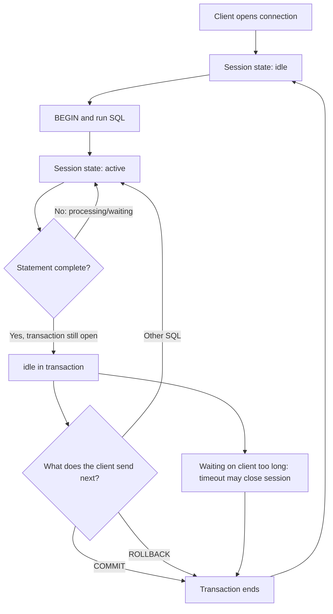

# Wait Time, Long-Running Transactions, and idle in transaction in PostgreSQL

A PostgreSQL transaction can start with `BEGIN`, run a `SELECT` or `UPDATE`, and then be "forgotten" because the application is waiting on an HTTP API, waiting for user action, or failing to call `COMMIT`/`ROLLBACK`. During that time, the connection remains open and the transaction can continue holding locks, resources, or related snapshot information. Other sessions may be blocked, DDL deployments slow down, and PostgreSQL's cleanup of old row versions is impacted.

That is why the following three issues need to be studied together:

- **Wait time:** a session may be waiting on a lock, I/O, client, or other resource. Not every "slow" query is using CPU.
- **Long-running transaction:** the elapsed time from when a transaction starts until it commits or rolls back; it can be long even if every SQL statement inside it is very short.
- **`idle in transaction`:** PostgreSQL has finished executing the most recent statement, but **the transaction is still open** and the server is waiting for the client to send the next command.

This lesson belongs to the **Transactions** chapter and focuses on properly understanding session states, diagnosing locks and blocked queries, safely handling long-running transactions, configuring timeouts, and designing Java/JDBC applications to avoid leaving transactions open unintentionally.

## 1. Why can a transaction that is not running SQL still be dangerous?

Consider two sessions connected to the same database. Session A runs:

```sql
BEGIN;

UPDATE app.accounts
SET balance = balance + 100
WHERE account_id = 1;

-- The client sends no further commands for several minutes.
-- COMMIT/ROLLBACK has not been executed yet.
```

The `UPDATE` statement has finished running, yet the transaction remains open. Session B wants to update the same account:

```sql
UPDATE app.accounts
SET balance = balance - 20
WHERE account_id = 1;
```

Session B may have to **wait** because the target row is locked by A's transaction. On the server, A may be in the `idle in transaction` state while B is in the `active` state waiting on a lock.

A common misconception is assuming that session A is "doing nothing" and is therefore harmless. In reality:

- A's uncommitted changes have not become committed data for other sessions.
- Row locks and table locks held by the transaction can continue to persist.
- Certain types of snapshots/long-running transactions can hinder the reclamation of old row versions.
- The connection remains occupied, reducing the number of available connections in the pool.

**Conclusion:** the `idle in transaction` state does not mean PostgreSQL is processing heavy SQL. It means **the application has stopped sending commands while the transaction has not ended**.

## 2. Distinguishing the lifecycle of a session, statement, and transaction

These three objects have different lifetimes:

| Object | Starts | Ends | Example |
| --- | --- | --- | --- |
| Session/connection | Client connects to PostgreSQL | Disconnects or is closed by the server | A JDBC connection in a pool |
| Statement | PostgreSQL receives and processes an SQL command | Command completes or is canceled | `SELECT`, `UPDATE`, `COMMIT` |
| Transaction | Transaction starts, implicitly or explicitly | `COMMIT` or `ROLLBACK`; may also be rolled back when the session ends | `BEGIN; UPDATE; SELECT; COMMIT;` |

When JDBC autocommit is enabled, a regular statement is processed in its corresponding implicit transaction. When an application turns off autocommit and begins operations, the transaction can remain open across statements until commit/rollback is called.

An example distinguishing two forms of "slow":

```sql
-- A slow-running SELECT statement: both statement and transaction are active.
SELECT pg_sleep(5);

-- A transaction can be long even though each statement is very fast.
BEGIN;
SELECT 1;
-- The client stops sending commands for 5 minutes.
COMMIT;
```

In the second case, most of the transaction age comes from **waiting on the client**, not PostgreSQL computation time.



The diagram illustrates common states. In practice, there are also errors, aborted transactions, prepared transactions, implicit transactions, and other auxiliary activities.

## 3. Key states in pg_stat_activity

The `pg_stat_activity` system view is the standard starting point for finding active sessions and identifying whether any transactions have been left open.

| `state` | Interpretation | Does it by default mean a harmful lock is held? |
| --- | --- | --- |
| `active` | Backend is executing an SQL statement | No; it may be processing, waiting on a lock, I/O, or another resource |
| `idle` | No statement is running, no open transaction at the time of observation | No; a normal idle session differs from idle in a transaction |
| `idle in transaction` | The most recent statement has finished, but the transaction is still open | **Possibly** holding locks/snapshots; further inspection required |
| `idle in transaction (aborted)` | Transaction has errored and is waiting for the client to roll back or end it | Risks holding transaction/resources; needs rollback |
| `fastpath function call` | Executing a fast-path function call per supported mechanism | Uncommon in typical SQL applications |
| `disabled` | Activity statistics are disabled on the corresponding backend | Insufficient state data to draw conclusions |

An `active` session may be **waiting on a Lock**, so `active` does not automatically mean it is burning CPU. Conversely, `idle in transaction` is not a "waiting on lock" state; it is typically waiting on the **client** to send the next command.

### 3.1. Basic observation query

```sql
SELECT
    pid,
    usename,
    application_name,
    client_addr,
    state,
    wait_event_type,
    wait_event,
    xact_start,
    query_start,
    state_change,
    left(query, 160) AS query_sample
FROM pg_stat_activity
WHERE datname = current_database()
ORDER BY xact_start NULLS LAST, pid;
```

Key fields:

- `pid`: PostgreSQL backend process ID to look up the session.
- `usename`: database role used by the connection.
- `application_name`: client/application label, very useful if configured clearly.
- `client_addr`: connection address if available; not every connection type has an IP.
- `state`: session state at the moment statistics were captured.
- `wait_event_type` and `wait_event`: type and name of the event being waited on, if any.
- `xact_start`: timestamp when the current transaction started, if a transaction is active.
- `query_start`: timestamp when the current SQL statement started if active, or when the last SQL statement started if not active.
- `state_change`: timestamp when the session transitioned to the current state.
- `query`: current or most recent SQL statement; visibility of full text may be restricted by privileges and configuration.

**Important:** `query_start` on an `idle in transaction` session is the start time of the **last statement**, not when the transaction began. Using it to measure "transaction age" will be wrong.

### 3.2. Privileges to view other sessions

A regular role may see limited information about sessions belonging to other roles. A monitoring role granted appropriate privileges, such as those related to `pg_monitor`/`pg_read_all_stats`, can view additional details.

Do not grant monitoring roles or superuser privileges to application accounts just to fix an observability gap. Design a dedicated operations role and avoid logging sensitive data from `query` contents into public logs.

## 4. Measuring transaction age and idle duration accurately

To see which transactions have been open for a long time:

```sql
SELECT
    pid,
    usename,
    application_name,
    state,
    now() - xact_start AS transaction_age,
    now() - query_start AS last_query_start_age,
    now() - state_change AS current_state_age,
    wait_event_type,
    wait_event
FROM pg_stat_activity
WHERE datname = current_database()
  AND xact_start IS NOT NULL
ORDER BY xact_start;
```

In the output:

- `transaction_age` measures age from when the current transaction started.
- `last_query_start_age` is not necessarily a "running statement"; for idle sessions, it is the elapsed time since the **last statement started**.
- `current_state_age` measures how long the session has been in its current state, useful for `idle in transaction`.
- `xact_start IS NULL` usually means that session does not currently have a recorded transaction at the time of observation.

### 4.1. Finding only excessively long idle transactions

```sql
SELECT
    pid,
    usename,
    application_name,
    client_addr,
    state,
    now() - xact_start AS transaction_age,
    now() - state_change AS idle_state_age,
    wait_event_type,
    wait_event,
    pg_blocking_pids(pid) AS blocked_by,
    left(query, 200) AS last_sql
FROM pg_stat_activity
WHERE datname = current_database()
  AND state LIKE 'idle in transaction%'
  AND state_change < now() - INTERVAL '1 minute'
ORDER BY state_change;
```

The query above covers both `idle in transaction` and `idle in transaction (aborted)`. The **1 minute** threshold is only an example; systems with special business transactions may have different thresholds. Alert thresholds should align with SLA, application type, write frequency, and lock sensitivity.

### 4.2. Why use state_change instead of query_start?

Suppose a transaction begins at 10:00, runs SQL for 20 seconds, and goes idle at 10:00:20. By 10:05:

- Transaction age is about 5 minutes.
- Time in the idle in transaction state is about 4 minutes 40 seconds.
- Age from `query_start` depends on when the SQL started, not directly the idle duration.

When the goal is detecting applications that forgot to close a transaction, **`state_change`** provides a closer measure of the time spent waiting on the client.

## 5. Wait events: waiting on locks vs. waiting on clients

PostgreSQL exposes wait event categories. They help distinguish where a "slow" statement is spending its time.

| Common `wait_event_type` | General meaning | How to investigate |
| --- | --- | --- |
| `Lock` | Waiting on a conflicting lock | Use `pg_blocking_pids` and `pg_locks` |
| `LWLock` | Waiting on an internal lightweight lock | Inspect workload, resources, and server version |
| `IO` | Waiting on an I/O operation | Inspect disk, cache, query, and buffer counts |
| `Client` | Waiting to read/write data with the client | Check client result handling or command sending |
| `Timeout` | Waiting on a timeout/sleep event | Check wait event name and SQL statement |
| `BufferPin` | Waiting on a buffer pin condition | Check sessions and operations holding buffers |
| `IPC` | Waiting on inter-process communication between backends | Check event name and workload type |
| `Activity` | Backend waiting for work in its main activity loop | Usually related to background workers |

Specific wait event names depend on the PostgreSQL version. `wait_event_type IS NULL` does not by itself prove the backend is at 100% CPU; it only indicates no wait event was recorded at the moment of observation.

### 5.1. Two sessions with opposite symptoms

In a lock-wait incident:

- Session **A** may show `state = 'idle in transaction'`, `wait_event_type = 'Client'`, and `wait_event = 'ClientRead'`.
- Session **B** may show `state = 'active'`, `wait_event_type = 'Lock'`.

Session B is the **waiting victim**, whereas A may be the **root lock holder**. Searching only for long-running `active` sessions will miss an idle culprit.

Do not diagnose A as the culprit solely because A has been idle for a long time; you must verify the **actual blocking relationship** with locking tools.

## 6. Two-session lab: creating idle in transaction and a lock wait

Perform this in a **learning database**; do not intentionally hold locks on production tables.

### 6.1. Preparing the table

```sql
CREATE SCHEMA IF NOT EXISTS tx_lab;

CREATE TABLE tx_lab.accounts (
    account_id integer PRIMARY KEY,
    owner_name text NOT NULL,
    balance numeric(12, 2) NOT NULL CHECK (balance >= 0)
);

INSERT INTO tx_lab.accounts (account_id, owner_name, balance)
VALUES
    (1, 'Account One', 1000.00),
    (2, 'Account Two', 500.00),
    (3, 'Account Three', 200.00);
```

If you created/inserted these rows in a previous lab, use a new schema or clean up sample data in a controlled manner; do not rerun `INSERT` and mistake a duplicate key error for a transaction error.

### 6.2. Session A: keeping a transaction open

Open connection A with `psql` or an SQL client and run:

```sql
BEGIN;

UPDATE tx_lab.accounts
SET balance = balance + 100
WHERE account_id = 1;

SELECT pg_backend_pid() AS session_a_pid;

-- Stop here: do not COMMIT/ROLLBACK yet.
```

The `UPDATE` has completed. If no further SQL is sent, session A will typically remain `idle in transaction`, waiting for commands from the client.

A normal `SELECT` in session B under `READ COMMITTED` can still read the **old committed value** of balance from before A's update, rather than being blocked by a read lock. However, an update to the same row will conflict.

### 6.3. Session B: attempting to update the same row

Open connection B and run:

```sql
BEGIN;

SET LOCAL lock_timeout = '3s';

UPDATE tx_lab.accounts
SET balance = balance - 20
WHERE account_id = 1;

-- If UPDATE is canceled due to lock_timeout, you must ROLLBACK.
```

While waiting, session B can display `wait_event_type = 'Lock'`. If A still has not committed/rolled back after the timeout elapses, B will encounter a lock timeout error (typically SQLSTATE `55P03`).

After a statement error inside a normal transaction, transaction B enters the failed/aborted state; run:

```sql
ROLLBACK;
```

If A releases the lock before B's timeout expires, the `UPDATE` in B can finish. In that case, also use `ROLLBACK` in the lab to avoid unintended balance changes.

### 6.4. Session C: observing the blocking relationship

While B is waiting, open connection C and run:

```sql
SELECT
    pid,
    application_name,
    state,
    wait_event_type,
    wait_event,
    now() - xact_start AS transaction_age,
    pg_blocking_pids(pid) AS blocking_pids,
    left(query, 120) AS sql_sample
FROM pg_stat_activity
WHERE datname = current_database()
  AND pid <> pg_backend_pid()
ORDER BY xact_start NULLS LAST, pid;
```

Expected observations before B times out:

- Session A: has an open transaction, idle after `UPDATE`/`SELECT`.
- Session B: active, waiting on Lock.
- `pg_blocking_pids(B_pid)` contains A's PID if A is directly blocking B.

Because `lock_timeout = '3s'` makes the observation window short, you can increase the timeout in a learning environment if you need more time to inspect, while always keeping a way to stop waiting and end the transaction.

### 6.5. Cleaning up properly

Return to session A:

```sql
ROLLBACK;
```

If you want to verify again, run in a new session:

```sql
SELECT account_id, balance
FROM tx_lab.accounts
ORDER BY account_id;
```

Since the test operations were rolled back, the sample balances remain unchanged. The most important takeaway from this lab is **never leaving session A around indefinitely with an unfinished transaction**.

## 7. pg_blocking_pids: finding who is blocking whom

The `pg_blocking_pids(pid)` function returns an array of backend PIDs that PostgreSQL determines are blocking the target backend in a lock-wait context.

A query listing waiter/blocker pairs:

```sql
SELECT
    w.pid AS waiting_pid,
    w.usename AS waiting_user,
    w.wait_event_type AS waiting_type,
    w.wait_event AS waiting_event,
    now() - w.query_start AS waiting_query_age,
    left(w.query, 160) AS waiting_sql,
    b.pid AS blocking_pid,
    b.state AS blocking_state,
    now() - b.xact_start AS blocking_transaction_age,
    now() - b.state_change AS blocking_state_age,
    left(b.query, 160) AS blocking_last_sql
FROM pg_stat_activity AS w
JOIN LATERAL
    unnest(pg_blocking_pids(w.pid)) AS bp(blocking_pid)
    ON TRUE
LEFT JOIN pg_stat_activity AS b
    ON b.pid = bp.blocking_pid
WHERE w.datname = current_database()
ORDER BY waiting_query_age DESC NULLS LAST;
```

How to read it:

- `waiting_pid`: the blocked backend.
- `blocking_pid`: a backend holding a lock or ahead in the lock queue under blocking rules.
- `blocking_state`: the culprit may be `idle in transaction` or active.
- `blocking_transaction_age`: how long the blocker's transaction has been open.
- `blocking_last_sql`: current/most recent SQL, not necessarily the first SQL that acquired the lock.

### 7.1. Why not simply compare pg_locks rows sharing the same relation?

PostgreSQL locks take many forms: relation, transaction ID, virtual transaction ID, tuple, advisory lock, object lock, and so on. Waiting to update a row can show up as waiting on a transaction ID rather than simply "two `pg_locks` entries on the same relation."

`pg_blocking_pids()` is generally a better first tool than manually reconstructing all conflict pairs from `pg_locks`. You can use `pg_locks` to dig deeper, but do not treat a simple join on relation as a complete blocker detector.

### 7.2. Blocking chains

You can encounter:

```text
A (idle in transaction, holding lock)
       |
       v
B (active, waiting on A)
       |
       v
C (active, waiting on B or waiting in the queue)
```

The session waiting the longest is not always the root cause. Follow the blocker chain to locate the **root session holding the resource**, then identify its owner and how to end it safely.

## 8. pg_locks: inspecting lock modes and affected objects

Example querying locks on the lab table:

```sql
SELECT
    l.pid,
    l.locktype,
    l.mode,
    l.granted,
    l.relation::regclass AS relation_name,
    a.state,
    left(a.query, 120) AS query_sample
FROM pg_locks AS l
JOIN pg_stat_activity AS a
    ON a.pid = l.pid
WHERE a.datname = current_database()
  AND l.relation = 'tx_lab.accounts'::regclass
ORDER BY l.granted, l.pid, l.mode;
```

Columns:

- `locktype`: type of locked object.
- `mode`: lock mode such as `AccessShareLock`, `RowExclusiveLock`, `AccessExclusiveLock`, etc.
- `granted`: `true` if the lock has been granted; `false` if waiting.
- `relation`: table object when the lock is relation-related.

**Limitation:** not every held row lock appears as a distinct `tuple` row in `pg_locks`. A session blocked by a row update may be waiting on a `transactionid`. Therefore, filtering by `l.relation = ...` alone may not fully explain why a session is waiting.

### 8.1. Read lock status before taking action

A session holding `RowExclusiveLock` on a table does not mean it blocks every `SELECT` query. PostgreSQL enforces a mode-based lock compatibility matrix, and row-level locks follow different rules from table-level locks.

Identify **which lock is being awaited**, **who holds the conflicting lock**, and the **actual operational impact**. Never kill a transaction simply because you see a granted lock.

## 9. Idle in transaction can block DDL even after only running SELECT

Another scenario besides `UPDATE` is a transaction that has read a table and not yet committed.

Session A:

```sql
BEGIN;

SELECT account_id, owner_name
FROM tx_lab.accounts
WHERE account_id = 1;

-- Leave the transaction open and send no further SQL.
```

A regular `SELECT` statement can hold a table-level `AccessShareLock` until the transaction ends. Although it modifies no data, it can block DDL that requires `AccessExclusiveLock`, such as certain `ALTER TABLE` commands.

In session B, you can demonstrate a DDL statement with a timeout:

```sql
BEGIN;

SET LOCAL lock_timeout = '3s';

ALTER TABLE tx_lab.accounts
ADD COLUMN lab_note text;

ROLLBACK;
```

If A still keeps its transaction open, `ALTER TABLE` may fail to acquire the lock and be canceled after the timeout. If the DDL does acquire the lock, `ROLLBACK` in the example avoids keeping the test schema change.

**Note:** if `ALTER TABLE` fails, transaction B is marked aborted; in that case you must `ROLLBACK`, rather than trying to execute subsequent DDL statements inside an unresolved failed transaction.

Then clean up session A:

```sql
ROLLBACK;
```

Key takeaway: **even a read-only transaction holds table locks** for the duration of the transaction and can obstruct DDL. Its impact on vacuum cleanup depends on the specific snapshot/transaction, and not every read-only transaction holds the same `xmin` for its entire lifetime.

## 10. Idle in transaction (aborted): errored state not yet rolled back

In a lab session:

```sql
BEGIN;

SELECT 1 / 0;
-- division_by_zero: statement errors.

SELECT 42;
-- Inside an errored transaction, this statement is also rejected.

ROLLBACK;
```

Between the error and the `ROLLBACK` command, PostgreSQL can report the session state:

```text
idle in transaction (aborted)
```

Subsequent error messages often return SQLSTATE `25P02`, meaning the current transaction is in a failed state and further commands cannot execute normally until rolled back (or handled appropriately with savepoints).

### 10.1. Why doesn't an error automatically return the session to normal idle?

Inside an explicit transaction, when a statement fails, PostgreSQL does not automatically turn the entire transaction into a successful one. The client must take action to end or recover the state.

If an application catches an exception and keeps using the connection without rolling back, it can:

- Receive additional `current transaction is aborted` errors.
- Leave the transaction/session in an unwanted state.
- Hold the connection in the pool longer than expected.
- Cause subsequent requests to receive a connection with uncleaned transaction state if the pool/application manages it improperly.

### 10.2. Savepoints for handleable errors

If you want part of the work to be allowed to fail without aborting the entire transaction, you can use `SAVEPOINT`:

```sql
BEGIN;

SAVEPOINT before_optional_step;

-- If the next command fails, the client must execute
-- ROLLBACK TO SAVEPOINT before_optional_step.

ROLLBACK TO SAVEPOINT before_optional_step;

RELEASE SAVEPOINT before_optional_step;

COMMIT;
```

This is only an **illustrative skeleton**. In real applications, place the potentially failing command and appropriate rollback branch properly; do not run subsequent statements while the transaction is aborted before returning to a valid savepoint.

Savepoints are not a cure for clients forgetting to close transactions. They solve **rollback scope within a transaction**, and do not close the transaction by themselves.

## 11. How long-running transactions impact MVCC and VACUUM

PostgreSQL uses **Multi-Version Concurrency Control (MVCC)** so sessions can read appropriate data versions without necessarily blocking each other like simple read/write-lock systems.

When a row is updated via `UPDATE` or deleted via `DELETE`, old versions may need to stick around for a while to serve snapshots that are still allowed to see them. `VACUUM` cleans up versions that are no longer needed once safety conditions are met.

### 11.1. Long transactions can delay cleanup of old versions

A transaction holding an old snapshot for a long time can prevent PostgreSQL from reclaiming certain row versions that the snapshot might still need.

Potential consequences:

- `n_dead_tup` grows or cleanup is delayed.
- Table/index size grows alongside update/delete volume.
- I/O and scan costs increase.
- Autovacuum has to do extra catch-up work once cleanup conditions allow.
- Transaction age and cleanup horizons need monitoring.

However, avoid oversimplifying by claiming that **every `idle in transaction` session always holds the same `xmin` snapshot and blocks VACUUM database-wide**.

Under `READ COMMITTED`, PostgreSQL normally takes a snapshot per statement; an idle read-only transaction may **not always keep an active snapshot** between statements. Under `REPEATABLE READ`/`SERIALIZABLE`, a transaction may retain its snapshot longer. Cursors, active queries, transactions with an assigned XID, and other factors also affect cleanup.

Therefore, combine `state`, `xact_start`, `backend_xmin`/`backend_xid` (when present), and vacuum statistics rather than inferring the entire risk from the `state` column alone.

### 11.2. Observing backend_xid and backend_xmin

```sql
SELECT
    pid,
    application_name,
    state,
    xact_start,
    now() - xact_start AS transaction_age,
    backend_xid,
    backend_xmin,
    left(query, 120) AS last_sql
FROM pg_stat_activity
WHERE datname = current_database()
  AND xact_start IS NOT NULL
ORDER BY xact_start;
```

`backend_xid` is the top-level transaction ID assigned to the backend, if any. `backend_xmin` reflects the `xmin` horizon maintained by the backend at observation time, if any. They can be **NULL**; do not treat `backend_xmin IS NULL` as a guarantee that a session is completely harmless.

When diagnosing severe vacuum freeze/wraparound issues, inspect the whole system, including replication slots, prepared transactions, running transactions, and related XID ages.

### 11.3. Viewing dead tuple statistics

```sql
SELECT
    schemaname,
    relname,
    n_live_tup,
    n_dead_tup,
    n_tup_upd,
    n_tup_del,
    last_autovacuum,
    last_vacuum
FROM pg_stat_user_tables
WHERE schemaname = 'tx_lab'
ORDER BY relname;
```

`n_live_tup` and `n_dead_tup` are **estimated** counters updated by the statistics system and do not necessarily reflect exact row counts immediately after each transaction.

Do not blindly run `VACUUM FULL` to fix every bloat issue: that command has its own rewrite/locking mechanics and can cause major disruption. First, eliminate the root cause of transactions/snapshots lingering too long.

## 12. Lock wait time, slow queries, and deadlocks are not the same

Three situations:

| Situation | What is happening | What to investigate |
| --- | --- | --- |
| Lock wait | Backend is waiting for a lock to be granted | `wait_event_type = 'Lock'`, `pg_blocking_pids` |
| Slow query | SQL takes long to process data, not necessarily waiting on locks | `EXPLAIN`, I/O, row counts, indexes, CPU, query plan |
| Deadlock | A lock-wait cycle preventing transactions from progressing together | Server deadlock detector, SQLSTATE `40P01` |

Two-way deadlock example:

```text
Session A: holds lock on account 1, waits for account 2.
Session B: holds lock on account 2, waits for account 1.

A is waiting on B; B is waiting on A → deadlock cycle.
```

PostgreSQL has a deadlock detector and typically aborts one transaction to break the wait cycle. Not every long lock wait is a deadlock: a slow-running transaction may eventually commit and release its locks normally.

### 12.1. deadlock_timeout is not a transaction timeout

The `deadlock_timeout` parameter controls how long a backend waits on a lock before PostgreSQL runs deadlock detection. It is not a "maximum time a transaction is allowed to run" and not a promise that every SQL query will be aborted after that interval.

In operations, do not tune `deadlock_timeout` just to kill slow queries. Choose `lock_timeout` or `statement_timeout` when the actual goal is bounding wait or statement duration.

## 13. Related timeout parameters

PostgreSQL provides several timeout settings addressing different problems. Some exist across many versions, while others depend on the major version.

| Parameter | What does it bound? | When useful |
| --- | --- | --- |
| `lock_timeout` | Time spent waiting to acquire each lock | Preventing DDL/DML from waiting too long for locks |
| `statement_timeout` | Statement execution duration, typically including related waits | Preventing overly long statements |
| `idle_in_transaction_session_timeout` | Time a session sits idle while a transaction is open | Cleaning up connections with forgotten transactions |
| `idle_session_timeout` | Time a session sits idle outside a transaction | Managing inactive sessions; use care with connection pools |
| `transaction_timeout` | Total transaction age on supported PostgreSQL versions | Bounding transactions spanning both active and idle periods |
| `deadlock_timeout` | Wait threshold before running deadlock detection | Tuning deadlock detection/lock-wait logging; not a transaction limit |

Setting `0` for many common timeouts disables the respective timeout; check the exact semantics of each parameter on your server version.

### 13.1. lock_timeout

Example limiting lock wait time inside a transaction:

```sql
BEGIN;

SET LOCAL lock_timeout = '2s';

UPDATE tx_lab.accounts
SET balance = balance + 10
WHERE account_id = 1;

COMMIT;
```

If the statement has to wait too long for a lock, PostgreSQL can cancel the statement. In an explicit transaction, you must then `ROLLBACK` instead of calling `COMMIT` as if no error occurred.

`lock_timeout` does not stop a statement from **computing for 20 minutes** if it does not wait long on a lock. It focuses strictly on lock wait duration.

### 13.2. statement_timeout

```sql
BEGIN;

SET LOCAL statement_timeout = '10s';

SELECT pg_sleep(20);

-- If canceled by statement_timeout, you must ROLLBACK.
```

`statement_timeout` can cancel a running statement that exceeds the limit. It is not an overall transaction timeout. An application can send many short SQL statements below the timeout threshold while still leaving the transaction open for a very long time between statements.

If `lock_timeout` is greater than or equal to `statement_timeout`, the statement timeout may trigger first, making `lock_timeout` practically ineffective on its own. To distinguish lock-wait failures, operators commonly set `lock_timeout` shorter than `statement_timeout`.

### 13.3. idle_in_transaction_session_timeout

Example session setting:

```sql
SET idle_in_transaction_session_timeout = '60s';
```

When a session stays idle inside a transaction continuously past the configured duration, PostgreSQL can **terminate that session's connection**, triggering a rollback of the uncommitted transaction and releasing related resources/locks.

This is a **last-resort safety guard**, not a replacement for code calling `COMMIT`/`ROLLBACK` promptly.

Consequences to consider:

- The connection held by the application will be closed by the server; subsequent use may hit a connection error.
- The uncommitted transaction is rolled back, so the business operation may remain incomplete even if the client does not realize it immediately.
- The connection pool needs to detect and discard broken connections.
- Too short a timeout can cut off a valid workflow waiting on a client between steps.
- For applications intentionally using long transactions, fix the design first rather than just disabling safety guards.

### 13.4. idle_session_timeout differs from idle_in_transaction_session_timeout

`idle_session_timeout` targets sessions doing nothing **outside a transaction**, whereas `idle_in_transaction_session_timeout` targets idle periods while a **transaction is still open**.

With a connection pool, keeping a connection in the `idle` state waiting for the next request can be completely normal. Setting `idle_session_timeout` too short in PostgreSQL can cause the pool to repeatedly encounter server-closed connections. Conversely, `idle_in_transaction_session_timeout` is specifically useful for handling applications that forget to finish transactions.

Do not confuse the two parameters just because their names look similar.

### 13.5. transaction_timeout and version availability

Some newer PostgreSQL versions provide `transaction_timeout` to bound the total duration of a transaction. If the server does not support it, `SHOW transaction_timeout` may report that the parameter does not exist.

Do not rely on a parameter not yet verified on your running major version. In multi-environment projects, verify settings with:

```sql
SHOW server_version;
SHOW idle_in_transaction_session_timeout;
SHOW statement_timeout;
SHOW lock_timeout;
```

If using `transaction_timeout`, confirm it is supported on that server and understand how it interacts with other timeouts. This parameter differs from `statement_timeout`: a transaction can become long across multiple statements or idle gaps between them.

## 14. Configuring timeouts at session, transaction, and role scope

There are different configuration scopes:

- `SET` changes the setting for the current session (unless special rules apply).
- `SET LOCAL` changes the setting for the scope of the current transaction.
- Role/database-level or config-file settings apply according to their scope and load timing.

A migration may use dedicated timeouts:

```sql
BEGIN;

SET LOCAL lock_timeout = '3s';
SET LOCAL statement_timeout = '30s';

ALTER TABLE tx_lab.accounts
ADD COLUMN optional_metadata jsonb;

COMMIT;
```

In a learning environment, if you do not want to keep the schema change, use `ROLLBACK` instead of `COMMIT`. In production, wait limits and statement limits must be chosen based on actual timings rather than copied mechanically.

### 14.1. Setting timeouts to prevent forgotten transactions

You can configure idle-in-transaction limits for an application role when permitted, for example:

```sql
-- Administrative configuration example; do not run directly before identifying the target role.
ALTER ROLE application_role
SET idle_in_transaction_session_timeout = '60s';
```

This applies to new sessions connecting with that role; it does not immediately alter all currently open connections. `application_role` is merely an illustrative name.

Role-level configuration enforces default policies without requiring every query to run `SET LOCAL`. However, it must be tested with your connection pool and legitimate long workflows.

### 14.2. Do not pick timeouts by guessing

To choose thresholds, examine:

- How long do normal business transactions take at p95/p99?
- Which code paths might wait on an HTTP API or user input?
- Do any sessions frequently hold locks on hot tables?
- Does the application use cursors/streaming or large batches?
- How do the pool and ORM handle server-closed connections?
- What threshold causes real user impact?

A 30-second value might be reasonable for a simple API, yet unsuitable for a reporting job with an intentionally longer transaction. Best practice is to **shorten transaction duration in code first**, then add timeouts as guardrails.

## 15. When a timeout fires, is the transaction automatically rolled back?

You must distinguish **statement cancellation** from **session termination**.

### 15.1. Statement cancellation via statement_timeout/lock_timeout

A canceled statement inside an explicit transaction usually puts the transaction into a failed/aborted state. The client must issue `ROLLBACK` or an intentional savepoint recovery to proceed properly.

Example:

```sql
BEGIN;

SET LOCAL statement_timeout = '1s';

SELECT pg_sleep(5);
-- Statement is canceled after about 1s.

SELECT 1;
-- Will report that the transaction is aborted.

ROLLBACK;
```

Statement cancellation does not mean statements committed **earlier in separate transactions** are rolled back. Committed changes from distinct transactions are not undone by a timeout in the current transaction.

### 15.2. Session termination via idle_in_transaction_session_timeout

When a session is terminated, its uncommitted transaction cannot continue and is rolled back. The client-side connection can no longer be used as a healthy connection.

**This is a connection-boundary failure**, not a regular error returned inside a `ResultSet`. The application layer needs to detect connection health and retry at the appropriate business scope if safe.

### 15.3. Connection loss after COMMIT

Cases exist where PostgreSQL commits successfully, yet the `COMMIT` acknowledgment never reaches the client because the network drops. The client must not assume the transaction rolled back and blindly resend a non-idempotent operation.

For money transfers, counter increments, or external transaction records, implement an **idempotency key**, unique constraint, or reconciliation mechanism to handle uncertain commit outcomes.

## 16. Canceling a query vs. terminating a session: two different operations

PostgreSQL provides administrative functions:

```sql
SELECT pg_cancel_backend(12345);
```

and:

```sql
SELECT pg_terminate_backend(12345);
```

`12345` is an **illustrative PID**; do not run with an arbitrary PID.

| Operation | Purpose | Notes |
| --- | --- | --- |
| `pg_cancel_backend(pid)` | Requests cancellation of the currently executing statement | Does not guarantee the transaction/session closes; transaction may remain aborted |
| `pg_terminate_backend(pid)` | Requests termination of the backend/session | Uncommitted transaction rolls back; application loses the connection |
| `COMMIT` from owning client | Completes transaction successfully | Only when business logic is finished and data is valid |
| `ROLLBACK` from owning client | Aborts uncommitted transaction | Appropriate when a transaction is stranded or errored |

Appropriate privileges are required to cancel/terminate someone else's session. Do not automatically terminate every session over 60 seconds: some transactions are intentionally long or executing critical operations.

**Recommended handling order:**

1. Verify the real blocker using `pg_blocking_pids()`.
2. Identify the owner via `application_name`, role, client, and application logs.
3. Prefer letting the application **end the transaction properly**.
4. Only if it is a critical incident, following an approved runbook with rollback impact understood, consider terminating the session.
5. Re-check blocker chains, latency, and application health afterward.

### 16.1. Why doesn't cancel always resolve idle in transaction?

An `idle in transaction` session has **no running statement** to cancel. `pg_cancel_backend` may not produce the desired outcome: the transaction remains open and locks can persist.

To close that transaction, the client must commit/roll back, or the session must eventually be terminated through an authorized mechanism. That is why a dashboard "Cancel query" button is not a universal fix for every long transaction.

## 17. Connection pools and sources of idle in transaction

Applications commonly use a pool such as HikariCP to reuse connections. Pooling reduces connection-establishment overhead, but a connection borrowed and held in an open transaction reduces available pool capacity.

Common scenarios:

- A method opens a transaction and then calls an external HTTP API.
- A user is shown a form and the application holds the transaction while waiting for confirmation.
- An exception occurs and the code fails to roll back.
- JDBC sets `autoCommit(false)`, yet code misses `commit()`/`rollback()` on some branch.
- Streaming/cursor result reading takes longer than expected inside a transaction.
- An ORM opens a transaction spanning an entire request or long pipeline.
- A batch job executes thousands of statements and commits only at the very end.
- A connection is returned to the pool in an inconsistent state due to buggy code/configuration.

### 17.1. An idle connection in a pool is not idle in transaction

If a pool keeps 20 connections in the `idle` state ready for incoming requests, that can be completely normal behavior.

If many connections are in `idle in transaction`, inspect code paths for unfinished transactions. Pool settings like `idleTimeout` or `maxLifetime` should not be mistaken as replacements for PostgreSQL's `idle_in_transaction_session_timeout`; each mechanism governs a different aspect.

Some pools do not close a connection **while it is currently borrowed** solely because the pool's idle timeout expired. Thus, connection leaks can still occur even with pool lifetimes configured.

### 17.2. Tagging application_name to identify session owners

On the PostgreSQL side, `application_name` is visible in `pg_stat_activity`. Naming connections by service or worker helps trace connection sources:

```sql
SET application_name = 'orders-api';
```

Or configure it via the connection string/driver as supported, e.g., PgJDBC's corresponding application name property. Do not put tokens, personal data, or secrets inside `application_name`.

In multi-instance deployments, you can combine service names with permitted observability labels, while avoiding overly high cardinality or leaking secrets.

## 18. Designing proper transaction boundaries in Java/JDBC

Example of a method executing two related statements. What matters is not complex SQL, but ensuring every path **commits or rolls back** and releases the connection.

```java
import java.math.BigDecimal;
import java.sql.Connection;
import java.sql.PreparedStatement;
import java.sql.SQLException;
import javax.sql.DataSource;

public class AccountService {
    private final DataSource dataSource;

    public AccountService(DataSource dataSource) {
        this.dataSource = dataSource;
    }

    public void transfer(
            long fromId,
            long toId,
            BigDecimal amount
    ) throws SQLException {
        if (amount.signum() <= 0 || fromId == toId) {
            throw new IllegalArgumentException("Invalid transfer");
        }

        try (Connection connection = dataSource.getConnection()) {
            connection.setAutoCommit(false);

            try {
                try (PreparedStatement debit =
                             connection.prepareStatement("""
                    UPDATE tx_lab.accounts
                    SET balance = balance - ?
                    WHERE account_id = ?
                      AND balance >= ?
                    """);
                     PreparedStatement credit =
                             connection.prepareStatement("""
                    UPDATE tx_lab.accounts
                    SET balance = balance + ?
                    WHERE account_id = ?
                    """)) {

                    debit.setBigDecimal(1, amount);
                    debit.setLong(2, fromId);
                    debit.setBigDecimal(3, amount);

                    if (debit.executeUpdate() != 1) {
                        throw new SQLException("Insufficient funds or missing source");
                    }

                    credit.setBigDecimal(1, amount);
                    credit.setLong(2, toId);

                    if (credit.executeUpdate() != 1) {
                        throw new SQLException("Missing destination");
                    }
                }

                connection.commit();
            } catch (SQLException | RuntimeException ex) {
                try {
                    connection.rollback();
                } catch (SQLException rollbackError) {
                    ex.addSuppressed(rollbackError);
                }
                throw ex;
            }
        }
    }
}
```

This example borrows a connection from the pool and demonstrates commit/rollback. It is **not a complete production transfer system**: bidirectional transfers still need deadlock prevention (such as locking accounts in a deterministic order), idempotency, auditing, numeric range checks, and incident handling.

Good practices to preserve:

- Do not open the transaction before user confirmation of the business operation.
- Keep all statements requiring atomicity inside the same transaction.
- Call `commit()` on success.
- Call `rollback()` whenever `SQLException`/`RuntimeException` is thrown.
- Use `try-with-resources` to ensure resources are closed and the connection returns to the pool upon completion.

### 18.1. Do not make unnecessary external network calls inside an open transaction

Example to **avoid**:

```java
@Transactional
public void processOrder(long orderId) {
    orderRepository.markProcessing(orderId);

    // May take 30 seconds or several minutes.
    externalPaymentClient.charge(orderId);

    orderRepository.markPaid(orderId);
}
```

If the method actually runs inside a single transaction spanning the `externalPaymentClient` call, it can hold the transaction/connection/locks while waiting on the network. Moreover, a database rollback **does not automatically roll back** side effects of an external HTTP API.

A better design typically splits phases:

1. Record state and intent/outbox in a short transaction.
2. Commit.
3. Call the external service with an idempotency key.
4. Record the outcome in another short transaction.
5. Provide retry/reconciliation handling for failures at the boundary between the two systems.

That is an architectural pattern, not a rigid rule applied blindly to every flow. Atomicity requirements within the same database must still be maintained inside appropriate transactions.

### 18.2. @Transactional does not guarantee transaction termination in all situations

In Spring, transaction boundaries depend on transaction manager configuration, proxy/interception behavior, propagation, and exception handling. Some exceptions may be caught and swallowed by application code so the framework never knows to roll back; certain internal calls may bypass the proxy by default.

Do not assume simply adding an annotation makes all `idle in transaction` bugs disappear. Observe actual runtime behavior, tracing, and both success and failure branches.

## 19. Long-running transactions when using cursors and streaming ResultSets

A query returning a huge number of rows may lead applications to stream results rather than load everything into RAM.

In PgJDBC, cursor/fetch-size handling may require disabling autocommit depending on configuration. If the client reads incrementally and waits a long time on file processing, HTTP APIs, or user actions, the transaction can stay open longer than expected.

Illustrative sketch:

```java
try (Connection connection = dataSource.getConnection()) {
    connection.setAutoCommit(false);

    try (PreparedStatement ps = connection.prepareStatement("""
        SELECT account_id, balance
        FROM tx_lab.accounts
        ORDER BY account_id
        """)) {
        ps.setFetchSize(100);

        try (var rs = ps.executeQuery()) {
            while (rs.next()) {
                // Process data quickly within a reasonable scope.
                // Do not wait for user interaction here.
            }
        }
    }

    connection.commit();
}
```

This example only illustrates reading data with cursor/fetch size; actual streaming behavior depends on the driver, `ResultSet` type, connection mode, and version.

If a report export takes hours, consider:

- Keyset pagination on a stable key if semantics permit.
- Deliberate snapshot/transaction usage when a consistent point-in-time view is required.
- Reading from a replica or appropriate summary table when architecture allows.
- Never holding a connection open indefinitely simply because a downstream consumer is slow.

**Do not split the transaction arbitrarily** if business semantics require a globally consistent snapshot. Instead, design controlled reading/streaming and evaluate MVCC impact.

## 20. READ COMMITTED, REPEATABLE READ, and long transactions

Snapshot lifetime depends on isolation level and how queries use it.

### 20.1. READ COMMITTED

Under `READ COMMITTED`, each statement typically receives an appropriate snapshot at the start of that statement. Two `SELECT` queries inside the same transaction can observe different commits from other transactions.

```sql
BEGIN ISOLATION LEVEL READ COMMITTED;

SELECT balance
FROM tx_lab.accounts
WHERE account_id = 1;

-- Another transaction COMMITs a change.

SELECT balance
FROM tx_lab.accounts
WHERE account_id = 1;

ROLLBACK;
```

The two reads can return different values if another transaction commits a change in between and it is not prevented by constraints/locks.

Hence, an `idle in transaction` session under `READ COMMITTED` does not necessarily hold a single old snapshot throughout the entire idle period. Still, it can hold locks acquired earlier in the transaction.

### 20.2. REPEATABLE READ

Under `REPEATABLE READ`, a transaction typically uses one stable snapshot for queries once the snapshot is established, avoiding observable changes between reads per PostgreSQL semantics.

```sql
BEGIN ISOLATION LEVEL REPEATABLE READ;

SELECT balance
FROM tx_lab.accounts
WHERE account_id = 1;

-- Avoid leaving this transaction idle for too long unless necessary.

SELECT balance
FROM tx_lab.accounts
WHERE account_id = 1;

COMMIT;
```

A long transaction with an old snapshot can hinder cleanup of related row versions. Therefore, choosing an isolation level affects not only read semantics, but also operational impact when transactions are held open for a long time.

### 20.3. SERIALIZABLE

Under `SERIALIZABLE`, PostgreSQL can detect serialization conflicts and require retrying the entire transaction with SQLSTATE `40001`. Long transactions and overlapping accesses can make conflicts more complex.

Do not try to resolve serialization failures by keeping the transaction open longer or retrying individual statements. For `40001`, the application generally needs to retry the **entire transaction unit** from the beginning, with idempotency and bounded retry attempts.

## 21. Prepared transactions: long transactions no longer attached to a normal session

PostgreSQL supports two-phase commit in environments where prepared transactions are enabled and used. A transaction that executed `PREPARE TRANSACTION` can remain alive **after the original session disconnects**, continuing to hold resources/locks until `COMMIT PREPARED` or `ROLLBACK PREPARED`.

Because of that, sometimes no obvious `pid` shows up as `idle in transaction` in `pg_stat_activity`, yet unexplained locks still exist.

Check with:

```sql
SELECT
    gid,
    prepared,
    owner,
    database
FROM pg_prepared_xacts
ORDER BY prepared;
```

**Important warning:**

- Never run `COMMIT PREPARED` or `ROLLBACK PREPARED` on a `gid` whose owner you do not know.
- 2PC can involve a transaction coordinator or multiple external resources.
- Mishandling it can break distributed system consistency.
- Contact the operations/application team managing the coordinator and verify business state first.

Prepared transactions differ from normal `idle in transaction` sessions, yet they are critical when investigating long-lived locks not attached to any active session.

## 22. Replication and retention: not just transactions on the primary

When investigating vacuum cleanup and data retention lag, sometimes resources are held back not only by application transactions, but also by replication mechanisms.

Example checking replication slots:

```sql
SELECT
    slot_name,
    slot_type,
    active,
    restart_lsn,
    confirmed_flush_lsn
FROM pg_replication_slots;
```

A replication slot can retain WAL if downstream consumers fall behind. Snapshot/`xmin`-related mechanisms on certain slot types also need inspection when investigating the vacuum horizon.

This is **not** the cause of every `idle in transaction` incident, yet it prevents the false conclusion that terminating one session will immediately free all WAL or dead tuples.

If replicas are serving long queries, you may also need to check feedback/snapshot settings and recovery conflicts according to configuration. Never drop slots or disable replication carelessly to "fix bloat" without understanding the impact on synchronization and recovery.

## 23. Difference between long transactions and long-running queries in monitoring

A good dashboard should show **two separate time axes**:

| Metric | Approximate measurement | Meaning |
| --- | --- | --- |
| Transaction age | `now() - xact_start` | How long since the transaction opened |
| Active statement age | `now() - query_start` when `state = 'active'` | How long the current SQL has been running/waiting |
| Idle time in transaction | `now() - state_change` when `state LIKE 'idle in transaction%'` | How long the client has sent no command inside the transaction |
| Lock wait time | Wait events, telemetry, or lock-wait logs | How long SQL has been stuck on locks |
| Snapshot/oldest xmin age | XID/xmin metadata, server state | Risk of retaining old row versions |
| Pool checkout duration | Application/pool metrics | How long the connection has been borrowed by the application |

A 30-second HTTP request might not hold a database transaction for all 30 seconds. Conversely, a finished request with a leaked connection can leave a transaction open for minutes.

Correlate **PID/`application_name`**, request traces, connection checkouts, query logs, and transaction timestamps to track down the originating code path.

### 23.1. A compact monitoring query for operations

```sql
SELECT
    a.pid,
    a.usename,
    a.application_name,
    a.client_addr,
    a.state,
    a.wait_event_type,
    a.wait_event,
    CASE
        WHEN a.xact_start IS NOT NULL
        THEN now() - a.xact_start
    END AS transaction_age,
    CASE
        WHEN a.state = 'active'
        THEN now() - a.query_start
    END AS active_statement_age,
    CASE
        WHEN a.state LIKE 'idle in transaction%'
        THEN now() - a.state_change
    END AS idle_in_transaction_age,
    pg_blocking_pids(a.pid) AS blocking_pids,
    left(a.query, 160) AS query_sample
FROM pg_stat_activity AS a
WHERE a.datname = current_database()
ORDER BY a.xact_start NULLS LAST, a.pid;
```

Note: a query is only a **point-in-time snapshot at execution**. Sessions can commit, roll back, change state, or disconnect immediately afterward. Never auto-terminate sessions based on stale observation data.

## 24. Runbook for handling idle in transaction incidents

Suppose an API starts timing out on lock waits and dashboards show many idle transactions. A safe procedure:

### Step 1 — Assess impact

Identify affected tables/features, waiting request counts, p95/p99 latency, pool connection usage, and severity. If DDL or migrations are waiting, identify which lock type they are waiting on.

### Step 2 — Find waiters and blockers

Use `pg_stat_activity`, `pg_blocking_pids()`, and `pg_locks`. Do not assume the longest-running SQL session is the blocker.

### Step 3 — Identify the transaction owner

Use `pid`, `application_name`, `usename`, `client_addr`, and application clues. When possible, trace the corresponding request/job. Do not expose full `query` text if it contains sensitive data.

### Step 4 — Determine business state

Ask: is the transaction still performing an important step? Are there uncommitted changes that need preserving? Is it waiting on an external API, waiting on a user, or did code error out without rolling back?

### Step 5 — Prefer ending the transaction from the owner

When possible, let the application finish processing or safely roll back. When immediate lock release is unavoidable, verify permissions, impact, and approved procedures before calling `pg_terminate_backend`.

### Step 6 — Observe recovery

Re-check the blocker chain, application latency, pool session counts, replication lag, and vacuum statistics. Terminating a session does not automatically clean all row versions or stop application errors if the leaking code path remains live.

### Step 7 — Prevent recurrence

Fix transaction boundaries, exception handling, default timeouts, connection pool metrics, and alerts on `idle in transaction`. Use load tests or staging reproduction instead of treating manual session termination as a long-term fix.

## 25. Common misconceptions that lead to misdiagnosis

### 25.1. "Idle sessions do not hold locks"

True for many ordinary `idle` sessions, but **false for open transactions**. An `idle in transaction` session can hold row/table locks until commit/rollback.

### 25.2. "Long transactions are always caused by slow SQL"

A transaction can stay open primarily because the application stops sending further SQL. Check both `xact_start` and `state_change`, not just `query_start`.

### 25.3. "Just canceling the query clears the lock"

If a session is already `idle in transaction`, there is no running query to cancel. You must end the transaction or session safely.

### 25.4. "Statement timeout protects all transactions"

Many short statements separated by client wait gaps can sit inside one long transaction. `statement_timeout` does not measure total elapsed time from `BEGIN` to `COMMIT`.

### 25.5. "Idle in transaction always holds backend_xmin"

Not every scenario maintains a persistent `backend_xmin`; isolation level, snapshots, and workload determine that. Yet even when `backend_xmin IS NULL`, a transaction can still hold locks and pose operational risks.

### 25.6. "Having locks means there is a problem"

Many granted locks are completely normal. Look for **conflicting locks and actually blocked sessions**, rather than just counting rows in `pg_locks`.

### 25.7. "SKIP LOCKED cures all lock waits"

`FOR UPDATE SKIP LOCKED` suits only specific worker queues that can skip locked rows. It does not replace transaction control when updating a specific business row or when every item must be processed.

### 25.8. "Rollback is always safe if the client received no response"

If a failure occurred at the commit boundary, the client may not know whether the server committed. Use idempotency and reconciliation instead of blindly retrying non-idempotent operations.

## 26. Useful SQL queries for your runbook

### 26.1. Checking timeout settings

```sql
SHOW server_version;
SHOW lock_timeout;
SHOW statement_timeout;
SHOW idle_in_transaction_session_timeout;
SHOW idle_session_timeout;
```

Only query `SHOW transaction_timeout` once you have confirmed the server version supports it or you handle nonexistent parameters.

### 26.2. Listing transactions older than a threshold

```sql
SELECT
    pid,
    application_name,
    state,
    now() - xact_start AS age,
    pg_blocking_pids(pid) AS blocked_by,
    left(query, 160) AS sql_sample
FROM pg_stat_activity
WHERE datname = current_database()
  AND xact_start < now() - INTERVAL '5 minutes'
ORDER BY xact_start;
```

This query includes both active and idle transactions and helps spot high transaction age; it does **not** automatically imply all of them need termination.

### 26.3. Finding idle in transaction sessions

```sql
SELECT
    pid,
    application_name,
    state,
    now() - state_change AS idle_age,
    now() - xact_start AS xact_age,
    backend_xmin,
    left(query, 160) AS last_sql
FROM pg_stat_activity
WHERE datname = current_database()
  AND state LIKE 'idle in transaction%'
ORDER BY idle_age DESC;
```

### 26.4. Observing lock waits

```sql
SELECT
    pid,
    application_name,
    wait_event_type,
    wait_event,
    pg_blocking_pids(pid) AS blocking_pids,
    now() - query_start AS current_query_age,
    left(query, 160) AS sql_sample
FROM pg_stat_activity
WHERE datname = current_database()
  AND wait_event_type = 'Lock'
ORDER BY query_start;
```

### 26.5. Observing prepared transactions

```sql
SELECT gid, prepared, owner, database
FROM pg_prepared_xacts
ORDER BY prepared;
```

Do not "run every monitoring query every second." Dashboards should choose sensible intervals and access privileges so monitoring itself does not add load or expose sensitive query text.

## 27. Hands-on exercises

Use the `tx_lab` schema from section 6. Exercises involving locks and timeouts require **two or three separate connections**; do not run them in production and always terminate test sessions with `COMMIT`/`ROLLBACK`.

### Exercise 1 — Comparing idle vs. idle in transaction

In session A:

```sql
SELECT 1;

BEGIN;
SELECT 2;
-- Keep the transaction open for a few seconds to observe.
```

In session B, check `pg_stat_activity.state` for A. Explain the difference between the state after `SELECT 1` in autocommit and after `BEGIN; SELECT 2`.

Finish A:

```sql
ROLLBACK;
```

### Exercise 2 — Measuring transaction age and idle age

In session A, open a transaction and wait 10 seconds. In session B, query:

```sql
SELECT
    pid,
    state,
    now() - xact_start AS xact_age,
    now() - state_change AS state_age,
    now() - query_start AS last_query_start_age
FROM pg_stat_activity
WHERE datname = current_database()
  AND state LIKE 'idle in transaction%';
```

Explain why the three durations do not necessarily match.

### Exercise 3 — Creating a real blocker

Session A updates `account_id = 1` and keeps the transaction open. Session B attempts to update the same row with `lock_timeout = '3s'`.

In session C, find which PID is waiting and which PID is blocking using `pg_blocking_pids()`. End both transactions properly.

### Exercise 4 — Regular SELECT vs. SELECT FOR UPDATE

While A holds an update lock on account 1, try two separate statements in B within a test environment:

```sql
SELECT balance
FROM tx_lab.accounts
WHERE account_id = 1;
```

and:

```sql
BEGIN;
SET LOCAL lock_timeout = '3s';

SELECT balance
FROM tx_lab.accounts
WHERE account_id = 1
FOR UPDATE;

ROLLBACK;
```

Explain why a regular MVCC read may not wait, whereas a locking read may wait. If it times out, `ROLLBACK` transaction B.

### Exercise 5 — DDL blocked by a read-only transaction

Session A runs `BEGIN; SELECT ... FROM tx_lab.accounts;` and goes idle. Session B runs `ALTER TABLE ... ADD COLUMN ...` with a short `lock_timeout` and rolls back the change if the statement succeeds.

Observe `AccessShareLock`/`AccessExclusiveLock` and explain why "modifying no data" can still obstruct DDL.

### Exercise 6 — Transaction in aborted state

```sql
BEGIN;
SELECT 1 / 0;
-- Before ROLLBACK, inspect the session state from another session.
ROLLBACK;
```

Observe `idle in transaction (aborted)` and explain why sending a normal `SELECT 42` while the transaction is still aborted does not recover it automatically.

### Exercise 7 — Comparing two timeouts

With a session trying to wait on a lock, try configuring `lock_timeout` shorter than `statement_timeout`. Then explain:

- Which error relates primarily to lock wait time?
- Which error bounds overall statement duration?
- Why don't these two timeouts protect against clients abandoning a transaction after a statement?

### Exercise 8 — Identifying connection pool sources

Suppose `pg_stat_activity` shows 20 `idle` sessions and 5 `idle in transaction` sessions from the same service. Describe how to combine `application_name`, connection checkout metrics, and request tracing to find the code path opening transactions without closing them.

### Exercise 9 — Diagnosing vacuum impact

Start a long transaction at an appropriate isolation level in a test database, then run several `UPDATE` statements in another session. Observe `pg_stat_activity.backend_xmin`, `pg_stat_user_tables.n_dead_tup`, and autovacuum status.

Explain why relying solely on `state = 'idle in transaction'` is not enough to determine snapshot retention impact. Do not manually run forced vacuum operations in production.

### Exercise 10 — Java/JDBC transaction handling

Write a Java method that:

1. Obtains a connection from a `DataSource`.
2. Uses an explicit transaction for two dependent updates.
3. Calls `commit()` on success.
4. Calls `rollback()` on all necessary error paths.
5. Closes the connection with `try-with-resources`.
6. Never holds a transaction open waiting on an HTTP request or user input.

Explain when to add application-level and database-level timeouts.

### Exercise 11 — Incident decision-making

Given a dashboard showing three sessions:

| PID | state | xact_age | wait_event_type | Blocking relationship |
| ---: | --- | --- | --- | --- |
| 1101 | idle in transaction | 15 minutes | Client | Blocking 1102 |
| 1102 | active | 4 minutes | Lock | Blocked by 1101 |
| 1103 | active | 8 minutes | IO | Not blocked by lock |

Determine:

- Which session is most likely the blocker causing lock waits?
- Which session is the victim?
- Which session needs a different performance/I/O investigation?
- Why shouldn't you terminate all three simply because `xact_age` is high?
- What information is needed from the owner and application before terminating a connection?

### Exercise 12 — Designing alerts

Design two separate alert conditions:

1. `idle_in_transaction_age` exceeds the service's configured threshold.
2. Count of `active` sessions waiting on `Lock` and wait duration steadily increasing.

Explain why a threshold on regular `idle` connection count does not replace either alert above.

## 28. Summary and principles to remember

- **`idle in transaction` is not harmless idleness.** SQL may have finished, yet the transaction continues holding locks or resources until commit/rollback.
- **Measure the right interval:** `xact_start` for transaction age, `query_start` for current/last SQL statement, `state_change` for time in the current state.
- **Distinguish waiters from blockers:** an `active` session waiting on `Lock` may be blocked by an `idle in transaction` session. Use `pg_blocking_pids()` to verify directly.
- **Do not lump every wait into lock waits.** `wait_event_type` also includes `IO`, `Client`, `LWLock`, `Timeout`, and others.
- **Long transactions can affect MVCC/VACUUM**, though the impact depends on snapshots, isolation levels, and other factors; do not infer from one state column alone.
- **`statement_timeout` and `lock_timeout` do not prevent all long transactions.** `idle_in_transaction_session_timeout` guards against clients forgetting transactions; on supported versions, also consider `transaction_timeout`.
- **Canceling a query differs from terminating a session.** `pg_cancel_backend` is not a universal fix to release locks from idle transactions; `pg_terminate_backend` triggers rollback and disconnects clients, so use it only under proper privileges and procedures.
- **Set proper transaction boundaries in applications.** Do not hold transactions open across user interaction or HTTP API calls unless strictly necessary; every path must commit/roll back and return the connection to the pool.
- **Build contextual monitoring.** Correlate `application_name`, PID, pool metrics, tracing, blocker chains, WAL/vacuum, and replication status before acting.
- **Close incidents by fixing the root cause.** Manual termination may temporarily clear locks, but it will not fix a code branch that still forgets to roll back.

Understanding long-running transactions and the `idle in transaction` state helps you diagnose **why a query is waiting**, protect PostgreSQL from abandoned transactions, and design applications with short, clean, and operable transaction boundaries.
