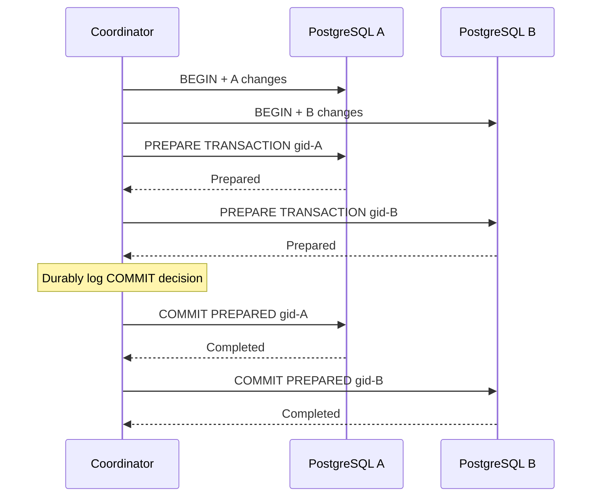
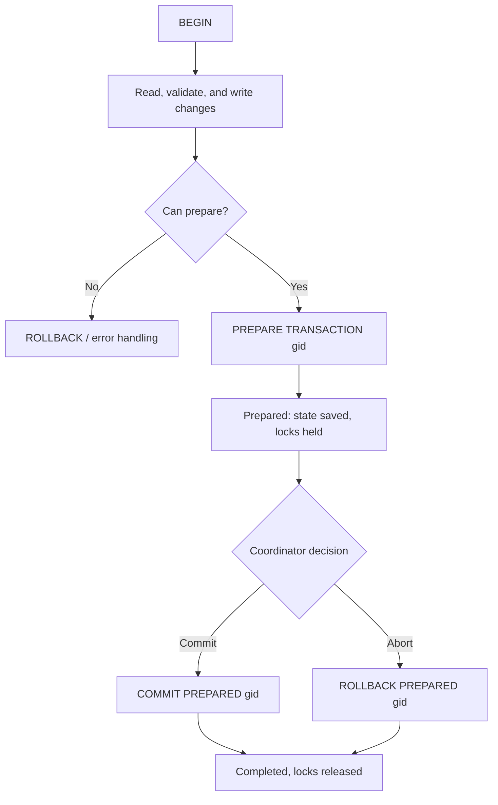

# Two-Phase Prepared Transactions and Operational Risks in PostgreSQL

A normal PostgreSQL transaction ends with `COMMIT` or `ROLLBACK`. However, in systems that need to coordinate **one business transaction across multiple databases or multiple transactional resources**, one side may already be ready to persist changes while the other is not. If each side commits independently, a network failure or crash creates the risk that **one side commits while the other rolls back**.

PostgreSQL supports **prepared transactions** as its participant mechanism for the **two-phase commit (2PC)** protocol. A participant can confirm:

> "I have durably recorded the transaction state and am ready to follow a commit or rollback decision later; I have not yet published the changes as committed data."

This is performed with:

```sql
BEGIN;
-- INSERT / UPDATE / DELETE statements for a transaction branch.
PREPARE TRANSACTION 'branch-global-id';
```

Once a transaction is prepared, **it no longer belongs to the original connection session as a regular open transaction**. A valid session, connected to the right database with sufficient privileges, can complete it using one of two commands:

```sql
COMMIT PREPARED 'branch-global-id';
```

or:

```sql
ROLLBACK PREPARED 'branch-global-id';
```

This capability is very useful for a **transaction coordinator** outside PostgreSQL. However, prepared transactions **hold locks and resources until a final decision is executed**; they can persist even after the client disconnects or PostgreSQL restarts. An abandoned prepared transaction can block updates, hinder VACUUM, cause table bloat, and make the system difficult to operate.

This lesson belongs to the **Transactions** chapter and explains the two-phase mechanism, PostgreSQL syntax, configuration limits, failure handling, state observability, and why you should **never use 2PC as a default replacement for regular transactions**.

## 1. The problem a single COMMIT cannot solve

Suppose a system has:

- **Database A** managing money accounts.
- **Database B** managing payment ledger records.
- A business flow requiring **debiting funds in A and crediting/recording the entry in B** as a single joint decision.

If the application does:

```text
A: BEGIN
A: UPDATE balance
A: COMMIT                   -- Succeeded

B: BEGIN
B: INSERT ledger_entry
B: COMMIT                   -- Network failure or server crash
```

then A may have committed while B did not. Two independent transactions **do not automatically become one atomic distributed transaction** simply because the application invokes them in the same request.

A single PostgreSQL transaction already provides atomicity **within one database and that transaction's scope**, yet you cannot use a `COMMIT` in database A to directly commit an independent transaction in database B.

### 1.1. Goal of 2PC

The 2PC protocol splits work into two phases:

1. **Prepare / voting:** each participant executes its intended changes and reports whether it can commit. Any agreeing participant must durably store its state so it can recover after a crash.
2. **Decision / completion:** once the coordinator decides commit/rollback according to protocol rules and durably records that decision, it instructs all participants to complete accordingly.

Model:



This is the **happy path**, not a guarantee that network operations will execute without failure. If the coordinator or a participant crashes, recovery mechanisms must resolve any branches left in the prepared state.

### 1.2. Two phases does not mean two COMMIT statements

It is not:

```text
Database A: COMMIT
Database B: COMMIT
```

but rather:

```text
Database A: PREPARE
Database B: PREPARE
Coordinator: global decision
Database A: COMMIT PREPARED
Database B: COMMIT PREPARED
```

The decisive difference lies in the **prepared-but-uncommitted state**, allowing a participant to keep waiting for the decision even after the originating session ends.

## 2. Regular transactions vs. prepared transactions

| Criterion | Regular transaction | Prepared transaction |
| --- | --- | --- |
| Start | `BEGIN` or implicit client-managed transaction | Also starts as a regular transaction |
| Completion | `COMMIT` / `ROLLBACK` | `PREPARE TRANSACTION`, then `COMMIT PREPARED` or `ROLLBACK PREPARED` |
| Original connection drops after prepare | Not applicable | Prepared state **still persists** |
| Are changes visible after the prepare step? | Only after COMMIT | **Not yet**; requires COMMIT PREPARED |
| Are locks still held while waiting? | Until transaction ends | **Yes**, until COMMIT/ROLLBACK PREPARED |
| Can it be completed from another connection? | Not in this way | Yes, with the right database/privileges |
| Configuration required | Standard transaction support | Requires `max_prepared_transactions` greater than 0 |
| Typical use case | Most application operations | Coordinating commits across multiple participants |
| When abandoned | Open connection/transaction can be handled via session management | **No original session left to kill**; must resolve the prepared GID |

Key point: `PREPARE TRANSACTION` **does not commit** the changes. A prepared transaction remains the coordinator's responsibility until a final decision is applied.

### 2.1. Lifecycle diagram



**A prepared transaction does not automatically expire after a default timeout just because the client left.** That is both its strength for crash recovery and a major operational risk without a sufficiently reliable coordinator.

## 3. Three core PostgreSQL commands

### 3.1. PREPARE TRANSACTION

```sql
PREPARE TRANSACTION 'gid';
```

A GID (*global transaction identifier*) is a string identifying the prepared transaction. It must be **unique among currently active prepared transactions in the PostgreSQL cluster** and has a length limit; in standard PostgreSQL builds, a GID must be **shorter than 200 bytes**.

Structured naming example:

```text
transfer:20261114:8af39:branch-A
transfer:20261114:8af39:branch-B
```

GIDs should derive from **a global business operation identifier and transaction branch**, not merely a username or collision-prone timestamp. Never embed passwords, tokens, or sensitive personal data in a GID because it appears in operational metadata.

`PREPARE TRANSACTION` is run **inside an active transaction**. It ends the current transaction from the session's perspective by transitioning it into the prepared state; afterward, the connection can no longer continue modifying that prepared branch.

### 3.2. COMMIT PREPARED

```sql
COMMIT PREPARED 'gid';
```

This command finalizes the prepared changes, releases locks, and completes the transaction branch. It is normally invoked by the coordinator after the coordinator **has durably recorded the global commit decision**.

Do not place `COMMIT PREPARED` inside another `BEGIN ... COMMIT` transaction block. It is a standalone prepared-transaction completion command and must execute outside an open transaction block.

### 3.3. ROLLBACK PREPARED

```sql
ROLLBACK PREPARED 'gid';
```

This command undoes the changes of the prepared branch and releases locks. It is normally used when the coordinator reaches an **abort decision**.

**Do not run `ROLLBACK PREPARED` solely because a transaction appears to have waited too long.** Another participant may already have committed under the global decision. Rolling back one branch after another branch committed leaves distributed business state inconsistent.

### 3.4. COMMIT PREPARED/ROLLBACK PREPARED require the exact context

Completion commands must be sent:

- To the **exact PostgreSQL database** holding the prepared transaction.
- With the **exact GID**, without adding or dropping a single character.
- From a role with proper privileges: in general, **the owner who prepared the transaction or a superuser** may complete it.
- **Outside any open transaction block**.

Avoid SQL-injection-prone string concatenation from user input when constructing GID commands; in applications, use a reliable transaction manager/driver and controlled GID generation.

## 4. PREPARE TRANSACTION is not a prepared SQL statement

The word "prepared" has two completely different meanings in PostgreSQL.

**Prepared statement**:

```sql
PREPARE find_account(integer) AS
SELECT account_id, balance
FROM tx2pc_lab.accounts
WHERE account_id = $1;

EXECUTE find_account(1);

DEALLOCATE find_account;
```

This is an **SQL statement prepared for repeated execution** within a session; it **does not keep a transaction in an uncommitted state**.

**Prepared transaction**:

```sql
BEGIN;
UPDATE tx2pc_lab.accounts
SET balance = balance + 10
WHERE account_id = 1;
PREPARE TRANSACTION 'demo-transaction-001';
```

This is a **transaction state** capable of waiting for a later commit/rollback decision.

| Term | Purpose | Related concepts |
| --- | --- | --- |
| `PREPARE statement_name AS ...` | Prepares a reusable statement/plan | `EXECUTE`, `DEALLOCATE`, `pg_prepared_statements` |
| JDBC `PreparedStatement` | Safely binds parameters and executes SQL from Java | Parameter binding |
| `PREPARE TRANSACTION 'gid'` | Prepares a transaction for the 2PC decision phase | `COMMIT PREPARED`, `ROLLBACK PREPARED`, `pg_prepared_xacts` |

Do not use `pg_prepared_statements` to monitor 2PC transactions. The view to inspect is **`pg_prepared_xacts`**.

## 5. Configuration prerequisite: max_prepared_transactions

PostgreSQL has the parameter:

```sql
SHOW max_prepared_transactions;
```

In typical configurations, the default value is **0**, meaning **prepared transactions are disabled**. Running `PREPARE TRANSACTION` while the feature is disabled will be rejected by the server.

To inspect additional status details:

```sql
SELECT
    name,
    setting,
    context,
    pending_restart
FROM pg_settings
WHERE name = 'max_prepared_transactions';
```

### 5.1. You cannot just SET it in a session and use it immediately

`max_prepared_transactions` is a **server-level parameter requiring a PostgreSQL restart to take effect**. It is not something you can temporarily enable with:

```sql
-- Not a way to enable the feature per session:
-- SET max_prepared_transactions = 10;
```

An administrator, in an appropriate environment, can set it via the configuration file or `ALTER SYSTEM` followed by a planned **restart**:

```sql
-- Administrative configuration syntax example;
-- DO NOT run in production just to practice.
-- ALTER SYSTEM SET max_prepared_transactions = 20;
```

After the server is restarted following operational procedures, verify again with `SHOW max_prepared_transactions`.

### 5.2. What value is appropriate?

Do not pick a number like 20 or 100 merely because of an example:

- You must estimate how many distributed transactions can be in the prepared state concurrently.
- Account for slow or temporarily disconnected participants.
- Prepared transactions consume server resources and can hold locks for extended periods.
- If you have no real 2PC coordinator, **leaving it at 0 is usually the safe choice**.
- In primary/standby setups, the standby setting must be **equal to or greater than the primary** per PostgreSQL requirements to support recovery/failover state.

A system handling hundreds of requests per second does not automatically need `max_prepared_transactions` scaled to request rate. This parameter relates to **concurrently prepared transactions**, not regular connection counts.

### 5.3. Prerequisites for the labs

The examples using `PREPARE TRANSACTION` below can only run if a test server has been **configured by an administrator to allow prepared transactions** with a value greater than 0. If you do not have permission to change configuration, **read and understand the SQL without executing the PREPARE steps**; never disable production safeguards just to try a rarely used feature.

## 6. Preparing the test database

Use **a dedicated learning database**; never create or prepare test transactions on a database serving live traffic. Demo steps can **hold locks after a session ends**, so always execute cleanup too.

### 6.1. Creating the schema and accounts table

```sql
CREATE SCHEMA IF NOT EXISTS tx2pc_lab;

CREATE TABLE tx2pc_lab.accounts (
    account_id INTEGER PRIMARY KEY,
    owner_name TEXT NOT NULL,
    balance NUMERIC(14, 2) NOT NULL
        CHECK (balance >= 0)
);
```

Balances use `NUMERIC` to illustrate exact decimal arithmetic. This is a **transaction-mechanics lab**, not a complete financial ledger design: real money systems also require double-entry accounting, idempotency checks, immutable ledgers, reconciliation, and additional business controls.

### 6.2. Loading data

Run only on the new table in the test database:

```sql
INSERT INTO tx2pc_lab.accounts
    (account_id, owner_name, balance)
VALUES
    (1, 'An', 500.00),
    (2, 'Bình', 100.00);
```

Verify:

```sql
SELECT
    account_id,
    owner_name,
    balance
FROM tx2pc_lab.accounts
ORDER BY account_id;
```

Initial result:

| account_id | owner_name | balance |
| ---: | --- | ---: |
| 1 | An | 500.00 |
| 2 | Bình | 100.00 |

Total = **600.00**. In the transfer-80 example, total balance must remain unchanged. The rule "neither create nor destroy money" is illustrated by two `UPDATE` statements **inside the same PostgreSQL transaction**.

### 6.3. Avoid reusing an existing GID

Before running the demo, check:

```sql
SELECT
    gid,
    owner,
    database,
    prepared
FROM pg_prepared_xacts
WHERE gid LIKE 'course222:%'
ORDER BY prepared;
```

If a matching GID is already waiting, **do not rerun the demo with that GID** and do not arbitrarily roll back an unknown transaction. Rows in this view show only transactions **currently in the prepared state**, not the full history of committed or rolled-back transactions.

## 7. Single-branch practice: PREPARE then ROLLBACK PREPARED

First, let us learn the **prepared transaction lifecycle** on one database. This is not a full distributed 2PC example; the goal is observing state at a single participant.

### 7.1. Step 1 — BEGIN and updates

```sql
BEGIN;

UPDATE tx2pc_lab.accounts
SET balance = balance - 80
WHERE account_id = 1
  AND balance >= 80
RETURNING account_id, balance;

UPDATE tx2pc_lab.accounts
SET balance = balance + 80
WHERE account_id = 2
RETURNING account_id, balance;
```

When all conditions hold, the two `UPDATE` statements return respectively:

| account_id | balance after UPDATE, before prepare |
| ---: | ---: |
| 1 | 420.00 |
| 2 | 180.00 |

**Important:** the example assumes each `UPDATE` affects **exactly one row**. If the first `UPDATE` returns no row due to insufficient funds or a missing account, you must **ROLLBACK**, never proceed to credit account 2 and prepare. A production application must check affected row counts programmatically and abort the transaction if any condition fails.

### 7.2. Step 2 — Transitioning the transaction to prepared

In the **same session holding the transaction from Step 1**:

```sql
PREPARE TRANSACTION 'course222:local:abort:001';
```

At this point the transaction enters the **prepared** state. The two new balances are **not yet committed**, yet PostgreSQL has durably stored the transaction state for a later decision.

The connection that issued the command no longer needs to keep that transaction open. Any authorized session on the right database can complete the transaction via its GID.

### 7.3. Step 3 — Inspecting prepared transactions

```sql
SELECT
    gid,
    transaction,
    prepared,
    owner,
    database
FROM pg_prepared_xacts
WHERE gid = 'course222:local:abort:001';
```

Expect **one row**, showing:

- `gid`: the chosen identifier.
- `transaction`: internal transaction ID.
- `prepared`: timestamp when it entered the prepared state.
- `owner`: role that prepared the transaction.
- `database`: database containing this transaction.

In another session, ordinary `SELECT` statements taking a fresh snapshot before commit prepared still see the **unchanged data** (500.00 and 100.00), while write locks held by the transaction may force an `UPDATE` on the same row to wait.

### 7.4. Step 4 — Abort decision

Run **outside a transaction block**:

```sql
ROLLBACK PREPARED 'course222:local:abort:001';
```

Verify:

```sql
SELECT account_id, balance
FROM tx2pc_lab.accounts
ORDER BY account_id;

SELECT gid
FROM pg_prepared_xacts
WHERE gid = 'course222:local:abort:001';
```

Balances return to **500.00 / 100.00**. The GID no longer appears in the prepared list.

**If you run `ROLLBACK PREPARED` with a nonexistent GID**, PostgreSQL raises an error; never blindly infer that the transaction "must have rolled back" solely from the absence of the GID.

## 8. Single-branch practice: PREPARE then COMMIT PREPARED

The next example uses a **different GID** to simulate a commit decision.

### 8.1. Step 1 — Updating balances

```sql
BEGIN;

UPDATE tx2pc_lab.accounts
SET balance = balance - 80
WHERE account_id = 1
  AND balance >= 80
RETURNING account_id, balance;

UPDATE tx2pc_lab.accounts
SET balance = balance + 80
WHERE account_id = 2
RETURNING account_id, balance;

PREPARE TRANSACTION 'course222:local:commit:002';
```

Only run `PREPARE TRANSACTION` when **both UPDATEs affect exactly one row**. If either fails or affects 0 rows, run `ROLLBACK` on the still-open transaction and handle the error.

### 8.2. Step 2 — Finalizing the transaction

Run outside a transaction block:

```sql
COMMIT PREPARED 'course222:local:commit:002';
```

### 8.3. Step 3 — Checking final balances

```sql
SELECT
    account_id,
    balance
FROM tx2pc_lab.accounts
ORDER BY account_id;

SELECT SUM(balance) AS total_balance
FROM tx2pc_lab.accounts;
```

Result:

| account_id | balance after commit |
| ---: | ---: |
| 1 | 420.00 |
| 2 | 180.00 |

`total_balance = 600.00`, no money lost or created in the example.

### 8.4. How to reset the demo?

Once committed, you can start a new transaction transferring 80 back from Bình to An, though that is a **new compensating operation**, not a `ROLLBACK PREPARED` of the completed GID.

In a pure test database, if you want to restore initial values:

```sql
-- ONLY for resetting classroom data in schema tx2pc_lab
-- and when no related prepared transaction remains.
UPDATE tx2pc_lab.accounts
SET balance = CASE account_id
    WHEN 1 THEN 500.00
    WHEN 2 THEN 100.00
END
WHERE account_id IN (1, 2);
```

Never apply this style of balance overwrite to real financial data; real ledgers require compensating entries, auditing, and accounting workflows.

## 9. Stricter check: verifying affected row counts before preparing

In real applications, you should not rely on an operator visually checking two `RETURNING` results. A PL/pgSQL example inside a test transaction can **raise an error if any target row is missing**:

```sql
BEGIN;

DO $body$
DECLARE
    updated_rows INTEGER;
BEGIN
    UPDATE tx2pc_lab.accounts
    SET balance = balance - 80
    WHERE account_id = 1
      AND balance >= 80;

    GET DIAGNOSTICS updated_rows = ROW_COUNT;
    IF updated_rows <> 1 THEN
        RAISE EXCEPTION
            'Cannot debit source account: expected 1 row, got %',
            updated_rows;
    END IF;

    UPDATE tx2pc_lab.accounts
    SET balance = balance + 80
    WHERE account_id = 2;

    GET DIAGNOSTICS updated_rows = ROW_COUNT;
    IF updated_rows <> 1 THEN
        RAISE EXCEPTION
            'Cannot credit target account: expected 1 row, got %',
            updated_rows;
    END IF;
END;
$body$;

-- Only call PREPARE if DO completed successfully.
PREPARE TRANSACTION 'course222:checked:003';
```

Then immediately finish in one of the two directions:

```sql
-- Choose ONE direction per coordinator decision:
ROLLBACK PREPARED 'course222:checked:003';

-- OR in another demo run, with an appropriate GID:
-- COMMIT PREPARED 'course222:checked:003';
```

If `DO` throws an exception, the regular transaction is already in the failed state and cannot prepare; run `ROLLBACK`. Having **sufficient funds, both accounts present, and exact affected row counts** are business preconditions that must be verified before the prepare phase.

**Note:** the snippet above only enforces correctness within **one database**. Achieving 2PC across two databases also requires a durable coordinator, as shown next.

## 10. Two databases and a coordinator: the full 2PC flow

Suppose there are **PostgreSQL A** and **PostgreSQL B**, each with its own appropriate schema/tables. The coordinator manages one global operation:

```text
global_operation_id = payout-2026-11-14-0007
branch A GID        = payout-2026-11-14-0007:A
branch B GID        = payout-2026-11-14-0007:B
```

Each GID identifies **one participant's transaction branch**. Avoid reusing one GID across two branches on **the same PostgreSQL cluster**; GIDs must be unique among prepared transactions currently active in the cluster.

### 10.1. Phase 1: each participant executes and prepares

**Connection to database A:**

```sql
BEGIN;

-- Changes belonging to database A and fully validated.
UPDATE tx2pc_lab.accounts
SET balance = balance - 80
WHERE account_id = 1
  AND balance >= 80;

-- Coordinator must verify UPDATE affected exactly one row.
PREPARE TRANSACTION 'payout-2026-11-14-0007:A';
```

**Connection to database B:**

```sql
BEGIN;

-- Changes belonging to database B, using target account
-- per B's data and business rules.
UPDATE tx2pc_lab.accounts
SET balance = balance + 80
WHERE account_id = 2;

-- Coordinator must verify UPDATE affected exactly one row.
PREPARE TRANSACTION 'payout-2026-11-14-0007:B';
```

These two SQL snippets assume schema `tx2pc_lab.accounts` exists in **both databases** with balances/accounts initialized appropriately. They illustrate **running on two separate connections**, not a single sequential script against one database. In real deployments, the coordinator must verify permissions, `UPDATE` row counts, and business balancing rules.

### 10.2. If both prepare successfully

The coordinator writes the **global COMMIT decision to durable storage** before dispatching completion commands. Conceptual log record:

```text
operation_id: payout-2026-11-14-0007
participants:
  - database: A
    gid: payout-2026-11-14-0007:A
    prepared: true
  - database: B
    gid: payout-2026-11-14-0007:B
    prepared: true
decision: COMMIT
decision_durable: true
```

Then:

**On database A:**

```sql
COMMIT PREPARED 'payout-2026-11-14-0007:A';
```

**On database B:**

```sql
COMMIT PREPARED 'payout-2026-11-14-0007:B';
```

While those two commands are in flight over the network, A may already be committed while B is still prepared. Thus 2PC does not create an **instantaneous global observation point** for independent readers; it is a protocol to drive participants toward the **same commit/abort outcome** and allow recovering pending states upon failure.

### 10.3. If one participant fails to prepare

For example, B reports a balance check error or storage error. The coordinator decides **ABORT**:

- For branch A already prepared: send `ROLLBACK PREPARED` to A.
- For transaction B not yet prepared but open: send `ROLLBACK` to B, or let the transaction manager abort according to its actual state.
- Record completion/abort status for recovery tracking.

**Never** send `COMMIT PREPARED` to A just because A prepared successfully. One branch's result does not determine the global outcome.

### 10.4. A coordinator is mandatory

PostgreSQL provides **participant commands**. It **does not automatically discover every transaction across all databases and choose a global outcome on its own**.

The coordinator must manage:

1. The participant list and each branch's GID.
2. Prepare outcomes or Vote-No responses.
3. The COMMIT/ABORT decision.
4. A **durable decision log** for crash recovery.
5. Dispatching completion commands and retrying based on reconciled state.
6. Monitoring unresolved branches.

Calling `PREPARE TRANSACTION` directly from an application without a durable coordinator introduces the risk of **indefinitely stranded transactions** with nowhere authoritative to decide how to resolve them.

## 11. 2PC is a blocking protocol: what happens if the coordinator disappears?

Suppose both A and B have prepared:

```text
A: prepared, holding locks
B: prepared, holding locks
Coordinator: disconnected / crashed
```

Participant databases **cannot independently determine** all conditions and the final decision of the distributed transaction, so they keep the prepared state waiting for recovery.

This is the classic **blocking** characteristic of 2PC. "Wait a few seconds and roll back" is not always right: the coordinator may have already logged the commit decision and committed one branch before losing connectivity.

### 11.1. Prepared does not mean business success

A successfully prepared branch means:

- PostgreSQL accepted placing that branch into a state that can be completed later.
- The branch's changes are **not yet committed**.
- Locks and certain resources remain tied to that transaction.

It **does not confirm** that the business operation has committed across all systems. Even when both databases reply "prepared," the coordinator might not yet have delivered the commit decision to every side.

### 11.2. Why not auto-rollback every expired prepared transaction?

Suppose:

1. The coordinator durably logs the **COMMIT** decision.
2. A executes `COMMIT PREPARED` successfully.
3. The network drops before B receives `COMMIT PREPARED`.
4. B stays visible in `pg_prepared_xacts` for some time.

If a cleanup job automatically runs `ROLLBACK PREPARED` on B simply because "the GID is old," A has committed while B rolled back. That cleanup job **violates the global decision**.

The right action is reading the coordinator's state and proceeding with **COMMIT PREPARED** on B if the durable log shows COMMIT.

## 12. Failure scenarios and recovery table

| Failure | Possible state | Recovery approach |
| --- | --- | --- |
| Participant fails before PREPARE | Normal uncommitted transaction, may auto-abort | Coordinator decides abort, rolls back remaining open/prepared branches |
| Participant disconnects after PREPARE | GID stays in `pg_prepared_xacts` | Coordinator reconnects to COMMIT/ROLLBACK PREPARED per decision |
| PostgreSQL restarts after PREPARE | Prepared transaction is recovered by PostgreSQL | Inspect `pg_prepared_xacts` and apply the decision |
| Coordinator crashes before logging COMMIT | Prepared branches may remain | Recover durable log, check states, decide per protocol |
| Coordinator crashes after logging COMMIT, before reaching all participants | Some branches committed, others still prepared | Dispatch/retry COMMIT PREPARED for unfinished branches |
| Client times out after sending COMMIT PREPARED | Unknown whether server committed | Reconcile GID, coordinator log, and business evidence; do not guess |
| GID absent from pg_prepared_xacts | May have committed, rolled back, or never prepared | Never treat missing GID as proof of final outcome |
| Prepared transaction holds locks too long | Other sessions wait, possible bloat | Investigate owner/GID/coordinator, resolve based on verified decision |
| Exceeding max_prepared_transactions | New PREPAREs are rejected | Resolve legitimate prepared GIDs, review concurrency and configuration |
| Coordinator log unreachable | No trusted global decision available | Escalate operations, restore log/source of truth; do not drop GIDs arbitrarily |

**There is no universal "roll back on network error" rule valid at every moment.** Before the global decision is durably logged, abort may be appropriate; after COMMIT is logged and one branch commits, rolling back another branch creates divergence that regular rollback commands cannot undo.

## 13. Durability and recovery across PostgreSQL restarts

A prepared transaction persists so a database can **recover its obligation to complete** after a crash.

In essence:

1. PostgreSQL writes the prepared-state metadata via its storage and WAL mechanisms.
2. When the original backend closes its connection after PREPARE, that state persists.
3. If the server restarts, PostgreSQL restores unfinished prepared transactions.
4. Any authorized session can inspect them and run `COMMIT PREPARED` or `ROLLBACK PREPARED`.

Example post-restart check:

```sql
SELECT
    gid,
    database,
    owner,
    prepared
FROM pg_prepared_xacts
ORDER BY prepared;
```

**Never restart PostgreSQL as a way to "clear stuck transactions."** For prepared transactions, crash recovery is specifically designed to **preserve them** so the coordinator's decision can still be honored.

### 13.1. Prepared transactions are not data backups

They do not replace:

- Backups and PITR.
- Replication/HA.
- Audit policies.
- The transaction coordinator's durable log.
- Business ledgers and reconciliation mechanisms.

If a cluster suffers data loss or restores to a point incompatible with the coordinator's state, distributed transaction recovery requires special handling; never assume the entire system is consistent merely by inspecting leftover GIDs on one side.

## 14. Observing with pg_prepared_xacts

Primary operational view:

```sql
SELECT
    gid,
    transaction,
    prepared,
    owner,
    database
FROM pg_prepared_xacts
ORDER BY prepared;
```

Key columns:

| Column | Content |
| --- | --- |
| `gid` | Global identifier of the prepared transaction branch |
| `transaction` | PostgreSQL transaction ID |
| `prepared` | Timestamp when the transaction was prepared |
| `owner` | Role owning the transaction |
| `database` | Database in which the transaction was prepared |

This view shows transactions **currently in the prepared state**, not an audit history of completed transactions.

### 14.1. Finding long-lived GIDs

```sql
SELECT
    database,
    owner,
    gid,
    prepared,
    now() - prepared AS prepared_age
FROM pg_prepared_xacts
ORDER BY prepared;
```

`prepared_age` shows how long the transaction has remained prepared. Compare it against **the normal coordination window of the protocol**. A system normally completing 2PC in under a few seconds should not have hours-old GIDs without explanation.

Still, **old age is a signal to investigate, not a license to roll back automatically**.

### 14.2. Filtering by database and GID

```sql
SELECT
    gid,
    owner,
    database,
    prepared
FROM pg_prepared_xacts
WHERE database = current_database()
  AND gid LIKE 'course222:%'
ORDER BY prepared;
```

Filtering by database lowers the risk of confusing a branch in another database. In real recovery, always cross-check with the coordinator log and business operation ID.

### 14.3. Do not use pg_prepared_xacts to prove a commit happened

A GID missing from the view could mean:

- `COMMIT PREPARED` already succeeded.
- `ROLLBACK PREPARED` already succeeded.
- `PREPARE` never succeeded.
- The transaction lives in another database/cluster.
- There is a synchronization lag or the observer queried the wrong environment.

To know the final outcome, you need **the coordinator's durable history and business state evidence**, not just a query checking currently pending transactions.

## 15. Locks: a prepared transaction can block the entire system

Before PREPARE, a transaction modifying rows acquires the necessary locks. **After PREPARE, those locks do not vanish** simply because the original backend returned its connection to the pool.

Example:

```sql
BEGIN;

UPDATE tx2pc_lab.accounts
SET balance = balance - 80
WHERE account_id = 1
  AND balance >= 80;

PREPARE TRANSACTION 'course222:lock-demo:004';
```

While this GID remains prepared:

- Another session attempting to `UPDATE` the same account 1 row can **wait on locks**.
- A DDL statement like `ALTER TABLE tx2pc_lab.accounts ...` may require strong table locks and **get blocked**.
- Ordinary `SELECT` queries can still read **the previously committed version** via MVCC, not the uncommitted balance inside the prepared transaction.
- Locks are released only upon running `COMMIT PREPARED` or `ROLLBACK PREPARED`, not when closing the original connection.

**Finish the demo immediately** from an authorized session:

```sql
ROLLBACK PREPARED 'course222:lock-demo:004';
```

Do not leave demo GIDs in the prepared state to "test how long until they expire"; they may not expire automatically.

### 15.1. Why doesn't pg_terminate_backend solve it?

A prepared transaction is no longer tied to a regular request-executing backend. It can hold locks with **no originating session PID to terminate**.

Commands like:

```sql
-- Not a general fix for prepared transactions:
-- SELECT pg_terminate_backend(<old_pid>);
```

do not replace `COMMIT PREPARED`/`ROLLBACK PREPARED`. Terminating a waiting backend stops that waiting request, yet **leaves the lock-holding prepared GID untouched**.

### 15.2. Inspecting sessions waiting on locks

With appropriate monitoring privileges:

```sql
SELECT
    a.pid,
    a.datname,
    a.state,
    a.wait_event_type,
    a.wait_event,
    pg_blocking_pids(a.pid) AS blocking_pids,
    a.query
FROM pg_stat_activity AS a
WHERE a.wait_event_type = 'Lock'
ORDER BY a.datname, a.pid;
```

When a prepared transaction is the blocker, monitoring tools or functions may represent the blocker **without a normal live backend PID**; in PostgreSQL, `pg_blocking_pids` can return **0** to represent a prepared transaction as the blocker.

To inspect locks not attached to a backend PID:

```sql
SELECT
    locktype,
    relation::regclass AS relation_name,
    transactionid,
    mode,
    granted
FROM pg_locks
WHERE pid IS NULL
ORDER BY locktype, relation::text, mode;
```

`pg_locks.pid IS NULL` rows help investigate locks held by prepared transactions, though you **cannot blindly assume every NULL-PID row belongs to one specific GID**. Accurate mapping requires correlating transaction ID/GID and relevant catalog/lock metadata.

### 15.3. Does lock_timeout solve it?

A blocked application can set:

```sql
BEGIN;
SET LOCAL lock_timeout = '3s';
UPDATE tx2pc_lab.accounts
SET balance = balance + 1
WHERE account_id = 1;
ROLLBACK;
```

If the lock cannot be acquired within the deadline, the statement raises a timeout error. That prevents **waiting forever on the client side**, but it **does not release the prepared transaction** holding the lock.

Never keep raising timeouts endlessly as an operational fix. Resolve the GID according to its valid global decision.

## 16. MVCC, VACUUM, and bloat risks

Prepared transactions do more than cause lock waits. Because they hold an unfinished transaction state, they can **pin old transaction horizons**, forcing PostgreSQL to preserve row versions that could otherwise have been cleaned up.

An overly long-lived prepared transaction can lead to:

- **Dead tuples** not being reclaimed as expected.
- Growing table and index size (*bloat*).
- VACUUM/autovacuum unable to remove versions the system must still preserve.
- Transaction ID pressure and anti-wraparound activity in severe cases.
- DDL, maintenance, and certain replication/backup operations impacted by locks or old transaction state.

Not every prepared transaction causes the same degree of bloat. Impact depends on the write workload, how long the state is held, transaction age, write rate on affected tables, and activity from other sessions.

### 16.1. Why can't VACUUM just clean it up?

`VACUUM` cannot remove row versions PostgreSQL must still preserve because an active snapshot/transaction horizon remains open. If a prepared GID has been stuck for hours or days, you must **resolve the GID** per the coordinator's decision.

`VACUUM FULL` is not a cheap or safe cure either: it takes heavy locks, can itself be blocked, and generates heavy I/O. Never substitute forced maintenance commands in production for eliminating the source pinning the transaction horizon.

### 16.2. Compounding dual risk

```text
Abandoned prepared transaction
    |
    +--> Holds locks: UPDATE/DDL/maintenance blocked
    |
    +--> Pins transaction horizon: VACUUM cannot reclaim old versions
                                   -> bloat / higher operational cost
```

Hence, the question "is just one prepared transaction worth worrying about?" must be answered using **age, operation type, held locks, and system write load**, not just the GID count.

## 17. Resource limits and risking prepared-transaction slot exhaustion

`max_prepared_transactions` bounds the maximum number of concurrent prepared transactions in a PostgreSQL instance. When that limit is reached:

- New `PREPARE TRANSACTION` calls **fail**.
- The coordinator must handle the unprepared branch and abort per protocol.
- If old GIDs are still holding locks, raising the limit endlessly will not fix the underlying cause.
- 2PC-dependent business flows may fail to complete normally until the incident is resolved.

### 17.1. Monitoring usage

```sql
SELECT COUNT(*) AS prepared_count
FROM pg_prepared_xacts;

SHOW max_prepared_transactions;
```

A system with max 50 and 49 multi-day stale prepared transactions carries a completely different operational risk from one with 49 normal prepared transactions lasting a few milliseconds each.

### 17.2. Do not use prepared transactions as a work queue

An anti-pattern:

```text
BEGIN
UPDATE inventory
PREPARE TRANSACTION 'order-123'
Wait 30 minutes for user payment
COMMIT PREPARED
```

During those 30 minutes, the transaction holds inventory locks and resources. Growing numbers of pending orders will quickly stall the database.

Normally you should use **time-bounded data-level reservations**, outbox patterns, or business workflows with short committed state transitions, rather than abusing the prepared state as an "order hold" awaiting user input.

**2PC fits brief commit-coordination windows**, not multi-hour business state persistence.

## 18. Restrictions inside a prepared transaction

Not every PostgreSQL session feature can safely transition into a prepared transaction.

Notable examples:

- Operations involving **temporary tables or temporary namespaces** face restrictions because temporary objects are session-bound.
- Operations like `LISTEN`, `UNLISTEN`, and `NOTIFY` are incompatible with preparing transactions in cases where PostgreSQL rejects preparing them.
- Session-scoped objects or state such as cursors and advisory locks require reviewing specific restrictions.
- External side effects outside the database—such as HTTP requests, sending emails, or writing external files—are **not rolled back by PostgreSQL** just because the DB transaction rolls back.

Because exact restrictions can vary by PostgreSQL version and operation type, check documentation for your running version and test specific operations in an equivalent environment before placing a workload under 2PC.

### 18.1. Do not trigger external side effects during the prepare phase

Suppose a trigger or service sends a "payment succeeded" email immediately upon updating a row:

```text
UPDATE order status
    -> send external email
PREPARE TRANSACTION
ROLLBACK PREPARED
```

The sent email **cannot be unsent** when the DB rolls back. That is an architectural flaw even when all database participants strictly follow 2PC.

A generally better approach is a **transactional outbox**: write the intended event into a table within the same DB transaction, and have a worker publish events only after commit. Note that an outbox requires idempotency and consumer deduplication; it does not magically turn external services into 2PC participants.

### 18.2. Keep atomicity within the right boundary

2PC only enforces its protocol guarantees across **resource managers that actually participate in 2PC** under a proper failure-handling coordinator. An email server, HTTP API, or payment gateway lacking compatible protocol support does not automatically become a transactional participant.

## 19. Access control and GID protection

Prepared transactions are powerful because one session can **commit or roll back changes prepared by a different session**.

### 19.1. Privilege principles

To complete a prepared transaction, a role generally must be **the role that prepared it or a superuser**. Having `SELECT` or `UPDATE` privileges on a table does not implicitly grant permission to commit another role's prepared transaction.

In distributed applications:

- The coordinator or adapter runs under a dedicated, least-privilege role.
- GIDs are generated from controlled transaction identifiers.
- Never accept arbitrary GID strings from public internet requests for execution.
- Maintain audit trails of decisions, actors, timestamps, and branch outcomes.
- Manual intervention requires approval commensurate with operational risk.

### 19.2. Do not confuse inspection privileges with completion privileges

A user may be able to read `pg_prepared_xacts` for monitoring yet **lack permission** to run `COMMIT PREPARED` or `ROLLBACK PREPARED` on a GID created by another role.

When manual recovery is needed, use an authorized administrative role/workflow; never broaden privileges excessively or run all application requests as superuser just to bypass permission errors.

## 20. Idempotency and handling uncertain responses

Imagine a client sends:

```sql
COMMIT PREPARED 'payout-2026-11-14-0007:B';
```

and loses connectivity **before receiving the response**.

Two possibilities:

1. The server **did not process** the command yet; the GID is still prepared.
2. The server **committed successfully**, yet the response was lost; the GID is no longer prepared.

The client cannot deduce the outcome from the network error alone. If it retries after the GID already completed, PostgreSQL may report **transaction with identifier does not exist**. That error **is not sufficient proof** that the previous attempt committed; the GID could also have rolled back or never been prepared.

### 20.1. Role of the coordinator log

The coordinator should record:

```text
global_id
participant_id
gid
prepare_result
durable_global_decision
completion_attempts
completion_evidence
last_error
updated_at
```

During recovery:

- Look up the durably recorded global decision.
- Check whether the participant is still prepared or already finished.
- Retry **the same decision**; never flip COMMIT into ROLLBACK because of a timeout.
- Cross-check business state and audit trails when the GID is absent.
- Mark complete only when sufficient evidence exists across participants.

### 20.2. Business-level idempotency is still required

Suppose a user resubmits a payment request after an HTTP timeout. Even if the previous 2PC transaction committed, a fresh HTTP request might generate a **new global transaction ID** and execute the operation a second time.

Therefore, applications still need mechanisms such as:

```sql
-- Example dedicated schema table for application-level idempotency.
CREATE TABLE tx2pc_lab.processed_operations (
    operation_id TEXT PRIMARY KEY,
    processed_at TIMESTAMPTZ NOT NULL DEFAULT now()
);
```

When handling the same `operation_id`, the system must enforce a clear contract **not to re-execute business side effects**. Simply adding a `UNIQUE` table is not enough: you must design how transactions check, lock, and record outcomes/idempotency responses consistently.

**2PC guarantees agreement among participating branches; it does not stop a user from submitting a duplicate business request.**

## 21. Manual recovery procedure for a stuck prepared GID

This operational procedure demands caution because consequences can span multiple systems.

### Step 1 — Identify the GID and environment

```sql
SELECT
    gid,
    database,
    owner,
    prepared,
    now() - prepared AS age
FROM pg_prepared_xacts
ORDER BY prepared;
```

Record the cluster, database, role, GID, age, incident/ticket ID, and associated applications.

### Step 2 — Assess lock impact

Inspect waiting sessions:

```sql
SELECT
    pid,
    datname,
    wait_event_type,
    wait_event,
    pg_blocking_pids(pid) AS blockers,
    query
FROM pg_stat_activity
WHERE wait_event_type = 'Lock';
```

Look beyond waiting sessions: also check prepared transaction ages and signs of autovacuum lag, bloat, or transaction-horizon pressure.

### Step 3 — Find the owner/coordinator and durable decision

Inspect:

- Transaction manager logs.
- The global transaction record and list of branches.
- Which branches committed and which remain prepared.
- Whether a COMMIT/ABORT decision was durably logged.
- Any network outages, restarts, failovers, or configuration changes.

If the decision cannot be retrieved, **do not guess an outcome intuitively**. Escalate to data/application owners and restore the coordinator's source of truth.

### Step 4 — Complete according to the verified decision

When **COMMIT** is confirmed:

```sql
-- Syntax illustration; substitute the verified GID.
COMMIT PREPARED 'verified-gid';
```

When **ABORT** is confirmed:

```sql
ROLLBACK PREPARED 'verified-gid';
```

**Never execute both commands** for the same transaction; apply the single outcome matching the global transaction decision.

### Step 5 — Post-resolution verification

```sql
SELECT gid
FROM pg_prepared_xacts
WHERE gid = 'verified-gid';
```

A completed GID disappears from the view. Still verify:

- Correctness of business data.
- Coordinator logs and statuses of sibling branches.
- Remaining lock-waiting sessions.
- VACUUM, WAL, replication, and latency health.

The absence of a GID **proves only that it is no longer prepared on the queried server**, not by itself that the entire distributed system is consistent.

## 22. Proactive monitoring and alerting

Any system intentionally using 2PC needs monitoring before the database stalls rather than checking `pg_prepared_xacts` only during outages.

### 22.1. Signals to monitor

| Signal | Why monitor it |
| --- | --- |
| Count of prepared transactions | Detect approaching `max_prepared_transactions` |
| Oldest prepared GID | Detect abandoned branches |
| Prepared age by application/owner/database | Pinpoint the problematic component |
| Waiting sessions and lock wait duration | Detect impact on live traffic |
| Coordinator completion retries/errors | Detect logged decisions failing to reach participants |
| WAL/storage/bloat/autovacuum | Detect transaction-horizon pressure |
| PREPARE failures | Detect configuration or slot exhaustion issues |
| Failover/replication status | Ensure prepared recovery works across HA events |

### 22.2. Basic dashboard SQL

```sql
SELECT
    database,
    owner,
    COUNT(*) AS prepared_count,
    MIN(prepared) AS oldest_prepared_at,
    MAX(now() - prepared) AS max_prepared_age
FROM pg_prepared_xacts
GROUP BY database, owner
ORDER BY max_prepared_age DESC NULLS LAST;
```

When no prepared transactions exist, the query returns **0 rows**, rather than returning a row with count 0 per database. Dashboards should handle that cleanly.

### 22.3. Avoid arbitrary SLA thresholds

A 30-second prepared GID might be normal across slow WAN links, yet far too long for a system expected to finish in milliseconds. Understand **normal prepare duration**, coordinator timeouts, and recovery SLAs.

Principled recommendations:

- Alert when GID age exceeds expected coordination latency.
- Page at higher severity when a GID causes long lock waits or nears the slot limit.
- Provide runbooks for verifying durable decisions.
- Separate **alerts requiring investigation** from **commit/rollback actions**.

Never automate "roll back any GID older than X minutes" unless you have verified proof that abort is the right decision for each transaction; age alone is insufficient proof.

## 23. Differences between atomicity, isolation, and instantaneous visibility

2PC is often introduced as a solution for **atomic commit** across multiple resource managers. However, it does not automatically provide every global transaction property at every layer.

### 23.1. Atomic commit does not mean all clients observe it simultaneously

Suppose the coordinator chose COMMIT:

```text
12:00:00.000  A receives COMMIT PREPARED
12:00:00.005  Reader on A sees new data
12:00:00.010  B is still prepared
12:00:00.030  B receives COMMIT PREPARED
12:00:00.035  Reader on B sees new data
```

Depending on delivery order and read timing, independent readers can observe the two sides at slightly different moments during **the completion phase**. 2PC guarantees that commit/abort decisions are **consistent and recoverable**, not a single global clock creating instantaneous cross-system snapshots.

### 23.2. Isolation levels must still be chosen properly

On each PostgreSQL database, `READ COMMITTED`, `REPEATABLE READ`, or `SERIALIZABLE` enforces its respective isolation rules. Simply enabling 2PC does not automatically:

- Upgrade transactions from `READ COMMITTED` to `SERIALIZABLE`.
- Validate cross-database business constraints automatically.
- Prevent another application from reading two databases at slightly different moments.

For example, when updating balances in A and ledger entries in B, ensure business invariants are enforced through proper locking, constraints, isolation, and coordination protocols. **2PC does not replace isolation and invariant design.**

### 23.3. Durability of the coordinator's decision

If the coordinator announces "COMMIT" while storing the decision only in RAM and then crashes, the system lacks any durable record telling it whether to send COMMIT or ROLLBACK to prepared branches.

Therefore, **the coordinator's durable log is a core component**, not an optional logging convenience. You also need log recovery procedures if the transaction manager host fails.

## 24. Comparing 2PC with alternative design patterns

Not every multi-service problem should use `PREPARE TRANSACTION`.

| Pattern | Characteristics | When to consider |
| --- | --- | --- |
| Single transaction in one PostgreSQL database | Simple atomicity and rollback within one resource | Tables can live in the same database |
| 2PC with durable coordinator | Coordinates commit/abort across 2PC-capable participants | Strict cross-resource atomic commit needed with reliable coordinator infrastructure |
| Transactional outbox | Writes data and outbox row in one DB transaction; worker publishes after commit | Event-driven flows needing zero lost events while accepting async delivery |
| Saga/workflow with compensation | Multiple local transactions with compensating steps on failure | Long-running business flows across services not supporting 2PC |
| Reservation with TTL | Reserves resources via committed state and expiration logic | Pending payments, bookings, multi-minute inventory holds |
| Batch reconciliation | Reconciles and repairs drift per policy | Integrating external providers without atomic 2PC support |

### 24.1. Transactional outbox is not 2PC

An outbox typically looks like:

```text
PostgreSQL transaction:
    UPDATE order
    INSERT outbox_event
    COMMIT

Worker:
    reads committed outbox
    publishes event
    retries on error

Consumer:
    processes idempotently
```

It eliminates dual-write atomic commits between DB and message broker, while introducing **eventual consistency**, retry/dedup logic, and delivery tracking.

### 24.2. Sagas are not distributed database rollbacks

Sagas use multiple local transactions:

```text
T1: create order -> commit
T2: reserve stock -> commit
T3: charge payment -> error
Compensation: release reservation, cancel order per rules
```

Compensation does not mean literally erasing every past side effect. Once emails are sent, goods shipped, or shipping fees recorded, controlled compensating business workflows are required.

### 24.3. When is 2PC worth the cost?

2PC can fit when:

- All participants **genuinely support the protocol** and run within an intentional architecture.
- Cross-resource atomicity outweighs the **blocking behavior and recovery complexity**.
- A durable transaction manager, logging, alerting, and runbooks are in place.
- Distributed transactions finish quickly and do not depend on multi-hour human input.

If most changes can reside inside **one PostgreSQL database**, a single regular transaction is usually far simpler and safer.

## 25. Java, JTA, and managing 2PC in applications

In Java applications, several distinct concepts are often confused:

- JDBC `Connection.setAutoCommit(false)`: begins a transaction on one connection.
- JDBC `commit()`/`rollback()`: finishes a regular transaction on that connection.
- JDBC `PreparedStatement`: parameterizes and executes SQL, **not 2PC**.
- XA/JTA transaction manager: coordinates multiple resource managers under the XA specification when drivers/datasources and runtime infrastructure provide full support.

Never write:

```java
dbA.commit();
dbB.commit();
```

and call it "two-phase commit." Two independent `commit()` calls leave a failure window between them.

### 25.1. Architecture with a transaction manager

```text
Business service
       |
       v
Transaction manager (durable decision log)
       |
       +-- XA resource PostgreSQL A
       |
       +-- XA resource PostgreSQL B
       |
       v
Prepare -> global decision -> completion/recovery
```

Applications must verify:

1. Whether the driver and `XADataSource` properly support the required XA flows.
2. How the transaction manager persists its log and recovers after restarts.
3. Whether the connection pool properly handles XA enlist/delist and timeouts.
4. How GIDs/XIDs map between the transaction manager and PostgreSQL.
5. `max_prepared_transactions`, DB privileges, and HA compatibility.
6. Whether any branch involves a non-XA system.

Never enable 2PC merely because a framework exposes an "XA" option: without proper coordination logs, recovery, and database settings, the setup can be worse than simple local transactions.

### 25.2. Interaction with connection pools

After `PREPARE TRANSACTION`, the prepared GID exists **independently of the original backend**. Returning the connection to the pool neither commits nor rolls back the transaction. Hence, ordinary pool health checks **do not clean up prepared transactions**.

The coordinator must track branch identifiers beyond connection lifetimes and open fresh connections to complete recovery when needed.

## 26. Common misconceptions and operational mistakes

| Misconception / mistake | Consequence | Correct understanding |
| --- | --- | --- |
| Thinking `PREPARE TRANSACTION` committed changes | Reporting success while data is unpublished | Requires `COMMIT PREPARED` |
| Confusing PREPARE transaction with prepared SQL statements | Broken monitoring and misconfiguration | Distinguish `PREPARE ... AS` vs. `PREPARE TRANSACTION` |
| Using 2PC for routine CRUD requests | Needless complexity and extra locking | Regular transactions suffice within one DB |
| Enabling 2PC without a durable coordinator | Orphaned GIDs after network drops/crashes | Needs durable decision log and recovery |
| Expecting disconnect to auto-rollback prepared work | Prepared GID remains alive | Must issue COMMIT/ROLLBACK PREPARED |
| Restarting PostgreSQL to clear stuck GIDs | GIDs are restored on restart | Investigate and apply the verified decision |
| Auto-rolling back expired GIDs | Can break globally committed operations | Never decide purely by age |
| Seeing empty `pg_prepared_xacts` and assuming committed | GID may have rolled back or never prepared | Verify logs and business state |
| Retrying `COMMIT PREPARED`, hitting "does not exist", assuming committed | Cannot distinguish commit from abort | Keep evidence and idempotent recovery |
| Reusing one GID across branches in the same cluster | Identifier collision | Unique GID per global operation + branch |
| Using old PID to terminate a prepared transaction | Does not clear lock-holding GID | Complete the prepared GID directly |
| Monitoring only max slots while ignoring age | Few GIDs still hold locks for days | Monitor age and lock waits |
| Raising `max_prepared_transactions` endlessly | Masks operational failure, wastes resources | Fix coordinator and bound limits properly |
| Assuming SELECTs see prepared changes | Wrong expectations about dirty reads | Visible only after COMMIT PREPARED |
| Thinking 2PC makes readers across DBs see commits simultaneously | Misread completion-window timing | Design global read consistency explicitly if needed |
| Assuming `SERIALIZABLE` gives you 2PC | No global coordinator | Isolation and atomic commit are separate problems |
| Sending email before prepare then rolling back | Email stays sent | Outbox / post-commit side-effect design |
| Holding prepared transactions while waiting hours for user payment | Locks, bloat, slot exhaustion | Business reservations/workflows |
| Ignoring standby settings | HA recovery/read errors | Keep primary/standby settings compatible |
| Checking only one branch's balance | Another branch may remain uncommitted | Reconcile all participants + logs |
| Running labs in production | Test GIDs can block traffic | Dedicated lab, roll back prepared immediately |
| Treating the transaction manager as optional | No source of truth on crash | Mandatory for real 2PC |

## 27. Safe 2PC design checklist

Whenever a team proposes using `PREPARE TRANSACTION`, clarify these points before implementation:

1. **Why is cross-resource atomic commit needed?** Could all changes live in one database instead?
2. **Do all participants genuinely support 2PC/XA?** Are there external APIs or non-rollbackable side effects?
3. **What acts as the coordinator?** Does it have a durable log, crash recovery, and failover?
4. **How are GIDs generated?** Unique, branch-scoped, free of secrets?
5. **When is the COMMIT decision durably logged?** Guaranteed before sending completion commands?
6. **What happens if one branch fails to prepare?** Is abort logic and cleanup complete?
7. **What if the coordinator crashes after one branch commits?** What component retries remaining prepared branches?
8. **What if the network times out after COMMIT PREPARED?** How is outcome verified without flipping decisions?
9. **How long can transactions remain prepared?** Are there age SLAs and alerts?
10. **What is the lock/MVCC/VACUUM impact?** Tested under realistic concurrency?
11. **How is PostgreSQL configured?** `max_prepared_transactions`, standby settings, and resource limits?
12. **Who has permission to run COMMIT/ROLLBACK PREPARED?** Dedicated role/service account and auditing?
13. **What enforces business idempotency?** Do HTTP retries avoid creating duplicate operations?
14. **What is the runbook for in-doubt transactions?** Who is authorized to decide, and what evidence suffices?
15. **Have crash/network-kill/restart/failover tests been run?** Tested both before prepare and after durable decision.
16. **How is it monitored post-deployment?** `pg_prepared_xacts`, age, locks, coordinator logs, replication.
17. **Is there a deployment rollback plan?** Avoid removing services while leaving orphaned prepared GIDs behind.

A successful deployment is not just executing `PREPARE TRANSACTION`; it is **cleanly resolving every prepared transaction whenever any component fails**.

## 28. PostgreSQL hands-on exercises

The early exercises use the `tx2pc_lab` schema created above on a dedicated database with `max_prepared_transactions > 0`. **Do not leave multiple exercises holding prepared GIDs simultaneously**; resolve each GID before moving to the next exercise.

1. **Concepts:** explain the difference between `COMMIT` and `PREPARE TRANSACTION`. Why is a prepared transaction not considered completed?
2. **Two phases:** draw an A/B coordinator sequence from `BEGIN` and `PREPARE` through durable decision and `COMMIT PREPARED`.
3. **Configuration:** run `SHOW max_prepared_transactions`. If it returns 0, why can't you enable prepared transactions simply by running `SET` in one session?
4. **Demo schema:** create `tx2pc_lab.accounts` and insert balances 500.00 and 100.00. Verify total 600.00.
5. **Preparing:** open `BEGIN`, update both balances to transfer 80, and call `PREPARE TRANSACTION` with a dedicated GID. What conditions should be checked before `PREPARE`?
6. **Observing:** use `pg_prepared_xacts` to locate the GID, owner, database, and prepare timestamp. Distinguish internal transaction ID from GID.
7. **Not committed yet:** from another session, `SELECT` the balances before `COMMIT PREPARED`. Why aren't the uncommitted changes visible?
8. **Abort:** run `ROLLBACK PREPARED` on your demo GID, verify balances return to initial values, and confirm the GID disappears.
9. **Commit:** using a fresh GID, prepare a transfer-80 transaction and execute `COMMIT PREPARED`. Verify balances 420.00/180.00.
10. **Duplicate error:** try reusing an already-active GID. Why cannot two prepared transactions share one GID in a cluster?
11. **Privileges:** sketch an application setup with a transaction-handling role and a maintenance role. Who can complete a prepared transaction under PostgreSQL rules?
12. **Statement vs. transaction:** contrast `PREPARE name AS SELECT ...` and `PREPARE TRANSACTION 'gid'` with two examples.
13. **Two sessions and locks:** in session A, prepare an `UPDATE` on account 1; in B, attempt to `UPDATE` the same row with a short `lock_timeout`. What does B observe?
14. **Dead backend:** after preparing, close session A. Query `pg_prepared_xacts` from a new session. Why is the GID still present?
15. **Simulated restart:** explain why a server restart does not drop a waiting prepared transaction. If testing is permitted in your lab, what must you do to clean up after restart?
16. **COMMIT PREPARED inside BEGIN:** explain why `COMMIT PREPARED` cannot be executed inside another transaction block.
17. **Missing GID:** if a GID is absent from `pg_prepared_xacts`, list at least three possible explanations and what evidence sources to check.
18. **Lost coordinator:** A and B are both prepared and the coordinator crashes. Why shouldn't they automatically roll back after a fixed timeout?
19. **Partial completion:** the coordinator logged COMMIT, A committed, and B is still prepared. Which decision must B follow?
20. **Network error after command:** the client sends `COMMIT PREPARED` and loses the response. Design safe verification steps.
21. **max_prepared_transactions:** if too many GIDs are waiting, describe the impact on new `PREPARE` attempts and how to find the root cause.
22. **pg_locks:** look for NULL-PID locks in the lab. Why can't every such row automatically be attributed to one GID without cross-checking?
23. **VACUUM:** explain how a long-lived prepared transaction can increase bloat even when no backend is actively running that transaction.
24. **Side effects:** if a trigger sends an email before `PREPARE` and the transaction later rolls back, why does the email still go out? Propose using an outbox instead.
25. **Idempotency:** a transfer request times out and the user retries it. Design `operation_id` and `UNIQUE` handling to avoid duplicate processing.
26. **Two databases:** design distinct GIDs for A and B derived from one global transaction ID and describe their state in the coordinator log.
27. **Abort phase:** B fails to prepare while A is already prepared. How must the coordinator resolve A?
28. **Isolation boundaries:** explain why enabling `SERIALIZABLE` on A does not automatically commit B under the same decision.
29. **Architecture comparison:** choose 2PC or saga for an order waiting 30 minutes for payment? Analyze lock duration.
30. **Outbox:** describe `UPDATE order` + `INSERT outbox` + `COMMIT`, followed by worker event dispatch. Why is this not a cross-DB atomic commit?
31. **Monitoring:** write a query reporting prepared GID count and oldest GID per database/owner; propose alerts grounded in normal system timings.
32. **Recovery runbook:** prepare a checklist covering GID lookup, coordinator decision, completed branches, privileges, command execution, and result verification.
33. **XA in Java:** distinguish JDBC `PreparedStatement`, local transactions, and an XA/JTA transaction manager. Why aren't two `connection.commit()` calls sufficient for cross-database atomic commit?
34. **HA:** why must standby configuration account for the primary's `max_prepared_transactions`, and how are prepared GIDs handled after failover?
35. **Crash matrix:** build a failure matrix at four checkpoints: before PREPARE, after one PREPARE, after two PREPAREs before the decision, and after durable COMMIT before all branches finish.
36. **Design review:** a team wants to set `max_prepared_transactions=1000` to work around stuck GIDs. Propose how to investigate the coordinator, GID ages, lock waits, and valid resolution workflows instead of simply bumping the cap.

## 29. Summary

Prepared transactions in PostgreSQL are a **participant mechanism** for two-phase commit, neither a variant of prepared SQL statements nor a tool to use for ordinary transactions.

```text
Phase 1: PREPARE
    BEGIN
    changes and precondition checks
    PREPARE TRANSACTION 'gid'
    -> transaction not yet committed
    -> state survives disconnects and restarts
    -> locks and resources remain held

Phase 2: DECISION + COMPLETION
    Coordinator durably logs decision
    COMMIT PREPARED 'gid'
         or
    ROLLBACK PREPARED 'gid'
    -> resolves state, releases locks
```

Key points to remember:

- **`PREPARE TRANSACTION` is not COMMIT.** A prepared GID represents unfinished work and responsibility.
- **2PC requires a coordinator with a durable decision log.** PostgreSQL does not automatically coordinate multiple databases or external services on its own.
- **Prepared transactions survive disconnects and restarts.** They continue holding locks, resources, and affecting VACUUM until resolved.
- **Never auto-rollback purely by age or timeout.** Decisions must come from the transaction coordinator and sibling participant states.
- **`pg_prepared_xacts` shows currently prepared state**, not complete proof of past commits or rollbacks.
- **`max_prepared_transactions` usually defaults to 0 and requires configuration plus restart to enable.** Do not turn it on in production without a real need and 2PC operational readiness.
- **Atomic commit differs from isolation and global read consistency.** 2PC does not replace invariant design, access control, idempotency, or handling external side effects.
- **A single regular transaction is far simpler whenever all changes fit in one PostgreSQL database.** For long-lived workflows or services lacking 2PC support, evaluate sagas, reservations, and transactional outboxes.

The most important operational rule: **never create a prepared state without a reliable mechanism to decide and complete it, even when applications, connections, or servers fail**. In distributed systems, failure recovery is the hardest part of two-phase prepared transactions.
