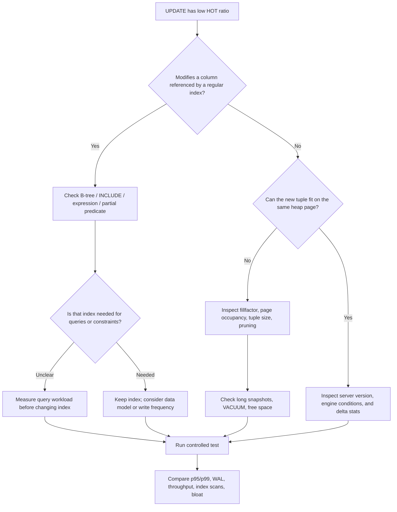

# HOT Updates and Conditions for Reducing Index Maintenance in PostgreSQL

A PostgreSQL `UPDATE` does not merely overwrite a few bytes inside an existing row. Under **Multi-Version Concurrency Control (MVCC)**, a normal update creates a **new tuple version** in the heap while keeping the old version long enough for active readers to continue seeing consistent data.

When a table has many indexes, creating a new row version can bring extra work: adding or maintaining index entries, writing WAL, increasing storage footprint, and generating additional I/O. However, PostgreSQL has a key optimization called **HOT — Heap-Only Tuple update**: under the right conditions, the new row version is placed on the exact same heap page and **does not require inserting new entries into non-summarizing indexes**.

Practical benefits:

- Reduces index-update work when a row is modified frequently.
- Reduces dead index entries needing cleanup and associated maintenance costs.
- Can reduce WAL volume, CPU usage, and I/O for update-heavy workloads.
- Makes repeated updates to unindexed columns much cheaper.
- Works together with pruning/`VACUUM` to reuse free space on heap pages.

Still, **not every `UPDATE` is HOT**. You must consider which columns change, what indexes exist, and how much free space remains on the heap page. A table with indexes that are completely sensible for read queries can still make HOT rare if one of those indexes references a constantly updated column.

This lesson belongs to the **MVCC** chapter of the *Database Engine Relational PostgreSQL* module. The goal is to understand HOT from mechanics to real-world measurement; choosing indexes, `fillfactor`, and update strategies without sacrificing data correctness. DDL and configuration commands are examples for a **lab database**, not for running directly in production.

## 1. Recap: UPDATE in MVCC Creates a New Version

Suppose a table has one row:

```text
id = 42
status = 'NEW'
note = 'created'
```

A transaction runs:

```sql
UPDATE orders
SET note = 'confirmed'
WHERE id = 42;
```

Under MVCC, PostgreSQL retains the old version and creates a new version:

```text
Heap before UPDATE
┌──────────────────────────────────────┐
│ Tuple A: id=42, status=NEW, note=... │
└──────────────────────────────────────┘

Heap after UPDATE (logical model)
┌──────────────────────────────────────┐
│ Tuple A: old version, marked updated │
├──────────────────────────────────────┤
│ Tuple B: new version of id=42        │
└──────────────────────────────────────┘
```

A transaction that started earlier can keep reading version A per its snapshot, while a new transaction after commit reads version B. That explains why PostgreSQL does not simply overwrite all old row data in place.

### 1.1. Two Cost Categories to Distinguish

An `UPDATE` can incur:

1. **Heap cost:** creating the new tuple, marking/updating old-version metadata, WAL, dirty pages, and cleaning up the old tuple once unneeded.
2. **Index cost:** if index pointers must point to the new tuple, PostgreSQL updates relevant index structures, potentially creating new index tuples and later needing to clean obsolete entries.

HOT primarily optimizes **index maintenance** by letting existing index entries point to a chain of heap versions on the same page.

HOT **does not eliminate MVCC**: a new tuple is still created, WAL is still generated, transactions still take locks, and old versions still need cleanup when safe.

## 2. HOT Stands for Heap-Only Tuple

HOT allows an `UPDATE` to store the new tuple version on **the same heap page** without needing corresponding new entries in non-summarizing indexes.

Example:

- `id` is a primary key with a B-tree index.
- `status` is in an index supporting filter queries.
- `last_seen_at` **is not in any index and is not referenced by any index expression or predicate**.

If only `last_seen_at` is updated and enough space exists on the heap page, PostgreSQL **has the opportunity** to perform a HOT update.

```sql
UPDATE account
SET last_seen_at = statement_timestamp()
WHERE account_id = 42;
```

If any condition fails, the `UPDATE` still succeeds, but follows the **non-HOT update** path with extra index overhead.

### 2.1. HOT Is Not an Explicit SQL Keyword

There is no SQL syntax like:

```sql
-- DOES NOT EXIST:
UPDATE account HOT SET ...;
```

HOT is an **internal storage-engine decision** based on schema, update pattern, and physical page state. SQL authors can improve the odds of HOT, yet there is no SQL keyword to "force HOT" on an `UPDATE`.

### 2.2. HOT Does Not Mean "In RAM Cache"

The word HOT here is an acronym—it **does not mean** the tuple is always in `shared_buffers`, incurs zero I/O, or lives in a "hot access tier."

A HOT update can still read/write heap pages, generate WAL, and experience disk latency when pages aren't cached or during checkpoints/`VACUUM`.

## 3. Two Core Conditions for an UPDATE to Be HOT

For normal indexes, two major conditions apply:

1. **No change in values of columns that non-summarizing indexes on the table depend on.** This covers index keys, `INCLUDE` columns, index expressions, and columns in partial index predicates.
2. **The new tuple version must fit on the same heap page as the old version.** PostgreSQL needs sufficient usable free space on that page.

Starting in PostgreSQL 16, rules for **summarizing indexes**—notably BRIN—allow certain `UPDATE`s to remain HOT even when modifying columns tracked only by those summarizing indexes. Summarizing indexes maintain their summary info in their own way.

These two conditions still sit alongside MVCC processing constraints, tuple state, and actual storage mechanics; thus we say **HOT can occur**, never guaranteeing that every "SQL-eligible" `UPDATE` becomes HOT.

### 3.1. Quick Decision Table

| Update Scenario | HOT Eligibility |
|---|---|
| Modifying a column no index depends on, enough space on same page | Can be HOT |
| Modifying a B-tree indexed column with an actual value change | Normally non-HOT |
| Modifying an `INCLUDE` column in a B-tree index | Normally non-HOT |
| Modifying a column used in an expression index | Can prevent HOT |
| Modifying a column used in a partial index predicate | Can prevent HOT |
| Modifying an unindexed column when the page is full | Non-HOT |
| Modifying a column covered only by a BRIN summarizing index, PostgreSQL 16+ | Can be HOT if other conditions hold |
| `INSERT`ing a new row | Not an `UPDATE`; HOT update rate does not apply |
| `DELETE`ing a row | Not a HOT update |
| No-op `UPDATE` still creating a tuple | Can still incur MVCC work; check actual conditions |

The deciding factor is **index dependencies on the modified columns**, not simply "whether the table has indexes."

## 4. Heap Pages, Tuples, and TIDs: The Foundation of HOT

PostgreSQL heaps are divided into fixed-size pages, **typically 8 KiB** in default builds. Each page contains:

- Page header.
- Line pointers (item identifiers).
- Tuples holding row data and MVCC metadata.
- Free space region usable for new tuples.
- Metadata needed to manage, prune, and read the page.

A tuple's location is represented by a **TID/CTID**, consisting of block number and item offset within the block.

```text
Heap relation
       │
       ├── Block 100
       │     ├── Item 1: tuple for id=10
       │     ├── Item 2: tuple for id=42 (old version)
       │     ├── Item 3: tuple for id=42 (new version)
       │     └── Free space
       │
       └── Block 101
             └── Other tuples
```

With HOT, the index pointer continues pointing to the **root** of the version chain on that same page. PostgreSQL follows the HOT chain and checks MVCC visibility to find the version appropriate for the reading snapshot.

### 4.1. CTID Is Not a Primary Key

```sql
SELECT ctid, *
FROM some_table
WHERE id = 42;
```

This is illustrative SQL because `some_table` has not been created in the lab. `ctid` is the **physical location of the current tuple version**; it can change after `UPDATE`, `VACUUM FULL`, or data reorganization.

Never store `ctid` as a long-term ID, never synchronize clients by `ctid`, and never replace a primary key with `ctid`. HOT uses TIDs internally to walk version chains, while application contracts should stick to logical keys.

## 5. How Does a HOT Chain Work?

A HOT chain links consecutive versions of the same row on a single heap page.

```text
                 B-tree index
              key: account_id=42
                       │
                       ▼
              Root TID (block 100, item 2)
                       │
                       ▼
Heap page 100  ┌───────────────────────────┐
               │ Tuple A (old version)     │
               │ t_ctid → item 3           │
               ├───────────────────────────┤
               │ Tuple B (newer version)   │
               │ t_ctid → item 4           │
               ├───────────────────────────┤
               │ Tuple C (latest version)  │
               │ visible to reader         │
               └───────────────────────────┘

             No need for 3 new B-tree entries.
```

This is a conceptual model, not detailing every header bit/flag or line-pointer state. PostgreSQL maintains markers and rules to distinguish roots, heap-only tuples, redirects, and pruned slots.

### 5.1. Why Does Being on the Same Page Matter?

An index entry stores only one heap TID as a starting point. With a HOT chain, chain traversal stays **inside a single page**, letting PostgreSQL avoid writing extra index entries for each updated version.

If the new tuple lands on a **different page**, following a chain inside the old page cannot satisfy the HOT model. The `UPDATE` then takes the non-HOT path with corresponding index maintenance.

### 5.2. One Index Entry Can Lead to Multiple Versions Over Time

One entry does not mean only one tuple version exists. When a snapshot needs an older version, the engine follows the chain and visibility rules to locate the matching version.

Once older versions are no longer visible to any active snapshot, PostgreSQL can **prune** the chain and reuse space on the page.

### 5.3. HOT Chains Cannot Grow Forever

A continuous-update workload is not guaranteed to reuse one root tuple forever at zero cost. Pruning, open snapshots, tuple widths, page fullness, and cleanup cadence determine how chains get shortened.

If old versions cannot be pruned due to long-running read transactions, the page runs out of space and subsequent `UPDATE`s lose HOT eligibility.

## 6. HOT vs. Non-HOT UPDATE

Comparing updating an unindexed column vs. an indexed column:

```text
                     UPDATE row id=42
                            │
                 ┌──────────┴──────────┐
                 │                     │
        HOT conditions met     HOT conditions missing
                 │                     │
                 ▼                     ▼
       New version on same     New version may be on
           heap page           same or different page
                 │                     │
                 ▼                     ▼
       Existing index uses     New index entries needed
         HOT chain root         via non-HOT path
                 │                     │
                 └──────────┬──────────┘
                            │
                            ▼
                      MVCC, WAL,
                   VACUUM still apply
```

In a non-HOT `UPDATE`, PostgreSQL normally must insert index entries for the new version into **all regular indexes on the table**, not just the index of the changed column. That is why a single small index on a frequently updated column can significantly raise `UPDATE` cost on tables with many indexes.

### 6.1. Why Must Unchanged-Column Indexes Also Be Updated?

If a non-HOT `UPDATE` creates a new tuple while an old index pointer points only to the old version, queries using other indexes still need to find the new version. Therefore, the system must add index access paths for the new tuple.

HOT avoids this by keeping all same-page versions reachable through the chain root whenever index keys remain unchanged under supported conditions.

### 6.2. Does Not Mean "HOT Writes Zero WAL"

Both HOT and non-HOT updates modify the heap, and PostgreSQL must guarantee crash recovery via WAL rules. HOT only **reduces one category of work**; it does not eliminate durability overhead.

## 7. Why Can Adding One Index Slow Down UPDATEs?

Suppose table `session_state` has:

- `session_id`: primary key.
- `user_id`: used to look up a user's sessions.
- `last_seen_at`: updated every few seconds.

With indexes only on `session_id` and `user_id`, updating `last_seen_at` **can be HOT**, provided pages have enough free space.

If you create:

```sql
CREATE INDEX idx_session_last_seen_at
ON session_state (last_seen_at);
```

then every time `last_seen_at` changes, it becomes an **index-referenced column**. With a standard B-tree index, that `UPDATE` no longer qualifies for HOT.

The impact can be huge on a table with millions of sessions and thousands of heartbeat updates per minute. Every `UPDATE` incurs extra index work just to bump a timestamp.

### 7.1. Indexes Are Not Bad; Indexes Need Justification

An index on `last_seen_at` might be essential for:

- Finding expired sessions.
- Range scans by time window.
- TTL/cleanup batches.
- Recent-activity reporting.

The right decision is not "drop every index on frequently updated columns," but to measure:

- Which queries need this index?
- Read count vs. `UPDATE` count?
- Could a different index or cleanup structure work?
- Could heartbeat writes move to a separate table?
- If appropriate, would a summarizing index like BRIN give a better trade-off?

**Every HOT optimization must preserve correctness and latency of read queries.**

## 8. Hands-On: Creating a Schema for HOT

Examples use modern PostgreSQL in a lab database. DDL creates real tables; run only in authorized environments.

```sql
CREATE SCHEMA IF NOT EXISTS demo_hot;

CREATE TABLE demo_hot.hot_candidate (
    state_id BIGINT GENERATED ALWAYS AS IDENTITY PRIMARY KEY,
    business_key TEXT NOT NULL UNIQUE,
    state_code TEXT NOT NULL,
    note TEXT NOT NULL,
    last_seen_at TIMESTAMPTZ NOT NULL DEFAULT statement_timestamp()
) WITH (fillfactor = 70);

CREATE TABLE demo_hot.dense_candidate (
    state_id BIGINT GENERATED ALWAYS AS IDENTITY PRIMARY KEY,
    business_key TEXT NOT NULL UNIQUE,
    state_code TEXT NOT NULL,
    note TEXT NOT NULL,
    last_seen_at TIMESTAMPTZ NOT NULL DEFAULT statement_timestamp()
) WITH (fillfactor = 100);
```

Both tables have identical logical schemas but different `fillfactor`:

- `hot_candidate`: reserves free space on pages during initial inserts.
- `dense_candidate`: packs new pages tightly.

Both have indexes on `state_id` and `business_key` from constraints, and no index on `note` or `last_seen_at`.

### 8.1. Inserting Seed Data

```sql
INSERT INTO demo_hot.hot_candidate
    (business_key, state_code, note)
SELECT
    'BUS-' || lpad(g::text, 6, '0'),
    CASE WHEN g % 3 = 0 THEN 'ACTIVE' ELSE 'IDLE' END,
    repeat('a', 100)
FROM generate_series(1, 20000) AS g;

INSERT INTO demo_hot.dense_candidate
    (business_key, state_code, note)
SELECT
    'BUS-' || lpad(g::text, 6, '0'),
    CASE WHEN g % 3 = 0 THEN 'ACTIVE' ELSE 'IDLE' END,
    repeat('a', 100)
FROM generate_series(1, 20000) AS g;

ANALYZE demo_hot.hot_candidate;
ANALYZE demo_hot.dense_candidate;
```

In a clean lab schema, both tables hold the same 20,000 business keys. Do not re-run the `INSERT` block once data is loaded, as the `UNIQUE` constraint will fail.

### 8.2. Why Use Two Tables Instead of ALTERing One Table?

`fillfactor` controls how **free space is left when tuples are inserted into pages**. Changing the parameter on an already-packed table does not rewrite existing pages to immediately carve out 30% free space.

Creating two tables with different `fillfactor` from the start demonstrates the concept clearly. Even then, measurements depend on tuple size, page occupancy, MVCC snapshots, caches, and workload; no fixed exact HOT percentage is guaranteed.

## 9. Measuring HOT With pg_stat_user_tables

PostgreSQL tracks statistics counters per table:

- `n_tup_upd`: cumulative count of updated tuples.
- `n_tup_hot_upd`: count of `UPDATE`s executed via the HOT path.
- `n_tup_newpage_upd`: on PostgreSQL 16+, count of `UPDATE`s placing the new version on a different page from the old version.
- `n_dead_tup`: **estimated** dead tuples, not an exact instantaneous counter.
- `n_live_tup`: **estimated** live tuples.

### 9.1. Querying the HOT Ratio

```sql
SELECT
    schemaname,
    relname,
    n_tup_upd,
    n_tup_hot_upd,
    CASE
        WHEN n_tup_upd = 0 THEN NULL
        ELSE round(100.0 * n_tup_hot_upd / n_tup_upd, 2)
    END AS hot_update_percent,
    n_live_tup,
    n_dead_tup
FROM pg_stat_user_tables
WHERE schemaname = 'demo_hot'
ORDER BY relname;
```

Meaning:

\[
\text{HOT ratio} =
\frac{\text{n\_tup\_hot\_upd}}{\text{n\_tup\_upd}} \times 100\%
\]

This ratio is **cumulative since the statistics counters were last reset**, not necessarily describing just the single `UPDATE` you just ran.

### 9.2. Newer Versions and n_tup_newpage_upd

If the server is PostgreSQL 16 or newer:

```sql
SELECT
    relname,
    n_tup_upd,
    n_tup_hot_upd,
    n_tup_newpage_upd
FROM pg_stat_user_tables
WHERE schemaname = 'demo_hot'
ORDER BY relname;
```

Do not run the second query on older versions lacking `n_tup_newpage_upd`. Check:

```sql
SHOW server_version;
```

`n_tup_newpage_upd` identifies `UPDATE`s forced onto another page, though **not every non-HOT `UPDATE` is a newpage update**: an `UPDATE` can be non-HOT even on the same page if a normal indexed column changed.

### 9.3. Note on Statistics Lag

Counters in `pg_stat_user_tables` do not necessarily update immediately if you run `UPDATE` and query stats inside **the same transaction**. Statistics are flushed/reported per session rules and stats caching.

For clearer lab observation:

1. Capture baseline numbers first.
2. Run the `UPDATE` in a transaction and `COMMIT`.
3. Read from another monitoring session or re-read after stats update.
4. If the session holds a cached stats snapshot, call `pg_stat_clear_snapshot()` in an appropriate context.
5. Compare **deltas**, not only cumulative ratios.

Never reset all production statistics just to measure a practice exercise.

## 10. Testing Updates on Unindexed Columns

On `hot_candidate`:

```sql
UPDATE demo_hot.hot_candidate
SET note = note || 'x',
    last_seen_at = statement_timestamp()
WHERE state_id BETWEEN 1 AND 2000;
```

Neither `note` nor `last_seen_at` is referenced by existing indexes. This is a **HOT candidate** when page space allows.

On `dense_candidate`:

```sql
UPDATE demo_hot.dense_candidate
SET note = note || 'x',
    last_seen_at = statement_timestamp()
WHERE state_id BETWEEN 1 AND 2000;
```

Both `UPDATE`s are logically identical. Any difference in HOT ratio demonstrates the impact of page free space.

### 10.1. Observing After COMMIT

```sql
SELECT
    relname,
    n_tup_upd,
    n_tup_hot_upd,
    round(
        100.0 * n_tup_hot_upd / NULLIF(n_tup_upd, 0), 2
    ) AS hot_pct
FROM pg_stat_user_tables
WHERE schemaname = 'demo_hot'
  AND relname IN ('hot_candidate', 'dense_candidate')
ORDER BY relname;
```

If `hot_candidate` shows a better HOT ratio, that aligns with design expectations. If the two ratios are close or vary between runs, do not jump to thinking PostgreSQL is buggy: page occupancy, update counts, tuple widths, and old versions all play a role.

### 10.2. Repeated Updates Can Exhaust Free Space

Running multiple rounds of `UPDATE` on the same rows creates multiple new versions:

```sql
UPDATE demo_hot.hot_candidate
SET note = note || 'y'
WHERE state_id BETWEEN 1 AND 2000;
```

Depending on pruning and open snapshots, page space may be reused or pinned by still-needed tuple versions. **There is no guarantee that if the first update is HOT, the 100th will also be HOT.**

## 11. Adding an Index to a Frequently Updated Column

Now consider adding a regular index on `last_seen_at`:

```sql
CREATE INDEX idx_demo_hot_last_seen
ON demo_hot.hot_candidate (last_seen_at);

ANALYZE demo_hot.hot_candidate;
```

Update the timestamp:

```sql
UPDATE demo_hot.hot_candidate
SET last_seen_at = statement_timestamp()
WHERE state_id BETWEEN 3001 AND 5000;
```

Because `last_seen_at` is tracked by a B-tree index and its value typically changes, this `UPDATE` **no longer satisfies normal HOT conditions**. In edge cases where rows happen to receive the exact same timestamp as before, engine-level checks for whether an indexed attribute changed govern the outcome.

### 11.1. Impact Beyond the New Index

When non-HOT, PostgreSQL may also have to insert index tuples into the indexes for `state_id` and `business_key` even though neither key changed. This is the **amplification cost of indexing a heavily updated column**.

### 11.2. Comparing Statistics via Delta

Before and after the `UPDATE`, capture:

```sql
SELECT relname, n_tup_upd, n_tup_hot_upd
FROM pg_stat_user_tables
WHERE schemaname = 'demo_hot'
  AND relname = 'hot_candidate';
```

Compare the increments of both counters across the run. If `n_tup_upd` rises by ~2,000 while `n_tup_hot_upd` rises far less, that signals those `UPDATE`s were non-HOT.

**Never look at the cumulative HOT ratio right after adding an index and say "the index made no difference"**: the counter may already include 2,000 HOT updates from the earlier test.

## 12. Unchanged Primary Keys Still Allow HOT

A common misconception:

> "The table has a B-tree PRIMARY KEY, so every UPDATE must update the PK index."

Incorrect.

If an `UPDATE` modifies only columns **no index depends on**, and the new tuple fits on the same page, a HOT update **requires no new PK index entry**. The existing PK index still locates the root of the chain.

Example:

```sql
UPDATE demo_hot.dense_candidate
SET note = 'acknowledged'
WHERE state_id = 123;
```

The indexed `state_id` column is **used in `WHERE` to find the row**, yet is **not modified** by the `UPDATE`. HOT does not ask "did `WHERE` use an index?"; it asks "did any indexed attribute actually change and is there enough room on the same page?".

### 12.1. Index Usage in WHERE Does Not Block HOT

```sql
UPDATE demo_hot.dense_candidate
SET note = note || 'z'
WHERE business_key = 'BUS-000123';
```

`business_key` is the unique index key in the search predicate. Since only `note` is modified, HOT can still happen if the page has room.

### 12.2. You Cannot Infer HOT From EXPLAIN Index Scan

`EXPLAIN` may show the `UPDATE` locates rows via an `Index Scan`, yet **there is no rule saying "an UPDATE using Index Scan must be non-HOT."** Those are two separate steps:

1. How target rows are found.
2. How the new tuple version is stored and whether indexes need maintenance.

## 13. INCLUDE Columns Can Also Block HOT

PostgreSQL supports `INCLUDE` columns on certain indexes—especially B-trees—to carry extra payload for queries.

```sql
CREATE INDEX idx_customer_include_note
ON demo_hot.dense_candidate (business_key)
INCLUDE (note);
```

`note` is not a B-tree ordering key, yet **it is stored inside index tuples**. Consequently, when `note` changes, the index must reflect the new value, which can **prevent HOT** just like regular key columns.

### 13.1. INCLUDE Is Not Free on Writes

A covering index:

```sql
CREATE INDEX idx_orders_customer
ON some_orders (customer_id)
INCLUDE (status, updated_at);
```

can eliminate heap fetches for read queries under appropriate visibility conditions. However, if `updated_at` changes on every `UPDATE`, that index can destroy HOT eligibility across the workload.

This is an illustrative template; `some_orders` is not in the lab. When designing `INCLUDE` indexes on real data, measure update frequency of **included** columns too, not just key columns.

### 13.2. Trade-Off Between Covering Indexes and HOT

- Reads: `INCLUDE` indexes enable index-only scans when pages are all-visible.
- Writes: updating an `INCLUDE` field forces non-HOT updates.
- MVCC: `UPDATE` also clears the page's all-visible bit, forcing index-only scans to check the heap more often.

Thus, an index ideal for `SELECT`s on a mostly static table can become a bottleneck on a continuously updated table.

## 14. Expression Indexes: Source Columns Matter Too

Consider an expression index:

```sql
CREATE TABLE demo_hot.account (
    account_id BIGINT GENERATED ALWAYS AS IDENTITY PRIMARY KEY,
    email TEXT NOT NULL,
    profile_note TEXT NOT NULL DEFAULT '',
    is_active BOOLEAN NOT NULL DEFAULT TRUE
) WITH (fillfactor = 75);

CREATE UNIQUE INDEX uq_demo_hot_account_lower_email
ON demo_hot.account (lower(email));
```

If you update:

```sql
UPDATE demo_hot.account
SET profile_note = 'changed'
WHERE account_id = 1;
```

assuming a matching row and free page space, the `UPDATE` can be HOT because `profile_note` is unrelated to the index.

If you update `email`:

```sql
UPDATE demo_hot.account
SET email = 'new@example.test'
WHERE account_id = 1;
```

`lower(email)` depends on `email`. Changing that source column can disqualify HOT due to the expression index.

### 14.1. What If the Expression Evaluates to the Same Value?

Suppose you only change `Alice@example.test` to `alice@example.test`, so `lower(email)` still yields the same result. Never assume HOT is guaranteed from that.

PostgreSQL evaluates index/expression/predicate dependencies according to engine-level HOT support rules; never rely on SQL authors guessing **"the expression result looks unchanged"** to guarantee skipping index maintenance.

**Practical guideline:** if a source column of an expression index changes frequently, treat it as a HOT risk and measure it.

### 14.2. Generated Columns Also Create Dependencies

If a generated column is indexed, updating columns referenced by the generated expression changes the generated column's value. Inspect the full schema, not just column names visible directly in `CREATE INDEX`.

## 15. Partial Indexes: Predicate Columns Matter Too

Example indexing only active accounts:

```sql
CREATE INDEX idx_demo_hot_active_email
ON demo_hot.account (email)
WHERE is_active;
```

Changing `is_active` from `TRUE` to `FALSE` removes the row from the index set; changing `FALSE` to `TRUE` adds it.

```sql
UPDATE demo_hot.account
SET is_active = FALSE
WHERE account_id = 1;
```

`is_active` is a **predicate column**, so updating it can prevent HOT even though it is not in the index's key list `(email)`.

### 15.1. Does the Predicate Still Matter Even When Membership Doesn't Change?

Never assume a rule like "since the row stayed active before and after, it must be HOT." PostgreSQL checks attributes referenced by the index; HOT eligibility should not be guessed solely because a predicate remains `TRUE` after `UPDATE`.

### 15.2. Partial Indexes Remain Valuable for Selective Workloads

A partial index can be very effective for frequent queries over a small subset:

```sql
SELECT account_id, email
FROM demo_hot.account
WHERE is_active
  AND email = 'lan@example.test';
```

However, if active state flips constantly, factor write cost into the decision. Never drop a partial index solely because it might hinder HOT; weigh total read/write cost.

## 16. BRIN and the Summarizing Index Exception

**BRIN — Block Range Index** stores summary metadata over block ranges rather than keeping an index tuple per row like B-tree.

Since **PostgreSQL 16**, HOT can still occur when updating a column indexed only by a **summarizing index** like BRIN, provided other conditions hold. This is an important improvement when a frequently updated column still needs block-range scan support.

Example on a separate table:

```sql
CREATE TABLE demo_hot.sensor_state (
    sensor_id BIGINT GENERATED ALWAYS AS IDENTITY PRIMARY KEY,
    last_seen_at TIMESTAMPTZ NOT NULL,
    payload TEXT NOT NULL
) WITH (fillfactor = 75);

CREATE INDEX idx_sensor_last_seen_brin
ON demo_hot.sensor_state
USING brin (last_seen_at);
```

If only `last_seen_at` is modified:

```sql
UPDATE demo_hot.sensor_state
SET last_seen_at = statement_timestamp()
WHERE sensor_id = 1;
```

On supported versions and when same-page conditions hold, a BRIN-only column does not break HOT under standard B-tree rules.

### 16.1. BRIN Is Not a Cheap B-Tree for Every Query

BRIN shines when column values have strong **physical correlation** with page locations, such as append-only time-series events. For a `last_seen_at` column updated randomly across scattered rows, physical correlation can degrade, forcing scans across many page ranges.

Therefore:

- You may gain write/HOT savings.
- Yet timestamp queries might have to scan many heap pages.
- BRIN still needs appropriate summary maintenance.
- Benchmark against real data distributions.

**Never swap a B-tree needed by primary queries for BRIN just to boost the HOT ratio.**

### 16.2. Watch Your Version

These BRIN summarizing observations target PostgreSQL 16+. On older versions, do not assume the same exception. Check:

```sql
SHOW server_version;
```

For other index access methods or extensions, never label them summarizing indexes just because they are small. Verify the index type and HOT behavior on your target server version.

## 17. fillfactor: Proactively Reserving Heap Page Free Space

A table's `fillfactor` is a storage parameter controlling how full PostgreSQL packs pages during inserts and bulk loads.

Example:

```sql
CREATE TABLE demo_hot.profile_state (
    profile_id BIGINT GENERATED ALWAYS AS IDENTITY PRIMARY KEY,
    memo TEXT NOT NULL
) WITH (fillfactor = 70);
```

A value of 70 leaves free space on new pages so later `UPDATE`s have room to place new tuples on the same page.

### 17.1. Core Trade-Off

| Lower fillfactor | Higher fillfactor |
|---|---|
| Reserves more free space on heap pages | Packs initial data more densely |
| Can boost HOT ratio for update workloads | Reduces footprint for mostly-read tables |
| Table occupies more pages initially | Table occupies fewer pages initially |
| Can increase I/O for full table scans due to more pages | May cause more non-HOT updates as updates grow |
| Fits heavy updates on unindexed columns | Better fits relatively static tables, workload-dependent |

`fillfactor=70` is not a universal optimum. Some tables suit 80/90, some need no reduction from default, and tables updating indexed columns will not gain HOT from lowering `fillfactor`.

### 17.2. ALTER fillfactor Does Not Immediately Rewrite Existing Data

```sql
ALTER TABLE demo_hot.hot_candidate
SET (fillfactor = 80);
```

This changes the storage parameter for future operations; **it does not shuffle existing tuples to guarantee 20% free space on every existing page**.

If a table is already packed full, evaluate appropriate reorganize/rewrite options (and their lock, WAL, and disk impacts). Never run `VACUUM FULL` in production just to create free space without a downtime and capacity plan.

### 17.3. Actual Free Space Also Depends on Tuple Size

An `UPDATE` adding 2 bytes to `note` has very different space needs from an `UPDATE` expanding a text field from 100 bytes to several KiB. If the new tuple does not fit on the old page, HOT cannot happen even if the column is unindexed.

Conversely, an `UPDATE` that does not increase payload length still creates a new tuple version and needs space for that new version. **Never judge HOT solely by payload byte delta.**

## 18. How Do TOAST and HOT Relate?

PostgreSQL uses **TOAST** for oversized values (such as large `text`/`JSONB`/`bytea` exceeding thresholds). Large values may be compressed and/or stored out-of-line in a TOAST relation, while the main heap tuple keeps a pointer reference.

That affects main tuple width and space required during an `UPDATE`.

### 18.1. Can Updating a Large JSONB Column Be HOT?

Yes, **if**:

- Changed columns do not affect regular indexes.
- The new main heap tuple fits on the same page.
- Other storage/MVCC conditions hold.

Still, a `JSONB` `UPDATE` can create new TOAST chunks, WAL, and substantial I/O even when HOT. Therefore, **a high HOT ratio does not prove `JSONB` updates are cheap**.

### 18.2. A GIN Index on JSONB Changes Everything

```sql
CREATE INDEX idx_documents_payload
ON documents USING gin (payload);
```

This is a conceptual example; `documents` is not in the lab. If `payload` is updated often, a GIN index on `payload` blocks HOT because `payload` is an indexed attribute, adding significant index maintenance cost.

Avoid indexing an entire `JSONB` with GIN just for a rare query if the main workload is continuous updates and queries could use a narrower expression index. Always measure index changes on real queries.

## 19. HOT and VACUUM/Pruning: Cleanup After Updates

HOT does not make old tuple versions vanish immediately. They persist until no active snapshot/transaction needs to see them.

Distinguish two PostgreSQL mechanisms:

- **Heap page pruning:** performed opportunistically when a page is accessed under suitable conditions, shortening chains and safely reclaiming free space.
- **VACUUM/autovacuum:** cleans dead tuples and index entries, updating visibility and free-space maps per system rules.

### 19.1. HOT Chains Can Be Pruned

```text
Initially:
  Root → A → B → C
        old old new

Once no reader needs A or B:
  Root redirect → C
  Slots for A and B become reusable
```

This diagram is simplified; actual root line pointers and cleanup states have more details. The takeaway is that **old versions are not kept forever**, and cleanup restores room for future HOT updates.

### 19.2. HOT Does Not Replace VACUUM

A table with a high HOT ratio still needs autovacuum to process dead tuples, update the visibility map, prevent transaction ID wraparound, and sustain performance.

Never disable autovacuum because HOT reduced index churn. They are complementary mechanisms.

### 19.3. VACUUM Is Not a "Force HOT" Button

```sql
VACUUM (ANALYZE) demo_hot.hot_candidate;
```

In the lab, `VACUUM` cleans unneeded versions and refreshes statistics. However:

- It does not retroactively convert past non-HOT `UPDATE`s into HOT.
- It does not make an index on an updated column "unrelated."
- It does not repack full pages to match a new `fillfactor`.
- It cannot clean tuples still needed by an old snapshot.

Never equate `VACUUM FULL` with `VACUUM`: `VACUUM FULL` rewrites the table with completely different locking and disk-space implications.

## 20. Long Snapshots Can Lower the HOT Ratio

Suppose:

1. Transaction A starts `REPEATABLE READ` and reads the table.
2. A keeps its snapshot open for a very long time.
3. Transaction B continuously `UPDATE`s rows in the table.
4. Old versions cannot be pruned because A still needs that snapshot.
5. Pages gradually run out of space to fit new versions on the same page.

Once page-local space runs out, B's HOT ratio drops even though `UPDATE`s still touch only unindexed columns.

### 20.1. Creating a Long-Lived Read Transaction in the Lab

Session A:

```sql
BEGIN TRANSACTION
    ISOLATION LEVEL REPEATABLE READ,
    READ ONLY;

SELECT COUNT(*) FROM demo_hot.hot_candidate;

-- Keep transaction open in the lab; never practice this in production.
```

Session B:

```sql
UPDATE demo_hot.hot_candidate
SET note = note || 'a'
WHERE state_id BETWEEN 1 AND 500;
```

Repeating B's updates creates multiple versions. At the end of the test, Session A:

```sql
COMMIT;
```

This is a conceptual illustration of snapshot impact; the exact number of updates needed to observe HOT drop varies with pruning, free space, and tuple size.

### 20.2. Monitoring Aging Transactions

```sql
SELECT
    pid,
    application_name,
    state,
    xact_start,
    now() - xact_start AS transaction_age,
    backend_xmin,
    left(query, 150) AS query_excerpt
FROM pg_stat_activity
WHERE datname = current_database()
ORDER BY xact_start NULLS LAST;
```

A long-running `idle in transaction` session can hold snapshots or locks and obstruct cleanup. Correlate with replication slots, standby feedback, and other `xmin` holders rather than blaming every bit of bloat on a single reader.

## 21. HOT and the Visibility Map: Impact on Index-Only Scans

An **Index-Only Scan** does not mean PostgreSQL always skips the heap. It must verify tuple visibility; if the heap page is marked **all-visible** in the visibility map, the engine skips heap fetches.

When a row is `UPDATE`d, its heap page normally loses its all-visible flag because a new version exists whose visibility is not yet universal.

Therefore, a heavy `UPDATE` workload can degrade index-only scan efficiency **even when most `UPDATE`s are HOT**.

### 21.1. Two Distinct Optimizations

| HOT UPDATE | Index Only Scan |
|---|---|
| Optimizes `UPDATE` write path | Optimizes `SELECT` read path |
| Avoids creating new index entries | Avoids heap fetches when index + visibility map suffice |
| Requires page-local space & compatible index dependencies | Requires index covering returned columns & all-visible pages |
| Still creates a new heap tuple | Does not guarantee zero heap fetches |
| Tracked via `n_tup_hot_upd` | Observed via `Heap Fetches` in `EXPLAIN` |

An `INCLUDE` index can speed up `SELECT` via index-only scans while **blocking HOT** if an included column changes often. That is a critical trade-off between read-heavy and update-heavy workloads.

### 21.2. Checking the Plan

```sql
EXPLAIN (ANALYZE, BUFFERS)
SELECT business_key
FROM demo_hot.hot_candidate
WHERE business_key BETWEEN 'BUS-000100' AND 'BUS-000200';
```

If the plan shows `Index Only Scan`, inspect `Heap Fetches`. Never expect `Heap Fetches` to stay 0 merely because the `SELECT` only asks for indexed columns.

Remember `EXPLAIN ANALYZE` executes the query, which has side effects for DML; use it safely here only on a lab `SELECT`.

## 22. Does HOT Reduce Index Bloat?

It can. Because a HOT update avoids inserting new index entries, it slows the buildup of obsolete index entries compared to non-HOT updates at the same rate.

However:

- Index bloat is also driven by `DELETE`s, updates to indexed fields, page splits, workload shape, and `VACUUM`.
- HOT does not shrink an already-bloated index back to minimal size.
- The heap still has old versions needing cleanup.
- You cannot claim an index "will never bloat" just because the HOT ratio is high.

Distinguish **slowing new index garbage generation** from **rebuilding an already-bloated index**. `REINDEX` and maintenance tools serve different goals with heavier resource costs.

## 23. Is Updating a Column to Its Existing Value Necessary?

A query like:

```sql
UPDATE demo_hot.hot_candidate
SET state_code = state_code
WHERE state_id = 100;
```

may not change application-level values, yet PostgreSQL still executes an MVCC `UPDATE`, creates a new tuple version, and fires triggers per applicable rules.

**Never use HOT as an excuse to accept no-op `UPDATE`s.** Better yet, avoid updating when no business change occurred:

```sql
UPDATE demo_hot.hot_candidate
SET note = 'processed'
WHERE state_id = 100
  AND note IS DISTINCT FROM 'processed';
```

`IS DISTINCT FROM` handles `NULL` cleanly; in the lab `note` is `NOT NULL`, though the pattern is especially useful for nullable columns.

### 23.1. No-Op Updates and ORMs

An ORM may emit `UPDATE` for every field on an entity even when several fields did not change. Consequence:

- Extra MVCC tuples.
- Extra WAL/locks/triggers.
- If an indexed/included field appears in `SET` with an unchanged value, HOT eligibility depends on engine-level evaluation rather than naive inspection of SQL text.

Prefer **proper dirty checking**, conditional SQL `UPDATE`s, and clean write models—then measure.

## 24. Updating Timestamps Every Time Can Break HOT

A very common pattern:

```sql
UPDATE account
SET profile = ?,
    updated_at = now()
WHERE id = ?;
```

If `updated_at` has a B-tree index, every normal `UPDATE` changes the timestamp. Even if `profile` is unindexed, HOT can be blocked by `updated_at`.

### 24.1. Ask the Right Questions About the updated_at Index

Is that index used for:

- Expiring stale records?
- Timestamp-based incremental sync?
- Fetching most recently modified records?
- Near-real-time reports?
- Listing ordered by `updated_at`?

If it is critical, dropping the index will hurt `SELECT`s. If queries are rare or timestamp scans are inefficient due to scattered data, evaluate alternatives.

### 24.2. Pattern: Separating Heartbeats

If only `last_seen_at` updates 100 times/hour while the profile stays mostly static, consider:

- Moving heartbeats to a separate table with its own keys and retention policy.
- Batching heartbeat updates by a time threshold.
- Using a cache/stream for ephemeral presence and syncing back in a controlled manner.
- Skipping writes when the new timestamp is not meaningfully newer per business rules.
- Evaluating BRIN if data has suitable physical correlation.

No option is automatically best for every system. Splitting tables can increase `JOIN`s, latency, and statement counts, so evaluate holistically.

## 25. Indexing Rarely Changed Columns Is Friendlier to HOT

Consider a `customer` table with:

- `customer_id`: PK.
- `tenant_id`: stable.
- `email`: rarely changes.
- `tier`: rarely changes.
- `last_seen_at` and `profile_note`: change frequently.

If indexes cover `customer_id`/`tenant_id`/`email` and most `UPDATE`s only touch `last_seen_at`/`profile_note`, HOT thrives.

This suggests a principle:

> **Design indexes for query needs, but always check whether any index references the columns modified most frequently.**

A table with five indexes on **unchanging** columns does not necessarily hurt HOT. Conversely, a table with just one B-tree index on a constantly updated `last_seen_at` can force most `UPDATE`s to be non-HOT.

## 26. HOT and the INSERT/UPDATE/DELETE Mix

`n_tup_hot_upd / n_tup_upd` only measures updated tuples in stats; it says nothing about the workload's `INSERT` or `DELETE` share.

A table with:

- 90% `INSERT`.
- 9% `DELETE`.
- 1% `UPDATE`.

and a 100% HOT ratio can still incur heavy WAL, index inserts, and autovacuum because most activity is `INSERT`/`DELETE`.

Conversely, a table with 95% `UPDATE`s and an 80% HOT ratio can benefit enormously—though it still depends on whether updates grow TOAST payloads, row sizes, contention, and index counts.

Never compare two tables by HOT ratio alone without checking **absolute `UPDATE` counts**.

### 26.1. Simple Summary Stats

```sql
SELECT
    relname,
    n_tup_ins,
    n_tup_upd,
    n_tup_hot_upd,
    n_tup_del,
    n_live_tup,
    n_dead_tup
FROM pg_stat_user_tables
WHERE schemaname = 'demo_hot'
ORDER BY relname;
```

These statistics are useful for trends, not exact real-time row-level counts. Cross-check with application metrics, WAL, latency, and logs when tuning production.

## 27. Checking Page Occupancy and Sizes

A coarse check:

```sql
SELECT
    pg_size_pretty(pg_relation_size('demo_hot.hot_candidate'))
        AS hot_table_heap_size,
    pg_size_pretty(pg_relation_size('demo_hot.dense_candidate'))
        AS dense_table_heap_size,
    pg_size_pretty(pg_total_relation_size('demo_hot.hot_candidate'))
        AS hot_total_with_indexes_and_toast,
    pg_size_pretty(pg_total_relation_size('demo_hot.dense_candidate'))
        AS dense_total_with_indexes_and_toast;
```

With a lower `fillfactor`, the initial heap is larger. Size after many `UPDATE`s depends on pruning/`VACUUM`, tuple growth, TOAST, and index changes.

### 27.1. pgstattuple If Available

The `pgstattuple` extension inspects tuple counts, free space, and bloat in greater detail, given required privileges:

```sql
-- Only in a lab environment authorized to install extensions:
CREATE EXTENSION IF NOT EXISTS pgstattuple;

SELECT *
FROM pgstattuple('demo_hot.hot_candidate');
```

This is a supplementary tool and can generate heavy I/O on large tables. Never scan huge production tables with diagnostic extensions without estimating impact first.

### 27.2. pg_freespacemap and pageinspect

Extensions like `pg_freespacemap` or `pageinspect` let you study page and index layout at a low level. Syntax example, only when permitted:

```sql
CREATE EXTENSION IF NOT EXISTS pg_freespacemap;

SELECT *
FROM pg_freespace('demo_hot.hot_candidate'::regclass);
```

Free space map info is an **estimate / storage metadata**, not a guarantee an `UPDATE` will be HOT. `pageinspect` goes deeper into item pointers and tuple headers—great for advanced storage labs, unnecessary for everyday HOT usage.

## 28. Index Maintenance and WAL

An `UPDATE` can generate WAL for:

- Heap tuple changes.
- Related index changes.
- Full-page images (FPIs) when required.
- Trigger/TOAST side effects.

HOT can cut part of the WAL and index work, yet total WAL still depends on page layout, checkpoints, `full_page_writes`, table/index count, and update patterns.

### 28.1. Measuring WAL in a Test Environment

Modern PostgreSQL versions support `EXPLAIN (ANALYZE, WAL, BUFFERS)`:

```sql
BEGIN;

EXPLAIN (ANALYZE, BUFFERS, WAL)
UPDATE demo_hot.hot_candidate
SET note = note || 'k'
WHERE state_id BETWEEN 6001 AND 7000;

ROLLBACK;
```

**Important:** `EXPLAIN ANALYZE` **actually executes the `UPDATE`**. Even with `ROLLBACK`, it acquires locks, generates WAL, and can trigger non-transactional side effects in complex systems. Run such examples only in a lab, never casually in production.

`WAL`/`BUFFERS` metrics help compare resource cost under similar conditions, though they cannot isolate pure HOT vs. non-HOT WAL if triggers, TOAST, or cache state differ.

### 28.2. Many Indexes Make Non-HOT More Expensive

When an `UPDATE` falls onto the non-HOT path, every regular index must be maintained. Thus the cost of adding one index on a frequently updated column can **exceed the size of that new index itself**: it forces work on all the other indexes too.

That is why auditing *every* index is crucial when optimizing update-heavy workloads.

## 29. HOT and Autovacuum Thresholds

Autovacuum triggers based on formulas involving dead tuples, inserts, updates, and server/table configuration.

Checking configuration:

```sql
SHOW autovacuum;
SHOW autovacuum_vacuum_threshold;
SHOW autovacuum_vacuum_scale_factor;
SHOW autovacuum_analyze_threshold;
SHOW autovacuum_analyze_scale_factor;
```

A heavily updated table may need autovacuum to run more frequently. Still:

- HOT does not eliminate the need for autovacuum.
- Increasing `VACUUM` frequency does not turn indexed-column changes into HOT.
- Setting thresholds too low increases overhead.
- Autovacuum can still be blocked by long transactions, standby feedback, or replication slots.
- Gather real metrics before changing storage parameters.

### 29.1. Inspecting VACUUM Activity

```sql
SELECT
    relname,
    last_vacuum,
    last_autovacuum,
    vacuum_count,
    autovacuum_count,
    n_dead_tup
FROM pg_stat_user_tables
WHERE schemaname = 'demo_hot'
ORDER BY relname;
```

If `last_autovacuum` is NULL, that alone does not prove "autovacuum is turned off"; the table may not have reached trigger thresholds yet, stats may have been reset, or metrics haven't updated.

## 30. Update Latency and HOT Under Concurrency

HOT does not eliminate the **row-level lock** required by `UPDATE`. If 1,000 clients concurrently update one single counter row, they still serialize on that row and wait on each other.

Counter example:

```sql
CREATE TABLE demo_hot.counter_state (
    counter_id INTEGER PRIMARY KEY,
    counter_value BIGINT NOT NULL
) WITH (fillfactor = 70);

INSERT INTO demo_hot.counter_state (counter_id, counter_value)
VALUES (1, 0);
```

Application updates:

```sql
UPDATE demo_hot.counter_state
SET counter_value = counter_value + 1
WHERE counter_id = 1;
```

`counter_value` is unindexed, so HOT can occur when page space allows. Yet all writers still contend on **the exact same row**. HOT reduces storage/index overhead; it does not solve hot-row lock bottlenecks.

### 30.1. Redesigning Around Hot-Row Lock Contention

You may need:

- Sharded/striped counters aggregated on read or periodically.
- Append-only event logs rolled up asynchronously.
- Batching multiple increments.
- Partitioning load by key.
- Synchronized caching where business rules permit.

Never lower `fillfactor` expecting concurrent sessions to update the same row without waiting.

## 31. A High HOT Ratio Does Not Guarantee Low Latency

A table can show `hot_pct = 95%` while `UPDATE`s remain slow due to:

- Row lock contention.
- Expensive trigger functions.
- Very large TOASTed JSONB values.
- WAL flush or disk bottlenecks.
- Updating too many rows per statement.
- Synchronous replication commit latency.
- Transactions holding locks too long.
- Poor query plans finding rows via sequential scans.

HOT ratio only tells you **what fraction of `UPDATE`s avoided index maintenance**, not total latency cost.

### 31.1. Observing Lock Waits

```sql
SELECT
    pid,
    state,
    wait_event_type,
    wait_event,
    xact_start,
    now() - xact_start AS transaction_age,
    left(query, 150) AS sql_excerpt
FROM pg_stat_activity
WHERE datname = current_database()
ORDER BY xact_start NULLS LAST;
```

If `UPDATE` time is dominated by `Lock` wait events, a tweak that only boosts the HOT ratio will yield far less speedup than expected.

## 32. HOT Under Transaction Isolation and MVCC Visibility

HOT does not alter isolation rules:

- Under `READ COMMITTED`, each statement reads an appropriate snapshot and sees MVCC-visible versions.
- Under `REPEATABLE READ`, a transaction continues seeing older versions even after writers commit.
- Under `SERIALIZABLE`, PostgreSQL still enforces SSI rules to preserve serializability.
- A HOT chain can hold multiple versions, while readers still see only the version matching their snapshot.

**HOT is a physical optimization**, not an isolation level or a bypass for visibility checks.

### 32.1. VACUUM Must Not Delete Versions Still Needed by Readers

While an old snapshot can still read tuple A, PostgreSQL cannot arbitrarily remove A and show B to everyone. That ties pruning/HOT efficiency to concurrent transaction behavior.

### 32.2. Changing CTID Does Not Mean the Primary Key Changed

If a row's observed `ctid` changes after an `UPDATE`, never assume the primary key or business identity changed. It is simply a consequence of row versioning and physical tuple placement.

## 33. HOT Is Not a Compression Substitute for Backups or Replication

HOT reduces index maintenance on the primary, yet every `UPDATE` is still WAL-logged for durability. Standbys apply WAL to reproduce changes, and logical decoding/replication depends on replica identity and logical row changes.

### 33.1. Physical Replication

Physical standbys receive WAL records covering heap/page/index changes as needed. HOT can affect WAL volume, but does not exempt standbys from replaying updates.

### 33.2. Logical Replication

Logical replication streams row changes per replica identity and protocol. HOT does not mean logical subscribers "skip the `UPDATE`" when logical row values change.

### 33.3. Backups

HOT is not a compressed backup format. MVCC tuples, WAL, `VACUUM`, and backups/PITR serve distinct goals; never substitute HOT ratio for backup consistency or recovery testing.

## 34. Review Query Patterns First When Optimizing Indexes

For an update-heavy table, build a matrix:

| Column | Update Frequency | Filter/Sort Frequency | Current Index | Notes |
|---|---|---|---|---|
| `id` | Almost never | Very heavy lookups | PK | Good; HOT rarely blocked since `id` is stable |
| `tenant_id` | Rare | Heavy filtering | Composite B-tree | Needed for isolation and queries |
| `status` | Moderate | Heavy filtering | Partial/composite | Weigh HOT cost when `status` changes |
| `updated_at` | Every `UPDATE` | Rare queries | Separate B-tree | Candidate to review because it can break HOT |
| `payload` | Very high | Occasional search | GIN | Can impose heavy update cost |
| `last_seen_at` | Continuous | Periodic cleanup | B-tree | Review workload / BRIN / table split |
| `note` | High | Rare | Unindexed | HOT-friendly when page has room |

This table is an analytical template, not a blanket instruction to drop indexes. Always rely on real query stats and production data.

### 34.1. Not Every Unused-Looking Index Is Useless

`pg_stat_user_indexes` reports `idx_scan` and related metrics:

```sql
SELECT
    schemaname,
    relname,
    indexrelname,
    idx_scan,
    idx_tup_read,
    idx_tup_fetch
FROM pg_stat_user_indexes
WHERE schemaname = 'demo_hot'
ORDER BY relname, indexrelname;
```

An index with `idx_scan = 0` over a short window may still serve:

- `UNIQUE` constraints.
- Foreign key-related checks.
- Monthly reporting jobs.
- Rare incident/maintenance tasks.
- A plan transition as data grows.

Never drop an index solely because `idx_scan = 0` without checking stats duration, index type, and constraint role.

## 35. Designing Experiments Comparing fillfactor and Indexes

To isolate the impact of each factor, compare **controlled variants**:

1. Table A: low `fillfactor`, indexes only on stable columns.
2. Table B: high `fillfactor`, identical indexes.
3. Table C: low `fillfactor`, extra index on a frequently updated column.
4. Identical `UPDATE` pattern, data shape, and row count.
5. Capture before/after counters, elapsed time, and `WAL`/`BUFFERS`.
6. Run multiple trials accounting for caches, checkpoints, and autovacuum.
7. Benchmark read queries that depend on those indexes too.

### 35.1. Never Run Three Experiments on One Table and Compare Cumulative Stats

For instance, if you previously added `idx_demo_hot_last_seen` on `hot_candidate`, its cumulative HOT ratio mixes workloads from **before and after adding the index**.

For clean measurements, use fresh tables in a lab or capture baseline counters and compute exact deltas. Never reset production stats or drop live client indexes for an experiment.

### 35.2. Prioritize p95/p99 Latency and Throughput Together

If lowering `fillfactor` lifts the HOT ratio from 50% to 85% yet slows a critical table scan by 30%, weigh the **overall SLA impact**. High HOT ratio is not the ultimate goal of the system.

## 36. Cleaning Up the Lab Without Affecting External Data

This lab created objects inside `demo_hot`. If it is a dedicated lab schema, cleanup can use:

```sql
-- ONLY run on a lab database after confirming the entire schema is test data:
DROP SCHEMA demo_hot CASCADE;
```

This deletes **all** objects in the schema, including tables and indexes. Never execute it on shared databases or production. If you simply want to pause practicing, there is no need to drop the data right away.

## 37. Exercise 1: Identifying HOT Candidates

A table has:

```sql
CREATE TABLE demo_hot.task_state (
    task_id BIGINT PRIMARY KEY,
    tenant_id BIGINT NOT NULL,
    status TEXT NOT NULL,
    progress_pct INTEGER NOT NULL,
    last_message TEXT
) WITH (fillfactor = 75);

CREATE INDEX idx_task_tenant_status
ON demo_hot.task_state (tenant_id, status);
```

Evaluate these `UPDATE`s:

A. `SET progress_pct = progress_pct + 1`.

B. `SET status = 'DONE'`.

C. `SET last_message = 'ok'`.

D. `SET tenant_id = 200`.

**Suggested answer:** A and C are HOT candidates because they do not alter indexed attributes, assuming same-page space exists. B and D modify columns referenced by the B-tree index, so they are normally non-HOT.

## 38. Exercise 2: Same-Page Condition

An `UPDATE` modifies only unindexed `last_message`, yet the current heap page lacks space for the new tuple version.

**Question:** Is it HOT?

**Answer:** No. Satisfying the indexed-attribute condition alone is insufficient; the new tuple must fit on the same heap page.

**Follow-up:** Does raising `fillfactor` from 70 to 100 help?

**Answer:** Usually the opposite: higher `fillfactor` packs new pages tighter, leaving less headroom for future `UPDATE`s. Always measure with real tuple sizes and workloads.

## 39. Exercise 3: INCLUDE and HOT

Given:

```sql
CREATE INDEX idx_task_cover
ON demo_hot.task_state (tenant_id)
INCLUDE (progress_pct);
```

**Question:** Is `UPDATE task_state SET progress_pct = progress_pct + 1` still a HOT candidate as before?

**Answer:** Normally no, because `progress_pct` is stored in the index via `INCLUDE` even though it is not an index search key.

## 40. Exercise 4: Partial Index and status

Given:

```sql
CREATE INDEX idx_task_open
ON demo_hot.task_state (tenant_id)
WHERE status = 'OPEN';
```

**Question:** Why can updating `status` prevent HOT?

**Answer:** `status` is referenced in the partial index's predicate, determining row membership in the index.

**Follow-up:** Does this index block HOT on `UPDATE last_message`?

**Answer:** No, because `last_message` is neither in the index key nor its predicate—though sufficient heap page space and any other indexes still apply.

## 41. Exercise 5: Measuring HOT Ratio

Before and after a test:

```text
Before: n_tup_upd=10000, n_tup_hot_upd=7000
After:  n_tup_upd=12000, n_tup_hot_upd=8800
```

**Question:** What is the HOT ratio specifically for the 2,000 new `UPDATE`s?

**Solution:**

\[
\Delta\mathrm{upd}=12000-10000=2000
\]

\[
\Delta\mathrm{hot}=8800-7000=1800
\]

\[
\mathrm{HOT\ ratio}_{\mathrm{delta}}=\frac{1800}{2000}\times100\%=90\%
\]

Never divide `8800/12000` and present it as the ratio of the new test; that is the cumulative ratio.

## 42. Exercise 6: Index on updated_at

A table has 7 indexes, all on rarely changed columns, and enjoys a high HOT ratio. The ops team adds a B-tree index on `updated_at`, which a trigger updates on every `UPDATE`. Afterward, the HOT ratio drops near 0%.

**Question:** Did PostgreSQL suffer a regression?

**Answer:** Not necessarily. The new index references a column modified on every update, breaking HOT eligibility. Losing HOT also forces all 7 existing indexes to be maintained on non-HOT updates.

**How to handle:** verify which queries use the timestamp index, evaluate trade-offs, stats, and table/retention design; never drop indexes by guesswork.

## 43. Exercise 7: BRIN Exception

On PostgreSQL 16+, a timestamp column is tracked only by a BRIN summarizing index. An `UPDATE` modifies that column, and the new tuple fits on the same page.

**Question:** Is it guaranteed to be non-HOT?

**Answer:** No. PostgreSQL 16+ allows HOT in certain cases modifying columns belonging only to summarizing indexes. Verify whether any regular index also references the column, page free space, and observed stats.

**Follow-up:** Can BRIN always replace B-tree?

**Answer:** No. BRIN effectiveness depends on correlation between column values and heap block ranges as well as query patterns.

## 44. Exercise 8: No-Op UPDATE

```sql
UPDATE demo_hot.task_state
SET last_message = last_message
WHERE task_id = 1;
```

**Question:** Is this guaranteed to generate zero WAL and zero new tuples?

**Answer:** No. It is still an `UPDATE` under SQL/PostgreSQL semantics. If business logic does not require a write, add a condition to update only when values truly differ or skip sending the statement.

## 45. Exercise 9: HOT and Index-Only Scans

A table has a high HOT ratio, yet `SELECT` using `Index Only Scan` still reports many `Heap Fetches`.

**Question:** Is that a contradiction?

**Answer:** No. HOT optimizes index maintenance on `UPDATE`, whereas Index-Only Scan depends on the visibility map's all-visible bits and covered columns. Continuous `UPDATE`s clear all-visible bits on pages, forcing `SELECT`s to check the heap.

## 46. Exercise 10: Long Snapshots

A `REPEATABLE READ` read transaction holds a snapshot for 3 hours while another worker updates the same rows repeatedly.

**Question:** Why can the HOT ratio drop?

**Answer:** Old heap versions cannot be pruned while still visible to the long snapshot, exhausting page free space for subsequent versions. Closing transactions promptly and monitoring `backend_xmin`/`VACUUM` are essential.

## 47. Exercise 11: Checking Version-Specific Stats

PostgreSQL 15 runs:

```sql
SELECT n_tup_newpage_upd
FROM pg_stat_user_tables;
```

**Question:** Will this query succeed?

**Answer:** No, on versions lacking that column. `n_tup_newpage_upd` was introduced in PostgreSQL 16; use `n_tup_upd`/`n_tup_hot_upd` on earlier versions and consult matching documentation/catalogs.

## 48. Exercise 12: Designing a Heartbeat Table

Requirements:

- Update `last_seen_at` every 10 seconds.
- Look up by `session_id` frequently.
- Scan expired sessions every few minutes.

**Suggested analysis:**

1. Keep the PK/index on `session_id`.
2. Measure scan frequency on `last_seen_at` and selectivity.
3. If a B-tree on the timestamp is required, recognize heartbeats may become non-HOT.
4. Consider batched updates, splitting out a heartbeat table, expiration queues, or BRIN if layout/queries fit.
5. Tune `fillfactor` only when updates on unindexed columns genuinely benefit.
6. Monitor HOT ratio, WAL, row locks, lookup latency, and cleanup latency.

**No single `CREATE INDEX` optimizes lookup, updates, and cleanup simultaneously without knowing session counts and time distributions.**

## 49. Exercise 13: Choosing a Strategy to Reduce Index Updates

An orders table has:

```text
order_id          PK, stable
customer_id       filtered often, rarely changes
status            changes a few times per lifecycle
last_polled_at    updated every minute
amount            mostly immutable
```

The ops team plans to index every column because "it makes SELECTs faster."

**Question:** What should be checked first?

**Answer:** `last_polled_at` updates very frequently; a B-tree on it can break HOT for most updates. Evaluate actual queries, selectivity, update cost, WAL, and the polling design. Never index every column out of habit.

## 50. Exercise 14: Difference Between HOT Ratio and Disk Usage

A table has `hot_pct = 98%`, yet heap size grows sharply after a few days.

**Question:** Did HOT "stop working"?

**Answer:** Not necessarily. HOT still creates heap tuple versions. If pruning/`VACUUM` is blocked, TOAST payloads grow, or new rows are continuously `INSERT`ed, heap size grows. Check `n_dead_tup`, autovacuum, long snapshots, tuple size, and insert rates.

## 51. Summary Table: What Affects HOT?

| Factor | Impact on HOT | Action to Take |
|---|---|---|
| Updating B-tree indexed column | Normally prevents HOT | Balance index value vs. `UPDATE` frequency |
| Updating B-tree `INCLUDE` column | Normally prevents HOT | Evaluate covering-index trade-off |
| Updating column in expression index | Can prevent HOT | Inspect dependencies, not just index names |
| Updating column in partial index predicate | Can prevent HOT | Review membership and status-change rate |
| Column only in BRIN summarizing index (PG16+) | HOT exception exists | Measure with version and physical correlation |
| Page has free space | Prerequisite for same-page new tuple | `fillfactor`, pruning, `VACUUM` |
| Lower `fillfactor` | Can increase HOT odds | Measure table size / scan trade-off |
| Long snapshots | Can block pruning, shrink free space | Monitor transaction age / `xmin` |
| HOT chain with many dead versions | Needs pruning when safe | Keep autovacuum running |
| No-op `UPDATE` | Still creates tuples/WAL | Use `IS DISTINCT FROM` where appropriate |
| Many indexes | Amplifies cost when non-HOT | Audit each index's value |
| Large TOAST payload | Can keep `UPDATE`s costly despite HOT | Assess payload, WAL, compression |
| Index-Only Scan | Separate read optimization; hits visibility map | Measure `Heap Fetches` |
| Row lock contention | HOT does not eliminate row waits | Optimize transaction/partition workload |

## 52. Production HOT Optimization Checklist

Before changing indexes, `fillfactor`, or `UPDATE` strategies, verify:

1. **How many `UPDATE`s/second hit the table?** Is HOT worth optimizing here?
2. **Which columns change frequently?** Especially timestamps, statuses, `JSONB`.
3. **Which indexes reference those columns?** Including `INCLUDE`, expressions, and partial predicates.
4. **Is a rarely used B-tree breaking HOT?** Verify workload and constraints before altering.
5. **Is a summarizing index suitable on your version?** Evaluate BRIN on PostgreSQL 16+.
6. **What are current and delta HOT ratios?** Never rely solely on cumulative counters.
7. **Is `n_tup_newpage_upd` high?** Only on supported versions.
8. **Do pages have enough free space?** Check `fillfactor`, tuple sizes, free space.
9. **Are there long transactions/snapshots?** Fix them if they block pruning/`VACUUM`.
10. **Is autovacuum working properly?** Never disable it just because HOT ratio is high.
11. **Are there no-op writes?** Check `WHERE ... IS DISTINCT FROM` and ORM dirty checking.
12. **Are HOT chains, TOAST, or WAL too large?** HOT does not eliminate all write costs.
13. **Are index-only scans affected?** Balance read and write performance.
14. **Do read queries depend on an index you plan to drop?** Measure latency and plans.
15. **Is there row-lock hotspot contention?** HOT does not solve same-row contention.
16. **Does changing `fillfactor` require a rewrite?** `ALTER` alone does not repack existing pages.
17. **Did you test on representative data?** Never conclude from a 100-row table.
18. **Do you have maintenance/rollback windows for index DDL?** DDL affects locks and WAL.
19. **Are post-deploy metrics monitored?** HOT ratio, p95/p99, throughput, disk, autovacuum.
20. **Are data invariants preserved?** Never drop `UNIQUE` indexes just to raise HOT.

Optimization quality is measured by **overall latency, throughput, correctness, and operational cost**, not by a single HOT percentage.

## 53. Decision Flowchart When an UPDATE Is Non-HOT



## 54. Summary

HOT updates are a core optimization sitting between **MVCC heap storage** and **index maintenance** in PostgreSQL. A normal `UPDATE` creates a new tuple version; HOT lets existing indexes keep locating the right version through a same-page chain, avoiding new index entries.

Five core takeaways:

1. **HOT requires both column and placement conditions.** For regular indexes, no dependent column changes, and the new tuple fits on the same heap page. PostgreSQL 16+ adds an important exception for summarizing indexes such as BRIN.
2. **Indexing a frequently updated column can eliminate HOT across the workload.** Look beyond key columns: `INCLUDE`, expression indexes, and partial predicates all matter.
3. **`fillfactor` and pruning create free-space opportunities.** HOT does not clean old tuples by itself; `VACUUM`, long snapshots, and payload size still govern the HOT ratio.
4. **HOT ratio is an indicator, not complete performance.** Track delta `n_tup_hot_upd / n_tup_upd` alongside WAL, heap/index sizes, lock waits, and read query plans.
5. **Never trade correctness or critical read queries just to hit 100% HOT.** `UNIQUE` indexes, essential search predicates, and audit needs may justify paying non-HOT costs.

A practical question to ask before adding a new index is: **"Does this column change in most `UPDATE`s, and if indexed, will those `UPDATE`s still be able to use HOT?"** The second question is: **"Is there enough space on the same heap page for the new version, and can `VACUUM`/pruning keep up with the workload?"** Answering both with schema awareness, stats, and controlled tests lets you tune PostgreSQL writes from real mechanics rather than guesswork.
