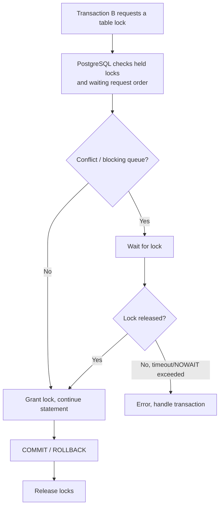
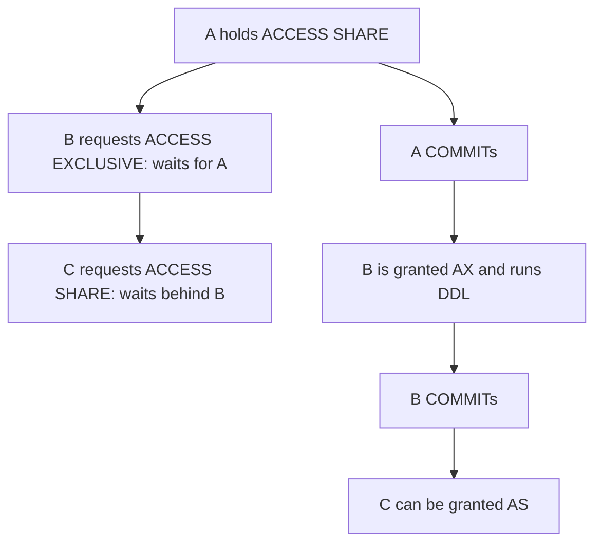

# Table Lock Modes and Compatibility Matrix in PostgreSQL

In PostgreSQL, when multiple transactions concurrently read, write, or alter the structure of the same table, the database engine must ensure that incompatible operations do not execute out of order. A key mechanism for this is the **table-level lock**. PostgreSQL has **eight table lock modes**, ranging from the least restrictive `ACCESS SHARE` to the strongest `ACCESS EXCLUSIVE`.

Lock names can be misleading: `ROW EXCLUSIVE` sounds like a single-row lock, yet it is actually **a table-level lock mode**; meanwhile, `SELECT ... FOR UPDATE` acquires `ROW SHARE` at the table level while also locking specific rows. These two lock layers are distinct and must not be confused.

This lesson belongs to the **Locks** chapter and focuses on:

- The eight modes: `ACCESS SHARE`, `ROW SHARE`, `ROW EXCLUSIVE`, `SHARE UPDATE EXCLUSIVE`, `SHARE`, `SHARE ROW EXCLUSIVE`, `EXCLUSIVE`, and `ACCESS EXCLUSIVE`.
- **The compatibility matrix**: which modes can two transactions hold simultaneously on a table?
- Which SQL statements acquire each mode **implicitly**; when should an explicit `LOCK TABLE` be used?
- The relationship between table locks, row locks, lock waits, deadlocks, and `idle in transaction` sessions.
- How to inspect `pg_locks`, `pg_stat_activity`, and `pg_blocking_pids()`, control wait durations, and write safe Java/JDBC applications.
- Practical scenarios for index creation, migrations/DDL, and concurrent workload handling.

The goal is not to memorize every cell of the matrix mechanically, but to **predict which operations might wait**, identify the **exact blocking session**, and choose the least restrictive lock level that preserves correctness.

## 1. What Is a Table Lock?

A **table-level lock** is managed by PostgreSQL for a relation object—typically a table or related object—to coordinate concurrent operations. When one transaction already holds a lock mode on a table, PostgreSQL evaluates the lock mode requested by another transaction on the same object.

- If **compatible**, the transactions can hold their locks concurrently.
- If **conflicting**, the new transaction usually has to **wait**, or receives an error if using a non-blocking option or timeout.
- When a transaction ends with `COMMIT` or `ROLLBACK`, the locks it held are released.
- A transaction generally **does not conflict with itself** when requesting additional lock modes on the same object; the matrix applies primarily between different transactions.

Table-level locks are usually acquired **implicitly** by statements such as `SELECT`, `INSERT`, `UPDATE`, `DELETE`, `CREATE INDEX`, and `ALTER TABLE`. Even without calling `LOCK TABLE`, PostgreSQL applies appropriate protection.



This is a conceptual model and does not depict the full lock-granting algorithm or every lock-queue edge case.

### 1.1. A Table-Level Lock Does Not Always Block the Entire Table

A `ROW EXCLUSIVE` lock, typically acquired during an `UPDATE`, **does not automatically block all `SELECT` statements** on that table. PostgreSQL uses MVCC so read queries can execute concurrently with write queries.

Only **incompatible mode pairs** conflict at the table level. Row locks can introduce additional wait scenarios even when two table locks are compatible.

### 1.2. "Granted Lock" vs. "Waiting for Lock"

The `pg_locks` view has a `granted` column:

- `granted = true`: the backend has been granted the lock.
- `granted = false`: the request is waiting to be granted the lock.

Seeing many locks with `granted = true` is normal. To diagnose a problem, look for **blocked requests**, their requested lock modes, and the conflicting transactions.

## 2. The Eight Table Lock Modes

PostgreSQL uses the following mode names, typically ordered from least restrictive to strongest. However, **this is not a strictly linear "less than / greater than" order for every pair**: you must check the exact conflict set.

| Abbreviation in lesson | Exact mode name | General characteristics |
| --- | --- | --- |
| **AS** | `ACCESS SHARE` | Typical for read `SELECT`s; conflicts only with `ACCESS EXCLUSIVE` |
| **RS** | `ROW SHARE` | Typical for `SELECT ... FOR UPDATE/SHARE`; conflicts with `EXCLUSIVE` and `ACCESS EXCLUSIVE` |
| **RX** | `ROW EXCLUSIVE` | Typical for `INSERT`, `UPDATE`, `DELETE`; blocks some `SHARE` and stronger modes |
| **SUE** | `SHARE UPDATE EXCLUSIVE` | Used for many maintenance/online DDL tasks; **conflicts with itself** |
| **S** | `SHARE` | Allows multiple readers; conflicts with `ROW EXCLUSIVE` writers and several maintenance modes |
| **SRX** | `SHARE ROW EXCLUSIVE` | Stronger `SHARE` mode, **self-conflicting**; used in some DDL |
| **X** | `EXCLUSIVE` | Allows plain `ACCESS SHARE` reads, blocks many other operations |
| **AX** | `ACCESS EXCLUSIVE` | Conflicts with **all modes**, including `ACCESS SHARE` |

**Note:** the word "ROW" in `ROW SHARE` or `ROW EXCLUSIVE` is **part of the table-lock mode name**. They do not replace row-level lock modes such as `FOR KEY SHARE`, `FOR SHARE`, `FOR NO KEY UPDATE`, and `FOR UPDATE`.

## 3. Full Compatibility Matrix

The table below evaluates **two different transactions requesting locks on the same table**. Rows represent a lock already requested/held by transaction A; columns represent the lock transaction B needs. The matrix is symmetric.

- **✓**: the two modes are **compatible** at the table level.
- **✕**: the two modes **conflict**; B may have to wait or fail depending on wait/timeout settings.
- This is the **table-lock matrix**; a row lock, advisory lock, transaction-ID wait, or an earlier request in the queue can still affect execution.

| A \ B | AS | RS | RX | SUE | S | SRX | X | AX |
| --- | :---: | :---: | :---: | :---: | :---: | :---: | :---: | :---: |
| **AS** | ✓ | ✓ | ✓ | ✓ | ✓ | ✓ | ✓ | ✕ |
| **RS** | ✓ | ✓ | ✓ | ✓ | ✓ | ✓ | ✕ | ✕ |
| **RX** | ✓ | ✓ | ✓ | ✓ | ✕ | ✕ | ✕ | ✕ |
| **SUE** | ✓ | ✓ | ✓ | ✕ | ✕ | ✕ | ✕ | ✕ |
| **S** | ✓ | ✓ | ✕ | ✕ | ✓ | ✕ | ✕ | ✕ |
| **SRX** | ✓ | ✓ | ✕ | ✕ | ✕ | ✕ | ✕ | ✕ |
| **X** | ✓ | ✕ | ✕ | ✕ | ✕ | ✕ | ✕ | ✕ |
| **AX** | ✕ | ✕ | ✕ | ✕ | ✕ | ✕ | ✕ | ✕ |

Reading a few key cells:

1. **AS–RX = ✓**: a plain `SELECT` can run concurrently with `INSERT/UPDATE/DELETE` at the table-lock layer.
2. **RX–RX = ✓**: two `UPDATE`s on the same table do not conflict at the table-lock layer, though they can still wait on a **row lock** if updating the same row.
3. **RX–S = ✕**: a transaction holding `SHARE` causes normal DML needing `ROW EXCLUSIVE` to wait.
4. **S–S = ✓**: two transactions can hold `SHARE` simultaneously; this **does not mean** both can later update without hitting a deadlock.
5. **SUE–SUE = ✕**: two maintenance operations requiring `SHARE UPDATE EXCLUSIVE` on the same table block each other.
6. **X–AS = ✓**: `EXCLUSIVE` still permits plain `SELECT`s, unlike `ACCESS EXCLUSIVE`.
7. **AX–AS = ✕**: an operation requiring `ACCESS EXCLUSIVE` can block even read-only `SELECT`s.

### 3.1. Conflict Sets for Quick Lookup

| Held mode | Conflicts with these modes from another transaction |
| --- | --- |
| `ACCESS SHARE` | `ACCESS EXCLUSIVE` |
| `ROW SHARE` | `EXCLUSIVE`, `ACCESS EXCLUSIVE` |
| `ROW EXCLUSIVE` | `SHARE`, `SHARE ROW EXCLUSIVE`, `EXCLUSIVE`, `ACCESS EXCLUSIVE` |
| `SHARE UPDATE EXCLUSIVE` | `SHARE UPDATE EXCLUSIVE`, `SHARE`, `SHARE ROW EXCLUSIVE`, `EXCLUSIVE`, `ACCESS EXCLUSIVE` |
| `SHARE` | `ROW EXCLUSIVE`, `SHARE UPDATE EXCLUSIVE`, `SHARE ROW EXCLUSIVE`, `EXCLUSIVE`, `ACCESS EXCLUSIVE` |
| `SHARE ROW EXCLUSIVE` | `ROW EXCLUSIVE`, `SHARE UPDATE EXCLUSIVE`, `SHARE`, `SHARE ROW EXCLUSIVE`, `EXCLUSIVE`, `ACCESS EXCLUSIVE` |
| `EXCLUSIVE` | `ROW SHARE`, `ROW EXCLUSIVE`, `SHARE UPDATE EXCLUSIVE`, `SHARE`, `SHARE ROW EXCLUSIVE`, `EXCLUSIVE`, `ACCESS EXCLUSIVE` |
| `ACCESS EXCLUSIVE` | All eight modes, including itself |

The conflict sets highlight an important detail: `SHARE UPDATE EXCLUSIVE` **is compatible with `ROW EXCLUSIVE`** even though it conflicts with itself and with `SHARE`. Therefore, you cannot assume that any lock name containing `EXCLUSIVE` blocks all DML.

### 3.2. A Few Easily Confused Cases

**Two transactions running `SELECT`:** each typically needs AS. AS–AS is compatible, so they do not block each other at the table-lock layer.

**One transaction running `SELECT`, one running `UPDATE`:** AS–RX is compatible; `SELECT` reads a snapshot via MVCC. If `SELECT` uses `FOR UPDATE`, row-level locking also applies and other conditions must be checked.

**One transaction running `UPDATE`, one running regular `CREATE INDEX`:** RX–S conflicts, because regular `CREATE INDEX` typically requires `SHARE` on the source table.

**One transaction running `UPDATE`, one running `CREATE INDEX CONCURRENTLY`:** RX–SUE is compatible at the table-lock layer, but concurrent index creation has multiple phases and must **wait for relevant transactions** at certain steps. You cannot conclude it can never cause waits.

## 4. ACCESS SHARE: The Normal Read Lock

`ACCESS SHARE` is the mode typically requested by a read-only `SELECT` on a table.

```sql
SELECT *
FROM lock_lab.products
WHERE product_id = 1;
```

It conflicts only with `ACCESS EXCLUSIVE`. Thus, `ACCESS SHARE` is compatible with `ROW EXCLUSIVE` from DML and with `EXCLUSIVE`.

This is a core reason PostgreSQL serves many concurrent readers and writers. Still, do not assume every `SELECT` never waits:

- A DDL statement holding or waiting for `ACCESS EXCLUSIVE` can block `SELECT`.
- A `SELECT ... FOR UPDATE` query uses stronger locks than AS at both table and row levels.
- Functions, triggers, or complex queries may trigger other operations and locks.
- A reading session can wait on I/O, buffers, client communication, or other resources even with no table-lock conflict.

**Important:** a `SELECT` inside an explicit transaction holds `ACCESS SHARE` until the transaction ends, even after the `SELECT` statement has finished executing. A read transaction that forgets `COMMIT/ROLLBACK` can block DDL waiting for `ACCESS EXCLUSIVE`.

## 5. ROW SHARE: The Table Lock When a Query Locks Rows

`ROW SHARE` typically appears when using:

```sql
SELECT *
FROM lock_lab.products
WHERE product_id = 1
FOR UPDATE;
```

Or:

```sql
SELECT *
FROM lock_lab.products
WHERE product_id = 1
FOR SHARE;
```

`FOR NO KEY UPDATE` and `FOR KEY SHARE` variants also belong to `SELECT` queries that request row locking. At the table level, these `SELECT`s acquire `ROW SHARE` on the target table; simultaneously, PostgreSQL acquires the corresponding **row lock** on selected rows according to their specific semantics.

At the table level, `ROW SHARE` conflicts only with `EXCLUSIVE` and `ACCESS EXCLUSIVE`. Nevertheless, `SELECT ... FOR UPDATE` can wait on rows locked by another transaction even though table-level `ROW SHARE` and `ROW EXCLUSIVE` are compatible.

### 5.1. NOWAIT and SKIP LOCKED on FOR UPDATE Are Not Table-Level NOWAIT

```sql
SELECT *
FROM lock_lab.products
WHERE product_id = 1
FOR UPDATE NOWAIT;
```

Here, `NOWAIT` primarily controls behavior when acquiring the **row lock**. Acquiring table-level `ROW SHARE` still follows normal rules and can wait. To bound table-lock wait time, configure `lock_timeout` appropriately.

Similarly, `FOR UPDATE SKIP LOCKED` skips locked **rows**, not every table lock or every kind of wait.

## 6. ROW EXCLUSIVE: The Table Lock for Write Operations

DML statements normally acquire `ROW EXCLUSIVE` on the target table:

```sql
INSERT INTO lock_lab.products
    (product_id, product_name, price)
VALUES
    (10, 'New Item', 100.00);
```

```sql
UPDATE lock_lab.products
SET price = price + 5
WHERE product_id = 1;
```

```sql
DELETE FROM lock_lab.products
WHERE product_id = 10;
```

`ROW EXCLUSIVE` **does not conflict** with `ACCESS SHARE`, `ROW SHARE`, `ROW EXCLUSIVE` itself, or `SHARE UPDATE EXCLUSIVE`.

However, it **conflicts** with `SHARE`, `SHARE ROW EXCLUSIVE`, `EXCLUSIVE`, and `ACCESS EXCLUSIVE`.

### 6.1. Two UPDATEs on the Same Table Do Not Necessarily Block at the Table Lock

Session A:

```sql
BEGIN;
UPDATE lock_lab.products SET price = 120 WHERE product_id = 1;
-- Not committed yet.
```

Session B:

```sql
BEGIN;
UPDATE lock_lab.products SET price = 75 WHERE product_id = 2;
COMMIT;
```

With no other conflicts and independent rows, B can proceed even while A holds `ROW EXCLUSIVE` on the same table. Reason: **RX–RX is compatible**.

If B updates **the same `product_id = 1`**, it will wait due to a **row-level lock or transaction-ID wait**, not because `ROW EXCLUSIVE` is incompatible with `ROW EXCLUSIVE`.

This is a classic situation where looking only at table modes in `pg_locks` does not fully explain the wait.

## 7. SHARE UPDATE EXCLUSIVE: Bounded Concurrent Maintenance

`SHARE UPDATE EXCLUSIVE` commonly appears in operations such as:

- Plain `VACUUM` (not `VACUUM FULL`).
- `ANALYZE`.
- `CREATE INDEX CONCURRENTLY` and related online index/maintenance operations.
- Certain `ALTER TABLE` forms that do not require the strongest lock, depending on the subcommand and version.

The conflict set of SUE includes SUE itself, `SHARE`, `SHARE ROW EXCLUSIVE`, `EXCLUSIVE`, and `ACCESS EXCLUSIVE`.

This expresses two ideas:

1. **SUE is compatible with DML requiring RX** in the matrix; many maintenance tasks can run concurrently with normal reads and writes.
2. **SUE conflicts with itself**, preventing maintenance operations that require this mode from running concurrently on the same table in unsafe ways.

Example statements associated with SUE:

```sql
ANALYZE lock_lab.products;
```

```sql
-- Run standalone, outside an explicit transaction block.
CREATE INDEX CONCURRENTLY idx_products_price
ON lock_lab.products (price);
```

**Limitation:** `CREATE INDEX CONCURRENTLY` cannot run inside an explicit transaction block; it also has its own transaction-wait and validation phases. The fact that SUE is compatible with RX **does not** mean index creation never waits or never adds I/O load.

## 8. SHARE: Reads Allowed, Normal Writes Must Wait

`SHARE` is typically associated with regular `CREATE INDEX` and can be acquired explicitly:

```sql
BEGIN;

LOCK TABLE lock_lab.products IN SHARE MODE;

-- Other transactions can still SELECT normally.
-- However, INSERT/UPDATE/DELETE needing ROW EXCLUSIVE will conflict.

COMMIT;
```

`SHARE` is compatible with AS, RS, and S itself. It conflicts with RX, SUE, SRX, X, and AX.

### 8.1. Can Two SHARE Locks Coexist?

Yes. Two transactions can hold `SHARE` on the same table because cell S–S in the matrix is ✓.

However, if both later attempt to `UPDATE` that table, they will try to request RX. Since each still holds S and the other's RX conflicts with S, this can lead to a **deadlock**. Thus, a self-compatible mode does not guarantee that subsequent lock upgrades will also be compatible.

## 9. SHARE ROW EXCLUSIVE: A Self-Conflicting SHARE Mode

`SHARE ROW EXCLUSIVE` appears in certain schema-changing operations, such as `CREATE TRIGGER`, and can be acquired explicitly:

```sql
BEGIN;

LOCK TABLE lock_lab.products
IN SHARE ROW EXCLUSIVE MODE;

-- Perform work requiring this lock scope.

COMMIT;
```

This mode conflicts with RX, SUE, S, SRX itself, X, and AX; it remains compatible with AS and RS.

Compared to `SHARE`, the key difference is that **SRX–SRX conflicts** whereas S–S is compatible. That is useful for operations that must serialize one at a time on the same table.

The name `SHARE ROW EXCLUSIVE` does not mean PostgreSQL locked every row with `FOR UPDATE`. It is still a **table-level lock**, while row-level locking is a separate mechanism.

## 10. EXCLUSIVE: Allows Plain SELECT, Blocks Many Other Operations

`EXCLUSIVE` is a strong mode, though **not yet the strongest**.

It is compatible only with `ACCESS SHARE`, so non-locking `SELECT` queries can still run concurrently. It conflicts with `ROW SHARE`, RX, SUE, S, SRX, X, and AX.

An example command that can acquire this mode is `REFRESH MATERIALIZED VIEW CONCURRENTLY` on the refreshed materialized view, under the conditions where PostgreSQL supports that operation.

It can be demonstrated explicitly:

```sql
BEGIN;

LOCK TABLE lock_lab.products IN EXCLUSIVE MODE;

-- Plain SELECT from another session can still run.
-- SELECT FOR UPDATE or UPDATE from another session must wait.

COMMIT;
```

Do not interpret `EXCLUSIVE` as "blocks everything." Only `ACCESS EXCLUSIVE` conflicts with `ACCESS SHARE`.

## 11. ACCESS EXCLUSIVE: The Strongest Mode

`ACCESS EXCLUSIVE` conflicts with **all eight modes**, including itself and `ACCESS SHARE`.

Commands that commonly require this mode:

- `TRUNCATE`.
- `DROP TABLE`.
- `VACUUM FULL`.
- `CLUSTER`.
- `REFRESH MATERIALIZED VIEW` without `CONCURRENTLY`.
- Many forms of `ALTER TABLE`, except when a subcommand specifies a weaker mode in the documentation.

`LOCK TABLE` **without specifying a mode** also defaults to `ACCESS EXCLUSIVE`. This is an easy way to accidentally acquire an overly strong lock:

```sql
BEGIN;

-- Stronger than needed for most application flows.
LOCK TABLE lock_lab.products;

-- Equivalent to requesting ACCESS EXCLUSIVE on this table.
ROLLBACK;
```

Once AX is granted, even a plain `SELECT` from another transaction must wait. If AX is **waiting in the queue**, incoming requests may be queued behind it to prevent starvation; see Section 19.

### 11.1. Why Can a Short DDL Cause a Long Outage?

An `ALTER TABLE` statement might execute in milliseconds once it gets the lock, yet **wait** for minutes because another transaction holds an uncommitted AS/RX lock. While the DDL waits for AX, subsequent `SELECT`/`UPDATE` requests can pile up behind it in the queue.

Therefore, do not measure only DDL execution time; measure **lock acquisition wait time** and understand the open transactions in your workload.

## 12. Which Mode Do Common SQL Statements Acquire?

The following table gives **typical rules**, not an exhaustive catalog of every statement or execution plan. One statement can acquire **multiple modes across multiple tables**, and certain DDL subcommands have specific rules.

| Common command / scenario | Typical table-level mode involved |
| --- | --- |
| Plain `SELECT` | `ACCESS SHARE` on read tables |
| `SELECT ... FOR UPDATE / FOR SHARE` | `ROW SHARE` on row-locked target tables; other tables may be AS |
| `INSERT` | `ROW EXCLUSIVE` on target table |
| `UPDATE` | `ROW EXCLUSIVE` on target table |
| `DELETE` | `ROW EXCLUSIVE` on target table |
| `MERGE` | Write-appropriate lock on target table, typically RX |
| Plain `VACUUM` | `SHARE UPDATE EXCLUSIVE` |
| `ANALYZE` | `SHARE UPDATE EXCLUSIVE` |
| Regular `CREATE INDEX` | `SHARE` |
| `CREATE INDEX CONCURRENTLY` | `SHARE UPDATE EXCLUSIVE` in relevant phases |
| `CREATE TRIGGER` | `SHARE ROW EXCLUSIVE` |
| `REFRESH MATERIALIZED VIEW CONCURRENTLY` | `EXCLUSIVE` |
| `TRUNCATE` | `ACCESS EXCLUSIVE` |
| `VACUUM FULL` | `ACCESS EXCLUSIVE` |
| `DROP TABLE` | `ACCESS EXCLUSIVE` |
| Many `ALTER TABLE` commands | `ACCESS EXCLUSIVE` unless subcommand requires a weaker mode |
| `LOCK TABLE tablename` without `IN ... MODE` | Defaults to `ACCESS EXCLUSIVE` |

**Be cautious predicting DDL locks:** `ALTER TABLE` has many subcommands with different lock requirements; adding a column, adding/validating a constraint, changing a column type, or setting metadata should not be treated as identical. When preparing migrations, check the docs for your exact major version and test on representative data.

### 12.1. Where Does a SELECT with JOIN Acquire Locks?

```sql
SELECT
    p.product_name,
    c.category_name
FROM lock_lab.products AS p
JOIN lock_lab.categories AS c
    ON c.category_id = p.category_id;
```

A query reading both tables acquires appropriate read locks on **the participating tables**, not a single table lock on "the JOIN result."

If the query reads `products` and another transaction attempts `DROP TABLE products`, AS and AX conflict on `products`. Joining `categories` does not remove that conflict.

### 12.2. INSERT ... SELECT Acquires Different Locks on Source and Target

```sql
INSERT INTO lock_lab.product_audit (product_id, snapshot_price)
SELECT product_id, price
FROM lock_lab.products
WHERE price > 0;
```

Assuming the example tables exist and have no special side effects:

- Target table `product_audit` requires a write lock, typically RX.
- Source table `products` is read with an appropriate read lock, typically AS.
- Tables with related triggers or foreign keys may generate additional lock requests.

One statement can simultaneously be a **reader of table A and a writer of table B**. When investigating locks, always inspect the exact relation that is blocked.

## 13. Explicit LOCK TABLE Syntax

PostgreSQL lets you request a table-level lock directly:

```sql
LOCK [TABLE] table_name
IN lock_mode MODE
[NOWAIT];
```

In the syntax above, square brackets denote **optional** syntax elements, not literal characters to type. `lock_mode` must be replaced with one of the eight valid modes.

Example:

```sql
BEGIN;

LOCK TABLE lock_lab.products
IN SHARE MODE;

-- Perform steps that truly require a stable table state
-- within the SHARE lock scope.

COMMIT;
```

Or try acquiring without waiting:

```sql
BEGIN;

LOCK TABLE lock_lab.products
IN SHARE MODE NOWAIT;

-- If a conflicting lock exists, the statement errors immediately.

ROLLBACK;
```

**`NOWAIT` on `LOCK TABLE`** applies to that specific table-lock request. Unlike `FOR UPDATE NOWAIT`, it does not apply only to row-level locks.

### 13.1. Why Is BEGIN Necessary?

In autocommit mode, a standalone `LOCK TABLE` statement runs in an implicit transaction; as soon as the statement finishes, the transaction ends and the lock is released. Thus, it **will not protect a subsequent SQL statement** as a developer might expect.

To span a sequence of statements, use an explicit transaction and keep it **as short as possible**.

### 13.2. Choosing the Least Restrictive Mode

If the goal is simply to ensure several statements in a transaction can read a table consistently, check whether implicit AS plus an appropriate isolation level already suffices. Do not use `ACCESS EXCLUSIVE` just to "be safe."

For example:

- Need to prevent certain structural changes while allowing DML? Choose a mode appropriate for the operation.
- Need to perform multi-step data writes? Usually row locks, constraints, and transactions are sufficient without strong full-table locks.
- Need consistent state across multiple tables? Consider isolation levels and business invariants; a table lock is not the only answer.

Adding stronger locks can eliminate a race condition at the cost of lower throughput and deadlock risk when transactions acquire locks in different orders.

### 13.3. Locking Multiple Tables in a Fixed Order

```sql
BEGIN;

LOCK TABLE lock_lab.products
IN SHARE MODE;

LOCK TABLE lock_lab.categories
IN SHARE MODE;

-- Appropriate operations.

COMMIT;
```

If multiple code paths need the same two tables, acquire locks in a **consistent order**. A locking `products` then `categories` while B locks `categories` then `products` risks creating a wait cycle.

You can also write a single `LOCK TABLE table_a, table_b IN ... MODE` when using the same mode; what matters most is understanding which locks are needed and enforcing ordering rules.

## 14. Creating Practice Tables

All examples from here on use a **dedicated test database**. Sessions intentionally keep transactions open to observe locks, so **always rollback/commit after each exercise**. Never induce lock waits on production tables.

```sql
CREATE SCHEMA IF NOT EXISTS lock_lab;

CREATE TABLE lock_lab.categories (
    category_id integer PRIMARY KEY,
    category_name text NOT NULL
);

CREATE TABLE lock_lab.products (
    product_id integer PRIMARY KEY,
    category_id integer NOT NULL
        REFERENCES lock_lab.categories(category_id),
    product_name text NOT NULL,
    price numeric(12, 2) NOT NULL CHECK (price >= 0)
);

CREATE TABLE lock_lab.product_audit (
    audit_id bigint GENERATED ALWAYS AS IDENTITY PRIMARY KEY,
    product_id integer NOT NULL,
    snapshot_price numeric(12, 2) NOT NULL
);

INSERT INTO lock_lab.categories
    (category_id, category_name)
VALUES
    (1, 'Books'),
    (2, 'Devices');

INSERT INTO lock_lab.products
    (product_id, category_id, product_name, price)
VALUES
    (1, 1, 'PostgreSQL Handbook', 100.00),
    (2, 1, 'SQL Exercises', 70.00),
    (3, 2, 'USB-C Cable', 25.00);
```

Run the seed statements **once** in an empty practice database. If you already ran a prior exercise and the tables exist, create a fresh schema or clean up test data carefully rather than re-running and mistaking duplicate-key errors for lock conflicts.

The exercises use two or three sessions:

- **Session A:** intentionally holds a lock.
- **Session B:** runs a statement that blocks or is compatible with A.
- **Session C:** uses system views to observe A and B.

## 15. Lab 1: SELECT and UPDATE Coexisting

Session A:

```sql
BEGIN;

UPDATE lock_lab.products
SET price = price + 5
WHERE product_id = 1;

SELECT pg_backend_pid() AS session_a_pid;

-- Do not COMMIT/ROLLBACK yet.
```

Session A holds RX on `products` and a row-level lock on product 1. Session B runs:

```sql
SELECT product_id, price
FROM lock_lab.products
WHERE product_id = 1;
```

This is a non-locking `SELECT`, typically requiring only AS. **AS–RX = ✓**, so it reads a committed version via MVCC without being blocked by A's `UPDATE` row lock.

In Session B, try updating a **different row**:

```sql
BEGIN;

SET LOCAL lock_timeout = '2s';

UPDATE lock_lab.products
SET price = price + 1
WHERE product_id = 2;

ROLLBACK;
```

Both writers hold RX on the table, but modify independent rows; with no other conflicts, B completes.

Now try updating **the same row 1**:

```sql
BEGIN;

SET LOCAL lock_timeout = '2s';

UPDATE lock_lab.products
SET price = price + 1
WHERE product_id = 1;

-- If lock_timeout errors, run ROLLBACK.
```

While A is still open, B waits on the **row lock/transaction ID**, even though table locks RX–RX are compatible.

Clean up:

```sql
-- Session B:
ROLLBACK;

-- Session A:
ROLLBACK;
```

This lab distinguishes **concurrent read/write compatibility** from **contention on the exact same row**.

## 16. Lab 2: SHARE Blocks UPDATE

Session A:

```sql
BEGIN;

LOCK TABLE lock_lab.products IN SHARE MODE;

SELECT pg_backend_pid() AS session_a_pid;

-- Do not COMMIT/ROLLBACK yet.
```

Session B:

```sql
BEGIN;

SET LOCAL lock_timeout = '3s';

UPDATE lock_lab.products
SET price = price + 10
WHERE product_id = 2;

-- If canceled by timeout, run ROLLBACK.
```

`UPDATE` needs RX; A holds S. **S–RX = ✕**, so B waits until A releases the lock or the timeout fires.

Meanwhile, Session C can run a plain `SELECT`:

```sql
SELECT *
FROM lock_lab.products
ORDER BY product_id;
```

`SHARE` is compatible with AS, so plain `SELECT`s can read normally, provided they are not stalled behind other queued requests.

End both transactions:

```sql
-- Session B:
ROLLBACK;

-- Session A:
ROLLBACK;
```

To see an immediate error:

```sql
BEGIN;

LOCK TABLE lock_lab.products IN ROW EXCLUSIVE MODE NOWAIT;

ROLLBACK;
```

Run in another transaction while A holds `SHARE`, this does not wait and immediately errors. Once `LOCK` fails, the explicit transaction is in an error state and requires `ROLLBACK`.

## 17. Lab 3: ACCESS EXCLUSIVE Blocks SELECT

Session A:

```sql
BEGIN;

LOCK TABLE lock_lab.products
IN ACCESS EXCLUSIVE MODE;

-- Keep the transaction open for observation.
```

Session B:

```sql
BEGIN;

SET LOCAL lock_timeout = '3s';

SELECT *
FROM lock_lab.products
WHERE product_id = 1;

-- If AS cannot be acquired, the statement fails on timeout.
```

A holds AX, B needs AS. **AX–AS = ✕**, so even a plain `SELECT` has to wait.

With an open read-only transaction, the reverse direction also causes trouble:

1. A runs `BEGIN; SELECT ... FROM lock_lab.products;` and stops.
2. B wants to run DDL needing AX, such as certain `ALTER TABLE` commands.
3. B must wait for A to end its transaction even though A's `SELECT` already returned results.

After the test, release the transactions:

```sql
-- Session B:
ROLLBACK;

-- Session A:
ROLLBACK;
```

**Never hold AX on a production table just for demonstration.** To analyze real incidents, observe existing locks and reproduce in staging.

## 18. Lab 4: EXCLUSIVE Still Allows Plain Reads

Session A:

```sql
BEGIN;

LOCK TABLE lock_lab.products
IN EXCLUSIVE MODE;
```

Session B runs a plain read:

```sql
SELECT product_id, product_name
FROM lock_lab.products
ORDER BY product_id;
```

B requests AS; **X–AS = ✓**, so it is not blocked by A's table lock in this simple scenario.

Now B tries `FOR UPDATE`:

```sql
BEGIN;

SET LOCAL lock_timeout = '3s';

SELECT *
FROM lock_lab.products
WHERE product_id = 2
FOR UPDATE;

-- If timeout occurs, run ROLLBACK.
```

`FOR UPDATE` requires RS at the table level; **X–RS = ✕**. Thus B blocks right at the table-lock layer before even reaching row-level locks.

Clean up:

```sql
-- Session B:
ROLLBACK;

-- Session A:
ROLLBACK;
```

This example shows why you shouldn't call every mode containing `EXCLUSIVE` a lock that "blocks all SELECTs": **`EXCLUSIVE` differs from `ACCESS EXCLUSIVE`**.

## 19. Lock Queue: Why Can SELECT Wait When the Current Holder Is Compatible?

Consider a three-session scenario on the same table:

1. **A** holds `ACCESS SHARE` in a read-only transaction.
2. **B** requests `ACCESS EXCLUSIVE` to alter the table structure; B must wait for A.
3. **C** sends a new `SELECT` needing `ACCESS SHARE`.

In the matrix, A's AS and C's AS are **compatible**. However, fair queueing causes C to **wait behind B's AX request** rather than jumping ahead of it; otherwise, continuous incoming reads could starve DDL B indefinitely.



This explains a major operational symptom: a DDL statement that only needs milliseconds to run can create a **pile-up of waiting `SELECT` queries** if it gets stuck behind a long transaction.

### 19.1. Hard Blockers and Soft Blockers

`pg_blocking_pids()` considers backends preventing lock acquisition for a waiting backend. In such cases, blockers may be:

- **Hard blocker:** a backend currently holding a conflicting lock.
- **Soft blocker:** a backend ahead in the wait queue with a conflicting request.

Do not look only for locks with `granted = true` and ignore queue position. Investigate thoroughly using `pg_blocking_pids` and columns in `pg_locks`/`pg_stat_activity`.

### 19.2. Avoiding "Infinite Wait" DDL During Peak Hours

A migration requiring AX should typically set an appropriate `lock_timeout`, for example:

```sql
BEGIN;

SET LOCAL lock_timeout = '2s';
SET LOCAL statement_timeout = '30s';

ALTER TABLE lock_lab.products
ADD COLUMN IF NOT EXISTS description text;

COMMIT;
```

This is a practice example; in production, wait thresholds and DDL impact must be evaluated for your specific workload, version, and subcommand.

If the lock cannot be acquired within the budget, it is usually better to roll back and reschedule or retry in a controlled way than to let an AX request hang and block subsequent traffic.

## 20. Observing with pg_locks

The `pg_locks` view exposes lock requests across the system. To inspect table-level locks on the practice table:

```sql
SELECT
    l.pid,
    a.application_name,
    a.state,
    l.locktype,
    l.mode,
    l.granted,
    l.relation::regclass AS relation_name,
    now() - a.xact_start AS transaction_age,
    left(a.query, 120) AS query_sample
FROM pg_locks AS l
LEFT JOIN pg_stat_activity AS a
    ON a.pid = l.pid
WHERE l.locktype = 'relation'
  AND l.relation = 'lock_lab.products'::regclass
ORDER BY l.granted, l.pid, l.mode;
```

You should expect to see `mode` names like `AccessShareLock`, `RowExclusiveLock`, or `AccessExclusiveLock`.

**Names shown in `pg_locks.mode`** use CamelCase with a `Lock` suffix, whereas SQL syntax uses spaces:

| SQL mode | `pg_locks.mode` |
| --- | --- |
| `ACCESS SHARE` | `AccessShareLock` |
| `ROW SHARE` | `RowShareLock` |
| `ROW EXCLUSIVE` | `RowExclusiveLock` |
| `SHARE UPDATE EXCLUSIVE` | `ShareUpdateExclusiveLock` |
| `SHARE` | `ShareLock` |
| `SHARE ROW EXCLUSIVE` | `ShareRowExclusiveLock` |
| `EXCLUSIVE` | `ExclusiveLock` |
| `ACCESS EXCLUSIVE` | `AccessExclusiveLock` |

### 20.1. pg_locks Has Many Lock Types, Not Just relation

Other `locktype` values include `transactionid`, `virtualxid`, `tuple`, `object`, `advisory`, or other internal types depending on version. Therefore:

```sql
SELECT
    pid,
    locktype,
    mode,
    granted,
    relation::regclass AS relation_name,
    transactionid
FROM pg_locks
WHERE pid = pg_backend_pid();
```

is a way to explore the **current backend's** lock types, not just table locks. However, do not assume every held row lock appears as a separate `tuple` row in `pg_locks`.

### 20.2. Check granted Before Blaming a Blocker

A backend with a granted `RowExclusiveLock` is not necessarily blocking other transactions. To find a conflict, check **specific ungranted requests** against the matrix.

You can inspect waiting locks:

```sql
SELECT
    l.pid,
    l.locktype,
    l.mode,
    l.granted,
    l.relation::regclass AS relation_name,
    a.state,
    a.wait_event_type,
    a.wait_event
FROM pg_locks AS l
LEFT JOIN pg_stat_activity AS a
    ON a.pid = l.pid
WHERE NOT l.granted
ORDER BY l.pid, l.locktype;
```

This query inspects a point-in-time snapshot; the waiting rows can change right after you read them.

## 21. Finding Waiters and Blockers with pg_blocking_pids()

`pg_blocking_pids(pid)` returns the list of backend PIDs blocking the queried PID's lock request. This is usually a more reliable starting point than manually joining `pg_locks` solely on `relation`.

```sql
SELECT
    w.pid AS waiting_pid,
    w.application_name AS waiting_application,
    w.wait_event_type AS waiting_type,
    w.wait_event AS waiting_event,
    now() - w.query_start AS waiting_query_age,
    left(w.query, 150) AS waiting_sql,
    b.pid AS blocking_pid,
    b.application_name AS blocking_application,
    b.state AS blocking_state,
    now() - b.xact_start AS blocking_xact_age,
    left(b.query, 150) AS blocking_last_sql
FROM pg_stat_activity AS w
JOIN LATERAL
    unnest(pg_blocking_pids(w.pid)) AS bp(blocking_pid)
    ON TRUE
LEFT JOIN pg_stat_activity AS b
    ON b.pid = bp.blocking_pid
WHERE w.datname = current_database()
ORDER BY waiting_query_age DESC NULLS LAST;
```

This query can show:

- **Waiting PID:** the session waiting.
- **Blocking PID:** the session blocking, which may be `active` or `idle in transaction`.
- **Blocking transaction age:** how long the blocker's transaction has been open.
- **Blocking last SQL:** the latest or current SQL statement, not necessarily the full sequence of statements that acquired locks.

### 21.1. Blockers Can Be idle in transaction

Example transaction A:

```sql
BEGIN;

UPDATE lock_lab.products
SET price = price + 1
WHERE product_id = 1;

-- Application stops sending SQL, without COMMITting.
```

A may show `state = 'idle in transaction'`. Although no SQL is actively running, A still holds its table and row locks. Session B waiting on the lock shows `state = 'active'` and `wait_event_type = 'Lock'`.

Filtering only `WHERE state='active'` to find the culprit will miss A. Follow the **blocker chain**.

### 21.2. A Wait Is Not Necessarily a Table Lock

An `UPDATE` blocked on a row often shows a wait on `transactionid` rather than an obvious row-level `tuple` lock. Both transactions hold compatible RX table locks while waiting on each other at the row level.

Therefore, interpret `pg_blocking_pids()`, `pg_locks`, and `wait_event_type` together rather than trying to explain every lock wait with the table-lock matrix alone.

## 22. Measuring Wait Duration Without Confusing It with Transaction Age

`pg_stat_activity` provides different timestamps:

| Column | Meaning |
| --- | --- |
| `xact_start` | Time the current transaction started, if any |
| `query_start` | Time the current query started when `active`; time the last query started when not active |
| `state_change` | Time the backend transitioned to its current state |
| `wait_event_type` | Category of event the backend is waiting on, if any |
| `wait_event` | Specific wait event name |

Example:

```sql
SELECT
    pid,
    application_name,
    state,
    wait_event_type,
    wait_event,
    CASE
        WHEN xact_start IS NOT NULL
        THEN now() - xact_start
    END AS transaction_age,
    CASE
        WHEN state = 'active'
        THEN now() - query_start
    END AS active_query_age,
    CASE
        WHEN state LIKE 'idle in transaction%'
        THEN now() - state_change
    END AS idle_transaction_age,
    pg_blocking_pids(pid) AS blocking_pids
FROM pg_stat_activity
WHERE datname = current_database()
ORDER BY xact_start NULLS LAST, pid;
```

`query_start` measures the **age of the active SQL query**, not solely how long the backend has been waiting on a lock. If a statement spends 10 seconds computing before waiting 2 seconds for a lock, `now() - query_start` gives ~12 seconds, not 2 seconds of lock wait.

To measure exact lock-wait duration over time, combine lock-wait logging, APM/telemetry, and appropriate monitoring tools.

## 23. NOWAIT, lock_timeout, and statement_timeout

### 23.1. NOWAIT on LOCK TABLE

```sql
BEGIN;

LOCK TABLE lock_lab.products
IN SHARE MODE NOWAIT;

COMMIT;
```

If a conflicting lock exists, the statement does not wait and raises an error. Inside an explicit transaction, you must `ROLLBACK` or use a savepoint after an error.

### 23.2. lock_timeout

```sql
BEGIN;

SET LOCAL lock_timeout = '2s';

UPDATE lock_lab.products
SET price = price + 1
WHERE product_id = 1;

COMMIT;
```

`lock_timeout` limits how long to wait to **acquire each lock**. If `UPDATE` waits longer than the threshold, the statement is aborted with an appropriate lock availability/timeout error. It does not limit total CPU/I/O execution time once the lock is acquired.

### 23.3. statement_timeout

```sql
BEGIN;

SET LOCAL statement_timeout = '10s';

SELECT pg_sleep(20);

-- The SQL statement is canceled due to statement_timeout.

ROLLBACK;
```

`statement_timeout` limits total statement duration within the configured scope. Unlike `lock_timeout`, it can cancel a statement **even when it is not waiting on any lock**.

If `lock_timeout` is equal to or longer than `statement_timeout`, `statement_timeout` may fire before `lock_timeout` takes effect.

### 23.4. idle_in_transaction_session_timeout

```sql
SET idle_in_transaction_session_timeout = '60s';
```

When a session stays `idle in transaction` continuously beyond the configured threshold, PostgreSQL **terminates the session**, rolling back the uncommitted transaction and releasing its locks/resources.

This is a safety net when clients abandon transactions, not a replacement for applications calling commit/rollback. With connection pools, server-side termination requires the client/pool to handle the closed connection.

### 23.5. deadlock_timeout Is Not lock_timeout

`deadlock_timeout` is the wait duration before PostgreSQL runs deadlock detection for a lock wait. It does not cap total lock wait time like `lock_timeout`, nor is it a transaction timeout.

If a real wait cycle exists, PostgreSQL detects it and aborts one transaction with SQLSTATE `40P01`. Do not raise or lower this parameter arbitrarily hoping to make queries run faster.

## 24. How Long Are Locks Held? Transactions and Savepoints

Table locks acquired in a normal transaction are held until the transaction ends via `COMMIT` or `ROLLBACK`.

Example:

```sql
BEGIN;

LOCK TABLE lock_lab.products IN SHARE MODE;

SELECT product_name
FROM lock_lab.products
WHERE product_id = 1;

-- SELECT has finished, but SHARE is still held.

COMMIT;
```

Therefore, a brief query inside a **long transaction** can cause long lock waits.

### 24.1. Savepoints and Rolling Back to a Savepoint

PostgreSQL can release locks acquired **after a savepoint** when rolling back to that savepoint, following transaction rollback rules.

Example:

```sql
BEGIN;

SAVEPOINT before_lock;

LOCK TABLE lock_lab.products
IN SHARE MODE;

-- Discard work after the savepoint:
ROLLBACK TO SAVEPOINT before_lock;

-- Locks acquired after the savepoint can be released.

COMMIT;
```

`RELEASE SAVEPOINT` does not commit work or release locks; it merely removes a savepoint inside the open transaction. Use `ROLLBACK TO SAVEPOINT` deliberately instead of leaving a failed transaction open indefinitely.

### 24.2. Failed Transactions Must Be Rolled Back

```sql
BEGIN;

SELECT 1 / 0;
-- Statement errors.

SELECT 1;
-- Cannot proceed normally inside an aborted transaction.

ROLLBACK;
```

Between the error and `ROLLBACK`, the session sits in `idle in transaction (aborted)`. This is still a symptom the application must handle promptly, not a state to leave open for a connection pool to clean up later.

## 25. Deadlocks from Lock Ordering and Lock Upgrades

A normal lock wait ends when the holder commits. A **deadlock** is a wait cycle where none of the transactions can make progress.

### 25.1. Two-Table Deadlock

Session A:

```sql
BEGIN;

LOCK TABLE lock_lab.products IN SHARE MODE;

-- Later wants to lock categories.
LOCK TABLE lock_lab.categories IN SHARE ROW EXCLUSIVE MODE;
```

Session B:

```sql
BEGIN;

LOCK TABLE lock_lab.categories IN SHARE ROW EXCLUSIVE MODE;

-- Later wants to lock products.
LOCK TABLE lock_lab.products IN SHARE ROW EXCLUSIVE MODE;
```

With interleaved timing:

- A holds `SHARE` on `products` and wants SRX on `categories` held by B.
- B holds SRX on `categories` and wants SRX on `products`; B's SRX conflicts with A's `SHARE`.
- Both form a wait cycle.

PostgreSQL detects this and aborts one transaction to break the deadlock. **In practice**, do not run untimed blocking statements across two sessions without an exit plan; use a short `lock_timeout` or observe in a prepared lab.

### 25.2. Upgrading from SHARE to ROW EXCLUSIVE

Two transactions holding S on a table are allowed because S–S is compatible. However, if each subsequently tries to `UPDATE` the table, each needs RX, which conflicts with the other's S.

Both can thus enter a lock-upgrade wait and deadlock. Avoid patterns like "read and hold `SHARE` across multiple sessions, then everyone `UPDATE`s" whenever a better design exists.

### 25.3. Prevention

- Acquire table locks in a **consistent order**.
- Keep transactions short, avoiding external network calls while holding locks whenever unnecessary.
- Minimize repeated lock upgrades; request the needed mode upfront when truly required.
- Use indexes/predicates to reduce the number of rows needing row locks.
- Retry the **entire deadlocked transaction** with bounded retries and backoff; never retry a single statement inside an aborted transaction.

## 26. Migrations and Operations: Minimizing Strong Lock Duration

A migration can fail operationally even when data-correct if it requests AX while the table has long-running transactions.

### 26.1. Evaluating DDL Before Execution

Determine:

1. Which lock mode does the command need in your PostgreSQL version?
2. Does it rewrite the table or scan large amounts of data?
3. How long will it hold the lock once acquired?
4. Can it be split into smaller phases?
5. If a new index is needed, can it use `CONCURRENTLY`?
6. Can `lock_timeout` prevent excessive queuing?
7. Does the application have long-running read or write transactions?

Not every `ALTER TABLE` takes the same mode. **Check the specific subcommand**, not just the command name.

### 26.2. CREATE INDEX vs. CREATE INDEX CONCURRENTLY

```sql
CREATE INDEX idx_products_price_regular
ON lock_lab.products (price);
```

Regular `CREATE INDEX` typically needs S on the table, conflicting with DML's RX: while building the index, writers must wait.

```sql
CREATE INDEX CONCURRENTLY idx_products_price_online
ON lock_lab.products (price);
```

`CREATE INDEX CONCURRENTLY` uses a strategy allowing normal writes to continue, though it has separate scan/wait phases and cannot run inside an explicit transaction block.

If concurrent index creation fails, it can leave behind an invalid index requiring cleanup. Never assume every DDL with `CONCURRENTLY` is zero-lock or zero-risk.

### 26.3. ALTER TABLE and Access Availability

Different `ALTER TABLE` commands may require AX or a weaker mode. Even a near-instant metadata change can wait minutes to acquire AX.

For automated migrations, consider:

```sql
BEGIN;

SET LOCAL lock_timeout = '2s';
SET LOCAL statement_timeout = '30s';

-- Specific structural change command.
ALTER TABLE lock_lab.products
ADD COLUMN IF NOT EXISTS sku text;

COMMIT;
```

If `ALTER TABLE` fails to acquire the lock, it is usually better to roll back and re-evaluate the deployment window than to elongate the lock queue. If the DDL performs a large rewrite or scan, 30 seconds may be too short; treat example numbers as non-universal.

## 27. Partitioned Tables, Indexes, and Dependent Objects

A statement on a partitioned table or a table with indexes/foreign keys/triggers can acquire locks on **multiple objects**, not solely the table typed in the query.

For instance, an `UPDATE` on a parent table may touch relevant partitions; an `INSERT` with a foreign key checks the referenced table and acquires corresponding row locks. An `ALTER TABLE` may need different locks on the parent and its children/partitions.

**Do not assume from a table-lock mode on the parent that all dependent objects are locked in the same mode.**

In partitioned or inherited setups, observe actual behavior with `pg_locks` and check the rules for the running command. `LOCK TABLE` also has syntax/semantics around traversing child tables; do not run `LOCK TABLE ONLY parent` assuming all partitions are protected.

Likewise, two statements with compatible modes on the target table may still contend on indexes, rows, transaction IDs, or other resources. This matrix explains **one layer** of concurrency, not the entire locking system.

## 28. Table Locks vs. Row Locks, Predicate Locks, and Advisory Locks

| Concept | Target / semantics | Example |
| --- | --- | --- |
| Table-level lock | Coordinates access at the relation level | `ACCESS SHARE`, `ROW EXCLUSIVE`, `ACCESS EXCLUSIVE` |
| Row-level lock | Coordinates updates/locking of specific rows | `FOR UPDATE`, `FOR SHARE` |
| Transaction-ID wait | A backend waits for another transaction to finish to resolve row/lock state | Visible as `transactionid` in `pg_locks` |
| Predicate/SIRead lock | Supports conflict detection under `SERIALIZABLE` isolation | SSI mechanism, unlike blocking table locks |
| Advisory lock | Application-defined locks keyed by numeric IDs | `pg_advisory_lock`, `pg_try_advisory_xact_lock` |

**Predicate locks in `SERIALIZABLE`** detect serializability anomalies and have different semantics from blocking table locks; you cannot substitute this compatibility table for `SIReadLock` conflict tracking.

**Advisory locks** are meaningful only if participating application code adheres to the locking convention; they do not automatically block `INSERT/UPDATE/DELETE` on a data table.

To prevent two workers from processing the same job, row-level `FOR UPDATE SKIP LOCKED` is often better suited than a strong full-table lock. Conversely, to protect a relation-wide schema change, table locks are indispensable.

## 29. Java/JDBC: Deliberate Transactions and Timeouts

In a Java application, lock-wait issues typically surface as slow requests, timeouts, or JDBC exceptions. Handling must be consistent across both database and application layers.

Example of updating a product price in a short transaction:

```java
import java.math.BigDecimal;
import java.sql.Connection;
import java.sql.PreparedStatement;
import java.sql.SQLException;
import javax.sql.DataSource;

public class ProductService {
    private final DataSource dataSource;

    public ProductService(DataSource dataSource) {
        this.dataSource = dataSource;
    }

    public void updatePrice(long productId, BigDecimal newPrice)
            throws SQLException {
        if (newPrice.signum() < 0) {
            throw new IllegalArgumentException("Price must be nonnegative");
        }

        try (Connection connection = dataSource.getConnection()) {
            connection.setAutoCommit(false);

            try {
                // SET LOCAL applies only within the current transaction.
                try (PreparedStatement setup =
                             connection.prepareStatement(
                                 "SET LOCAL lock_timeout = '2s'")) {
                    setup.execute();
                }

                try (PreparedStatement ps =
                             connection.prepareStatement("""
                                 UPDATE lock_lab.products
                                 SET price = ?
                                 WHERE product_id = ?
                                 """)) {
                    ps.setBigDecimal(1, newPrice);
                    ps.setLong(2, productId);

                    if (ps.executeUpdate() != 1) {
                        throw new SQLException("Product not found");
                    }
                }

                connection.commit();
            } catch (SQLException | RuntimeException ex) {
                try {
                    connection.rollback();
                } catch (SQLException rollbackFailure) {
                    ex.addSuppressed(rollbackFailure);
                }
                throw ex;
            }
        }
    }
}
```

This example illustrates that:

- `UPDATE` acquires table-level RX.
- If blocked by a table or row lock for too long, `lock_timeout` bounds the wait.
- After an error, the application rolls back the transaction rather than returning an aborted connection to the pool.
- `try-with-resources` closes statements and connections across all paths.
- Transactions are not held open while waiting on user input or external HTTP APIs.

The code assumes **ownership of the connection/transaction**. In Spring or frameworks using a transaction manager, do not call `commit()` manually on a framework-managed connection; use the framework's transaction boundaries.

### 29.1. Conscious SQLSTATE Handling

Common error codes:

| SQLSTATE | General meaning | Handling approach |
| --- | --- | --- |
| `55P03` | Lock not available; occurs on `NOWAIT`/`lock_timeout` | Roll back, report appropriately, or retry with backoff |
| `40P01` | Deadlock detected | Roll back and retry **the entire transaction** when safe |
| `40001` | Serialization failure | Retry transaction from the beginning per business semantics |
| `57014` | Query canceled; often seen with `statement_timeout`/cancel | Review timeouts, query cost, and transaction state |
| `25P02` | Current transaction is aborted | Roll back/recover transaction; do not blindly keep executing |

Do not retry indefinitely. A deadlocked non-idempotent operation may require idempotency keys when commit outcome across a connection boundary is ambiguous. Also distinguish server SQLSTATEs from network or pool connection errors.

### 29.2. Tagging application_name

```sql
SET application_name = 'catalog-service';
```

In PgJDBC, application configuration can also populate `application_name`. This helps identify which service owns a blocker in `pg_stat_activity`. Never put tokens, passwords, or personal data in `application_name`.

Another important metric is **connection checkout duration** in the pool. An `idle in transaction` session may be a connection held too long by the application after SQL has finished.

## 30. Do Not Automatically Terminate Every Blocker

A flawed reflex is: "whichever session holds a lock making me wait, terminate it immediately."

PostgreSQL provides:

```sql
-- PID is illustrative; never run against an arbitrary PID.
SELECT pg_cancel_backend(12345);

SELECT pg_terminate_backend(12345);
```

These two operations differ:

- `pg_cancel_backend` sends a cancel request to the running statement. It **does not** guarantee an idle transaction closes or releases its locks.
- `pg_terminate_backend` terminates the session; uncommitted transactions roll back, releasing locks, but the application loses its connection and legitimate work may be disrupted.

Before acting, verify **PID, owner, transaction type, rollback impact, and operational authorization**. Prefer letting the application finish its transaction cleanly.

A transaction holding AS while DDL waits for AX might simply be an intentional long-running report; the right fix may be rescheduling the migration, shortening the read transaction, or changing deployment strategy rather than blindly killing the report.

## 31. Table Lock Incident Diagnosis Runbook

A practical workflow can follow these steps:

**Step 1 — Confirm it is truly a lock wait.** In `pg_stat_activity`, check `wait_event_type = 'Lock'` and timestamps. Distinguish it from I/O, CPU, or client waits.

**Step 2 — Identify the affected relation.** Inspect `relation` in `pg_locks`, SQL queries, and referenced objects. For row-lock waits, `relation` may not appear directly on the waiting lock row; infer from the query and blocker.

**Step 3 — Trace the blocker chain.** Call `pg_blocking_pids(waiting_pid)` and follow further if the blocker itself is waiting.

**Step 4 — Read lock modes.** Check the matrix and identify the conflicting pair. Do not see `RowExclusiveLock` and jump to the conclusion that it blocks plain `SELECT`s.

**Step 5 — Measure transaction age and state.** `now() - xact_start` differs from `now() - query_start`. Prioritize inspecting `idle in transaction` sessions holding locks for a long time.

**Step 6 — Decide remediation by business context.** DDL can retry with `lock_timeout`; abandoned transactions may need application-side rollback; never terminate without knowing the impact.

**Step 7 — Verify aftermath.** Afterward, re-check blockers, p95 latency, connection pools, migration state, and rolled-back transactions.

**Step 8 — Prevent recurrence.** Enforce tight transaction boundaries, lock ordering, timeouts, and per-service alerting rather than database-wide averages alone.

### 31.1. Quick Query for Blocked Sessions

```sql
SELECT
    a.pid,
    a.application_name,
    a.state,
    a.wait_event_type,
    a.wait_event,
    now() - a.query_start AS query_age,
    pg_blocking_pids(a.pid) AS blockers,
    left(a.query, 140) AS sql_sample
FROM pg_stat_activity AS a
WHERE a.datname = current_database()
  AND a.wait_event_type = 'Lock'
ORDER BY a.query_start;
```

### 31.2. Query for Long-Open Transactions

```sql
SELECT
    pid,
    application_name,
    state,
    now() - xact_start AS transaction_age,
    now() - state_change AS state_age,
    pg_blocking_pids(pid) AS blockers,
    left(query, 140) AS last_sql
FROM pg_stat_activity
WHERE datname = current_database()
  AND xact_start < now() - INTERVAL '2 minutes'
ORDER BY xact_start;
```

The two-minute threshold is just an example. Do not assume every transaction older than that is abnormal: batch jobs, backups, reports, or intentional workflows may have different boundaries.

## 32. Common Pitfalls

| Misconception | Why it is wrong | Correct understanding |
| --- | --- | --- |
| `ROW EXCLUSIVE` is a row-level lock | The mode name contains ROW, but it is a table lock | Row locks have their own set of modes |
| `UPDATE` blocks every `SELECT` | RX is compatible with AS | `SELECT` reads via MVCC unless another conflict exists |
| Two `UPDATE`s on the same table cannot run concurrently | RX–RX is compatible | They only wait on row/transaction IDs or other resources |
| `SHARE` prevents all reads | S–AS is compatible | `SHARE` mainly conflicts with RX writers and other modes |
| `SHARE UPDATE EXCLUSIVE` blocks `UPDATE` | SUE–RX is compatible | SUE conflicts with itself and S/SRX/X/AX |
| `EXCLUSIVE` blocks every `SELECT` | X–AS is compatible | Only AX blocks AS |
| `ACCESS EXCLUSIVE` only blocks writers | AX conflicts with AS too | Plain `SELECT`s also have to wait |
| `SELECT FOR UPDATE` only uses `ROW SHARE` | It also takes row-level locks on rows | Must account for both lock layers |
| `NOWAIT` in `FOR UPDATE` prevents all waits | It mainly applies to row locks | Table-level lock acquisition can still wait |
| `LOCK TABLE` defaults to a light mode | Default mode is AX | Specify `IN ... MODE` explicitly |
| `LOCK TABLE` outside `BEGIN` holds until the next command | Autocommit ends the transaction right after the statement | Use an explicit transaction to hold the lock |
| Only a granted lock holder can make `SELECT` wait | The queue has soft blockers | Check `pg_blocking_pids` and the lock queue |
| Every lock shown in `pg_locks` is an error | Locks are normal database operation | Check `granted`, waits, and mode conflicts |
| `pg_locks` always shows all row locks under `tuple` | Row-lock state often lives in tuple headers/transaction IDs | Combine wait events and blocking PIDs |
| Fast DDL will not affect production | It can wait for AX and build a queue | Set `lock_timeout` and pick a migration window |
| `CREATE INDEX CONCURRENTLY` never waits | It has transaction-wait phases and overhead | Monitor progress and handle controlled retries |
| Canceling a blocker's query is enough | Idle transactions have no active query | End the transaction/session properly |
| No need to roll back after a timeout | Explicit transactions enter an aborted state | Roll back or use a savepoint |
| Always need strong table locks to protect invariants | Row locks, unique constraints, or isolation levels may suffice | Choose the least restrictive mechanism that preserves correctness |

## 33. Practice Exercises

All exercises below use the `lock_lab` schema and three sessions A/B/C. **Always end practice transactions**—never leave locks open indefinitely.

### Exercise 1 — Reading the Matrix Without Running SQL

Using the matrix, determine whether each pair can coexist:

1. AS and RX.
2. RX and RX.
3. RX and S.
4. SUE and RX.
5. SUE and SUE.
6. S and S.
7. X and AS.
8. X and RS.
9. AX and AS.
10. SRX and SRX.

Explain why a pair that is compatible at the table level can still produce a row-level lock wait.

### Exercise 2 — Non-Locking SELECT Alongside UPDATE

Session A runs `BEGIN; UPDATE products SET price=price+1 WHERE product_id=1;` and waits. Session B runs `SELECT price ... WHERE product_id=1;` and records the price read.

Explain using MVCC and cell AS–RX. Then in B try `UPDATE` on the same row with a short `lock_timeout` to observe the row lock wait. Clean up A and B with rollback.

### Exercise 3 — Two UPDATEs on Different Rows

A updates product 1 and B updates product 2 in separate transactions; neither commits while inspecting `pg_locks`. Both backends show `RowExclusiveLock` on `products` with `granted = true`. Why is there no table-level conflict?

### Exercise 4 — SHARE Blocks Writers

A acquires `LOCK TABLE ... IN SHARE MODE`. B tries:

```sql
BEGIN;

SET LOCAL lock_timeout = '2s';

INSERT INTO lock_lab.products
    (product_id, category_id, product_name, price)
VALUES
    (99, 1, 'Trial Product', 15.00);

ROLLBACK;
```

While A holds `SHARE`, `INSERT` needs RX and is canceled by timeout. Why is a plain `SELECT` not blocked?

### Exercise 5 — ACCESS EXCLUSIVE Blocks SELECT

A holds AX. B runs `SELECT ...` with a short `lock_timeout` and observes `wait_event_type` before timing out. Clean up A with rollback. Compare with the case where A holds `EXCLUSIVE`.

### Exercise 6 — ROW SHARE and EXCLUSIVE

A holds `LOCK TABLE ... IN EXCLUSIVE MODE`. B runs a plain `SELECT`, then `SELECT ... FOR UPDATE` inside a transaction with a timeout.

Why can one `SELECT` run while the other has to wait at the table lock?

### Exercise 7 — SHARE UPDATE EXCLUSIVE Conflicts with Itself

A:

```sql
BEGIN;
LOCK TABLE lock_lab.products
IN SHARE UPDATE EXCLUSIVE MODE;
```

B:

```sql
BEGIN;

SET LOCAL lock_timeout = '2s';

LOCK TABLE lock_lab.products
IN SHARE UPDATE EXCLUSIVE MODE;

ROLLBACK;
```

Observe why B waits even though if B used `LOCK ... IN ROW EXCLUSIVE MODE`, the SUE–RX pair would be compatible.

### Exercise 8 — Inspecting pg_locks

While one session holds `SHARE` and another waits for RX, run the `pg_locks` query from Section 20.

Identify `pid`, `mode`, `granted`, and `relation_name`; compare against the matrix. Why might a row lock wait not show clearly if you only filter `locktype='relation'`?

### Exercise 9 — Finding Blockers with pg_blocking_pids

Create a lock wait on the lab table. In Session C, run the SQL query from Section 21. Find the waiting PID, blocking PID, blocker state, and transaction age.

Explain why the blocker can be `idle in transaction` while the waiter is `active`.

### Exercise 10 — Observing DDL Impact in the Queue

In A, open a transaction that only `SELECT`s `products` and keeps AS. B runs a DDL command needing AX with an appropriate `lock_timeout`. C attempts a `SELECT` while B is waiting.

Describe why C can be blocked even though C's AS is compatible with A's AS. Clean up all transactions when finished.

### Exercise 11 — NOWAIT and Timeout

Compare:

```sql
LOCK TABLE lock_lab.products IN SHARE MODE NOWAIT;
```

with:

```sql
SET LOCAL lock_timeout = '2s';

LOCK TABLE lock_lab.products IN SHARE MODE;
```

When a conflicting lock already exists, one errors immediately; the other waits up to the timeout. How must failed transactions be handled?

### Exercise 12 — Evaluating a Migration Plan

Suppose a large `orders` table has read transactions running for tens of minutes and needs a new column. Identify:

- Lock mode of the specific DDL on your PostgreSQL version.
- Risk of the DDL waiting for AX and building a `SELECT` queue.
- Initial `lock_timeout` to try acquiring the lock.
- How to identify the blocker and application owner.
- Plan to reschedule the deployment window if the lock is not acquired.
- Rollback conditions and post-migration verification.

### Exercise 13 — Debugging a Deadlock

Two code paths need to lock `products` and `categories` but acquire them in opposite order. Draw the wait cycle between A and B and propose a common lock order.

Why does setting `lock_timeout` not replace consistent lock-order design? If PostgreSQL returns SQLSTATE `40P01`, what unit of work should be retried?

### Exercise 14 — JDBC: Short Transactions

Write a JDBC method updating a product using `PreparedStatement`, with `SET LOCAL lock_timeout`, `commit()`, `rollback()`, and `try-with-resources`.

Describe the failures that can occur if the method holds the transaction open while waiting on an external API or skips rollback after an exception.

## 34. Summary

- PostgreSQL has **eight table lock modes**. Rely on the **compatibility matrix**, not just mode names, to gauge strength and conflicts.
- **`ACCESS SHARE`** serves `SELECT` and conflicts only with AX; **`ROW SHARE`** accompanies `SELECT` with row locking and conflicts with X/AX.
- **`ROW EXCLUSIVE`** is DML's table lock; **RX–RX is compatible**, though two writers can still conflict at the row level.
- **`SHARE UPDATE EXCLUSIVE`** permits RX DML, yet conflicts with itself; **`SHARE`** blocks RX writers while staying compatible with AS/RS/S.
- **`SHARE ROW EXCLUSIVE`** conflicts with itself and blocks RX; **`EXCLUSIVE`** still allows AS; **`ACCESS EXCLUSIVE`** blocks all modes.
- **Implicit locks still exist** even without `LOCK TABLE`. `LOCK TABLE` without an explicit mode defaults to AX, so write it explicitly and choose the least restrictive mode.
- **Table locks do not explain every wait**. Row locks, transaction-ID waits, soft blockers in the queue, and other resources must be examined separately.
- **Locks are normally held until the end of the transaction**. An `idle in transaction` session can hold locks long after SQL finishes; keep transactions short and roll back on error paths.
- **Use `pg_locks`, `pg_stat_activity`, and `pg_blocking_pids()`** to find actual waiters and blockers; distinguish transaction age, query age, and wait duration.
- **Choose timeouts and migration windows deliberately**. DDL waiting for AX can stall incoming `SELECT`s; `CREATE INDEX CONCURRENTLY` also has its own constraints.
- **In Java/JDBC**, bind parameters, keep transaction boundaries short, always commit/rollback cleanly, and handle lock/deadlock errors with bounded retries where appropriate.

Understanding the compatibility matrix lets you answer a crucial operational question: **can two operations on the same table proceed concurrently or must they wait, and at which lock layer?** Combining that knowledge with proper inspection of transaction states and lock queues lets you deploy schema changes, write concurrent DML, and troubleshoot PostgreSQL incidents accurately without introducing unnecessary heavy locks.
