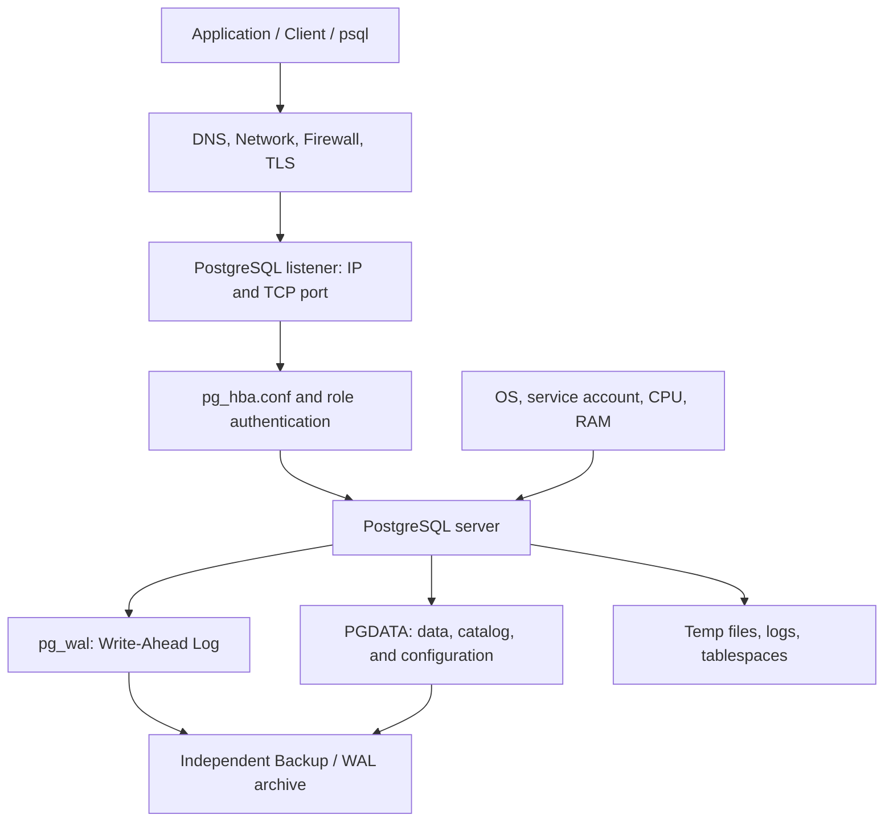
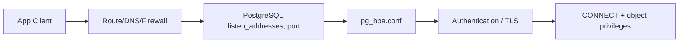

# Preparing Operating System, Storage, Network Ports, and Service Accounts for PostgreSQL

Before running the PostgreSQL installer or initializing a database cluster, you must determine **whether the host is compatible and has sufficient resources, where data will reside, which port will be used, and under which account the PostgreSQL process is permitted to run**. Skipping this step can result in software that installs but fails to start, disks filling up during writes, applications failing to connect, or databases being inadvertently exposed to public networks.

This lesson guides you through preparing PostgreSQL on Linux, Windows, and macOS, with detailed Linux examples for server operations. Key topics include:

- Selecting the operating system, PostgreSQL version, architecture, and CPU/RAM resources.
- Estimating space for tables, indexes, WAL, temporary files, and backups; planning a safe data directory layout.
- Checking the default port `5432`, listen addresses, firewalls, authentication, and application connectivity.
- Distinguishing the **operating system service account** from **PostgreSQL login roles**; designing permissions according to the principle of least privilege.
- Building a pre-installation checklist and practicing troubleshooting for common scenarios.

OS observation commands can be run prior to installation. Commands such as `psql`, `pg_isready`, `SHOW`, or configuring `postgresql.conf` and `pg_hba.conf` are only meaningful **after the corresponding program or cluster exists**.

## 1. Map of Components to Prepare



| Component | Preparation Question |
|---|---|
| Operating System | Are the OS version, CPU, and PostgreSQL distribution compatible? |
| CPU/RAM | Are there sufficient resources for connection volume, queries, reporting, and maintenance operations? |
| Storage | Where will data, WAL, logs, temporary files, and backups be placed, and how much headroom is reserved? |
| Service User | Which OS user runs PostgreSQL; who owns the data directory? |
| Port and Address | Is the client on the same host or a remote host, is there a port conflict, and which interface does the server listen on? |
| Access Policy | Do the firewall, `pg_hba.conf`, authentication, TLS, and database permissions align? |
| Operations | Are logging, backup/restore, capacity monitoring, and update procedures in place? |

It is important to distinguish early between a **learning/local machine** (application and DB on the same host) and an **application network/production server**. A learning machine may only need `localhost`; a dedicated server requires clear IP ranges, authentication, security, and recoverability.

## 2. Preparing the Operating System and PostgreSQL Version

### 2.1. Compatibility Matters More Than OS Name

PostgreSQL runs on many platforms, but you must choose the **appropriate package, version, and architecture**. Before downloading, identify:

1. Specific operating system and version.
2. Architecture (`x86_64/amd64`, `aarch64/arm64`, or another package-supported architecture).
3. A PostgreSQL major version still within its support lifecycle, compatible with drivers and administration tools.
4. Required extensions, system libraries, and authentication methods.
5. Package source and update method (OS packages, PostgreSQL repository, installer, or container).

| Environment | Common Deployment Options | Key Considerations |
|---|---|---|
| Debian/Ubuntu Linux | Distro packages or compatible PostgreSQL repository | Package version, service name, data directory, systemd |
| RHEL/Rocky/Alma Linux | OS packages or PostgreSQL repository | SELinux, firewalld, versioned services |
| Windows | Suitable installer/package source | Windows Service, NTFS ACL, service account, firewall |
| macOS | Installer, Homebrew, or suitable tool | Intel/Apple Silicon, directory permissions, and service manager |
| Docker/Kubernetes | PostgreSQL image and persistent volume | UID/GID, RAM/CPU quota, storage, and volume lifecycle |

Do not mix multiple installation sources on the same host without a plan. Doing so can create multiple `postgres`/`psql` binaries, services, or clusters; a `psql` command in `PATH` might not belong to the running server version.

### 2.2. Checking Linux Before Installation

```bash
# Operating system version.
cat /etc/os-release

# Machine architecture and kernel version.
uname -m
uname -r

# CPU and RAM.
lscpu
nproc
free -h

# Swap and file descriptor limits in the current shell.
swapon --show
ulimit -n
```

The shell's `ulimit -n` does not necessarily match the limit received by the systemd service. After installation, you must check the service configuration as well if you need to adjust resource limits.

### 2.3. Checking Windows

In PowerShell:

```powershell
Get-ComputerInfo |
    Select-Object WindowsProductName, OsVersion, OsArchitecture

Get-CimInstance Win32_ComputerSystem |
    Select-Object Name, TotalPhysicalMemory

Get-CimInstance Win32_Processor |
    Select-Object Name, NumberOfCores, NumberOfLogicalProcessors
```

On Windows, the PostgreSQL service may run under a Windows service account configured by the installer or administrator. Do not assume this account has the same name or mechanism as the `postgres` user on Linux.

### 2.4. Checking macOS

```bash
sw_vers
uname -m
sysctl -n hw.memsize
sysctl -n hw.logicalcpu
```

The commands above only gather information. When choosing a PostgreSQL version, always cross-check the publisher/installer support matrix at deployment time rather than assuming every PostgreSQL version runs on every OS release.

## 3. Estimating CPU, RAM, and Concurrent Load

There is no fixed formula like "100 users = 4 CPUs and 8 GiB RAM" for all PostgreSQL deployments. Two applications with the same user count but different query structures can require vastly different resources.

### 3.1. CPU

- OLTP applications with small transactions need low response times when many requests arrive concurrently.
- Analytical queries with `JOIN`, `GROUP BY`, sorting, aggregations, and heavy filtering can consume substantial CPU.
- Index creation, autovacuum, backup compression, and background tasks compete for resources.
- VMs and containers may be constrained by CPU quotas or host contention.

Plan performance around a representative workload; do not just look at the total reported core count.

### 3.2. RAM and Connection Count

| Post-Install PostgreSQL Setting | Role |
|---|---|
| `shared_buffers` | PostgreSQL shared memory buffer cache |
| `work_mem` | Memory budget per sort/hash operation; **a single query can have multiple operations** |
| `maintenance_work_mem` | Memory for certain maintenance operations |
| `max_connections` | Maximum concurrent connections on the server |
| `autovacuum_work_mem` | Memory for autovacuum workers when configured |

For example, a query with multiple hash/sort steps can allocate multiple `work_mem` regions. If many connections run similar queries simultaneously, total RAM needed can be much larger than assuming "one `work_mem` per connection".

Do not allocate all RAM to `shared_buffers`. The operating system also needs page cache, background processes, networking, and other services. Using an application-side connection pool is usually more effective than raising `max_connections` excessively without understanding how many queries actually execute concurrently.

### 3.3. Swap, OOM, and Service Limits

Check `free -h`, `swapon --show`, and container/VM limits. Constant swapping or the OOM killer can disrupt service. Do not blindly apply a list of "PostgreSQL optimization" sysctl settings copied from another environment without verifying the kernel, storage, and actual workload.

Especially with containers, the host's physical RAM may be much larger than the **memory limit** allocated to the PostgreSQL process. Configuration must be based on the container's actual limit and concurrent workers/queries.

## 4. Storage Planning Must Include Data, WAL, Temp Files, and Backups

A common planning mistake is assuming "80 GiB of data means a 100 GiB disk is enough." Beyond table data, PostgreSQL also stores indexes, WAL logs, temporary files for heavy queries, and needs space for maintenance.

### 4.1. Disk Consumers

| Item | Purpose and Risk |
|---|---|
| Table data | Stores rows and row versions under MVCC |
| Indexes | B-tree and other index types, consuming additional space |
| `pg_wal` | WAL for crash recovery, replication, and WAL archiving |
| Temporary files | Sorts/hashes or operations exceeding RAM budget may spill to disk |
| Bloat | Updates/deletes can leave dead tuples requiring vacuuming and space |
| Maintenance | `VACUUM FULL`, `CLUSTER`, and index rebuilds can require substantial space |
| Server logs | Error logs, connection logs, slow query logs, and task logs |
| Backup/WAL archive | Recovery data; requires dedicated capacity and an independent safe location |

`PGDATA` is the conventional name for the cluster data directory. It typically contains system subdirectories, data files, catalogs, and `pg_wal` in the default layout. The exact location is determined by the package, initialization command, and service configuration.

### 4.2. Sample Capacity Calculation

Suppose initial table data is 80 GiB and indexes are 32 GiB. Projecting until the next expansion cycle:

| Component | Planned Capacity |
|---|---:|
| Table data | 80 GiB |
| Indexes | 32 GiB |
| Table and index growth | 45 GiB |
| WAL reserve during heavy writes/slow replicas | 25 GiB |
| Temporary files for reporting queries | 20 GiB |
| Bloat and maintenance operations | 40 GiB |
| **Subtotal before headroom** | **242 GiB** |

Adding 20% operational headroom gives `242 × 1.20 = 290.4 GiB`. A volume of roughly **300 GiB or more** is a reasonable starting point for discussion in this example. This is not a universal rule for all systems: rewriting a large table can require **nearly the size of the table and its associated indexes** in temporary space, exceeding this illustrative reserve.

You must also factor in monthly growth rate, IOPS/throughput, backup policies, and online volume expansion capabilities. Do not confuse **GiB** (2^30 bytes) with **GB** (10^9 bytes) when comparing device capacities.

### 4.3. Why Can WAL Grow Unexpectedly?

WAL (*Write-Ahead Log*) enables PostgreSQL to recover consistently after a crash and stream changes under certain replication setups. The `pg_wal` directory can grow if:

- A replica uses a **replication slot** but stops receiving WAL.
- WAL archiving fails and PostgreSQL must retain segments not yet successfully archived.
- The workload generates heavy WAL from large write transactions or high churn.
- Retention mechanisms require keeping segments longer than expected.

The `max_wal_size` parameter is **not a hard limit** on WAL size in all scenarios. A misconfigured retention policy or failing archive can fill the volume even when `max_wal_size` is set.

During preparation, decide who receives alerts for WAL growth, which data is backed up/archived, and how to handle a replica that stops receiving changes. Never move `pg_wal` by cutting and pasting the directory while PostgreSQL is running.

### 4.4. Backups Must Not Reside Only on the Data Drive

A `/srv/postgresql/backups` directory on the **same physical disk** as `PGDATA` can be handy for temporary operations, but it cannot protect against complete disk loss. You need backups in an independent location matching your RPO/RTO requirements, periodic restore testing, and a WAL retention policy if point-in-time recovery is desired.

Replication does not replace backups either: an accidental `DELETE`, business-logic corruption, or application bug can be replicated straight to replicas.

## 5. Storage Devices, Filesystems, and the PGDATA Directory

### 5.1. Free Space Does Not Mean Fast Enough I/O

Beyond `df -h`, you should know:

- Does the disk use SSD/NVMe, HDD, or a network/cloud volume?
- Are there IOPS, throughput, or burst credit limits?
- Does the storage support the flush/sync semantics required for data durability?
- Are there policies for snapshots, disk replacement, and hardware failure monitoring?
- Is the mount guaranteed to be ready before the PostgreSQL service starts?

On Linux, **ext4** and **XFS** are common filesystems when supported by the infrastructure. Windows typically uses **NTFS**, and macOS typically uses **APFS**. What matters is a supported configuration, proper permissions, and storage that reliably executes synchronous writes.

Never disable `fsync` or durability guarantees just to make benchmarks look better in environments where data must be protected.

### 5.2. Inspecting Disks on Linux

```bash
# Capacity and filesystem types currently mounted.
df -hT

# Available inodes.
df -i

# Block devices and partitions.
lsblk -f

# Check the filesystem containing the planned path (if the path already exists).
findmnt -T /srv/postgresql
```

If the mount point has not been created or the volume is not mounted, `/srv/postgresql` may actually reside on the **root filesystem**. Therefore, do not conclude "a separate volume is already mounted" just because the directory exists.

On Windows PowerShell:

```powershell
Get-Volume |
    Select-Object DriveLetter, FileSystem, Size, SizeRemaining

Get-PSDrive -PSProvider FileSystem |
    Select-Object Name, Root, Used, Free
```

### 5.3. Data Directory Layout

An example layout for a self-managed Linux environment:

```text
/srv/postgresql/
    data/              # PGDATA owned by the service user
    backups-local/     # staging area; not the sole backup

/var/log/postgresql/   # only if logging policy uses this path
```

Many packages have their own conventions such as `/var/lib/postgresql/...` or `/var/lib/pgsql/...`. **Prefer the layout managed by your chosen package/service** unless there is a clear reason to change it; do not guess `PGDATA` from a guide written for a different distribution.

If using a dedicated volume, prepare the mount **before initializing the cluster**, and ensure the service only starts after the correct volume is ready. Otherwise, PostgreSQL may accidentally use a path on the root disk or report missing data.

### 5.4. Data File Permissions

On Unix, the data directory must belong to the OS user running PostgreSQL, with restricted permissions. **`0700`** is the common choice; in certain configurations PostgreSQL accepts **`0750`** for appropriate group access. Never use `0777` and never allow arbitrary regular users to read or modify database files.

Observation command if the path already exists:

```bash
stat -c '%U %G %a %n' /srv/postgresql/data
```

Checking ownership alone is insufficient if the system also enforces SELinux/AppArmor or Windows ACLs. Do not run `chown -R`, `chmod -R`, or move the data directory of an active cluster by guesswork; you must verify the exact service, volume, and security policy.

## 6. OS Service Accounts Differ from PostgreSQL Roles

### 6.1. Operating System User Running the Server

On many Linux distributions, the installation package creates an operating system user named **`postgres`**. This user owns the server processes and data directory, and is **not root**.

After the package creates the account, you can verify:

```bash
id postgres
getent passwd postgres
ps -eo user,pid,comm,args | grep '[p]ostgres'
```

If checking **before installation** and `id postgres` reports not found, do not assume an error: the package may simply not have created the account yet. Do not rush to create the `postgres` user manually before knowing whether your installation method manages the UID, home directory, and service automatically.

Principles:

- The PostgreSQL process must run under a restricted OS account, **not as root**.
- This account should have read/write permissions only for the paths the server needs, without full system administrative privileges.
- Do not use it as the daily login account for a web application.
- Permissions for logs, backups, TLS certificates, and volumes must be granted intentionally.

On Windows, use a **Windows service account** with appropriate NTFS ACLs and the "Log on as a service" policy. The account name may be determined by the installer; it is not necessarily `postgres`.

### 6.2. PostgreSQL Roles Are Accounts Inside the Cluster

Once the cluster is running, PostgreSQL manages **roles** at the database layer. A role can have attributes such as `LOGIN` to connect, `CREATEDB`, `CREATEROLE`, or `SUPERUSER`; permissions on tables/schemas/databases are managed separately.

Illustrative SQL example **after installation and obtaining administrative privileges**:

```sql
CREATE ROLE app_user LOGIN;
-- This account also requires an authentication mechanism and access permissions
-- on databases/schemas/tables as required by the application.
```

| Aspect | OS User `postgres` | PostgreSQL Role `postgres` |
|---|---|---|
| Where managed? | Operating system | Inside the database cluster |
| Purpose | Runs the service, owns PGDATA | Typically the administrative/superuser database role |
| Verification | `id postgres`, process manager | `\du` in psql or system catalogs |
| Privileges | UID/GID, ACL, SELinux/AppArmor | `LOGIN`, `GRANT`, `SUPERUSER`, object privileges |
| Use for web apps? | Should not | Should not; create a separate role |

Both objects can share the same name, but they are **not the same account**. The OS user password does not need to match the database role password.

### 6.3. Applying Least Privilege

A deployment model:

```text
OS service user: postgres
    └── Owns PGDATA and runs PostgreSQL

DB administrator role: postgres / designated admin role
    └── Administers cluster, databases, and roles

DB migration role: app_migrator
    └── Modifies schema within approved scope

DB application role: app_user
    └── CONNECT and required SELECT/INSERT/UPDATE/DELETE

DB backup role:
    └── Privileges appropriate for the backup method
```

Do not grant `SUPERUSER` or `CREATEROLE` to roles handling normal application requests. Assign privileges strictly per database, schema, and actual objects needed. Manage passwords via a secret manager or suitable secret store; never commit passwords to Git or embed them in shared scripts.

## 7. Default Port 5432, Listen Addresses, and Sockets

PostgreSQL uses **TCP 5432** by default. This port can be changed to run multiple clusters on the same host or to follow infrastructure policies.

### 7.1. Checking Port Conflicts Before Installation

Linux:

```bash
ss -ltnp | grep ':5432'
```

Windows PowerShell:

```powershell
Get-NetTCPConnection -LocalPort 5432 -State Listen -ErrorAction SilentlyContinue
```

macOS:

```bash
lsof -nP -iTCP:5432 -sTCP:LISTEN
```

If no listener exists, the filtered command may print nothing. If the port is already occupied, identify the process and cluster using it. **Do not stop or delete a PostgreSQL service holding important data just because you want port 5432.** You can choose another port, such as 5433, provided you update application configs and firewalls accordingly.

### 7.2. listen_addresses and port After Installation

In `postgresql.conf`, common configurations:

```conf
# Listen only on loopback/local when the application runs on the same host.
listen_addresses = 'localhost'
port = 5432
```

When the application is in a private subnet and the server has private IP `10.20.0.10`:

```conf
# Example IP only; use the actual address of your server.
listen_addresses = '10.20.0.10'
port = 5432
```

`listen_addresses = '*'` allows listening on all available interfaces; **do not use this as a default in environments that do not require remote connections**. When changing parameters that require a restart, such as `listen_addresses` or `port`, you must restart the service properly; do not assume a reload is sufficient.

### 7.3. TCP vs. Unix-Domain Sockets

On Linux/macOS, the same PostgreSQL server can accept connections via:

- **TCP/IP** using a host/IP and port.
- **Unix-domain socket** when the client is on the same machine and the server configures a socket.

Example once `appdb` and `app_user` exist:

```bash
# Connect via TCP loopback.
psql -h 127.0.0.1 -p 5432 -U app_user -d appdb

# On Unix, omitting -h typically uses a Unix-domain socket,
# depending on the build and client configuration.
psql -U app_user -d appdb
```

Socket and TCP connections can match **different authentication rules**. A successful `psql` connection over a socket does not prove that an application on another host will connect successfully over TCP.

## 8. Successful Connections Require Multiple Layers, Not Just Opening a Firewall



### 8.1. Private Network Design

Illustrative example:

```text
Application: 10.20.1.25 in subnet 10.20.1.0/24
          |
          | TCP 5432, appropriate TLS policy
          v
PostgreSQL: 10.20.0.10 (private IP)
          |
          +-- pg_hba.conf
          +-- role app_user
          +-- database appdb
```

Open ports **only for approved sources**, typically application hosts or private subnets. OS firewalls, cloud firewalls, security groups, network ACLs, and container/Kubernetes network policies can all affect the connection path.

### 8.2. pg_hba.conf Decides Who May Attempt Authentication

Example rule for a private-network application, **only to be used when TLS is configured**:

```conf
# TYPE     DATABASE   USER       ADDRESS         METHOD
hostssl    appdb      app_user   10.20.1.0/24    scram-sha-256
```

Meaning:

- `hostssl`: matches only TCP connections using SSL/TLS.
- `appdb`: target database.
- `app_user`: role allowed to attempt authentication under this rule.
- `10.20.1.0/24`: accepted client address range.
- `scram-sha-256`: SCRAM-based password authentication method.

**A rule does not create** roles, databases, passwords, or certificates. The server must have valid TLS configured for `hostssl` to work; the client must trust and verify the certificate according to security requirements.

`pg_hba.conf` uses the **first matching rule** evaluated in order. If authentication under the first matching rule fails, the server does not automatically fall through to subsequent rules. Always inspect the ordering of rules, not just whether a seemingly correct line exists.

Never set `trust` for untrusted network connections: this method bypasses password authentication for matching connections. On Linux, `peer` may be suitable for certain Unix socket connections because it relies on the OS user identity; it is not equivalent to TCP password authentication.

### 8.3. Checking the Firewall Before Making Changes

Linux using UFW:

```bash
sudo ufw status verbose
```

Linux using firewalld:

```bash
sudo firewall-cmd --list-all
```

Windows PowerShell:

```powershell
Get-NetFirewallRule -Enabled True -Direction Inbound |
    Select-Object DisplayName, Action, Profile
```

These commands are **observation** steps. Creating inbound rules should be based on actual IPs/subnets and must account for infrastructure firewalls. Never open TCP 5432 to `0.0.0.0/0` just because a single client is encountering an error.

### 8.4. Verifying After the Service Is Running

From a Linux/macOS application host:

```bash
# Check whether the TCP port is reachable.
nc -vz db.internal.example 5432

# Check whether the server is accepting connections at a status level;
# this does not guarantee app_user can authenticate successfully.
pg_isready -h db.internal.example -p 5432
```

From Windows:

```powershell
Test-NetConnection -ComputerName db.internal.example -Port 5432
```

Once the role, database, and valid certificates are in place:

```bash
psql "host=db.internal.example port=5432 dbname=appdb user=app_user sslmode=verify-full"
```

`sslmode=verify-full` verifies both the server certificate and hostname; it requires a trusted CA and valid certificate configuration. If TLS is not set up yet, the command may report a certificate error. **Do not default to downgrading to an unencrypted connection** without reviewing your environment's security requirements.

| Observed Error | Where to Check |
|---|---|
| `Connection refused` | Listener, address, port, service status |
| TCP timeout | Routing, firewall, security group, network |
| `no pg_hba.conf entry` | Rules matching IP/client/database/role/SSL |
| `password authentication failed` | Password, role, authentication method |
| TLS/certificate error | Certificate, CA, hostname, and TLS configuration |
| `permission denied for table/schema` | Object privileges after a successful connection |

TCP reachability does **not** prove PostgreSQL allows login; successful login does **not** prove the role has permissions on every table.

## 9. System Clock, Encoding, Locale, and Timezone

### 9.1. Accurate Time Supports Logging and Operations

Clock skew between machines can distort logs, scheduled jobs, TTLs, certificate validation, and incident analysis. On Linux systemd:

```bash
timedatectl status
```

If the system uses Chrony:

```bash
chronyc tracking
chronyc sources
```

The exact synchronization tool depends on the OS/infrastructure. Do not change the system-wide timezone without considering impacts on other applications.

### 9.2. Choosing Encoding and Locale Before initdb

When initializing a cluster or creating a database, decide on:

- **Encoding:** `UTF8` is generally appropriate for multilingual data.
- **Locale/collation:** affects string comparison, sorting, and the behavior of certain indexes.
- **Locale provider:** depending on the PostgreSQL version and platform, this can be libc or ICU.
- **Timezone:** select a consistent standard for storing/displaying dates and times with your application.

On Linux:

```bash
locale
locale -a
```

Do not assume locales like `vi_VN.UTF-8` or `en_US.UTF-8` exist by default on every OS or container. Choose a supported locale and document the decision. When collation library versions change after an OS upgrade, sort order can change, requiring procedures to inspect or rebuild affected indexes.

### 9.3. TIMESTAMP and TIMESTAMPTZ

Distributed applications typically need to store exact instants in time, such as payment timestamps, using `TIMESTAMPTZ`. PostgreSQL stores this type as an instant in time and displays it according to the session timezone; it **does not store the original timezone name with each value**. If business logic needs to remember "which timezone the customer selected," store that information in a separate column.

`TIMESTAMP WITHOUT TIME ZONE` is suitable for representing local wall-clock times not tied to an absolute instant, but it can easily cause confusion if used for cross-region events. While this is a data design decision, it should be aligned during environment preparation.

## 10. Service Manager, SELinux/AppArmor, and Operations

### 10.1. Packaging-Specific Services

On Linux using systemd, after installation you can check:

```bash
systemctl list-unit-files | grep -i postgres
systemctl status postgresql
```

Unit names may include the version or cluster name; `systemctl status postgresql` reporting not found does not prove the server is not installed. Before installation, having no PostgreSQL unit is normal.

The startup path must specify the correct binary, data directory, and service user, and ensure the volume/mount containing `PGDATA` is ready before the service starts. Do not use a forceful kill as a standard stop method when a clean shutdown mechanism is provided.

### 10.2. SELinux and AppArmor

On some Linux distributions, standard Unix permissions are not enough due to Mandatory Access Control layers:

- **SELinux** is common on RHEL-based systems.
- **AppArmor** may be present on Debian/Ubuntu and other systems.

Observation commands if the tools are installed:

```bash
getenforce
sudo aa-status
```

If moving PGDATA to a custom mount, security labels or profiles may not match. Do not blindly fix errors by running `chmod 777` or disabling SELinux/AppArmor system-wide; inspect policy logs and deployment documentation instead.

### 10.3. Operational Procedures Must Be Designed Upfront

A PostgreSQL server storing important data requires:

1. An OS and PostgreSQL patching schedule.
2. Monitoring for CPU, RAM, I/O, data size, WAL, logs, and connections.
3. Scheduled backups, a retention policy, and **restore testing**.
4. Management of passwords/secrets, roles, and administrative privileges.
5. Procedures for restarts, port changes, volume expansion, and upgrades.
6. Early alerts before disk exhaustion or WAL accumulation.

Volume-level storage encryption and TLS in transit may be required by security policy, but they **do not replace** access control or backups. Similarly, having backups does not guarantee recoverability unless restores are tested.

## 11. Considerations When Running PostgreSQL in Containers or Cloud

Container environments introduce additional conditions:

- **Persistent volume:** data must survive container replacement; never store production data only in the ephemeral container image layer.
- **UID/GID:** the user inside the container may not match the `postgres` user on the host. Mounts and filesystems must grant proper permissions rather than resorting to `chmod 777`.
- **CPU/RAM limits:** use actual cgroup/container limits when sizing PostgreSQL memory.
- **IOPS/throughput:** cloud volumes may have performance limits in addition to maximum capacity.
- **Backup/snapshot:** verify how consistent backups and restores are performed; standalone storage snapshots do not replace proper PostgreSQL backup procedures.
- **Readiness/liveness:** health checks must allow adequate startup/recovery time to avoid repeated restart loops.

When using multiple pods or VMs, clearly define a **stable connection endpoint**, DNS, firewall/network policies, and failover ownership. Opening TCP on a pod does not automatically ensure secure connectivity from the application.

## 12. Two Planning Scenarios

### 12.1. Development Machine: PostgreSQL and Application on the Same Laptop

| Criterion | Sensible Approach |
|---|---|
| OS | Windows, Linux, or macOS supported by the installer |
| PGDATA | Path managed by the installer/package with sufficient space |
| Port | `5432` if unoccupied |
| Listener | `localhost`/loopback |
| Firewall | Do not open the port to the Internet |
| OS account | Service account created/managed by the installation method |
| DB role | Dedicated project role; avoid superuser when unnecessary |
| Backup | Keep copies of learning data you need to preserve |

```text
Laptop
  +---------------------------------------+
  | Java app / psql --> 127.0.0.1:5432   |
  |                    PostgreSQL service |
  |                    PGDATA on local SSD|
  +---------------------------------------+
```

There is no need to set `listen_addresses = '*'` or configure a public IP for purely local development.

### 12.2. Dedicated Server for an Application Network

```text
Application subnet 10.20.1.0/24
             |
             | TCP 5432 + TLS
             v
PostgreSQL private IP 10.20.0.10
             |
             +-- OS user: postgres/service account
             +-- PGDATA on persistent volume
             +-- WAL and I/O monitored
             +-- Dedicated application role
             +-- Independent backup location
```

| Decision | Illustrative Value | What Must Be Verified |
|---|---|---|
| OS | Supported 64-bit Linux | Exact distro and version |
| PostgreSQL | Supported major branch | Drivers, extensions, installation method |
| Resources | CPU/RAM based on load testing | Connection count and query latency |
| Volume | E.g., ~300 GiB from the capacity example | Growth, WAL, maintenance, and IOPS |
| Service user | `postgres` created by package | UID, ownership, OS security policy |
| Address/port | `10.20.0.10:5432` | Actual IP, DNS, port conflicts |
| Firewall | Only approved application subnet | OS/cloud/Kubernetes policies |
| Auth | `hostssl` + `scram-sha-256` | TLS certificate, roles, secrets, and privileges |
| Backup | Stored outside the failure domain | Backup schedule, RPO/RTO, and restore tests |

The `10.20.x.x` addresses are **hypothetical private IPs**, not the learner's real addresses.

## 13. Pre-Installation Checklist

### 13.1. Operating System and Resources

- [ ] Selected a PostgreSQL version compatible with the OS, architecture, and extensions.
- [ ] Agreed on the package/installer source and update strategy.
- [ ] Checked CPU, RAM, swap, VM/container quotas, and service limits.
- [ ] System clock synchronized; encoding, locale, and timezone decided.
- [ ] Identified the service manager and any SELinux/AppArmor/Windows ACL mechanisms.

### 13.2. Storage

- [ ] Estimated table data, indexes, growth, WAL, temporary files, and maintenance overhead.
- [ ] Checked filesystem, mount points, IOPS/throughput, and volume expansion capability.
- [ ] Confirmed exact `PGDATA` path without overlapping another cluster.
- [ ] Service user has appropriate ownership and permissions; no shared/public directories used.
- [ ] Defined backup, WAL archiving, and independent storage strategies.
- [ ] Configured disk space/WAL alerts before running out of space.

### 13.3. Networking and Privileges

- [ ] Planned port (typically 5432) does not conflict with other processes.
- [ ] Determined whether applications connect via TCP or Unix socket.
- [ ] Defined `listen_addresses` and allowed source IPs.
- [ ] Firewall/cloud security groups open only to the required scope.
- [ ] Designed `pg_hba.conf`, authentication, TLS, and secret management.
- [ ] Separated application/migration/backup roles from administrative roles.
- [ ] Planned a post-install verification test for actual connectivity.

### 13.4. Operations

- [ ] Identified owners for the service, logs, and alerts.
- [ ] Established procedures for restarts, updates, disk expansion, and config rollbacks.
- [ ] Scheduled backups and planned restore testing.
- [ ] Documented binary paths, service names, data directory, address, and port.

## 14. Scenario Exercises with Answers

### Exercise 1: Does PostgreSQL on a Laptop Need to Listen on All IPs?

A developer running Java and PostgreSQL on the same machine wants to set `listen_addresses = '*'` simply because connecting to `localhost` failed.

**Answer:** No. First check the service status, port, `pg_hba.conf`, and local authentication. If connecting only from the same host, use `localhost` or the appropriate loopback address; listening on all interfaces unnecessarily increases the attack surface.

### Exercise 2: Calculating Disk Space

Tables are 80 GiB, indexes 32 GiB, projected growth 45 GiB, WAL 25 GiB, temp files 20 GiB, and maintenance 40 GiB, plus 20% headroom.

**Answer:** Subtotal before headroom is `242 GiB`, and with the reserve it is roughly **290.4 GiB**. A 300 GiB volume is a starting point for discussion, but you must also check the size of maintenance operations and store backups separately.

### Exercise 3: Are Two Accounts Named postgres the Same?

A Linux machine has an OS user `postgres` owning `PGDATA`, and PostgreSQL has a database role `postgres`.

**Answer:** No. The OS user governs file ownership and system processes; the database role is governed by SQL privileges and PostgreSQL authentication. Applications should have a separate `app_user` role instead of using the superuser.

### Exercise 4: Port Is Open but Returns "no pg_hba.conf entry"

An application in a private subnet connects to the DB on TCP 5432, but PostgreSQL returns `no pg_hba.conf entry`.

**Answer:** Network traffic reached the server, but there is no matching rule for the connection type, user, database, IP, or SSL status. Check the rule order in `pg_hba.conf` and add the minimal matching rule; do not enable `trust` or open all IPs just to silence the error.

### Exercise 5: PGDATA Has the Right Owner but the Server Still Won't Start

A DB runs on Linux with SELinux; the administrator moved `PGDATA` to a separate drive and changed the owner to `postgres`. The service still reports permission denied.

**Answer:** It may be an SELinux label/policy, service configuration, or mount point issue—not just file ownership. Inspect the error logs and security policies rather than blindly running `chmod 777` or disabling SELinux.

### Exercise 6: Is max_wal_size a Hard Limit?

A server has a replication slot retaining WAL because a replica disconnected. The administrator believes that because `max_wal_size` is set, the WAL directory cannot exceed that threshold.

**Answer:** No. WAL can be retained for replication or archiving requirements; `max_wal_size` is not an absolute ceiling. You must monitor `pg_wal`, archiving, slots, and volume headroom.

### Exercise 7: Order of Connection Troubleshooting

An application cannot connect to PostgreSQL at `db.internal.example:5432`.

**Answer:** Check DNS/routing → PostgreSQL running and listening on the right IP/port → firewall/security group → `pg_hba.conf` → TLS/password/role → `CONNECT`, schema, and table privileges. A `permission denied for table` error after login is an internal database privilege issue, not a firewall issue.

## 15. Summary

Before installing PostgreSQL, finalize four decisions:

1. **Operating system:** OS/CPU compatible with the PostgreSQL package; update source available, sufficient CPU/RAM, and synchronized clock.
2. **Storage:** know where `PGDATA` resides; enough room for data, indexes, WAL, temp files, bloat, maintenance, and independent backups.
3. **Network ports:** default port 5432 is only part of the picture; align `listen_addresses`, firewalls, `pg_hba.conf`, authentication methods, and TLS.
4. **Service accounts:** PostgreSQL runs under a non-root OS user; application roles inside the database are separated and granted only necessary privileges.

Once these four layers are properly prepared, installation and cluster initialization become much more predictable, and future deployment, upgrade, backup, and scaling operations will be far safer.
