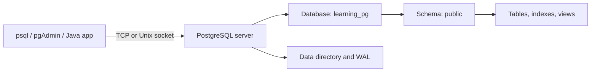

# Installing PostgreSQL on Linux, Windows, and macOS

**PostgreSQL** is an open-source relational database management system supporting SQL, ACID transactions, rich data types, indexes, foreign keys, views, functions, and extensive extensibility. To start learning PostgreSQL, you need to install the database server, a client tool, and create a database for practice. Across Linux, Windows, and macOS, the installation steps differ, yet once the server is running, working with SQL is nearly identical.

This lesson covers three common environments:

- **Linux:** Ubuntu/Debian via APT; Fedora/RHEL/Rocky Linux via DNF.
- **Windows:** the graphical PostgreSQL installer recommended on the official download page, typically provided by EDB.
- **macOS:** Homebrew or the Postgres.app application.

After installing, you will verify the service, connect with `psql`, create a role/database, test SQL statements, and learn how to troubleshoot common errors. The commands assume you have privileges to install software on a practice machine. Never run commands that alter accounts, networking, or delete data on a production host without proper operational procedures.

## 1. Understanding Components Before Installing

A typical PostgreSQL setup consists of:

| Component | Role | Example |
| --- | --- | --- |
| PostgreSQL server | Manages databases, data, transactions, and connections | The `postgres` process |
| Database cluster | Collection of databases managed by a single PostgreSQL server instance within one data directory | Directory initialized by `initdb` |
| Command-line client | Sends SQL to the server | `psql` |
| GUI admin tool | Manages and queries via a graphical interface | pgAdmin or a compatible SQL client |
| Service manager | Starts/stops the server process | `systemctl`, Windows Services, `brew services` |
| Data directory | Stores tables, indexes, WAL, and instance metadata | Path reported by `SHOW data_directory;` |
| Configuration | Controls ports, listen addresses, and authentication | `postgresql.conf`, `pg_hba.conf` |



Terminology note: in PostgreSQL documentation, a **database cluster** does not necessarily mean a multi-server cluster. It refers to a collection of databases stored in **one** data directory and managed by **one** PostgreSQL instance. Do not confuse this with a high-availability cluster with primary/standby nodes.

### 1.1. Server and Client Can Reside on Different Machines

If you install only `psql`, you can connect to a PostgreSQL server on another machine, **but you will not have a server to run local databases**. Conversely, if you install the server without a CLI client in `PATH`, you can still administer it using the full path or a GUI.

In this lesson, we install both the server and the tools required to connect to `localhost`. The default TCP port is usually **5432**, though it may have been changed to run multiple instances.

### 1.2. Choosing a PostgreSQL Version

Choose **a major version still supported** by PostgreSQL that matches your application, operating system, drivers, and deployment environment. Do not assume the version in your OS's default repository is the latest release, and you do not need to upgrade to the very newest release just to complete basic lessons.

Some examples below use **PostgreSQL 18** to illustrate versioned package names; if you install a different major version, substitute the corresponding version number. Availability of Homebrew formulas, RPM packages, Windows binaries, and OS support depends on time and repository state.

Trusted download sources:

- [Official PostgreSQL Download Page](https://www.postgresql.org/download/)
- [PostgreSQL for Ubuntu](https://www.postgresql.org/download/linux/ubuntu/)
- [PostgreSQL for Red Hat and Related Distributions](https://www.postgresql.org/download/linux/redhat/)
- [PostgreSQL for Windows](https://www.postgresql.org/download/windows/)
- [PostgreSQL for macOS](https://www.postgresql.org/download/macosx/)

## 2. Pre-Installation Preparation

Before choosing an installation method, check:

1. **Operating system and CPU architecture:** Linux distribution/version, Windows x64, or macOS Intel/Apple Silicon. Pick a build supported by the publisher.
2. **Machine privileges:** `sudo` on Linux, administrator privileges for Windows installation, write permissions for Homebrew/Applications on macOS.
3. **Is port 5432 already in use?** If PostgreSQL is already running, installing another instance may cause port or service conflicts.
4. **Is there existing data?** If this machine holds older databases, back them up and identify the existing data directory before changing versions or initializing an instance.
5. **Network requirements:** learning on a personal machine typically requires only `localhost`. There is no need to expose the server to the Internet.
6. **Disk space, data directory permissions, and backups:** development databases may be small, but WAL, backups, and logs also consume disk space.

You can check before installing:

```bash
# Linux or macOS, if psql is already in PATH:
psql --version

# If a server is already running and pg_isready is available:
pg_isready -h 127.0.0.1 -p 5432
```

`pg_isready` checks whether the server accepts connections; it **does not prove** that a username/password has permission to log in to a specific database. If `psql --version` fails, the client may not be installed yet or its `bin` directory may not be in `PATH`.

## 3. Installing PostgreSQL on Ubuntu/Debian

Ubuntu and Debian use the **APT** package system. The simplest approach for a learning environment is installing the PostgreSQL version included in the OS repository.

### 3.1. Updating the Package Index and Installing

Open a terminal on Ubuntu/Debian:

```bash
sudo apt update
sudo apt install postgresql postgresql-client
```

The `postgresql` package usually pulls in the server version matching the repository; `postgresql-client` provides the client utilities. Some Debian packages also install cluster management tools like `pg_lsclusters`.

If you need a specific major version not available in the default repository, follow the **PostgreSQL Apt Repository (PGDG)** instructions for your exact OS release on the official PostgreSQL site. Never manually add a repository meant for a different Ubuntu/Debian release: doing so can break dependencies or prevent security updates.

### 3.2. Checking the Service and Cluster

On systems using systemd:

```bash
sudo systemctl status postgresql
```

If the service is not enabled yet, you can run:

```bash
sudo systemctl enable --now postgresql
```

On Debian/Ubuntu, the `postgresql` unit is sometimes an **umbrella/management service**; the actual cluster may use a versioned unit named after the cluster, such as `postgresql@18-main`. Thus, `systemctl status postgresql` showing `active (exited)` is **not enough** to conclude that the specific database process is running.

Inspect clusters using the Debian utility:

```bash
pg_lsclusters
```

Illustrative output (version/port/path may differ):

```text
Ver Cluster Port Status Owner    Data directory
18  main    5432 online postgres /var/lib/postgresql/18/main
```

If the cluster is `down`, check the actual version and cluster name, then start it with the distribution's tool—for example, for cluster `18/main`:

```bash
sudo pg_ctlcluster 18 main start
```

Replace `18` and `main` according to `pg_lsclusters`. Never create a new cluster or run `initdb` on an existing data directory just because the service is not running.

### 3.3. Logging In with the postgres Operating System Account

Debian/Ubuntu packages typically create an **operating system user** named `postgres` alongside a **PostgreSQL role** named `postgres`. Local authentication over Unix sockets generally uses the **peer** method, which matches the OS user to the database role.

To open `psql` with instance administrative privileges:

```bash
sudo -iu postgres psql
```

Inside `psql`, run:

```sql
SELECT version();
SELECT current_user, current_database();
SHOW port;
```

Upon successful login, `current_user` is typically `postgres` and `current_database()` is typically `postgres`. To exit:

```text
\q
```

**Do not assume the `postgres` role has a pre-configured TCP password.** On Debian/Ubuntu, running `psql -U postgres -h 127.0.0.1` may prompt for a password and fail while `sudo -iu postgres psql` works. That is the difference between local peer authentication and host/TCP authentication, not necessarily a broken installation.

## 4. Installing PostgreSQL on Fedora/RHEL/Rocky Linux

Fedora, RHEL, and Rocky Linux distributions typically use **DNF**. Package names and initialization tools can differ between distribution packages and versioned PGDG packages.

### 4.1. Installing Distribution Packages

On distributions providing these packages:

```bash
sudo dnf install postgresql-server postgresql-contrib
```

On some releases, you may need to enable an appropriate module or repository before installing; do not blindly apply module-enable commands from one release to another. If a specific major version is required, follow PostgreSQL's official instructions for your OS and version.

### 4.2. Initializing the Data Directory

With standard distribution packages, initializing a new database cluster is usually:

```bash
sudo postgresql-setup --initdb
```

This step **creates the initial data structure**, not a command to re-run every time the server starts. **Only execute this when the instance does not yet have an initialized data directory.** If the host already stores databases, verify existing paths and instance status before running it.

With versioned PGDG PostgreSQL packages, the command may have a different name, such as `/usr/pgsql-18/bin/postgresql-18-setup initdb`, and the service might be named `postgresql-18`. Those names are **examples for major version 18**; consult the documentation for the actual package installed.

### 4.3. Starting the Service

With distribution packages using the `postgresql` service name:

```bash
sudo systemctl enable --now postgresql
sudo systemctl status postgresql
```

For packages with versioned service names, substitute the actual name managed by `systemctl`. Do not start two different PostgreSQL instances both listening on port 5432 without reconfiguring ports.

### 4.4. Testing the Connection

```bash
sudo -iu postgres psql
```

Then:

```sql
SELECT version();
SELECT current_user;
```

If connection fails, check the service, SELinux/network policy for TCP connections, and authentication methods in `pg_hba.conf`. Do not disable SELinux or open the entire firewall just for a local example.

## 5. Installing PostgreSQL on Windows

Windows does not use `apt` or `dnf`. A common approach is using the **graphical installer** featured on the PostgreSQL Windows download page, typically provided by EnterpriseDB (EDB).

### 5.1. Downloading the Correct Installer Version

1. Open [PostgreSQL Downloads — Windows](https://www.postgresql.org/download/windows/).
2. Follow the link to the installer matching your machine architecture and desired major version.
3. Download from the source recommended on the official page, checking publisher details/signatures if required by your organization.
4. Run the installer with appropriate privileges.

During setup, you will typically see these options:

| Step | Meaning | Recommendation for Practice Machine |
| --- | --- | --- |
| Installation Directory | Where binaries and tools are stored | Can keep the default path |
| Components | Server, Command Line Tools, pgAdmin, and optional utilities | Select server and client; GUI if needed |
| Data Directory | Where actual database data is stored | Choose a stable folder with sufficient space |
| Superuser Password | Password for the `postgres` admin role | Strong password, stored securely |
| Port | Port the server listens on | Typically `5432` if unused |
| Locale | Locale setting during cluster initialization | Choose according to needs and policy |

Installer screens may vary slightly across versions. If `5432` is already in use, identify the existing service before choosing a different port or altering the existing service.

**The password for the `postgres` role is critical.** The installer does not automatically reuse your Windows login password for this role. Do not give the database admin account a weak password, and never capture or save real passwords in documentation.

### 5.2. Checking the PostgreSQL Service

After installation, PostgreSQL usually runs as a **Windows Service**. Open `services.msc` or use PowerShell:

```powershell
Get-Service -Name 'postgresql*'
```

Output may show a service name such as `postgresql-x64-18` (example only; the actual name depends on the installer). A status of `Running` means the service is active.

If multiple instances exist, identify the exact service and port before starting or stopping an instance. Depending on your Windows account and policies, managing services may require running PowerShell as Administrator.

### 5.3. Opening psql on Windows

The installer typically provides **SQL Shell (psql)** in the Start Menu. Open SQL Shell and enter host, database, port, username, and password in order. For a typical local install:

```text
Server [localhost]: localhost
Database [postgres]: postgres
Port [5432]: 5432
Username [postgres]: postgres
Password for user postgres: (enter the password set during install)
```

To use PowerShell directly, you can invoke `psql.exe` using its full path. For example, if major version **18** was installed in the default directory:

```powershell
& "C:\Program Files\PostgreSQL\18\bin\psql.exe" -h localhost -p 5432 -U postgres -d postgres
```

If you installed another version, replace `18` with the installed directory name. For paths containing spaces, use quotes and the PowerShell call operator `&`.

Check the version:

```powershell
& "C:\Program Files\PostgreSQL\18\bin\psql.exe" --version
```

If you want to invoke `psql` directly from any folder, add the `bin` folder of the exact version to the `PATH` environment variable following OS/organizational procedures, then open a new terminal. Do not alter `PATH` carelessly if multiple PostgreSQL versions are installed; `psql --version` shows which binary is selected.

### 5.4. Using pgAdmin

If **pgAdmin** is installed, you can register a connection to the local instance:

| Field | Typical Value |
| --- | --- |
| Host name/address | `localhost` |
| Port | `5432` |
| Maintenance database | `postgres` |
| Username | `postgres` |
| Password | The PostgreSQL role password you set |

The password to unlock the pgAdmin application (if prompted) and the **database role** password serve two different purposes. Logging into pgAdmin does not automatically grant access to a server without supplying valid connection credentials.

## 6. Installing PostgreSQL on macOS with Homebrew

**Homebrew** is a popular package manager on macOS. This method fits well if you work heavily with the terminal, CLI, and development tools.

### 6.1. Checking Homebrew

Open Terminal:

```bash
brew --version
```

If the command does not exist, install Homebrew following the official instructions at [brew.sh](https://brew.sh/). Never run installation scripts downloaded from untrusted URLs. Note that Homebrew prefixes differ between Apple Silicon and Intel Macs; use `brew --prefix` instead of assuming all machines use the same folder.

### 6.2. Installing a Supported Version

For example, installing a major version provided under `postgresql@18`:

```bash
brew update
brew install postgresql@18
```

**`18` is an illustrative major version only**; check which versions Homebrew currently offers and substitute your target version. For some versioned formulas, binaries are not linked into `PATH` automatically because Homebrew allows multiple versions to coexist.

To use the client from the exact formula:

```bash
"$(brew --prefix postgresql@18)/bin/psql" --version
```

### 6.3. Starting the Server

Homebrew usually provides a service for the installed version:

```bash
brew services start postgresql@18
brew services list
```

Once the service is running, test connecting:

```bash
"$(brew --prefix postgresql@18)/bin/psql" -d postgres
```

In a typical Homebrew development setup, the initial administrative role may carry the **current macOS username**, rather than `postgres` as in Linux packages or Windows installers. `initdb` normally creates the initial superuser role matching the OS user that invoked it unless specified otherwise.

Therefore, if `psql -U postgres` reports that the role does not exist on macOS Homebrew, that may simply reflect how the cluster was initialized; try the role matching your OS username and verify with `SELECT current_user;`. Do not create a `postgres` role purely under the assumption that it is mandatory.

### 6.4. Stopping or Restarting the Service

```bash
brew services stop postgresql@18
brew services start postgresql@18
```

These commands apply only to the corresponding Homebrew service; if your PostgreSQL was installed via Postgres.app or another manager, do not use `brew services` to control that instance.

## 7. Installing PostgreSQL on macOS with Postgres.app

**Postgres.app** packages PostgreSQL as a macOS app, convenient when you want a quick setup without manually configuring multiple service components.

### 7.1. Basic Steps

1. Visit [Postgres.app](https://postgresapp.com/) or the official PostgreSQL macOS download page.
2. Choose the package matching your macOS version and CPU architecture.
3. Install the app following the publisher's instructions, usually moving it into `/Applications`.
4. Open Postgres.app and initialize/start the server from the UI.
5. Confirm the server is running and check the connection port.

Postgres.app includes CLI tools such as `psql`, `createdb`, and `pg_dump` inside the app's binary directory. In a standard installation, you can add the path for the current terminal session:

```bash
export PATH="/Applications/Postgres.app/Contents/Versions/latest/bin:$PATH"
psql --version
```

This path applies when Postgres.app is in the default location and exposes a `latest` folder; if your setup differs, check the binary path shown by the app. Here `export` only modifies `PATH` for the **current shell session**.

Test connecting:

```bash
psql -d postgres
```

Like some other macOS installations, the initial role may match your macOS user. If the `postgres` database or corresponding role does not exist, consult the initialization guide for your exact Postgres.app version rather than deleting the data directory to "start fresh."

### 7.2. Do Not Run Homebrew and Postgres.app on the Same Port

If Homebrew PostgreSQL is already listening on `5432` and Postgres.app also attempts to use `5432`, the second instance may fail to start or clients may connect to the wrong server. Check which instance is running, which port is used, and which `psql` binary is in `PATH`.

Useful commands on macOS:

```bash
which psql
psql --version
lsof -nP -iTCP:5432 -sTCP:LISTEN
```

`which psql` shows the client path; it **does not prove** the server you connect to comes from the same installation. To be certain, connect and run `SELECT version();`, `SHOW port;`, and `SHOW data_directory;`.

## 8. Verifying the Installation Across All Three Operating Systems

Once the server is running, any operating system can use the same common verification sequence.

### 8.1. Checking Client and Server Versions

In a terminal with `psql`:

```bash
psql --version
```

After connecting to the server:

```sql
SELECT version();
SELECT current_user, current_database();
SHOW server_version;
SHOW port;
```

The `psql` version is the **client**; the version returned by `SELECT version();` is the **connected server**. They can differ if multiple clients exist on the machine or if you are connecting to a remote server.

### 8.2. First psql Commands

`psql` has **meta-commands** starting with a backslash `\`. They are not SQL and are used directly inside a `psql` session:

| Command in psql | Effect |
| --- | --- |
| `\conninfo` | View current connection info |
| `\l` | List databases |
| `\du` | List roles |
| `\c learning_pg` | Switch to database `learning_pg` |
| `\dn` | List schemas |
| `\dt` | List tables in the active search path |
| `\d products` | Inspect structure of table `products` |
| `\?` | Meta-command help |
| `\h CREATE TABLE` | PostgreSQL SQL syntax help |
| `\q` | Quit psql |

Example:

```text
postgres=# \conninfo
postgres=# \l
postgres=# \du
postgres=# \q
```

`postgres=#` is an illustrative prompt; type only the command starting with `\`, not the prompt itself.

### 8.3. Explicit TCP Connection

To test connecting over TCP loopback:

```bash
psql -h 127.0.0.1 -p 5432 -U learning_app -d learning_pg
```

Meaning:

- `-h 127.0.0.1`: host of the PostgreSQL server.
- `-p 5432`: server port.
- `-U learning_app`: login role.
- `-d learning_pg`: target database.

If the role has a password, `psql` uses the configured authentication mechanism. To explicitly force a password prompt, add `-W`:

```bash
psql -h 127.0.0.1 -p 5432 -U learning_app -d learning_pg -W
```

Prefer entering passwords interactively at a prompt or via an appropriate secret management tool; never pass real passwords directly in connection strings saved to shell history.

## 9. Creating a Dedicated Role and Database to Learn SQL

You should not use the default administrative role like `postgres` for all application queries. A good practice is creating a **dedicated login role** and a **dedicated database**.

### 9.1. Distinguishing Roles from Databases

PostgreSQL uses the concept of a **role** to represent an identity along with a set of privileges. A role with the `LOGIN` attribute can connect; a role without `LOGIN` can be used to group privileges. A database is an isolated namespace containing schemas and data within the same instance.

| Concept | Example | Purpose |
| --- | --- | --- |
| PostgreSQL role | `learning_app` | Login identity and privileges |
| PostgreSQL database | `learning_pg` | Where practice tables are stored |
| Schema | `public` | Namespace inside the database |
| Table | `public.products` | Structure storing data |

### 9.2. Logging In with Administrative Privileges

Depending on the operating system:

- Ubuntu/Debian/Fedora distro packages: typically `sudo -iu postgres psql`.
- Windows installer: typically `psql -h localhost -U postgres -d postgres` using the password set during install.
- macOS Homebrew/Postgres.app: typically log in with the role created during `initdb`, which may match your macOS username.

After connecting with a role having `CREATEROLE` and `CREATEDB` or superuser privileges, run:

```sql
CREATE ROLE learning_app
    LOGIN
    PASSWORD 'REPLACE_WITH_A_UNIQUE_STRONG_PASSWORD!';

CREATE DATABASE learning_pg OWNER learning_app;
```

**Example only.** Replace the placeholder password with a strong secret unique to your environment. Never store real passwords in repositories or terminal screenshots. You can also use an administrative tool to set passwords securely without embedding secrets directly in script files.

`CREATE DATABASE` must be executed **outside a transaction block**. In standard `psql` autocommit mode, the statement runs directly; do not wrap the whole script in `BEGIN; ... COMMIT;`.

The `learning_app` role is set as the **owner** of the new database for practice. On modern PostgreSQL versions, default `CREATE` privileges on the `public` schema differ from older releases; in a newly created database with a valid owner, the owner role generally has the privileges needed to create tables in `public`. If your environment enforces custom schema policies, inspect actual privileges rather than granting `SUPERUSER` to bypass an error.

### 9.3. Connecting with the New Role

Exit the admin session with `\q`, then open a TCP connection:

```bash
psql -h 127.0.0.1 -p 5432 -U learning_app -d learning_pg -W
```

Once authenticated, run:

```sql
SELECT
    current_user AS role_name,
    current_database() AS db_name,
    current_schema() AS active_schema;
```

Expected output shows role `learning_app` working inside database `learning_pg`, typically with schema `public` per the default search path.

If PostgreSQL reports `role "learning_app" does not exist` or `database "learning_pg" does not exist`, verify that you are connecting to the **exact instance/port** where these objects were created; do not blindly recreate them on another server.

## 10. Running Your First SQL Exercise

In `psql` as `learning_app` on `learning_pg`, run:

```sql
CREATE TABLE products (
    product_id BIGINT GENERATED ALWAYS AS IDENTITY PRIMARY KEY,
    sku        VARCHAR(40) NOT NULL UNIQUE,
    name       VARCHAR(150) NOT NULL,
    unit_price NUMERIC(12, 2) NOT NULL CHECK (unit_price >= 0),
    stock_qty  INTEGER NOT NULL DEFAULT 0 CHECK (stock_qty >= 0)
);

INSERT INTO products (sku, name, unit_price, stock_qty)
VALUES
    ('BOOK-A5', 'A5 Notebook', 45000.00, 10),
    ('PEN-02', 'Blue Ballpoint Pen', 8000.00, 100);

SELECT
    product_id,
    sku,
    name,
    unit_price,
    stock_qty,
    unit_price * stock_qty AS inventory_value
FROM products
ORDER BY product_id;
```

Expected result:

| product_id | sku | name | unit_price | stock_qty | inventory_value |
| ---: | --- | --- | ---: | ---: | ---: |
| 1 | BOOK-A5 | A5 Notebook | 45000.00 | 10 | 450000.00 |
| 2 | PEN-02 | Blue Ballpoint Pen | 8000.00 | 100 | 800000.00 |

`GENERATED ALWAYS AS IDENTITY` instructs PostgreSQL to auto-generate identifiers; if the database already contains data, actual IDs may differ since sequences do not automatically reset. `NUMERIC(12,2)` fits unit prices requiring exact decimal precision.

Try inserting a product with a negative price:

```sql
INSERT INTO products (sku, name, unit_price, stock_qty)
VALUES ('BAD-PRICE', 'Invalid Price Item', -1.00, 5);
```

Expected result is a **CHECK constraint violation error**, and the row is not inserted. This demonstrates that the server enforces data constraints independently of any client UI.

When finished, inspect the tables with:

```text
\dt
\d products
```

**Do not** run the failing `BAD-PRICE` statement inside a transaction used for other work: after a statement fails, a PostgreSQL transaction enters an aborted state and requires `ROLLBACK` before continuing.

## 11. Authentication, Ports, and Key Configuration Files

After successful installation on any OS, two files are essential to know:

| File | Purpose |
| --- | --- |
| `postgresql.conf` | Port, listen addresses, memory, logging, and server settings |
| `pg_hba.conf` | Authentication rules by connection type, database, role, and client address |

Exact paths depend on the package and operating system. Rather than guessing paths, connect with an appropriately privileged admin role and ask the server:

```sql
SHOW config_file;
SHOW hba_file;
SHOW data_directory;
SHOW port;
SHOW listen_addresses;
```

On Debian/Ubuntu, configuration files and the data directory are typically separated by distribution packaging conventions. On Windows or macOS, these files often reside inside the instance's data directory. **Do not use example paths from one OS to edit another.**

### 11.1. Local and TCP Authentication Are Not the Same

A `pg_hba.conf` file may contain lines like:

```text
# TYPE   DATABASE   USER           ADDRESS          METHOD
local    all        postgres                        peer
host     all        all            127.0.0.1/32     scram-sha-256
host     all        all            ::1/128          scram-sha-256
```

This is an **illustrative example**, not a mandatory config for every installation.

- `local` applies to Unix-domain socket connections on supported systems.
- `host` applies to TCP/IP connections.
- `peer` authenticates using the OS user identity for matching local connections.
- `scram-sha-256` is a password authentication method more secure than legacy methods in many contexts.
- `127.0.0.1/32` specifies the IPv4 loopback address; `::1/128` specifies the IPv6 loopback address.

PostgreSQL evaluates `pg_hba.conf` entries **from top to bottom** and uses the first matching rule; if authentication under that rule fails, it does not fall through to subsequent rules as backups. Thus both order and scope of every line matter.

**Never use `trust` for connections from uncontrolled networks**, as it allows matching connections without checking a password. Special testing setups may use `trust`, but it should never be applied blindly to personal machines holding important data or to production.

### 11.2. Inspecting Authentication Configuration

If connected as an admin role with sufficient privileges, you can inspect the `pg_hba.conf` rules parsed by PostgreSQL:

```sql
SELECT
    line_number,
    type,
    database,
    user_name,
    address,
    auth_method,
    error
FROM pg_hba_file_rules
ORDER BY line_number;
```

This view helps catch lines with syntax errors or invalid authentication methods under the active configuration. Access to this view may be restricted; do not grant broad admin privileges to an application account merely to view system tables.

After editing `pg_hba.conf` in an authorized environment, the server usually needs a configuration **reload**:

```sql
SELECT pg_reload_conf();
```

For settings requiring a **restart** such as `listen_addresses`, a simple reload is insufficient. Verify applied status via documentation and server queries after making changes.

## 12. Allowing Remote Connections: Only When Truly Needed

For learning PostgreSQL on a single machine, keeping the server listening only on loopback is the lowest-risk option. If an application runs on another host, multiple layers must align:

1. The PostgreSQL server listens on the permitted network address.
2. The firewall/security group/VPC allows the **specific source IP** to reach the PostgreSQL port.
3. `pg_hba.conf` allows the exact database/role and source IP/range with an appropriate authentication method.
4. Login roles have strong passwords/credentials and only necessary SQL privileges.
5. Network connections use TLS in accordance with security policy; never send passwords and sensitive data over untrusted links.

Example of a `pg_hba.conf` line restricted to an illustrative internal subnet:

```text
# Example only: replace CIDR with your actual application source.
host    learning_pg    learning_app    192.0.2.0/24    scram-sha-256
```

The `192.0.2.0/24` range is reserved for documentation, not your default private network. Real configurations must reflect approved client sources.

In `postgresql.conf`, set `listen_addresses` to the appropriate internal interface IP address. Avoid using `'*'` to listen on all interfaces if only one network address is required. After modifying `listen_addresses`, a server **restart** is typically required.

**Never open port 5432 to the public Internet just to test a SELECT query.** Prefer a VPN, private network, SSH tunnel, or managed database platform with proper access controls.

## 13. Checking and Managing the Service by Operating System

| OS / Method | Checking the Server | Typical Server Management |
| --- | --- | --- |
| Ubuntu/Debian distro package | `pg_lsclusters`; `systemctl status postgresql` | `pg_ctlcluster <major> main start/stop` or corresponding systemd unit |
| Fedora/RHEL/Rocky distro package | `systemctl status postgresql` | `sudo systemctl start/stop postgresql` |
| Linux versioned PGDG package | Versioned systemd unit | E.g., `postgresql-18`, depending on actual package |
| Windows installer | Services or `Get-Service 'postgresql*'` | Windows Services / actual service name |
| macOS Homebrew | `brew services list` | `brew services start/stop postgresql@18` in the example |
| macOS Postgres.app | Status inside the app | Start/Stop via Postgres.app |

An application holding a connection pool can be disrupted when you restart the database. In real environments, account for downtime, active transactions, backups, and user notifications before changing service state.

### 13.1. Identifying Which Server You Are Actually Connected To

Especially when a machine hosts multiple PostgreSQL instances:

```sql
SELECT
    current_database() AS db_name,
    current_user AS role_name,
    inet_server_addr() AS server_ip,
    inet_server_port() AS server_port,
    version() AS server_version;
```

Over a Unix socket connection, `inet_server_addr()` may return `NULL`; that does not mean the server is inactive. Combine `\conninfo`, `SHOW data_directory;` (if permitted), and service details to confirm the exact instance.

## 14. Troubleshooting Common Installation and Connection Errors

### 14.1. "psql: command not found" or "psql is not recognized"

**Cause:** client is not installed or the binary directory is not in `PATH`.

Resolution:

- Linux: verify whether the appropriate client package is installed.
- Windows: invoke `psql.exe` directly from `C:\Program Files\PostgreSQL\<major>\bin` or add that exact folder to `PATH`.
- macOS Homebrew: use `"$(brew --prefix postgresql@18)/bin/psql"` if following the major 18 example.
- macOS Postgres.app: check `/Applications/Postgres.app/Contents/Versions/latest/bin` per your actual install.

Do not copy a standalone `psql` binary from another machine without knowing its shared library dependencies.

### 14.2. "connection refused" on localhost:5432

**Common causes:** server is not running, wrong port, or PostgreSQL is not listening on the interface/port being accessed.

Check in order:

```bash
pg_isready -h 127.0.0.1 -p 5432
```

Then inspect the service, active ports, and logs. On Linux with systemd, you can check:

```bash
sudo systemctl status postgresql
sudo journalctl -u postgresql -n 50 --no-pager
```

On Debian/Ubuntu, logs for the actual cluster may reside under `postgresql@<major>-main` or the distribution-managed log path. On Windows, check Windows Event Viewer and the PostgreSQL logs configured by the installer.

### 14.3. "FATAL: role ... does not exist"

PostgreSQL cannot find the requested role in the **connected instance**. If `psql` is invoked without `-U`, it defaults to the current OS username, which differs across Windows, Linux, and macOS.

Solution: connect with an existing admin role, run `\du` to list roles, and create the needed role properly. Do not grant superuser to an application role just to resolve a login error.

### 14.4. "FATAL: database ... does not exist"

Without `-d`, `psql` defaults to a database with the same name as the login user. The role may exist while a matching database has not been created.

Connect explicitly:

```bash
psql -h 127.0.0.1 -U learning_app -d learning_pg -W
```

Only create another database when actually needed; verify the exact database name and instance port first.

### 14.5. "Peer authentication failed"

**Common cause on Linux:** connecting via Unix socket using `peer`, where the current OS user does not match the target PostgreSQL role.

Example:

```bash
# Local login as OS user postgres:
sudo -iu postgres psql
```

To use a password over TCP, ensure the role and `pg_hba.conf` rules exist, then connect with `-h 127.0.0.1`. Never change all local authentication to `trust` just to bypass peer checks.

### 14.6. "password authentication failed"

Check:

- Are user, database, host, and port all correct?
- Are you pointing at a different PostgreSQL instance?
- Does the role have a valid password or use a different authentication method?
- Does the rule order in `pg_hba.conf` cause the connection to match an unexpected rule?
- Does your client driver support the configured authentication mechanism?

On a learning machine with admin privileges, you can reset the password **for the exact role** securely. Never record new passwords in command history or source code.

### 14.7. "no pg_hba.conf entry for host ..."

The server accepted the TCP connection but found no authentication rule matching the client IP, database, role, and encryption status.

Verify the real source IP seen by PostgreSQL, cross-check `pg_hba.conf`, TLS settings, and firewalls. Add the **narrowest rule that meets the requirement**, place it in the right order, and reload configuration. Never add `host all all 0.0.0.0/0 trust` "just to make it work."

### 14.8. Port 5432 Is Already in Use

Another PostgreSQL instance or another application may already be using the port.

On Linux/macOS:

```bash
ss -lntp | grep 5432
```

On macOS, `ss` is not available by default; use:

```bash
lsof -nP -iTCP:5432 -sTCP:LISTEN
```

On Windows PowerShell:

```powershell
Get-NetTCPConnection -LocalPort 5432 -State Listen
```

Never terminate a process without identifying its owner and impact. If you need multiple instances on the same machine, assign separate ports and data directories, and configure clients to target the right instance.

### 14.9. "permission denied for schema public"

The role can log in but lacks privileges to create tables in the target schema. PostgreSQL 15 and newer changed default `CREATE` privileges on `public` compared to older versions.

Check database ownership, schema ownership, search path, and granted privileges. If needed, an administrator can create a dedicated application schema with an appropriate owner instead of granting overly broad permissions:

```sql
-- Run inside learning_pg by a role permitted to create schemas.
CREATE SCHEMA app AUTHORIZATION learning_app;
```

Then qualify objects as `app.products` or configure `search_path` intentionally. Never grant `SUPERUSER` to resolve a simple schema permission error.

## 15. Backups, Upgrades, and Avoiding Data Loss During Reinstalls

Installing PostgreSQL for the first time differs from **upgrading an instance containing data**. Data lives in the actual cluster directory, not in binaries that can simply be uninstalled and reinstalled.

### 15.1. Logical Backups with pg_dump

Example backing up an accessible database:

```bash
pg_dump -h 127.0.0.1 -p 5432 -U learning_app -d learning_pg \
  -Fc -f learning_pg.dump
```

This uses Linux/macOS shell line continuation; in PowerShell, write the same parameters on **a single line** instead of using `\` line continuations.

`-Fc` selects `pg_dump`'s custom archive format, typically restored with `pg_restore`. A backup is only truly trustworthy after you establish **restore testing**, integrity verification, and protection for files containing sensitive data.

### 15.2. Minor Updates and Major Upgrades

- **Minor updates** within the same major version typically deliver bug/security fixes and share the same data directory format under supported update mechanisms.
- **Major upgrades** may require `pg_upgrade` or dump/restore; **never** point a newer major binary at an older major version's data directory expecting automatic compatibility.
- If multiple instances share a host, verify ports, services, extensions, configs, backups, and client versions before switching.
- For production, plan downtime/replication, test in a staging environment, and verify rollback and application compatibility.

Never delete the data directory or run `initdb` on a populated directory simply because PostgreSQL failed to start after an update. Read the logs first and check the current cluster's major version.

## 16. Quick Reference Comparison Across Operating Systems

| Task | Ubuntu/Debian | Fedora/RHEL/Rocky | Windows Installer | macOS Homebrew |
| --- | --- | --- | --- | --- |
| Install server | `sudo apt install postgresql` | `sudo dnf install postgresql-server` | Official installer | `brew install postgresql@18` (example) |
| Initialize cluster | Package usually creates default cluster | Usually requires `postgresql-setup --initdb` | Handled by installer | Formula/postinstall manages per docs |
| Manage service | `systemctl`, `pg_ctlcluster` | `systemctl` | Windows Services | `brew services` |
| First admin login | `sudo -iu postgres psql` | `sudo -iu postgres psql` | Usually `postgres` with set password | Initial role usually matches macOS user |
| psql client | Client package | Client package | SQL Shell or `psql.exe` | Binary inside Homebrew formula |
| Common port | 5432 | 5432 | 5432 | 5432 |
| Test connection | `pg_isready`, `psql` | `pg_isready`, `psql` | `psql.exe` or pgAdmin | `psql` or SQL client |

For **Postgres.app**, manage the server through the app and use the CLI binaries bundled with it; do not blindly apply Homebrew steps to it.

## 17. Practice Exercises

1. On your current operating system, choose a suitable PostgreSQL installation method. Explain why you chose distro packages, the installer, Homebrew, or Postgres.app.
2. Identify the **server version**, **`psql` version**, port, and data directory. Explain why client and server versions can differ.
3. Verify the server is running via the OS service manager. On Debian/Ubuntu, also explain the difference between the umbrella `postgresql` service and a specific cluster unit.
4. Log into `psql` using an administrative role in your practice environment and run `SELECT version();`, `\l`, `\du`, and `\conninfo`.
5. Create the `learning_app` role and the `learning_pg` database owned by that role. Then connect via TCP to `127.0.0.1:5432` using the new role.
6. Create the `products` table, insert two products, and query inventory value. Test a statement violating `CHECK` and explain the error.
7. Find the paths to `postgresql.conf`, `pg_hba.conf`, and `data_directory` using SQL queries; do not guess paths from another OS.
8. Compare local Unix socket connections with TCP connections. Why might `sudo -iu postgres psql` succeed while `psql -h 127.0.0.1 -U postgres` prompts for a password?
9. Describe how to grant access from another internal application server to PostgreSQL without exposing the database to the entire Internet.
10. Outline the resolution for each error: `psql not found`, `connection refused`, `role does not exist`, `peer authentication failed`, and `no pg_hba.conf entry`.
11. On macOS, if both Homebrew and Postgres.app are installed, how can you tell which server is listening on port 5432 and which installation's `psql` binary is running?
12. Explain why you cannot upgrade PostgreSQL to a new major version merely by swapping binaries without upgrading data; describe the backup and restore testing steps required beforehand.

## 18. Summary

Installing PostgreSQL on Linux, Windows, and macOS differs in **packages, cluster initialization, service managers, and initial login methods**. Once the server is running, however, the general workflow is the same:

```text
Install server and client
    -> Confirm the instance is running on the expected port
    -> Connect with psql
    -> Verify server version and role identity
    -> Create a dedicated role and database
    -> Run test SQL
    -> Understand authentication config, backups, and security
```

Start with **local connections, a least-privilege application role, and a dedicated practice database**, rather than opening broad admin privileges or network ports from the beginning. Understanding the distinctions between the PostgreSQL server, `psql` client, cluster, database, roles, and configuration files will help you install safely, diagnose connection issues effectively, and prepare for subsequent lessons on SQL, transactions, and PostgreSQL administration.
