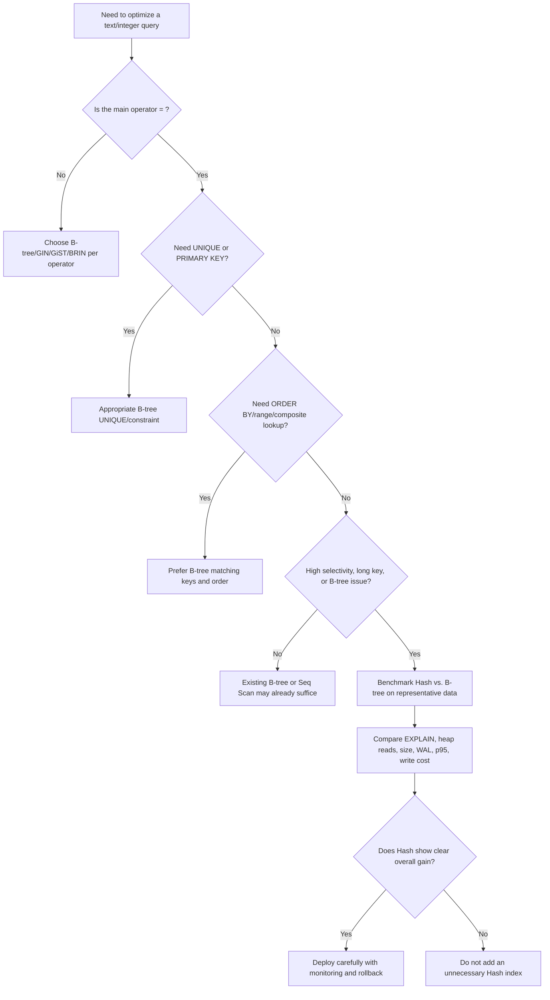

# Hash Indexes and Equality Queries in PostgreSQL

In PostgreSQL, a **Hash index** is an indexing method designed to support **equality comparisons** (`=`). Instead of storing full key values in a sortable order that can be traversed from smallest to largest like a B-tree, a Hash index stores the **hash code** of the key and organizes index entries into *buckets*.

If a workload consists primarily of exact single-value lookups:

```sql
SELECT *
FROM orders
WHERE external_code = 'EVT-00018427';
```

a Hash index may be worth testing. Yet for most application tables, **B-tree remains the better default choice**, because B-tree also handles equality well while additionally supporting other operators, sorting, unique constraints, and index scan modes that Hash indexes do not support.

This lesson is part of the **Indexes** chapter in the *Database Engine Relational PostgreSQL* module. It explains Hash index mechanics from storage to the query planner, proper usage with `=`, key limitations, when to test it against B-tree, how to benchmark accurately, and common pitfalls in Java/JDBC.

**All DDL examples are strictly for a test database.** Never create or swap production indexes just because the word “hash” suggests O(1) lookup. Decisions must be grounded in query plans, data distribution, correctness requirements, and maintenance costs.

## 1. Learning Objectives and Use Cases

After this lesson, you will be able to:

1. Explain why Hash indexes suit `WHERE column = value` yet do not directly serve `ORDER BY` or range queries.
2. Distinguish **Hash indexes** from **Hash Join**, **Hash Aggregate**, and the `hashtext()` function.
3. Understand hash codes, buckets, overflow pages, hash collisions, and why PostgreSQL must **recheck** values in the heap.
4. Identify limitations: **not unique**, **single index key only**, **no index-only scan**, **no ordering**, and other constraints of the hash access method.
5. Create and test indexes using `CREATE INDEX ... USING hash` and `EXPLAIN (ANALYZE, BUFFERS)`.
6. Weigh B-tree, expression indexes, partial indexes, and multi-column indexes for business requirements.
7. Monitor index size, access statistics, update impact, and WAL.
8. Roll out index changes safely and verifiably on production systems.

Consider an application ingesting external events via a long identifier:

```sql
SELECT event_id, received_at, payload
FROM integration_event
WHERE partner_reference = $1;
```

If `partner_reference` has high cardinality, typically matches only a few rows, and no other queries need sorting or range scans on it, a Hash index **may be worth benchmarking**. However, if that field must be unique, a unique B-tree index is still required.

## 2. Refresher: What Is an Index in PostgreSQL?

A PostgreSQL table stores row versions in a **heap**. Without an index, finding a rare code may force PostgreSQL to scan many heap pages:

```text
Event heap
┌────────────────────┐
│ Page 1: many rows  │
├────────────────────┤
│ Page 2: many rows  │
├────────────────────┤
│ Page 3: many rows  │
├────────────────────┤
│ ...                │
└────────────────────┘

SELECT ... WHERE external_code = 'EVT-00018427'
   → May read many pages if using Seq Scan alone.
```

An index adds a structured access path to locate **TIDs (tuple identifiers)** of rows with matching keys:

```text
Query value
       │
       ▼
     Index
       │
       ▼
Heap TIDs to inspect
       │
       ▼
Row versions visible under MVCC
```

An index **does not** replace MVCC visibility checks. Even when an index points directly to a tuple, PostgreSQL still must determine which version is visible to the transaction snapshot.

### 2.1. An Access Method Is an Index Structure Choice

PostgreSQL offers several index access methods, commonly including:

| Method | Common Use Cases |
|---|---|
| **B-tree** | Equality, ordering, ranges, uniqueness, ordered index scans |
| **Hash** | Equality (`=`) on a single key |
| **GIN** | Multi-component keys such as arrays, full-text, JSONB per operator class |
| **GiST** | Geometric searches, ranges, and operators per operator class |
| **SP-GiST** | Space-partitioned data, tries, and specialized opclasses |
| **BRIN** | Block-range summaries, effective when values correlate with physical position |

You cannot pick an index purely from column data types. You must evaluate the **operators** in queries, **operator classes**, number of rows retrieved, and ordering or uniqueness needs.

## 3. Creating a Basic Hash Index

Syntax:

```sql
CREATE INDEX index_name
ON schema_name.table_name
USING hash (column_name);
```

Example:

```sql
CREATE INDEX idx_event_external_code_hash
ON demo_hash.integration_event
USING hash (external_code);
```

When running:

```sql
SELECT event_id, external_code
FROM demo_hash.integration_event
WHERE external_code = 'EVT-00018427';
```

the planner **may** choose the Hash index if statistics and cost estimates show it is beneficial. Creating an index never forces the planner to always use it.

### 3.1. USING hash Syntax Is Not a Hash Function Call

```sql
CREATE INDEX ... USING hash (external_code);
```

does not mean storing raw `external_code` strings in a new hash column. PostgreSQL invokes the hash function from the matching **hash operator class** to produce internal index keys.

Do not manually write:

```sql
-- No need to hash values manually to use a Hash index:
CREATE INDEX ... ON t USING hash (md5(external_code));
```

Wrapping in `md5()` changes the key expression and lookup semantics. For `external_code = ?` lookups, prefer indexing the column directly rather than double-hashing.

### 3.2. A Hash Index Does Not Modify the Table

Creating a Hash index does not alter text values, turn codes into hash strings inside the heap, or change existing constraints. It builds an **independent index object** that PostgreSQL can consult during queries.

## 4. Why Does a Hash Index Support Only Equality Comparisons?

A hash function maps input keys to hash codes:

```text
  'EVT-001' ──────► hash code A ──► bucket X
  'EVT-002' ──────► hash code B ──► bucket Y
  'EVT-003' ──────► hash code C ──► bucket X
```

Two values equal under the corresponding hash/equality rules must yield **compatible hash codes** for lookups to work. However, numeric relationships between hash codes **do not preserve lexical or magnitude ordering** of the original keys.

For example, there is no rule saying:

```text
'a' < 'b'  ⇒  hash('a') < hash('b')
```

Consequently, a Hash index lacks the ordering information needed to answer directly:

```sql
WHERE external_code > 'EVT-05000000'

WHERE external_code BETWEEN 'EVT-01000000' AND 'EVT-02000000'

ORDER BY external_code ASC
```

It only has an access strategy for a supported **equality operator**.

### 4.1. Queries Aligned with the Hash Index Idea

```sql
SELECT *
FROM demo_hash.integration_event
WHERE external_code = 'EVT-00018427';
```

```sql
SELECT COUNT(*)
FROM demo_hash.integration_event
WHERE external_code = 'EVT-00018427';
```

```sql
SELECT event_id
FROM demo_hash.integration_event
WHERE external_code = $1;
```

The last query uses a server-side/prepared-statement PostgreSQL placeholder; in JDBC you typically use `?`.

### 4.2. Queries Not Directly Served by Hash Index Lookup Conditions

```sql
-- Range query:
SELECT * FROM demo_hash.integration_event
WHERE external_code >= 'EVT-00010000';

-- Sorting:
SELECT * FROM demo_hash.integration_event
ORDER BY external_code
LIMIT 20;

-- Prefix pattern:
SELECT * FROM demo_hash.integration_event
WHERE external_code LIKE 'EVT-0001%';

-- Substring search:
SELECT * FROM demo_hash.integration_event
WHERE external_code ILIKE '%184%';
```

If a query also includes an equality predicate, the planner might still use a Hash index **for that equality predicate** and filter or sort afterward. Yet the Hash index itself provides no range, pattern, or ordering access.

## 5. Comparing Hash Indexes and B-trees

| Criterion | Hash index | B-tree |
|---|---|---|
| `WHERE key = value` | Can support | Can support |
| `WHERE key < value` or `>` | No | Yes, per opclass |
| `BETWEEN` | No | Yes |
| `ORDER BY key` via index order | No | Possible |
| `MIN(key)`/`MAX(key)` via index order | No | Possible |
| Unique index | **No** | Yes |
| Composite index with multiple key columns | **No** in current Hash AM | Yes |
| `INCLUDE`/covering index | Not supported like B-tree | Yes, depending on structure |
| Index-only scan | **No** | Possible when eligible |
| Partial index | Yes | Yes |
| Expression index | Yes | Yes |
| Optimizing very long text codes | May be worth testing since it stores hash codes | Has index tuple size limits |
| Subject to hash collisions | Yes, requires recheck | No equivalent hash collision issue |
| Default for `CREATE INDEX` | No | **Yes** |
| Suitable for PK/business unique keys | No | Usually suitable |

B-tree handles equality while also covering many additional needs. Thus **never create a Hash index just because a query has `=`**; an existing B-tree may already handle it nicely without introducing another index.

### 5.1. Cases Where a Hash Index May Be Worth Considering

- A high-cardinality column queried almost exclusively via equality.
- Long index key values that make B-trees large or hit raw key size limits.
- No need for uniqueness, ordering, range scans, or index-only scans on that column.
- Benchmarks on real data show favorable size, latency, and write cost.
- No existing B-tree already serves the workload adequately.

These are **test candidates**, not guarantees that a Hash index will win.

### 5.2. Cases Where B-tree Is Usually More Appropriate

- The key must be `UNIQUE` or a `PRIMARY KEY`.
- Queries use `>`, `<`, `BETWEEN`, or `ORDER BY`.
- Predicates combine multiple columns, such as `tenant_id` and `external_code`.
- Index-only scans are desired.
- Prefix lookups are needed with a compatible operator class/collation.
- An existing B-tree already performs well with no measured bottleneck.

## 6. What Does a Hash Index Physically Store?

A PostgreSQL Hash index stores a **4-byte hash code** of the index key along with the TID pointing to the heap tuple. It does not retain the full raw string as a key the way a standard B-tree does.

Concept:

```text
Hash index
┌────────────────────────────────────────────┐
│ Metadata / metapage                         │
├────────────────────────────────────────────┤
│ Bucket 0                                    │
│    hash code h0 → heap TID                  │
│    hash code h1 → heap TID                  │
├────────────────────────────────────────────┤
│ Bucket 1                                    │
│    hash code h2 → heap TID                  │
│    hash code h3 → heap TID                  │
├────────────────────────────────────────────┤
│ Bucket 2                                    │
│    hash code h4 → heap TID                  │
│    ...                                      │
├────────────────────────────────────────────┤
│ Overflow pages when a bucket holds many     │
│ entries                                     │
└────────────────────────────────────────────┘
```

Illustrative diagram; it does not depict exact bit layouts across PostgreSQL versions.

### 6.1. Buckets Group Index Entries

The hash code identifies the target bucket. Entries inside that bucket locate candidate rows with matching hashes.

As the index grows, PostgreSQL splits buckets and manages overflow pages. Real lookup cost is not a single CPU hash calculation; it also depends on:

- Number of index pages read.
- Number of entries in the bucket.
- Number of overflow pages.
- Cache state and I/O.
- Number of heap tuples needing recheck.
- Value distribution and duplicate key counts.
- MVCC visibility.
- Concurrency and internal index locks/latches.

Therefore, never describe Hash indexes as “every lookup is always O(1) in practice.”

### 6.2. A Hash Code Is Not the Actual Value

Given strings:

```text
'ORDER-ABC'
'ORDER-XYZ'
```

the index stores only representative hash codes to filter candidates. When PostgreSQL must return `external_code` or confirm an exact match, it must visit the heap—it cannot deduce the original key from the hash code alone.

This directly leads to two constraints: **collision rechecks** and **no index-only scans**.

## 7. Hash Collisions: Why Values Must Be Rechecked

A **hash collision** occurs when two **distinct** keys produce the same hash code.

Collisions are unavoidable because the space of possible text strings is vast while a PostgreSQL Hash index uses a finite-width hash code.

```text
    'external-code-A' ──► 0x1A2B3C4D ─┐
                                        ├─► same hash code
    'external-code-B' ──► 0x1A2B3C4D ─┘

    Two different strings!
```

The hex value illustrates a collision only and is **not an actual PostgreSQL hash output** for those strings.

### 7.1. Two Layers of Verification During a Query

For:

```sql
SELECT event_id
FROM demo_hash.integration_event
WHERE external_code = 'EVT-00018427';
```

A Hash index scan:

1. Computes the query value's hash code via the matching opclass.
2. Finds index tuples in the bucket with a matching hash code.
3. Fetches heap tuples using the TIDs.
4. **Rechecks actual equality** on `external_code`.
5. Applies MVCC visibility and any remaining predicates to return accurate rows.

Thus collisions can **increase the number of candidate heap reads**, yet they can never cause a query to return wrong rows simply due to matching hash codes.

### 7.2. Do Not Confuse Hash Collisions with Duplicate Keys

Two rows sharing the same `external_code` are **duplicate values** under equality. Two rows with different `external_code` values but identical hash codes are a **collision**.

A Hash index stores entries for both. It **does not enforce uniqueness**.

An application must never treat:

```sql
hashtext(external_code) = hashtext(?)
```

as proof that two original strings are equal. When comparing values, always compare the **original values**.

### 7.3. Why Can't a Hash Index Be UNIQUE?

A Hash index stores only finite-width hash codes, where distinct values can share a hash code. It lacks B-tree's unique index machinery to enforce uniqueness on original keys as supported by PostgreSQL.

The following syntax is invalid for the Hash access method:

```sql
-- INTENTIONALLY INVALID:
CREATE UNIQUE INDEX ux_event_code_hash
ON demo_hash.integration_event USING hash (external_code);
```

When `UNIQUE` is needed:

```sql
CREATE UNIQUE INDEX ux_event_code_btree
ON demo_hash.integration_event USING btree (external_code);
```

Note that if existing data contains actual duplicates, creating a unique B-tree will fail. Never create a unique index in the lab without checking existing data first.

## 8. A Hash Index Is Not a Hash Join

Both terms contain “hash,” yet they operate at **completely different layers**.

**Hash index:**

- A persistent schema object in the database.
- Created with `CREATE INDEX ... USING hash`.
- Accelerates equality lookups on a single key.
- Occupies disk space and is maintained across `INSERT`/`UPDATE`/`DELETE`/`VACUUM`.
- Evaluated by the query planner as an access path.

**Hash Join:**

- A **join algorithm** inside a single query's execution plan.
- Typically builds a transient hash table in memory (spilling to disk if needed) to match two datasets on a join condition.
- Does not require any Hash index on either table.
- Does not persist an index just because the execution plan has a `Hash` node.

### 8.1. Example of Hash Join Without Any Hash Index

```sql
SELECT e.event_id, t.tenant_name
FROM demo_hash.integration_event AS e
JOIN demo_hash.tenant AS t
    ON t.tenant_id = e.tenant_id;
```

PostgreSQL might choose:

```text
Hash Join
  Hash Cond: (e.tenant_id = t.tenant_id)
  -> Seq Scan on integration_event e
  -> Hash
       -> Seq Scan on tenant t
```

This is an **illustrative plan**, not fixed `EXPLAIN` output. No Hash index needs to exist for `Hash Join` to execute.

### 8.2. Hash Indexes Can Be Used by Nested Loop

If a query looks up a few rows by code per outer row and the Hash index is selective enough, the planner may pick an **Index Scan on the Hash index** on the inner side of a `Nested Loop`.

```text
Nested Loop
  -> ... outer rows ...
  -> Index Scan using idx_event_code_hash
       Index Cond: (external_code = outer.some_code)
```

This plan is likewise illustrative. Choosing it depends on row counts, statistics, alternative join strategies, and costs.

### 8.3. HashAggregate Is Also a Separate Concept

`HashAggregate` groups rows using an in-execution hash table, not a Hash index created on the grouping column.

```sql
SELECT tenant_id, COUNT(*)
FROM demo_hash.integration_event
GROUP BY tenant_id;
```

If `EXPLAIN` shows `HashAggregate`, **do not infer** that a `hash` index method is being used.

## 9. Setting Up a Sufficiently Large Lab Dataset

Create an isolated schema for testing without touching external tables.

```sql
CREATE SCHEMA IF NOT EXISTS demo_hash;

CREATE TABLE demo_hash.tenant (
    tenant_id INTEGER PRIMARY KEY,
    tenant_name TEXT NOT NULL
);

CREATE TABLE demo_hash.integration_event (
    event_id BIGINT GENERATED ALWAYS AS IDENTITY PRIMARY KEY,
    tenant_id INTEGER NOT NULL REFERENCES demo_hash.tenant(tenant_id),
    external_code TEXT NOT NULL,
    event_type TEXT NOT NULL,
    created_at TIMESTAMPTZ NOT NULL,
    payload TEXT NOT NULL
);
```

Initially only the PK on `event_id` exists, while `external_code` has **no index**. We will compare indexing options on this column.

### 9.1. Inserting Data

```sql
INSERT INTO demo_hash.tenant (tenant_id, tenant_name)
SELECT
    g,
    'Tenant ' || g::text
FROM generate_series(1, 100) AS g;

INSERT INTO demo_hash.integration_event
    (tenant_id, external_code, event_type, created_at, payload)
SELECT
    ((g - 1) % 100) + 1,
    'EVT-' || lpad(g::text, 8, '0'),
    CASE WHEN g % 10 = 0 THEN 'RETRY' ELSE 'NEW' END,
    TIMESTAMPTZ '2026-01-01 00:00:00+00'
        + (g % 300) * INTERVAL '1 day',
    repeat('p', 80)
FROM generate_series(1, 100000) AS g;

ANALYZE demo_hash.integration_event;
ANALYZE demo_hash.tenant;
```

On a clean schema, this produces:

- 100 tenants.
- 100,000 events.
- Deterministic `external_code` values, one distinct value per event.
- Skewed `event_type` distribution, with far more `'NEW'` rows than `'RETRY'`.
- Moderate payload width so the heap contains more than just indexed keys.

Do not re-run setup if the table already has 100,000 rows without resetting first: that creates duplicates and alters benchmark conditions.

### 9.2. Verifying Distribution

```sql
SELECT
    COUNT(*) AS total_rows,
    COUNT(DISTINCT external_code) AS distinct_codes,
    COUNT(DISTINCT tenant_id) AS distinct_tenants
FROM demo_hash.integration_event;

SELECT event_type, COUNT(*) AS row_count
FROM demo_hash.integration_event
GROUP BY event_type
ORDER BY event_type;
```

With this data, an equality lookup on `external_code` is very selective. Conversely, `event_type = 'NEW'` returns most of the table: two opposite profiles leading to **different plan choices**.

## 10. Baseline: No Index on external_code

Start here:

```sql
EXPLAIN (ANALYZE, BUFFERS)
SELECT event_id, tenant_id, external_code
FROM demo_hash.integration_event
WHERE external_code = 'EVT-00018427';
```

Without an index on `external_code`, the planner typically picks `Seq Scan` and checks each row.

Illustrative plan:

```text
Seq Scan on integration_event
  Filter: (external_code = 'EVT-00018427')
  Rows Removed by Filter: ...
```

**There is no fixed timing number.** Lab latency depends on CPU, storage, cache, row count, and runtime environment.

Record:

- `Execution Time`.
- `actual rows`.
- `Rows Removed by Filter`.
- `Buffers: shared hit/read`.
- Actual plan nodes.

Never extrapolate production performance from a single execution timing.

## 11. Creating and Testing the Hash Index

```sql
CREATE INDEX idx_event_external_code_hash
ON demo_hash.integration_event
USING hash (external_code);

ANALYZE demo_hash.integration_event;
```

Inspect the plan:

```sql
EXPLAIN (ANALYZE, BUFFERS)
SELECT event_id, tenant_id, external_code
FROM demo_hash.integration_event
WHERE external_code = 'EVT-00018427';
```

With high cardinality, PostgreSQL **may** select:

```text
Index Scan using idx_event_external_code_hash
  on integration_event
  Index Cond: (external_code = 'EVT-00018427')
```

If it still chooses `Seq Scan`, the index is not broken. The table may be small enough in your environment, pages may be cached, statistics may differ, or sequential reading may simply estimate cheaper.

### 11.1. Index Cond Does Not Mean No Heap Recheck

`Index Cond` indicates a condition used to locate candidates via the index. Because a Hash index stores only hash codes, PostgreSQL still visits the heap to recheck the original value and MVCC visibility.

Do not read `Index Cond` as equality being proven **from the 4-byte hash alone**.

### 11.2. A Query Returning Multiple Columns

```sql
EXPLAIN (ANALYZE, BUFFERS)
SELECT event_id, tenant_id, created_at, payload
FROM demo_hash.integration_event
WHERE external_code = 'EVT-00018427';
```

The Hash index identifies candidates, while returned columns come from the heap. For a single row, the cost stays low. For millions of candidates, fetching many heap pages becomes expensive and the planner may pick a different plan.

## 12. Comparing Against a B-tree on the Same Column

Create an additional B-tree index in the lab:

```sql
CREATE INDEX idx_event_external_code_btree
ON demo_hash.integration_event
USING btree (external_code);

ANALYZE demo_hash.integration_event;
```

Re-run:

```sql
EXPLAIN (ANALYZE, BUFFERS)
SELECT event_id, tenant_id, external_code
FROM demo_hash.integration_event
WHERE external_code = 'EVT-00018427';
```

When both indexes exist, **PostgreSQL chooses one of them** or even `Seq Scan`. Do not take a plan picking B-tree as proof that the Hash index is invalid, nor a plan picking Hash as proof that Hash is always faster.

### 12.1. How to Compare Fairly

On a **lab copy**:

1. Measure the query with **only the appropriate B-tree**.
2. Record `EXPLAIN`, buffers, multi-run latencies, and index size.
3. Drop the B-tree **in the lab**, and create/keep only the Hash index.
4. Measure the exact same query, data, and statistics state.
5. Repeat runs and compare p50/p95 latencies, I/O, footprint, and maintained index count.
6. If relevant, test `INSERT`/`UPDATE`/`DELETE` write workloads too.

Never alter live production indexes purely to run an experiment. Use a restored copy or an isolated benchmark environment when production is active.

### 12.2. Comparing Index Sizes

```sql
SELECT
    pg_size_pretty(
        pg_relation_size('demo_hash.idx_event_external_code_hash')
    ) AS hash_index_size,
    pg_size_pretty(
        pg_relation_size('demo_hash.idx_event_external_code_btree')
    ) AS btree_index_size;
```

Because a Hash index stores hash codes and TIDs, it **can be smaller** than a B-tree on long text keys. Actual size still depends on index metadata, bucket layout, overflow pages, page fill, duplicate keys, and PostgreSQL version details. Never claim a Hash index is always smaller.

## 13. The Case of Very Long Key Values

A Hash index is especially worth evaluating when a column is queried strictly by equality on long strings, such as:

- Very long partner reference codes.
- Long normalized paths or URIs.
- Text fingerprints used for exact lookups.
- Application tokens that do not require uniqueness and follow proper storage policies.

A Hash index stores only a 4-byte hash code for the key, whereas a B-tree stores actual key data and enforces a **per-entry maximum size limit**.

### 13.1. B-trees Have Limits on Oversized Keys

If text values are very long, a B-tree index can hit an error like:

```text
index row requires ... bytes, maximum size is ...
```

The exact limit depends on page size and index method. A Hash index on long text avoids **part of the direct key-size limit inside the index**, since it stores only the hash code.

This **does not** mean a Hash index can enforce `UNIQUE` on long keys or avoid reading the heap for rechecks.

### 13.2. Optional Lab with Long Codes

```sql
CREATE TABLE demo_hash.long_key_lookup (
    row_id BIGINT GENERATED ALWAYS AS IDENTITY PRIMARY KEY,
    long_code TEXT NOT NULL,
    payload TEXT
);

INSERT INTO demo_hash.long_key_lookup
    (long_code, payload)
SELECT
    repeat(md5(g::text), 20),
    'row-' || g::text
FROM generate_series(1, 20000) AS g;

CREATE INDEX idx_long_code_hash
ON demo_hash.long_key_lookup
USING hash (long_code);

ANALYZE demo_hash.long_key_lookup;
```

Strings built via `repeat(md5(...), 20)` are merely synthetic long test strings, **not a cryptographic token design**.

Lookup:

```sql
EXPLAIN (ANALYZE, BUFFERS)
SELECT row_id, payload
FROM demo_hash.long_key_lookup
WHERE long_code = repeat(md5('1234'), 20);
```

This exercise lets you observe index costs for long keys without manually constructing an expression index over a hash function.

### 13.3. Do Not Confuse a Hash Index with a Stored Digest Column

If the application needs **UNIQUE across an entire very long string**, you need a different design—such as a canonical short key, or a separately stored digest paired with value rechecks and constraint/transaction logic ensuring correctness.

A finite-length digest **cannot serve alone as absolute proof** that two source strings match. Never replace a string unique constraint with a unique digest without evaluating collision policies, threat models, and conflict handling.

## 14. Hash Indexes Do Not Support Composite Keys

PostgreSQL's current Hash access method supports **a single index key**, not standard multi-column indexes.

The statement below is invalid:

```sql
-- INTENTIONALLY INVALID:
CREATE INDEX idx_tenant_code_hash
ON demo_hash.integration_event
USING hash (tenant_id, external_code);
```

Problem:

```sql
SELECT *
FROM demo_hash.integration_event
WHERE tenant_id = 42
  AND external_code = 'EVT-00018442';
```

A composite B-tree is usually the right candidate to test:

```sql
CREATE INDEX idx_event_tenant_code_btree
ON demo_hash.integration_event
USING btree (tenant_id, external_code);
```

Meanwhile, a Hash index on `external_code` alone can locate rows matching the code and then filter `tenant_id` on the heap. If `external_code` is not globally unique and repeats across many tenants, that approach may inspect many unnecessary rows.

### 14.1. One Index Per Column Does Not Equal a Composite Index

```sql
CREATE INDEX idx_event_tenant_hash
ON demo_hash.integration_event USING hash (tenant_id);

CREATE INDEX idx_event_code_hash_alt
ON demo_hash.integration_event USING hash (external_code);
```

This is a conceptual example; the lab table already has `idx_event_external_code_hash`, so do not add a duplicate Hash index on the same column. Separate single-column indexes do not guarantee the same plan or performance as a composite B-tree.

PostgreSQL can combine bitmap/index paths in appropriate cases, yet two Hash indexes should not be treated as a general substitute for a composite key.

### 14.2. Never Concatenate Strings Ambiguously to Fake a Single Key

A dangerous idea is:

```sql
-- Not recommended:
CREATE INDEX ...
USING hash ((tenant_id::text || external_code));
```

Different value pairs can produce identical concatenated strings without unambiguous encoding/delimiters. Even with unambiguous encoding, a Hash index still lacks `UNIQUE`, `ORDER BY`, and range support.

When you have a composite business key, a **multi-column B-tree is usually clearer and safer**.

## 15. Hash Indexes Cannot Enforce UNIQUE or PRIMARY KEY

A table must enforce:

> Each tenant can have at most one row with the same `external_code`.

Express that constraint in the schema:

```sql
CREATE TABLE demo_hash.event_registry (
    registry_id BIGINT GENERATED ALWAYS AS IDENTITY PRIMARY KEY,
    tenant_id INTEGER NOT NULL,
    external_code TEXT NOT NULL,
    CONSTRAINT uq_event_registry_tenant_code
        UNIQUE (tenant_id, external_code)
);
```

PostgreSQL creates a matching unique B-tree index to enforce the constraint.

If you also create a Hash index on `external_code`:

```sql
CREATE INDEX idx_event_registry_code_hash
ON demo_hash.event_registry USING hash (external_code);
```

that index is **not a UNIQUE arbiter** and does not alter the uniqueness already enforced by the constraint above.

### 15.1. Constraints Must Protect Concurrency

Never replace a unique constraint with:

```text
SELECT count(*) WHERE external_code = ?
If zero: INSERT ...
```

Two sessions can both observe “zero” simultaneously and both `INSERT`. A Hash index only speeds up lookups; **it does not prevent duplicates under concurrent writes**. Uniqueness requires a unique constraint/index or a properly designed transactional synchronization strategy.

### 15.2. ON CONFLICT Needs a Valid Unique Arbiter

```sql
INSERT INTO demo_hash.event_registry
    (tenant_id, external_code)
VALUES (42, 'EXT-123')
ON CONFLICT (tenant_id, external_code)
DO NOTHING;
```

This statement relies on the composite unique constraint/index, **not on a Hash index**. A Hash index cannot act as an arbiter for `ON CONFLICT` to detect duplicate business keys.

If a table has only a Hash index with no matching unique constraint, `ON CONFLICT (key)` will error because no matching unique or exclusion constraint exists.

## 16. Hash Indexes Provide No Sort Order

A B-tree stores keys in ordered sequence and can support:

```sql
SELECT external_code
FROM demo_hash.integration_event
ORDER BY external_code
LIMIT 10;
```

A Hash index has **no ordering information** to satisfy `ORDER BY external_code`. The query must instead:

- Use a suitably ordered B-tree index.
- Or scan and run a `Sort` node in the plan.
- Or take another plan chosen by the planner.

### 16.1. Using Both a Hash Index and a Sort

```sql
SELECT event_id, external_code, created_at
FROM demo_hash.integration_event
WHERE external_code = 'EVT-00018427'
ORDER BY created_at DESC;
```

The Hash index can handle the equality condition; sorting becomes a separate operation if multiple rows match. With only one row, sorting is trivial, yet **it is not supplied by the Hash index**.

### 16.2. Do Not Use Hash Indexes for Keyset Pagination

If an application paginates:

```sql
SELECT event_id, external_code
FROM demo_hash.integration_event
WHERE external_code > 'EVT-00018427'
ORDER BY external_code, event_id
LIMIT 50;
```

a Hash index does not support range scans or cursor ordering like a B-tree. A B-tree matching the collation and tiebreaker is the right candidate to evaluate.

### 16.3. MIN and MAX

```sql
SELECT MIN(external_code), MAX(external_code)
FROM demo_hash.integration_event;
```

A Hash index has no “smallest/largest” element in key order to exploit directly. B-trees can enable min/max index optimizations depending on the plan and operator class.

## 17. No Index Only Scan with Hash Indexes

An **Index Only Scan** requires an index that holds enough data to return the requested values plus visibility support.

Because a Hash index stores only hash codes and TIDs—**not the original key values**—PostgreSQL cannot use it as a covering index to return `external_code` without touching the heap.

Example:

```sql
SELECT external_code
FROM demo_hash.integration_event
WHERE external_code = 'EVT-00018427';
```

Even when the query selects only the hashed column, PostgreSQL must still visit the heap to verify equality and retrieve the original value.

### 17.1. Even COUNT(*) Must Check MVCC and Values

```sql
SELECT COUNT(*)
FROM demo_hash.integration_event
WHERE external_code = 'EVT-00018427';
```

A Hash index supplies candidates, yet it cannot prove from the hash code alone how many tuples are **visible** and actually equal to the target string.

### 17.2. INCLUDE Does Not Remove This Limitation

Do not attempt:

```sql
-- INTENTIONALLY INVALID for the Hash access method:
CREATE INDEX idx_hash_cover
ON demo_hash.integration_event
USING hash (external_code)
INCLUDE (event_id);
```

Hash indexes do not support B-tree-style covering indexes via `INCLUDE`. If a workload needs `event_id` directly from the index, benchmark a B-tree with key/`INCLUDE` columns and favorable visibility map behavior.

### 17.3. B-tree Index Only Scan Doesn't Always Skip the Heap Either

A B-tree may carry all needed columns and still check the visibility map; pages not marked all-visible trigger `Heap Fetches`. Never claim B-tree index-only scans always incur zero heap reads.

## 18. Hash Indexes and NULL

PostgreSQL Hash indexes **do not store NULL index keys**. Consequently, they cannot be used to search for rows with `NULL` keys in the usual way.

```sql
SELECT *
FROM demo_hash.integration_event
WHERE external_code IS NULL;
```

The lab table defines `external_code NOT NULL`, so this query always returns empty; the example illustrates semantics only.

### 18.1. Equality vs. NULL

```sql
WHERE external_code = NULL
```

is not a valid `NULL` check under SQL three-valued logic; comparing against `NULL` yields `UNKNOWN`, never `TRUE`.

For a nullable column, the proper query is:

```sql
WHERE external_code IS NULL
```

Yet a Hash index **does not accelerate** `IS NULL` because it contains no `NULL` entries. A B-tree can support `IS NULL` lookups in many cases.

### 18.2. IS NOT DISTINCT FROM

`IS NOT DISTINCT FROM` provides NULL-safe equality, yet do not assume the planner translates it into a Hash `Index Cond` equivalent to `=` across all versions and structures. Check `EXPLAIN` for your specific query.

When you specifically want non-NULL exact equality, `column = ?` is the clearest condition for evaluating a Hash index.

## 19. High-Selectivity vs. Low-Selectivity Conditions

**Selectivity** determines how many heap reads an index actually saves.

### 19.1. A Nearly Unique Code

```sql
SELECT *
FROM demo_hash.integration_event
WHERE external_code = 'EVT-00018427';
```

In the lab, each code appears once. A Hash index can avoid scanning 100,000 rows.

### 19.2. A Status Appearing on Most of the Table

```sql
SELECT *
FROM demo_hash.integration_event
WHERE event_type = 'NEW';
```

Most lab rows carry `'NEW'`, so even with a Hash index on `event_type`, the planner will likely find `Seq Scan` cheaper than reading vast numbers of index entries and heap tuples.

There is no rule saying:

```text
WHERE x = constant  ⇒  Hash Index Scan is always faster than Seq Scan
```

### 19.3. Hash Collisions vs. Heavy Duplicate Values

When millions of rows genuinely share the same value, they share the same hash code and cluster inside the corresponding bucket and overflow pages.

That is not a collision bug between two distinct values; it is **true key duplication**, forcing the lookup to return many TIDs. When a query matches most of the table, an index may not be worthwhile.

### 19.4. Skewed Data Needs Accurate Statistics

The planner relies on statistics such as distinct value counts, most-common values, and histograms to estimate row counts.

```sql
ANALYZE demo_hash.integration_event;
```

If stats are stale after a large import, the planner can pick poor plans. Index diagnostics should start with cardinality and `ANALYZE`, never with forcing an index method.

## 20. Expression Hash Indexes

A Hash index can be built on **an expression**, not solely a raw column, provided the result type has a suitable hash operator class.

Example for case-insensitive email lookup with `lower()`:

```sql
CREATE TABLE demo_hash.contact_lookup (
    contact_id BIGINT GENERATED ALWAYS AS IDENTITY PRIMARY KEY,
    email TEXT NOT NULL,
    display_name TEXT
);

INSERT INTO demo_hash.contact_lookup (email, display_name)
VALUES
    ('Alice@example.test', 'Alice'),
    ('bob@example.test', 'Bob'),
    ('CAROL@example.test', 'Carol');

CREATE INDEX idx_contact_lower_email_hash
ON demo_hash.contact_lookup
USING hash ((lower(email)));
```

Queries must use the **matching expression**:

```sql
SELECT contact_id, email
FROM demo_hash.contact_lookup
WHERE lower(email) = lower('ALICE@example.test');
```

A Hash expression index can accelerate equality lookups on `lower(email)` when the planner judges it cost-effective.

### 20.1. Does Not Replace Case-Insensitive Uniqueness

Because this is a Hash index, the table can still accept two rows:

```sql
INSERT INTO demo_hash.contact_lookup (email)
VALUES ('alice@example.test');
```

If business rules forbid case-equivalent emails, use a **unique B-tree expression index** or a properly designed unique constraint/collation/canonical key.

```sql
-- Example only; may fail if existing data already has duplicates under lower(email):
CREATE UNIQUE INDEX uq_contact_lower_email_btree
ON demo_hash.contact_lookup (lower(email));
```

**Do not run a unique index build on data containing unresolved duplicates.** This section highlights that a Hash index supports search, not uniqueness enforcement.

### 20.2. lower() Is Not Complete Case Folding or Normalization

Unicode case folding, accent-insensitive comparisons, NFC/NFD normalization, and internationalized email rules are distinct concerns. `lower(email)` may fit one specific policy while failing broader linguistic or identifier requirements.

Choose expression indexes based on exact SQL semantics and business rules, not merely because an ASCII example passes.

## 21. Partial Hash Indexes

PostgreSQL supports **partial indexes** with a `WHERE` predicate. For example, indexing only unprocessed events:

```sql
CREATE INDEX idx_event_pending_code_hash
ON demo_hash.integration_event
USING hash (external_code)
WHERE event_type = 'NEW';
```

Query:

```sql
SELECT event_id, external_code, payload
FROM demo_hash.integration_event
WHERE event_type = 'NEW'
  AND external_code = 'EVT-00018427';
```

The planner can use the partial Hash index because the query predicates prove target rows belong to `event_type = 'NEW'` under PostgreSQL's predicate implication rules.

### 21.1. Queries Must Match the Predicate

```sql
SELECT event_id
FROM demo_hash.integration_event
WHERE external_code = 'EVT-00018427';
```

This omits `event_type = 'NEW'`. Because the partial index stores only `'NEW'` rows, it **cannot represent all event types**. The planner is not allowed to use it as a full-table index when the subset condition is missing.

### 21.2. Parameterized Predicates Can Be Hard to Prove

If the application writes:

```sql
WHERE event_type = $1
  AND external_code = $2
```

a generic plan cannot assume `$1` is always `'NEW'`. Hence the partial index may go unused even if most executions pass `'NEW'`.

When analyzing performance, test **prepared statement generic vs. custom plans**, rather than running literal SQL in `psql` and assuming JDBC will get the exact same plan.

### 21.3. A Partial Hash Index Is Not Partial Uniqueness

Even within the `event_type = 'NEW'` subset, a Hash index still **does not guarantee `external_code` appears only once**. If uniqueness within a subset is required, use a partial unique B-tree index:

```sql
-- Pattern only; create only if the subset already satisfies uniqueness:
CREATE UNIQUE INDEX uq_new_event_code
ON demo_hash.integration_event (external_code)
WHERE event_type = 'NEW';
```

Choosing an index for lookup speed and choosing a constraint for data integrity are two overlapping yet distinct decisions.

## 22. Single-Column Hash Index with Multi-Column Filters

```sql
SELECT event_id
FROM demo_hash.integration_event
WHERE external_code = 'EVT-00018427'
  AND tenant_id = 27
  AND event_type = 'NEW';
```

A Hash index on `external_code` can locate rows matching the code; the remaining conditions are checked afterward on the heap.

If `external_code` is nearly globally unique, that may already perform well.

However, if every tenant has its own `'ORDER-001'`, a Hash index on `external_code` alone can pull rows from many tenants before filtering. In that case, a composite B-tree:

```sql
CREATE INDEX idx_event_tenant_code
ON demo_hash.integration_event (tenant_id, external_code);
```

is a natural option to test because both predicates sit in the key.

**Never create a single-column Hash index thinking it somehow hashes all `AND` conditions together into one composite key.**

## 23. Hash Indexes with IN, ANY, and OR

These constructs can involve multiple equality checks:

```sql
SELECT event_id
FROM demo_hash.integration_event
WHERE external_code IN (
    'EVT-00018427',
    'EVT-00018428',
    'EVT-00018429'
);
```

```sql
SELECT event_id
FROM demo_hash.integration_event
WHERE external_code = ANY (
    ARRAY['EVT-00018427', 'EVT-00018428']
);
```

```sql
SELECT event_id
FROM demo_hash.integration_event
WHERE external_code = 'EVT-00018427'
   OR external_code = 'EVT-00018428';
```

PostgreSQL can transform and execute these predicates via various access paths, yet **there is no guarantee a Hash index will always be picked or support every scalar-array index qual form** across every version.

Check actual `EXPLAIN` output. For large value lists, the planner may prefer a plan other than repeated index lookups.

### 23.1. Don't Infer Hash Index Suitability from Implicit Equality Semantics

A query like:

```sql
SELECT DISTINCT external_code
FROM demo_hash.integration_event
ORDER BY external_code;
```

has no equality lookup predicate even though grouping uses equality internally. A Hash index does not help `DISTINCT` or `ORDER BY` the way an ordered B-tree can.

Likewise, `GROUP BY` may use `HashAggregate` without touching any Hash index.

## 24. Collations, Data Types, and Hash Operator Classes

A Hash index cannot automatically hash every PostgreSQL data type. It requires a **hash operator class** compatible with the data type and equality operator.

Types such as `integer`, `bigint`, `text`, and many built-in types have standard hash index support. For custom types or specialized operator classes, inspect the system catalogs.

### 24.1. Listing Hash Operator Classes on the Server

```sql
SELECT
    ns.nspname AS opclass_schema,
    oc.opcname AS opclass_name,
    format_type(oc.opcintype, NULL) AS input_type
FROM pg_opclass AS oc
JOIN pg_am AS am
    ON am.oid = oc.opcmethod
JOIN pg_namespace AS ns
    ON ns.oid = oc.opcnamespace
WHERE am.amname = 'hash'
ORDER BY ns.nspname, oc.opcname;
```

This query lists registered hash operator classes. If a type lacks a suitable hash opclass, `CREATE INDEX USING hash` will fail or require a verified custom operator class.

### 24.2. Collations Affect String Comparisons

For `text`/`varchar`, equality and hash operators must align with the query's collation and comparison rules. In ICU environments with **nondeterministic collations**, two byte-different strings can compare equal under the chosen collation rules.

Never assume a Hash index automatically makes searches case-insensitive or accent-insensitive.

Technical `"C"` collation example:

```sql
CREATE INDEX idx_event_code_hash_c
ON demo_hash.integration_event
USING hash (external_code COLLATE "C");
```

A query targeting that collation must match explicitly:

```sql
SELECT event_id
FROM demo_hash.integration_event
WHERE (external_code COLLATE "C") = 'EVT-00018427';
```

This index adds extra overhead if an equivalent Hash or B-tree index already exists. Create it only for lab study; avoid duplicate-purpose indexes in production.

### 24.3. Do Not Depend on hashtext() Producing Cross-Environment Stable IDs

Hash functions can vary by type, collation, implementation, and PostgreSQL version. Never build cross-system synchronization relying on `hashtext()` as a version-independent permanent ID.

A Hash index is an **internal access structure maintained by PostgreSQL**, not an external hash ID store.

## 25. Why You Should Not Compute Hashes Manually in WHERE

When a Hash index exists on `external_code`, writing:

```sql
WHERE external_code = $1
```

is the right approach. PostgreSQL invokes the hash operator class automatically when using the index.

Do not write:

```sql
WHERE hashtext(external_code) = hashtext($1)
```

just to “force” Hash index usage. That expression:

- May not match a standard column index.
- Can force PostgreSQL to compute hashes across many rows.
- Risks returning **false positives** from collisions if original values are not rechecked.
- Complicates collation semantics and migrations.
- Provides no guarantee of being faster.

If a system stores a separate digest column for a specific reason, queries still must verify original value equality whenever exact correctness is required.

## 26. The Query Planner Chooses Hash Indexes by Cost

PostgreSQL uses a cost-based optimizer. It does not select a Hash index merely because DDL created one.

When deciding among `Seq Scan`, B-tree `Index Scan`, Hash `Index Scan`, and other plans, the planner evaluates:

- Estimated matching row count.
- Table and index sizes and page counts.
- Sequential vs. random I/O costs.
- Cache and table statistics.
- Overall plan needs such as sorts, joins, and limits.
- Parameter values and custom vs. generic plans.
- Other available indexes.
- Number of heap tuples to fetch.

### 26.1. An Index Can Be Valid Yet Unchosen

On a 10-row table, scanning the whole table is tiny. A Hash `Index Scan` introduces more overhead than it saves.

Hence a tiny lab dataset does not reveal how the planner behaves on 100 million rows.

### 26.2. Do Not Force enable_seqscan=off to Prove Hash Wins

You can toggle planner GUCs in a test session to explore alternative plans, yet a forced plan **does not reflect** natural cost-based selection.

Never change `enable_seqscan` server-wide or in production to make PostgreSQL use a Hash index. When a query is slow, prioritize:

1. Checking cardinality and selectivity.
2. Running `ANALYZE`.
3. Reading complete `EXPLAIN` output.
4. Checking data types, expressions, and collations.
5. Comparing existing indexes.
6. Benchmarking a representative workload.

## 27. Reading EXPLAIN for Equality Queries

```sql
EXPLAIN (ANALYZE, BUFFERS, VERBOSE)
SELECT event_id, tenant_id
FROM demo_hash.integration_event
WHERE external_code = 'EVT-00018427';
```

Watch for:

| Plan Detail | Meaning |
|---|---|
| `Seq Scan` | Sequential table scan |
| `Index Scan using idx_event_external_code_hash` | Uses the specific Hash index |
| `Index Scan using ..._btree` | Uses B-tree instead of Hash |
| `Index Cond` | Search condition applied in the index |
| `Filter` | Condition checked at the node |
| `Rows Removed by Filter` | Rows rejected by `Filter` at that node |
| `actual rows` | Actual rows produced by each node |
| `loops` | Number of times the node executed |
| `Buffers: shared hit/read` | Buffer cache hits and disk/OS reads |
| `Execution Time` | Measured server execution time |
| `Planning Time` | Time spent planning |

### 27.1. Do Not Infer Hash Collision Counts from Rows Removed by Filter

`Rows Removed by Filter` can reflect other predicates. Hash index rechecks and MVCC handling have specific execution mechanics; **do not deduce collision counts directly from one EXPLAIN counter** without verifying how your PostgreSQL version records it.

### 27.2. Hash Indexes Have No Index Only Scan

If the plan fetches a column from the heap, that is expected behavior. Do not tweak visibility maps or `VACUUM` hoping a Hash index will turn into an `Index Only Scan`; this access method simply does not support it.

### 27.3. EXPLAIN ANALYZE Executes the SQL Statement

The examples here use `SELECT`. If you run `EXPLAIN ANALYZE` on `UPDATE`/`DELETE`/`INSERT`, PostgreSQL **actually modifies data**, so wrap tests in a transaction with rollback in an authorized environment and mind side effects.

## 28. Checking Whether a Hash Index Is Actually Used

`pg_stat_user_indexes` tracks index usage metrics:

```sql
SELECT
    schemaname,
    relname,
    indexrelname,
    idx_scan,
    idx_tup_read,
    idx_tup_fetch
FROM pg_stat_user_indexes
WHERE schemaname = 'demo_hash'
ORDER BY relname, indexrelname;
```

These are **cumulative counters** since the last stats reset, not per-query runtime timings.

### 28.1. idx_scan = 0 Is Not Enough to Drop an Index

Reasons include:

- The index was created recently and has not seen the full workload.
- It serves periodic or batch jobs.
- It may become active as data volume or distribution shifts.
- Statistics were reset or the server restarted per version behavior.
- It belongs to an in-progress migration rollout.

Conversely, a Hash index with high `idx_scan` does not prove it outperforms B-tree. Compare full query latency and I/O.

### 28.2. Inspecting the Definition and Actual Access Method

```sql
SELECT
    ns.nspname AS schema_name,
    tb.relname AS table_name,
    ix.relname AS index_name,
    am.amname AS access_method,
    pg_get_indexdef(ix.oid) AS index_definition
FROM pg_class AS ix
JOIN pg_index AS ind
    ON ind.indexrelid = ix.oid
JOIN pg_class AS tb
    ON tb.oid = ind.indrelid
JOIN pg_namespace AS ns
    ON ns.oid = tb.relnamespace
JOIN pg_am AS am
    ON am.oid = ix.relam
WHERE ns.nspname = 'demo_hash'
ORDER BY tb.relname, ix.relname;
```

Having `hash` in an index name does not prove its access method is Hash. Always verify `amname` in the catalog.

### 28.3. Invalid Indexes After Migration

If a concurrent index build fails or is interrupted, an invalid index may remain. Check:

```sql
SELECT
    ci.relname AS index_name,
    ind.indisvalid,
    ind.indisready,
    pg_get_indexdef(ci.oid) AS index_definition
FROM pg_index AS ind
JOIN pg_class AS ci
    ON ci.oid = ind.indexrelid
JOIN pg_namespace AS ns
    ON ns.oid = ci.relnamespace
WHERE ns.nspname = 'demo_hash'
ORDER BY ci.relname;
```

An invalid index cannot serve queries merely because its name exists in the catalog. Follow DBA recovery steps before finishing a rollout.

## 29. WAL, Crash Safety, and PostgreSQL History

An important version distinction: **starting in PostgreSQL 10, Hash indexes are WAL-logged**, supporting crash recovery and replication under PostgreSQL's modern architecture.

Before PostgreSQL 10, Hash indexes lacked WAL logging and had serious crash-safety limitations, making them unsuitable for many production workloads. Never apply outdated “Hash indexes are not WAL-logged” advice to modern PostgreSQL.

### 29.1. Do Not Misread “WAL-Logged” as Zero Write Cost

Creating and updating a Hash index still generates WAL, consumes I/O, and impacts replication. WAL logging protects durability and recovery—it does not make index maintenance free.

### 29.2. Crash/Restart Does Not Require Rebuilding Hash Indexes by Default on PG10+

On modern PostgreSQL, there is no operational rule that **every server crash requires `REINDEX` on all Hash indexes**. That stems from pre-PG10 history prior to WAL logging and should not be applied to PG10+.

If genuine corruption is suspected, investigate and follow proper recovery/maintenance procedures rather than blaming the access method name.

### 29.3. Physical Replication and Logical Replication

- **Physical replication:** replays WAL for both heap and indexes through PostgreSQL's standard mechanism; Hash indexes are not excluded simply for being Hash.
- **Logical replication:** replicates data changes as logical row events; which indexes exist and get built on the subscriber is a schema/operational setup matter, not “logical replication ships raw hash buckets.”

Never view a Hash index as a cross-server cache or replication mechanism.

## 30. INSERT, UPDATE, DELETE, and Maintenance Costs

Every index on a table incurs write overhead when rows change.

### 30.1. INSERT

When inserting a row with a non-NULL `external_code`, the Hash index must add an entry for it. Under heavy inserts, bucket splits and overflow pages occur as the index grows.

### 30.2. UPDATE

Under PostgreSQL MVCC, `UPDATE` normally creates a new tuple version.

If `UPDATE` modifies the column tracked by the Hash index, **HOT (Heap-Only Tuple)** optimization is blocked just like with other standard indexed columns.

```sql
UPDATE demo_hash.integration_event
SET external_code = 'EVT-99999999'
WHERE event_id = 1;
```

This alters a business key, so do not run it on a dataset you want kept intact. When `external_code` changes, the Hash index must index the new version under its new value.

### 30.3. UPDATE Touching Only Other Columns

```sql
UPDATE demo_hash.integration_event
SET payload = 'changed payload'
WHERE event_id = 1;
```

Because `payload` is not in the Hash index or existing key B-tree indexes, this `UPDATE` can be HOT if the new tuple version fits on the same heap page and other conditions hold.

HOT reduces index maintenance, though it still writes WAL and creates a new heap tuple version.

### 30.4. DELETE and VACUUM

`DELETE` marks row versions no longer visible under MVCC; dead index entries are cleaned up later when safe. `VACUUM`/autovacuum maintains both heap and indexes under PostgreSQL rules.

A Hash index neither removes the need for autovacuum nor turns row deletion into zero-I/O work.

## 31. Bucket Overflow and Skewed Data

A Hash index groups entries into buckets. When a bucket accumulates many entries, **overflow pages** may be allocated.

This prevents lookups from always being “one hash calculation and one page read.”

### 31.1. Low-Cardinality Data

For example, the lab's `event_type` column has mostly two values. If you create a Hash index:

```sql
CREATE INDEX idx_event_type_hash
ON demo_hash.integration_event
USING hash (event_type);
```

tens of thousands of entries pile onto two keys. A query returning most of the table:

```sql
SELECT *
FROM demo_hash.integration_event
WHERE event_type = 'NEW';
```

will likely favor `Seq Scan` because fetching so many heap tuples via an index costs more. A Hash index can also develop long overflow chains when key distribution is heavily skewed.

### 31.2. Extreme Skew and Hotspots

If writers/readers hammer one single key value, its bucket becomes a hotspot. Hash indexes include concurrency and bucket-splitting mechanics, yet **they offer no constant-latency guarantee independent of duplicate counts and collisions**.

Heavily skewed workloads must be benchmarked under concurrency while tracking p95/p99 latency, not just testing a single rare-key lookup.

## 32. Hash Index Fillfactor vs. Table Fillfactor

PostgreSQL provides storage parameters controlling **how full pages are packed**. On a Hash index, `fillfactor` governs bucket/index page packing per the access method; on a heap table, `fillfactor` reserves free space for new row versions and HOT updates.

Do not confuse:

```sql
-- INDEX parameter (as supported by the target version's Hash AM):
CREATE INDEX idx_example_hash
ON demo_hash.integration_event
USING hash (external_code)
WITH (fillfactor = 75);
```

with:

```sql
-- TABLE parameter:
ALTER TABLE demo_hash.integration_event
SET (fillfactor = 80);
```

These apply to **two distinct objects**; altering a table parameter does not change Hash index structure, and altering an index parameter does not reserve heap page room for HOT updates.

### 32.1. Do Not Tweak Fillfactor as a Universal Trick

If a Hash index suffers heavy overflow pages due to skewed keys, lowering `fillfactor` does not fix the root cause: duplicate counts and hash distribution. Optimization starts with key/query design and write frequency.

Likewise, lowering heap `fillfactor` can boost HOT for non-indexed updates while enlarging the table and slowing sequential scans. Measure both reads and writes.

## 33. REINDEX and Hash Index Maintenance

When bloat, index layout issues, or deliberate bulk changes warrant rebuilding, PostgreSQL supports `REINDEX` according to version and object rules.

```sql
-- Lab maintenance example:
REINDEX INDEX demo_hash.idx_event_external_code_hash;
```

Rebuilding changes physical layout and consumes resources and locks depending on execution mode. In production, consider `REINDEX CONCURRENTLY` where supported for the version/object type, keeping statement restrictions in mind.

### 33.1. Do Not REINDEX Just Because Queries Don't Use the Hash Index

The planner may skip a Hash index because:

- Sequential scan is cheaper.
- A B-tree index is already preferred.
- The predicate is not `=`.
- The query uses mismatched expressions or collations.
- Statistics are stale.
- A partial index does not cover the query predicate.

`REINDEX` fixes none of those causes.

### 33.2. Do Not Disable Autovacuum

Autovacuum handles cleanup and statistics updates. Disabling it leads to heap/index bloat, retained dead tuples, and rising query costs. Having a Hash index is no reason to turn off autovacuum.

### 33.3. Tracking Sizes Over Time

```sql
SELECT
    pg_size_pretty(
        pg_relation_size('demo_hash.integration_event')
    ) AS heap_size,
    pg_size_pretty(
        pg_indexes_size('demo_hash.integration_event')
    ) AS total_index_size,
    pg_size_pretty(
        pg_total_relation_size('demo_hash.integration_event')
    ) AS total_relation_size;
```

If index size grows unexpectedly, examine row counts, `UPDATE`/`DELETE` churn, total index count, autovacuum activity, and key distribution before proposing a rebuild.

## 34. Using Hash Indexes with Partitioned Tables

When a table is partitioned by time or tenant, indexes on each partition are separate physical structures scoped to that partition. PostgreSQL supports creating partitioned indexes on the parent table and matching indexes on partitions per version and DDL workflow.

However, a Hash index **never enforces uniqueness across partitions** and does not replace the partition key.

### 34.1. Partition Pruning and Index Lookup Are Two Layers

Consider:

```sql
WHERE event_month = DATE '2026-11-01'
  AND external_code = 'EVT-00018427'
```

PostgreSQL can prune partitions via `event_month` and then use the local index on the remaining partition(s) if cost-effective.

The Hash index only assists equality lookups on its indexed key; it does not perform partition pruning or time-range filtering.

### 34.2. When Queries Omit the Partition Key

A query specifying only `external_code = ?` may have to probe every partition, depending on the partitioning scheme and planner. Having a Hash index on each partition does **not** create “one global hash index” spanning all partitions.

Optimize by examining query routing, partition keys, and partition count. Never create per-partition Hash indexes blindly without measuring maintenance and planning overhead.

## 35. CREATE INDEX CONCURRENTLY in Real Deployments

On large tables receiving active writes, standard `CREATE INDEX` acquires restrictive locks and consumes significant resources. You can consider concurrent builds:

```sql
CREATE INDEX CONCURRENTLY idx_event_code_hash_concurrent
ON demo_hash.integration_event
USING hash (external_code);
```

This is a lab example. Never build a second Hash index on the same key in production without a clear purpose.

### 35.1. Transaction Restrictions

`CREATE INDEX CONCURRENTLY` **cannot run inside an explicit transaction block**. Many migration frameworks wrap migrations in a transaction by default; configure your migration tool accordingly.

### 35.2. Longer Duration and Invalid Indexes on Failure

A concurrent build runs in multiple phases alongside live writes. If canceled or failed, it can leave behind an invalid index requiring cleanup.

Production steps should include:

- Checking existing names, schemas, and indexes.
- Estimating disk, temp space, WAL, and replica lag impact.
- Scheduling in an appropriate maintenance window.
- Monitoring progress, locks, and duration.
- Verifying `pg_index.indisvalid`/`indisready`.
- Inspecting `EXPLAIN` and production workload stats.
- Having a rollback/drop plan if results fall short.

### 35.3. Do Not Run Both Index Types Just “To Be Safe”

A Hash index and a B-tree on the same column compete for write overhead and disk space. If B-tree already handles all queries well, adding a Hash index simply makes `INSERT`/`UPDATE`/`DELETE` costlier.

After experimenting, keep **only the right index set for your requirements** rather than accumulating variants.

## 36. Prepared Statements, JDBC, and Generic Plans

Java applications typically query using bind parameters:

```java
String sql = """
    SELECT event_id, tenant_id, external_code, created_at
    FROM demo_hash.integration_event
    WHERE external_code = ?
    """;

try (PreparedStatement ps = connection.prepareStatement(sql)) {
    ps.setString(1, code);

    try (ResultSet rs = ps.executeQuery()) {
        while (rs.next()) {
            long eventId = rs.getLong("event_id");
            int tenantId = rs.getInt("tenant_id");
            String externalCode = rs.getString("external_code");
            System.out.println(eventId + ": " + tenantId + ": " + externalCode);
        }
    }
}
```

Here `?` binds a **data value**. PostgreSQL can choose the Hash index if type, operator, and plan costs align.

### 36.1. You Cannot Bind Index Names or Access Methods

`PreparedStatement#setString` cannot substitute SQL identifiers:

```sql
-- Not a valid value placeholder:
SELECT ... FROM ? WHERE code = ?;
```

Table and index names are SQL structure, not bind parameters. If an application queries dynamic tables, validate against an identifier allowlist and construct SQL safely instead of concatenating raw input.

### 36.2. Generic and Custom Plans

A prepared statement can switch between custom and generic plans under PostgreSQL's planner rules. If one code occurs once while another occurs 5 million times, the optimal plan can differ.

When benchmarking:

- Use representative parameter values.
- Bind with matching data types.
- Inspect the application's actual prepared plans, not only literal SQL.
- Never conclude “Hash index always wins” from a single rare ID.
- Measure returned row counts alongside network and Java mapping overhead.

### 36.3. Enforce Idempotency and Uniqueness in the Schema

If a service ingests external events and must “process each event ID only once,” a Hash index on `external_code` does not enforce uniqueness. Use a unique B-tree constraint/index on the business key within a transaction and handle `ON CONFLICT` or the corresponding SQLSTATE error.

Optimizing lookups and guaranteeing correctness under concurrent writes are two separate requirements.

## 37. Hash Indexes and Row-Level Security

A Hash index does not bypass access controls. Queries against a table with Row-Level Security must still obey policies, permissions, and MVCC.

Example:

```sql
SELECT event_id
FROM demo_hash.integration_event
WHERE external_code = 'EVT-00018427';
```

If a role may only see its own tenant, the index may find candidates without ever being permitted to expose rows belonging to other tenants.

### 37.1. Never Use a Hash Index as a Security Filter

An application filtering by authenticated `tenant_id`:

```sql
SELECT event_id
FROM demo_hash.integration_event
WHERE tenant_id = ?
  AND external_code = ?;
```

If a query omits the tenant check and RLS is absent, a Hash index will not magically block cross-tenant data exposure. Tenant isolation must live in authorization, SQL predicates, or RLS—not in an index access method.

## 38. A Scenario Where You Must Choose B-tree Even for Equality-Only Lookups

An API looks up orders by `order_number = ?` and requires that no two orders share a number within the same tenant:

```sql
CREATE TABLE demo_hash.order_registry (
    order_id BIGINT GENERATED ALWAYS AS IDENTITY PRIMARY KEY,
    tenant_id BIGINT NOT NULL,
    order_number TEXT NOT NULL,
    CONSTRAINT uq_order_tenant_number
        UNIQUE (tenant_id, order_number)
);
```

Even if 100% of lookups are equality checks, the system **still requires UNIQUE**. The B-tree index backing the constraint satisfies both lookups and uniqueness.

Adding a Hash index on `order_number`:

- Does not replace the unique constraint.
- Adds extra write overhead.
- Unlikely improves queries already served by the B-tree.
- Does not optimize composite lookups if `order_number` repeats across tenants.

That is why “the workload is 100% `=`” is **never enough** by itself to justify a Hash index.

## 39. Why Isn't Hash Index the Default?

PostgreSQL defaults to B-tree:

```sql
CREATE INDEX idx_event_code_default
ON demo_hash.integration_event (external_code);
```

B-trees handle equality well across many types while providing broad additional capabilities. Hash indexes occupy a niche—especially for long equality-only keys—constrained by:

- No uniqueness enforcement.
- No range or sort order support.
- No multi-column keys.
- No index-only scans.
- Collision rechecks.
- Maintaining a separate index structure.
- Bucket skew/overflow under adverse distributions.

Accordingly, **B-tree first, benchmark Hash when there is a specific reason** is a sound rule of thumb.

### 39.1. Do Not Pick Indexes by Column Name

An `id` column could be UUID, bigint, or text. Avoid rigid rules like “IDs use Hash, timestamps use B-tree.”

If `id` needs PK/UNIQUE, B-tree is the natural choice. If a timestamp column is only ever queried for exact rare timestamps, Hash could serve equality, whereas time-range queries still call for B-tree or BRIN.

## 40. Common Mistakes and Misconceptions

| Misconception | Accurate Explanation |
|---|---|
| “Hash index is always faster than B-tree for `=`” | No; measure planner choice, I/O, cache, cardinality, and write cost. |
| “Hash index is required for Hash Join” | Hash Join usually builds a transient hash table and requires no Hash index. |
| “A Hash index automatically gives UNIQUE” | No; Hash indexes do not support `UNIQUE`. |
| “Matching hash codes mean equal values” | False; collisions require heap rechecks. |
| “Hash index stores the full text key” | No; it stores hash codes and TIDs. |
| “Hash index can return the key without reading the heap” | Index-only scans are not supported. |
| “Hash index sorts by hash so it supports ORDER BY” | Hash order is not value order. |
| “Hash index can hold two columns” | The current Hash access method does not support multi-column indexes. |
| “Hash index supports INCLUDE like B-tree” | No. |
| “WHERE LIKE 'abc%' is just like equality” | No; Hash has no prefix or range strategy. |
| “Every WHERE col = ? should use Hash” | The planner may pick a cheaper B-tree or Seq Scan. |
| “Hash indexes are not WAL-logged” | Outdated advice; WAL-logged since PostgreSQL 10. |
| “A server crash requires rebuilding all Hash indexes” | Not a general rule on PostgreSQL 10+. |
| “Hash index accelerates IS NULL” | Hash indexes do not store NULL entries. |
| “Hash index replaces constraints and tenant checks” | No; uniqueness and authorization require dedicated mechanisms. |
| “Smaller index size guarantees faster queries” | Size is only one cost factor. |
| “High usage count means the index is ideal” | Measure latency, footprint, and write overhead. |
| “A Hash index on a two-value status column will be super fast” | Queries may match most rows; Seq Scan can win. |

## 41. Exercise 1: Choosing an Index for Equality Lookups

A table has:

```text
event_id         BIGINT PRIMARY KEY
external_code    Long TEXT, nearly unique per row
status           TEXT with only NEW/DONE
created_at       TIMESTAMPTZ
```

Primary queries:

```sql
WHERE external_code = $1
```

and very few other queries filter on `external_code`.

**Question:** should you test a Hash index?

**Hint:** it is reasonable to benchmark because this is a selective equality lookup on a text key. Still, compare against an existing or new B-tree, verify whether uniqueness is needed, and measure heap fetches, index size, write overhead, and other queries. Do not assume Hash wins upfront.

## 42. Exercise 2: Uniqueness Required

Requirement: a tenant cannot have two rows with the same `external_code`.

**Question:** is `CREATE UNIQUE INDEX ... USING hash (external_code)` valid?

**Answer:** no. Hash indexes do not support `UNIQUE`. Use a composite unique B-tree:

```sql
CREATE UNIQUE INDEX uq_tenant_external_code
ON demo_hash.integration_event (tenant_id, external_code);
```

**Note:** if the lab contains duplicate pairs, this statement will fail. Identify and reconcile duplicates before applying the constraint.

## 43. Exercise 3: Hash Join Does Not Require a Hash Index

```sql
SELECT t.tenant_name, COUNT(*)
FROM demo_hash.tenant AS t
JOIN demo_hash.integration_event AS e
  ON e.tenant_id = t.tenant_id
GROUP BY t.tenant_name;
```

**Question:** if `EXPLAIN` displays `Hash Join`, must a `CREATE INDEX ... USING hash` exist?

**Answer:** no. `Hash Join` builds a temporary hash structure during join execution. It is unrelated to persistent Hash indexes in the schema.

## 44. Exercise 4: Range Query

```sql
SELECT event_id
FROM demo_hash.integration_event
WHERE external_code BETWEEN 'EVT-00010000' AND 'EVT-00020000';
```

**Question:** can a Hash index directly return rows in this range?

**Answer:** no. Hash functions do not preserve value ordering. B-tree is the right index method to evaluate for ranges.

## 45. Exercise 5: Index-Only Scan

```sql
SELECT external_code
FROM demo_hash.integration_event
WHERE external_code = 'EVT-00018427';
```

**Question:** why does selecting only `external_code` still prevent an Index Only Scan on a Hash index?

**Answer:** a Hash index stores hash codes, not full text values. PostgreSQL must read the heap to confirm equality, retrieve the original value, and verify MVCC visibility.

## 46. Exercise 6: Collision

Two distinct text strings are assumed to share the same hash code.

**Question:** will a Hash index mistakenly return both when searching for one?

**Answer:** never permitted. The index yields candidates, and PostgreSQL rechecks actual values in the heap. Collisions add extra work without altering `=` semantics.

## 47. Exercise 7: Low Cardinality

A 10-million-row table has 99% `status = 'ACTIVE'`, with a Hash index on `status`.

**Question:** will `WHERE status = 'ACTIVE'` definitely be faster than `Seq Scan`?

**Answer:** no. Using the index would touch nearly the entire heap, making `Seq Scan` more efficient. The bucket for the dominant value would also hold huge entry/overflow chains.

## 48. Exercise 8: Expression Index

Given:

```sql
CREATE INDEX idx_contact_lower_email_hash
ON demo_hash.contact_lookup
USING hash ((lower(email)));
```

**Question:** which query better matches this index?

A.

```sql
SELECT * FROM demo_hash.contact_lookup
WHERE email = 'alice@example.test';
```

B.

```sql
SELECT * FROM demo_hash.contact_lookup
WHERE lower(email) = lower('ALICE@example.test');
```

**Answer:** B uses the matching expression equality; A filters on the raw column and does not automatically match the `lower(email)` index expression. The planner still chooses whether using the index is cost-effective.

## 49. Exercise 9: Partial Index and Parameterized Queries

Given:

```sql
CREATE INDEX idx_event_pending_code_hash
ON demo_hash.integration_event
USING hash (external_code)
WHERE event_type = 'NEW';
```

**Question:** why might a prepared query `WHERE event_type = $1 AND external_code = $2` not use the partial index?

**Answer:** a generic plan does not know `$1` is always `'NEW'`, so it cannot prove the partial index predicate always holds. Inspect custom vs. generic plans with representative parameters.

## 50. Exercise 10: Multi-Tenant Lookup

A table has the same `external_code = 'A001'` across thousands of tenants. Query:

```sql
SELECT *
FROM demo_hash.integration_event
WHERE tenant_id = 42
  AND external_code = 'A001';
```

**Question:** which index should you consider?

**Answer:** a composite B-tree `(tenant_id, external_code)` is a strong candidate because it filters both predicates at once. A Hash index on `external_code` alone could return many candidates from other tenants.

## 51. Exercise 11: Evaluating Adding Another Index

A system already has a unique B-tree index on `external_code`; 100% of queries are equality lookups. Someone proposes adding a Hash index on the same column because Hash sounds fast.

**Solution approach:** the unique B-tree already provides both lookup speed and uniqueness. Adding a Hash index increases write amplification, storage, WAL, and `VACUUM` work. Keep the extra index only if real-workload benchmarks prove enough net gain after total cost.

## 52. Exercise 12: Incident After CREATE INDEX CONCURRENTLY

A migration creating a Hash index concurrently was canceled; the index appears in the catalog yet queries ignore it.

**Question:** what should you check?

**Answer:** inspect `pg_index.indisvalid`/`indisready`, migration logs, and build state. An invalid index cannot be used like a complete index. Plan a controlled cleanup and rebuild.

## 53. Exercise 13: Long Text Keys

A `document_path` column holds values thousands of bytes long and is queried only by equality. A direct B-tree hits index tuple size limits.

**Question:** what can a Hash index help with, and what can't it help with?

**Answer:** storing compact hash codes allows indexing long equality keys. However, it still requires heap rechecks, lacks `UNIQUE`, has no range/sort support, and provides no index-only scans. If strict uniqueness is needed, design explicit constraints and collision handling.

## 54. Exercise 14: Updating an Indexed Key

A table has a Hash index on `external_code`. Writers update `external_code` constantly.

**Question:** why does the index make `UPDATE`s costly?

**Answer:** PostgreSQL must maintain the Hash index for the new values; modifying an indexed column can block HOT updates, forcing other indexes on the table to add entries for the new tuple version as well. Weigh business key mutability against write overhead.

## 55. Exercise 15: Choosing an Index for ORDER BY

An application needs:

```sql
SELECT external_code
FROM demo_hash.integration_event
ORDER BY external_code
LIMIT 100;
```

**Question:** should you use Hash or B-tree?

**Answer:** B-tree can supply the sorted order directly; Hash does not support `ORDER BY` on original values.

## 56. Exercise 16: Reading Usage Statistics Properly

You run:

```sql
SELECT indexrelname, idx_scan
FROM pg_stat_user_indexes
WHERE schemaname = 'demo_hash';
```

and see `idx_scan = 0` on a newly created Hash index.

**Question:** does this already prove the index is useless?

**Answer:** not yet. Cumulative statistics may not yet cover the workload, or the planner may prefer an existing B-tree. Inspect `EXPLAIN` for the target queries, measure costs, and observe across a sufficient window before deciding.

## 57. Pre-Deployment Hash Index Checklist

1. **Are queries primarily using `=`?** If range or sorting is needed, Hash does not serve them.
2. **Is there only one lookup key?** The Hash AM does not build standard composite indexes.
3. **Is the column highly selective?** Low-cardinality equality may belong to `Seq Scan`.
4. **Are `UNIQUE` or `PRIMARY KEY` needed?** Hash does not enforce uniqueness.
5. **Does a B-tree already exist?** Avoid redundant indexes without measured benefit.
6. **Are keys very long?** Hash may be smaller than B-tree; factor in heap rechecks.
7. **Is Index Only Scan required?** Hash does not support it.
8. **Are `ORDER BY` or keyset pagination needed?** Hash provides no ordering.
9. **Are there `NULL` lookups?** Hash does not store `NULL` keys.
10. **Does the type have a matching hash opclass?** Check the catalogs.
11. **Do query and index collations align?**
12. **Are expression or partial indexes involved?** Queries must match the expression/predicate.
13. **Do prepared statements use generic plans?** Test with representative parameters.
14. **Is there major key skew or duplication?** Measure bucket/heap accesses and latency.
15. **What is the `INSERT`/`UPDATE`/`DELETE` rate?** New indexes add write overhead.
16. **Does it impact HOT updates?** Indexing frequently mutated columns can break HOT.
17. **Is there enough storage, WAL, and maintenance headroom?**
18. **Have you measured `EXPLAIN (ANALYZE, BUFFERS)` on realistic workloads?**
19. **Have you checked p95/p99 and other read queries?** Don't optimize a single lookup in isolation.
20. **Is there a concurrent rollout and rollback plan?** Verify `indisvalid` after building.
21. **Are backups, monitoring, and replication capacity accounted for?**
22. **Are tenant isolation and uniqueness enforced in the schema?** Hash indexes do not provide security.
23. **Have you verified your PostgreSQL version?** Hash indexes are WAL-logged from PG10 onward.
24. **Have you defined clear criteria for dropping the Hash index if it underperforms?**

Choosing an index is a **total cost and correctness** decision, not a contest over which method's name sounds fastest.

## 58. Syntax Quick Reference

| Purpose | Example |
|---|---|
| Create Hash index | `CREATE INDEX idx ON t USING hash (col);` |
| Equality query | `SELECT ... FROM t WHERE col = $1;` |
| Expression Hash index | `CREATE INDEX idx ON t USING hash ((lower(col)));` |
| Partial Hash index | `CREATE INDEX idx ON t USING hash (col) WHERE active;` |
| Inspect plan | `EXPLAIN (ANALYZE, BUFFERS) SELECT ...;` |
| Update statistics | `ANALYZE schema.table;` |
| Check index size | `pg_relation_size('schema.index_name')` |
| Inspect access method | `pg_class` JOIN `pg_am` |
| Check usage counters | `pg_stat_user_indexes` |
| Check index validity | `pg_index.indisvalid` |
| Non-blocking index build | `CREATE INDEX CONCURRENTLY ... USING hash (...);` |
| Rebuild index | `REINDEX INDEX schema.index_name;` |
| Enforce unique business key | **B-tree UNIQUE**, not Hash |
| Range/order | **B-tree**, not Hash |

## 59. Decision Flowchart



## 60. Summary

A Hash index in PostgreSQL is a specialized access method for **equality queries**. It maps index key hash codes into buckets, quickly narrowing down matching candidates and then **rechecking actual values in the heap**. It is useful in narrow workloads, yet it is **not an all-around better B-tree**.

Five core takeaways:

1. **Hash indexes support equality (`=`), not ranges or ordering.** Do not use Hash for `BETWEEN`, `<`, `>`, prefix `LIKE`, or ordered pagination.
2. **Hash indexes do not enforce `UNIQUE` and are single-column only.** They also lack index-only scans and B-tree-style `INCLUDE`. For primary keys, business unique keys, or composite lookups, B-tree is usually the right choice.
3. **Hash codes can collide across distinct keys.** PostgreSQL must recheck exact equality in the heap; collisions add candidate checks without altering SQL `=` semantics.
4. **Hash indexes are distinct from Hash Join and HashAggregate.** `Hash`/`Hash Join` nodes in `EXPLAIN` do not imply a Hash index exists, and a Hash index does not force Hash Join.
5. **Keep a Hash index only when measurements prove real net benefit.** PostgreSQL 10+ WAL-logs Hash indexes, yet every index still consumes storage, I/O, WAL, `VACUUM`, and write maintenance. Compare against B-tree on the same workload using `EXPLAIN (ANALYZE, BUFFERS)`, cardinality, index size, p95/p99, and write costs.

A helpful question before creating a Hash index is: **“Do I truly only need single-key equality without uniqueness, ordering, or ranges—and what measurable weakness does B-tree have here?”** Until you can answer that, keep B-tree as your baseline. When backed by evidence on representative data, a Hash index can serve as a focused, purposeful optimization.
