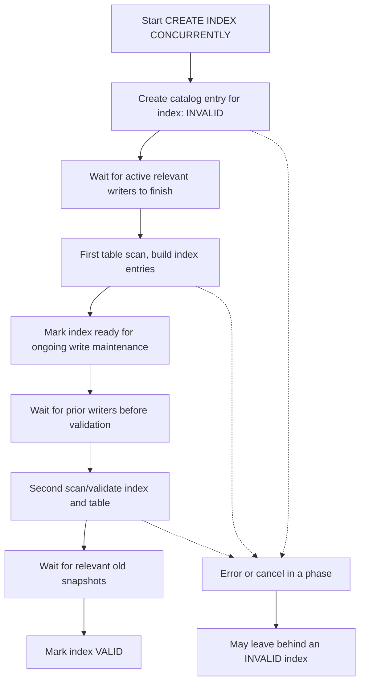

# CREATE INDEX CONCURRENTLY and the Lifecycle of Invalid Indexes in PostgreSQL

Adding an index to a PostgreSQL table with tens of millions of rows can improve read performance, yet how the index is deployed can directly affect live transactions. With standard `CREATE INDEX`, PostgreSQL can block write operations on the table throughout the index build. With **`CREATE INDEX CONCURRENTLY`**, the database executes a multi-phase workflow allowing normal `INSERT`, `UPDATE`, and `DELETE` operations to proceed during the build.

The word *concurrently* easily misleads learners into thinking the operation takes no locks, never waits, always succeeds, or rolls back alongside other schema changes. In reality, `CREATE INDEX CONCURRENTLY` **can take longer**, requires multiple table scans, depends on other transactions, and can **leave an index in an `INVALID` state if it fails**.

This lesson in the **Indexes** chapter focuses on two tightly coupled topics:

1. **Creating indexes while the system stays live:** understanding phases, costs, locks, snapshots, and transaction limits of `CREATE INDEX CONCURRENTLY`.
2. **Managing the invalid index lifecycle:** identifying `pg_index.indisvalid`, `indisready`, `indislive`; diagnosing root causes; and cleaning up or rebuilding safely.

Beyond syntax, this lesson covers monitoring queries, an intentional failure lab, recovery workflows, unique index caveats, partitioned tables, migration tooling considerations, and a production deployment runbook.

## 1. Why Can Index Creation Impact Applications?

Suppose an `orders` table holds millions of orders and a common query is:

```sql
SELECT order_id, created_at, total_amount
FROM app.orders
WHERE tenant_id = 42
ORDER BY created_at DESC
LIMIT 20;
```

An appropriate B-tree index might be:

```sql
CREATE INDEX idx_orders_tenant_created
ON app.orders (tenant_id, created_at DESC);
```

In small datasets, the statement finishes rapidly. On large tables, however, PostgreSQL must scan data and build the index structure while enforcing consistency rules as concurrent transactions insert new orders.

**Operational issue:** if the index build holds a lock incompatible with `INSERT`, `UPDATE`, or `DELETE`, application write requests must wait until the build completes.

The concurrent variant is designed to reduce that risk:

```sql
CREATE INDEX CONCURRENTLY idx_orders_tenant_created
ON app.orders (tenant_id, created_at DESC);
```

This allows normal write activity to continue while building the index, at the cost of extra work and waiting on relevant transactions at specific phases. **Fewer write blocks never means zero impact on latency, CPU, I/O, or WAL.**

## 2. Comparing Standard CREATE INDEX vs. CONCURRENTLY

| Criterion | `CREATE INDEX` | `CREATE INDEX CONCURRENTLY` |
| --- | --- | --- |
| Allows normal `SELECT` during build | Generally yes | Generally yes |
| Blocks `INSERT/UPDATE/DELETE` on the table | Generally yes for build duration | Does not take a standard-build write-blocking lock against normal DML |
| Main table scans | Typically one | Typically two, plus validation steps |
| Cost and duration | Often faster | Adds extra scans, transaction waits, and overhead |
| Runs inside explicit `BEGIN ... COMMIT` | Yes | **Prohibited** |
| Outcome on mid-build error | Statement usually rolls back its new structure | **May leave an `INVALID` index behind** |
| Suitability under continuous writes | Must weigh write-blocking impact | Usually preferable |
| Guaranteed completely wait-free | No guarantee | **Also no guarantee** |

What matters is **application latency**, not merely DDL wall-clock runtime. A standard build finishing in 20 seconds while stalling writers for 20 seconds can be far worse than a concurrent build taking 2 minutes while writers keep progressing, provided I/O load stays within budget.

Conversely, on small tables or during maintenance windows where writes pause, standard `CREATE INDEX` can be simpler and cheaper.

## 3. Self-Contained Lab Dataset

Create a dedicated `index_lab` schema strictly in a learning PostgreSQL database. **Never run intentional index failure or locking demos against production databases.**

```sql
CREATE SCHEMA IF NOT EXISTS index_lab;

CREATE TABLE index_lab.orders (
    order_id bigint GENERATED ALWAYS AS IDENTITY PRIMARY KEY,
    tenant_id integer NOT NULL,
    customer_email text NOT NULL,
    status text NOT NULL
        CHECK (status IN ('paid', 'pending', 'cancelled')),
    created_at timestamptz NOT NULL,
    total_amount numeric(12, 2) NOT NULL
        CHECK (total_amount >= 0)
);

INSERT INTO index_lab.orders
    (tenant_id, customer_email, status, created_at, total_amount)
SELECT
    (g % 10 + 1)::integer,
    'customer-' || (g % 500)::text || '@example.test',
    CASE
        WHEN g % 10 = 0 THEN 'cancelled'
        WHEN g % 3 = 0 THEN 'pending'
        ELSE 'paid'
    END,
    TIMESTAMPTZ '2025-01-01 00:00:00+00'
        + g * INTERVAL '1 minute',
    ((g % 10000) / 100.0)::numeric(12, 2)
FROM generate_series(1, 50000) AS g;

ANALYZE index_lab.orders;
```

This generates **50,000 rows** for experimenting with syntax and inspecting catalogs. On fast hardware, index builds may complete too quickly to observe intermediate phases; never assume production behaves identically.

A query to optimize:

```sql
EXPLAIN (ANALYZE, BUFFERS)
SELECT order_id, created_at, total_amount
FROM index_lab.orders
WHERE tenant_id = 3
ORDER BY created_at DESC
LIMIT 20;
```

Without a matching index, the planner may read and sort more rows; once indexed, it gains an additional potential access path. **There is no guarantee the planner is forced to pick the index**: choices depend on statistics, row counts, cost estimates, and heap visibility.

## 4. CREATE INDEX CONCURRENTLY Syntax

Minimal syntax:

```sql
CREATE INDEX CONCURRENTLY index_name
ON schema_name.table_name (column_name);
```

Example with filter and sort keys:

```sql
CREATE INDEX CONCURRENTLY idx_orders_tenant_created
ON index_lab.orders (tenant_id, created_at DESC);
```

Another multi-column index:

```sql
CREATE INDEX CONCURRENTLY idx_orders_status_created
ON index_lab.orders (status, created_at DESC);
```

Familiar index design features remain available, including:

- `UNIQUE` to enforce uniqueness per index definition.
- `USING btree` or another supported access method.
- `INCLUDE` for non-key payload columns.
- `WHERE` for partial indexes.
- Expressions such as `lower(customer_email)` for expression indexes.
- `ASC`/`DESC` and `NULLS FIRST`/`NULLS LAST` where supported by the access method.

Covering index example for read queries:

```sql
CREATE INDEX CONCURRENTLY idx_orders_lookup_cover
ON index_lab.orders (tenant_id, created_at DESC)
INCLUDE (status, total_amount);
```

`INCLUDE` does not make those two columns part of B-tree key ordering or comparison bounds; they are **stored payload columns** that can enable eligible queries to use index-only scans. Actual behavior still depends on visibility map/MVCC state and planner choices.

### 4.1. IF NOT EXISTS Checks Only Name Presence, Not Index Health

```sql
CREATE INDEX CONCURRENTLY IF NOT EXISTS idx_orders_tenant_created
ON index_lab.orders (tenant_id, created_at DESC);
```

`IF NOT EXISTS` prevents an error when **a relation with that name** already exists in the schema. It **does not verify** whether the existing index has the same definition, is valid, includes the right columns, or sits in an `INVALID` state.

This is a major warning for idempotent migrations: a leftover `INVALID` index from a failed run can cause a retried `CREATE INDEX CONCURRENTLY IF NOT EXISTS ...` to be **silently skipped**, fooling you into thinking the retry succeeded.

**Proper procedure:** inspect `pg_index.indisvalid` and the index definition before deciding how to remediate; never treat `IF NOT EXISTS` as validation.

### 4.2. UNIQUE CONCURRENTLY

```sql
CREATE UNIQUE INDEX CONCURRENTLY uq_orders_tenant_order
ON index_lab.orders (tenant_id, order_id);
```

This index enforces uniqueness on `(tenant_id, order_id)`. In the sample dataset, `order_id` is already the primary key, so this mainly illustrates syntax; in real apps, add unique indexes only for clear business invariants.

**Never assume** uniqueness checks wait until the DDL statement returns success. A concurrent unique index can **begin rejecting duplicate writes** before it is marked valid, as explained in the lifecycle section below.

### 4.3. Partial and Expression Indexes

Example indexing only pending orders:

```sql
CREATE INDEX CONCURRENTLY idx_orders_pending_tenant_time
ON index_lab.orders (tenant_id, created_at DESC)
WHERE status = 'pending';
```

And an expression index:

```sql
CREATE INDEX CONCURRENTLY idx_orders_lower_email
ON index_lab.orders (lower(customer_email));
```

A query aiming to use a partial index typically needs predicates the planner proves imply the index predicate:

```sql
SELECT order_id, created_at
FROM index_lab.orders
WHERE tenant_id = 3
  AND status = 'pending'
ORDER BY created_at DESC
LIMIT 20;
```

Expression indexes require expressions obeying function/index immutability rules. Creating one does not make arbitrary case-insensitive queries match automatically; queries need a matching expression such as `WHERE lower(customer_email) = lower($1)` aligned with application parameter handling.

## 5. Golden Rule: Cannot Run Inside an Explicit Transaction Block

Unlike standard `CREATE INDEX`, **`CREATE INDEX CONCURRENTLY` cannot run inside a transaction block**.

**Invalid** example:

```sql
BEGIN;

CREATE INDEX CONCURRENTLY idx_orders_tenant_created
ON index_lab.orders (tenant_id, created_at DESC);

COMMIT;
```

PostgreSQL rejects this because a concurrent build manages multiple internal transactions to advance the index lifecycle and synchronize with live writes.

It is valid when executed **as a standalone statement**, outside explicit `BEGIN ... COMMIT`:

```sql
CREATE INDEX CONCURRENTLY idx_orders_tenant_created
ON index_lab.orders (tenant_id, created_at DESC);
```

In `psql` with default autocommit on, running the statement directly executes it standalone. When using migration tools, **disable the transaction wrapper for that migration per the tool's supported settings**.

### 5.1. Cannot Group Multiple Migrations Under One BEGIN

An invalid attempt:

```sql
BEGIN;

ALTER TABLE index_lab.orders ADD COLUMN note text;

CREATE INDEX CONCURRENTLY idx_orders_note
ON index_lab.orders (note);

COMMIT;
```

Concurrent index creation cannot sit inside that explicit transaction sequence. To add a column and concurrently index it, split them into **separate controlled deployment steps** with defined retry and remediation steps per phase.

### 5.2. Can You Use SET LOCAL?

`SET LOCAL` applies only inside an open transaction. Since `CREATE INDEX CONCURRENTLY` cannot execute inside an explicit transaction block, do not write:

```sql
BEGIN;
SET LOCAL lock_timeout = '2s';
CREATE INDEX CONCURRENTLY ...;
COMMIT;
```

Instead, configure timeouts at the **session or role level** prior to the concurrent statement:

```sql
SET lock_timeout = '5s';
SET statement_timeout = '0';

CREATE INDEX CONCURRENTLY idx_orders_tenant_created
ON index_lab.orders (tenant_id, created_at DESC);

RESET lock_timeout;
RESET statement_timeout;
```

This illustrates session-scoped settings, not production defaults to copy blindly. `statement_timeout = '0'` disables query timeouts for the session and can allow runaway builds; choose operational thresholds carefully and ensure settings reset on failure paths.

## 6. Phases of CREATE INDEX CONCURRENTLY

To let writers keep mutating rows, PostgreSQL cannot simply scan the table once and declare the index complete. It must ensure modifications happening mid-scan are properly reflected.

A conceptual lifecycle view:



This diagram illustrates **logical states**. Exact internal transactions, catalog flag transitions, and scan/validation steps are managed internally by PostgreSQL; never use the diagram to justify manual edits against `pg_catalog`.

### 6.1. Initial Catalog Entry Created Invalid

Before an index can serve queries, PostgreSQL registers it in system catalogs. In a concurrent build, the index enters the catalog **marked not yet valid**.

That explains why a subsequent failure leaves a named index relation behind. An object existing in catalogs **does not imply** it finished building or is usable by the planner.

### 6.2. Waiting for Prior Writers

Before scan phases, PostgreSQL may wait for transactions already modifying the table to finish. A session that ran an `UPDATE` and now sits `idle in transaction` can stall the index build in a waiting phase even though its `UPDATE` finished long ago.

This does **not** mean concurrent builds grab write-blocking locks over new writers; rather, it must synchronize snapshot boundaries across existing read/write transactions.

### 6.3. Building Index Entries from Table Scans

During build, PostgreSQL scans table pages to populate index entries. Because writers remain active, PostgreSQL must maintain the index for mutations occurring past a certain point.

During intermediate phases, the index is **not yet valid for queries** yet **already marked ready to receive updates from subsequent writes**. That is why an `INVALID` index can still impose write overhead even after a failed build.

### 6.4. Second Scan Validation and Old Snapshots

PostgreSQL runs a second validation scan to catch and verify changes made during the initial build. Afterward, it may have to **wait for transactions holding older snapshots** before flipping the index to valid.

Long-running `SELECT`s, open transactions holding old snapshots, or even concurrent index builds on other tables in certain scenarios can prolong that wait. Partial and expression indexes carry additional snapshot considerations as well.

### 6.5. When Does the Index Actually Become Usable?

Merely appearing in catalogs is never enough. The index must be marked **valid** and satisfy snapshot safety rules for a given query. In subtle edge cases, even immediately after DDL completes, a transaction started prior to the index build may **still not be permitted to use the index right away**.

Never rely solely on seeing the index name in `pg_indexes` as proof of completion. Check catalog flags and verify real query plans when needed.

## 7. pg_index and Three Key Flags: indisvalid, indisready, indislive

PostgreSQL stores index metadata in `pg_index`, linked with `pg_class` and other catalogs.

Three primary lifecycle flags:

| Flag | If `true` | If `false` |
| --- | --- | --- |
| `indisvalid` | Index is valid for query planning (subject to other conditions) | Index may be incomplete; planner must not treat it as a normal valid query index |
| `indisready` | Index is ready to be maintained by new write operations | Index is not yet updated by normal `INSERT/UPDATE` maintenance |
| `indislive` | Index is considered a live object in its lifecycle | Index is in the middle of being dropped and ignored for related operations |

Also note `indcheckxmin`: in certain cases involving HOT chains and MVCC, PostgreSQL ensures a query's snapshot is sufficiently recent before trusting the index. Therefore, **`indisvalid = true` does not guarantee every query in every existing snapshot immediately uses the index**.

### 7.1. Typical Logical States

| Stage | `indisvalid` | `indisready` | `indislive` | Meaning |
| --- | :---: | :---: | :---: | --- |
| Completed normal index | true | true | true | Usable by planner and maintained by DML |
| Fresh catalog entry in concurrent build | false | false | true | Not usable for queries, build incomplete |
| Passed initial build, validating | false | true | true | Not used for queries yet already maintained on writes |
| Failed after becoming ready | false | true | true | **`INVALID`; can keep costing DML overhead** |
| Being dropped | May vary | May vary | false | Drop in progress; never manually alter flags |

This table depicts **observable states**, not arbitrary boolean combinations guaranteed as public APIs. Never run `UPDATE pg_index SET ...` to “fix flags”: direct catalog edits can corrupt your database.

### 7.2. INVALID Does Not Mean “Index Does Not Exist”

When `indisvalid = false`:

- The index still has a name, OID, and physical storage.
- The planner **will not trust it as a valid query access path**.
- Depending on `indisready`, writers may still have to update it.
- On unique indexes in late failure phases, **uniqueness enforcement may still apply**.
- A subsequent `CREATE INDEX CONCURRENTLY IF NOT EXISTS` can silently skip due to the existing name.

Hence, an `INVALID` index is an **operational issue needing resolution**, not a harmless label.

## 8. Querying Index Status on a Table

Use system catalogs to list indexes on a table and inspect their flags:

```sql
SELECT
    t.oid::regclass AS table_name,
    idx.oid::regclass AS index_name,
    i.indisunique,
    i.indisprimary,
    i.indisvalid,
    i.indisready,
    i.indislive,
    i.indcheckxmin,
    pg_size_pretty(pg_relation_size(idx.oid)) AS index_size,
    pg_get_indexdef(idx.oid) AS definition
FROM pg_index AS i
JOIN pg_class AS idx
    ON idx.oid = i.indexrelid
JOIN pg_class AS t
    ON t.oid = i.indrelid
WHERE t.oid = 'index_lab.orders'::regclass
ORDER BY idx.relname;
```

This reveals both system-generated `PRIMARY KEY` indexes and user-created indexes.

A filtered version finding **non-valid indexes** in a schema:

```sql
SELECT
    t.oid::regclass AS table_name,
    idx.oid::regclass AS index_name,
    i.indisvalid,
    i.indisready,
    i.indislive,
    pg_get_indexdef(idx.oid) AS definition
FROM pg_index AS i
JOIN pg_class AS t
    ON t.oid = i.indrelid
JOIN pg_class AS idx
    ON idx.oid = i.indexrelid
JOIN pg_namespace AS n
    ON n.oid = t.relnamespace
WHERE n.nspname = 'index_lab'
  AND NOT i.indisvalid
ORDER BY t.relname, idx.relname;
```

**Never rush to assume a non-valid index in progress is broken.** While `CREATE INDEX CONCURRENTLY` is actively running, `indisvalid = false` is a **normal intermediate state**. Check `pg_stat_progress_create_index` and active sessions before dropping anything.

### 8.1. psql Displays INVALID

In `psql`, describing a table:

```text
\d index_lab.orders
```

labels broken indexes with `INVALID` beside the index name. It is a handy visual cue, though catalog queries are still needed to inspect `indisready` and dependencies.

### 8.2. pg_indexes Is Insufficient to Prove Validity

`pg_indexes` is convenient for listing names and definitions:

```sql
SELECT schemaname, tablename, indexname, indexdef
FROM pg_indexes
WHERE schemaname = 'index_lab'
ORDER BY tablename, indexname;
```

However, `pg_indexes` **omits `pg_index` status flags**. An `INVALID` index still shows up there. Always check `pg_index` before declaring an index healthy.

## 9. Monitoring Active Builds with pg_stat_progress_create_index

PostgreSQL provides `pg_stat_progress_create_index` to monitor active `CREATE INDEX` and `REINDEX` commands:

```sql
SELECT
    p.pid,
    p.datname,
    p.relid::regclass AS table_name,
    p.index_relid::regclass AS index_name,
    p.command,
    p.phase,
    p.lockers_total,
    p.lockers_done,
    p.current_locker_pid,
    p.blocks_total,
    p.blocks_done,
    p.tuples_total,
    p.tuples_done,
    now() - a.query_start AS elapsed
FROM pg_stat_progress_create_index AS p
LEFT JOIN pg_stat_activity AS a
    ON a.pid = p.pid
WHERE p.datname = current_database()
ORDER BY p.pid;
```

Notable `phase` values:

| Phase | Meaning |
| --- | --- |
| `initializing` | Preparing index build |
| `waiting for writers before build` | Waiting for relevant active writer transactions before building |
| `building index` | Access method populating index entries |
| `waiting for writers before validation` | Waiting for writers before validation pass |
| `index validation: scanning index` | Scanning index for validation |
| `index validation: sorting tuples` | Sorting tuples during validation |
| `index validation: scanning table` | Scanning table during validation |
| `waiting for old snapshots` | Waiting for old snapshots that block promoting to valid |
| `waiting for readers before marking dead` | Phase associated with `REINDEX CONCURRENTLY` |
| `waiting for readers before dropping` | Phase associated with `REINDEX CONCURRENTLY` |

Exact phase names and reported progress columns depend on PostgreSQL version. Not every access method populates block/tuple totals meaningfully.

### 9.1. Understanding lockers_* Columns

During wait phases:

- `lockers_total`: count of relevant backends/transactions waited on in this phase.
- `lockers_done`: count completed so far.
- `current_locker_pid`: PID of the backend currently waited on, if reported.

Do not read `lockers_done / lockers_total` as percentage progress of the entire build; it tracks **only the current waiting phase**.

### 9.2. When the View Returns Zero Rows

If `pg_stat_progress_create_index` returns nothing:

- The build already finished.
- The build failed and the backend exited the create-index command.
- You are querying a different database or lack privileges to inspect full details.
- The statement has not yet started on the server.

To verify final outcome, **inspect `pg_index`** and migration logs—never rely solely on the absence of a progress row.

## 10. Diagnosing Why an Index Build Is Waiting

A concurrent build can stall in `waiting for writers before build` or `waiting for old snapshots`. Inspect open transactions:

```sql
SELECT
    pid,
    usename,
    application_name,
    client_addr,
    state,
    wait_event_type,
    wait_event,
    now() - xact_start AS transaction_age,
    now() - query_start AS query_age,
    backend_xmin,
    pg_blocking_pids(pid) AS blocking_pids,
    left(query, 180) AS query_sample
FROM pg_stat_activity
WHERE datname = current_database()
  AND xact_start IS NOT NULL
ORDER BY xact_start;
```

Correlate:

1. `pg_stat_progress_create_index.phase` and `current_locker_pid`.
2. `pg_stat_activity` for long transactions, `idle in transaction` states, and running SQL.
3. `pg_blocking_pids(pid)` when a backend waits directly on a lock.
4. `pg_locks` when analyzing lock modes and target relations.

### 10.1. Why Can an Idle Transaction Stall DDL?

Another transaction that updated the table earlier without committing can hold a concurrent build at the pre-build or pre-validation writer wait phase. Similarly, old snapshots held by open transactions can prolong the final snapshot wait phase.

Being `idle in transaction` does not by itself prove a specific session blocks your index build—correlate phase, PID, and snapshot/lock state first. Nevertheless, it is one of the most common culprits.

### 10.2. Never Blindly Terminate Long Transactions

`pg_terminate_backend(pid)` kills the session and rolls back uncommitted work, potentially freeing resources at the expense of business disruption. Verify session ownership, rollback impact, and operational authorization first.

Prefer letting applications close transactions cleanly. If the build stalls excessively, consider **canceling the index build in a controlled manner**, accepting cleanup of a potential invalid index and rescheduling later.

## 11. How Do INVALID Indexes Happen?

Common causes:

| Cause | Outcome |
| --- | --- |
| `CREATE INDEX CONCURRENTLY` canceled or timed out | Catalog registered the index yet build did not finish |
| Deadlock or lock-wait failure in a phase | Statement fails and may leave an invalid index |
| `CREATE UNIQUE INDEX CONCURRENTLY` hits duplicates | Validation/uniqueness fails while index remains |
| Expression index throws runtime function error | Build aborts mid-way, index stays invalid |
| Partial index hits error evaluating predicate/expression | Can fail after creating index object |
| Out of disk space or I/O/system failure | Command aborts; check state and recover carefully |
| `REINDEX CONCURRENTLY` fails mid-way | Can leave `_ccnew` or `_ccold` index artifacts |
| Partitioned parent awaiting child partition attaches | Parent index can stay **intentionally invalid** until all partitions attach |

Not every failed DDL leaves an invalid index: this specifically reflects the **multi-transaction phases of concurrent builds**. Failures prior to catalog registration leave nothing to clean up.

### 11.1. Can the Planner Accidentally Use an Invalid Index?

PostgreSQL will not trust an `indisvalid = false` index as a normal query access path because it may miss rows or lack full validation.

Fast queries can still run using another index or sequential scan. **Fast query execution does not prove an invalid index became valid**, just as a valid index is not guaranteed to be chosen by the planner.

### 11.2. Invalid Indexes Can Still Cost Write Overhead

When `indisready = true`, PostgreSQL must maintain the index for incoming `INSERT`/`UPDATE` statements. Because the planner ignores it for reads, that write maintenance is **pure overhead with zero read benefit**.

Invalid indexes also consume disk space, generate WAL/maintenance work, and cause name collisions in later migrations. Clean them up promptly once confirmed genuinely broken.

## 12. Hands-On Lab: Intentionally Failing a UNIQUE Index Build

Goal: observe how **data errors can leave behind an `INVALID` index**. Run this strictly in a learning database.

Create a table containing duplicate emails:

```sql
CREATE TABLE index_lab.email_registry (
    registry_id bigint GENERATED ALWAYS AS IDENTITY PRIMARY KEY,
    email text NOT NULL,
    registered_at timestamptz NOT NULL DEFAULT now()
);

INSERT INTO index_lab.email_registry (email)
VALUES
    ('duplicate@example.test'),
    ('duplicate@example.test'),
    ('unique@example.test');
```

Inspect duplicates first:

```sql
SELECT email, COUNT(*) AS occurrences
FROM index_lab.email_registry
GROUP BY email
HAVING COUNT(*) > 1;
```

Output shows `duplicate@example.test` appearing twice.

Attempt a concurrent unique index build:

```sql
-- Intentionally fails due to duplicate data.
CREATE UNIQUE INDEX CONCURRENTLY uq_email_registry_email
ON index_lab.email_registry (email);
```

PostgreSQL detects the duplicate and raises an error. Because it is a concurrent build, `uq_email_registry_email` **may remain in the catalog marked `INVALID`**.

Inspect immediately:

```sql
SELECT
    idx.relname AS index_name,
    i.indisunique,
    i.indisvalid,
    i.indisready,
    i.indislive,
    pg_get_indexdef(idx.oid) AS definition
FROM pg_index AS i
JOIN pg_class AS idx
    ON idx.oid = i.indexrelid
WHERE i.indrelid = 'index_lab.email_registry'::regclass
ORDER BY idx.relname;
```

After the error, you can also run:

```text
\d index_lab.email_registry
```

When left behind, `psql` tags it `INVALID` next to the index name.

### 12.1. Do Not Mistake Failure for Full Lifecycle Rollback

A false assumption: “`CREATE UNIQUE INDEX CONCURRENTLY` failed, so no trace of the index remains.”

Because earlier concurrent phases committed metadata in separate transactions, later failures leave an unvalidated object behind. Always **check catalogs** rather than assuming an error SQLSTATE erased all side effects.

### 12.2. Why Not Simply Re-Run with IF NOT EXISTS?

```sql
-- Insufficient to repair a leftover INVALID index with the same name.
CREATE UNIQUE INDEX CONCURRENTLY IF NOT EXISTS uq_email_registry_email
ON index_lab.email_registry (email);
```

Because the same-named index already exists, `IF NOT EXISTS` skips creation. Your migration script reports “no error because the name exists” while **lacking a valid unique index**.

Clean duplicate rows and remediate the index properly.

## 13. Critical Trap: UNIQUE Indexes Can Enforce Uniqueness Before Becoming Valid

With `CREATE UNIQUE INDEX CONCURRENTLY`, PostgreSQL can begin **enforcing uniqueness against concurrent writes once the second scan starts**, before DDL finishes and marks the index valid.

This creates two memorable pitfalls:

1. An application transaction can receive a duplicate key error **while** a concurrent unique index is still building.
2. If the build fails during the second scan, the **leftover `INVALID` index can continue enforcing uniqueness** on new writes.

Never look at `indisvalid = false` and conclude “no unique constraint affects writes.”

Conversely, because the index remains invalid, uniqueness across **all pre-existing rows** is unverified. You end up in a confusing state where some new writes fail uniqueness while catalogs flag the index invalid.

### 13.1. Resolve Business Rules Beforehand

When adding a unique index to a legacy table that previously permitted duplicates:

- Audit existing duplicate keys.
- Decide policy to merge, delete, fix, or archive older rows.
- Update writers to enforce business rules cleanly.
- Build the unique index concurrently.
- Verify the index is valid and writes behave as expected.

Never run a unique index build hoping it will somehow “clean up” duplicates.

### 13.2. Partial Unique Indexes and Uniqueness Scope

Example enforcing uniqueness only among non-soft-deleted registrations:

```sql
CREATE TABLE index_lab.accounts (
    account_id bigint GENERATED ALWAYS AS IDENTITY PRIMARY KEY,
    email text NOT NULL,
    deleted_at timestamptz
);

CREATE UNIQUE INDEX CONCURRENTLY uq_accounts_active_email
ON index_lab.accounts (lower(email))
WHERE deleted_at IS NULL;
```

This expression partial unique index covers only rows where `deleted_at IS NULL`. Soft-deleted rows fall outside the predicate, yet the build still validates active duplicates and concurrent writes modifying `deleted_at`.

Do not treat a partial unique index identically to a table-wide `UNIQUE CONSTRAINT`; `ON CONFLICT` targets and query matching must align with the exact definition.

## 14. Recovery Option 1: DROP INDEX CONCURRENTLY and Recreate

Standard recovery for an invalid index lacking blocking dependencies:

1. Confirm no active build is still running on the index.
2. Identify the failure cause.
3. Fix duplicate data, disk space, or transaction/lock blockers.
4. **Drop the invalid index** appropriately.
5. **Re-run `CREATE INDEX CONCURRENTLY`**.
6. Verify `indisvalid = true` afterward.

In our email lab, first fix the duplicate row:

```sql
UPDATE index_lab.email_registry
SET email = 'duplicate-second@example.test'
WHERE registry_id = (
    SELECT MAX(registry_id)
    FROM index_lab.email_registry
    WHERE email = 'duplicate@example.test'
);
```

Verify:

```sql
SELECT email, COUNT(*)
FROM index_lab.email_registry
GROUP BY email
HAVING COUNT(*) > 1;
```

Once zero duplicates remain and you have **verified the index name and confirmed no prohibiting dependencies**, run each statement separately:

```sql
DROP INDEX CONCURRENTLY IF EXISTS index_lab.uq_email_registry_email;
```

Then:

```sql
CREATE UNIQUE INDEX CONCURRENTLY uq_email_registry_email
ON index_lab.email_registry (email);
```

Confirm state:

```sql
SELECT
    idx.relname,
    i.indisunique,
    i.indisvalid,
    i.indisready
FROM pg_index AS i
JOIN pg_class AS idx ON idx.oid = i.indexrelid
WHERE idx.oid = 'index_lab.uq_email_registry_email'::regclass;
```

Expect `indisvalid = true` and `indisready = true`.

### 14.1. Restrictions on DROP INDEX CONCURRENTLY

`DROP INDEX CONCURRENTLY` carries strict rules:

- **Cannot execute inside an explicit transaction block.**
- Allows only **one index name per statement**.
- **Does not support `CASCADE`**.
- Cannot drop indexes backing **`PRIMARY KEY` or `UNIQUE` constraints** directly due to constraint dependencies.
- Not supported directly in this form on partitioned parent indexes per PostgreSQL rules.
- Requires proper privileges (typically index owner).
- Can still **wait on concurrent transactions** to minimize read/write blocking.

An independent unique index created via `CREATE UNIQUE INDEX` is not automatically attached to a `UNIQUE CONSTRAINT`. Always verify dependencies first—never judge purely by `indisunique`.

### 14.2. What If the Index Backs a Constraint?

For `PRIMARY KEY` or `UNIQUE` constraint indexes, never run `DROP INDEX CONCURRENTLY` blindly without understanding the constraint relationship. Dropping or rebuilding it may require constraint alteration or disallow concurrent drops.

For critical constraints, follow a DBA-approved recovery plan accounting for locks and availability—never strip data protection just to tidy up catalogs.

## 15. Recovery Option 2: REINDEX INDEX CONCURRENTLY

PostgreSQL also supports rebuilding an index in place:

```sql
REINDEX INDEX CONCURRENTLY index_lab.uq_email_registry_email;
```

This offers an alternative once root causes are fixed. For an invalid index left by a failed `CREATE INDEX CONCURRENTLY`, **`REINDEX INDEX CONCURRENTLY`** can rebuild it without dropping and recreating from scratch.

Key points:

- Cannot run inside an explicit transaction block.
- `REINDEX CONCURRENTLY` also runs through scan and wait phases—it is not instantaneous.
- If a unique index still encounters duplicates, rebuilding fails again.
- Concurrent rebuilding of invalid indexes applies specifically to `REINDEX INDEX`; do not assume every `REINDEX TABLE/SCHEMA/DATABASE CONCURRENTLY` variant treats invalid indexes identically.
- `REINDEX CONCURRENTLY` has restrictions on certain objects such as exclusion constraint indexes and system catalogs.
- Choose between **drop + create** and **reindex** based on index definitions, dependencies, server version, and operational requirements.

### 15.1. Which Approach When?

| Situation | Approach to Consider |
| --- | --- |
| Newly created index failed, no dependencies, easy to recreate | `DROP INDEX CONCURRENTLY` then `CREATE INDEX CONCURRENTLY` |
| Want to preserve existing name/definition with eligible rebuild | `REINDEX INDEX CONCURRENTLY` |
| Failed due to duplicate data | **Fix duplicates first**, then choose rebuild approach |
| Failed due to long transaction or snapshot wait | Clear blocker/window, then retry |
| Failed due to disk or WAL exhaustion | Add capacity / reduce load before retrying |
| Index backs PK/`UNIQUE` constraint guarding live invariants | Controlled DBA workflow; never drop blindly |
| Partitioned parent invalid while partitions remain unattached | Finish attaching child indexes; do not mistake for failure |

Never pick a repair command just because it is shorter to type; inspect **data, catalogs, and dependencies** first.

## 16. _ccnew and _ccold INVALID Indexes After REINDEX CONCURRENTLY

During `REINDEX CONCURRENTLY`, PostgreSQL constructs a temporary replacement index and swaps it with the old index.

If the operation fails mid-way, leftover index names may carry suffixes:

- `_ccnew`: the **new** temporary index being built that failed to complete.
- `_ccold`: the **old** index left behind after the replacement succeeded yet cleanup of the old copy did not finish.

Numeric suffixes like `_ccnew1` or `_ccold2` can appear to avoid name collisions.

### 16.1. Handling _ccnew

A `_ccnew` artifact is normally marked invalid and unused by queries. After confirming exact name and state, recovery typically involves **dropping the temporary `_ccnew` index**, fixing the failure cause, and retrying `REINDEX CONCURRENTLY` on the original index.

Illustrative example (verify catalogs before running):

```sql
-- Only after confirming the temporary index is inactive.
DROP INDEX CONCURRENTLY IF EXISTS index_lab.some_index_ccnew;
```

Never bulk-drop by wildcard naming pattern without checking dependencies and active jobs.

### 16.2. Handling _ccold

`_ccold` usually marks the **old index** awaiting cleanup after the replacement became active. Once you confirm the replacement index is valid and serving properly, you can drop the old copy cleanly.

Inspect target table, definitions, constraints/dependencies, and active index flags first. If `DROP CONCURRENTLY` is restricted on a given object, plan an alternative cleanup—never delete index files on disk manually.

**Never rename or drop either index copy by guesswork before confirming which one is valid.**

## 17. Why Can REINDEX CONCURRENTLY Also Leave Invalid Indexes?

`REINDEX CONCURRENTLY` does not overwrite the old index inside a single atomic transaction. It builds a replacement, catches up concurrent writes, swaps metadata, and drops the old index across phases.

If canceled, timed out, or failed mid-phase, intermediate `_ccnew` or `_ccold` states can remain. Consequently, **checking `pg_index` after both `CREATE` and `REINDEX CONCURRENTLY`** belongs in your standard runbook—not only when queries slow down.

Conversely, seeing two temporary copies during an active reindex is expected by design, not an error.

## 18. Other Limitations of CONCURRENTLY

### 18.1. One Concurrent Index Build per Table at a Time

PostgreSQL limits **one concurrent index build at a time on a single table**. Running two independent concurrent index builds against the same table forces them to serialize or contend per locking/coordination rules.

Never launch parallel migration workers on the same table hoping to “build indexes faster.” Even across different tables, concurrent builds compete for CPU, I/O, and WAL.

### 18.2. Avoid Schema Changes During Concurrent Builds

Concurrent builds coordinate locks with DDL operations; structural table modifications cannot proceed freely while a build runs.

Avoid scheduling major `ALTER TABLE`s, partition attaches, or table rewrites on the same table while an index build runs; check version-specific lock interactions carefully.

### 18.3. Temporary Tables

Temporary tables belong exclusively to one session, so concurrent builds offer no multi-session write benefit there. Standard `CREATE INDEX` is simpler and cheaper on temp tables.

### 18.4. Still Consumes Major System Resources

`CONCURRENTLY` does not make index building metadata-only: on regular tables it still scans data and builds full index structures.

Impacted resources include:

- CPU for key extraction and sorting.
- Disk I/O reading heap pages and writing index pages.
- WAL generation and disk headroom.
- Memory for sorting/building per `maintenance_work_mem` and access method.
- Buffer pool cache pressure competing with live queries.
- Waits on concurrent transactions/snapshots.
- Ongoing writer index maintenance once ready.

In production, monitor **application latency, write throughput, free disk, WAL/replication lag**—not just progress percentages.

## 19. Partitioned Tables: Cannot Run CONCURRENTLY Directly on Parent

For declarative partitioned tables, PostgreSQL does not support running `CREATE INDEX CONCURRENTLY` directly on the **partitioned parent table** the way it works on regular tables.

Unsupported example:

```sql
-- Do not use directly on a partitioned parent.
CREATE INDEX CONCURRENTLY idx_events_p_time
ON index_lab.events_partitioned (occurred_at);
```

Supported rollout workflow:

1. Build the index on **each leaf partition** using `CREATE INDEX CONCURRENTLY`.
2. Create the **partitioned parent index metadata** non-concurrently (`ON ONLY`), which avoids scanning all child partitions.
3. Attach each matching partition index to the parent index.
4. Once every partition has an attached matching index, PostgreSQL marks the parent index valid.

### 19.1. Partitioned Sample Schema

```sql
CREATE TABLE index_lab.events_p (
    event_id bigint NOT NULL,
    occurred_at date NOT NULL,
    payload text NOT NULL
) PARTITION BY RANGE (occurred_at);

CREATE TABLE index_lab.events_p_2025
PARTITION OF index_lab.events_p
FOR VALUES FROM ('2025-01-01') TO ('2026-01-01');

CREATE TABLE index_lab.events_p_2026
PARTITION OF index_lab.events_p
FOR VALUES FROM ('2026-01-01') TO ('2027-01-01');
```

### 19.2. Creating Metadata-Only Parent Index

```sql
CREATE INDEX idx_events_p_time
ON ONLY index_lab.events_p (occurred_at);
```

`ON ONLY` registers the parent partitioned index **without building child partition indexes upfront**. The parent remains marked invalid **until all child partition indexes are attached**.

Next, build each leaf partition index concurrently:

```sql
CREATE INDEX CONCURRENTLY idx_events_p_2025_time
ON index_lab.events_p_2025 (occurred_at);
```

```sql
CREATE INDEX CONCURRENTLY idx_events_p_2026_time
ON index_lab.events_p_2026 (occurred_at);
```

Run each concurrent statement outside explicit transaction blocks.

### 19.3. Attaching Child Indexes

Once each partition index is valid and matches the parent definition:

```sql
ALTER INDEX index_lab.idx_events_p_time
ATTACH PARTITION index_lab.idx_events_p_2025_time;
```

```sql
ALTER INDEX index_lab.idx_events_p_time
ATTACH PARTITION index_lab.idx_events_p_2026_time;
```

Once every partition has a matching attached index, the parent index becomes **valid**.

Here, an invalid parent index mid-rollout is **an expected intermediate stage**, not a failed concurrent build.

### 19.4. Future Partitions and Parent Constraints

When attaching new partitions later, verify inherited index creation/attachment behavior and lock impacts. `UNIQUE` and `PRIMARY KEY` constraints on partitioned tables impose additional rules (typically requiring partition key columns in the constraint).

**Never copy a regular-table runbook onto partitioned tables without confirming parent/child layout and major-version limits.**

## 20. CREATE INDEX CONCURRENTLY and UNIQUE Constraints

Standalone unique indexes and `UNIQUE` constraints are closely related yet **not identical**.

An explicit unique index:

```sql
CREATE UNIQUE INDEX CONCURRENTLY uq_accounts_active_email
ON index_lab.accounts (lower(email))
WHERE deleted_at IS NULL;
```

enforces uniqueness per its expression and predicate. It does not automatically act as a plain `UNIQUE CONSTRAINT (email)` in every context.

Conversely, `UNIQUE` or `PRIMARY KEY` constraints are backed by PostgreSQL-managed indexes with strict dependency rules preventing casual drops.

### 20.1. Attaching a Concurrent Unique Index as a Constraint

Where eligible, PostgreSQL lets you promote an existing unique index into a constraint:

```sql
ALTER TABLE some_table
ADD CONSTRAINT some_unique_constraint
UNIQUE USING INDEX existing_unique_index;
```

However, the index must meet **eligibility rules**: for example, partial and expression indexes cannot be attached directly as `UNIQUE` constraints this way, and `ALTER TABLE` itself acquires table locks briefly.

Do not assume creating a concurrent unique index **completes a constraint migration** when callers or foreign keys expect a named table constraint.

### 20.2. When DML Starts Failing Uniqueness

On concurrent unique builds, writers can encounter duplicate violations as soon as the second scan starts. If the app previously allowed duplicates, **behavior changes before DDL even reports success**.

Clean existing duplicates and fix application write validation **before** running a concurrent unique build whenever possible. And after any failure, never assume uniqueness checks vanished.

## 21. Validity Differs from Usage and Performance

Separate three independent questions:

1. **Does the index exist?** Inspect catalogs/metadata.
2. **Is the index valid?** Check `pg_index.indisvalid` and sibling flags.
3. **Does the planner use it for a given query?** Run `EXPLAIN`/`EXPLAIN ANALYZE` against realistic data.

For example, once valid:

```sql
ANALYZE index_lab.orders;

EXPLAIN (ANALYZE, BUFFERS)
SELECT order_id, created_at, total_amount
FROM index_lab.orders
WHERE tenant_id = 3
ORDER BY created_at DESC
LIMIT 20;
```

The planner may choose `Index Scan`, `Index Only Scan`, `Bitmap Heap Scan`, or `Seq Scan`. A valid index can still **go unused** if alternatives cost less, predicates mismatch, or statistics indicate low selectivity.

**Never run `REINDEX` to “fix” a `Seq Scan` just assuming “a valid index must be chosen.”** Inspect the index definition, query predicates, statistics, and cost model first.

### 21.1. Is pg_stat_user_indexes Enough to Spot Invalid Indexes?

`pg_stat_user_indexes` tracks usage counters like `idx_scan`, yet omits validity flags. Seeing `idx_scan = 0` on a new index does not prove it is invalid; perhaps no matching query ran yet.

Join stats with `pg_index`:

```sql
SELECT
    s.relname AS table_name,
    s.indexrelname AS index_name,
    s.idx_scan,
    s.idx_tup_read,
    s.idx_tup_fetch,
    i.indisvalid,
    i.indisready
FROM pg_stat_user_indexes AS s
JOIN pg_index AS i
    ON i.indexrelid = s.indexrelid
WHERE s.schemaname = 'index_lab'
ORDER BY s.relname, s.indexrelname;
```

Never drop an index solely because `idx_scan = 0`: it might enforce a unique constraint, support seasonal/monthly reports, run on replicas, or reflect recently reset statistics.

## 22. Bloat, Disk Footprint, and WAL During Builds

Building a new index requires additional disk space. During `REINDEX CONCURRENTLY`, **both old and replacement index copies** coexist temporarily.

Key drivers:

- Table size and row count.
- Number and width of key/included columns.
- Access method.
- Concurrent write rate during build.
- WAL generation and replication retention.
- Competing disk/cache activity.
- Leftover invalid indexes from prior failures.

Check a specific index's size:

```sql
SELECT
    pg_size_pretty(
        pg_relation_size('index_lab.idx_orders_tenant_created'::regclass)
    ) AS index_size;
```

This fails on `regclass` cast if the named index does not exist.

List sizes safely across all indexes on a table:

```sql
SELECT
    idx.relname,
    pg_size_pretty(pg_relation_size(idx.oid)) AS size,
    i.indisvalid
FROM pg_index AS i
JOIN pg_class AS idx ON idx.oid = i.indexrelid
WHERE i.indrelid = 'index_lab.orders'::regclass
ORDER BY pg_relation_size(idx.oid) DESC;
```

**Note:** size reflects physical allocation alone. A large index is not automatically bloated, nor is a small index automatically optimal. Detecting bloat properly requires deeper analysis.

## 23. Replication and Long Transactions During Index Builds

Concurrent builds generate substantial WAL. In streaming replication setups, replicas must receive and replay all generated index WAL.

Monitor from primary:

```sql
SELECT
    application_name,
    state,
    sync_state,
    sent_lsn,
    write_lsn,
    flush_lsn,
    replay_lsn,
    write_lag,
    flush_lag,
    replay_lag
FROM pg_stat_replication;
```

Note lag columns can be `NULL` or fail to tell the whole backlog story—track WAL generation rates, actual replay lag, and free disk space together.

### 23.1. Monitor More Than DDL Elapsed Time

A long index build can succeed SQL-wise while causing side effects:

- Replica lag spikes.
- WAL disk nears capacity.
- Read latency degrades from I/O contention.
- Write overhead rises once the index enters maintenance (`indisready`).
- Queued migrations stall behind the build.

Monitor before, during, and after building; SQL success is only one part of safe rollout.

### 23.2. Dropping Invalid Indexes Reclaims Space—Verify Dependencies First

Once an invalid index is confirmed unnecessary, dropping it cleanly reclaims storage. Dropping the wrong object, however, strips uniqueness protection or breaks queries.

Never run an indiscriminate script deleting every `indisvalid = false` index: an index might be mid-build, a partitioned parent awaiting child attaches, or tied to other dependencies.

## 24. Java/JDBC: Executing Concurrent DDL with Proper Transaction Boundaries

A Java migration tool running `CREATE INDEX CONCURRENTLY` via JDBC must respect connection transaction boundaries.

Example:

```java
import java.sql.Connection;
import java.sql.SQLException;
import java.sql.Statement;
import javax.sql.DataSource;

public class IndexMigration {
    private final DataSource dataSource;

    public IndexMigration(DataSource dataSource) {
        this.dataSource = dataSource;
    }

    public void createTenantIndex() throws SQLException {
        try (Connection connection = dataSource.getConnection()) {
            // Dedicated migration connection; no explicit transaction block.
            connection.setAutoCommit(true);

            try (Statement statement = connection.createStatement()) {
                statement.execute("""
                    CREATE INDEX CONCURRENTLY IF NOT EXISTS
                        idx_orders_tenant_created
                    ON index_lab.orders (tenant_id, created_at DESC)
                    """);
            }

            // Always verify catalog flags afterward, because IF NOT EXISTS
            // does not guarantee the index is valid.
        }
    }
}
```

Note there is **no user input interpolated into identifiers**; table/index names are controlled by admin code. Never construct DDL by concatenating untrusted HTTP parameters without strict allowlists and quoting.

### 24.1. Why Does setAutoCommit(false) Fail?

```java
try (Connection c = dataSource.getConnection()) {
    c.setAutoCommit(false);
    try (Statement s = c.createStatement()) {
        s.execute("""
            CREATE INDEX CONCURRENTLY idx_orders_tenant_created
            ON index_lab.orders (tenant_id, created_at DESC)
            """);
    }
    c.commit();
}
```

This opens a transaction context forbidden by concurrent index builds; PostgreSQL immediately rejects the statement.

**Do not try to work around it by calling `commit()` after an error.** Run concurrent DDL on a connection configured for autocommit (`setAutoCommit(true)`), check catalog state, and handle resource cleanup cleanly.

### 24.2. Framework Transaction Managers

In Spring or framework-managed environments, `@Transactional` wraps execution inside an explicit transaction. That breaks `CREATE INDEX CONCURRENTLY`.

Configure your migration runner or DDL executor **outside framework-managed transactions** (`Propagation.NOT_SUPPORTED` or non-transactional migration scripts depending on tool/version). Split transactional DDL and concurrent DDL into separate steps if your runner cannot mix them.

### 24.3. Error Handling and Post-Execution Verification

After the SQL completes, verify validity explicitly:

```sql
SELECT i.indisvalid, i.indisready
FROM pg_index AS i
WHERE i.indexrelid =
    to_regclass('index_lab.idx_orders_tenant_created');
```

If `to_regclass(...)` returns `NULL`, zero rows come back—handle that too. Require **exactly one row** with both flags `true`.

If DDL fails, inspect catalogs because an invalid index may linger. Do not blindly retry `IF NOT EXISTS` without clearing the failure cause first.

## 25. Runbook: Deploying CREATE INDEX CONCURRENTLY in Production

Reference procedure for large live tables:

### Step 1 — Confirm Target Queries

Collect SQL shapes, filters, sort orders, row counts, and latency metrics. Verify why existing indexes fall short.

Example:

```sql
EXPLAIN
SELECT order_id, created_at, total_amount
FROM index_lab.orders
WHERE tenant_id = 3
ORDER BY created_at DESC
LIMIT 20;
```

Never create indexes just because “the table is huge”; every index adds write and storage tax.

### Step 2 — Check Objects and Existing Names

Verify:

- Is the table a partitioned parent?
- Does an identically named index already exist?
- If so, what are its `indisvalid`/`indisready` flags?
- Does it back a constraint?
- Does an existing index already serve close enough?
- Is another concurrent build or migration running on the same table?

### Step 3 — Audit Uniqueness and Data Quality

For unique indexes, check duplicates using the exact target key, expression, and predicate. Never assume `COUNT(DISTINCT ...)` suffices for composite keys or special `NULL` rules.

Example:

```sql
SELECT lower(email), COUNT(*)
FROM index_lab.email_registry
GROUP BY lower(email)
HAVING COUNT(*) > 1;
```

Adjust predicates/columns if the index is partial or multi-column.

### Step 4 — Check Operational Headroom

Verify free disk, WAL space, replica lag, CPU, I/O headroom, active long transactions, pending DDL locks, and change window. Prepare an abort plan if live latency spikes.

### Step 5 — Execute as Standalone Statement

```sql
CREATE INDEX CONCURRENTLY idx_orders_tenant_created
ON index_lab.orders (tenant_id, created_at DESC);
```

Run outside any transaction block using a properly configured runner—never wrapped in `BEGIN`.

### Step 6 — Monitor Progress and Blockers

Watch `pg_stat_progress_create_index` and `pg_stat_activity`, especially writer or old-snapshot wait phases.

Never blindly terminate long transactions just for looking slow; coordinate with owners per operational policy.

### Step 7 — Handle Failures Cleanly

If canceled, timed out, deadlocked, unique-violated, or failed on I/O:

1. Capture full error message and SQLSTATE.
2. Check if the index exists in catalogs.
3. Inspect `indisvalid`/`indisready`/`indislive`.
4. Confirm no background build remains active on the object.
5. Choose **drop + recreate** or **`REINDEX INDEX CONCURRENTLY`** as appropriate.
6. Remediate root cause before retrying.

### Step 8 — Verify Post-Completion

Inspect:

```sql
SELECT
    idx.oid::regclass AS index_name,
    i.indisvalid,
    i.indisready,
    i.indislive,
    pg_get_indexdef(idx.oid) AS definition
FROM pg_index AS i
JOIN pg_class AS idx ON idx.oid = i.indexrelid
WHERE idx.oid =
    to_regclass('index_lab.idx_orders_tenant_created');
```

Next, verify `EXPLAIN` plans on representative queries and monitor production latency/throughput. Never verify catalog state alone while forgetting the real goal: **faster reads without unacceptable write regression**.

### Step 9 — Document and Clean Up

Log index name, definition, table, deployment date, duration, validation results, and incidents resolved. If invalid indexes or `_ccnew`/`_ccold` artifacts remain, trace causes and clean up safely.

Never drop older overlapping indexes immediately before verifying live queries no longer rely on them and a rollback plan exists.

## 26. Common Misconceptions

### 26.1. “CONCURRENTLY means zero locks”

False. It uses lock modes that avoid blocking normal writes compared to standard builds, yet still coordinates locks, waits for writers/snapshots, and consumes CPU/I/O.

### 26.2. “Seeing the index name means it built successfully”

False. An entry can exist with `indisvalid = false`. Check `pg_index`, not merely `pg_indexes`.

### 26.3. “An INVALID index is completely harmless”

False. It burns disk space, write maintenance overhead, and in unique builds can still reject duplicate writes.

### 26.4. “IF NOT EXISTS repairs invalid indexes”

False. It only skips name collisions. An invalid index with the matching name causes `IF NOT EXISTS` to do nothing.

### 26.5. “REINDEX CONCURRENTLY never creates temporary indexes”

False. It swaps replacement copies and can leave `_ccnew`/`_ccold` artifacts on failure.

### 26.6. “A valid index forces the planner to use it”

False. Cost estimates, statistics, predicates, and even snapshot timing (`indcheckxmin`) decide actual usage.

### 26.7. “CREATE INDEX CONCURRENTLY runs fine inside a @Transactional migration”

False. PostgreSQL forbids concurrent builds inside explicit transactions; adjust transaction boundaries.

### 26.8. “Unique indexes only enforce uniqueness after finishing”

False. Enforcement can begin at the second scan, and late-phase failures can leave invalid indexes still rejecting duplicate writes.

### 26.9. “An INVALID partitioned parent index always means corruption”

Not necessarily. Under `CREATE INDEX ... ON ONLY` + per-partition concurrent attach workflows, invalid parent state mid-rollout is expected until every child attaches.

### 26.10. “DROP INDEX CONCURRENTLY handles every index identically”

False. Restrictions apply for constraint-backing indexes, partitioned parents, `CASCADE`, multi-index lists, and explicit transactions.

## 27. Troubleshooting Quick Reference

| Symptom | Likely Cause | Next Step |
| --- | --- | --- |
| `CREATE INDEX CONCURRENTLY cannot run inside a transaction block` | Migration/driver opened a transaction | Run as standalone statement outside transactions |
| Long runtime with stalled `blocks_done` | Waiting on writers/old snapshots, or non-block phase | Inspect `phase`, `current_locker_pid`, and `pg_stat_activity` |
| Fails with `unique_violation` | Existing duplicates or concurrent duplicate write | Find duplicates, fix data/writers, inspect leftover invalid index |
| `IF NOT EXISTS` skips yet queries stay unindexed | Same-named `INVALID` or mismatched index exists | Inspect `pg_index` and `pg_get_indexdef` |
| `indisvalid=false, indisready=true` post-failure | Invalid index still incurring write maintenance | Classify and drop/reindex cleanly |
| `DROP INDEX CONCURRENTLY` rejected | Transaction block, constraint dependency, or object restriction | Choose appropriate drop/rebuild sequence |
| `_ccnew` left after `REINDEX` | Incomplete temporary replacement index | Verify state/dependencies, then drop temporary artifact |
| `_ccold` left after `REINDEX` | Uncleaned old index copy | Verify new index is valid before dropping old copy |
| `CREATE INDEX CONCURRENTLY` rejected on partitioned parent | Unsupported directly on parent | Build on partitions concurrently, then attach parent metadata |
| Query uses `Seq Scan` despite valid index | Alternative plan cheaper or predicate mismatch | Inspect `EXPLAIN`, stats, and selectivity |
| Replica lag climbs during build | Heavy WAL generation outpacing replay | Throttle/monitor WAL and replication headroom |
| Writers slow without lock waits | I/O/CPU contention or ready-index maintenance | Measure latency, disk I/O, buffers, and system load |

## 28. Hands-On Exercises

Exercises use schema `index_lab`. If names already exist from earlier steps, pick distinct names or clean up test objects safely first.

### Exercise 1 — Create a Valid Concurrent Index

```sql
CREATE INDEX CONCURRENTLY idx_orders_tenant_time_ex1
ON index_lab.orders (tenant_id, created_at DESC);
```

Check via catalogs whether `indisvalid` and `indisready` are `true`. Why does command success alone not prove the planner uses the index for every query?

### Exercise 2 — Deliberate Transaction Block Error

```sql
BEGIN;

CREATE INDEX CONCURRENTLY idx_orders_status_ex2
ON index_lab.orders (status);

ROLLBACK;
```

Capture the PostgreSQL error. Explain why concurrent builds cannot run inside transaction-wrapped migrations, then run it outside a transaction block if you want to create the index.

### Exercise 3 — Compare Standard vs. CONCURRENTLY

Create two differently named indexes on test columns—one via `CREATE INDEX`, one via `CREATE INDEX CONCURRENTLY`—and observe duration and work in the lab.

On tiny tables, timing differences may not reflect production. Explain why concurrent builds do **more total work** yet stay safer for live writers.

### Exercise 4 — Inspect Catalog Flags

Write a query joining `pg_index`, `pg_class`, and `pg_namespace` listing index name, table name, `indisvalid`, `indisready`, and `indislive` in schema `index_lab`.

Why is `pg_indexes` insufficient here?

### Exercise 5 — Deliberate Invalid Unique Index

Using `index_lab.email_registry` from Section 12 with duplicate emails present, run:

```sql
CREATE UNIQUE INDEX CONCURRENTLY uq_email_registry_ex5
ON index_lab.email_registry (email);
```

Expect failure. Inspect the leftover index and `indisvalid`. Do not run `IF NOT EXISTS` and assume it fixed anything.

### Exercise 6 — Fix Data and Rebuild

After Exercise 5, resolve duplicates per business keys, drop `uq_email_registry_ex5` cleanly, and rebuild:

```sql
DROP INDEX CONCURRENTLY IF EXISTS index_lab.uq_email_registry_ex5;
```

```sql
CREATE UNIQUE INDEX CONCURRENTLY uq_email_registry_ex5
ON index_lab.email_registry (email);
```

Verify the new index is valid. Why is **fixing data first** essential?

### Exercise 7 — Explain Uniqueness Risk While Invalid

Describe this sequence:

1. Concurrent unique build begins.
2. Second scan starts and uniqueness enforces against concurrent writes.
3. Build fails at a later point.
4. Index remains invalid yet can still impact writes.

Why can applications hit unique violations even when the migration reported failure? Which catalog flags should you inspect?

### Exercise 8 — Monitor Progress

On a sufficiently large lab table, launch a concurrent build in Session A and query in Session B:

```sql
SELECT
    pid,
    command,
    phase,
    lockers_total,
    lockers_done,
    current_locker_pid,
    blocks_total,
    blocks_done
FROM pg_stat_progress_create_index;
```

If the build finishes too quickly to catch output, explain why dataset size and live load affect observability.

### Exercise 9 — Prior Writers and Wait Phases

In Session A, open a transaction, update a lab row, and stay uncommitted. In Session B, run a new concurrent index build. In Session C, observe `phase`, `xact_start`, and PIDs.

When finished, **rollback or commit all test transactions**. Explain why an `idle in transaction` session can stall index builds.

### Exercise 10 — REINDEX INDEX CONCURRENTLY

In your lab database, pick a non-constraint index, inspect its definition, and run:

```sql
REINDEX INDEX CONCURRENTLY index_lab.idx_orders_tenant_time_ex1;
```

Re-check catalog flags. Contrast rebuilding in place versus creating a second overlapping index.

### Exercise 11 — Distinguish _ccnew vs. _ccold

Suppose a failed `REINDEX CONCURRENTLY` leaves:

```text
idx_orders_lookup
idx_orders_lookup_ccnew
```

Another incident leaves:

```text
idx_orders_lookup
idx_orders_lookup_ccold
```

Explain which suffix denotes the incomplete replacement vs. the uncleaned old index. Why confirm `indisvalid` before dropping either?

### Exercise 12 — Partitioned Parent Index Workflow

Create `index_lab.events_p` with two partitions per Section 19. Perform:

1. `CREATE INDEX ... ON ONLY` parent.
2. `CREATE INDEX CONCURRENTLY` per partition.
3. `ALTER INDEX ... ATTACH PARTITION` per child index.
4. Check parent `indisvalid` before and after all partitions attach.

Explain why an invalid parent index midway through is normal.

### Exercise 13 — Partial Index and Matching Queries

Create:

```sql
CREATE INDEX CONCURRENTLY idx_orders_pending_ex13
ON index_lab.orders (tenant_id, created_at DESC)
WHERE status = 'pending';
```

Compare `EXPLAIN` for a query filtering `WHERE status='pending'` vs. filtering only `tenant_id`. Why does the partial index not cover arbitrary statuses?

### Exercise 14 — Author a Production Runbook

Suppose a 100M-row table absorbs thousands of `INSERT`/`UPDATE` ops/sec and needs a new index for a tight-SLA read query.

Write a plan covering:

- Index definition and key column order rationale.
- WAL, replication lag, disk headroom, and latency monitoring.
- Migration runner transaction boundaries.
- How to read `pg_stat_progress_create_index`.
- Abort thresholds if writer/old-snapshot waits drag out.
- Recovery steps if an invalid index remains on failure.
- Post-build checks (`indisvalid`, `indisready`, `EXPLAIN`).

### Exercise 15 — Triage Invalid Indexes

A dashboard reports:

| Index | indisvalid | indisready | Notes |
| --- | --- | --- | --- |
| `idx_orders_new` | false | true | `CREATE INDEX CONCURRENTLY` failed yesterday |
| `idx_orders_building` | false | false | Active progress row in `initializing` phase |
| `idx_events_parent` | false | true | Partitioned parent awaiting child partition attaches |
| `idx_orders_ccold` | false | false | Leftover after `REINDEX CONCURRENTLY` |

Decide for each whether to **keep monitoring**, **remediate/drop/reindex**, or **finish attaching partitions**—never apply the same `DROP INDEX` blindly across every row.

### Exercise 16 — Java/JDBC Migration Tool

Write a small JDBC migration helper that:

1. Acquires a dedicated connection.
2. Ensures no explicit transaction block is open.
3. Executes `CREATE INDEX CONCURRENTLY`.
4. Catches exceptions and logs SQLSTATE.
5. Verifies index status in `pg_index` after completion or failure.
6. Refuses to blindly retry `IF NOT EXISTS` while an invalid index exists.

Explain why `setAutoCommit(false)` breaks this workflow.

## 29. Incident Troubleshooting Reference Queries

### 29.1. Checking Server Version

```sql
SHOW server_version;
```

Features and catalog details vary across major versions. Verify partitioned table mechanics, index types, and `REINDEX` behavior against documentation for your exact server version.

### 29.2. Finding Invalid Indexes in a Schema

```sql
SELECT
    t.oid::regclass AS table_name,
    idx.oid::regclass AS index_name,
    i.indisunique,
    i.indisvalid,
    i.indisready,
    i.indislive,
    pg_get_indexdef(idx.oid) AS ddl
FROM pg_index AS i
JOIN pg_class AS idx ON idx.oid = i.indexrelid
JOIN pg_class AS t ON t.oid = i.indrelid
JOIN pg_namespace AS n ON n.oid = t.relnamespace
WHERE n.nspname = 'index_lab'
  AND i.indisvalid = false
ORDER BY t.relname, idx.relname;
```

### 29.3. Monitoring Running Concurrent Builds

```sql
SELECT
    pid,
    relid::regclass AS target_table,
    index_relid::regclass AS target_index,
    phase,
    lockers_total,
    lockers_done,
    current_locker_pid,
    blocks_total,
    blocks_done
FROM pg_stat_progress_create_index
WHERE datname = current_database();
```

### 29.4. Finding Long-Running Transactions

```sql
SELECT
    pid,
    application_name,
    state,
    now() - xact_start AS xact_age,
    backend_xmin,
    left(query, 140) AS query_sample
FROM pg_stat_activity
WHERE datname = current_database()
  AND xact_start < now() - INTERVAL '5 minutes'
ORDER BY xact_start;
```

### 29.5. Checking an Index Safely by Name Without Failing If Missing

```sql
SELECT
    idx.oid::regclass AS index_name,
    i.indisvalid,
    i.indisready,
    i.indislive,
    pg_get_indexdef(idx.oid) AS definition
FROM pg_index AS i
JOIN pg_class AS idx ON idx.oid = i.indexrelid
WHERE idx.oid =
    to_regclass('index_lab.idx_orders_tenant_created');
```

If absent, zero rows return—never misinterpret zero rows as a valid index.

### 29.6. Consulting Official Documentation

Cross-check official PostgreSQL docs matching your server major version:

- [CREATE INDEX — Building Indexes Concurrently](https://www.postgresql.org/docs/current/sql-createindex.html)
- [System Catalog pg_index](https://www.postgresql.org/docs/current/catalog-pg-index.html)
- [Progress Reporting — CREATE INDEX phases](https://www.postgresql.org/docs/current/progress-reporting.html)
- [REINDEX — Rebuilding Indexes Concurrently](https://www.postgresql.org/docs/current/sql-reindex.html)
- [DROP INDEX — CONCURRENTLY](https://www.postgresql.org/docs/current/sql-dropindex.html)

When operating PostgreSQL 14, 15, 16, 17, or 18, consult the matching version's docs instead of assuming your environment matches `current`.

## 30. Core Takeaways

- **`CREATE INDEX CONCURRENTLY` lets normal DML continue during builds**, yet executes multiple phases, scans twice, and waits on active writers or old snapshots.
- **Never run concurrent builds inside explicit `BEGIN ... COMMIT` blocks**. Configure migration runners, framework transaction managers, and JDBC connections accordingly.
- **Indexes register initially as invalid before flipping valid**. Late-phase failures can leave `INVALID` index artifacts in catalogs.
- **`pg_index.indisvalid`** governs query usability, **`indisready`** indicates ongoing write maintenance, and **`indislive`** shows whether the index is outside drop teardown.
- **`INVALID` is not always harmless.** An invalid index still consumes disk and write maintenance overhead; concurrent unique indexes begin checking uniqueness before completion and can keep enforcing it after failing.
- **`IF NOT EXISTS` never validates index health**. Checking name collisions alone breaks idempotent retries when invalid indexes linger.
- **Use `pg_stat_progress_create_index` and `pg_stat_activity`** to distinguish active builds, writer waits, and old snapshots before assuming an index is broken.
- **Recovery typically means fixing root causes followed by concurrent drop + create or `REINDEX INDEX CONCURRENTLY`** where allowed—never manually editing system catalogs.
- **`REINDEX CONCURRENTLY` can leave `_ccnew` or `_ccold` artifacts**; verify which index is incomplete vs. active before dropping anything.
- **Partitioned parents require a dedicated workflow**: build indexes concurrently per partition, then attach to `ON ONLY` parent metadata. Invalid parents mid-attach are normal.
- **A valid index is not guaranteed to be used by the planner**; evaluate via queries, statistics, and `EXPLAIN`.
- **Production rollouts require a runbook** tracking disk/WAL/replication lag, lock waits, timeouts, abort procedures, recovery paths, validity verification, and benchmarked read/write impact.

Mastering `CREATE INDEX CONCURRENTLY` goes far beyond adding a keyword to DDL. It means managing the **entire lifecycle of an index under live concurrent transactions**: from initial catalog creation, through build and validation scans, into valid query usage, and through failure detection and recovery. That discipline improves read performance while keeping locks, data integrity, and PostgreSQL operations firmly under control.
