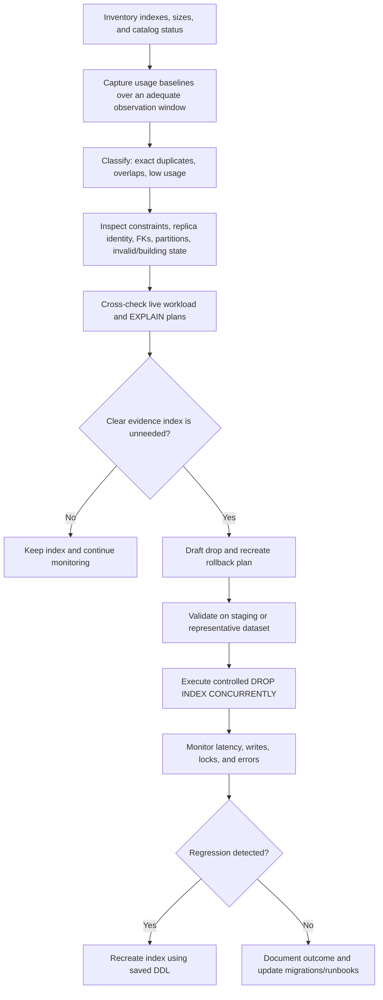

# Auditing Redundant, Unused, or Duplicate Indexes in PostgreSQL

An index can cut query execution time dramatically, yet it is never free. PostgreSQL must store and maintain indexes as data mutates. Over years of application evolution, a single table can accumulate dozens of indexes: remnants from old migrations, indexes serving retired queries, multi-column indexes overlapping single-column ones, or near-identical indexes added independently by different teams.

**Auditing redundant, unused, or duplicate indexes** never means querying `idx_scan = 0` and bulk-dropping rows. A unique index may safeguard data integrity even when rarely read. A foreign-key index may matter most when deleting parent records. An index built for month-end reporting may stay silent in the past few days of metrics.

This lesson in PostgreSQL's **Indexes** chapter shows how to combine:

- **Usage statistics** from `pg_stat_user_indexes` alongside stats reset timestamps.
- **Definitions and structure** from `pg_index`, `pg_class`, and `pg_get_indexdef()`.
- **Storage footprint and write cost** incurred as every `INSERT`, `UPDATE`, or `DELETE` maintains indexes.
- **Integrity roles** including primary keys, unique/exclusion constraints, foreign keys, and replica identity.
- **Duplication and overlap analysis** across single-column, composite, partial, expression, covering indexes, and distinct access methods.
- **Workload validation** using real queries, `EXPLAIN` plans, multi-period baselines, and controlled change testing.
- **Safe removal procedures** via `DROP INDEX CONCURRENTLY` backed by tested rebuild plans.

The goal is **trimming unnecessary overhead without breaking query performance or critical data invariants**.

## 1. Why Too Many Indexes Hurt

Suppose a write-heavy `orders` table maintains ten indexes. Inserting one order no longer writes merely one heap tuple; PostgreSQL must also update every applicable index.

Potential costs:

1. **Disk storage:** each index allocates dedicated pages; wide composite or `INCLUDE` indexes consume significant space.
2. **WAL volume:** index page inserts/updates emit WAL records, impacting I/O and replication bandwidth.
3. **Write latency:** `INSERT`, `UPDATE`, and `DELETE` must perform additional index maintenance work.
4. **Buffer cache pressure:** index pages compete with table pages and other hot indexes for shared buffer memory.
5. **VACUUM and maintenance:** cleanup passes must process indexes alongside heap tuples.
6. **HOT update inhibition:** indexing frequently modified columns prevents qualifying `UPDATE`s from taking the Heap-Only Tuple (HOT) path.
7. **Migrations, backups, and restores:** excessive indexes slow schema builds, validation, and recovery.

Still, minimizing index count is not an isolated goal. If an index adds modest write overhead while speeding up a critical query from 5 seconds to 5 milliseconds, it earns its keep.

**Principle:** weigh *read gains and integrity protection* against *write overhead, storage, and maintenance cost* within your real workload.

## 2. Three Distinct Concepts

| Concept | Signal | Safe to Drop Immediately? |
| --- | --- | --- |
| **Unused / rarely used index** | Low scan counters observed during stats window | **No**: check seasonality, stats resets, replicas, constraints, and workload |
| **Duplicate index** | Two indexes sharing table, access method, keys, expressions, sort order, predicates, uniqueness rules | **Not yet**: verify dependencies, validity, replica identity, and removal plan |
| **Overlapping / partially redundant index** | One index can serve some queries covered by another, e.g., B-tree `(a, b)` covering lookups on `a` | **Never automatically**: smaller index size, ordering, selectivity, or covering payload may still matter |

An index can be rarely scanned yet **non-duplicate**; or duplicate yet **heavily scanned** because the planner happens to pick one copy. Conversely, similar names never guarantee identical semantics.

Example:

```sql
CREATE INDEX idx_orders_tenant
ON orders (tenant_id);

CREATE INDEX idx_orders_tenant_created
ON orders (tenant_id, created_at DESC);
```

The second index can satisfy predicates on `tenant_id`, yet that alone **does not prove the first index is useless**.

Meanwhile:

```sql
CREATE INDEX idx_orders_tenant_created_v2
ON orders (tenant_id, created_at DESC);
```

If this shares the identical access method and semantic attributes as the second index, it is a **clear duplicate candidate**. Even then, inspect catalogs and dependencies before choosing which copy to keep.

## 3. A Sound Audit Workflow



This is a **decision workflow**, not a blind cleanup script. For constraint-backing or critical indexes, the right conclusion is often **keep the index** even when `idx_scan = 0`.

## 4. Hands-On Dataset

Create this schema and sample tables inside a learning database. Indexes here deliberately introduce duplicates and overlaps for inspection. **Never run illustrative drops on production tables.**

```sql
CREATE SCHEMA IF NOT EXISTS index_audit_lab;

CREATE TABLE index_audit_lab.customers (
    customer_id bigint PRIMARY KEY,
    customer_name text NOT NULL
);

INSERT INTO index_audit_lab.customers (customer_id, customer_name)
SELECT g, 'Customer ' || g::text
FROM generate_series(1, 100) AS g;

CREATE TABLE index_audit_lab.orders (
    order_id bigint GENERATED ALWAYS AS IDENTITY PRIMARY KEY,
    tenant_id integer NOT NULL,
    customer_id bigint NOT NULL
        REFERENCES index_audit_lab.customers(customer_id),
    external_ref text NOT NULL UNIQUE,
    status text NOT NULL
        CHECK (status IN ('paid', 'pending', 'cancelled')),
    created_at timestamptz NOT NULL,
    amount numeric(12, 2) NOT NULL CHECK (amount >= 0)
);

INSERT INTO index_audit_lab.orders
    (tenant_id, customer_id, external_ref, status, created_at, amount)
SELECT
    (g % 10 + 1)::integer,
    (g % 100 + 1)::bigint,
    'ORDER-' || g::text,
    CASE
        WHEN g % 10 = 0 THEN 'cancelled'
        WHEN g % 4 = 0 THEN 'pending'
        ELSE 'paid'
    END,
    TIMESTAMPTZ '2026-01-01 00:00:00+00'
        + g * INTERVAL '1 minute',
    ((g % 10000)::numeric / 100)::numeric(12, 2)
FROM generate_series(1, 40000) AS g;
```

Create illustrative indexes:

```sql
-- 1. Single-column index: leading-prefix overlap candidate.
CREATE INDEX idx_orders_tenant
ON index_audit_lab.orders (tenant_id);

-- 2. Composite index for tenant + recency.
CREATE INDEX idx_orders_tenant_created
ON index_audit_lab.orders (tenant_id, created_at DESC);

-- 3. Deliberate copy of index #2.
CREATE INDEX idx_orders_tenant_created_copy
ON index_audit_lab.orders (tenant_id, created_at DESC);

-- 4. Low-cardinality status index to evaluate usefulness.
CREATE INDEX idx_orders_status
ON index_audit_lab.orders (status);

-- 5. Foreign key index on the child table.
CREATE INDEX idx_orders_customer
ON index_audit_lab.orders (customer_id);

-- 6. Partial index covering only pending orders.
CREATE INDEX idx_orders_pending_tenant_created
ON index_audit_lab.orders (tenant_id, created_at DESC)
WHERE status = 'pending';

-- 7. Covering index adding an INCLUDE column.
CREATE INDEX idx_orders_tenant_created_include_amount
ON index_audit_lab.orders (tenant_id, created_at DESC)
INCLUDE (amount);

ANALYZE index_audit_lab.orders;
```

The `orders` table also carries system-created indexes backing `PRIMARY KEY(order_id)` and `UNIQUE(external_ref)`.

In sections below:

- `idx_orders_tenant_created` and `idx_orders_tenant_created_copy` are **structural duplicate candidates**.
- `idx_orders_tenant` is a **prefix-overlap candidate** with leading key `tenant_id`.
- `idx_orders_status` is a **low-selectivity candidate**, though low cardinality alone never guarantees redundancy.
- `idx_orders_customer` is not created automatically by PostgreSQL for child foreign keys; it was created intentionally to help joins and parent deletes.
- The `INCLUDE (amount)` index enables *covering* plans differing from the plain two-key index.
- The partial index covers only `status = 'pending'`, so it is not equivalent to a full-table index.

This 40,000-row dataset remains far too small to extrapolate production timings for hundred-million-row tables.

## 5. Measuring Index Size and Storage Footprint

First, inspect table heap size alongside total index footprint:

```sql
SELECT
    'index_audit_lab.orders'::regclass AS table_name,
    pg_size_pretty(
        pg_relation_size('index_audit_lab.orders'::regclass)
    ) AS heap_size,
    pg_size_pretty(
        pg_indexes_size('index_audit_lab.orders'::regclass)
    ) AS total_indexes_size,
    pg_size_pretty(
        pg_total_relation_size('index_audit_lab.orders'::regclass)
    ) AS total_relation_size;
```

Function summary:

| Function | Typical Meaning |
| --- | --- |
| `pg_relation_size(table)` | Main fork size of the relation, excluding associated indexes/TOAST |
| `pg_indexes_size(table)` | Total size across all indexes on the table |
| `pg_total_relation_size(table)` | Combined table, TOAST, and index storage |
| `pg_relation_size(index)` | Physical size of a single index |
| `pg_size_pretty(bytes)` | Human-readable byte formatting |

List individual indexes sorted by descending size:

```sql
SELECT
    s.schemaname,
    s.relname AS table_name,
    s.indexrelname AS index_name,
    pg_relation_size(s.indexrelid) AS index_bytes,
    pg_size_pretty(pg_relation_size(s.indexrelid)) AS index_size
FROM pg_stat_user_indexes AS s
WHERE s.schemaname = 'index_audit_lab'
ORDER BY pg_relation_size(s.indexrelid) DESC, s.indexrelname;
```

A multi-gigabyte index is a **high-priority investigation target** if unused, yet large size alone never proves bloat or waste. A large index may back a critical query or mandatory constraint.

### 5.1. Index-to-Heap Size Ratio

Quick check:

```sql
SELECT
    pg_relation_size('index_audit_lab.orders'::regclass)
        AS heap_bytes,
    pg_indexes_size('index_audit_lab.orders'::regclass)
        AS indexes_bytes,
    ROUND(
        pg_indexes_size('index_audit_lab.orders'::regclass)::numeric
        / NULLIF(
            pg_relation_size('index_audit_lab.orders'::regclass),
            0
        ),
        2
    ) AS index_to_heap_ratio;
```

Ratios above 1 mean total indexes outweigh the heap itself. That is **not an automatic error**: narrow tables with several legitimate indexes naturally exceed 1. Use it strictly to **prioritize audits**, never as an auto-drop threshold.

## 6. Reading pg_stat_user_indexes

PostgreSQL exposes `pg_stat_user_indexes` for user-table index usage counters:

```sql
SELECT
    schemaname,
    relname AS table_name,
    indexrelname AS index_name,
    idx_scan,
    idx_tup_read,
    idx_tup_fetch
FROM pg_stat_user_indexes
WHERE schemaname = 'index_audit_lab'
ORDER BY relname, idx_scan, indexrelname;
```

Three core counters:

| Column | Meaning and Limitations |
| --- | --- |
| `idx_scan` | Number of index scans/searches recorded by stats; **not equal to distinct SQL `SELECT` count** |
| `idx_tup_read` | Number of index entries returned across scans per PostgreSQL stats accounting |
| `idx_tup_fetch` | Live heap rows fetched via **simple index scans** using that index; excludes certain access paths |

### 6.1. What Does idx_scan = 0 Mean?

`idx_scan = 0` means **zero index scans have been recorded since statistics began or were reset**. It does *not* mean:

- The index was never used historically.
- The index does not protect a unique or primary key constraint.
- The index is unnecessary for a monthly or quarterly batch job.
- The index is unused on **read replicas**.
- Dropping the index cannot hurt performance.
- Another index handles the workload at identical cost.

Treat zero solely as a **signal warranting further investigation**.

### 6.2. One SQL Statement Can Increment idx_scan Many Times

`idx_scan` counts **index probes/scans** inside query execution; a nested loop join can trigger thousands of index scans from a single SQL query. Never equate `idx_scan` directly with “number of HTTP requests using this index.”

Exact counter increment semantics can differ across PostgreSQL versions; account for version differences when comparing stats across upgrades.

### 6.3. idx_tup_read Differs from idx_tup_fetch

An `Index Only Scan` can read index entries (`idx_tup_read`) while skipping heap fetches (`idx_tup_fetch`) on all-visible pages. Similarly, `Bitmap Index Scan` credits heap fetches to table-level stats rather than individual index `idx_tup_fetch`.

Therefore, low `idx_tup_fetch` never proves an index is useless. Inspect `EXPLAIN (ANALYZE, BUFFERS)` and full plans to measure actual query behavior.

## 7. Know Your Statistics Observation Window

Stats counters never mean “the last 30 days.” They accumulate cumulatively from initial collection or the last stats reset.

Inspect database-level stats reset timestamps:

```sql
SELECT
    datname,
    stats_reset,
    now() - stats_reset AS stats_age
FROM pg_stat_database
WHERE datname = current_database();
```

Be careful:

- Database `stats_reset` is **not a per-index last-used timestamp**.
- An index created mid-window has a shorter observation age than older indexes.
- Stats resets, crashes, major upgrades, or topology switches interrupt historical baselines.
- Separate **primary** vs. **read replica** counters by where read queries actually execute.
- Low-traffic periods or paused batch jobs do not represent full business cycles.

For monthly billing reports, observe across at least one billing cycle. For annual closing queries, a few weeks of metrics remain blind.

### 7.1. Compare Deltas, Not Raw Cumulative Totals

An index showing `idx_scan = 5,000,000` might have been heavily hit months ago and **completely abandoned** after an application refactor.

A practical observation method captures baselines:

```sql
CREATE TABLE index_audit_lab.index_usage_baseline AS
SELECT
    clock_timestamp() AS captured_at,
    indexrelid,
    relid,
    idx_scan,
    idx_tup_read,
    idx_tup_fetch
FROM pg_stat_user_indexes
WHERE schemaname = 'index_audit_lab';
```

After a representative observation window, compare deltas:

```sql
SELECT
    s.indexrelid::regclass AS index_name,
    b.captured_at,
    clock_timestamp() AS observed_at,
    s.idx_scan - b.idx_scan AS scans_since_baseline,
    s.idx_tup_read - b.idx_tup_read AS entries_since_baseline,
    s.idx_tup_fetch - b.idx_tup_fetch AS fetches_since_baseline
FROM pg_stat_user_indexes AS s
JOIN index_audit_lab.index_usage_baseline AS b
    ON b.indexrelid = s.indexrelid
WHERE s.schemaname = 'index_audit_lab'
ORDER BY scans_since_baseline, index_name;
```

**Important caveats:**

- A stats reset between snapshots produces negative or invalid deltas.
- Dropping, recreating, or concurrently reindexing changes `indexrelid`, breaking OID joins.
- This table stores a lab snapshot; real monitoring pipelines persist versioned metrics tracking OID, index name, reset timestamps, and host role.
- Short-window baselines miss seasonal batch workloads.

**Never call `pg_stat_reset()` in production just for a “clean starting point”**—it wipes operational counters across every team.

## 8. Comprehensive Audit Query: Usage, Size, and Structural Role

Combine usage counters, storage footprint, and constraint metadata into an audit inventory:

```sql
SELECT
    s.schemaname,
    s.relname AS table_name,
    s.indexrelname AS index_name,
    pg_size_pretty(
        pg_relation_size(s.indexrelid)
    ) AS index_size,
    s.idx_scan,
    s.idx_tup_read,
    s.idx_tup_fetch,
    i.indisprimary,
    i.indisunique,
    i.indisexclusion,
    i.indisvalid,
    i.indisready,
    i.indisreplident,
    EXISTS (
        SELECT 1
        FROM pg_constraint AS c
        WHERE c.conindid = s.indexrelid
          AND c.contype IN ('p', 'u', 'x')
    ) AS supports_pk_unique_or_exclusion_constraint,
    EXISTS (
        SELECT 1
        FROM pg_constraint AS c
        WHERE c.conindid = s.indexrelid
          AND c.contype = 'f'
    ) AS referenced_by_foreign_key,
    pg_get_indexdef(s.indexrelid) AS index_definition
FROM pg_stat_user_indexes AS s
JOIN pg_index AS i
    ON i.indexrelid = s.indexrelid
WHERE s.schemaname = 'index_audit_lab'
ORDER BY
    pg_relation_size(s.indexrelid) DESC,
    s.relname,
    s.indexrelname;
```

This is an **investigative report**, never a rule to “drop whenever all booleans are false.”

Key flags:

- `indisprimary`: primary key index.
- `indisunique`: unique index (including standalone unique indexes not tied to constraints).
- `indisexclusion`: exclusion constraint index.
- `indisvalid`: index valid for planner queries.
- `indisready`: index maintained on incoming writes.
- `indisreplident`: index explicitly assigned as replica identity via `USING INDEX`.
- `pg_constraint.conindid`: links constraints; for foreign keys (`contype = 'f'`), identifies the referenced unique index on the target parent table.

**Crucial note:** when a table uses `REPLICA IDENTITY DEFAULT`, the primary key serves as replica identity without setting `indisreplident = true`. Never drop a PK index solely because `indisreplident` is false.

## 9. Rarely Scanned Indexes You Must Keep: PRIMARY KEY and UNIQUE

Our sample table declares:

```sql
order_id bigint GENERATED ALWAYS AS IDENTITY PRIMARY KEY
```

and:

```sql
external_ref text NOT NULL UNIQUE
```

PostgreSQL builds indexes backing both constraints.

Even if the app never runs `SELECT ... WHERE external_ref = ...` during an observation week, that unique index enforces **write-time duplicate prevention**. Reading `idx_scan` alone misses that invariant completely.

Distinguish clearly:

- `PRIMARY KEY`: guarantees uniqueness and `NOT NULL` per primary-key rules.
- `UNIQUE CONSTRAINT`: enforces uniqueness as a named constraint.
- Standalone `CREATE UNIQUE INDEX`: enforces uniqueness and can act as an `ON CONFLICT` arbiter.
- `EXCLUDE USING ...`: guards exclusion invariants (often via GiST).

Never drop a unique index merely because a non-unique index “already reads those columns just as fast.” Non-unique indexes **cannot enforce uniqueness invariants**.

### 9.1. Account for UPSERT and ON CONFLICT Targets

Applications commonly issue:

```sql
INSERT INTO index_audit_lab.orders
    (tenant_id, customer_id, external_ref, status, created_at, amount)
VALUES
    (1, 1, 'ORDER-NEW-123', 'paid', now(), 10.00)
ON CONFLICT (external_ref) DO NOTHING;
```

If writes rely on `external_ref`'s unique index to handle duplicates atomically, dropping or changing uniqueness breaks application UPSERT conflict inference.

Index audits must evaluate **write contracts**, not only `SELECT` plans.

### 9.2. Are Two Unique Indexes Truly Identical?

Two unique indexes on matching columns may still differ across:

- `NULLS DISTINCT` vs. `NULLS NOT DISTINCT` (PostgreSQL 15+).
- Collation, operator class, and expressions.
- Partial predicates (`WHERE ...`).
- Composite uniqueness key tuple scope.
- Constraint dependencies, deferrability, and replica identity.

Never assume “matching column names means duplicate unique indexes.”

## 10. Foreign Keys: Parent-Side vs. Child-Side Indexes

PostgreSQL requires referenced parent columns of a foreign key to carry a matching unique or primary key index, which guards parent lookups.

Conversely, PostgreSQL **does not automatically create an index on child-table foreign key columns** when you declare `REFERENCES`.

In our schema:

```sql
customer_id bigint NOT NULL
    REFERENCES index_audit_lab.customers(customer_id)
```

has an explicit child index:

```sql
CREATE INDEX idx_orders_customer
ON index_audit_lab.orders (customer_id);
```

If you drop `idx_orders_customer` merely due to low `idx_scan`, deleting a parent row:

```sql
DELETE FROM index_audit_lab.customers
WHERE customer_id = 20;
```

can force scans over massive numbers of child `orders` rows to check for references—causing severe latency spikes or long lock waits on huge child tables.

Child FK indexes are **optional for FK correctness**, yet critical for **parent `DELETE`/`UPDATE` speed and join performance**.

### 10.1. Do Not Rely Solely on pg_constraint to Spot Child FK Indexes

`pg_constraint` identifies FK columns and the referenced parent index, yet does not label “which child index accelerates child lookups.”

A composite child index leading with the FK, such as `(customer_id, created_at)`, accelerates `customer_id` checks; whereas `(created_at, customer_id)` has a different leading key and behaves differently.

Before dropping an index on a foreign key column, check:

- Parent/child relationships and `ON DELETE`/`ON UPDATE` actions.
- Whether another index leads with that FK column.
- Frequency of parent deletes or primary-key updates.
- Child table size and operation latency budgets.
- Join and filter queries targeting that FK.

## 11. Replica Identity and Logical Replication Streams

In logical replication, pub/sub pipelines, or CDC tools, downstream consumers must identify updated and deleted rows via table-level `REPLICA IDENTITY`.

```sql
SELECT
    oid::regclass AS table_name,
    relreplident
FROM pg_class
WHERE oid = 'index_audit_lab.orders'::regclass;
```

`relreplident` modes:

| Value | General Meaning |
| --- | --- |
| `d` | DEFAULT: typically uses the primary key when present |
| `i` | Index mode: uses the index assigned via `USING INDEX` |
| `f` | FULL: logs full old row columns instead of an identity index |
| `n` | NOTHING: logs no replica identity for updates/deletes |

An explicitly assigned replica identity index appears with `pg_index.indisreplident = true`. Never drop it as “rarely scanned” without verifying replication pipelines.

Furthermore, `DEFAULT` relies implicitly on the primary key even when `indisreplident` is false—meaning **PK indexes remain vital to logical replication**.

Coordinate with CDC/replication owners before altering constraints or indexes on replicated tables.

## 12. What Makes Two Indexes Exact Structural Duplicates?

For standard B-trees, two indexes are duplicate candidates when they share:

1. **Target table**.
2. **Access method** (e.g., B-tree).
3. **Identical key columns/expressions in identical order**.
4. **Identical operator classes and collations**.
5. **Matching `ASC`/`DESC` directions and `NULLS FIRST`/`LAST` placement**.
6. **Identical `INCLUDE` column lists**.
7. **Identical or logically equivalent partial predicates**.
8. **Matching unique/exclusion semantics**, including `NULLS NOT DISTINCT` and deferrability.
9. **Compatible validity and dependencies** permitting safe consolidation.

Note that identical semantic definitions do not imply identical physical attributes: `tablespace`, `fillfactor`, storage parameters, bloat levels, cluster order, and physical sizes can still differ.

### 12.1. An Obvious Duplicate Pair

Sample pair:

```sql
CREATE INDEX idx_orders_tenant_created
ON index_audit_lab.orders (tenant_id, created_at DESC);

CREATE INDEX idx_orders_tenant_created_copy
ON index_audit_lab.orders (tenant_id, created_at DESC);
```

Both target the same table using default B-tree, keys `tenant_id` followed by `created_at DESC`, no partial predicate, no `INCLUDE`, and non-unique. Here, **dropping one copy is a strong candidate** once dependencies and operational quirks are cleared.

Which copy should you keep? Prefer the name referenced consistently in migrations/tooling, verify valid state, check tablespace/storage settings, and plan recovery—do not blindly prioritize whichever happens to show slightly higher `idx_scan`, since the planner picks arbitrarily between identical copies.

### 12.2. Different Names Add Zero Query Capability

Names like `idx_foo_v1` and `idx_foo_v2` do not imply different behavior. Yet never bulk-drop by naming convention alone: a `v2` copy might differ in `INCLUDE`, partial predicates, uniqueness, or collation.

Inspect full definitions:

```sql
SELECT
    indexrelid::regclass AS index_name,
    pg_get_indexdef(indexrelid) AS definition
FROM pg_index
WHERE indrelid = 'index_audit_lab.orders'::regclass
ORDER BY index_name;
```

Read the complete `indexdef` string, not just the first parenthesized key list.

## 13. Detecting Structural Duplicate Candidates via System Catalogs

The query below **flags pairs of indexes with matching metadata** for human review—it is never an automatic delete list.

**Version note:** this query references `pg_index.indnullsnotdistinct`, available in **PostgreSQL 15+**. On older versions, remove that predicate and evaluate null uniqueness per version behavior. Always verify `SHOW server_version;`.

```sql
SELECT
    a.indrelid::regclass AS table_name,
    a.indexrelid::regclass AS index_a,
    b.indexrelid::regclass AS index_b,
    pg_size_pretty(pg_relation_size(a.indexrelid)) AS size_a,
    pg_size_pretty(pg_relation_size(b.indexrelid)) AS size_b,
    pg_get_indexdef(a.indexrelid) AS definition_a,
    pg_get_indexdef(b.indexrelid) AS definition_b
FROM pg_index AS a
JOIN pg_index AS b
    ON b.indrelid = a.indrelid
   AND b.indexrelid > a.indexrelid
JOIN pg_class AS ia
    ON ia.oid = a.indexrelid
JOIN pg_class AS ib
    ON ib.oid = b.indexrelid
JOIN pg_class AS t
    ON t.oid = a.indrelid
JOIN pg_namespace AS n
    ON n.oid = t.relnamespace
WHERE n.nspname = 'index_audit_lab'
  AND ia.relam = ib.relam
  AND a.indnkeyatts = b.indnkeyatts
  AND a.indnatts = b.indnatts
  AND a.indkey = b.indkey
  AND a.indclass = b.indclass
  AND a.indcollation = b.indcollation
  AND a.indoption = b.indoption
  AND pg_get_expr(a.indexprs, a.indrelid)
      IS NOT DISTINCT FROM
      pg_get_expr(b.indexprs, b.indrelid)
  AND pg_get_expr(a.indpred, a.indrelid)
      IS NOT DISTINCT FROM
      pg_get_expr(b.indpred, b.indrelid)
  AND a.indisunique = b.indisunique
  AND a.indisexclusion = b.indisexclusion
  AND a.indnullsnotdistinct = b.indnullsnotdistinct
  AND a.indimmediate = b.indimmediate
  AND a.indisvalid
  AND b.indisvalid
ORDER BY table_name, index_a, index_b;
```

Catalog columns explained:

| Catalog field | Meaning |
| --- | --- |
| `indrelid` | Target table OID |
| `indexrelid` | Index OID |
| `pg_class.relam` | Index access method |
| `indkey` | Column numbers; `0` denotes an expression key |
| `indclass` | Operator classes per key |
| `indcollation` | Collations per key |
| `indoption` | Per-key ordering and access-method option flags |
| `indnkeyatts` | Count of key attributes |
| `indnatts` | Total attributes including `INCLUDE` columns |
| `indexprs` | Expression trees for expression keys |
| `indpred` | Partial index predicate expression |
| `indisunique` | Uniqueness flag |
| `indnullsnotdistinct` | Null uniqueness behavior (PostgreSQL 15+) |
| `indimmediate` | Immediate vs. deferred uniqueness enforcement |

**Query limitations:**

- Comparing deparsed expression/predicate strings is a **heuristic**; differently written expressions can be logically identical, or deceptively similar strings can hide edge cases.
- Does not compare physical storage traits (`tablespace`, `reloptions`, bloat).
- Does not inspect constraint dependencies, replica identity, partition attachments, clustering, or application/migration coupling.
- Two valid indexes appearing in results does not guarantee dropping either is safe.

Treat results strictly as a **manual review checklist**.

## 14. Left-Prefix Overlap in B-tree Indexes

In multi-column B-trees, key order matters critically.

```sql
CREATE INDEX idx_example_a
ON some_table (a);

CREATE INDEX idx_example_a_b
ON some_table (a, b);
```

Index `(a, b)` can support `WHERE a = ...`, making `(a)` a prefix-overlap candidate. However:

- `(a)` is typically narrower and can outperform `(a, b)` for queries filtering strictly on `a`.
- `(a, b)` serves `WHERE a = ... ORDER BY b` cleanly.
- Do not assume `(a, b)` replaces `(b)` or serves predicates on `b` alone identically.
- Differences in `INCLUDE`, partial predicates, operator classes, or collations break substitutability.
- Unique `(a)` enforces a completely different invariant from unique `(a, b)`.

### 14.1. Reversed Column Orders Are Not Duplicates

```sql
CREATE INDEX idx_example_a_b
ON some_table (a, b);

CREATE INDEX idx_example_b_a
ON some_table (b, a);
```

These serve distinct query access patterns. Never sort column lists alphabetically in an audit script to declare indexes identical.

### 14.2. ASC/DESC Ordering Must Be Evaluated Across Composite Keys

Single-column B-trees support forward and backward scans, so `(created_at ASC)` and `(created_at DESC)` often cover similar ground (aside from `NULLS` differences).

With mixed-direction composite keys:

```sql
CREATE INDEX idx_mixed
ON some_table (tenant_id ASC, created_at DESC);
```

serving `ORDER BY tenant_id ASC, created_at DESC` cannot be replicated identically by an index with matching column names and mismatched directions. `NULLS FIRST`/`LAST` also affects eligibility.

**Compare query and ordering semantics, not just column names.**

## 15. Flagging Single-Column vs. Composite Indexes with Matching Leading Keys

This heuristic finds potential leading-key overlaps among **plain-column B-trees** (excluding expression indexes and complex configurations):

```sql
SELECT
    a.indrelid::regclass AS table_name,
    a.indexrelid::regclass AS one_key_index,
    b.indexrelid::regclass AS multi_key_index,
    pg_get_indexdef(a.indexrelid) AS one_key_definition,
    pg_get_indexdef(b.indexrelid) AS multi_key_definition
FROM pg_index AS a
JOIN pg_index AS b
    ON b.indrelid = a.indrelid
   AND b.indexrelid <> a.indexrelid
JOIN pg_class AS ia
    ON ia.oid = a.indexrelid
JOIN pg_class AS ib
    ON ib.oid = b.indexrelid
JOIN pg_am AS ama
    ON ama.oid = ia.relam
JOIN pg_class AS t
    ON t.oid = a.indrelid
JOIN pg_namespace AS n
    ON n.oid = t.relnamespace
WHERE n.nspname = 'index_audit_lab'
  AND ama.amname = 'btree'
  AND ia.relam = ib.relam
  AND a.indnkeyatts = 1
  AND b.indnkeyatts >= 2
  AND a.indkey[0] > 0
  AND a.indkey[0] = b.indkey[0]
  AND a.indclass[0] = b.indclass[0]
  AND a.indcollation[0] = b.indcollation[0]
  AND a.indexprs IS NULL
  AND b.indexprs IS NULL
  AND a.indpred IS NULL
  AND b.indpred IS NULL
  AND a.indisvalid
  AND b.indisvalid
ORDER BY table_name, one_key_index, multi_key_index;
```

This reports **potentially overlapping pairs**—it never proves the single-column index is safe to drop.

Limitations:

- The single-key index might carry `INCLUDE` columns, making it non-equivalent.
- The composite index could be much wider and slower for pure leading-key lookups.
- Does not verify sort direction compatibility, null placement, storage parameters, or constraints.
- Deliberately filters out expression and partial indexes to avoid false positives.
- Indexing `indkey[0]` uses internal vector indexing (`int2vector`); verify catalog behavior across major PostgreSQL versions.

**Whenever a candidate pair surfaces, test `EXPLAIN` against real queries before deciding.**

## 16. Partial Indexes Are Not Equivalent to Full Indexes

From our dataset:

```sql
CREATE INDEX idx_orders_tenant_created
ON index_audit_lab.orders (tenant_id, created_at DESC);

CREATE INDEX idx_orders_pending_tenant_created
ON index_audit_lab.orders (tenant_id, created_at DESC)
WHERE status = 'pending';
```

Both share identical key columns, yet index **different row subsets**.

The partial index stores only `status = 'pending'`, staying smaller and tailored for:

```sql
SELECT order_id, created_at
FROM index_audit_lab.orders
WHERE tenant_id = 3
  AND status = 'pending'
ORDER BY created_at DESC
LIMIT 20;
```

Meanwhile, the full index serves general queries across all statuses:

```sql
SELECT order_id, created_at
FROM index_audit_lab.orders
WHERE tenant_id = 3
ORDER BY created_at DESC
LIMIT 20;
```

Dropping the full index leaves the partial index unable to serve `paid` or `cancelled` orders.

### 16.1. Partial Predicates and Parameterized Queries

The planner must be able to prove query conditions imply the partial index predicate. A parameterized query:

```sql
SELECT *
FROM index_audit_lab.orders
WHERE tenant_id = $1
  AND status = $2;
```

cannot generally match a `WHERE status = 'pending'` partial index inside a reusable generic plan. Thus, low `idx_scan` on a partial index may reflect **planner predicate-matching limits** rather than unused business features.

Inspect `EXPLAIN` with actual application execution modes, especially prepared statements.

### 16.2. Never Drop Partial Unique Indexes Just Because Keys Look Similar

```sql
CREATE UNIQUE INDEX uq_active_email
ON accounts (lower(email))
WHERE deleted_at IS NULL;
```

This index enforces uniqueness **exclusively for non-soft-deleted accounts**. Neither a non-unique index on `lower(email)` nor a unique index with a different predicate preserves that business rule.

## 17. INCLUDE and Covering Indexes

Compare:

```sql
CREATE INDEX idx_orders_tenant_created
ON index_audit_lab.orders (tenant_id, created_at DESC);

CREATE INDEX idx_orders_tenant_created_include_amount
ON index_audit_lab.orders (tenant_id, created_at DESC)
INCLUDE (amount);
```

Both share identical key columns, yet the second carries `amount` in its leaf payload.

For:

```sql
SELECT tenant_id, created_at, amount
FROM index_audit_lab.orders
WHERE tenant_id = 3
ORDER BY created_at DESC
LIMIT 20;
```

the second index enables an **`Index Only Scan`** when visibility map/MVCC conditions allow skipping heap fetches, whereas the first index omits `amount` and must visit the heap.

Conversely, adding `INCLUDE` enlarges the index and raises write overhead.

**Do not treat matching key columns as duplicates when one carries `INCLUDE` columns.** Weigh heap-fetch savings against extra index size and DML cost.

## 18. Expression Indexes, Collations, and Operator Classes

Two indexes on the same text column can behave very differently:

```sql
CREATE INDEX idx_email_raw
ON accounts (email);

CREATE INDEX idx_email_lower
ON accounts (lower(email));
```

An index on raw `email` cannot replace `lower(email)` for:

```sql
SELECT account_id
FROM accounts
WHERE lower(email) = lower($1);
```

Similarly, operator classes and collations govern comparison and matching behavior. A default-collation B-tree and a `"C"`-collation or `text_pattern_ops` B-tree serve different operators and sort orders.

### 18.1. Different Access Methods Never Duplicate Each Other by Column Name

Example:

```sql
CREATE INDEX idx_docs_jsonb_gin
ON documents USING gin (payload);

CREATE INDEX idx_docs_created_brin
ON documents USING brin (created_at);
```

GIN handles containment/element searches inside structured/multi-value columns, while BRIN summarizes physical block ranges on correlated data. Neither duplicates a B-tree on the same column.

GiST, SP-GiST, GIN, BRIN, and B-tree have fundamentally different operator classes, plans, and write behaviors—never group them as duplicates purely by column name.

### 18.2. Account for NULL Placement and Null Uniqueness

Indexes sharing columns can differ in `NULLS FIRST`/`LAST` order or null uniqueness semantics. In PostgreSQL 15+, `UNIQUE NULLS NOT DISTINCT` behaves very differently from default `UNIQUE`.

Always compare **index semantics**, not just column names.

## 19. Valid, Invalid, and In-Progress Indexes

An index showing `indisvalid = false` may reflect:

- An active `CREATE INDEX CONCURRENTLY` mid-build.
- A failed concurrent build leaving an incomplete index.
- A temporary `_ccnew` / `_ccold` artifact from `REINDEX CONCURRENTLY`.
- A partitioned parent index awaiting child partition attaches.

Invalid indexes are skipped for query reads, yet if `indisready = true`, DML still incurs write maintenance; invalid concurrent unique indexes can also still reject conflicting writes.

Check status:

```sql
SELECT
    i.indrelid::regclass AS table_name,
    i.indexrelid::regclass AS index_name,
    i.indisvalid,
    i.indisready,
    i.indislive,
    i.indisunique
FROM pg_index AS i
JOIN pg_class AS t
    ON t.oid = i.indrelid
JOIN pg_namespace AS n
    ON n.oid = t.relnamespace
WHERE n.nspname = 'index_audit_lab'
  AND NOT i.indisvalid
ORDER BY table_name, index_name;
```

Check active progress:

```sql
SELECT
    pid,
    relid::regclass AS target_table,
    index_relid::regclass AS target_index,
    phase,
    lockers_total,
    lockers_done
FROM pg_stat_progress_create_index
WHERE datname = current_database();
```

**Do not confuse “broken invalid index needing cleanup” with “unused valid index.”** They require separate remediation workflows; never drop an `INVALID` index that is still building or is an awaiting partitioned parent.

## 20. Indexes on Partitioned Tables

Declarative partitioned tables have parent metadata indexes paired with physical leaf-partition indexes. When analyzing stats and sizes:

- Parent queries execute using child partition indexes.
- Parent partitioned indexes hold metadata rather than heap data structures of a regular table index.
- Each partition index tracks its own usage counters and physical size.
- Child indexes attached to a parent cannot be arbitrarily dropped independently.
- Older partitions showing low `idx_scan` may still serve retention/audit queries or belong to inherited partition constraints.

Inspect index inheritance links in catalogs:

```sql
SELECT
    child.oid::regclass AS child_index,
    parent.oid::regclass AS parent_index
FROM pg_inherits AS inh
JOIN pg_class AS child
    ON child.oid = inh.inhrelid
JOIN pg_class AS parent
    ON parent.oid = inh.inhparent
WHERE child.relkind IN ('i', 'I')
ORDER BY parent_index, child_index;
```

In schemas with hundreds of partitions, aggregate audit reports **by parent index definition and partition group**, rather than listing top 10 individual partition indexes with `idx_scan = 0`.

## 21. Using EXPLAIN to Trace Which Queries Rely on an Index

Index-level counters cannot tell you **which SQL statements need an index**. Start from real queries and examine plans:

```sql
EXPLAIN (ANALYZE, BUFFERS)
SELECT order_id, created_at, amount
FROM index_audit_lab.orders
WHERE tenant_id = 3
ORDER BY created_at DESC
LIMIT 20;
```

Look for:

- Does `Index Scan` or `Index Only Scan` use the target index?
- Does `Bitmap Index Scan` combine it with other indexes?
- Does omitting this index force an expensive `Sort`?
- What are `actual rows`, `loops`, `Buffers: shared hit/read`, and execution time?
- Does `LIMIT` or keyset pagination depend on the index sort order?
- Do production prepared statements/generic plans behave differently from ad-hoc literals?

**`EXPLAIN (ANALYZE, BUFFERS)` actually executes the statement.** Safe for standard lab `SELECT`s, yet dangerous with DML or side-effecting functions in production.

### 21.1. The Most Scanned Copy Is Not Automatically Optimal

Between two identical duplicate indexes, the planner may pick one consistently while leaving the other near `idx_scan = 0`. Keeping the higher-scan copy is generally lower-churn, yet **never the sole criterion**.

Also inspect OID dependencies, physical bloat/size, validity flags, schema ownership, migration naming conventions, and tablespace placement.

### 21.2. Rarely Scanned Indexes Can Be Mission-Critical

Suppose a quarterly audit query runs:

```sql
SELECT *
FROM index_audit_lab.orders
WHERE status = 'cancelled'
  AND created_at >= TIMESTAMPTZ '2026-01-01 00:00:00+00'
  AND created_at < TIMESTAMPTZ '2026-04-01 00:00:00+00';
```

If that report carries a strict SLA, keeping a dedicated index makes total sense despite low routine `idx_scan`. Always confirm **query owners, cadence, and criticality** before judging by scan counts.

## 22. pg_stat_statements and Workload Correlation

If `pg_stat_statements` is installed and enabled, find top time-consuming queries to prioritize audits:

```sql
-- Run only when pg_stat_statements is enabled/configured.
SELECT
    queryid,
    calls,
    total_exec_time,
    mean_exec_time,
    rows,
    left(query, 160) AS query_sample
FROM pg_stat_statements
WHERE query ILIKE '%orders%'
ORDER BY total_exec_time DESC
LIMIT 20;
```

`pg_stat_statements` does not directly map “query X depends on index Y.” Correlate key queries with `EXPLAIN`, APM traces, and runtime metrics.

Keep in mind:

- Requires extension installation and shared library preload.
- Query texts may carry sensitive shapes and have restricted access.
- Normalized query patterns hide parameter-dependent plan divergence.
- Workloads can diverge sharply between primary and read replicas.

Start from **top workload queries by call count and total latency**, then map which indexes serve them—and which indexes serve nobody.

## 23. Measuring Write Overhead and HOT Update Impact

Even an index never read by `SELECT`s costs continuous maintenance on heavily written tables.

Inspect table-level DML and HOT update counters:

```sql
SELECT
    schemaname,
    relname,
    n_tup_ins,
    n_tup_upd,
    n_tup_del,
    n_tup_hot_upd,
    n_dead_tup
FROM pg_stat_user_tables
WHERE schemaname = 'index_audit_lab'
ORDER BY relname;
```

These counters are **approximate cumulative statistics**, not substitutes for direct WAL and latency measurements.

### 23.1. Why Can an Index Inhibit HOT Updates?

PostgreSQL can perform a **Heap-Only Tuple (HOT)** update when heap page free space allows and no indexed column's value changes in a way requiring index updates.

Adding an index on a frequently updated column forces index entry maintenance on updates modifying that column, making those updates ineligible for HOT.

For example, frequent updates:

```sql
UPDATE index_audit_lab.orders
SET status = 'paid'
WHERE order_id = 12345;
```

Indexing `status` (or creating a partial index predicated on `status`) can increase write work. Still, never claim every update loses HOT merely because an index exists—evaluate which columns actually mutate, index definitions, and heap fill conditions.

### 23.2. Disk Savings Are Not the Only Benefit

Dropping a genuinely redundant index saves:

- Index disk footprint.
- Index page writes during DML.
- WAL generation and replication I/O.
- Vacuum and maintenance time.
- Shared buffer cache contention.

Prove gains by measuring pre/post write p95/p99 latency, throughput, WAL rate, size, and query execution times—not merely reclaimed megabytes.

## 24. Triaging Audit Candidates by Risk and Priority

A practical classification matrix:

| Category | Example | Action Priority |
| --- | --- | --- |
| **A — Exact structural duplicate, valid, no dependencies** | Two identical B-trees on the same table | High priority to verify and drop one copy |
| **B — Prefix-overlapping B-trees** | `(tenant_id)` and `(tenant_id, created_at)` | Benchmark affected queries before deciding |
| **C — Near-zero `idx_scan`** | Standalone status index rarely scanned | Observe longer window; check batch jobs and replicas |
| **D — Integrity / replication guard** | PK, `UNIQUE`, exclusion, replica identity | **Never auto-drop** regardless of scan count |
| **E — Child-side FK index** | `orders(customer_id)` | Assess parent `DELETE`/`UPDATE` impact first |
| **F — Partial / expression / covering** | `WHERE status='pending'`, `lower(email)`, `INCLUDE(amount)` | Compare exact semantics; never treat as plain duplicate |
| **G — `INVALID` or actively building** | `indisvalid = false` | Triage separately by build progress and dependencies |
| **H — Partitioned index** | Parent/child indexes | Check inheritance attachment and partition workloads |

Qualitatively score candidates across:

- **Removal impact:** effect on SLAs, constraints, replication, and periodic batch jobs.
- **Current write cost:** table write rate and update frequency on indexed columns.
- **Disk cost:** individual index bytes and total relation overhead.
- **Telemetry confidence:** observation window coverage, stats resets, replica visibility.
- **Recovery ease:** verified recreate DDL, estimated rebuild duration, and disk/WAL headroom.

Never reduce index audits to a blind numeric formula: **constraint-backing indexes stay off the drop list regardless of scan count or size**.

## 25. Safe Index Removal: DROP INDEX CONCURRENTLY

On busy tables, prefer `DROP INDEX CONCURRENTLY` when index type and PostgreSQL version permit:

```sql
DROP INDEX CONCURRENTLY
    index_audit_lab.idx_orders_tenant_created_copy;
```

This minimizes table access blocking compared to standard `DROP INDEX`, yet **is not zero-lock or wait-free**.

Key constraints:

- Cannot run inside an explicit `BEGIN ... COMMIT` transaction block.
- Drops only **one index per statement**.
- **Does not support `CASCADE`**.
- Cannot drop indexes directly backing `PRIMARY KEY` or `UNIQUE` constraints.
- Cannot directly drop certain partitioned parent indexes per PostgreSQL rules.
- Requires ownership or appropriate privileges.
- Still waits on active transactions across phases and can leave intermediate states if interrupted.

### 25.1. Why Avoid Plain DROP INDEX Immediately in Production?

```sql
DROP INDEX index_audit_lab.idx_orders_tenant_created_copy;
```

Standard `DROP INDEX` takes a strong lock blocking table reads and writes briefly (and can queue behind long queries, blocking subsequent traffic); reserve it for lab testing or controlled maintenance windows.

Nor is `DROP INDEX CONCURRENTLY` universally applicable—check index type, constraint dependencies, and workload carefully.

### 25.2. Cannot Bundle Multiple Concurrent Drops in One Transaction

**Invalid**:

```sql
BEGIN;

DROP INDEX CONCURRENTLY index_audit_lab.idx_orders_tenant_created_copy;

DROP INDEX CONCURRENTLY index_audit_lab.idx_orders_status;

COMMIT;
```

Execute each concurrent drop as an independent top-level statement and monitor between drops. Ensure migration runners disable transactional wrapping for concurrent DDL.

### 25.3. IF EXISTS Never Proves an Index Safe to Drop

```sql
DROP INDEX CONCURRENTLY IF EXISTS
    index_audit_lab.idx_orders_tenant_created_copy;
```

`IF EXISTS` merely avoids errors if the name is missing. It never confirms peer review approval, zero dependencies, or unchanged definitions.

Verify **exact schema, name, definition, and catalog state** immediately before dropping critical indexes rather than trusting `IF EXISTS`.

## 26. Recovery Plan After Dropping an Index

Before removing any index, capture its exact DDL:

```sql
SELECT pg_get_indexdef(
    'index_audit_lab.idx_orders_tenant_created_copy'::regclass
) AS original_index_definition;
```

Recovery DDL:

```sql
CREATE INDEX CONCURRENTLY idx_orders_tenant_created_copy
ON index_audit_lab.orders (tenant_id, created_at DESC);
```

Ensure real recovery scripts preserve exact **access method, keys, expressions, `INCLUDE`, predicates, collations, opclasses, uniqueness, and storage options**.

**Note:** `pg_get_indexdef()` outputs standard DDL without `CONCURRENTLY` and without re-attaching constraint metadata. Rebuilding a dropped constraint index standalone will **not restore constraint bindings automatically**.

### 26.1. Recovery Is Not an Instant Rollback

Once `DROP INDEX CONCURRENTLY` finishes, you cannot `ROLLBACK` a wrapper transaction to restore it instantaneously. Rebuilding takes time, consumes disk/WAL, and may wait on concurrent transactions.

Verify ahead of time:

- Tested recreate DDL ready to run.
- Sufficient disk and WAL/replica headroom.
- Realistic rebuild duration estimated from staging benchmarks (never guess an exact minute).
- Whether critical queries tolerate temporary latency degradation during rebuild.
- Clear abort/rollback triggers if p95/p99 latency or error rates climb.

If rebuild risk outweighs maintenance savings, **keeping the index** is the right call.

### 26.2. Never Rush to Drop Both Copies of a Suspected Duplicate

When two indexes look identical, pick **one valid copy to retain**. Never drop both before verifying application queries and dependencies. Monitor system behavior after dropping the first copy before touching anything else.

## 27. Hands-On Walkthrough: Dropping an Exact Duplicate

Given:

```sql
idx_orders_tenant_created
idx_orders_tenant_created_copy
```

sharing identical B-tree definitions on `(tenant_id, created_at DESC)`.

Lab procedure:

### Step 1 — Inspect Catalog Metadata for Both Indexes

```sql
SELECT
    i.indexrelid::regclass AS index_name,
    i.indisvalid,
    i.indisready,
    i.indisunique,
    i.indisprimary,
    pg_get_indexdef(i.indexrelid) AS definition
FROM pg_index AS i
WHERE i.indexrelid IN (
    'index_audit_lab.idx_orders_tenant_created'::regclass,
    'index_audit_lab.idx_orders_tenant_created_copy'::regclass
)
ORDER BY index_name;
```

Confirm both indexes carefully. Casting by name raises an error if missing; in automation scripts, prefer `to_regclass` and check row counts.

### Step 2 — Check Scans and Query Plans

```sql
SELECT
    indexrelid::regclass AS index_name,
    idx_scan,
    idx_tup_read,
    idx_tup_fetch
FROM pg_stat_user_indexes
WHERE indexrelid IN (
    'index_audit_lab.idx_orders_tenant_created'::regclass,
    'index_audit_lab.idx_orders_tenant_created_copy'::regclass
);
```

And run:

```sql
EXPLAIN (ANALYZE, BUFFERS)
SELECT order_id, created_at
FROM index_audit_lab.orders
WHERE tenant_id = 3
ORDER BY created_at DESC
LIMIT 20;
```

Do not expect the planner to favor one specific copy deterministically; both carry nearly identical costs.

### Step 3 — Choose the Survivor

Here, with no special dependencies, retaining `idx_orders_tenant_created` and dropping `_copy` is clean because the base name is clearer. In production, verify ownership, migration scripts, and physical health too.

### Step 4 — Drop Exactly One Copy in the Lab Database

```sql
DROP INDEX CONCURRENTLY
    index_audit_lab.idx_orders_tenant_created_copy;
```

Run standalone—**never inside `BEGIN`**.

### Step 5 — Verify State

```sql
SELECT indexname, indexdef
FROM pg_indexes
WHERE schemaname = 'index_audit_lab'
  AND tablename = 'orders'
ORDER BY indexname;
```

Confirm business queries retain clean index plans. If rollback proves necessary in testing, rebuild via the saved DDL—never touch `pg_catalog`.

## 28. Prefix-Overlap Case: (tenant_id) vs. (tenant_id, created_at)

Pair:

```sql
CREATE INDEX idx_orders_tenant
ON index_audit_lab.orders (tenant_id);

CREATE INDEX idx_orders_tenant_created
ON index_audit_lab.orders (tenant_id, created_at DESC);
```

This requires subtler evaluation than an exact duplicate pair.

Query A:

```sql
SELECT COUNT(*)
FROM index_audit_lab.orders
WHERE tenant_id = 3;
```

Query B:

```sql
SELECT order_id, created_at
FROM index_audit_lab.orders
WHERE tenant_id = 3
ORDER BY created_at DESC
LIMIT 20;
```

While `(tenant_id, created_at DESC)` structurally covers `tenant_id` lookups:

- Query A may prefer the smaller single-column index.
- Query B strongly benefits from the second ordered key.
- Data skew across tenants can swing plan choices.
- Index-only scan eligibility on `COUNT(*)` depends on visibility map coverage.
- Depending on selectivity, sequential or bitmap scans can beat both.

**Decision:** never drop `idx_orders_tenant` blindly solely because its column matches the composite prefix. Benchmark Query A, Query B, and related workload queries on representative data first.

## 29. Production Runbook for an Index Pruning Campaign

### Step 1 — Define Scope

Select target tables/indexes and document owning services, SLAs, write rates, seasonality, read replicas, and recent migrations. Never run cluster-wide auto-drops from a single `idx_scan = 0` query.

### Step 2 — Snapshot Catalogs and Sizes

Record:

- Schema, table, index name, and OID at audit time.
- `pg_get_indexdef()` and access method.
- `pg_index` flags.
- Constraint/FK dependencies and replica identity.
- Index and table sizes.
- Partitioned parent/child links if applicable.

### Step 3 — Collect Stats Over a Representative Window

Track `idx_scan`/`idx_tup_read`/`idx_tup_fetch` deltas across multiple timestamps, verifying `stats_reset` and read replicas while covering major scheduled batch jobs.

### Step 4 — Classify Candidates

Separate **exact duplicates**, **prefix overlaps**, **low-usage indexes**, **invalid/building indexes**, and **constraint/integrity indexes**—never lump them together as “unused.”

### Step 5 — Cross-Check Queries and Workloads

Use `pg_stat_statements` (where available), logs/APM, and `EXPLAIN` to map critical reads alongside `INSERT`/`UPDATE`/`DELETE` and FK checks.

### Step 6 — Weigh Cost vs. Recoverability

Estimate disk/WAL/write latency savings alongside rebuild duration and risk on live traffic. Rebuilding a huge index on a busy table takes time.

### Step 7 — Validate on Staging or Representative Clone

Verify plans and latency with candidate indexes dropped under realistic data size, distribution, and hard queries—a 40k-row test DB rarely predicts production behavior accurately.

### Step 8 — Drop One Index at a Time

Use `DROP INDEX CONCURRENTLY` where supported, watching lock waits and keeping concurrent DDL outside transaction blocks.

### Step 9 — Monitor Post-Removal Metrics

Track:

- p50/p95/p99 read latency on affected queries.
- Write throughput and latency.
- WAL volume, replica lag, and free disk.
- Errors, timeouts, and lock waits.
- `EXPLAIN` plans for key queries.
- Scheduled batch jobs running during observation.

### Step 10 — Close with Evidence

Trigger immediate rebuild if metrics regress. Once stable across a representative cycle, record dropped DDL, outcomes, and update migrations/runbooks.

**A successful index audit is not measured by how many indexes you dropped.** Retaining an index after proving its value is an equally solid engineering result.

## 30. Integrating Audits into Java/JDBC Admin Tooling

Java tools can generate index audit reports cleanly while keeping **read-only inspection** strictly separate from **DDL execution**.

JDBC example reading usage and sizes:

```java
import java.sql.Connection;
import java.sql.PreparedStatement;
import java.sql.ResultSet;
import java.sql.SQLException;
import javax.sql.DataSource;

public class IndexInventory {
    private final DataSource dataSource;

    public IndexInventory(DataSource dataSource) {
        this.dataSource = dataSource;
    }

    public void printIndexUsage(String schemaName) throws SQLException {
        String sql = """
            SELECT
                schemaname,
                relname,
                indexrelname,
                idx_scan,
                pg_relation_size(indexrelid) AS index_bytes
            FROM pg_stat_user_indexes
            WHERE schemaname = ?
            ORDER BY index_bytes DESC, indexrelname
            """;

        try (Connection connection = dataSource.getConnection();
             PreparedStatement ps = connection.prepareStatement(sql)) {
            ps.setString(1, schemaName);

            try (ResultSet rs = ps.executeQuery()) {
                while (rs.next()) {
                    System.out.printf(
                        "%s.%s: scans=%d, bytes=%d%n",
                        rs.getString("schemaname"),
                        rs.getString("indexrelname"),
                        rs.getLong("idx_scan"),
                        rs.getLong("index_bytes")
                    );
                }
            }
        }
    }
}
```

This snippet performs **read-only metadata inspection**. For real operational tooling:

- Use a least-privilege monitoring role instead of superuser everywhere.
- Store collection timestamps, PostgreSQL version, and host role (primary/replica).
- Never convert `idx_scan = 0` into automatic drop actions.
- If executing DDL via JDBC, enforce strict **schema/index allowlists** and identifier quoting; `?` bind placeholders cannot bind table/index names.
- Never wrap `DROP INDEX CONCURRENTLY` inside a manual transaction block.
- Log approver identity, exact DDL, execution outcome, and recreate DDL.

### 30.1. Why Never Build a “Delete All Unused Indexes” Button?

A naive button driven by scan count alone risks deleting:

- Unique indexes guarding data invariants.
- Child FK indexes protecting infrequent parent deletes.
- Indexes heavily queried on read replicas yet quiet on primary.
- Quarterly/annual reporting indexes.
- Partitioned table parent/child indexes.
- Newly deployed indexes awaiting application feature rollout.

Good tooling flags **“review candidates”** alongside full metadata and evidence, requiring engineering approval before executing DDL.

## 31. Common Misconceptions

| Misconception | Why It Is Wrong | Better Approach |
| --- | --- | --- |
| `idx_scan = 0` proves an index is useless | Stats window may be brief; index may guard constraints or replicas | Observe over full cycles and check roles |
| `idx_scan` equals SQL `SELECT` count | One query can perform multiple index probes | Read as index-level scan counter, not HTTP calls |
| `idx_tup_fetch = 0` proves an index is unused | Index-only and bitmap scans count differently | Inspect `EXPLAIN` and `idx_tup_read` |
| Matching columns mean duplicate indexes | Order, collation, opclass, predicate, and `INCLUDE` may differ | Compare full definitions and catalogs |
| `(a, b)` always replaces `(a)` at zero cost | Smaller single-column index may run faster on `a`-only queries | Benchmark affected workload queries |
| `(a, b)` equals `(b, a)` | Leading key and sort orders differ | Inspect `WHERE` predicates and `ORDER BY` |
| Partial index equals full index on same columns | Indexed row subsets differ | Verify predicate coverage |
| Low-scan unique index can be dropped | Still enforces uniqueness or `ON CONFLICT` | Preserve integrity and constraints |
| PostgreSQL auto-indexes every child FK | It does not | Evaluate child FK index need |
| `indisreplident = false` means unused by replication | `DEFAULT` mode still uses PK | Check `relreplident` and CDC pipelines |
| `INVALID` always means broken/drop immediately | May be mid-build or unattached partition parent | Check progress view and partition hierarchy |
| Large index automatically means bloat | Size may reflect valid rows or `INCLUDE` | Evaluate size and bloat diagnostics separately |
| Listed in `pg_indexes` means valid | `pg_indexes` omits validity flags | Query `pg_index` |
| Concurrent drop can roll back via `ROLLBACK` | Cannot run inside transaction blocks | Prepare tested recreate DDL beforehand |
| `DROP INDEX CONCURRENTLY` works on every index | Restricted for constraints, partitions, `CASCADE`, transactions | Check dependencies and PostgreSQL version |
| One `EXPLAIN` on 40k rows settles production | Table size, cache, and skew differ | Validate on representative data |
| Fewer indexes is always better | Dropping critical indexes spikes read latency or breaks invariants | Optimize holistically; retain valuable indexes |

## 32. Hands-On Exercises

Exercises use your lab database and `index_audit_lab` schema from Section 4. Never run drop commands in production. Every exercise expects you to explain **why** a decision holds, not merely execute SQL.

### Exercise 1 — Rank Index Storage Footprint

```sql
SELECT
    indexrelid::regclass AS index_name,
    pg_size_pretty(pg_relation_size(indexrelid)) AS size,
    idx_scan
FROM pg_stat_user_indexes
WHERE schemaname = 'index_audit_lab'
ORDER BY pg_relation_size(indexrelid) DESC;
```

Pick the three largest indexes. Can size alone justify dropping an index?

### Exercise 2 — Inspect Zero-Scan Indexes

```sql
SELECT
    indexrelid::regclass AS index_name,
    idx_scan,
    idx_tup_read,
    idx_tup_fetch
FROM pg_stat_user_indexes
WHERE schemaname = 'index_audit_lab'
  AND idx_scan = 0
ORDER BY index_name;
```

List at least four reasons an index with `idx_scan = 0` must still be retained. Why verify `stats_reset` first?

### Exercise 3 — Identify Clear Structural Duplicates

Compare:

```text
idx_orders_tenant_created
idx_orders_tenant_created_copy
```

Use `pg_get_indexdef` and the catalog query from Section 13 to verify identical keys, access methods, options, and validity. What additional checks belong before **keeping one and dropping the other**?

### Exercise 4 — Prefix Overlap on B-trees

Compare `idx_orders_tenant` and `idx_orders_tenant_created`. Run:

```sql
EXPLAIN (ANALYZE, BUFFERS)
SELECT COUNT(*)
FROM index_audit_lab.orders
WHERE tenant_id = 3;
```

and:

```sql
EXPLAIN (ANALYZE, BUFFERS)
SELECT order_id, created_at
FROM index_audit_lab.orders
WHERE tenant_id = 3
ORDER BY created_at DESC
LIMIT 20;
```

Do both queries share the exact same optimal index? Why consider both index size and sorting?

### Exercise 5 — Partial vs. Full Indexes

Run:

```sql
EXPLAIN
SELECT order_id
FROM index_audit_lab.orders
WHERE tenant_id = 3
  AND status = 'pending'
ORDER BY created_at DESC
LIMIT 20;
```

Compare against omitting `status = 'pending'`. Why can a partial index never be dismissed as a duplicate of a full-table index?

### Exercise 6 — INCLUDE and Index-Only Scans

Compare:

```text
idx_orders_tenant_created
idx_orders_tenant_created_include_amount
```

Run `EXPLAIN (ANALYZE, BUFFERS)` for a query projecting `amount`. Check whether `Index Only Scan` runs and observe `Heap Fetches`. Explain why `INCLUDE` brings distinct value despite identical key columns.

### Exercise 7 — UNIQUE Index Never Used by SELECT

Inspect the index backing `UNIQUE(external_ref)`. Even if `idx_scan` stays low, can you drop it? Use `INSERT ... ON CONFLICT (external_ref) DO NOTHING` to illustrate its arbiter role.

### Exercise 8 — Child Foreign Key Indexes

Locate `idx_orders_customer`. Suppose the app rarely filters `WHERE customer_id = ...` yet periodically deletes expired customers; analyze FK check cost if this index were dropped on a massive `orders` table.

### Exercise 9 — Compute Delta Usage Across Two Timestamps

Create the Section 7 baseline, run several queries on `orders`, then compute before/after `idx_scan` deltas.

Why verify `stats_reset`? Can `idx_scan` increments always be mapped 1:1 to query clicks in your SQL client?

### Exercise 10 — Contrast Read vs. Write Costs

Query `pg_stat_user_tables` for `n_tup_ins`, `n_tup_upd`, and `n_tup_hot_upd`. Explain why an unused index imposes heavy cost on tables handling 10,000 updates/sec.

### Exercise 11 — Triage Duplicate Query Output Without Auto-Dropping

Run the Section 13 `pg_index` duplicate query. Build an evaluation table per pair covering definition, size, scan delta, constraint/replica role, and decision (keep / drop / investigate).

### Exercise 12 — Auditing Partitioned Table Indexes

Suppose `orders` is partitioned monthly. Explain why checking only parent `idx_scan` misleads, and outline how to inspect child partition indexes, inheritance attachments, and annual reporting needs.

### Exercise 13 — DROP INDEX CONCURRENTLY in Lab

After confirming `idx_orders_tenant_created_copy` is semantically identical and free of dependencies:

```sql
DROP INDEX CONCURRENTLY
    index_audit_lab.idx_orders_tenant_created_copy;
```

Run outside `BEGIN`. Re-check `pg_indexes` and `EXPLAIN`. Contrast dropping a duplicate copy vs. dropping the sole index supporting `ORDER BY`.

### Exercise 14 — Recovery

In the lab database, recreate the dropped index:

```sql
CREATE INDEX CONCURRENTLY idx_orders_tenant_created_copy
ON index_audit_lab.orders (tenant_id, created_at DESC);
```

Check `pg_index.indisvalid` and `indisready`. Why is rebuilding a multi-million-row index nothing like an instant rollback?

### Exercise 15 — Triage Candidates by Risk

Evaluate:

| Index | Recent `idx_scan` | Characteristics |
| --- | ---: | --- |
| `idx_a_copy` | 0 | Exact B-tree duplicate of `idx_a`, no dependencies |
| `uq_customer_email` | 0 | Unique index protecting email uniqueness |
| `idx_orders_customer` | 5 | Child-side FK index |
| `idx_report_quarter` | 0 | Quarterly reporting index |
| `idx_partial_active` | 100 | Partial index for active records |

Which index warrants top priority for removal evaluation, which must stay protected, and what additional evidence is needed?

### Exercise 16 — Designing a Production Index Pruning Runbook

A 200M-row `transactions` table carries 15 indexes, sustains 2,000 writes/sec, and serves reads across two read replicas. Draft a runbook covering:

1. Collecting stats across primary and replicas over an appropriate window.
2. Detecting duplicate/overlapping candidates via catalogs.
3. Checking constraints, FKs, and replica identity.
4. Mapping indexes to query latency and `EXPLAIN` plans.
5. Assessing disk, WAL, HOT ratios, and write latency.
6. Testing on representative staging data.
7. Picking the first index for concurrent drop.
8. Defining monitoring thresholds, abort criteria, and recreate DDL.
9. Documenting outcomes and planning the next review cycle.

The aim is **defensible, recoverable engineering decisions**, not chasing a drop quota.

## 33. Core Takeaways

- **Redundant, rarely used, and duplicate indexes are three distinct concepts.** Classify carefully before taking action.
- **`pg_stat_user_indexes` is a starting clue**, never an automated drop trigger. `idx_scan = 0` proves nothing alone.
- **Know your observation window**: check `stats_reset`, index creation age, scheduled batch cycles, and primary vs. replica workloads before labeling anything “unused.”
- **Compare complete catalog metadata**, never names or columns alone: access method, key order, opclass, collation, predicate, `INCLUDE`, uniqueness rules, and validity flags.
- **B-tree left prefixes create overlaps**, yet leaner single-column indexes can still outperform wider ones; `(a, b)` and `(b, a)` are never automatically equivalent.
- **Partial, expression, and covering indexes** serve distinct semantics—never dismiss them as duplicates simply for sharing columns.
- **Never auto-drop integrity indexes**: protect PKs, `UNIQUE`, exclusion constraints, `ON CONFLICT` arbiters, replica identity, and child FK indexes.
- **Triage invalid indexes separately**: they may be active builds, failed concurrent attempts, or partitioned parents awaiting attachments—never lump them with low-scan valid indexes.
- **Measure write costs too**: unnecessary indexes burn disk, WAL, maintenance time, and HOT update eligibility.
- **`EXPLAIN` and live workloads** reveal actual query dependency; valid indexes are never guaranteed to be chosen by the planner.
- **`DROP INDEX CONCURRENTLY`** avoids heavy blocking where supported, yet cannot run in explicit transactions, supports one index at a time without `CASCADE`, and waits on concurrent transactions.
- **Always prepare recreate DDL first**, because a completed concurrent drop cannot simply roll back inside a transaction block.

A well-tuned PostgreSQL system is **not the system with the fewest indexes**—it is the system keeping the **right indexes** whose query speed and data integrity value genuinely justify their storage, write, and maintenance costs.
