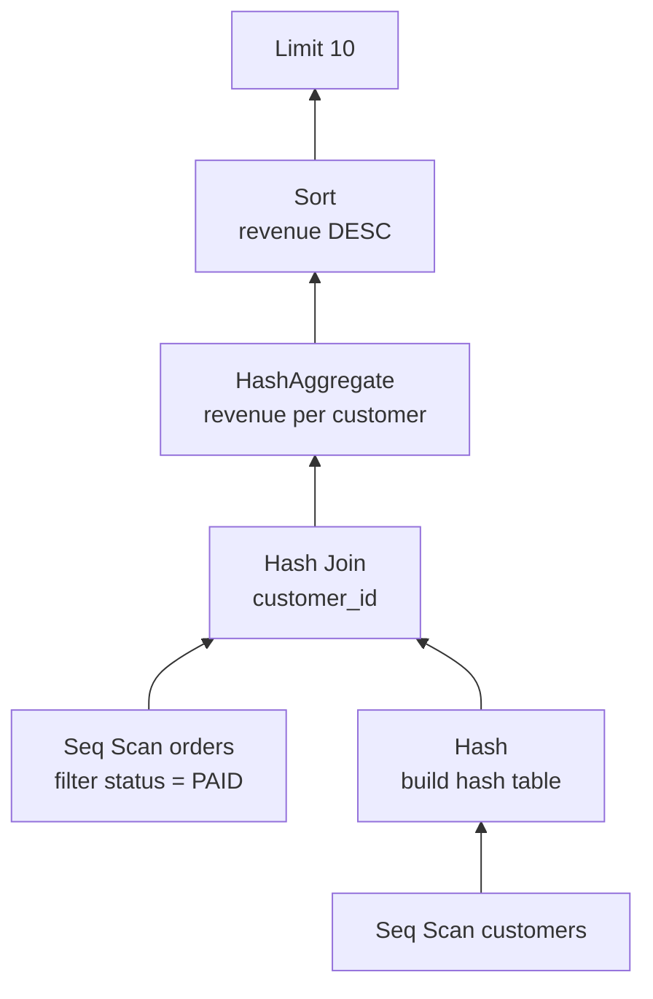

# Reading Plan Trees, Estimated Cost, Rows, and Width in PostgreSQL

A SQL statement describes **what result to fetch**, without fully specifying how PostgreSQL must retrieve it. When processing a query, PostgreSQL may choose a sequential table scan, use an index, build a hash table for a join, sort, aggregate, run multiple parallel workers, or combine several strategies.

To understand what the database **actually intends to do**, we read the **query execution plan** using `EXPLAIN`.

Example:

```sql
EXPLAIN
SELECT order_id, total_amount
FROM orders
WHERE customer_id = 42;
```

An illustrative plan might look like:

```text
Index Scan using idx_orders_customer on orders
  (cost=0.29..84.15 rows=32 width=20)
  Index Cond: (customer_id = 42)
```

Do not read this line as "the query takes 84.15 milliseconds and returns exactly 32 rows." That is a very common misunderstanding.

The three most important groups of numbers each have distinct meanings:

- **`cost=0.29..84.15`**: cost estimates computed by the **planner**, consisting of startup cost before returning the first row and expected total cost, in internal conventional units; **not milliseconds**.
- **`rows=32`**: estimated number of **rows this node will output per execution**, based on statistics and the cost model; **not guaranteed to be exact**.
- **`width=20`**: estimated **average size in bytes of the output row values from this node**, useful for estimating row transfer, sorting, hashing, and intermediate storage costs.

Beyond these three metrics, the **tree structure** and **parent-child relationships between nodes** show how data flows. On a complex query, looking only at the first line or seeing a `Seq Scan` and concluding "the query is slow" is not enough.

This lesson belongs to the **Query Plans** chapter, guiding you from reading simple trees to multi-branch plans, distinguishing estimates from actual measurements, spotting where the planner mispredicted, and choosing the right direction for performance investigation.

## 1. Why Read the Plan Instead of Guessing from SQL?

Consider:

```sql
SELECT
    c.customer_name,
    COUNT(*) AS order_count,
    SUM(o.total_amount) AS revenue
FROM customers AS c
JOIN orders AS o
  ON o.customer_id = c.customer_id
WHERE o.status = 'PAID'
GROUP BY c.customer_id, c.customer_name
ORDER BY revenue DESC
LIMIT 10;
```

The SQL describes:

1. Fetching customers and orders with status PAID.
2. Matching by `customer_id`.
3. Computing order count and total amount per customer.
4. Sorting by revenue descending.
5. Taking the first 10 customers.

However, the key execution decisions **cannot be read directly from the SQL**:

- Does PostgreSQL read `orders` using `Seq Scan` or `Index Scan`?
- Which table is read first?
- Does it use `Hash Join`, `Merge Join`, or `Nested Loop`?
- When does it use `HashAggregate` versus `GroupAggregate`?
- Is a `Sort` needed, or can ordering come directly from an index?
- How many PAID rows and how many result customers are predicted?
- How much memory is needed for sorting/hashing?
- Does it run in parallel, and are enough workers actually launched?

The execution plan provides the strategic answers and, when using `EXPLAIN ANALYZE`, measurements from an actual run.

**The goal of reading a plan** is not "force the database to always use an index," but **to understand why the planner chose a path and where reality differs from prediction**.

## 2. EXPLAIN and EXPLAIN ANALYZE

### 2.1. EXPLAIN: View the Expected Plan

```sql
EXPLAIN
SELECT *
FROM pg_class
WHERE relname = 'pg_class';
```

This command displays **the plan chosen by the planner** without executing the `SELECT` to return user rows. The `cost`, `rows`, and `width` figures are **estimates**.

### 2.2. EXPLAIN ANALYZE: Run and Measure

```sql
EXPLAIN (ANALYZE)
SELECT *
FROM pg_class
WHERE relname = 'pg_class';
```

With `ANALYZE`, PostgreSQL **actually executes the statement** and adds:

- `actual time`: actual timestamps of the node during the run, in milliseconds.
- `actual rows`: number of rows the node actually returned.
- `loops`: number of times the node was executed.
- `Planning Time`, `Execution Time`.

Example:

```text
Index Scan ... (cost=0.28..8.29 rows=1 width=265)
              (actual time=0.014..0.015 rows=1 loops=1)
```

Here:

- The first `rows=1` is the **planner's prediction**.
- `rows=1` inside `actual ...` is the **actual measurement**.
- `cost=8.29` is not `actual time=0.015 ms` written in a different unit.

### 2.3. Common Investigation Syntax

```sql
EXPLAIN (ANALYZE, BUFFERS, VERBOSE, SETTINGS)
SELECT ...
FROM ...
WHERE ...;
```

Meanings:

| Option | Main effect |
| --- | --- |
| `ANALYZE` | Executes to collect actual rows, loops, and execution time |
| `BUFFERS` | Block access statistics per node, such as shared hit/read, temp read/written |
| `VERBOSE` | Shows extra details such as Output/expressions and relation names |
| `SETTINGS` | Shows relevant non-default planner-related settings |
| `WAL` | Can add WAL statistics when supported and used with ANALYZE |
| `TIMING OFF` | Disables per-node timing to reduce overhead on some workloads; still executes and measures rows |
| `SUMMARY` | Enables/disables the summary section |
| `FORMAT JSON` | Returns the plan in JSON format for analysis tools |

You do not need every option every time. When targeting **cardinality mismatches or I/O**, `EXPLAIN (ANALYZE, BUFFERS)` is a useful starting point.

### 2.4. Warning for Write Statements

`EXPLAIN ANALYZE` **executes** `INSERT`, `UPDATE`, `DELETE`, and other side-effect statements. If you need to measure a write statement in a test environment without keeping changes:

```sql
BEGIN;

EXPLAIN (ANALYZE, BUFFERS)
UPDATE some_table
SET value = value + 1
WHERE id = 10;

ROLLBACK;
```

This is an **illustrative snippet**, assuming the table and columns exist. Even with ROLLBACK, running UPDATE can still acquire locks, generate WAL, and fire triggers; **side effects outside the database do not automatically roll back**. Never run EXPLAIN ANALYZE on a production DELETE/UPDATE just to view the plan without understanding its impact.

## 3. In What Order Is a Plan Tree Read?

A plan is presented in a **tree structure**. Indentation and `->` markers denote child nodes.

Illustrative example:

```text
Limit
  -> Sort
       Sort Key: total_amount DESC
       -> Seq Scan on orders
            Filter: (status = 'PAID')
```

Reading by data flow:

1. **`Seq Scan`** reads rows from the table and checks `status = 'PAID'`.
2. **`Sort`** receives rows from Seq Scan and sorts by total amount.
3. **`Limit`** takes the required number of leading rows to return.

**Data flows from leaves up to the root**, even though the plan prints parent nodes before child nodes.

### 3.1. Do Not Interpret the Tree as Strict Wall-Clock Order

In some node types, the executor uses a "parent requests one tuple from child" model, pulling from child nodes according to the execution mechanism. With `Nested Loop`, branches may be called repeatedly; with `Hash Join`, hash table construction and probing follow their own flow; with `Sort`, input may need to be collected before emitting tuples.

Therefore, "reading bottom-up from the leaves" is a **way to understand data relationships and processing dependencies**, not a claim that every child node always finishes completely before its parent in every millisecond.

### 3.2. Diagramming a Join Plan



In the diagram, the `orders` and `customers` branches feed data into the join; only the join result is aggregated, sorted, and limited.

### 3.3. Identifying Parent and Child Nodes

```text
Nested Loop
  -> Seq Scan on customers
  -> Index Scan using idx_orders_customer on orders
       Index Cond: (customer_id = customers.customer_id)
```

`Nested Loop` has **two child nodes**:

- Outer side: iterates over `customers`.
- Inner side: looks up orders for each customer's `customer_id`.

If `customers` has 2,000 rows, the inner node may be invoked **thousands of times**, which is why `loops` is so critical.

## 4. Structure of an EXPLAIN Line

A common plan line:

```text
Seq Scan on orders  (cost=0.00..1270.00 rows=42000 width=38)
```

Read as follows:

| Component | Meaning |
| --- | --- |
| `Seq Scan` | Plan node type |
| `on orders` | Relation being scanned |
| `cost=0.00..1270.00` | Startup cost and total cost, both **estimated** |
| `rows=42000` | Estimated number of rows **the node outputs**, not table page count |
| `width=38` | Estimated average bytes **of each row output by the node** |

Not every node has identical details. Some nodes also include `Index Cond`, `Hash Cond`, `Join Filter`, `Sort Key`, `Group Key`, `Filter`, `Recheck Cond`, or `Rows Removed by Filter`.

### 4.1. Output Lines Are Summaries, Not Full Executor Internals

A node label like `Hash Join` does not list every memory structure or buffer read on a single line. When deeper insight is needed, enable `ANALYZE, BUFFERS` and read the sub-lines directly beneath the node.

### 4.2. Do Not Mis-Multiply the Numbers

`cost`, `rows`, and `width` are not three dimensions of a single data block:

- `rows` × `width` can give a **rough estimate of the output rowset's byte size**, useful when reasoning about sort/hash costs.
- `cost` is not measured in bytes and does not come from multiplying those two numbers.
- A plan node can return very few rows while still reading the whole table, e.g., `COUNT(*)`: `rows=1` on Aggregate does not mean only one source row was scanned.

## 5. Cost: Startup Cost and Total Cost

Consider:

```text
Index Scan using idx_orders_customer on orders
  (cost=0.42..109.25 rows=30 width=32)
```

The pair of values means:

- **Startup cost = 0.42**: estimated cost before the node can **begin returning its first row**, under the planner's model.
- **Total cost = 109.25**: estimated cost for the node to process until **all expected output rows are returned**, including startup.

With:

```text
Sort (cost=2100.00..2205.00 rows=42000 width=32)
```

startup cost can be high because the node must collect/sort the input set before returning the first row.

### 5.1. What Unit Is Cost?

PostgreSQL uses **conventional planner cost units**, derived from parameters such as:

- `seq_page_cost`.
- `random_page_cost`.
- `cpu_tuple_cost`.
- `cpu_index_tuple_cost`.
- `cpu_operator_cost`.
- Assumptions about I/O, CPU, and memory.

Some units are calibrated relative to sequential page read cost. Their purpose is **comparing alternative plans**, not acting as a stopwatch.

**Do not write:** "cost 1000 means the query runs in 1000 ms." There is no fixed conversion from planner cost to wall-clock time.

### 5.2. Why Is Parent Cost Usually Higher Than Child Cost?

Illustrative example:

```text
Sort          (cost=1200.00..1225.00 rows=10000 width=24)
  -> Seq Scan (cost=0.00..800.00 rows=10000 width=24)
```

The Sort cost **already includes the cost of producing input from the Seq Scan** in the planner's model. Do not add `1225 + 800` to get total query cost.

Similarly, a join node's cost includes estimated costs from its child branches plus the join's own modeled cost.

### 5.3. Why Does LIMIT Care About Startup Cost?

```sql
SELECT order_id
FROM index_include_lab.orders
WHERE customer_id = 42
LIMIT 1;
```

An index scan can start returning one row very fast. Yet a seq scan can also be very fast if the dataset is small and matching rows appear early. The planner weighs **cost to start returning rows** and **expected number of rows needed**.

With `ORDER BY ... LIMIT 10`, an ordered index can avoid sorting the entire result. Still, a top-N heapsort `Sort` can remain reasonable depending on row counts, sort expressions, and available indexes.

### 5.4. Total Cost Is Not Always the Cost Actually Paid

If a parent only needs 10 rows, a child node may **stop early**. Total cost on a child node is generally the estimate to produce all of that node's output in the planner's model, not necessarily the full work the executor performed in a plan with LIMIT.

That is why when checking real results you must read `actual rows` and `loops` as well, rather than relying on total cost alone.

## 6. Estimating rows: How Does PostgreSQL Predict Cardinality?

`rows=N` is the number of rows a node is expected **to return to its parent node** in a single execution, after conditions evaluated at that node.

Example:

```text
Seq Scan on orders
  (cost=0.00..1200.00 rows=6000 width=32)
  Filter: (status = 'PENDING')
```

If the table has about 60,000 orders, `rows=6000` might come from estimating roughly 10% have status PENDING.

Estimates are based on:

- Estimated row count of the relation.
- Column statistics updated by `ANALYZE`/autovacuum.
- NULL fraction and number of distinct values.
- Most common values and histograms.
- Selectivity models for operators, joins, and predicates.
- Extended statistics in applicable cases.

### 6.1. rows Is Not the Table's Row Count Limit

```text
Aggregate  (cost=... rows=1 width=8)
  -> Seq Scan on orders (cost=... rows=60000 width=0)
```

If Aggregate computes `COUNT(*)`, `rows=1` on the Aggregate node is only **one result row**. Its child node may still have to read 60,000 rows.

### 6.2. Rows Means Different Things at Each Layer

| Node type | Meaning of rows |
| --- | --- |
| Scan | Rows remaining after predicates applied during the scan |
| Join | Expected rows after matching and join conditions |
| Filter | Rows remaining after the corresponding filter |
| Aggregate | Number of aggregated/grouped rows returned |
| Sort | Typically rows passing through after sorting |
| Limit | Maximum expected rows returned per LIMIT/offset |
| Gather | Expected rows after collecting from workers |

Do not use `rows` at the root node to conclude a leaf node only reads that many physical rows.

### 6.3. Row Mismatches Propagate Through the Entire Tree

If PostgreSQL thinks a filter returns 10 rows when it actually returns 100,000 rows, the planner might choose Nested Loop or an unsuitable join strategy. In that case the bug is not necessarily in the join node; it may start with **the row estimate at a child node**.

A key diagnostic technique is **finding the first node bottom-up with a major gap between estimated rows and actual rows**, then inspecting statistics/predicates there.

## 7. Estimating width: Output Row Byte Size

`width=N` is the **estimated average width** of a row passed by the node to its parent, usually in bytes. It does **not** mean:

- Table size on disk.
- PostgreSQL page size.
- Total size of the entire result set.
- Exact runtime size of each individual row.
- Number of columns in the SELECT.

Example:

```text
Seq Scan on orders (cost=... rows=60000 width=148)
```

The planner estimates each output row from the node at roughly 148 bytes. If the node only passes `order_id` and `customer_id`, width is usually smaller than if it must pass a long text `customer_note` up to the parent.

### 7.1. Projection Changes Width

Compare:

```sql
EXPLAIN
SELECT order_id, total_amount
FROM index_include_lab.orders;
```

with:

```sql
EXPLAIN
SELECT *
FROM index_include_lab.orders;
```

`SELECT *` carries more columns; the estimated width of the output-producing node can be noticeably larger.

**Width is a property of each node's output**, so a lower node may emit a different column set than an upper node due to projection, join, or aggregation.

### 7.2. Impact on Sort and Hash

If a node sorts 100,000 rows:

```text
rows=100000 width=24
```

the rough estimated output data size is about:

```text
100000 × 24 = 2,400,000 bytes (excluding overhead)
```

If width rises to 400:

```text
100000 × 400 = 40,000,000 bytes (excluding overhead)
```

The difference can strongly affect sort/hash memory estimates, plan selection, and risk of spilling to temp files.

Do not treat this simple multiplication as an exact memory formula: the executor also incurs metadata, alignment, tuple headers, hash structures, and other overhead.

### 7.3. Width Is Not Guaranteed to Match Actual Length

With `TEXT`/`JSONB`, value sizes vary per row. The planner uses statistics and estimates; skewed data or heavy churn can make predicted width diverge from reality.

If sort/hash spills to disk even though estimated width looks small, inspect real data, width variance, actual row counts, and memory settings.

## 8. Reading EXPLAIN ANALYZE: actual time, rows, and loops

Illustrative example:

```text
Index Scan using idx_orders_customer on orders
  (cost=0.42..110.50 rows=30 width=24)
  (actual time=0.027..0.074 rows=30 loops=1)
```

Reading:

- `actual time=0.027..0.074`: elapsed time from node start to first row and to node completion in **one average execution**, per EXPLAIN's reporting convention.
- `rows=30` in the actual block: actual rows returned by the node **on average per invocation/loop**.
- `loops=1`: the node executed once.

### 8.1. loops Is Very Easy to Overlook

Example:

```text
Nested Loop  (actual time=0.10..18.00 rows=900 loops=1)
  -> Seq Scan on customers
       (actual time=0.01..0.35 rows=300 loops=1)
  -> Index Scan on orders
       (actual time=0.01..0.04 rows=3 loops=300)
       Index Cond: (customer_id = customers.customer_id)
```

The Index Scan node:

- Returned **an average of 3 rows per call**.
- Was called **300 times**.
- Emitted roughly **3 × 300 = 900** rows across all iterations.

Do not conclude "Index Scan only processed three rows so it cannot be the bottleneck." Small per-call time and I/O accumulate heavily when loops are high.

### 8.2. Actual Time on a Node May Include Children

A parent node's measured cost reflects execution across its subtree; do not **blindly sum the times of every node** as completely separate intervals.

For instance, the Nested Loop's 18 ms already includes time spent in its child branches under EXPLAIN instrumentation. Adding Nested Loop 18 + Seq Scan 0.35 + Index Scan 0.04 × 300 will easily **double-count**.

### 8.3. TIMING OFF When Overhead Needs Reduction

```sql
EXPLAIN (ANALYZE, BUFFERS, TIMING OFF)
SELECT COUNT(*)
FROM index_include_lab.orders;
```

`TIMING OFF` reduces per-node timing overhead while keeping rows/loops/buffers and overall execution summary time. Useful when diagnosing cardinality where per-node timing perturbs short queries.

## 9. Practice: Creating Illustrative Data

The following steps use a **separate test PostgreSQL database**. The script creates 2,000 dummy customers and 60,000 dummy orders to demonstrate scan, join, sort, and aggregate scenarios. Do not run in a production database.

### 9.1. Schema and Customers Table

```sql
CREATE SCHEMA IF NOT EXISTS plan_tree_lab;

CREATE TABLE plan_tree_lab.customers (
    customer_id INTEGER PRIMARY KEY,
    customer_name TEXT NOT NULL,
    region TEXT NOT NULL,
    tier TEXT NOT NULL
        CHECK (tier IN ('STANDARD', 'VIP'))
);
```

### 9.2. Orders Table

```sql
CREATE TABLE plan_tree_lab.orders (
    order_id BIGINT GENERATED ALWAYS AS IDENTITY PRIMARY KEY,
    customer_id INTEGER NOT NULL
        REFERENCES plan_tree_lab.customers (customer_id),
    ordered_at TIMESTAMPTZ NOT NULL,
    status TEXT NOT NULL
        CHECK (status IN ('PAID', 'PENDING', 'CANCELLED')),
    total_amount NUMERIC(12, 2) NOT NULL
        CHECK (total_amount >= 0),
    note TEXT
);
```

### 9.3. Load Customers

```sql
INSERT INTO plan_tree_lab.customers
    (customer_id, customer_name, region, tier)
SELECT
    g.id,
    'Customer ' || g.id,
    CASE
        WHEN g.id % 3 = 0 THEN 'NORTH'
        WHEN g.id % 3 = 1 THEN 'CENTRAL'
        ELSE 'SOUTH'
    END,
    CASE WHEN g.id % 10 = 0 THEN 'VIP'
         ELSE 'STANDARD'
    END
FROM generate_series(1, 2000) AS g(id);
```

### 9.4. Load Orders

```sql
INSERT INTO plan_tree_lab.orders (
    customer_id,
    ordered_at,
    status,
    total_amount,
    note
)
SELECT
    (g.n % 2000) + 1,
    TIMESTAMPTZ '2026-01-01 00:00:00+00'
        + make_interval(mins => g.n),
    CASE
        WHEN g.n % 10 < 7 THEN 'PAID'
        WHEN g.n % 10 < 9 THEN 'PENDING'
        ELSE 'CANCELLED'
    END,
    (100 + g.n % 5000)::numeric(12, 2),
    repeat('Demo note. ', 6)
FROM generate_series(1, 60000) AS g(n);
```

### 9.5. Update Statistics

```sql
ANALYZE plan_tree_lab.customers;
ANALYZE plan_tree_lab.orders;

SELECT
    (SELECT COUNT(*) FROM plan_tree_lab.customers)
        AS customer_count,
    (SELECT COUNT(*) FROM plan_tree_lab.orders)
        AS order_count;
```

On a fresh schema loaded once, the result is **2,000 customers** and **60,000 orders**.

The EXPLAIN queries below may yield different plans on two machines for the same SQL. Factors such as PostgreSQL version, caching, statistics, configuration, and live data all affect planner choices. **Text plan examples in this lesson illustrate structure; they are not byte-for-byte outputs you are guaranteed to receive.**

## 10. Starting with a Simple Seq Scan

Run:

```sql
EXPLAIN
SELECT
    order_id,
    customer_id,
    total_amount
FROM plan_tree_lab.orders
WHERE status = 'PAID';
```

In the simulated data, about **70%** of orders are PAID. Scanning most of the table with `Seq Scan` can be cheaper than fetching scattered heap rows through an index.

An illustrative plan:

```text
Seq Scan on orders
  (cost=0.00..1750.00 rows=42000 width=22)
  Filter: (status = 'PAID'::text)
```

Reading:

1. There is only one scan node.
2. `cost=0.00`: low startup because scanning can begin immediately.
3. `total cost=1750.00` is the modeled scan/filter cost estimate.
4. `rows=42000`: the planner predicts about 42,000 PAID rows.
5. `width=22`: expected output width for the requested columns.
6. `Filter`: each tuple is read and checked for status.

Do not rush to create an index solely because `Seq Scan` appears. If a filter returns 70% of the table, Seq Scan may be the right choice.

### 10.1. Inspecting Actual Row Counts

```sql
EXPLAIN (ANALYZE, BUFFERS)
SELECT order_id, customer_id, total_amount
FROM plan_tree_lab.orders
WHERE status = 'PAID';
```

Observe:

- `actual rows` vs predicted `rows`.
- `Rows Removed by Filter`.
- `shared hit/read`.
- Total time.

If 42,000 rows is accurate yet the plan is still slow, the cause may lie in **the volume of data to read**, not cardinality error.

### 10.2. Rows Removed by Filter

Illustrative plan example:

```text
Seq Scan on orders
  (actual time=0.020..7.800 rows=42000 loops=1)
  Filter: (status = 'PAID'::text)
  Rows Removed by Filter: 18000
```

Out of 60,000 rows:

```text
60,000 input
   42,000 rows passed Filter
   18,000 rows discarded
```

Like `actual rows`, filtered-row counts in EXPLAIN can be expressed as **averages per loop**; when `loops>1`, multiply accordingly to infer totals.

## 11. Index Scan: Recognizing Index Cond

Create an index:

```sql
CREATE INDEX idx_plan_orders_customer
ON plan_tree_lab.orders (customer_id);
```

Query:

```sql
EXPLAIN (ANALYZE, BUFFERS)
SELECT
    order_id,
    customer_id,
    total_amount
FROM plan_tree_lab.orders
WHERE customer_id = 42;
```

With 60,000 orders spread evenly across 2,000 customers, customer 42 has about **30 orders**, making the predicate fairly selective.

Illustrative plan:

```text
Index Scan using idx_plan_orders_customer on orders
  (cost=0.29..115.00 rows=30 width=22)
  (actual time=0.025..0.130 rows=30 loops=1)
  Index Cond: (customer_id = 42)
```

### 11.1. Index Cond vs Filter

`Index Cond: (customer_id = 42)` shows the condition used for index lookup.

If you add:

```sql
WHERE customer_id = 42
  AND status = 'PAID'
```

with an index only on `customer_id`, PostgreSQL can use Index Cond for `customer_id` and then `Filter` `status` after fetching rows.

A possible plan:

```text
Index Scan using idx_plan_orders_customer on orders
  Index Cond: (customer_id = 42)
  Filter: (status = 'PAID'::text)
  Rows Removed by Filter: ...
```

**Index Cond** narrows the index traversal; **Filter** discards non-matching rows after the corresponding step. Not every Filter is a "design flaw": many filters are cheap and not worth adding an index for.

### 11.2. Index Scan Is Not Automatically Faster Than Seq Scan

If a query needs 80% of the table, using an index can generate huge heap accesses. The planner may prefer Seq Scan even though an index exists.

The goal is choosing **lowest estimated cost**; the best plan also depends on selectivity, cache, heap layout, and data volume.

## 12. Bitmap Index Scan + Bitmap Heap Scan

If a condition returns more rows than suits a regular Index Scan, the planner may choose:

```text
Bitmap Heap Scan on orders
  Recheck Cond: (customer_id = ANY (...))
  -> Bitmap Index Scan on idx_plan_orders_customer
       Index Cond: (customer_id = ANY (...))
```

Flow:

1. **`Bitmap Index Scan`** identifies row locations from the index.
2. Builds a bitmap indicating which heap pages/tuples to read.
3. **`Bitmap Heap Scan`** accesses the heap in block order to reduce scattered I/O.
4. If the bitmap becomes lossy or the condition requires rechecking, the executor re-evaluates while reading the heap.

### 12.1. Recheck Cond Does Not Always Mean Re-Filtering Every Tuple

`Recheck Cond` indicates the condition may need re-verification. How much rechecking actually happens depends on **exact/lossy** bitmap pages, index method, and execution state.

In `EXPLAIN ANALYZE`, watch for lines like `Heap Blocks: exact=... lossy=...` when present.

### 12.2. When Are Bitmaps Used?

Bitmap scans are often helpful when a medium/large number of rows is needed from an index and reading the heap block-by-block beats row-by-row lookup. There is no fixed threshold like "over 1,000 rows must use Bitmap": the planner decides by cost.

## 13. Index Only Scan and Heap Fetches

Create an index covering the returned columns:

```sql
CREATE INDEX idx_plan_orders_customer_cover
ON plan_tree_lab.orders (customer_id)
INCLUDE (order_id, total_amount);
```

Measure:

```sql
EXPLAIN (ANALYZE, BUFFERS)
SELECT order_id, total_amount
FROM plan_tree_lab.orders
WHERE customer_id = 42;
```

A plan might show:

```text
Index Only Scan using idx_plan_orders_customer_cover
  Index Cond: (customer_id = 42)
  Heap Fetches: 30
```

`Index Only Scan` means the index holds the columns the query needs, though PostgreSQL may still have to check the heap for tuple visibility.

### 13.1. Role of the Visibility Map

PostgreSQL maintains a **visibility map** per heap page. When a page is marked **all-visible**, the executor can skip fetching the heap for MVCC visibility checks on its tuples.

If pages are not yet all-visible, Index Only Scan still has to touch the heap. Hence:

- `Heap Fetches: 0`: in that run, no heap fetch was needed for visibility checks at the node.
- `Heap Fetches: 30`: heap fetches occurred, even though the node remained an Index Only Scan.

### 13.2. VACUUM and Write Distribution

```sql
VACUUM (ANALYZE) plan_tree_lab.orders;
```

Execute **outside a transaction block** in the lab, then re-measure the same query. VACUUM can mark eligible pages all-visible, reducing heap fetches, though it does **not guarantee** dropping to 0 in all situations, especially with long transactions or active writes.

### 13.3. Do Not Optimize Just to See Index Only Scan

A wide index with `INCLUDE` can increase WAL, storage, and UPDATE overhead. If an Index Scan reading 30 cached heap tuples is already super fast, a wide covering index may not yield net benefits.

## 14. Nested Loop: Reading Estimates and Loops Properly

A join query:

```sql
EXPLAIN (ANALYZE, BUFFERS)
SELECT
    c.customer_id,
    c.customer_name,
    o.order_id,
    o.total_amount
FROM plan_tree_lab.customers AS c
JOIN plan_tree_lab.orders AS o
  ON o.customer_id = c.customer_id
WHERE c.customer_id BETWEEN 40 AND 50;
```

With only 11 customers, a `Nested Loop` with an index scan per customer can make sense.

Illustrative plan:

```text
Nested Loop (cost=... rows=330 width=...)
            (actual time=... rows=330 loops=1)
  -> Index Scan on customers
       Index Cond: ((customer_id >= 40) AND (customer_id <= 50))
       (actual time=... rows=11 loops=1)
  -> Index Scan using idx_plan_orders_customer on orders
       Index Cond: (customer_id = c.customer_id)
       (actual time=... rows=30 loops=11)
```

Reading:

1. The outer branch returns 11 customers.
2. Each customer supplies the parameter value for the inner branch.
3. The inner branch runs 11 times, returning ~30 orders each time.
4. The join node emits roughly `11 × 30 = 330` rows.

### 14.1. Actual SQL Results Do Not Dictate a Mandatory Plan

The planner may pick another join if statistics, costs, and data differ. Do not write unit tests asserting a plan must contain the keyword Nested Loop when the SQL already returns the right result.

### 14.2. When Is Nested Loop Dangerous?

If the outer branch actually produces **100,000 rows** while the planner estimated **10 rows**, the inner branch could be invoked 100,000 times, causing massive random I/O.

A classic indicator:

```text
Nested Loop  (... rows=10 ...)
             (actual ... rows=100000 loops=1)
  -> ... (estimated rows=10, actual rows=100000)
  -> Index Scan ... (actual rows=1 loops=100000)
```

The misestimate in the outer branch is usually the investigation lead, not that Nested Loop is inherently bad.

### 14.3. Memoize and Nested Loop

In eligible PostgreSQL plans, a `Memoize` node can cache inner-side results by parameter key, reducing repeated executions when many outer rows share the same key.

In EXPLAIN ANALYZE, you may see `Cache Key`, hits, misses, and memory usage. Do not assume Memoize always appears whenever a join has duplicate keys; the planner decides based on characteristics and version.

## 15. Hash Join: Reading the Build and Probe Branches

Query:

```sql
EXPLAIN (ANALYZE, BUFFERS)
SELECT
    c.region,
    o.status,
    o.total_amount
FROM plan_tree_lab.orders AS o
JOIN plan_tree_lab.customers AS c
  ON c.customer_id = o.customer_id
WHERE o.status = 'PAID';
```

With many PAID rows, the planner may choose:

```text
Hash Join  (cost=... rows=42000 width=...)
  Hash Cond: (o.customer_id = c.customer_id)
  -> Seq Scan on orders o
       Filter: (status = 'PAID'::text)
  -> Hash
       -> Seq Scan on customers c
```

Reading both branches:

1. The **customers** branch is read to build a hash table via the `Hash` node.
2. The **orders** branch supplies rows to probe for matching entries in the hash table.
3. `Hash Cond` is the key-matching condition.
4. Hash Join emits matched rows.

### 15.1. The Hash Node Has Its Own Rows and Width

The Hash node receives output from scanning the build-side table. Estimated `rows` and `width` on the Hash branch help the planner predict hash table size.

If the Hash build estimates 2,000 rows but actually receives 2 million, memory/batching can become a problem.

### 15.2. Buckets, Batches, Memory Usage

With `ANALYZE`, the Hash section may show:

```text
Hash
  Buckets: 4096  Batches: 1  Memory Usage: 170kB
```

These values are examples. `Batches` greater than 1 can indicate the hash table had to split into batches because it did not fit in memory under execution conditions, typically bringing extra I/O. Read alongside `BUFFERS`—especially temp activity—and actual rows/width.

### 15.3. Hash Cond vs Join Filter

`Hash Cond` describes the condition used directly by the hash join. If extra conditions remain, the plan may show `Join Filter` and `Rows Removed by Join Filter`.

Do not equate the join condition used for hashing with every expression in SQL's `ON`/`WHERE`. Conditions may be pushed down by the planner to scans or evaluated at other nodes.

## 16. Merge Join: Data Needs Ordering

Another join type:

```text
Merge Join
  Merge Cond: (o.customer_id = c.customer_id)
  -> Index Scan on orders ...
  -> Index Scan on customers ...
```

`Merge Join` exploits two streams already ordered compatibly by the join keys. If inputs are not yet sorted, the planner can add `Sort`.

### 16.1. Why Does an Index Not Automatically Mean Merge Join?

An index can provide ordering on some columns, yet the planner also factors in:

- Row counts on both sides.
- Scan, sort, and materialization costs.
- Join selectivity.
- Hash build/probe costs.
- Required conditions and output ordering.

A Hash Join over two Seq Scans can still be cheaper than two Index Scans + Merge Join if most rows participate.

### 16.2. When Reading Merge Join

Check:

- `Merge Cond`.
- Whether `Sort` nodes sit on the inputs.
- Row estimates on both sides.
- Sort cost and Memory/Disk when ANALYZE is present.
- Output row estimate after the join.

## 17. Sort: Startup Cost and Memory

Query:

```sql
EXPLAIN (ANALYZE, BUFFERS)
SELECT
    order_id,
    customer_id,
    total_amount
FROM plan_tree_lab.orders
ORDER BY total_amount DESC, order_id
LIMIT 100;
```

If no suitable index supports the sort, the planner may produce:

```text
Limit
  -> Sort
       Sort Key: total_amount DESC, order_id
       -> Seq Scan on orders
```

### 17.1. Sort Startup Cost

Sort must gather or process an input set before returning ordered rows. Therefore, Sort's startup cost can be high. However, with `LIMIT 100`, the executor can use a **top-N heapsort**, avoiding sorting all 60,000 rows into a full sorted array.

### 17.2. Sort Method

An execution plan may show:

```text
Sort Method: top-N heapsort  Memory: 43kB
```

or:

```text
Sort Method: external merge  Disk: 12000kB
```

Meanings:

- `top-N heapsort`: method suited for retaining the top N rows.
- `quicksort`: an in-memory sort approach in other cases.
- `external merge`: sort using temporary disk files when memory is insufficient for that operation.

Do not treat the `Disk` figure in a Sort node as total database size or total memory needed for the whole query. It relates to sorting at that node and relevant loops/workers.

### 17.3. work_mem

`work_mem` governs the memory budget for operations such as sort/hash under PostgreSQL's mechanism. A query with **multiple sort/hash nodes** or multiple workers can allocate multiples of that budget.

Do not raise `work_mem` server-wide arbitrarily just because one Sort spilled: total memory across many concurrent connections/workers can spike dramatically. Measure, optimize queries/indexes, and plan memory limits carefully.

### 17.4. Incremental Sort

PostgreSQL can use `Incremental Sort` when input is already sorted by a **prefix** of the required sort keys.

Example:

```text
Incremental Sort
  Sort Key: customer_id, total_amount DESC
  Presorted Key: customer_id
  -> Index Scan ...
```

It leverages existing sorting on `customer_id` to sort sub-groups incrementally. It is not necessarily faster than every regular Sort; check actual time, rows, and memory in the plan.

## 18. Aggregate: Why Can Row Counts Drop Sharply?

Query:

```sql
EXPLAIN (ANALYZE, BUFFERS)
SELECT
    customer_id,
    COUNT(*) AS order_count,
    SUM(total_amount) AS total_revenue
FROM plan_tree_lab.orders
GROUP BY customer_id;
```

Input has **60,000 orders**, output at most **2,000 customers** in the sample dataset.

The planner may use:

```text
HashAggregate (cost=... rows=2000 width=...)
  Group Key: customer_id
  -> Seq Scan on orders (cost=... rows=60000 width=...)
```

`rows=2000` on HashAggregate means **expected number of groups**, not that only 2,000 rows were read. The child node may read all 60,000 rows.

### 18.1. HashAggregate

Aggregates by hash key, typically suited when the estimated group count and hash state size are moderate.

In EXPLAIN ANALYZE, you may see:

```text
Batches: 1  Memory Usage: 400kB
```

If HashAggregate splits into multiple batches with disk usage, inspect estimated group count/width, `work_mem`, `hash_mem_multiplier`, and whether data optimization is feasible.

### 18.2. GroupAggregate

Another plan:

```text
GroupAggregate
  Group Key: customer_id
  -> Sort
       Sort Key: customer_id
       -> Seq Scan on orders
```

`GroupAggregate` can leverage input already ordered by the group key or require a Sort. Do not assume HashAggregate always beats GroupAggregate.

### 18.3. Aggregate Without GROUP BY

```sql
EXPLAIN
SELECT COUNT(*) FROM plan_tree_lab.orders;
```

The `Aggregate` node normally expects **one row**, while the scan node below must still read the appropriate tuples/access path to count them.

## 19. A Multi-Layer Tree: Join → Aggregate → Sort → Limit

Query:

```sql
EXPLAIN (ANALYZE, BUFFERS)
SELECT
    c.region,
    COUNT(*) AS paid_orders,
    SUM(o.total_amount) AS revenue
FROM plan_tree_lab.customers AS c
JOIN plan_tree_lab.orders AS o
  ON o.customer_id = c.customer_id
WHERE o.status = 'PAID'
GROUP BY c.region
ORDER BY revenue DESC
LIMIT 2;
```

A plausible plan shape (hypothetical numbers strictly for learning how to read):

```text
Limit  (cost=2040.22..2040.23 rows=2 width=72)
  -> Sort  (cost=2040.22..2040.23 rows=3 width=72)
       Sort Key: (sum(o.total_amount)) DESC
       -> HashAggregate  (cost=2040.12..2040.16 rows=3 width=72)
            Group Key: c.region
            -> Hash Join  (cost=70.00..1725.12 rows=42000 width=16)
                 Hash Cond: (o.customer_id = c.customer_id)
                 -> Seq Scan on orders o
                      (cost=0.00..1550.00 rows=42000 width=18)
                      Filter: (status = 'PAID'::text)
                 -> Hash
                      -> Seq Scan on customers c
                           (cost=0.00..45.00 rows=2000 width=14)
```

**Correct step-by-step reading:**

1. Scan `customers` and build a hash table for the join.
2. Scan `orders`, filtering PAID orders.
3. Hash Join matches each order with its customer's region.
4. HashAggregate groups by region; in the sample data there are three regions so it returns three rows.
5. Sort the three results by revenue descending.
6. Limit takes the top two regions.

**Easy-to-make mistakes:**

- `rows=42000` at Hash Join is the predicted post-join row count, not the customer count.
- `rows=3` at HashAggregate is the number of region groups, not the number of orders read.
- `rows=2` at Limit is the output row count, not proof the whole query processed only two rows.
- `width=72` at Aggregate/Sort reflects different output width than `width=16` at Join.
- Limit's cost includes the tree below in the estimation model; **do not sum costs across nodes**.

### 19.1. Finding the Real Bottleneck

If runtime is slow, do not rush to optimize Sort just because it sits near the root. Sort here only handles three groups. The heaviest work likely lies in reading 42,000 orders and joining; still, measure `actual time`, buffers, and cardinality before concluding.

## 20. Evaluating Discrepancies Between Estimated Rows and Actual Rows

With `EXPLAIN ANALYZE`, it is important to inspect:

```text
(cost=... rows=100 ...)
(actual ... rows=10000 loops=1)
```

The planner predicted 100 rows, yet the node returned 10,000. Actual/estimated ratio:

```text
10000 / 100 = 100x
```

A 100x discrepancy **can flip scan/join choices**, especially when multiplied across multiple nodes.

### 20.1. Not All Discrepancies Have Equal Impact

A node estimating 1 row and returning 2 rows has a 2x ratio, yet total data is tiny. A node estimating 10,000 and returning 1,000,000 rows can cause Sort/Hash to spill to disk and Nested Loop to loop excessively.

Evaluate together:

- **Discrepancy ratio**.
- **Absolute row count**.
- **Loops**.
- **Width**.
- **Memory and disk activity**.
- **Which node sits on the query's hot path**.

### 20.2. Observation Formula

For a node invoked once with a non-zero estimate:

```text
estimate_ratio = actual_rows / estimated_rows
```

When `loops > 1`, `actual rows` is displayed as an average per loop, so compare against `estimated rows` according to how the node executes; to gauge total work, multiply by loops.

When estimated rows are tiny, the planner sometimes floors at 1 on certain node types, so ratios can look large without statistics necessarily being severely broken. What matters is **how plan decisions were affected**.

### 20.3. Finding the First Mismatched Node Bottom-Up

A useful procedure:

1. Start at leaf Scan nodes.
2. Compare Scan estimated rows vs actual rows after filters.
3. Follow the tree up to Joins, checking if join estimates diverge further.
4. Move up to Aggregate, Sort, Limit.
5. Pinpoint the **origin** of cardinality drift.
6. Inspect statistics, predicate correlations, parameters, and data types at that origin.

Tuning indexes or `work_mem` before finding the cause of cardinality error often treats only the symptom.

## 21. Why Does PostgreSQL Misestimate Row Counts?

Typical causes:

| Cause | Example | Investigation direction |
| --- | --- | --- |
| Stale statistics | Table grew 20x after bulk import | `ANALYZE`, autovacuum/analyze config |
| Skewed data distribution | One customer holds 80% of orders | MCV, histograms, parameter values |
| Correlated conditions | region and postal_code are linked | Extended statistics on the same table when suitable |
| Rare/volatile values | Query searches an uncommon ID | Statistics, value-specific selectivity |
| Hard-to-predict join fan-out | One customer has many child rows | Two-sided stats, uniqueness/FKs, query shape |
| Unfavorable types/casts | Comparing text with an unindexed expression | Normalize predicates, expression stats/indexes |
| Function in WHERE | `lower(name)`, expressions lacking direct stats | Expression index/statistics when worthwhile |
| Prepared statement generic plan | Extreme skew in parameter values | Inspect generic/custom plans |
| Partitioned data | One partition differs sharply from the rest | Partition pruning and per-partition stats |
| Rows hidden by row security or other filters | Planner must account for policy predicates | Check relevant SQL/role/config |

**Tuning costs while cardinality is wrong** may fail to solve the problem. The planner is making decisions from an "estimated map" that does not reflect the real data.

## 22. ANALYZE and Column Statistics

After adding/modifying substantial data:

```sql
ANALYZE plan_tree_lab.orders;
```

PostgreSQL samples statistics for the planner. For large workloads, autovacuum has an auto-analyze mechanism governed by thresholds and configuration; you do not need to run ANALYZE after every small INSERT.

### 22.1. Inspecting pg_stats

```sql
SELECT
    schemaname,
    tablename,
    attname,
    null_frac,
    n_distinct,
    correlation,
    most_common_vals,
    most_common_freqs
FROM pg_stats
WHERE schemaname = 'plan_tree_lab'
  AND tablename = 'orders'
  AND attname IN ('customer_id', 'status', 'total_amount')
ORDER BY attname;
```

Meanings of selected columns:

- `null_frac`: estimated fraction of NULLs.
- `n_distinct`: distinct count or relative distinct representation per PostgreSQL rules.
- `most_common_vals` and `most_common_freqs`: frequent values and their estimated frequencies.
- `correlation`: degree of correlation between physical table order and column values, which can influence index scan cost estimates.

`pg_stats` is a statistics **view** exposed with appropriate permission limits; do not treat these values as an exact COUNT at the instant of a query.

### 22.2. Statistics Target

PostgreSQL lets you tune the statistics target for a column with complex distributions:

```sql
ALTER TABLE plan_tree_lab.orders
ALTER COLUMN customer_id SET STATISTICS 500;

ANALYZE plan_tree_lab.orders;
```

The value 500 is a **lab example**, not a default to apply to every production column. A higher statistics target can improve modeling of skewed data, at the cost of higher ANALYZE work and metadata size.

### 22.3. ANALYZE Does Not Automatically Fix Every Mismatch

Two strongly dependent columns can break independent selectivity multiplication; correlated data across two tables is hard for single-column stats to express. That is when to consider **extended statistics** or appropriate query/constraint design.

## 23. Extended Statistics: Dependencies Across Multiple Columns

Suppose a table has tightly coupled `region` and `postal_area` columns:

```sql
WHERE region = 'NORTH'
  AND postal_area = 'N-001'
```

Estimates assuming independence may multiply the two fractions and underestimate row counts.

PostgreSQL supports extended statistics on columns/expressions of the **same table**:

```sql
CREATE STATISTICS stats_plan_customer_region_tier
    (dependencies, mcv)
ON region, tier
FROM plan_tree_lab.customers;

ANALYZE plan_tree_lab.customers;
```

These statistics can help the planner understand relationships between `region` and `tier` for supported predicates. They **do not guarantee** an immediately better plan, especially if actual data lacks strong correlation.

### 23.1. Types of Extended Statistics

| Type | Used for |
| --- | --- |
| `dependencies` | Functional dependencies between columns in the same table |
| `mcv` | Most-common value combinations |
| `ndistinct` | Estimating distinct combinations, helpful for GROUP BY |

Do not create extended statistics for every column combination because each object incurs collection and storage overhead. Create them only when there is evidence of misestimated cardinality on important predicates/groups.

### 23.2. Limitation: Multivariate Statistics Do Not Automatically Solve Every Join

Extended statistics on one table **do not become joint statistics across two separate tables**. If the mismatch lies in the data relationship between `customers` and `orders`, you also need to evaluate join keys, fan-out distributions, constraints, skew, and query shape.

## 24. Relationship Between Rows, Width, and Join Selection

The planner commonly has to decide:

```text
Few outer rows + selective inner access
       -> Nested Loop can be great

Many outer rows + equality join + suitable build side
       -> Hash Join can be great

Two suitably ordered inputs / appropriate join
       -> Merge Join can be good
```

Rows and width directly impact:

- Large outer rows can cause Nested Loop's inner side to be invoked many times.
- Build-side rows × width determines hash table size.
- Sort rows × width affects memory/disk usage and startup cost.
- Join output cardinality affects Aggregate/Sort costs above it.

**A small estimate error at a scan can amplify up through upper nodes.** Hence reading a plan requires reading the entire tree rather than a single node deemed "slow."

## 25. Filter, Index Cond, Hash Cond, Join Filter, and Recheck Cond

Detail lines beneath nodes explain **where conditions are evaluated**.

| Line in plan | Typical location | Meaning |
| --- | --- | --- |
| `Index Cond` | Index Scan/Index Only/Bitmap Index Scan | Condition driving index access |
| `Filter` | Scan or other nodes | Filtering condition at the node |
| `Hash Cond` | Hash Join | Condition used to hash/probe |
| `Merge Cond` | Merge Join | Matching condition on ordered streams |
| `Join Filter` | Join node | Additional join condition beyond the primary join condition |
| `Recheck Cond` | Bitmap Heap Scan and similar cases | Condition that may require re-verification |
| `Rows Removed by Filter` | Node with filter | Rows discarded at the node |
| `Rows Removed by Join Filter` | Join node | Row pairs discarded by the join filter |

### 25.1. Predicate Pushdown

The planner can push a condition down to a scan node:

```sql
WHERE o.status = 'PAID'
```

so it appears under `Seq Scan on orders` instead of as a Filter above Hash Join. That usually reduces the number of rows entering the join.

### 25.2. Not Every ON Condition Stays Inside the Join Node

A condition in `JOIN ... ON` can be applied earlier if the transformation is valid; a WHERE condition can participate in a join condition in applicable cases. Do not judge "where SQL filters" solely from clause placement without inspecting the plan.

## 26. Materialize, Memoize, and Avoiding Repeated Work

Two nodes that can appear in join plans:

### 26.1. Materialize

```text
Nested Loop
  -> ...
  -> Materialize
       -> Seq Scan ...
```

`Materialize` can buffer the child node's results so subsequent iterations do not re-execute it from scratch. It can use memory and in some situations write temp files.

Do not interpret `Materialize` as "the query is permanently cached" or a new physical table created in the schema. It is an executor mechanism within the current plan.

### 26.2. Memoize

```text
Memoize
  Cache Key: o.customer_id
  Cache Mode: logical
  -> Index Scan ...
```

`Memoize` can cache parameter-dependent inner-side results. In EXPLAIN ANALYZE you can observe hits, misses, evictions, and memory usage.

If many outer rows reuse a key, Memoize can cut inner scans. If nearly every key is unique, the benefit may be limited.

### 26.3. Rows/Loops Remain Crucial Metrics

When a child node sits under Materialize/Memoize, child execution counts **do not necessarily equal the parent's loops**, because caching can skip re-runs. Read all actual figures rather than mechanically multiplying assumptions.

## 27. CTEs and Plans: Do Not Assume Always Materialized

Example:

```sql
WITH paid_orders AS (
    SELECT customer_id, total_amount
    FROM plan_tree_lab.orders
    WHERE status = 'PAID'
)
SELECT customer_id, SUM(total_amount)
FROM paid_orders
GROUP BY customer_id;
```

In modern PostgreSQL, a side-effect-free, eligible CTE can be **inlined/folded** into the outer query. Thus EXPLAIN does not necessarily include a `CTE Scan` or `Materialize` node merely because SQL uses `WITH`.

### 27.1. MATERIALIZED and NOT MATERIALIZED

In supported versions, you can write:

```sql
WITH paid_orders AS MATERIALIZED (
    SELECT customer_id, total_amount
    FROM plan_tree_lab.orders
    WHERE status = 'PAID'
)
SELECT customer_id, SUM(total_amount)
FROM paid_orders
GROUP BY customer_id;
```

This requests that the CTE act as a materialization barrier when appropriate, though you should not add `MATERIALIZED` just because EXPLAIN shows many lines. It can block optimizations like predicate pushdown and slow the query down.

### 27.2. "Materialize" Has Multiple Meanings in Plans

An executor `Materialize` node and a `MATERIALIZED` CTE are neither the same syntax nor the same guarantee. Check what actually happened:

- Is there a `CTE Scan`?
- Was the CTE inlined?
- Is there a separate `Materialize` node for executor needs?
- Is there significant temp I/O and memory usage?

## 28. Parallel Queries: Reading Gather and Workers

With large tables and suitable configuration, PostgreSQL may choose a parallel plan:

```text
Finalize Aggregate
  -> Gather
       Workers Planned: 2
       Workers Launched: 2
       -> Partial Aggregate
            -> Parallel Seq Scan on orders
```

Reading:

1. `Parallel Seq Scan` lets multiple processes coordinate scanning.
2. `Partial Aggregate` produces local partial results from each worker.
3. `Gather` collects results to the leader.
4. `Finalize Aggregate` finishes the overall result.

### 28.1. Workers Planned vs Workers Launched

- `Workers Planned`: number of workers the planner expected.
- `Workers Launched`: number of workers actually launched during EXPLAIN ANALYZE.

If 4 were planned but only 1 launched, actual execution may run slower than expected. Causes can relate to worker/concurrency limits or configuration.

### 28.2. Actual Rows in a Parallel Plan

When a node is executed multiple times by workers/leader, `loops` and per-worker row counts must be interpreted per node semantics. One worker's output need not equal another's.

Do not take `actual rows` of a Parallel Seq Scan as the whole table's row count while ignoring `loops` or per-worker details.

### 28.3. Gather Merge

`Gather Merge` collects multiple streams that **already have compatible ordering** while preserving output order. Unlike plain `Gather`, it is responsible for merge-ordering across worker streams.

If `ORDER BY` is needed, the planner can use Gather Merge or place Sort above Gather depending on the plan. Not seeing Gather Merge does not mean the query has wrong ordering; check Sort nodes and upper layers of the plan.

## 29. Partitioned Tables and Append

For a monthly partitioned table, the plan might look like:

```text
Append
  -> Seq Scan on orders_2026_01
  -> Seq Scan on orders_2026_02
```

`Append` receives rows from multiple branches. Estimated rows on Append generally reflect the **sum of outputs across considered branches**, though you cannot simply sum branch times to get actual runtime due to execution behavior.

### 29.1. Partition Pruning

If a query filters for February and the partition structure permits, PostgreSQL can eliminate irrelevant partitions at planning time or execution time.

In the plan, you may see fewer branches, `Subplans Removed`, or `never executed` branches depending on the case and version.

### 29.2. Do Not Blame Append Simply Because It Appears

Append is a natural execution mechanism for partitioned relations or `UNION ALL`. What matters:

- How many partitions are actually scanned?
- Is pruning working properly?
- How many rows does each branch estimate/read?
- Is there an expensive Sort/Gather/Join above it?

If a query scans 24 partitions when it only needs one month, check whether the predicate aligns with the partition key before tuning an arbitrary index.

## 30. Rows and Width in Multi-Table JOIN Plans

When joining three tables, row estimates can expand or shrink according to data relationships.

Suppose:

```text
customers       2,000 rows
orders         60,000 rows
order_items   180,000 rows
```

Joining `orders` with `order_items` on `order_id`, with three items per order on average, can expand output to 180,000 rows. Then joining `customers` does not shrink the result back to 2,000 rows.

### 30.1. Fan-Out Is a Common Source of Misunderstanding

A query:

```sql
SELECT
    c.customer_id,
    o.order_id,
    i.item_id
FROM customers AS c
JOIN orders AS o
  ON o.customer_id = c.customer_id
JOIN order_items AS i
  ON i.order_id = o.order_id;
```

is an **illustrative snippet**; these three tables are not all created in the lab. The aim is reading cardinality:

- Customer → order: one-to-many.
- Order → order item: one-to-many.
- JOIN output usually scales with **item rows** when each item matches an order/customer, not with customer count.

### 30.2. Width Grows When Joining Extra Columns

A join selecting many columns from all three tables increases width. Large width × many rows makes downstream sort/hash more expensive.

Remedies can include:

- Selecting only needed columns.
- Aggregating to the proper grain before joining if business logic requires.
- Avoiding multiplying JOINs when only `EXISTS` is needed.
- Checking conditions/constraints so the planner recognizes uniqueness.

**Do not randomly add DISTINCT to mask fan-out**: it can create a large HashAggregate/Sort and hide join logic bugs.

## 31. LIMIT Can Make Plans Easy to Misread

```sql
EXPLAIN (ANALYZE, BUFFERS)
SELECT order_id
FROM plan_tree_lab.orders
WHERE status = 'PAID'
LIMIT 10;
```

A Seq Scan can stop after finding 10 PAID rows. In EXPLAIN ANALYZE:

- The scan's `actual rows` may be tiny.
- The scan's estimated `rows` may still be tens of thousands because it represents the **estimated full potential output of the scan if run to completion**.
- That is not necessarily a planner misestimate.

### 31.1. Compare with ORDER BY + LIMIT

```sql
EXPLAIN (ANALYZE, BUFFERS)
SELECT order_id, total_amount
FROM plan_tree_lab.orders
WHERE status = 'PAID'
ORDER BY total_amount DESC
LIMIT 10;
```

Without a matching index delivering rows ordered by `total_amount`, PostgreSQL must **examine all qualifying rows** to find the top 10; it cannot stop after the first 10 rows seen in the heap.

Thus `LIMIT 10` does not mean the query touches only 10 rows.

### 31.2. OFFSET and Rows Actually Processed

`OFFSET 10000 LIMIT 10` normally requires skipping the first 10,000 rows after ordering is established; the child node may have to emit at least 10,010 rows in the output stream depending on the plan. An ordered index helps, yet does not make large OFFSET constant-cost.

Keyset pagination can fit long lists better, provided sort order and page tokens are designed properly.

## 32. Comparing Two Plans: Don't Only Compare the Highest Cost Line

Suppose the planner evaluates:

**Option A:**

```text
Index Scan (cost=0.43..250.00 rows=50 width=40)
```

**Option B:**

```text
Seq Scan (cost=0.00..1700.00 rows=50 width=40)
```

Option A has a much lower cost; all else equal, the planner has grounds to pick A.

However, if:

```text
Index Scan (cost=0.43..6000.00 rows=50000 width=40)
Seq Scan   (cost=0.00..1700.00 rows=50000 width=40)
```

then B may be more reasonable because Index Scan reads too many heap pages.

### 32.1. Cost Compares Within the Same Context

Costs are estimates under a consistent parameter set, meaningful relatively for comparing options **for the same query in the same statistics/configuration environment**.

Do not use a query's cost on database A to conclude it is faster than another query on database B with different data/IO/cost settings.

### 32.2. Measured Runtime Determines Real Performance

If the planner rates A lower cost than B, yet `EXPLAIN ANALYZE` shows A runs slowly, check:

- Were rows misestimated?
- High heap fetch / random I/O?
- Index/table bloat?
- Differences in cache and concurrency across runs?
- Inefficient Filter/Join conditions?

Only then adjust statistics, index/query shape, or planner parameters if genuinely warranted.

## 33. Reading BUFFERS Correctly

Example:

```text
Index Scan using idx_plan_orders_customer
  Buffers: shared hit=46 read=3
```

Meanings:

- `shared hit`: blocks already in PostgreSQL shared buffer cache.
- `shared read`: blocks PostgreSQL had to read into shared buffers.
- If `shared dirtied`/`written` appear, they reflect blocks dirtied/written in EXPLAIN accounting terms.
- `temp read`/`temp written`: I/O on temp blocks from operations like sort/hash.

### 33.1. Shared Read Does Not Always Equal a Physical Disk Read

The OS page cache and other storage layers can serve reads, so do not equate every `shared read` with a slow physical disk I/O.

### 33.2. BUFFERS on a Parent May Include Children

BUFFERS in EXPLAIN are typically **cumulative metrics per node/subtree**. Adding Buffers across every parent and child node double-counts the same activity.

When locating the branch causing heavy I/O:

1. Check the total at the root node.
2. Inspect the breakdown across subtrees.
3. Do not add parent + child as independent groups.
4. Cross-check actual rows/loops and node type.

### 33.3. Sort Spills and Hash Batches

If you see `temp read/written` alongside `Sort Method: external merge` or increasing Hash Batches, check:

- `work_mem` and concurrent operations.
- Actual rows vs estimates.
- Tuple width.
- Can an index support `ORDER BY`?
- Is the query carrying unnecessarily wide columns?

**Do not immediately increase work_mem system-wide** upon seeing a single `temp written` line.

## 34. EXPLAIN JSON: Understanding the Tree as Data

PostgreSQL supports:

```sql
EXPLAIN (FORMAT JSON)
SELECT
    customer_id,
    COUNT(*)
FROM plan_tree_lab.orders
GROUP BY customer_id;
```

The output is a JSON structure containing the plan root node and a `Plans` array for child nodes.

**Abbreviated illustrative** example, not full output from a real run:

```json
[
  {
    "Plan": {
      "Node Type": "Aggregate",
      "Strategy": "Hashed",
      "Startup Cost": 1500.0,
      "Total Cost": 1520.0,
      "Plan Rows": 2000,
      "Plan Width": 12,
      "Plans": [
        {
          "Node Type": "Seq Scan",
          "Relation Name": "orders",
          "Plan Rows": 60000,
          "Plan Width": 4
        }
      ]
    }
  }
]
```

### 34.1. Text ↔ JSON Mapping

| Text EXPLAIN | Common JSON property |
| --- | --- |
| `Seq Scan` / `Hash Join` | `Node Type` |
| `cost=a..b` | `Startup Cost`, `Total Cost` |
| `rows=N` | `Plan Rows` |
| `width=N` | `Plan Width` |
| Child nodes after `->` | `Plans` array |
| `actual rows=N` | `Actual Rows` when ANALYZE is present |
| `loops=N` | `Actual Loops` when ANALYZE is present |

JSON is convenient for plan-diff tools, per-node metric storage, and visualizers. However, available fields depend on node type and options; parsers must handle optional fields.

### 34.2. Do Not Freeze Plan Expectations

A regression test verifying that SQL returns the right results is usually far more resilient than a test mandating a specific plan node. Plans can legitimately change after ANALYZE, data growth, PostgreSQL upgrades, or config updates.

If you need to track performance regressions, store **timings, buffers, estimates, and plan shapes** with context, not just raw text strings from one EXPLAIN run.

## 35. Query Parameters and Generic/Custom Plans

Java/JDBC applications frequently send parameterized queries:

```sql
SELECT order_id, total_amount
FROM plan_tree_lab.orders
WHERE customer_id = $1;
```

In PostgreSQL, prepared statements can use a **custom plan** or a **generic plan** under the server's selection mechanism.

### 35.1. Parameter Values Affect Selectivity

If customer 1 has 30 orders while customer 999 has 20 million orders in a real system, the two values have vastly different selectivity. A custom plan can leverage specific parameter information; a generic plan cannot rely on a concrete value like that.

When diagnosing application SQL, inspect **the plan it actually uses**, not just copying the SQL and substituting an arbitrary literal in psql.

### 35.2. Experimenting with PREPARE SQL Statements

```sql
PREPARE list_orders(integer) AS
SELECT order_id, total_amount
FROM plan_tree_lab.orders
WHERE customer_id = $1;

EXPLAIN (ANALYZE, BUFFERS)
EXECUTE list_orders(42);

DEALLOCATE list_orders;
```

This is `PREPARE` for **repeating a SQL statement**, not `PREPARE TRANSACTION` for two-phase commit.

### 35.3. Comparing Generic/Custom Plans in the Lab

A test environment can use:

```sql
BEGIN;
SET LOCAL plan_cache_mode = force_custom_plan;
EXPLAIN EXECUTE list_orders(42);
ROLLBACK;
```

or:

```sql
BEGIN;
SET LOCAL plan_cache_mode = force_generic_plan;
EXPLAIN EXECUTE list_orders(42);
ROLLBACK;
```

These examples assume `list_orders` is still prepared in the **session**; if you ran `DEALLOCATE`, re-PREPARE before testing.

This is a plan-study mechanism, not a recommendation to force one mode server-wide. Tuning must be based on real parameter distributions and overall benefit.

## 36. The "Find the Highest Cost" Trap

Suppose:

```text
Limit  (cost=3000..3000 rows=10 ...)
  -> Sort  (cost=3000..3001 rows=10000 ...)
       -> Hash Join  (cost=70..2500 rows=10000 ...)
            -> Seq Scan ...
            -> Hash ...
```

Do not say "Limit has cost 3000 so it is the most expensive" or "Sort has cost 3001 so Sort is the root cause." Parent cost includes child work.

Examine instead:

1. Which node **is doing the bulk of actual work**?
2. Which node has high **Rows Removed**?
3. Which node has many loops?
4. Which branches generate heavy buffers/temp usage?
5. Is startup time high due to Sort/Hash build?
6. Did a cardinality misestimate cause a poor join choice?

Performance diagnosis follows **data flow and measurements**, not ranking nodes by printed cost numbers.

## 37. Timing Mistake: actual time Does Not Add Linearly

Look at:

```text
Aggregate (actual time=100.0..100.1 rows=1 loops=1)
  -> Seq Scan (actual time=0.01..80.0 rows=500000 loops=1)
```

Aggregate time already includes reading its child Seq Scan, so you cannot conclude total query time is 100.1 + 80.0 = 180.1 ms.

Conversely, if an inner node shows:

```text
actual time=0.01..0.04 rows=2 loops=10000
```

then the displayed time is a per-loop average and the node's total contribution can be much larger. Multiply by loops when inferring total contribution, while still **avoiding double-counting parent/child**.

### 37.1. Planning Time and Execution Time

- `Planning Time`: time the planner spent building the plan as recorded by EXPLAIN.
- `Execution Time`: time the executor spent running as measured by EXPLAIN.

Do not treat the sum of those two numbers as real HTTP latency: applications still incur network round-trips, parameter binding, row transfer, serialization, connection pooling, and non-DB tasks.

## 38. Plans Are Not Immutable Guarantees

Two runs of the same SQL can produce different plans when:

- The table grows from 60,000 to 60 million rows.
- `ANALYZE` updates distributions.
- Indexes are created/dropped.
- `work_mem`/cost settings/parallelism change.
- Parameter values change.
- PostgreSQL version is upgraded.
- The query runs on another partition or under a role with different RLS policies.
- The planner switches between generic and custom plans.

Therefore, do not rely on "last time it used Index Scan" to claim every future run must use Index Scan.

### 38.1. Statistics and Data Are Point-in-Time

`EXPLAIN` shows the choice at planning time, not a binding guarantee for every future data state.

With concurrent transactions, actual rows can vary according to snapshots and committed changes.

### 38.2. The Server Does Not Try to "Match the Cost"

Cost guides plan selection, while runtime is shaped by caching, lock waits, I/O, CPU, concurrency, and many factors not predicted precisely per run by the cost model.

Hence, **good planner estimates** are a clue, while **runtime measurement** reveals real execution performance.

## 39. Experimenting with Selectivity and Ordered Indexes

Create an index matching a query fetching a customer's newest orders:

```sql
CREATE INDEX idx_plan_orders_customer_recent
ON plan_tree_lab.orders
    (customer_id, ordered_at DESC, order_id DESC);
```

Query:

```sql
EXPLAIN (ANALYZE, BUFFERS)
SELECT order_id, ordered_at, total_amount
FROM plan_tree_lab.orders
WHERE customer_id = 42
ORDER BY ordered_at DESC, order_id DESC
LIMIT 10;
```

The index can help:

- Locate the `customer_id = 42` range.
- Read in `ordered_at` descending, `order_id` descending order.
- Return 10 rows without a separate Sort, if the planner chooses the index path.

### 39.1. No Sort Does Not Mean Zero Cost

An Index Scan still traverses B-tree pages and may access the heap. If `total_amount` is not in the index, heap fetches are needed to retrieve it.

### 39.2. Having a Sort Is Not Always Wrong

If a customer has only 30 orders, sorting 30 rows can be dirt cheap and not worth adding an index to eliminate. Weigh cost/actual time/buffers against index maintenance overhead.

## 40. When Plans Diverge Due to Correlated Conditions

Suppose a 1-million-row table has:

- 80% of NORTH region customers with account type BUSINESS.
- SOUTH region mostly using PERSONAL.

A query:

```sql
WHERE region = 'NORTH'
  AND account_type = 'BUSINESS'
```

should not always be estimated as `P(region=NORTH) × P(account_type=BUSINESS)` if the two columns are strongly dependent.

### 40.1. Observing Cardinality

In the plan:

```text
Seq Scan ... (rows=10000 ...)
             (actual ... rows=200000 ...)
```

A 20x mismatch can cause downstream joins/sorts to be underestimated.

### 40.2. Investigation Steps

1. Inspect `pg_stats` for both columns.
2. Check actual data distribution safely using SQL on an appropriate scope.
3. Consider `CREATE STATISTICS (... mcv, dependencies ...)` if both predicates sit on the same table and PostgreSQL supports it.
4. Run `ANALYZE`.
5. Re-compare estimated rows vs actual rows.
6. Re-evaluate the plan and latency.

Do not assume every correlated column pair is solved by adding a new index.

## 41. Optimization Order When EXPLAIN Shows Slowness

A practical workflow:

1. **Capture real SQL and bind parameters** from the application, protecting sensitive data.
2. **Measure EXPLAIN (ANALYZE, BUFFERS)** in a representative data/load environment when safe.
3. **Read the tree bottom-up**: Scan → Join → Aggregate/Sort → Limit.
4. **Find where estimates diverge most from actuals** and propagate downstream.
5. **Check loops** on Nested Loop/inner scans.
6. **Check Filter/Rows Removed** to spot wasteful scanning.
7. **Check BUFFERS and temp I/O** to identify heavy I/O and sort/hash spills.
8. **Inspect width/projection**, dropping `SELECT *` if wide columns are unneeded.
9. **Check statistics**, running ANALYZE or evidence-based extended stats.
10. **Examine access paths**: suitable index, composite keys, partial indexes, ordering.
11. **Evaluate SQL shape**: join fan-out, EXISTS, aggregation grain, CTE materialization.
12. **Assess concurrency/locks** if runtime is high while plan CPU/I/O does not explain it.
13. **Benchmark before/after** on the same data distribution, across multiple runs, including read/write overhead.
14. **Preserve query semantics**: never trade correctness for lower cost.

The expected outcome is not "every plan uses an index," but **a plan and runtime fitting SLAs, actual row counts, and operational cost**.

## 42. Table of Common Plan-Reading Mistakes

| Misconception | Why it is wrong | Correct interpretation |
| --- | --- | --- |
| `cost=100` means 100 ms | Cost is a relative planner unit | Read runtime from `actual time` |
| Parent cost must be added to child cost | Parent cost already models the subtree | Do not double-count |
| `rows=100` is the actual COUNT(*) | It is a node output estimate | Compare with `actual rows` |
| `rows=1` on Aggregate means only 1 tuple read | Aggregate can combine many rows | Read child node rows |
| `width=100` means 100 columns | Width estimates bytes per row | Check projection and data types |
| Highest-cost node must be the bottleneck | Cost is inclusive and only an estimate | Read time, loops, buffers |
| Seq Scan is always slow | Can be optimal for small tables or broad filters | Check selectivity and I/O |
| Index Scan is always fast | Can incur excessive random heap fetches | Measure buffers/runtime |
| Index Only Scan never touches the heap | MVCC still needs visibility checks | Check `Heap Fetches` |
| Limit 10 means query only processes 10 rows | Sort/Filter may scan many rows first | Read subtree/actual rows |
| actual rows=3 loops=100 means 3 rows total | Actuals are averages per loop | Total is roughly 300 |
| Summing every node's actual time gives total time | Parent nodes include child time | Do not double-count |
| Rows Removed by Filter is automatically a bug | Filtering can be cheap and sensible | Evaluate numbers/impact |
| Seeing Sort means add an index immediately | Sorting a few rows is very cheap | Check actual input and memory |
| Hash Batches>1 is always a missing index | May be rows/width estimates or memory | Check temp I/O and stats |
| BUFFERS shared read equals physical disk seeks | OS cache may satisfy reads | Interpret per DB buffer stats |
| CTE is always an optimization fence | Eligible CTEs can be inlined | Read the actual plan |
| Parallel plan is always faster | Has overhead and worker limits | Check Workers Launched/actuals |
| One ANALYZE fixes every estimate | Skew/correlation/stats limits exist | Check pg_stats/extended stats |
| EXPLAIN ANALYZE only "simulates" UPDATE | It actually executes it | Test under control only |
| Generic plan equals custom plan for all values | Parameter values affect selectivity | Test plans across parameters |
| EXPLAIN stays fixed across upgrades | Planner improves and costs evolve | Re-measure after upgrades |

## 43. Practice Exercises

Use schema `plan_tree_lab` on a test database. `EXPLAIN ANALYZE` exercises with SELECT can run directly; DML exercises must sit inside a controlled transaction ending in ROLLBACK if solely for learning.

1. **Syntax:** write `EXPLAIN` for a query fetching all orders of customer 42. Distinguish `EXPLAIN` from `EXPLAIN ANALYZE`.
2. **Three numbers:** explain `cost=0.29..120.00 rows=30 width=22` without using the word "milliseconds" for cost.
3. **Startup:** a `Sort` has high startup cost. Why might it have to process many rows before returning the first row?
4. **Total cost:** why shouldn't you add the total cost of Limit and Sort to compute query cost?
5. **Seq Scan:** run the filter `status='PAID'`. Why might the planner choose Seq Scan when 70% of rows match?
6. **Rows Removed:** with 60,000 orders and ~42,000 PAID, predict Rows Removed by Filter.
7. **Width:** compare `SELECT order_id,total_amount` with `SELECT *`. Why does width change?
8. **Cost vs time:** run `EXPLAIN (ANALYZE, BUFFERS)` and identify which lines are estimates and which are runtime measurements.
9. **Index:** create an index on `customer_id` and observe `Index Cond` when filtering `customer_id=42`.
10. **Filter:** add a filter on `status` with only the `customer_id` index. Distinguish Index Cond from Filter.
11. **Loops:** an inner Index Scan returns 30 rows on average, loops=11. Roughly how many total rows pass through the inner node?
12. **Nested Loop:** join customers 40–50 with orders; point out outer side and inner side in the plan if the planner picks Nested Loop.
13. **Hash Join:** join all PAID orders with customers. Identify the Hash-building node and the probing node.
14. **Hash Cond:** distinguish Hash Cond from Join Filter in a sample plan.
15. **Merge Join:** explain why Merge Join might need Sort on both branches.
16. **Bitmap:** find a query selecting multiple customer IDs and check whether PostgreSQL picks Bitmap Heap Scan; if not, explain using cost.
17. **Bitmap recheck:** distinguish `Recheck Cond` from `Filter` and locate exact/lossy lines if present in the plan.
18. **Index Only:** create index `(customer_id) INCLUDE (order_id,total_amount)`; inspect whether Index Only Scan occurs.
19. **Heap Fetches:** measure Index Only Scan before/after VACUUM and explain why it is not guaranteed to drop to 0.
20. **Aggregate:** GROUP BY `customer_id` to count orders. Why does Aggregate show ~2,000 rows while Scan shows ~60,000?
21. **GroupAggregate:** describe when GroupAggregate + Sort appears instead of HashAggregate.
22. **Sort:** ORDER BY `total_amount DESC` LIMIT 100 and observe `Sort Method`.
23. **Memory:** distinguish top-N heapsort, quicksort, and external merge in EXPLAIN.
24. **Sort spill:** if `temp read/written` appears, list at least four factors to examine before increasing `work_mem`.
25. **Join–Aggregate–Sort:** read the revenue-by-region query in section 19, draw its tree, and identify leaf/root nodes.
26. **Startup cost:** in that plan, which node is likely to process its entire input before emitting results?
27. **Cardinality:** a Filter estimates 100, actual 10,000. Compute the discrepancy ratio and its effect on Nested Loop.
28. **Bottom-up drift:** describe how to find the first misestimated node instead of starting at Limit.
29. **Stats:** inspect `pg_stats` for `customer_id`/`status`; explain `n_distinct` and `most_common_freqs`.
30. **ANALYZE:** insert many test rows, run ANALYZE, and observe how row estimates change.
31. **Extended statistics:** create `mcv`/`dependencies` statistics on `region`/`tier` and explain when they can help.
32. **Fan-out:** one customer has 100 orders, each order 5 items. How many rows can joining customer–order–item return? How does width change?
33. **EXISTS:** compare a query checking whether customers have orders using EXISTS vs JOIN + DISTINCT; why can a semi-join avoid multiplying output rows?
34. **LIMIT without ORDER:** measure `WHERE status='PAID' LIMIT 10`; why can the scan stop early?
35. **LIMIT with ORDER:** add `ORDER BY total_amount DESC`; why might more rows need to be read to find the Top 10?
36. **Ordered index:** create `(customer_id, ordered_at DESC, order_id DESC)`, observe Sort appearing/disappearing on the newest-orders query.
37. **Parallel plan:** if Gather appears, distinguish Workers Planned from Workers Launched.
38. **Partitioning:** draw an Append over three partitions; describe pruning when querying a single month.
39. **CTE:** write an aggregating CTE and observe whether a CTE Scan node appears; why can't you assume it always materializes?
40. **Memoize:** on a Nested Loop plan, describe conditions making Memoize useful and how to read Cache Hits/Misses.
41. **Buffers:** compare shared hit/read across repeated runs, and explain why shared read does not directly equal physical disk seeks.
42. **Cost comparison:** state why cost 1,000 on server A cannot be converted directly to time or compared directly across servers.
43. **Generic/custom:** use PREPARE `list_orders`, inspect EXPLAIN EXECUTE, and discuss the effect of heavily skewed parameters.
44. **FORMAT JSON:** run EXPLAIN FORMAT JSON and locate `Plan Rows`, `Plan Width`, `Startup Cost`, and `Plans`.
45. **Safe DML:** in the lab, wrap EXPLAIN ANALYZE UPDATE in BEGIN/ROLLBACK and explain why internal side effects still happen.
46. **Integrated diagnosis:** a plan shows Nested Loop actual loops=200,000, HashAggregate spilling, width=600. Propose an investigation order from statistics/cardinality to projection/indexes/memory.

## 44. Checklist When Reading Any PostgreSQL Plan

Put the plan in front of you and answer in order:

1. **What is the root node?** Limit, Sort, Aggregate, Join, or Scan?
2. **How do leaf nodes read tables?** Seq/Index/Bitmap/Index Only/Parallel Scan?
3. **How does data flow up the tree?** Join, aggregate, sort, limit branches?
4. **How many rows does each node expect to return?** `rows` is the node's output estimate.
5. **What is the node's output width?** How does `width` affect sort/hash/memory?
6. **What do startup and total cost show?** Do not confuse with runtime.
7. **Do actual rows/loops match estimates?** If not, at which node does drift begin?
8. **Where are conditions evaluated?** Index Cond/Filter/Hash Cond/Merge Cond/Recheck?
9. **Is any node invoked for very many loops?** Especially inner scans.
10. **Are Buffers high?** Shared reads/hits, temp I/O, heap fetches?
11. **Do Sort/Hash spill to disk?** Memory/Disk/Batches?
12. **Is there parallelism or partition pruning?** Workers and Append branches?
13. **Are statistics fresh?** pg_stats, ANALYZE, extended stats, parameter distribution?
14. **Is the query carrying too many rows/columns?** JOIN fan-out, SELECT *, GROUP BY grain?
15. **Are there alternatives worth testing?** Indexes, query rewrites, stats, justified settings?
16. **Did benchmarks confirm the benefit?** Multiple runtime runs and write-workload impact.

## 45. Summary

An EXPLAIN line:

```text
Index Scan on orders
  (cost=0.42..109.25 rows=30 width=24)
```

does not say "runs in 109.25 ms." It says:

```text
cost=0.42..109.25
  -> startup cost and total cost ESTIMATED by the planner

rows=30
  -> output row count ESTIMATED for the node (per execution)

width=24
  -> average output row bytes ESTIMATED
```

When adding `ANALYZE`:

```text
actual time=... rows=... loops=...
  -> actual time and rows from the run
  -> loops tells how many times the node executed
```

Key principles:

- **Read the tree along data flow from leaf nodes up to the root.** Parents consume child results, so inspect the whole subtree.
- **Cost is a model unit, not milliseconds.** Startup and total cost help the planner compare alternatives.
- **Rows is the node's output cardinality estimate, not the table's COUNT(*).** Wrong row counts lower down can make the planner choose poor joins/sorts higher up.
- **Width is estimated average bytes per output row.** It influences memory, sorting, hashing, and intermediate costs.
- **In EXPLAIN ANALYZE, distinguish estimated rows from actual rows; always check loops.** A node returning 3 rows per call × 1,000 loops produces 3,000 rows and substantial work.
- **Do not blindly sum parent and child cost or actual time.** Parent metrics generally include subtree cost/time.
- **Seq Scan, Index Scan, Hash Join, Nested Loop, Sort, and Aggregate are not intrinsically good or bad.** Weigh row counts, selectivity, predicates, memory, and runtime.
- **BUFFERS, Heap Fetches, Sort Method, Hash Batches, and Workers Launched** reveal real execution behavior beyond node names alone.
- **Trace row-count errors bottom-up, and inspect statistics and query structure before tuning cost settings.** New indexes or memory only help when they address the actual root cause.

Once you understand **the execution tree, cost semantics, row cardinality, and byte width**, you can turn a multi-line EXPLAIN output into a clear narrative: what PostgreSQL reads, how it joins, how much data it processes, where it mispredicted, and which parts to measure or adjust so the query is both correct and efficient.
