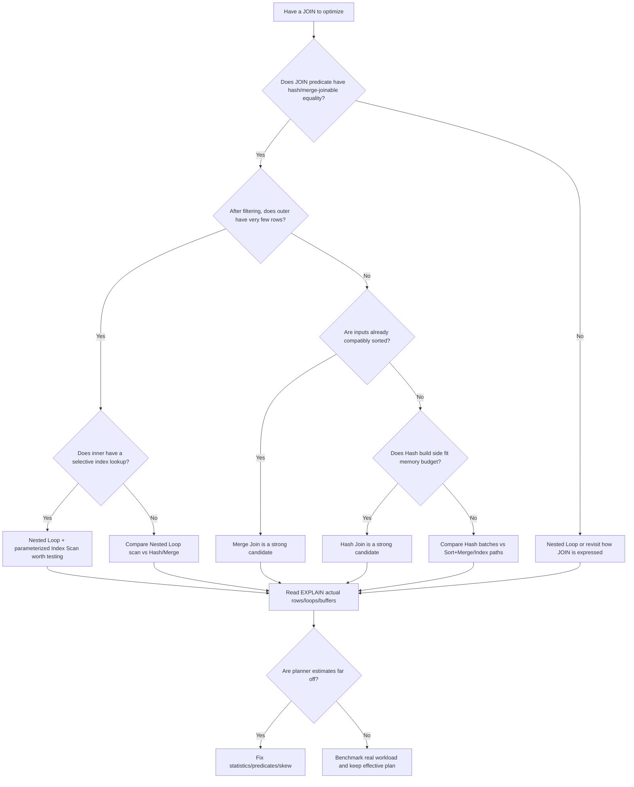

# Nested Loop, Hash Join, Merge Join, and Selection Conditions in PostgreSQL

A SQL `JOIN` clause describes **which rows must be combined**, rather than commanding PostgreSQL to combine them with one fixed algorithm. For this query:

```sql
SELECT c.customer_id, c.full_name, o.order_id, o.total_amount
FROM customers AS c
JOIN orders AS o
  ON o.customer_id = c.customer_id
WHERE c.customer_id = 42;
```

PostgreSQL may use **Nested Loop**, **Hash Join**, or **Merge Join** depending on row counts, statistics, indexes, data distribution, filter conditions, and estimated costs. An algorithm that excels on 100 rows may fail on 100 million rows; the exact same query with different parameter values can also produce a different plan.

This lesson belongs to the **Query Plans** chapter of the *Database Engine Relational PostgreSQL* module. The focus is not merely defining the three algorithms, but **the conditions under which PostgreSQL chooses each one, how to read evidence in EXPLAIN, and how to fix plans when estimates are wrong**.

Keep three core ideas in mind right from the start:

- **Nested Loop:** for each row from the outer input, find matching rows in the inner input. Very effective when iteration counts are small and inner lookups are cheap, especially via parameterized index scans.
- **Hash Join:** build a hash table from one side and probe it with the other side via hashed keys. Often useful for equality joins on relatively large datasets, though it needs memory and can split into batches/spill to disk.
- **Merge Join:** read two streams already sorted by join keys and merge rows with matching keys. Worth considering when inputs are already ordered or sorting cost is offset by join efficiency.

**There is no rigid rule that "small tables always use Nested Loop," "large tables always use Hash Join," or "having an index always means Merge Join."** PostgreSQL picks a global plan from valid alternatives based on its cost model.

## 1. SQL JOIN Differs from Execution Algorithm

`INNER JOIN`, `LEFT JOIN`, `RIGHT JOIN`, `FULL JOIN`, `CROSS JOIN`, `EXISTS`, and `NOT EXISTS` express SQL semantics. `Nested Loop`, `Hash Join`, and `Merge Join` are the **plan nodes/algorithms** the executor can use to carry out those relationships.

Example:

```sql
SELECT c.customer_id, o.order_id
FROM customers c
JOIN orders o ON o.customer_id = c.customer_id;
```

Two different plans can produce results obeying the exact same SQL semantics.

```text
             SQL declarative JOIN
                      │
                      ▼
              Parser / Rewriter
                      │
                      ▼
             Planner / Optimizer
            /          |           \
           ▼           ▼            ▼
      Nested Loop   Hash Join    Merge Join
           \           |            /
            \          |           /
                      ▼
                  Executor
                      │
                      ▼
                Result rows
```

The planner does not only pick a join algorithm; it also chooses **join order**, index/scan paths, filter pushdowns, sorts, aggregates, parallel workers, and ordering to satisfy `ORDER BY`/`LIMIT`.

### 1.1. Before Asking Which JOIN Type, Ask These Questions

1. **How many rows must the query return?** One customer and six orders, or full history?
2. **What is the join predicate?** `=`, a `<`/`>` range, or a complex expression?
3. **How many rows are filtered out on each side?** Do `WHERE`/partition pruning shrink the inputs?
4. **Is there an index supporting probes on the join key?** Especially on the inner side of a Nested Loop.
5. **Is the data already ordered as needed?** Index scans or ordered upstream nodes can help Merge Join.
6. **Does the hash table fit in memory?** Large build sets can force Hash Join to batch/spill.
7. **Does the output require sorting, grouping, or limiting?** A join plan preserving order can save downstream steps.
8. **Are row estimates accurate?** Bad cardinality estimates frequently cause wrong join algorithm choices.

## 2. Quick Comparison Table

| Characteristic | Nested Loop | Hash Join | Merge Join |
|---|---|---|---|
| Core idea | Iterate outer rows, search inner rows | Build hash table then probe | Walk two key-ordered streams together |
| Join condition | Flexible, including non-equality | Needs at least one hash-joinable condition, usually `=` | Needs at least one merge-joinable condition, usually `=` |
| Useful index | Index on inner side is very valuable | Not required | Index providing order can be valuable |
| Needs sorted input | Not required | No | Compatible ordering on both sides |
| Preparation cost | Low if probe is cheap | Build hash table | Sort if not already sorted |
| Small outer row count | Usually fits well | Pays build overhead | Pays sort/merge overhead |
| Two large inputs, equality | Can be expensive if probing repeats heavily | Often a strong candidate | Often a strong candidate if ordering is cheap |
| Hash memory and batches | Not applicable | Crucial | Builds no hash table |
| Sort memory/temp I/O | May be needed for other steps | May be needed for other steps | May be needed to prepare inputs |
| Preserves order for ORDER BY | Does not inherently guarantee key order | No | Can preserve useful pathkeys |
| Non-equi / cross join | Supported | Not without a hash-joinable condition | Not without a merge-joinable condition |
| FULL OUTER JOIN | Not supported by standard Nested Loop | Supported | Supported |

This table shows tendencies, **not hard-and-fast rules**. When at least one join predicate is suitable, PostgreSQL can use Hash/Merge for the equality condition and evaluate extra conditions via `Join Filter`.

## 3. Lab Dataset Scope

Create three illustrative tables in a dedicated schema:

- `customer`: customers.
- `sales_order`: orders, each belonging to a customer.
- `payment`: payments; some orders have payment records.

The goal is a dataset large enough to compare plans without touching another project's schema. Run all data-modifying SQL in this lesson strictly on a **test database**.

```sql
CREATE SCHEMA IF NOT EXISTS demo_join_plan;

CREATE TABLE demo_join_plan.customer (
    customer_id INTEGER PRIMARY KEY,
    full_name TEXT NOT NULL,
    region_code TEXT NOT NULL,
    active BOOLEAN NOT NULL
);

CREATE TABLE demo_join_plan.sales_order (
    order_id BIGINT PRIMARY KEY,
    customer_id INTEGER NOT NULL REFERENCES demo_join_plan.customer(customer_id),
    order_status TEXT NOT NULL,
    ordered_at TIMESTAMPTZ NOT NULL,
    total_amount NUMERIC(12, 2) NOT NULL CHECK (total_amount >= 0)
);

CREATE TABLE demo_join_plan.payment (
    payment_id BIGINT PRIMARY KEY,
    order_id BIGINT NOT NULL UNIQUE REFERENCES demo_join_plan.sales_order(order_id),
    payment_status TEXT NOT NULL,
    paid_amount NUMERIC(12, 2) NOT NULL CHECK (paid_amount >= 0)
);
```

Primary keys and unique constraints automatically create indexes. The foreign key from `sales_order.customer_id` to `customer.customer_id` **does not automatically create an index on the referencing column**; we will add dedicated indexes for Nested Loop examples.

### 3.1. Generate Customers

```sql
INSERT INTO demo_join_plan.customer
    (customer_id, full_name, region_code, active)
SELECT
    g,
    'Customer ' || g::text,
    CASE g % 4
        WHEN 0 THEN 'HN'
        WHEN 1 THEN 'HCM'
        WHEN 2 THEN 'DN'
        ELSE 'CT'
    END,
    g % 9 <> 0
FROM generate_series(1, 20000) AS g;
```

There are 20,000 customers split evenly across four regions for illustration. This data does not represent real market distributions.

### 3.2. Generate Orders

```sql
INSERT INTO demo_join_plan.sales_order
    (order_id, customer_id, order_status, ordered_at, total_amount)
SELECT
    g::bigint,
    ((g - 1) % 20000) + 1,
    CASE g % 3
        WHEN 0 THEN 'PAID'
        WHEN 1 THEN 'NEW'
        ELSE 'CANCELLED'
    END,
    TIMESTAMPTZ '2026-01-01 00:00:00+00'
        + (g % 250) * INTERVAL '1 day',
    (10 + g % 900)::numeric(12, 2)
FROM generate_series(1, 120000) AS g;
```

On a clean schema, each customer has about six orders. Row counts are sized so the lab runs easily on a learning machine; never extrapolate lab timings to production latency.

### 3.3. Generate Payments

```sql
INSERT INTO demo_join_plan.payment
    (payment_id, order_id, payment_status, paid_amount)
SELECT
    order_id,
    order_id,
    'SUCCESS',
    total_amount
FROM demo_join_plan.sales_order
WHERE order_id % 3 = 0;
```

Roughly one-third of orders have a payment. The data intentionally links `order_status` tightly with payment presence, giving us an angle to discuss cardinality estimation and correlation.

### 3.4. Indexes for Lookups and Ordering

```sql
CREATE INDEX idx_order_customer_id
ON demo_join_plan.sales_order (customer_id);

CREATE INDEX idx_order_customer_time
ON demo_join_plan.sales_order (customer_id, ordered_at DESC);

CREATE INDEX idx_order_status
ON demo_join_plan.sales_order (order_status);

ANALYZE demo_join_plan.customer;
ANALYZE demo_join_plan.sales_order;
ANALYZE demo_join_plan.payment;
```

`idx_order_customer_id` and `idx_order_customer_time` share a leading key prefix; we keep both in the lab for observation. In production, verify whether both are truly needed since redundant indexes add write/WAL cost.

### 3.5. Verify Row Counts

```sql
SELECT
    (SELECT COUNT(*) FROM demo_join_plan.customer) AS customers,
    (SELECT COUNT(*) FROM demo_join_plan.sales_order) AS orders,
    (SELECT COUNT(*) FROM demo_join_plan.payment) AS payments;
```

In a fresh dataset: 20,000 customers, 120,000 orders, and 40,000 payments. If counts differ, check whether setup ran twice or tables were altered by prior exercises.

## 4. Nested Loop: Iterate Outer Rows, Look Up Inner Rows

Basic Nested Loop model:

```text
for each outer_row in outer_input:
    for each inner_row matching outer_row in inner_input:
        if join_condition(outer_row, inner_row):
            emit joined_row
```

A naive implementation would compare every pair of rows, costing huge evaluations. However, PostgreSQL does not always rescan the whole inner table. The inner branch can be a **parameterized Index Scan driven by the outer row**, fetching only a few candidates per iteration.

### 4.1. Visualizing Nested Loop with Index Scan

```text
Outer: customer_id=42 (1 row)
               │
               ▼
         Nested Loop
               │
               ├── Outer customer row
               │
               └── Inner Index Scan
                    order.customer_id = 42
                              │
                              ▼
                       ~6 order rows

1 outer row × 1 small indexed lookup.
```

With 1 customer and ~6 orders, Nested Loop can be extremely fast.

### 4.2. Illustrative SQL

```sql
EXPLAIN (ANALYZE, BUFFERS)
SELECT c.customer_id, c.full_name, o.order_id, o.total_amount
FROM demo_join_plan.customer AS c
JOIN demo_join_plan.sales_order AS o
  ON o.customer_id = c.customer_id
WHERE c.customer_id = 42;
```

A plan **may** look like:

```text
Nested Loop
  -> Index Scan using customer_pkey on customer c
       Index Cond: (customer_id = 42)
  -> Index Scan using idx_order_customer_id on sales_order o
       Index Cond: (customer_id = c.customer_id)
```

This is a conceptual sketch, not a guaranteed output across all PostgreSQL versions and statistics states.

## 5. Parameterized Index Scan: Nested Loop's Strength

A *parameterized path* is an inner access path whose filter condition depends on values supplied from the outer side.

```text
Outer row 1: customer_id=42
    → inner index probe WHERE customer_id=42
Outer row 2: customer_id=43
    → inner index probe WHERE customer_id=43
Outer row 3: customer_id=44
    → inner index probe WHERE customer_id=44
```

Each probe uses the B-tree index on `sales_order(customer_id)` to fetch only that customer's orders.

### 5.1. An Inner Index Does Not Guarantee Index Usage

An Index Scan requires an indexable predicate and competitive cost. If the outer set has 100,000 rows and each probe performs heavy random heap reads, total cost can exceed a Hash Join scanning both tables sequentially.

Conversely, if the outer set has only one row, building a hash table over all of `customer` or `sales_order` makes little sense.

### 5.2. Actual Loop Count Matters Greatly

Reading `loops` in EXPLAIN:

```text
Nested Loop
  -> ... outer ... (actual rows=100 loops=1)
  -> Index Scan ... (actual rows=6 loops=100)
```

Here the inner scan runs **100 times**. `actual rows=6` on the inner node is the per-execution average reported by EXPLAIN, not 6 rows total.

To gauge total work, consider `actual rows × loops` (plus rounding/parallelism behavior), rather than looking at `rows` alone.

### 5.3. Nested Loop Can Use Memoize

Modern PostgreSQL versions support a `Memoize` node in certain parameterized Nested Loop plans. When many outer rows share the same join key, PostgreSQL can cache inner probe results to cut repeated lookups.

```text
Nested Loop
  -> Outer Scan
  -> Memoize
       Cache Key: outer.customer_id
       -> Index Scan ...
```

Check `Hits`, `Misses`, `Evictions`, and `Memory Usage` when this node appears. Do not assume Memoize appears in every Nested Loop, and do not mistake result caching for a new index.

## 6. Nested Loop Does Not Require Equality Conditions

Nested Loop can evaluate many kinds of predicates, for instance:

```sql
SELECT a.order_id, b.order_id
FROM demo_join_plan.sales_order AS a
JOIN demo_join_plan.sales_order AS b
  ON a.total_amount < b.total_amount
WHERE a.order_id <= 3
  AND b.order_id <= 100;
```

`a.total_amount < b.total_amount` is not an equality condition. Nested Loop can test candidate pairs via `Join Filter` when no specialized path is better.

Hash Join and Merge Join typically need at least one hash-joinable/merge-joinable equality condition to serve as their core key.

### 6.1. CROSS JOIN and Pairing All Rows

```sql
SELECT a.customer_id, b.customer_id
FROM demo_join_plan.customer AS a
CROSS JOIN demo_join_plan.customer AS b
WHERE a.customer_id <= 3
  AND b.customer_id <= 4;
```

This yields 3 × 4 = 12 pairs. There is no equality join key to hash or merge; Nested Loop is the natural execution method.

**Never run an unfiltered CROSS JOIN on two large tables** and be surprised when output explodes to the product of both row counts.

## 7. When Nested Loop Becomes Expensive

Suppose:

- Outer has 50,000 rows.
- Each inner lookup touches several index/heap pages.
- The query performs tens of thousands of separate lookups.

Total cost can become dominated by loop count and random I/O.

```text
Outer: 50,000 rows
        │
        ▼
Nested Loop
        │
        └── 50,000 parameterized probes
                  │
                  ▼
              Random heap I/O
```

Exact page accesses will not strictly equal outer rows due to index caching, visibility, heap layout, and Memoize. Still, **outer cardinality multiplied by inner path cost** is the right mental model.

### 7.1. Nested Loop on Large Sets Is Not Always Wrong

If inner probes stay completely cached, return very few rows, or repeat outer keys that Memoize caches, Nested Loop can remain competitive.

Conversely, Nested Loop even on a small set can be slow if the inner side lacks an indexable condition and scans the whole table repeatedly.

### 7.2. Materialize on the Inner Side

The planner may insert `Materialize` to avoid re-executing an expensive inner branch by buffering its output across loops:

```text
Nested Loop
  -> Outer Scan
  -> Materialize
       -> Seq Scan on inner_table
```

Materialize does not guarantee results fit in RAM; it can spill to temp storage if needed. Nor does it turn Nested Loop into Hash Join.

## 8. Nested Loop with LATERAL: Top-N per Group

A case where Nested Loop shines naturally is *fetching the three newest orders per customer*:

```sql
EXPLAIN (ANALYZE, BUFFERS)
SELECT
    c.customer_id,
    c.full_name,
    o.order_id,
    o.ordered_at
FROM demo_join_plan.customer AS c
LEFT JOIN LATERAL (
    SELECT
        so.order_id,
        so.ordered_at
    FROM demo_join_plan.sales_order AS so
    WHERE so.customer_id = c.customer_id
    ORDER BY so.ordered_at DESC, so.order_id DESC
    LIMIT 3
) AS o ON TRUE
WHERE c.customer_id BETWEEN 1 AND 20
ORDER BY c.customer_id, o.ordered_at DESC;
```

The `LATERAL` branch depends on `c.customer_id`. Index `(customer_id, ordered_at DESC)` helps locate by customer and time; PostgreSQL may handle the `order_id` tiebreaker depending on the access path.

### 8.1. Why Does TOP-N Favor Nested Loop?

For just 20 customers, PostgreSQL can run 20 index probes and stop after 3 orders per customer. No need to read 120,000 orders and compute `row_number` over every customer.

If selecting **all 20,000 customers**, weigh index probe counts against full-dataset strategies. A technique great for 20 customers is not guaranteed to scale well to 20 million customers.

### 8.2. LATERAL Does Not Force One Fixed Plan

`LATERAL` expresses correlation in SQL; PostgreSQL can optimize or rewrite certain forms equivalently. Still, correlated Top-N with `ORDER BY ... LIMIT` is a classic example of parameterized inner paths.

## 9. Hash Join: Build Then Probe

Hash Join normally has two logical phases:

1. **Build:** read one branch, hash join keys, and construct a hash table holding required attributes.
2. **Probe:** read the other branch, hash its keys, look up matching candidates in the hash table, and verify join predicates.

```text
           Hash Join on o.customer_id = c.customer_id

Customers (~20k)                          Orders (~120k)
      │                                         │
      ▼                                         ▼
 Build hash table                           Probe keys
      │                                         │
      └────────────► Hash Join ◄────────────────┘
                             │
                             ▼
                        Joined rows
```

The build side is chosen by estimated cost/size, not necessarily whichever table appears first or second in SQL. Look at which branch sits beneath the `Hash` node in the plan.

### 9.1. Suitable SQL

```sql
EXPLAIN (ANALYZE, BUFFERS)
SELECT c.region_code, COUNT(*) AS paid_order_count
FROM demo_join_plan.sales_order AS o
JOIN demo_join_plan.customer AS c
  ON c.customer_id = o.customer_id
WHERE o.order_status = 'PAID'
GROUP BY c.region_code
ORDER BY c.region_code;
```

Because many orders join with customers over an equality key with a suitable hash operator, Hash Join is usually a strong candidate.

**Illustrative** plan:

```text
HashAggregate
  Group Key: c.region_code
  -> Hash Join
       Hash Cond: (o.customer_id = c.customer_id)
       -> Seq Scan on sales_order o
            Filter: (order_status = 'PAID')
       -> Hash
            -> Seq Scan on customer c
```

The actual planner might also pick `GroupAggregate`, `Index Scan`, or another join algorithm depending on conditions and statistics.

## 10. Does Hash Join Need a Hash Index?

**No.** This distinction is mandatory:

- **Hash index:** a persistent database object created via `CREATE INDEX ... USING hash`, supporting single-key equality lookups.
- **Hash Join:** an executor algorithm building a transient query-scoped hash table to combine two datasets.

```sql
-- Hash Join can still be chosen even without this index:
CREATE INDEX idx_customer_id_hash
ON demo_join_plan.customer
USING hash (customer_id);
```

In our lab, that DDL is purely illustrative—**do not run it**, as `customer_id` already has a B-tree PK. Adding a redundant Hash index only increases write overhead.

```text
Hash Join plan:
   Hash
      -> Seq Scan on customer

No "Index Scan using ...hash_index" node exists.
```

Never conclude "I need `CREATE HASH INDEX` to make Hash Join fast." Hash Join routinely runs over **Seq Scan** or other scan paths, building a fresh hash table for that query.

### 10.1. HashAggregate Differs from Hash Join Too

`HashAggregate` uses a hash table to group/aggregate rows, not to join two relations. A plan containing both `Hash Join` and `HashAggregate` executes two separate phases.

## 11. Conditions for Choosing Hash Join

There normally must be at least one join predicate using a **hash-joinable equality** operator, for example:

```sql
ON o.customer_id = c.customer_id
```

Data types must have compatible equality/hash semantics within an operator family. PostgreSQL's catalog marks eligible operators; not every custom operator is hash-joinable.

If you only have:

```sql
ON a.amount < b.amount
```

there is no equality key to hash in the standard way.

### 11.1. Equality Combined with Additional Conditions

```sql
SELECT o.order_id, p.payment_id
FROM demo_join_plan.sales_order AS o
JOIN demo_join_plan.payment AS p
  ON p.order_id = o.order_id
 AND p.paid_amount <= o.total_amount;
```

`p.order_id = o.order_id` can serve as `Hash Cond`. `p.paid_amount <= o.total_amount` can be checked via `Join Filter` after matching key pairs.

```text
Hash Join
  Hash Cond: (p.order_id = o.order_id)
  Join Filter: (p.paid_amount <= o.total_amount)
```

Illustrative plan only. `Join Filter` differs from a single-input `Filter`: it evaluates on **candidate joined row pairs**.

### 11.2. Verify IS NOT DISTINCT FROM

`IS NOT DISTINCT FROM` provides NULL-aware equality semantics, yet do not assume the planner always treats it identically to `=` for hash-joinability across all versions and data types. Check `EXPLAIN` for the real query.

## 12. Hash Tables Can Consume Substantial Memory

Hash Join requires space for its hash table. If build data is small, it fits in memory. If too large, the executor splits into **batches** and spills to temp files.

Relevant parameters:

```sql
SHOW work_mem;
SHOW hash_mem_multiplier;
```

In modern PostgreSQL, memory budgeting for hash operations relates to:

\[
\text{hash memory budget} \approx
\texttt{work\_mem} \times \texttt{hash\_mem\_multiplier}
\]

This is a budgeting rule of thumb, **not a guarantee a hash table uses an exact byte limit** or that a query has only one hash table.

### 12.1. Reading Buffers, Buckets, Batches

A plan may report:

```text
Hash
  Buckets: 32768  Batches: 1  Memory Usage: 1600kB
```

- `Buckets`: number of buckets in the hash table.
- `Batches: 1`: did not split into multiple batches in this example.
- `Memory Usage`: node memory metric per version/path.

If `Batches > 1`, processing split into multiple batches with temp I/O. Inspect `Buffers: temp read/written` on the node/plan to confirm impact.

### 12.2. Raising work_mem Is Not a Universal Cure

Increasing `work_mem` can reduce spilling for a specific join/sort, yet:

- One query can hold multiple hash/sort nodes.
- Concurrent queries multiply total RAM demand.
- Parallel workers also multiply resource usage.
- Some queries still spill due to massive inputs or data skew.
- Changing memory settings can alter planner plan choices.

Never set `work_mem = '1GB'` globally just to patch one Hash Join. Test session-locally on specific workloads and monitor system-wide memory and throughput.

## 13. Hash Join and Data Skew

If join keys are unevenly distributed—such as millions of orders belonging to a few huge customers—some hash buckets accumulate many entries.

Hash Join must still verify actual key equality for candidate pairs; sharing a bucket does not guarantee equal keys.

A join key appearing many times on both sides produces **duplicate matches**, potentially exploding output:

```text
Side A: 1000 rows with key='X'
Side B: 500 rows with key='X'

INNER JOIN on key
  → 1000 × 500 = 500,000 row pairs
```

This is a **join cardinality** problem, not just hash collisions. Switching to Merge Join or Nested Loop will not eliminate those 500,000 SQL-valid result rows.

### 13.1. Inspecting Key Distribution

```sql
SELECT customer_id, COUNT(*) AS order_count
FROM demo_join_plan.sales_order
GROUP BY customer_id
ORDER BY order_count DESC
LIMIT 20;
```

If real data has severe skew, inspect MCV statistics, estimate accuracy, indexes, and whether the query truly needs every paired row.

### 13.2. Duplicates on Both Sides Cannot "Join as Fast as Unique Lookups"

Before tuning algorithms, ask whether business rules actually need all pairs, or only:

- Existence (`EXISTS`).
- Order count.
- Latest record per customer.
- One clearly selected record.

Rewriting the query to match real business intent cuts cardinality far more effectively than swapping join algorithms.

## 14. Parallel Hash Join

With large datasets and parallelism enabled, PostgreSQL may pick **Parallel Hash Join** or other parallel join plans.

An illustrative plan:

```text
Gather
  Workers Planned: 2
  -> Parallel Hash Join
       Hash Cond: (...)
       -> Parallel Seq Scan on ...
       -> Parallel Hash
            -> Parallel Seq Scan on ...
```

Parallel Hash lets workers collaborate to build and probe a shared/coordinated hash table; not every `Hash Join` beneath `Gather` uses the exact same parallel hash variant.

### 14.1. Look Beyond Worker Count

Effectiveness also depends on:

- Rows/bytes processed per worker.
- Disk/cache throughput.
- Hash build/probe cost.
- Load imbalance from skew.
- `Gather` overhead.
- Parallel worker limits and cluster resource contention.
- Whether functions/operations are `PARALLEL SAFE`.

`EXPLAIN (ANALYZE, BUFFERS)` displays `Workers Planned` and `Workers Launched`; they need not match when workers are scarce.

## 15. Merge Join: Two Streams Sorted by Join Key

Merge Join exploits **compatible ordering** across two input streams.

```text
Customers (sorted customer_id)   Orders (sorted customer_id)
           1                              1
           2                              1
           3                              2
           4                              2
           5                              4
           │                              │
           ▼                              ▼
          Merge: advance smaller key,
          emit matching rows when keys match.
                        │
                        ▼
                   Joined rows
```

Advancing in order avoids scanning unmatched pairs. However, **compatible ordering must already exist** or the planner must insert a Sort.

### 15.1. Suitable SQL

```sql
EXPLAIN (ANALYZE, BUFFERS)
SELECT c.customer_id, o.order_id
FROM demo_join_plan.customer AS c
JOIN demo_join_plan.sales_order AS o
  ON o.customer_id = c.customer_id
ORDER BY c.customer_id, o.order_id;
```

PostgreSQL may consider Merge Join because the key equality has B-tree indexes and output requests a related sort order. Still, `ORDER BY c.customer_id, o.order_id` requires secondary ordering on `order_id` that a Merge Join on `customer_id` alone **does not fully supply**, so a sort/incremental sort may still appear.

### 15.2. Illustrative Plan

```text
Merge Join
  Merge Cond: (o.customer_id = c.customer_id)
  -> Index Scan using idx_order_customer_id on sales_order o
  -> Index Scan using customer_pkey on customer c
```

In this plan, both inputs arrive ordered by `customer_id` from B-tree scans. Under other conditions, the planner can place `Sort` on one or both sides.

Do not assume the plan above is guaranteed; PostgreSQL may find Hash Join + Sort cheaper.

## 16. Conditions for Choosing Merge Join

You need a join predicate using a **merge-joinable** operator and a way to obtain two inputs **sorted under matching join keys, collations, and compatible opfamilies**.

For:

```sql
ON a.join_key = b.join_key
```

PostgreSQL can normally use Merge Join across standard B-tree-sortable data types.

If you only have:

```sql
ON a.x < b.x
```

there is no merge-joinable equality key for standard Merge Join.

### 16.1. Sort Keys Must Be Compatible

Simply having each side "sorted by something" is not enough. Sort order must match the join equality's semantics, operator families, and collation. For text, query/index collation mismatch can block sorted paths.

### 16.2. Where Does Pre-Sorted Data Come From?

- A B-tree Index Scan in matching order.
- A `Sort` node.
- An upstream operation supplying compatible pathkeys.
- Certain composite plans preserving join-key order.

There is **no requirement to have a B-tree index** for Merge Join. PostgreSQL can scan tables and Sort both inputs before merging.

### 16.3. Merge Join Pays Off When Sort Cost Is Shared

If after joining the query also needs:

```sql
ORDER BY c.customer_id
```

a Merge Join plan can supply useful ordering and save a final Sort, depending on keys and join semantics.

If output needs no order and neither side is pre-sorted, Hash Join is often cheaper because it avoids sorting entire datasets. That is a tendency, **not a fixed cost inequality**.

## 17. Sort Costs in Merge Join

When inputs are unsorted, the planner can produce:

```text
Merge Join
  Merge Cond: (...)
  -> Sort
       Sort Key: a.key
       -> Seq Scan on a
  -> Sort
       Sort Key: b.key
       -> Seq Scan on b
```

`Sort` can execute in memory or spill to temp files.

Read EXPLAIN:

```text
Sort Method: quicksort  Memory: ...
```

or:

```text
Sort Method: external merge  Disk: ...
```

If Sort spills, inspect `Buffers: temp read/written` and workload. Do not automatically conclude Merge Join is bad simply because Sort appears; compare against Hash/Nested Loop plus any post-join sorts those alternatives would need.

### 17.1. work_mem Affects Sorts Too

`work_mem` generally governs the budget per sort operation, and also affects Hash Join via `hash_mem_multiplier`. If raising `work_mem` for a Merge Join, account for multiple sort/hash nodes and concurrency rather than scaling for a single query.

### 17.2. Incremental Sort

Modern PostgreSQL versions support `Incremental Sort` when input is already sorted by a key prefix and needs additional trailing keys. This can cut sorting cost compared to a full sort, depending on group sizes.

`Incremental Sort` is a sort node, not a "new version of Merge Join." It can sit before or after joins per query pathkeys.

## 18. Duplicates in Merge Join

Merge Join does not just match one row per key. If the same key appears multiple times on both sides, the executor must emit **every matching pair** per SQL semantics.

Example:

```text
A: (key=7, id=A1), (key=7, id=A2)
B: (key=7, id=B1), (key=7, id=B2), (key=7, id=B3)

INNER JOIN:
  A1-B1, A1-B2, A1-B3,
  A2-B1, A2-B2, A2-B3
= 6 rows
```

Merge Join uses mark/restore mechanics when needed to rewind and emit all duplicate pairings. A plan may insert `Materialize` to support rescanning the inner input.

**Merge Join never drops duplicates** or picks one representative. If business logic wants one record per key, express that explicitly in SQL.

## 19. Merge Join and Index Scan: Using an Index Is Not Always Cheaper

A B-tree index on `(customer_id, order_id)` provides order, yet an Index Scan may read heap pages in scattered order and incur heavy random I/O.

Sometimes:

```text
Seq Scan → Sort → Merge Join
```

is cheaper than:

```text
Index Scan → Merge Join
```

especially when reading most of the table. The planner estimates full-path cost, not node count.

### 19.1. Having Indexes Does Not Guarantee Merge Join

```sql
SELECT c.customer_id, o.order_id
FROM demo_join_plan.customer AS c
JOIN demo_join_plan.sales_order AS o
  ON c.customer_id = o.customer_id;
```

Both tables have indexes on `customer_id`, yet Hash Join may still win because building 20,000 customers and sequentially scanning 120,000 orders beats ordered heap scans.

## 20. Qualitative Cost Model Comparison

To visualize, let:

- `N`: outer row count.
- `M`: inner row count.
- `P`: cost of one parameterized inner lookup.
- `S(X)`: cost to sort X rows.
- `H(X)`: cost to build/probe hash on X rows.

A Nested Loop **scanning the whole inner table** behaves roughly like pair-wise work:

\[
O(N \times M)
\]

With a selective index probe, cost approaches:

\[
\text{cost}_{NL} \approx
\text{cost}_{outer} + N \times P
\]

An ideal in-memory Hash Join tends to scale linearly with total input rows:

\[
O(N + M)
\]

subject to hash collisions, output rows, caching, and temp I/O if spilling.

Merge Join with **pre-sorted inputs** also scans linearly with input and output. If sorting both sides is required, rough cost includes:

\[
S(N) + S(M) + O(N+M+\text{output})
\]

These are conceptual mental models, **not the PostgreSQL planner's exact cost formulas**. PostgreSQL evaluates detailed cost parameters, row widths, selectivities, startup/total costs, and complex access paths.

### 20.1. Output Can Exceed Input

A many-to-many join on a single key generates `N×M` pairs whether using Hash or Merge. Complexity models must always include **output rows emitted**; you cannot produce 1 billion output rows in O(1).

## 21. Startup Cost and Total Cost

EXPLAIN prints estimated costs:

```text
(cost=STARTUP..TOTAL rows=EST_WIDTH width=...)
```

Meanings:

- **Startup cost:** cost before the node can start emitting its first row.
- **Total cost:** estimated cost to produce the node's entire output.
- **rows:** planner-predicted row count.
- **width:** estimated average row width in bytes at this node.

A parameterized Nested Loop can have very low startup cost for the first few rows. Hash Join must build its hash table before emitting normal output. Merge Join may have to Sort inputs, raising startup cost.

### 21.1. LIMIT Can Flip Algorithm Selection

```sql
SELECT c.customer_id, o.order_id
FROM demo_join_plan.customer AS c
JOIN demo_join_plan.sales_order AS o
  ON o.customer_id = c.customer_id
LIMIT 5;
```

The planner may favor a plan yielding the first five rows quickly without processing full relations. Remember: **without ORDER BY, which 5 rows return is unspecified**.

Adding `ORDER BY` changes semantics and can force the planner to process/sort much more before emitting 5 rows.

### 21.2. Reading Costs in Context

A Hash Join with lower total cost than Nested Loop yet higher startup cost suits full summary reports, whereas a `LIMIT 1` API call may prefer a fast-starting path.

Do not compare total costs of two sub-nodes from different plans as if they shared identical cardinality and roles.

## 22. Cardinality Estimation: Root Cause of Many Bad Plans

The planner must estimate:

1. Rows in each base relation.
2. Fraction kept by each filter predicate.
3. Join key distributions.
4. Remaining rows after each join.
5. Resources needed by upstream group/sort/limit operations.

If the planner expects 10 outer rows when reality holds 1 million, it may pick a Nested Loop with inner index probes and suffer massive unexpected looping.

### 22.1. Comparing Estimated vs Actual Rows

```sql
EXPLAIN (ANALYZE, BUFFERS)
SELECT o.order_id
FROM demo_join_plan.sales_order AS o
JOIN demo_join_plan.customer AS c
  ON c.customer_id = o.customer_id
WHERE c.region_code = 'HN';
```

At nodes, compare:

```text
rows=5000           -- Planner estimate
actual rows=30000   -- Observed in this run
```

Numbers are illustrative. When a large discrepancy appears, locate **the first node** where estimates diverge sharply instead of immediately blaming a high-level join algorithm.

### 22.2. Why Can Estimates Be Wrong?

- Stale statistics missing `ANALYZE` after heavy loads/deletes/updates.
- Skewed data where MCVs do not represent rare/extreme keys well.
- Correlated predicates on the same table.
- Cross-table correlations hard for single-table stats to capture.
- Queries using complex expressions/functions.
- Parameter values varying across executions.
- Join conditions across columns lacking suitable stats.
- Skew or large many-to-many join cardinality.
- RLS/partition predicates and plan variants.

**Tuning usually starts with fixing estimates**, not immediately "forcing PostgreSQL to use Hash Join."

## 23. ANALYZE and Column Statistics

Run:

```sql
ANALYZE demo_join_plan.customer;
ANALYZE demo_join_plan.sales_order;
ANALYZE demo_join_plan.payment;
```

`ANALYZE` samples and saves planner statistics without modifying business data.

### 23.1. Inspecting pg_stats

```sql
SELECT
    schemaname,
    tablename,
    attname,
    n_distinct,
    null_frac,
    most_common_vals,
    most_common_freqs,
    correlation
FROM pg_stats
WHERE schemaname = 'demo_join_plan'
  AND tablename IN ('customer', 'sales_order')
  AND attname IN ('customer_id', 'region_code', 'order_status');
```

- `n_distinct` estimates distinct value count.
- `most_common_vals/freqs` describe frequent values and frequencies.
- `null_frac` tracks NULL fraction.
- `correlation` helps estimate index access cost relative to physical order.

Output reflects sampled statistics, not an exhaustive guaranteed dump of every column value.

### 23.2. Conditionally Raising Statistics Target

```sql
ALTER TABLE demo_join_plan.sales_order
ALTER COLUMN customer_id SET STATISTICS 500;

ANALYZE demo_join_plan.sales_order;
```

Raising the target gives finer detail on complex distributions, at the cost of slower ANALYZE, larger stats storage, and slightly higher planning overhead. Never set 10000 across every column just for one slow query.

### 23.3. Extended Statistics Do Not Solve Every Join Estimate

PostgreSQL supports `CREATE STATISTICS` for dependencies/MCV/n-distinct across **columns within a single table**:

```sql
CREATE STATISTICS st_order_status_customer
    (dependencies, mcv, ndistinct)
ON order_status, customer_id
FROM demo_join_plan.sales_order;

ANALYZE demo_join_plan.sales_order;
```

Extended statistics help in eligible cases, yet **are not general multi-table statistics modeling every correlation across JOINs**. Verify whether the planner actually uses the stats object for your predicate.

## 24. Join Order Matters Just as Much as Join Algorithm

With three tables:

```sql
SELECT
    c.region_code,
    COUNT(*)
FROM demo_join_plan.customer AS c
JOIN demo_join_plan.sales_order AS o
  ON o.customer_id = c.customer_id
JOIN demo_join_plan.payment AS p
  ON p.order_id = o.order_id
WHERE p.payment_status = 'SUCCESS'
  AND c.active
GROUP BY c.region_code;
```

The planner can consider joining `orders ↔ payments` first or `customers ↔ orders` first before joining the third table; each order yields different intermediate row counts.

```text
   Plan A                          Plan B
orders ⋈ payment               customer ⋈ orders
       │                              │
       ⋈ customer                     ⋈ payment
       │                              │
       ▼                              ▼
   GROUP BY                        GROUP BY
```

If one filter is highly selective, applying it early shrinks downstream join cardinality. Still, the optimizer must respect outer join semantics, lateral dependencies, and reorder constraints.

### 24.1. SQL FROM Order Is Not Always Execution Join Order

For inner joins, PostgreSQL is generally free to reorder joins using equivalence transformations and costs. Writing `customer` first in SQL never proves it becomes the Nested Loop outer input or Hash Join build side.

Always read the plan from **the actual nodes**.

### 24.2. Search Space and GEQO

Relevant settings:

```sql
SHOW join_collapse_limit;
SHOW from_collapse_limit;
SHOW geqo_threshold;
```

With many tables, possible join orders grow exponentially. PostgreSQL limits search space collapse and uses the **Genetic Query Optimizer (GEQO)** for queries with many relations.

Tuning these parameters is an advanced technique. Never touch them just to patch a two-table query suffering from bad estimates.

## 25. INNER JOIN and the Three Algorithms

`INNER JOIN` emits only matching row pairs.

```sql
SELECT o.order_id, c.customer_id
FROM demo_join_plan.sales_order o
INNER JOIN demo_join_plan.customer c
  ON o.customer_id = c.customer_id;
```

With an equality using eligible operators, all three algorithms are valid candidates:

- Nested Loop probes order/customer pairs via input access paths.
- Hash Join builds/probes on `customer_id`.
- Merge Join consumes inputs sorted by `customer_id`.

Logical results must match (except that without `ORDER BY`, **row ordering is never guaranteed**). Never deduce a join algorithm from output row order without reading EXPLAIN.

## 26. LEFT JOIN and Placement of ON/WHERE Conditions

`LEFT JOIN` preserves all left-side rows even when no right-side match exists, filling NULLs on the right.

```sql
SELECT c.customer_id, o.order_id
FROM demo_join_plan.customer AS c
LEFT JOIN demo_join_plan.sales_order AS o
  ON o.customer_id = c.customer_id;
```

PostgreSQL can use Nested Loop Left Join, Hash Left Join, or Merge Left Join when eligible.

### 26.1. Filtering in ON vs Filtering in WHERE

```sql
-- Keep all customers; attach PAID orders if any:
SELECT c.customer_id, o.order_id
FROM demo_join_plan.customer c
LEFT JOIN demo_join_plan.sales_order o
  ON o.customer_id = c.customer_id
 AND o.order_status = 'PAID';
```

Versus:

```sql
-- WHERE discards rows where o.order_status is NULL:
SELECT c.customer_id, o.order_id
FROM demo_join_plan.customer c
LEFT JOIN demo_join_plan.sales_order o
  ON o.customer_id = c.customer_id
WHERE o.order_status = 'PAID';
```

The optimizer can convert the second query into an inner join because `WHERE` rejects unmatched NULL-extended rows per predicate semantics.

**Never move predicates between ON and WHERE just to coax a Hash Join or Nested Loop if doing so changes query results.** Always preserve OUTER JOIN semantics before optimizing.

### 26.2. RIGHT JOIN Can Be Rewritten Directionally

The planner can internally rewrite `RIGHT JOIN` as an equivalent `LEFT JOIN` during planning. Do not treat seeing `Hash Left Join` in a plan as a bug when SQL says `RIGHT JOIN` and logical results match.

## 27. FULL OUTER JOIN and Nested Loop Limitations

`FULL OUTER JOIN` preserves unmatched rows from **both sides**. In PostgreSQL, `Hash Full Join` and `Merge Full Join` are the candidate methods when join predicates support them.

```sql
SELECT
    c.customer_id,
    o.order_id
FROM demo_join_plan.customer AS c
FULL OUTER JOIN demo_join_plan.sales_order AS o
  ON o.customer_id = c.customer_id;
```

**Standard Nested Loop is not an option for FULL JOIN** in PostgreSQL's planner. Thus a FULL JOIN lacking hash/merge-joinable equality predicates faces execution limits or needs rewriting; never assume PostgreSQL can fall back to Nested Loop unconditionally.

### 27.1. FULL JOIN and Non-Equality Predicates

A FULL JOIN with only `a.x < b.x` and no hash/merge-joinable key requires careful redesign. PostgreSQL can report that FULL JOIN only supports merge-joinable or hash-joinable join conditions.

This is a **supported-plan limitation**, not a missing SQL keyword.

## 28. SEMI JOIN: EXISTS Without Multiplying Duplicate Matches

`EXISTS` expresses "at least one matching row exists":

```sql
SELECT c.customer_id
FROM demo_join_plan.customer AS c
WHERE EXISTS (
    SELECT 1
    FROM demo_join_plan.sales_order AS o
    WHERE o.customer_id = c.customer_id
      AND o.order_status = 'PAID'
);
```

The planner can transform this into a **Semi Join**. A Semi Join does not emit every matching pair in a one-to-many relationship; each outer row only checks whether a match exists.

EXPLAIN may show:

```text
Nested Loop Semi Join
Hash Semi Join
Merge Semi Join
```

depending on query and statistics.

### 28.1. Why Avoid Habitual JOIN + DISTINCT?

```sql
SELECT DISTINCT c.customer_id
FROM demo_join_plan.customer AS c
JOIN demo_join_plan.sales_order AS o
  ON o.customer_id = c.customer_id
WHERE o.order_status = 'PAID';
```

This may return the same customer set, yet forces deduplication after joining and can generate huge intermediate rows. When intent is **existence**, `EXISTS` expresses it directly so the optimizer can choose a semi join.

Do not assume PostgreSQL always runs `JOIN + DISTINCT` slower; check the plan. The key is **choosing clear semantics** that unlock optimization.

## 29. ANTI JOIN: NOT EXISTS and the NULL Trap

`NOT EXISTS` expresses "no matching row exists":

```sql
SELECT c.customer_id
FROM demo_join_plan.customer AS c
WHERE NOT EXISTS (
    SELECT 1
    FROM demo_join_plan.sales_order AS o
    WHERE o.customer_id = c.customer_id
);
```

The planner can use `Hash Anti Join`, `Merge Anti Join`, or `Nested Loop Anti Join` when appropriate.

### 29.1. Do Not Blindly Rewrite as NOT IN

```sql
WHERE c.customer_id NOT IN (
    SELECT o.customer_id FROM demo_join_plan.sales_order AS o
)
```

`NOT IN` has subtle three-valued logic when the subquery can return NULLs. In our lab `sales_order.customer_id` is `NOT NULL`, yet on nullable schemas mechanical replacement causes surprising empty results.

`NOT EXISTS` is clearer for correlated anti-membership queries; optimizations must preserve NULL semantics.

### 29.2. NOT EXISTS Still Needs Cost-Based Choice

If the outer set is tiny and the inner side has an index, Nested Loop Anti Join stopping on the first match works great. When checking millions of outer keys, Hash Anti Join can win. Never judge solely by the keyword `NOT EXISTS`.

## 30. Hash Cond, Merge Cond, Join Filter, and Filter Differ

One of the most valuable skills is reading **condition lines in EXPLAIN** accurately.

Logical example:

```sql
SELECT o.order_id, p.payment_id
FROM demo_join_plan.sales_order AS o
JOIN demo_join_plan.payment AS p
  ON o.order_id = p.order_id
 AND p.paid_amount <= o.total_amount
WHERE o.order_status = 'PAID';
```

Plan lines might include:

- `Hash Cond: (o.order_id = p.order_id)` — primary key condition for Hash Join.
- `Merge Cond: (o.order_id = p.order_id)` — primary key condition for Merge Join.
- `Join Filter: (p.paid_amount <= o.total_amount)` — extra predicate checked on matched join pairs.
- `Filter: (o.order_status = 'PAID')` — filter on a single input branch.
- `Index Cond: (o.customer_id = c.customer_id)` — index condition inside a parameterized Nested Loop inner scan.

### 30.1. Where Is Join Filter Applied?

In OUTER JOINs, filter placement determines **whether unmatched rows stay preserved**. Never move a `Join Filter` into `WHERE` just to shorten the plan if it drops NULL-extended rows.

### 30.2. Reading Rows Removed by Join Filter

When a plan shows:

```text
Rows Removed by Join Filter: 500000
```

many candidate join pairs were discarded by the extra condition. Check:

- Is the join predicate missing a key constraint?
- Can a filter condition be legally pushed down?
- Was equality join cardinality misestimated?
- Are duplicate keys producing massive candidate pairs?

Changing algorithms does not always help: if valid SQL truly pairs many candidates, fix **data/indexes/query semantics** as appropriate.

## 31. Comparing Three Plans on One Query

Using one standard query:

```sql
SELECT c.customer_id, o.order_id, o.total_amount
FROM demo_join_plan.customer AS c
JOIN demo_join_plan.sales_order AS o
  ON o.customer_id = c.customer_id
WHERE c.region_code = 'HN';
```

Depending on statistics, the plan could be:

**Option A — Nested Loop**

```text
Nested Loop
  -> Seq Scan on customer
       Filter: (region_code = 'HN')
  -> Index Scan on sales_order
       Index Cond: (customer_id = c.customer_id)
```

**Option B — Hash Join**

```text
Hash Join
  Hash Cond: (o.customer_id = c.customer_id)
  -> Seq Scan on sales_order o
  -> Hash
       -> Seq Scan on customer c
            Filter: (region_code = 'HN')
```

**Option C — Merge Join**

```text
Merge Join
  Merge Cond: (o.customer_id = c.customer_id)
  -> Index Scan on sales_order o
  -> Sort
       Sort Key: c.customer_id
       -> Seq Scan on customer c
            Filter: (region_code = 'HN')
```

All three plans are illustrative diagrams. They differ in total I/O, CPU, sort/hash memory, and startup cost. Never declare a winner from a single node name line.

## 32. Using enable_* to Study Alternative Plans

PostgreSQL exposes planner switches:

```sql
SHOW enable_nestloop;
SHOW enable_hashjoin;
SHOW enable_mergejoin;
```

To experiment **inside a lab transaction** and auto-revert:

```sql
BEGIN;

SET LOCAL enable_hashjoin = off;
SET LOCAL enable_mergejoin = off;

EXPLAIN (ANALYZE, BUFFERS)
SELECT c.customer_id, o.order_id
FROM demo_join_plan.customer AS c
JOIN demo_join_plan.sales_order AS o
  ON c.customer_id = o.customer_id
WHERE c.customer_id BETWEEN 1 AND 100;

ROLLBACK;
```

This **encourages** the planner to avoid Hash/Merge so you can inspect remaining alternatives.

### 32.1. Testing Hash Join

```sql
BEGIN;

SET LOCAL enable_nestloop = off;
SET LOCAL enable_mergejoin = off;

EXPLAIN (ANALYZE, BUFFERS)
SELECT c.customer_id, o.order_id
FROM demo_join_plan.customer AS c
JOIN demo_join_plan.sales_order AS o
  ON c.customer_id = o.customer_id
WHERE c.customer_id BETWEEN 1 AND 100;

ROLLBACK;
```

### 32.2. Testing Merge Join

```sql
BEGIN;

SET LOCAL enable_nestloop = off;
SET LOCAL enable_hashjoin = off;

EXPLAIN (ANALYZE, BUFFERS)
SELECT c.customer_id, o.order_id
FROM demo_join_plan.customer AS c
JOIN demo_join_plan.sales_order AS o
  ON c.customer_id = o.customer_id
WHERE c.customer_id BETWEEN 1 AND 100;

ROLLBACK;
```

### 32.3. Switches Are Not Absolute Hard Bans

Some queries have no alternative path. PostgreSQL can still pick Nested Loop if it is the only supported execution method even with `enable_nestloop=off`; planner switches mainly **discourage** plan classes.

**Never place `enable_* = off` in global production config** just to "fix" a report. They are diagnostic/benchmarking tools to uncover why the cost-based planner chose differently.

### 32.4. Measuring Properly When Forcing Plans

If forcing Hash Join runs dramatically faster, ask *why the planner rated it worse*:

- Bad row estimates?
- `random_page_cost`/`effective_cache_size` mismatched to hardware?
- Stale statistics?
- Temp spills in one plan?
- Cache/measurement skew?
- `LIMIT` making startup cost dominate?
- Prepared statement generic plan differing from literal query?

Fix the root cause instead of leaving plan overrides in place.

## 33. Cost Parameters Influencing Selection

Key parameters to know:

```sql
SHOW seq_page_cost;
SHOW random_page_cost;
SHOW cpu_tuple_cost;
SHOW cpu_index_tuple_cost;
SHOW cpu_operator_cost;
SHOW effective_cache_size;
SHOW work_mem;
SHOW hash_mem_multiplier;
```

Qualitative roles:

| Parameter | Role in cost model |
|---|---|
| `seq_page_cost` | Estimated cost of a sequential page read |
| `random_page_cost` | Estimated cost of a random page access, influencing Index Scan |
| `cpu_tuple_cost` | CPU cost of processing one tuple |
| `cpu_index_tuple_cost` | CPU cost of processing one index tuple |
| `cpu_operator_cost` | CPU cost per operator evaluation |
| `effective_cache_size` | Hint to planner about usable cache memory, **allocates zero RAM** |
| `work_mem` | Memory budget for sort/hash operations per node |
| `hash_mem_multiplier` | Memory budget multiplier for hash operations |

Never change all parameters at once. Cost values are **relative units** in the cost model, not measured milliseconds.

### 33.1. Does SSD Automatically Mean random_page_cost = 1?

No. SSDs shrink the gap between random and sequential I/O, yet the right setting still depends on caching, block sizes, concurrent workload, and actual storage. Lowering `random_page_cost` nudges the planner toward index probes, yet **does not fix wrong estimates**.

### 33.2. effective_cache_size Is Not work_mem

`effective_cache_size` helps the planner estimate cache hit likelihood when costing index paths. It does not reserve RAM for queries. `work_mem` governs hash/sort memory budgets.

Confusing the two leads to poor operational tuning and memory overcommit.

## 34. When EXPLAIN Shows Nested Loop Is Genuinely Bad

Symptom example:

```text
Nested Loop
  -> Seq Scan on customer
       (actual rows=100000 loops=1)
  -> Seq Scan on sales_order
       (actual rows=10 loops=100000)
```

Conceptual illustration: the inner Seq Scan runs 100,000 times. On a large inner table, this consumes massive I/O and CPU.

How to diagnose:

1. How many actual rows did the outer branch produce?
2. How many outer rows did the planner estimate?
3. Why did the inner side lack a parameterized Index Scan?
4. Did a cast/function on the join predicate prevent index usage?
5. Does a matching index exist on the inner key?
6. Could predicates filter earlier?
7. Are Hash/Merge alternatives valid?
8. Do `LATERAL`/correlations block join reordering?

**Do not add indexes blindly.** Verify exact join keys, data types, filters, and actual row volumes first.

## 35. When Hash Join Spills Across Many Batches

A plan may display:

```text
Hash
  Buckets: 131072  Batches: 32  Memory Usage: ...
Buffers: temp read=... written=...
```

This signals multi-batch processing with temp I/O. Check:

- Is the build side unnecessarily large?
- Does row width carry unneeded payloads/JSONB?
- Can filters/projections run before building?
- Did join order build on the larger side?
- Did statistics misestimate row counts or width?
- Are `work_mem` and `hash_mem_multiplier` sufficient for this workload?
- Are many concurrent hash joins causing memory pressure?

### 35.1. Projection Helps, Though It Is No Silver Bullet

```sql
SELECT c.customer_id, o.order_id
FROM demo_join_plan.customer AS c
JOIN demo_join_plan.sales_order AS o
  ON c.customer_id = o.customer_id;
```

Avoid `SELECT c.*, o.*` when unnecessary: row width can balloon. The planner normally prunes unneeded columns via projection, yet columns genuinely requested still drive memory and network size.

If filters can push down to scans, fewer rows enter the hash table. Check EXPLAIN to confirm rather than assuming every CTE/subquery blocks pushdown.

### 35.2. Raise Memory Only After Measuring

For a nightly analytics query spilling gigabytes, raising `work_mem` in that session/job can help. On an API serving hundreds of concurrent connections, raising global `work_mem` too high risks OOM.

## 36. When Merge Join Spends Heavily on Sort

Symptom:

```text
Merge Join
  Merge Cond: (...)
  -> Sort
       Sort Key: a.key
       Sort Method: external merge  Disk: ...
  -> Sort
       Sort Key: b.key
       Sort Method: external merge  Disk: ...
```

Ask:

- Do both sides have B-tree indexes yielding the needed order?
- Would Index Scan be cheaper than Seq Scan + Sort?
- Must almost the whole table be read?
- Is sorted output required above the join?
- Can rows/columns be trimmed before sorting?
- Does a Hash Join alternative incur less temp I/O?
- Is `work_mem` adequate and safe under concurrency?

**Never create an index solely because Sort appears.** An ordered Index Scan can incur more random heap reads than scanning and sorting.

## 37. Joining on Text, Collation, and Data Types

Both joined columns need compatible equality semantics. If one side is integer and the other is text, implicit/explicit casting can affect plans and even fail at runtime on non-numeric text.

Anti-pattern example:

```sql
-- Suppose a legacy table stores customer_id as text:
ON o.customer_id::text = legacy.customer_id_text
```

Casting can prevent direct use of an index on `o.customer_id` and alter hash/merge join eligibility depending on operators.

### 37.1. Standardize Join Key Types

Ideally, both tables share the exact same logical type:

```text
customer.customer_id  INTEGER
sales_order.customer_id INTEGER
```

Align types and collations before tuning. Do not build expression indexes just to paper over persistent schema mismatches when data design can be fixed.

### 37.2. Collation Affects Text Joins

For text, deterministic vs nondeterministic collations can alter value equivalence and operator/hash/merge eligibility across versions. Conflicting `COLLATE` clauses can raise errors.

Never assume Java `String.compareTo` or `equalsIgnoreCase` matches PostgreSQL ICU collation semantics. Define one canonical policy across services sharing text join keys.

## 38. A Join Condition Is Not Just a WHERE Filter

A basic mistake with huge performance fallout:

```sql
SELECT *
FROM demo_join_plan.customer c
JOIN demo_join_plan.sales_order o
  ON TRUE;
```

This essentially pairs every row, generating 20,000 × 120,000 = **2.4 billion rows** before any limit steps.

There is no join key for Hash/Merge equality. Nested Loop becomes astronomically expensive even when neither table alone is huge.

### 38.1. Check Join Predicates Before Tuning Costs

When a query emits absurdly many rows, verify whether you omitted:

```sql
ON c.customer_id = o.customer_id
```

A missing join predicate is a **logic bug**, not "the planner chose a bad join algorithm."

### 38.2. Do Not Habitually Use DISTINCT to Mask Bad JOINs

`DISTINCT` can make final output look right while forcing huge intermediate datasets through deduplication. Fix join keys and intended cardinality rather than deduplicating afterward.

## 39. Join Elimination and the Role of Constraints

Not every JOIN written in SQL requires a JOIN node in the plan. If the planner proves a join is redundant under constraints and query semantics, some joins can be eliminated or simplified.

For example, with foreign key/unique constraints and selective column usage, the optimizer can apply removal rules in supported versions.

Still, **never assume PostgreSQL removes every JOIN simply because an FK exists**. Join removal depends on join type, referenced columns, uniqueness, NULL semantics, and version.

### 39.1. PK/FK Constraints Guarantee Correctness First

Constraints protect data integrity. Better join plans are a potential bonus, not the sole reason to define constraints.

### 39.2. Foreign Key Columns Do Not Automatically Get Indexes

In PostgreSQL, declaring:

```sql
customer_id INTEGER REFERENCES demo_join_plan.customer(customer_id)
```

does not automatically index `customer_id` on `sales_order`. If parent queries/UPDATEs/DELETEs look up child rows, indexing per workload matters for both Nested Loops and FK checks.

## 40. CTEs, Subqueries, and Join Strategy

CTEs are not automatically materialization barriers in modern PostgreSQL. Since PostgreSQL 12, non-recursive, side-effect-free CTEs can be inlined/folded by planner rules.

Example:

```sql
WITH paid_orders AS (
    SELECT order_id, customer_id
    FROM demo_join_plan.sales_order
    WHERE order_status = 'PAID'
)
SELECT c.customer_id, p.order_id
FROM demo_join_plan.customer c
JOIN paid_orders p
  ON p.customer_id = c.customer_id;
```

The planner can push predicates and reorder joins across folded CTEs. Specifying `MATERIALIZED` creates an optimization fence where supported, changing join options.

**Never add `MATERIALIZED` just hoping "Hash Join builds faster."** It carries trade-offs with predicate pushdown, memory, and expression re-evaluation.

## 41. ORDER BY, LIMIT, and Result Ordering

Join algorithms have distinct ordering behaviors:

- Nested Loop may preserve some path order from its outer input, yet does not inherently guarantee arbitrary `ORDER BY`.
- Hash Join **provides no SQL-guaranteed join-key ordering**.
- Merge Join consumes ordered streams and can emit useful pathkeys in the plan, yet output must never be assumed SQL-ordered without `ORDER BY`.

### 41.1. Always Include ORDER BY When Order Matters

```sql
SELECT c.customer_id, o.order_id
FROM demo_join_plan.customer c
JOIN demo_join_plan.sales_order o
  ON o.customer_id = c.customer_id
ORDER BY c.customer_id, o.order_id;
```

Even if today's plan picks Merge Join, tomorrow's plan after growth might pick Hash Join. Never let application code rely on accidental output ordering.

### 41.2. Keyset Pagination Follows the Same Rule

When paginating by `(customer_id, order_id)`, cursor predicates must match exact sort order and types/collations. Swapping join algorithms will not alter the row set when SQL is well-defined.

## 42. EXPLAIN ANALYZE: Reading actual rows, loops, and buffers

Use:

```sql
EXPLAIN (ANALYZE, BUFFERS, VERBOSE, SETTINGS)
SELECT c.customer_id, o.order_id
FROM demo_join_plan.customer AS c
JOIN demo_join_plan.sales_order AS o
  ON c.customer_id = o.customer_id
WHERE c.region_code = 'HN';
```

Key elements:

| Field | Interpretation |
|---|---|
| `cost=startup..total` | Planner estimate, not real duration |
| `rows` | **Estimated** row count at the node |
| `width` | Estimated row width |
| `actual time` | Observed node time; consider loops/parallelism |
| `actual rows` | Average rows per node execution |
| `loops` | Number of times the node executed |
| `Buffers: shared hit/read` | Buffer cache hits and page reads |
| `Buffers: temp read/written` | Temp file I/O (sort/hash spills, etc.) |
| `Sort Method` | Sort algorithm and RAM/disk usage |
| `Buckets/Batches/Memory Usage` | Hash table execution details |
| `Hash Cond/Merge Cond/Join Filter` | How join conditions are applied |
| `Workers Planned/Launched` | Parallel execution details when active |
| `Planning Time` | Plan generation duration |
| `Execution Time` | Measured statement execution duration |

### 42.1. Do Not Sum actual time Across All Nodes

Parent node time generally includes child node work per instrumentation. Summing every node's time **double-counts**. Focus on hot branches, loops, row counts, buffers, and estimate drift.

### 42.2. EXPLAIN ANALYZE Runs the Real Query

On lab SELECTs, side effects are minimal. On DML, `EXPLAIN ANALYZE` executes `INSERT`/`UPDATE`/`DELETE`, modifying data and firing WAL/triggers. Never run it on production DML just to inspect a plan without proper transaction/safety controls.

### 42.3. JIT and Parallelism Can Shift Timings Unexpectedly

Complex queries may invoke JIT compilation or parallel workers. Timing shifts do not always stem from the join algorithm itself. Read the whole plan, cache state, and setup costs.

## 43. Diagnostic Lab 1: One Customer, Few Orders

```sql
EXPLAIN (ANALYZE, BUFFERS)
SELECT c.customer_id, o.order_id, o.total_amount
FROM demo_join_plan.customer c
JOIN demo_join_plan.sales_order o
  ON o.customer_id = c.customer_id
WHERE c.customer_id = 42;
```

Questions:

1. How many actual rows did the outer input return?
2. Does the inner lookup show `Index Cond: (customer_id = c.customer_id)`?
3. If Nested Loop, what is inner `loops`?
4. If the query returns only 6 orders, would a Hash Join building a full table pay off?
5. If `idx_order_customer_id` were dropped, could `idx_order_customer_time` still serve lookups on prefix `customer_id`?

**Hint:** A B-tree `(customer_id, ordered_at DESC)` has `customer_id` as its leading prefix, so it can serve equality lookups on `customer_id`. Both indexes are not necessarily needed for this workload alone.

## 44. Diagnostic Lab 2: All Paid Orders

```sql
EXPLAIN (ANALYZE, BUFFERS)
SELECT c.region_code, SUM(o.total_amount) AS revenue
FROM demo_join_plan.sales_order o
JOIN demo_join_plan.customer c
  ON c.customer_id = o.customer_id
WHERE o.order_status = 'PAID'
GROUP BY c.region_code;
```

Questions:

- How many orders pass the status filter?
- Did the planner build the hash table from `customer` or `sales_order`?
- Is there a `HashAggregate`? Is it another Hash Join?
- Were orders filtered before joining?
- If `PAID` were replaced with an ultra-rare status, would Nested Loop become more competitive?

Answer: there is no single fixed algorithm; examine selectivity and access paths on each side. `HashAggregate` is an aggregation node, not a join algorithm.

## 45. Diagnostic Lab 3: Three-Table Join

```sql
EXPLAIN (ANALYZE, BUFFERS)
SELECT
    c.region_code,
    COUNT(*) AS payment_count,
    SUM(p.paid_amount) AS paid_total
FROM demo_join_plan.payment p
JOIN demo_join_plan.sales_order o
  ON o.order_id = p.order_id
JOIN demo_join_plan.customer c
  ON c.customer_id = o.customer_id
WHERE p.payment_status = 'SUCCESS'
GROUP BY c.region_code
ORDER BY c.region_code;
```

Questions:

1. Which two tables did the planner join first?
2. Is the join algorithm identical at every level?
3. Is a Hash Join combined with a Nested Loop or Merge Join?
4. Is there a Sort for `ORDER BY` after GroupAggregate?
5. How do actual rows at each join compare with estimates?

**Hint:** One plan can combine **multiple join nodes using different algorithms**. A query does not have to pick a single join algorithm globally.

## 46. Diagnostic Lab 4: Forcing Alternatives in the Lab

Use each `SET LOCAL enable_*` block from section 32 to measure the same query on identical data and statistics.

Record a results table:

| Strategy | Execution time | shared hit/read | temp read/write | Estimated vs actual | Notes |
|---|---:|---:|---:|---|---|
| Default planner | Fill in | Fill in | Fill in | Fill in | Actual plan |
| Discourage Hash/Merge | Fill in | Fill in | Fill in | Fill in | Observe Nested Loop |
| Discourage NL/Merge | Fill in | Fill in | Fill in | Fill in | Observe Hash |
| Discourage NL/Hash | Fill in | Fill in | Fill in | Fill in | Observe Merge |

**Never fill in fake numbers as real benchmarks.** Repeat runs, avoid comparing cold run #1 against warm run #2, and note PostgreSQL version, hardware, and settings.

## 47. Exercise 1: Choosing an Algorithm by Scenario

An API receives an authenticated `customer_id` and needs that customer's six orders. A B-tree index `sales_order(customer_id)` exists.

**Question:** Which algorithm should you expect?

**Guided answer:** Nested Loop with a 1-row outer customer input and an inner index lookup is a very strong candidate. Hash Join remains valid, though build overhead rarely competes on tiny inputs.

## 48. Exercise 2: Joining Full Large Tables

Two tables each hold millions of rows, joined by `a.key=b.key` with no selective filter. The smaller side fits in memory as a hash table.

**Guided answer:** Hash Join is usually a strong candidate because it scans each side once and builds/probes by equality. Merge Join can compete if inputs are pre-sorted, and output cardinality/row width remain major factors.

Do not answer "Hash is definitely always fastest."

## 49. Exercise 3: Inputs Already Sorted by Key

Two relations are read by index scans aligned with `join_key`, and the query also asks for `ORDER BY join_key`.

**Guided answer:** Merge Join is a natural candidate since it exploits both sorted streams and preserves useful pathkeys. Still, Index Scans can incur heavy random heap I/O, so Hash Join + Sort can occasionally remain cheaper.

## 50. Exercise 4: Non-Equi JOIN

```sql
SELECT a.order_id, b.order_id
FROM demo_join_plan.sales_order a
JOIN demo_join_plan.sales_order b
  ON a.total_amount < b.total_amount
WHERE a.order_id <= 10
  AND b.order_id <= 50;
```

**Question:** Is Hash Join a standard candidate on `<`?

**Answer:** No; there is no hash-joinable equality key. Nested Loop evaluates candidate pairs with a join filter. Adding a valid equality condition could enable Hash/Merge paired with a Join Filter.

## 51. Exercise 5: Hash Join Needs No Hash Index

An EXPLAIN shows:

```text
Hash Join
  -> Seq Scan ...
  -> Hash
       -> Seq Scan ...
```

**Question:** Should you run `CREATE INDEX ... USING hash` to optimize it?

**Answer:** No. Hash Join builds an in-query transient hash table. Persistent Hash indexes are a separate access method; inspect scans/filters and memory/temp I/O before proposing any index.

## 52. Exercise 6: Reading Loops

```text
Nested Loop
  -> Outer Scan (actual rows=1000 loops=1)
  -> Index Scan (actual rows=3 loops=1000)
```

**Question:** Roughly how many total rows did the inner scan return across all runs?

**Answer:** Roughly `3 × 1000 = 3000`, since `actual rows` averages 3 per loop in EXPLAIN. There were 1,000 lookups, not 3.

## 53. Exercise 7: Hash Batches > 1

```text
Hash
  Buckets: 65536  Batches: 16
Buffers: temp read=... written=...
```

**Question:** What needs investigating?

**Answer:** Hash Join had to split into multiple batches due to build size vs memory budget; examine build size, row width, temp I/O, `work_mem`, and `hash_mem_multiplier` under concurrency, statistics, and filter pushdown opportunities. Do not raise RAM blindly.

## 54. Exercise 8: Merge Join with Sort

```text
Merge Join
  -> Sort -> Seq Scan A
  -> Sort -> Seq Scan B
```

**Question:** Is the query broken because no B-tree index exists?

**Answer:** No. Sort + Merge Join is a valid plan. Indexes can supply order, yet full Index Scan cost can exceed Seq Scan + Sort. Benchmark alternatives.

## 55. Exercise 9: LEFT JOIN Turned into Inner Join

```sql
SELECT c.customer_id, o.order_id
FROM demo_join_plan.customer c
LEFT JOIN demo_join_plan.sales_order o
  ON o.customer_id = c.customer_id
WHERE o.order_status = 'PAID';
```

**Question:** Are customers with no PAID orders preserved?

**Answer:** No. `WHERE o.order_status='PAID'` rejects rows where the right-side column is NULL, making the query equivalent to an inner join here. To keep all customers, move the filter into `ON` and verify intended output.

## 56. Exercise 10: EXISTS vs JOIN + DISTINCT?

Requirement: simply check whether a customer has at least one order, without listing orders.

**Guided answer:** `EXISTS` states intent clearly and unlocks Semi Join to avoid multiplying rows and running DISTINCT. PostgreSQL can choose Nested Loop/Hash/Merge Semi Join based on sizes and indexes.

## 57. Exercise 11: Bad Plans Caused by Stale Statistics

A query uses Nested Loop and runs slowly; EXPLAIN shows:

```text
Outer estimated rows=10
Outer actual rows=800000
```

**Question:** What should you prioritize?

**Answer:** Find the predicate/scan node causing cardinality drift, run `ANALYZE`, check skew/correlation/parameters/extended stats and recent data changes. Only then evaluate new indexes or algorithms. The planner picked Nested Loop thinking outer had **10 rows**, not the unknown 800,000 rows.

## 58. Exercise 12: Nested Loop Is Not a Bug When Fast

A query uses `Nested Loop`, runs in 2 ms, touches minimal buffers, and returns 4 rows.

**Question:** Should you "tune" it into a Hash Join because the table has 100 million rows?

**Answer:** No. Selective filters and indexes make Nested Loop optimal here. Tune by actual latency and workload, not algorithm reputation.

## 59. Exercise 13: Mismatched Join Key Types

One table uses `INTEGER`, while another stores the same ID as `TEXT`. Queries cast on every join.

**Hint:** Fix schema types or adopt a type normalization strategy; check index compatibility and operators. Do not slap on ad-hoc indexes if the root flaw is mismatched join key design.

## 60. Exercise 14: PostgreSQL Picked Hash Join, Yet Still Slow

The plan shows a Hash Join with zero spills and low Hash Memory Usage, yet outputs 300 million rows.

**Guided answer:** The bottleneck is output cardinality and row materialization/network transfer. Check duplicate keys, join predicates, whether all pairs are genuinely needed, and whether `EXISTS` or pre-aggregation applies. Switching to Merge Join will not reduce valid output rows.

## 61. Exercise 15: Prepared Statements

For `WHERE c.customer_id = ?`:

- Parameter A selects one customer.
- Parameter B in another query selects a massive region.

**Question:** Will the plan always stay identical?

**Answer:** Not necessarily. Parameter values and custom/generic plan caching affect selectivity, row counts, join order, and join algorithm. Benchmark prepared statements the exact way the app binds and runs them.

## 62. Exercise 16: Missing ORDER BY

A JOIN query used to return rows ordered by `customer_id` because PostgreSQL chose Merge Join. After ANALYZE, it switched to Hash Join and row order changed.

**Question:** Is this a PostgreSQL bug?

**Answer:** No. SQL without `ORDER BY` guarantees no output order. If the application requires ordering, declare an explicit `ORDER BY` and tiebreaker.

## 63. Exercise 17: FULL OUTER JOIN with Inequality

A query tries `FULL JOIN ... ON a.score < b.score`, and PostgreSQL errors that the join condition does not support Hash/Merge Full Join.

**Guided answer:** FULL JOIN has no standard Nested Loop path in PostgreSQL; revisit semantics and express the business logic with valid alternative queries. Never swap in CROSS JOIN + filter without proving equivalence and checking output explosion.

## 64. Exercise 18: Two Algorithms in One Query

A three-table query has this plan:

```text
Hash Join
  -> Nested Loop
       -> Index Scan A
       -> Index Scan B
  -> Hash
       -> Seq Scan C
```

**Question:** Is PostgreSQL "confused by mixing algorithms"?

**Answer:** No. Each join node solves a sub-join with different input sizes and costs. Mixing algorithms is the normal result of whole-query optimization.

## 65. Checklist for Diagnosing Slow JOINs

Before adding indexes or tweaking settings, check:

1. **Are JOIN keys business-accurate?** Is a missing predicate causing a Cartesian explosion?
2. **Are duplicate keys creating unexpected many-to-one or many-to-many fan-out?**
3. **Are INNER/LEFT/RIGHT/FULL semantics and ON/WHERE placement correct?**
4. **Does the JOIN use equality, inequality, or a complex expression?**
5. **Can EXISTS/NOT EXISTS replace JOIN + DISTINCT?**
6. **How many rows does each scan actually read?**
7. **At which node do estimated rows and actual rows first diverge?**
8. **Were statistics updated after bulk imports/updates?**
9. **Do skew/MCVs/correlations distort selectivity?**
10. **Is Nested Loop's outer set small? Does inner have a parameterized index path?**
11. **Is Nested Loop's inner `loops` huge? Are Memoize/Materialize present?**
12. **Does Hash Join's build side fit in memory? What are `Batches` and temp I/O?**
13. **How much does Merge Join Sort? Does Sort spill?**
14. **Do ORDER BY/LIMIT favor low startup cost or pre-sorted order?**
15. **Does join order apply selective predicates early?**
16. **Are composite B-tree indexes aligned with common conditions?**
17. **Are implicit casts, functions, or collation mismatches breaking join keys?**
18. **Do prepared statements use generic plans with representative parameters?**
19. **Did parallel workers launch? Is there worker skew?**
20. **Are `work_mem`/`hash_mem_multiplier` sized safely for total concurrency?**
21. **Are too many rows/columns returned, causing network/ORM bottlenecks?**
22. **Are concurrent DML or locks inflating elapsed time?**
23. **Did you compare p50/p95/p99, buffers, and plans on representative data?**
24. **Were diagnostic `enable_*` switches reverted?**
25. **Does optimization preserve exact SQL results and required ordering?**

A slow JOIN query often starts from bad cardinality estimates, missing indexes, overly broad join filters, or unnormalized data. The join algorithm is only **one piece** of the full execution path.

## 66. Workload Decision Matrix

| Scenario | Approach worth testing | Caveat |
|---|---|---|
| One customer → few orders, indexed child FK | Nested Loop + Index Scan | If outer grows, probes multiply |
| Millions of orders ↔ tens of thousands of customers, equality | Hash Join | Watch hash memory/batches and output size |
| Two large inputs pre-sorted by join key | Merge Join | Verify compatible ordering |
| Two unsorted inputs requiring sorted output | Merge or Hash + Sort | Compare total cost, not just JOIN node |
| Condition uses only `<`, `>` | Nested Loop / eligible paths | No Hash/Merge equality key |
| FULL OUTER JOIN on equality | Hash Full or Merge Full | No standard Nested Loop Full |
| EXISTS where one match suffices | Semi Join | Avoids multiplying pairs |
| NOT EXISTS | Anti Join | Watch NULLs if rewriting to NOT IN |
| Outer repeats keys, parameterized inner lookup | Nested Loop + Memoize can shine | Watch cache hits and memory |
| Hash build exceeds `work_mem` budget | Hash batches/spill or alternative | Avoid excessive global RAM bumps |
| Inner index probes cause heavy random I/O | Hash/Merge may beat NL | Check estimates and caching |
| Query fetches few rows with LIMIT | Low-startup plan can win | LIMIT without ORDER BY gives arbitrary rows |
| Query outputs billions of rows from duplicates | Fix business logic/query | Changing algorithm won't shrink valid output |

## 67. Decision Flowchart



This diagram is a **diagnostic guide**, not PostgreSQL planner source code. The planner may choose differently when output ordering, startup cost, parallelism, or index paths vary.

## 68. Summary

**Nested Loop, Hash Join, and Merge Join are not three fixed tiers of slow-to-fast.** They are three execution strategies suited to different conditions, selected by PostgreSQL within an overall plan.

Five core principles:

1. **Nested Loop excels when the outer input is small and inner lookups are cheap.** An Index Scan parameterized by the outer key makes small lookups fast; conversely, huge `loops` can cripple performance.
2. **Hash Join excels on equality joins over large datasets when build/probe fit efficiently.** It **does not require a Hash index**. Inspect `Buckets`, `Batches`, `Memory Usage`, and temp I/O to monitor memory limits.
3. **Merge Join excels when both sides match join-key ordering or sort cost pays off.** B-tree indexes can provide sorted streams, yet are neither mandatory nor always faster than scan + sort.
4. **JOIN conditions, join order, and cardinality estimates often drive plan quality more than algorithm name.** Missing predicates, duplicate keys, stale stats, or implicit casts ruin both plans and results.
5. **EXPLAIN (ANALYZE, BUFFERS) is your primary evidence.** Compare estimated vs actual rows, `loops`, join conditions, buffer hits/reads, temp spills, and total plan cost. Use `enable_*` in a lab session to study alternatives—never force algorithms globally.

A practical tuning workflow starts with three questions: **"After filtering, how many rows actually enter the join?", "What indexes or orderings make access paths cheaper?", and "Where in EXPLAIN did the planner misestimate?"** Answering with real measurements lets PostgreSQL pick among Nested Loop, Hash Join, and Merge Join by cost, instead of guessing one universal algorithm for every query.
