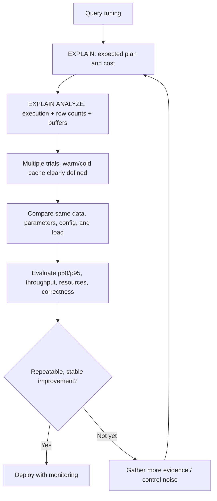
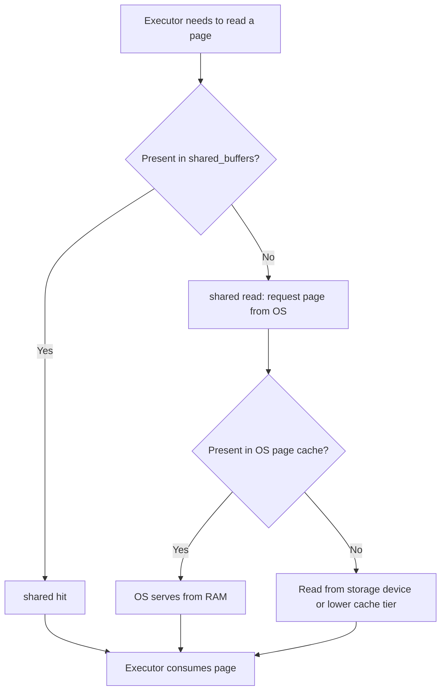

# Measurement Overhead, Caching, and Fair Plan Comparisons in PostgreSQL

An `EXPLAIN (ANALYZE, BUFFERS)` output shows the execution plan, actual row counts, timings, and buffer accesses. Yet those measurements **are not absolute ground truth about performance**. Instrumentation itself adds overhead; the first run may fault pages into cache while the next run hits memory; and a concurrent checkpoint, autovacuum worker, or write-heavy session can swing latency dramatically.

For example, the exact same query run twice might show:

- Run 1: 180 ms with heavy `shared read`.
- Run 2: 24 ms with mostly `shared hit`.

You cannot immediately conclude PostgreSQL switched to a better algorithm. Often **the plan never changed**—only cache state shifted. Conversely, a plan touching fewer buffers is not guaranteed to run faster if it spends far more CPU or ships wide result sets over the network.

Part of the **Query Plans** chapter, this lesson covers:

1. How planner `cost` estimates differ from execution time and measurement overhead.
2. How to use `EXPLAIN`, `ANALYZE`, `BUFFERS`, `TIMING OFF`, `WAL`, and related options without misreading metrics.
3. Distinguishing PostgreSQL `shared_buffers`, OS page cache, temporary files, and physical storage I/O.
4. Designing **fair A/B comparisons** across data, parameters, config, cache state, concurrency, and multi-trial statistics.
5. Combining `EXPLAIN` with operational metrics, `pg_stat_statements`, JDBC timings, and `pgbench`.
6. Avoiding risky shortcuts aimed at “making benchmarks look fast,” such as flushing OS caches on production hosts or disabling core planner mechanisms globally.

Core principle: **an execution plan is a hypothesis about how to do the work, whereas a controlled benchmark is evidence of its real cost under a specific workload**.

## 1. Three Distinct Layers of Questions

When a query is slow, separate three layers:

| Question | Appropriate Tool | Example Finding |
| --- | --- | --- |
| **What does the planner intend to do?** | `EXPLAIN` | Expects `Seq Scan` + `Hash Join` |
| **What did the executor actually do, read, and take?** | `EXPLAIN (ANALYZE, BUFFERS)` | Processed far more rows than estimated and spilled Sort to temp files |
| **Is the application genuinely faster?** | Multi-trial benchmarks, APM, `pg_stat_statements`, end-to-end latency | Request p95 drops under realistic concurrency |

Each layer can tell a different story:

- The planner prices `Index Scan` cheaply from low estimated selectivity, yet runtime returns far more rows.
- `EXPLAIN ANALYZE` reports 10 ms, yet the API takes 80 ms due to result streaming, object mapping, or downstream calls.
- A single-client trial runs in 5 ms, yet under 100 concurrent clients p95 jumps to 300 ms from I/O and CPU contention.

Never substitute one layer's metric for all three.



This diagram shows a diagnostic mindset—never an endorsement to run `EXPLAIN ANALYZE` casually across live production queries.

## 2. Planner Cost Uses Relative Units, Not Milliseconds

Illustrative plan:

```text
Seq Scan on orders  (cost=0.00..1715.00 rows=4000 width=48)
  Filter: (tenant_id = 7)
```

Components:

- `cost=0.00..1715.00` represents **startup cost..total cost** on the planner's abstract scale.
- `rows=4000` is the **estimated** number of rows emitted by the node, not actual rows.
- `width=48` is the **estimated** average output row size in bytes.
- `Seq Scan` is how the planner intends to read the table.

Costs combine many assumptions: page counts, row counts, distribution stats, selectivity, sequential vs. random page cost constants, CPU tuple/operator weights, and configuration settings.

**Common mistake:** `cost=100` does not mean 100 ms—nor do `cost=100` vs. `cost=200` guarantee one plan runs twice as fast as the other.

### 2.1. Startup Cost vs. Total Cost

For `LIMIT` queries or streaming pipelines emitting early rows, startup cost matters heavily.

```sql
SELECT order_id, created_at
FROM plan_bench.orders
WHERE tenant_id = 7
ORDER BY created_at DESC
LIMIT 20;
```

An ordered index scan can deliver the first 20 rows almost immediately compared to reading and sorting the whole matching set. The planner balances startup vs. total cost based on how many rows are requested.

If the application fetches the **entire** result set without `LIMIT`, a plan optimized for `LIMIT 20` may lose badly.

### 2.2. Cost Comparisons Only Hold Under Identical Assumptions

Never compare raw cost figures across two environments that differ in:

- Data volume, statistics, or PostgreSQL version.
- `random_page_cost`, `seq_page_cost`, or `cpu_tuple_cost`.
- `effective_cache_size`, parallelism, or memory settings.
- Parameter values.
- Query structure or requested row counts.

Cost explains **why the planner picked one candidate over another inside a single compilation context**—it is not an absolute KPI to compare two servers.

## 3. How EXPLAIN and EXPLAIN ANALYZE Differ

```sql
EXPLAIN
SELECT *
FROM plan_bench.orders
WHERE tenant_id = 7;
```

Plain `EXPLAIN` prints the predicted plan **without running the query through the executor**. You get estimates and plan structure, with zero actual timings or row counts.

```sql
EXPLAIN (ANALYZE)
SELECT *
FROM plan_bench.orders
WHERE tenant_id = 7;
```

`ANALYZE` tells PostgreSQL to **actually execute the query** and attach runtime instrumentation per node:

- `actual time`.
- `actual rows`.
- `loops`.
- Overall `Planning Time` and `Execution Time` where reported.
- Operation-specific runtime counters (sort method, hash batches, worker stats, etc.).

Because the **executor runs with timing/counter instrumentation enabled**, measured duration can differ from uninstrumented execution.

### 3.1. Be Careful with DML

`EXPLAIN (ANALYZE) INSERT/UPDATE/DELETE/MERGE` **actually writes and mutates data** per SQL semantics.

```sql
-- Practice database only; never run casually on production.
BEGIN;

EXPLAIN (ANALYZE, BUFFERS, WAL)
UPDATE plan_bench.orders
SET status = 'pending'
WHERE order_id = 42;

ROLLBACK;
```

`ROLLBACK` reverts transactional row modifications in this example. However, not all side effects revert: sequence advances stay consumed, triggers/functions may invoke external side effects, and non-transactional effects persist.

Therefore, **never treat `BEGIN/ROLLBACK` as a universal safety net for DML with side effects**. Test DML in isolated practice environments after understanding every trigger and function involved.

### 3.2. Even EXPLAIN ANALYZE SELECT Generates Load

A read-only `SELECT` can still:

- Pull gigabytes of pages into caches, evicting hot production data.
- Burn heavy CPU and storage I/O.
- Write large temp files on sort/hash spills.
- Contend for locks or resources against live sessions.
- Trigger side-effecting functions if the query calls volatile/external functions.

Never run an hours-long query under `EXPLAIN ANALYZE` in production just to grab its `Execution Time`.

## 4. What Is Instrumentation Overhead?

To report row counts, timings, and buffers at every node, `EXPLAIN ANALYZE` injects timing and counter calls throughout execution.

Suppose a Nested Loop executes a tiny inner node hundreds of thousands of times. Querying high-resolution system clocks before and after every single invocation can cost more time than the actual tuple work itself.

Factors shaping overhead include:

- Number of plan nodes and total `loops`.
- Duration per single node invocation.
- OS/clock-source timer cost (`clock_gettime` vs. hypervisor overhead).
- Whether `BUFFERS` or `track_io_timing` are enabled.
- Executor features and parallel workers.
- CPU, OS, virtualization layer, and PostgreSQL version.

Seeing `EXPLAIN ANALYZE` run slower than a plain query **does not by itself mean the plan is slow**.

### 4.1. TIMING OFF to Cut Per-Node Clock Overhead

A very practical option:

```sql
EXPLAIN (ANALYZE, BUFFERS, TIMING OFF)
SELECT order_id
FROM plan_bench.orders
WHERE tenant_id = 7;
```

With `TIMING OFF`:

- PostgreSQL skips **per-node timing measurements**.
- `actual rows`, `loops`, and `BUFFERS` (if requested) are still recorded accurately.
- **Overall `Execution Time` for the query is still measured.**
- Instrumentation overhead drops significantly, especially on tight high-loop plans.
- It does **not** eliminate all `EXPLAIN ANALYZE` overhead entirely.

Use `TIMING OFF` whenever you primarily care about **row estimates, loops, buffers, and total query duration** rather than node-by-node millisecond breakdowns.

### 4.2. When Should You Keep TIMING ON?

Keep per-node timing when isolating which stage dominates runtime, such as:

- Heavy Sort or Hash nodes.
- Repeatedly executed subqueries.
- Expensive Nested Loop inner lookups.
- High-I/O scan nodes.
- Aggregate or JIT bottlenecks.

Treat per-node timing as **diagnostic evidence**, never as a laboratory-grade stopwatch for individual operators.

### 4.3. Never Sum actual time Across All Nodes

Node timings are generally **inclusive**: a parent node's duration wraps its children's work. Summing every node's `actual time` **double-counts work** heavily.

When `loops > 1`, `actual time` and `actual rows` display **averages per loop execution**. Account for `loops` when estimating cumulative node work:

```text
Nested Loop  (actual time=0.020..8.000 rows=100 loops=1)
  -> Seq Scan ... (actual time=0.010..0.200 rows=100 loops=1)
  -> Index Scan ... (actual time=0.005..0.060 rows=1 loops=100)
```

*(Illustrative figures only—not measured output from the lab database.)* The inner `Index Scan` spans roughly `0.060 ms × 100 loops`, yet you cannot add that onto the `Nested Loop` total as an independent bucket.

## 5. Choosing EXPLAIN Options to Match Your Question

| Goal | Starting Command | Notes |
| --- | --- | --- |
| View plan without executing query | `EXPLAIN SELECT ...` | Estimates only |
| Check actual rows and duration | `EXPLAIN (ANALYZE) SELECT ...` | Adds measurement overhead |
| Inspect cache/buffer hits & reads | `EXPLAIN (ANALYZE, BUFFERS) ...` | `shared read` does not prove physical disk I/O |
| Reduce per-node clock overhead | `EXPLAIN (ANALYZE, BUFFERS, TIMING OFF) ...` | Still reports overall `Execution Time` |
| Inspect non-default planner GUCs | `EXPLAIN (ANALYZE, SETTINGS) ...` | Shows relevant modified planner settings per version |
| Measure WAL generated by statement | `EXPLAIN (ANALYZE, WAL) ...` | Executes query; guard DML carefully |
| Automate storage/plan diffing | `EXPLAIN (FORMAT JSON) ...` | Combine with `ANALYZE` for runtime stats |
| Collect parseable runtime metrics | `EXPLAIN (ANALYZE, BUFFERS, FORMAT JSON) ...` | Avoids brittle text regexes across versions |
| Inspect output serialization cost | `EXPLAIN (ANALYZE, SERIALIZE TEXT) ...` (supported versions) | Does not measure network transfer to client |

**Support for `SERIALIZE` and newer options depends on PostgreSQL major version.** Check `SHOW server_version;` and documentation for your server version.

### 5.1. SUMMARY and Overall Totals

```sql
EXPLAIN (
    ANALYZE,
    BUFFERS,
    TIMING OFF,
    SUMMARY ON
)
SELECT COUNT(*)
FROM plan_bench.orders
WHERE tenant_id = 7;
```

`SUMMARY` includes footer metrics like `Planning Time` and `Execution Time`. With `ANALYZE`, summary output is enabled by default.

**`Planning Time` and `Execution Time` measure separate phases.** For tiny high-frequency lookups, planning overhead can rival execution; for heavy analytical scans, execution dominates.

### 5.2. WAL in EXPLAIN

```sql
BEGIN;

EXPLAIN (ANALYZE, BUFFERS, WAL, TIMING OFF)
UPDATE plan_bench.orders
SET amount = amount
WHERE order_id = 42;

ROLLBACK;
```

This illustrates syntax, not a no-op write test: PostgreSQL can perform a real heap update even when the new value equals the old value, and triggers or storage rules affect WAL generation. Generated WAL records are not erased when `ROLLBACK` runs.

`WAL` output reports records, full-page images (FPIs), and bytes depending on version. Never interpret per-statement `EXPLAIN WAL` as total server-wide WAL throughput.

## 6. Building a Reproducible Lab Dataset

Create a dedicated benchmark schema. Never run sample data loads in production or against tables holding real user data.

```sql
CREATE SCHEMA IF NOT EXISTS plan_bench;

CREATE TABLE plan_bench.customers (
    customer_id integer PRIMARY KEY,
    customer_name text NOT NULL
);

INSERT INTO plan_bench.customers (customer_id, customer_name)
SELECT g, 'Customer ' || g::text
FROM generate_series(1, 1000) AS g;

CREATE TABLE plan_bench.orders (
    order_id bigint PRIMARY KEY,
    tenant_id integer NOT NULL,
    customer_id integer NOT NULL
        REFERENCES plan_bench.customers(customer_id),
    status text NOT NULL
        CHECK (status IN ('paid', 'pending', 'cancelled')),
    created_at timestamptz NOT NULL,
    amount numeric(12, 2) NOT NULL CHECK (amount >= 0),
    payload text NOT NULL
);

INSERT INTO plan_bench.orders
    (order_id, tenant_id, customer_id, status, created_at, amount, payload)
SELECT
    g::bigint,
    CASE
        WHEN g % 2 = 0 THEN 1
        ELSE (g % 20 + 2)::integer
    END,
    (g % 1000 + 1)::integer,
    CASE
        WHEN g % 20 = 0 THEN 'cancelled'
        WHEN g % 5 = 0 THEN 'pending'
        ELSE 'paid'
    END,
    TIMESTAMPTZ '2025-01-01 00:00:00+00'
        + g * INTERVAL '1 minute',
    ((g % 100000)::numeric / 100)::numeric(12, 2),
    repeat(md5(g::text), 3)
FROM generate_series(1, 80000) AS g;

CREATE INDEX idx_orders_tenant_created
ON plan_bench.orders (tenant_id, created_at DESC);

CREATE INDEX idx_orders_customer
ON plan_bench.orders (customer_id);

ANALYZE plan_bench.customers;
ANALYZE plan_bench.orders;
```

Intentional dataset properties:

- **80,000 orders** with deterministic `order_id` values (no randomness).
- `tenant_id = 1` owns **half of all rows**, while other tenants have small slices—creating **parameter skew** to demonstrate selectivity effects.
- `payload` adds realistic tuple width for observing fetch, transfer, and sort costs.
- `(tenant_id, created_at DESC)` supports tenant timeline pagination.
- `ANALYZE` populates initial planner statistics before experiments.

Never re-run `INSERT` on the same populated tables; recreate a fresh lab schema or reset deterministically when needed.

### 6.1. Verify Data Size and Distribution

```sql
SELECT
    COUNT(*) AS total_orders,
    COUNT(*) FILTER (WHERE tenant_id = 1) AS tenant_1_orders,
    MIN(created_at) AS first_order,
    MAX(created_at) AS last_order
FROM plan_bench.orders;

SELECT
    tenant_id,
    COUNT(*) AS order_count
FROM plan_bench.orders
GROUP BY tenant_id
ORDER BY order_count DESC, tenant_id;
```

A trustworthy benchmark starts by **knowing the input distribution**. Since `tenant_id=1` holds 40,000 rows while `tenant_id=7` holds only a few thousand, comparing `tenant_id=1` against `tenant_id=7` compares two different workloads—not two SQL plans.

### 6.2. Record Environment Baseline

```sql
SELECT version();

SHOW server_version;
SHOW shared_buffers;
SHOW work_mem;
SHOW effective_cache_size;
SHOW random_page_cost;
SHOW seq_page_cost;
SHOW max_parallel_workers_per_gather;
SHOW jit;
SHOW track_io_timing;
SHOW plan_cache_mode;
```

Settings vary slightly across major versions. Do not tweak settings indiscriminately just to run a benchmark before understanding their effects.

At minimum, record **PostgreSQL version, relevant GUCs, row counts, index definitions, and statistics timestamps** across any comparison.

## 7. Reading Plans and Actual Rows in Practice

```sql
EXPLAIN (ANALYZE, BUFFERS, TIMING OFF)
SELECT order_id, created_at, amount
FROM plan_bench.orders
WHERE tenant_id = 7
ORDER BY created_at DESC
LIMIT 20;
```

You may see an `Index Scan` on `idx_orders_tenant_created`, though never take that as mandatory—the planner decides from stats and environment settings.

Inspect:

1. Access node: `Index Scan`, `Bitmap Heap Scan`, or `Seq Scan`?
2. Are filters in `Index Cond` or post-fetch `Filter`?
3. How close is estimated `rows` to `actual rows`?
4. Was there a `Sort`, or did index order avoid sorting?
5. What are `Buffers: shared hit/read` and total `Execution Time`?
6. If `loops > 1`, how many times did the node execute?

### 7.1. Row Estimation Errors Matter More Than Raw Cost Gaps

Hypothetical example:

```text
Hash Join  (cost=... rows=100 ...)
  (actual rows=250000 loops=1)
```

Predicting 100 rows while generating 250,000 skews join algorithms, memory budgets, and scans.

Rather than asking “is cost low?”, find the **first node where estimated cardinality diverges sharply**. Check statistics, physical correlation, bind parameters, predicates, join selectivity, and recent data churn.

### 7.2. Node rows Is Not Always Whole-Table Size

`rows` on `Index Scan` estimates rows **emitted by that node**; `actual rows` is the measured average emitted per loop—neither equals total table rows.

With `LIMIT 20`, nodes often stop early, so read volume differs fundamentally from running the exact same `WHERE` clause without `LIMIT`.

## 8. BUFFERS: What Do shared hit/read/dirtied/written Mean?

Run:

```sql
EXPLAIN (ANALYZE, BUFFERS)
SELECT order_id, amount
FROM plan_bench.orders
WHERE tenant_id = 7;
```

You might see counters like:

```text
Buffers: shared hit=350 read=25 dirtied=0 written=0
```

*(Synthetic numbers explaining counter semantics—not guaranteed lab output.)*

| Label | General Meaning | What You Must NOT Conclude |
| --- | --- | --- |
| `shared hit` | Buffer access satisfied from PostgreSQL `shared_buffers` | Not **distinct** pages—the same page hit 100 times counts as 100 hits |
| `shared read` | Page had to be read into `shared_buffers` from the OS/storage layer | Not automatically physical disk I/O—the OS page cache may satisfy it from RAM |
| `shared dirtied` | Clean buffer modified and marked dirty by this operation | Not total pages immediately flushed to disk |
| `shared written` | Dirty buffer flushed to OS by this backend during processing | Not all background writer or checkpointer writes |
| `local hit/read/...` | Local buffer activity for session temporary relations | Distinct from `temp read/written` temp-file spills |
| `temp read/written` | Block I/O on executor temporary files (sort/hash spills) | Not row counts in user temporary tables |

Standard PostgreSQL builds default to an **8 KiB** block size, though builds can customize it. Check `block_size` before converting blocks to MB:

```sql
SHOW block_size;
```

### 8.1. Hit/Read Counts Are Block Accesses, Not Distinct Pages

If a Nested Loop pins the exact same index leaf page 10,000 times, `shared hit` increases by 10,000 even though only one physical page was touched.

Thus `shared hit = 100000` does not mean 100,000 unique pages live in cache—it counts PostgreSQL buffer accesses.

### 8.2. Parent Node Buffers Are Inclusive of Child Nodes

Just like node timings, a parent node's `Buffers` line normally **includes buffer activity performed by its children**.

Never sum `shared hit` across every line in the plan tree as total page accesses; doing so double-counts work.

### 8.3. shared read Does Not Prove Physical Disk I/O

When PostgreSQL misses `shared_buffers`, it issues a read request to the OS. The **OS page cache** frequently holds that file block in RAM already.

Hence:

- `shared read > 0`: PostgreSQL did not find the page in `shared_buffers` at lookup time.
- **Insufficient proof** that the read reached an SSD or HDD.
- `shared read = 0`: requested relation pages were already in `shared_buffers`, though CPU, JIT, temp I/O, or locks can still make the query slow.

Always distinguish a **PostgreSQL shared buffer miss** from a **physical storage read**.

## 9. Cache Tiers in the Data Read Path



This illustrates the typical buffered I/O path (subject to filesystem, direct I/O, virtualization, and PostgreSQL version details). The critical takeaway is that **a PostgreSQL buffer miss does not automatically equal a physical storage miss**.

### 9.1. shared_buffers

`shared_buffers` configures PostgreSQL's instance-wide shared buffer pool.

```sql
SHOW shared_buffers;
```

It is **not** total server RAM and does not house `work_mem` sort/hash allocations or backend private memory.

Once heap or index pages sit in `shared_buffers`, queries reuse them directly without issuing OS read calls.

### 9.2. OS Page Cache

The operating system retains recently read database file blocks in free RAM. Even when PostgreSQL increments `shared read`, the kernel often serves the block straight from memory.

Because unrelated OS processes also compete for OS page cache, two identical benchmarks can swing if background jobs evict cached blocks between runs.

### 9.3. Storage and Hypervisor Caches

SSDs, SAN controllers, cloud block volumes, and hypervisors add their own cache and prefetch layers. Thus `shared read` alone cannot determine physical device I/O latency.

To answer “how many bytes hit physical disks?”, pair PostgreSQL metrics with OS/storage-layer telemetry and I/O configuration knowledge.

### 9.4. effective_cache_size Allocates Zero Cache

`effective_cache_size` is solely a **planner cost assumption** estimating total RAM available across `shared_buffers` plus OS page cache when pricing index vs. sequential scans. It **allocates no memory** and warms no pages.

```sql
SHOW effective_cache_size;
```

Raising `effective_cache_size` can flip planner choices toward Index Scans by lowering estimated random read penalties—completely distinct from actually adding RAM to `shared_buffers`.

## 10. Warm Cache vs. Cold Cache

A **warm-cache** benchmark runs with relevant table/index pages already resident in caches. A **cold-cache** benchmark aims to start uncached, though “cold” must be defined precisely:

- Cold with respect to **PostgreSQL `shared_buffers`**?
- Cold with respect to **OS page cache**?
- Cold with respect to **storage controller cache**?
- Cold only for **one query**, rather than restarting the whole server?

### 10.1. Identical Plan, Different Runtime Due to Cache

First run:

```sql
EXPLAIN (ANALYZE, BUFFERS)
SELECT SUM(amount)
FROM plan_bench.orders
WHERE tenant_id = 7;
```

Run the exact same query immediately afterward.

If run 2 shows more `shared hit`, fewer `shared read`, and lower runtime, caching likely helped—alongside other possibilities:

- OS page cache warmed up.
- JIT compiled only on one run or changed behavior.
- Checkpoint, autovacuum, or backup overlapped differently.
- CPU scheduling or background I/O shifted.
- Statistics or plan changed.
- Concurrent queries warmed or evicted shared pages.

**Two runs never suffice** to credit an index or SQL rewrite for performance gains.

### 10.2. Deliberate Warm-Up Protocol

When measuring **warm-cache steady state**:

1. Pick representative queries and parameter values.
2. Execute a warm-up phase excluded from recorded statistics.
3. Keep background load steady across both options.
4. Measure multiple interleaved trials and report the latency distribution.
5. Check `BUFFERS` (`shared hit`/`read`) to verify cache behavior remained consistent.

Do not assume “three runs guarantees a warm cache”—datasets larger than RAM continuously evict earlier pages.

### 10.3. Never “Clear Cache” Casually in Production

Restarting PostgreSQL or dropping the OS page cache disrupts the entire server, triggering:

- Sudden storage I/O spikes.
- Latency spikes for unrelated applications.
- HA failovers, pool stalls, or dropped transactions.
- Minutes of degraded performance while caches re-warm.

**Never flush OS caches on shared or production machines to benchmark a query.** Run true cold-cache tests strictly on dedicated isolated benchmark hosts using documented procedures and specifying which cache tiers were cleared.

### 10.4. DISCARD and CHECKPOINT Do Not Clear Data Caches

- `DISCARD ALL` resets **current session state**, not `shared_buffers` or OS page cache.
- `CHECKPOINT` flushes dirty buffers to disk for crash recovery; it **does not evict clean read pages from `shared_buffers`**.
- `DEALLOCATE` / `DISCARD PLANS` drop prepared statements/plans, not cached table blocks.

Never rely on these commands to create a “cold-cache benchmark.”

## 11. pg_prewarm: Pre-Loading Relation Pages When Appropriate

Where installed and permitted, PostgreSQL's `pg_prewarm` extension pre-loads relation pages into OS cache or `shared_buffers`.

Illustrative usage (only where installed and authorized):

```sql
-- Only in benchmark environments authorized to install extensions.
CREATE EXTENSION IF NOT EXISTS pg_prewarm;

SELECT pg_prewarm(
    'plan_bench.orders'::regclass
);
```

**Caveats:**

- `pg_prewarm` may not be pre-installed or permitted in every environment.
- Calling it generates heavy I/O and can evict other workloads' cached pages.
- Available `mode` options and exact loading behavior vary by PostgreSQL version; consult docs first.
- Prewarming the heap table does not automatically prewarm all indexes or related tables.
- Ensure both A and B receive identical warm-up conditions rather than prewarming only one candidate.

Never enable extensions in production solely for a quick benchmark without operational approval.

## 12. track_io_timing and I/O Wait Duration

`BUFFERS` counts block operations, without telling how long each read/write took.

Check setting:

```sql
SHOW track_io_timing;
```

When enabled, PostgreSQL tracks I/O wait durations so `EXPLAIN (ANALYZE, BUFFERS)` prints `I/O Timings`.

Illustrative output:

```text
Buffers: shared hit=240 read=80
I/O Timings: shared read=12.600
```

**Do not interpret `12.600 ms` as “80 physical SSD reads took exactly 12.6 ms”**: OS page cache hits still register as `shared read` calls timed across the OS syscall boundary, shaped by timing instrumentation.

### 12.1. Timing I/O Has Overhead Too

Recording timestamps around I/O calls incurs syscall overhead depending on hardware and kernel. Always record `track_io_timing` state in benchmarks.

Never benchmark A with `track_io_timing = off` and B with `track_io_timing = on`, then blame SQL or indexes for the timing difference.

### 12.2. Database-Level Counters

```sql
SELECT
    datname,
    blks_read,
    blks_hit,
    blk_read_time,
    blk_write_time,
    stats_reset
FROM pg_stat_database
WHERE datname = current_database();
```

`blks_read`/`blks_hit` are cumulative database-wide counters across all sessions and queries; `blk_read_time`/`blk_write_time` accumulate when `track_io_timing` is active.

To evaluate a single query, `EXPLAIN BUFFERS` maps directly to plan nodes; for overall system load, sample cumulative views over fixed **time deltas**.

### 12.3. pg_stat_io on Supported Versions

On PostgreSQL 16+, `pg_stat_io` breaks down I/O by backend type, object, and context:

```sql
-- Only on servers exposing pg_stat_io.
SELECT *
FROM pg_stat_io
LIMIT 20;
```

These are **cluster/system-wide cumulative counters**, not per-query profiles. Columns evolve across versions; compute rates using before/after snapshots over consistent windows while tracking background activity.

## 13. Temp Files: Sort/Hash Spills Are Not Ordinary Cache Misses

A query can hit `shared_buffers` for 100% of table data and still run slowly if Sort or Hash runs out of memory and spills to temporary disk files.

```sql
EXPLAIN (ANALYZE, BUFFERS)
SELECT order_id, amount, payload
FROM plan_bench.orders
WHERE tenant_id = 1
ORDER BY payload, order_id;
```

Nodes may show:

```text
Sort Method: external merge  Disk: 4096kB
Buffers: shared hit=..., temp read=..., temp written=...
```

*(Format illustration only—not guaranteed output on the sample dataset.)*

### 13.1. Three Distinct Buffer Classes

- **`shared`:** shared buffer pool for permanent relations and shared indexes.
- **`local`:** backend-private buffers for session temporary tables (`CREATE TEMP TABLE`).
- **`temp`:** temporary file block I/O created by executor operators like Sort/Hash spills.

Seeing `temp written` spike does not require any user `CREATE TEMP TABLE`—external sorts and multi-batch hash joins generate `temp` I/O automatically.

### 13.2. work_mem Caps Each Operator, Not the Entire Query

`work_mem` bounds memory per internal sort/hash operation before spilling to disk (alongside `hash_mem_multiplier` for hash-based operators).

```sql
SHOW work_mem;
SHOW hash_mem_multiplier;
```

Do not assume `work_mem = '64MB'` caps a query to 64 MB total RAM. A plan with **multiple sort/hash nodes** and multiple parallel workers can allocate multiples of `work_mem` simultaneously.

Setting `work_mem` aggressively cluster-wide risks RAM exhaustion and OOM under high concurrency.

### 13.3. Testing Two work_mem Settings Safely with SET LOCAL

On a practice database:

```sql
BEGIN;
SET LOCAL work_mem = '1MB';

EXPLAIN (ANALYZE, BUFFERS, TIMING OFF)
SELECT order_id, amount, payload
FROM plan_bench.orders
WHERE tenant_id = 1
ORDER BY payload, order_id;

ROLLBACK;
```

Second variant:

```sql
BEGIN;
SET LOCAL work_mem = '64MB';

EXPLAIN (ANALYZE, BUFFERS, TIMING OFF)
SELECT order_id, amount, payload
FROM plan_bench.orders
WHERE tenant_id = 1
ORDER BY payload, order_id;

ROLLBACK;
```

Vary **only `work_mem`**, keep cache/load comparable across multiple interleaved runs, and inspect:

- `Sort Method` (quicksort in-memory vs. external merge).
- `temp read` / `temp written`.
- Total `Execution Time`.
- Memory budget under production concurrency.
- Whether the planner even changed plan shape.

Depending on hardware and data size, neither setting may spill or the planner might pick a different plan—treat observations as real evidence rather than forcing expected output.

## 14. Planning Time, Execution Time, and End-to-End Application Time

An end-to-end request traverses many stages:

```text
App builds parameters / waits for connection
  → Network sends request
  → Parse / plan / fetch cached plan
  → Executor reads data and computes result
  → Format output tuples
  → Network streams rows
  → JDBC maps ResultSet / business logic
  → HTTP response
```

`EXPLAIN ANALYZE` measures PostgreSQL's instrumented server-side execution **without streaming result rows to the client like a regular query**.

### 14.1. Why Can EXPLAIN Look Fast While JDBC Fetch Is Slow?

Suppose:

```sql
SELECT order_id, payload
FROM plan_bench.orders
WHERE tenant_id = 1;
```

This returns **tens of thousands of wide rows**. `EXPLAIN ANALYZE` runs the plan and discards tuples server-side, whereas a real client must:

- Serialize/format every row.
- Stream megabytes over TCP.
- Decode types inside the JDBC driver.
- Allocate Java objects and collections.
- Optionally serialize JSON and flush HTTP responses.

Thus application latency exceeding `Execution Time` does not mean “the network is broken” or “PostgreSQL measured wrong”—they measure different scopes.

### 14.2. EXPLAIN SERIALIZE on Supported Versions

On PostgreSQL versions supporting `SERIALIZE` (PostgreSQL 17+), you can include server-side output serialization cost in `EXPLAIN`:

```sql
-- Run only when the PostgreSQL version supports the SERIALIZE option.
EXPLAIN (ANALYZE, SERIALIZE TEXT, BUFFERS)
SELECT order_id, payload
FROM plan_bench.orders
WHERE tenant_id = 1;
```

This reveals server serialization overhead—yet PostgreSQL **still does not transmit result rows over the socket to the client**, so network bandwidth and client consumption speed remain unmeasured.

If your server version lacks `SERIALIZE`, omit that option and measure end-to-end timing from `psql` or client code separately.

### 14.3. psql \timing and JDBC Wall-Clock Time

In `psql`:

```text
\timing on
```

Running normal queries afterward measures end-to-end client round-trip duration as `psql` consumes and prints rows.

In Java, measure wall time from before `executeQuery()` through **draining the entire `ResultSet`**, since timing `executeQuery()` alone misses subsequent fetch batches.

## 15. JIT Compilation: One-Time Compilation vs. Execution Savings

PostgreSQL supports **Just-in-Time compilation (JIT)** on compatible builds when plan cost crosses configured thresholds:

```sql
SHOW jit;
SHOW jit_above_cost;
SHOW jit_inline_above_cost;
SHOW jit_optimize_above_cost;
```

JIT helps CPU-heavy analytical queries over large datasets, whereas LLVM compilation overhead can dominate short queries.

Whenever `EXPLAIN ANALYZE` outputs a `JIT:` block, check:

- Did JIT actually trigger?
- How much time went into generation, inlining, optimization, and emission?
- Was execution heavy enough to justify compilation overhead?
- Does this query repeat constantly across the same plans/parameters?

### 15.1. JIT Benchmarks Must Disclose Settings

It is unfair to compare A (`jit = off`) vs. B (`jit = on`) if you strip compilation cost and compare only executor loop speed.

If evaluating JIT, treat it explicitly as the **independent test variable**: keep everything else identical across multiple trials and document server version and JIT thresholds. Never disable JIT globally in production solely from one short synthetic benchmark.

## 16. Parallel Queries: Identical SQL Can Launch Different Worker Counts

The planner uses `Gather` / `Gather Merge` with parallel scans, joins, and aggregates to cut wall-clock latency on big queries.

```sql
SHOW max_parallel_workers_per_gather;
SHOW max_parallel_workers;
SHOW parallel_setup_cost;
SHOW parallel_tuple_cost;
```

Actual worker allocation depends on:

- Table/query parallel safety eligibility.
- Planner cost estimates.
- Free worker slots at execution time (`max_parallel_workers`).
- Concurrent server load.
- Parallel-safe functions and query constructs.

### 16.1. Workers Planned Differs from Workers Launched

`EXPLAIN ANALYZE` may display:

```text
Workers Planned: 2
Workers Launched: 1
```

This means the planner budgeted two workers, yet runtime contention left only one available. Comparing a 2-worker trial against a 1-worker trial mixes concurrency availability into your benchmark.

Always record both `Workers Planned`/`Workers Launched` and concurrent server load.

### 16.2. Total CPU vs. Wall-Clock Latency

A parallel plan lowers **wall-clock latency** while often consuming **more total CPU cycles** across workers and coordination overhead. Under heavy concurrent load, worker-hungry plans can lower cluster throughput and worsen p95.

Look beyond single-session `Execution Time` to throughput and CPU saturation under concurrency.

## 17. Prepared Statements: Generic Plans vs. Custom Plans

Java/JDBC apps typically issue parameterized queries, letting PostgreSQL pick between **custom plans** (built per parameter value) and reusable **generic plans**.

Example:

```sql
PREPARE orders_by_tenant (integer) AS
SELECT order_id, created_at, amount
FROM plan_bench.orders
WHERE tenant_id = $1
ORDER BY created_at DESC
LIMIT 20;
```

Compare two parameters:

```sql
EXPLAIN (ANALYZE, BUFFERS, TIMING OFF)
EXECUTE orders_by_tenant(1);

EXPLAIN (ANALYZE, BUFFERS, TIMING OFF)
EXECUTE orders_by_tenant(7);
```

Because `tenant_id=1` holds half the table while `tenant_id=7` holds far fewer rows, the planner may favor different paths or behaviors across them. **Never compare `tenant_id=1` runtime against `tenant_id=7` runtime to judge a setting**, because they process different data volumes.

### 17.1. Testing with plan_cache_mode

PostgreSQL exposes `plan_cache_mode` (`auto`, `force_generic_plan`, `force_custom_plan` on PostgreSQL 12+):

```sql
SHOW plan_cache_mode;
```

Test generic inside an isolated transaction:

```sql
BEGIN;

SET LOCAL plan_cache_mode = force_generic_plan;

EXPLAIN (ANALYZE, BUFFERS, TIMING OFF)
EXECUTE orders_by_tenant(7);

ROLLBACK;
```

Test custom:

```sql
BEGIN;

SET LOCAL plan_cache_mode = force_custom_plan;

EXPLAIN (ANALYZE, BUFFERS, TIMING OFF)
EXECUTE orders_by_tenant(7);

ROLLBACK;
```

Remember the prepared statement survives both rolled-back transactions until deallocated or session exit:

```sql
DEALLOCATE orders_by_tenant;
```

When comparing generic vs. custom, **pass the exact same tenant parameter to both**. To evaluate overall workload impact, test a **representative parameter mix** weighted by production traffic shares.

### 17.2. Generic Plans Are Not Inherently Broken

Generic plans cut repeated planning overhead cleanly when distributions stay balanced. Custom plans pay off when skew makes parameter-blind plans perform poorly.

Ask about **total planning + execution latency and throughput** across your real parameter mix rather than assuming one mode always wins.

## 18. Statistics and Data State Must Match

Planner estimates depend on `ANALYZE`. Heavy inserts, updates, or deletes shift histograms, MCVs, and `reltuples`:

```sql
ANALYZE plan_bench.orders;
```

Because `ANALYZE` itself can switch plans, a comparison is biased if:

- Candidate A ran against stale statistics.
- You ran `ANALYZE`.
- Candidate B ran with fresh statistics.
- You credited a new index for the speedup.

When testing an index or rewrite, ensure **both A and B use equally fresh statistics collected identically**. If testing `ANALYZE` itself, isolate it explicitly as the variable under test.

### 18.1. Data Skew Makes Unweighted Averages Misleading

In our sample dataset, `tenant_id=1` holds half of all rows while small tenants hold ~2.5% each.

Benchmarking solely `tenant_id=7` before shipping an API where 80% of traffic queries `tenant_id=1` invites production surprises.

Test a structured parameter matrix:

| Segment | Example | Purpose |
| --- | --- | --- |
| Hot / giant tenant | `tenant_id = 1` | Covers high-volume queries |
| Small tenant | `tenant_id = 7` | Covers selective point queries |
| Boundary / empty | Non-existent tenant | Exercises zero-row edge paths |
| Time range | Recent vs. older `created_at` | Probes cache warmth and correlation |
| Shape | `LIMIT 20` vs. unbounded export | Tests startup vs. total cost plans |

Weight results by **actual production request volume**, not a flat average across parameter buckets.

## 19. Which Variables Must Be Locked for a Fair A/B Experiment?

Document and hold constant everything except the test variable:

| Factor | Requirement When Not the Variable Under Test |
| --- | --- |
| SQL logic & semantics | Must return **identical rows, duplicates, and required ordering** |
| Row counts & distribution | Same data snapshot or matching dataset |
| Input parameters | Identical parameter values and traffic weights |
| PostgreSQL version | Same major version (and patch level ideally) |
| Schema & indexes | Differ only in the index/schema change being tested |
| Statistics | Equally fresh, gathered identically |
| Planner settings | Identical except the setting under test |
| Cache state | Clearly defined warm or cold cache regime |
| Transaction / isolation | Matching isolation level and transaction state |
| Connection / driver | Matching prepared-statement / generic/custom path |
| Client/server network | Comparable or measured separately |
| Concurrent load | Matching background traffic mix |
| Hardware / resources | Comparable CPU, RAM, storage pressure, worker slots |
| Measurement options | Identical `ANALYZE`/`BUFFERS`/`TIMING` flags |
| Time window | Avoid comparing peak hours vs. quiet off-peak hours |

**Zero noise does not exist** in real systems. Minimize controllable variance, log unavoidable background activity, run repeated interleaved trials, and match claims strictly to evidence.

## 20. Interleave A/B Trials Instead of Blocked Runs

Suppose A is the original query and B is a semantically equivalent rewrite.

Running blocked trials like:

```text
A A A A A  ... then B B B B B
```

invites strong order bias:

- A warms caches for B.
- Background server traffic shifts between blocks.
- Autovacuum or checkpoints happen to hit one block.
- OS page cache gets churned by unrelated processes.
- JIT or prepared plan caches differ across blocks.

A fairer interleaved design in a benchmark environment:

```text
Warm-up A/B
A B B A
B A A B
A B B A
...
```

*(Counterbalanced block ordering—one effective design alongside randomized ordering or paired time windows, always recording full context across multiple runs.)*

### 20.1. Never Compare Two Queries Returning Different Results

Query A:

```sql
SELECT order_id, created_at
FROM plan_bench.orders
WHERE tenant_id = 7
ORDER BY created_at DESC
LIMIT 20;
```

Query B:

```sql
SELECT order_id, created_at
FROM plan_bench.orders
WHERE tenant_id = 7
LIMIT 20;
```

Dropping `ORDER BY` makes B faster simply by **changing business behavior**. A and B are not valid A/B equivalents.

Similarly, dropping `DISTINCT`, turning `LEFT JOIN` into `INNER JOIN`, or shrinking date bounds speeds queries by doing less work—while silently returning wrong answers.

### 20.2. Test Identical Parameters Instead of Favorable Ones

Running A on `tenant_id=1` and B on `tenant_id=7` compares apples to oranges. Compare **A(1) vs. B(1)** and **A(7) vs. B(7)** separately, then combine weighted by real traffic.

### 20.3. Change One Independent Variable per Experiment

Clean single-variable experiments:

- **Index:** absent vs. present (or two index designs).
- **SQL rewrite:** two semantically equivalent forms.
- **`work_mem`:** operator memory budget.
- **JIT:** on vs. off for target workload.
- **Generic vs. custom plan:** identical parameters across modes.
- **Parallelism:** varying worker caps.

Avoid bundling five simultaneous changes if you need to know *why* latency moved.

## 21. Designing a Fair A/B Experiment for a Query Rewrite

Suppose baseline query A is:

```sql
SELECT
    c.customer_id,
    COUNT(o.order_id) AS order_count
FROM plan_bench.customers AS c
LEFT JOIN plan_bench.orders AS o
    ON o.customer_id = c.customer_id
WHERE c.customer_id BETWEEN 1 AND 200
GROUP BY c.customer_id
ORDER BY c.customer_id;
```

Candidate rewrite B pre-aggregates orders first:

```sql
WITH totals AS (
    SELECT
        customer_id,
        COUNT(*) AS order_count
    FROM plan_bench.orders
    WHERE customer_id BETWEEN 1 AND 200
    GROUP BY customer_id
)
SELECT
    c.customer_id,
    COALESCE(t.order_count, 0::bigint) AS order_count
FROM plan_bench.customers AS c
LEFT JOIN totals AS t
    ON t.customer_id = c.customer_id
WHERE c.customer_id BETWEEN 1 AND 200
ORDER BY c.customer_id;
```

Under this schema, both queries compute identical order counts for customers `1..200`:

- A uses `COUNT(o.order_id)` so NULL-extended `LEFT JOIN` rows count as `0`.
- B aggregates matching orders via `COUNT(*)` and converts missing matches with `COALESCE(..., 0)`.
- Both emit identical columns and `ORDER BY c.customer_id`.

**Verify equivalence before benchmarking**—schema, filter, or nullability tweaks can subtly break equivalence.

### 21.1. Verifying Equivalence with EXCEPT ALL

On a practice database:

```sql
WITH
a AS (
    SELECT
        c.customer_id,
        COUNT(o.order_id) AS order_count
    FROM plan_bench.customers AS c
    LEFT JOIN plan_bench.orders AS o
        ON o.customer_id = c.customer_id
    WHERE c.customer_id BETWEEN 1 AND 200
    GROUP BY c.customer_id
),
b AS (
    SELECT
        c.customer_id,
        COALESCE(t.order_count, 0::bigint) AS order_count
    FROM plan_bench.customers AS c
    LEFT JOIN (
        SELECT customer_id, COUNT(*) AS order_count
        FROM plan_bench.orders
        WHERE customer_id BETWEEN 1 AND 200
        GROUP BY customer_id
    ) AS t
        ON t.customer_id = c.customer_id
    WHERE c.customer_id BETWEEN 1 AND 200
)
SELECT 'only_in_a' AS side, x.*
FROM (SELECT * FROM a EXCEPT ALL SELECT * FROM b) AS x
UNION ALL
SELECT 'only_in_b', y.*
FROM (SELECT * FROM b EXCEPT ALL SELECT * FROM a) AS y;
```

Returning **0 rows** proves A and B match identically—including multiplicity—on the tested snapshot. While not a formal proof across all possible future states, it is a strong practical check.

### 21.2. Measure Under Identical Instrumentation

```sql
EXPLAIN (ANALYZE, BUFFERS, TIMING OFF)
SELECT
    c.customer_id,
    COUNT(o.order_id) AS order_count
FROM plan_bench.customers AS c
LEFT JOIN plan_bench.orders AS o
    ON o.customer_id = c.customer_id
WHERE c.customer_id BETWEEN 1 AND 200
GROUP BY c.customer_id
ORDER BY c.customer_id;
```

Use identical `ANALYZE, BUFFERS, TIMING OFF` options on B, warm up first, interleave multiple runs, and inspect full plans.

On a small sample dataset, plans and runtimes may look almost identical. **The lesson teaches fair comparison methodology—not a promise that pre-aggregation always wins.**

## 22. Index A/B Tests Must Measure Full Workload Impact

When A lacks an index and B adds it, verify:

- Did target query latency improve?
- Did unrelated queries suffer plan regressions?
- Did `INSERT` / `UPDATE` / `DELETE` slow down from maintaining the extra index?
- Did WAL volume, storage size, and replication lag grow?
- Did planner choices shift on related queries?
- Does it affect constraints or lock contention?

Shaving 30 ms off a rare analytics query while adding 10 ms to a high-QPS write path is rarely a net win.

### 22.1. Never Use enable_seqscan=off Alone to Claim an Index Helps

```sql
BEGIN;

SET LOCAL enable_seqscan = off;

EXPLAIN (ANALYZE, BUFFERS)
SELECT order_id
FROM plan_bench.orders
WHERE tenant_id = 7;

ROLLBACK;
```

`enable_seqscan = off` is useful **strictly for exploring alternate access paths**—it skews planner cost penalties heavily without truly prohibiting every sequential scan.

Never present an `enable_seqscan = off` run as proof that adding an index speeds up production. Final benchmarks must run under **normal production planner settings** so you confirm the planner actually chooses the index naturally.

### 22.2. Creating an Index Alters Cache State Too

`CREATE INDEX` scans table pages and writes fresh index pages into buffer/OS caches. Running A before `CREATE INDEX` and B immediately afterward mixes warm-cache bias into the result.

Benchmark on isolated clone environments or run controlled warm-up and interleaved trials afterward rather than trusting naive before/after timing.

## 23. Collecting Multiple Trials and Statistical Summaries

Record repeated trials systematically:

| Trial | Variant | Param | Cache Mode | Execution Time | `shared hit/read` | Notes |
| ---: | --- | --- | --- | --- | --- | --- |
| 1 | A | tenant 7 | warm | 18 ms | 500/8 | Synthetic data |
| 2 | B | tenant 7 | warm | 14 ms | 390/4 | Synthetic data |
| 3 | B | tenant 7 | warm | 16 ms | 400/4 | Synthetic data |
| 4 | A | tenant 7 | warm | 19 ms | 505/7 | Synthetic data |

*(Illustrative logging template only—never treat these synthetic rows as real benchmark gains.)*

### 23.1. Median, p95, and Variance

- **Median / p50:** typical latency, far less skewed by outliers than mean.
- **p95 / p99:** critical for SLA tail stability; demands sufficient sample counts to be meaningful.
- **Mean:** useful for aggregate resource budgeting, sensitive to rare spikes.
- **Spread / variance:** exposes noisy instability.
- **Throughput:** essential under multi-client concurrency.

Reporting “exact p99” from 3–5 runs is statistically meaningless, and sub-millisecond gaps often vanish inside measurement noise.

### 23.2. Noise Margins vs. Real Effects

Dropping median from 10.0 ms to 9.9 ms while trials swing `±2 ms` is noise, not evidence.

You rarely need complex statistics tests on every query, yet always demand **repeatable gains larger than typical run-to-run jitter**, especially before risky migrations.

### 23.3. Report Both Absolute and Relative Improvements

Cutting 50% from 2 ms to 1 ms matters far less operationally than cutting 10% from 3,000 ms to 2,700 ms on a batch bottleneck.

Report:

- Absolute before/after durations.
- Percentage change where informative.
- Sample count and observed min–max / percentiles.
- Parameter profile and cache assumptions.
- Equivalence verification results.
- Broader workload impact.

Never chase percentage metrics blindly.

## 24. Single-Session Timings Differ from Concurrent Load

An isolated `EXPLAIN ANALYZE` may show B beats A by 20%. Under production concurrency, queries share and contend for:

- CPU cores and OS scheduler slots.
- Shared buffer pool and OS page cache.
- Storage I/O bandwidth and IOPS.
- WAL writes and checkpoints.
- Parallel worker pool slots (`max_parallel_workers`).
- Row and table locks.
- Connection pool capacity.
- Total `work_mem` memory pool.

Evaluate at two distinct tiers:

1. **Microbenchmark:** single query, controlled parameters and caches—explains plan mechanics.
2. **Load benchmark:** concurrent traffic mix—reveals throughput, p95/p99 latency, and resource contention.

Never publish production SLA promises from single-session microbenchmarks alone.

### 24.1. pgbench for Database-Level Concurrency Tests

`pgbench` ships with PostgreSQL to drive custom SQL scripts across multiple simulated clients and threads.

Sample `read_orders.sql` script contents *(documentation example only; do not create standalone files during STEP 4)*:

```text
\set tenant_id random(1, 20)
SELECT order_id, created_at, amount
FROM plan_bench.orders
WHERE tenant_id = :tenant_id
ORDER BY created_at DESC
LIMIT 20;
```

Example command against a **dedicated benchmark database**:

```bash
pgbench -n -c 4 -j 2 -T 60 -f read_orders.sql benchmark_db
```

Approximate meaning of flags:

- `-n`: skip vacuuming standard default `pgbench` tables.
- `-c 4`: 4 concurrent clients.
- `-j 2`: 2 `pgbench` worker threads.
- `-T 60`: 60-second run duration.
- `-f`: execute custom script file.

**No fixed TPS or client count fits all systems.** Tune warm-up, client concurrency, and duration to test goals—and never aim load generators at production without formal operational approval.

### 24.2. Workload Scripts Must Match Real Hot-Tenant Skew

Notice `random(1, 20)` selects tenants uniformly, whereas in our lab `tenant_id=1` accounts for half of rows (and in production might account for 70% of traffic). A uniform script misrepresents real cache pressure and plan skew.

Model **realistic traffic parameter frequencies** (or clearly state you are stress-testing a specific synthetic distribution).

## 25. pg_stat_statements: Multi-Execution Visibility

Once `pg_stat_statements` is enabled and preloaded, it aggregates query execution statistics grouped by normalized query fingerprint (`queryid`).

Sample inspection query:

```sql
SELECT
    queryid,
    calls,
    total_plan_time,
    total_exec_time,
    mean_exec_time,
    stddev_exec_time,
    rows,
    shared_blks_hit,
    shared_blks_read,
    temp_blks_read,
    temp_blks_written,
    left(query, 160) AS query_sample
FROM pg_stat_statements
ORDER BY total_exec_time DESC
LIMIT 20;
```

**Version/config note:** planning-time columns depend on `pg_stat_statements.track_planning`, and exact column names differ slightly across PostgreSQL major versions. The view is unavailable unless the extension is properly loaded and created.

### 25.1. When Is It Better Than Single EXPLAIN Runs?

- Queries called thousands or millions of times.
- Inspecting mean, standard deviation (`stddev_exec_time`), and aggregate duration.
- Ranking top resource-consuming query fingerprints.
- Tracking cumulative buffer and temp I/O totals.
- Comparing deployment windows before vs. after rollouts.

Still, `pg_stat_statements` does not replace `EXPLAIN`: it **cannot display per-execution plan trees**, and normalized queries merge distinct parameter sets (and potentially multiple plans) under one `queryid`.

### 25.2. Never Reset Statistics Casually

Avoid calling `pg_stat_statements_reset()` or `pg_stat_reset()` on shared environments solely for “clean numbers”—it wipes monitoring history used by observability dashboards and other teams.

Take **before/after snapshots** instead and compute exact deltas over clean time windows.

## 26. pg_statio_user_tables and Table-Level I/O Metrics

`pg_statio_user_tables` summarizes buffer I/O per table and index:

```sql
SELECT
    schemaname,
    relname,
    heap_blks_read,
    heap_blks_hit,
    idx_blks_read,
    idx_blks_hit,
    toast_blks_read,
    toast_blks_hit
FROM pg_statio_user_tables
WHERE schemaname = 'plan_bench'
ORDER BY relname;
```

These highlight table/index cache behavior across workloads, yet **they are not per-query metrics**. On busy hosts, deltas include every concurrent session touching that table.

### 26.1. Never Judge Query Efficiency Solely from “99% Cache Hit Ratio”

A high ratio of:

```text
shared hit / (shared hit + shared read)
```

merely confirms pages were already in `shared_buffers`. A terrible full-table nested-loop query can hit 99.9% buffer cache while burning huge CPU and memory bandwidth.

Conversely, a query scanning cold blocks once efficiently may show a lower hit rate while touching very few total pages.

Focus on **total work, plan structure, and latency**, not hit ratio alone.

## 27. EXPLAIN FORMAT JSON for Archiving and Diffing Plans

`EXPLAIN` supports machine-readable JSON:

```sql
EXPLAIN (FORMAT JSON)
SELECT order_id, created_at
FROM plan_bench.orders
WHERE tenant_id = 7
ORDER BY created_at DESC
LIMIT 20;
```

With runtime measurements:

```sql
EXPLAIN (
    ANALYZE,
    BUFFERS,
    TIMING OFF,
    FORMAT JSON
)
SELECT order_id, created_at
FROM plan_bench.orders
WHERE tenant_id = 7
ORDER BY created_at DESC
LIMIT 20;
```

JSON captures clean structured fields:

- `Node Type`.
- `Relation Name`, `Index Name`.
- `Join Type`.
- `Plan Rows` and `Actual Rows`.
- `Startup Cost` and `Total Cost`.
- `Actual Loops`.
- Shared/Temp block counts per schema version.
- `Planning Time` and `Execution Time`.

### 27.1. Compare Plan Structure Before Comparing Runtimes

Two plans can diverge across:

- `Seq Scan` vs. `Index Scan`.
- `Hash Join` vs. `Nested Loop`.
- Presence or absence of `Sort`.
- Presence of `Gather` and worker count.
- Memory vs. spilling aggregation/sort.
- Sharp swings in estimated rows.

Structural diffs explain *why* timings shifted. Keep in mind identical plans can run at different speeds due to cache/load, and different plans are not guaranteed improvements.

### 27.2. Never Diff Raw JSON Strings as Pass/Fail Tests

Runtime JSON includes variable timings, loop averages, and dynamic block stats that vary slightly every run.

Structured plan comparison tools separate:

1. **Plan structure:** node types, join algorithms, keys, index names.
2. **Estimates:** cost, plan rows, width.
3. **Runtime metrics:** timings, actual rows, buffers, temp I/O, workers.
4. **Environment metadata:** schema, stats, version, settings, cache regime.

Never assert byte-for-byte identical JSON across executions.

## 28. Common Sources of Noise and How to Control Them

| Source of Noise | Symptom | Control / Mitigation |
| --- | --- | --- |
| PostgreSQL `shared_buffers` | Heavy `shared read` on run 1, `shared hit` afterward | Warm-up runs; report warm/cold regime clearly |
| OS page cache | `shared read` completes very quickly | Never equate `shared read` with physical disk I/O |
| Concurrent queries | Latency jumps even with unchanged plans | Test in isolated quiet env or under controlled load |
| Autovacuum / `ANALYZE` | CPU/I/O spikes or plans shift mid-test | Log timestamps; never disable blindly in production |
| Checkpoints / WAL | Periodic I/O bursts and background writes | Monitor metrics and run longer/multiple trials |
| JIT compilation | First/short query runs slower than expected | Log JIT settings and compilation block |
| Parallel workers | `Workers Launched` fluctuates under load | Record planned vs. launched and server load |
| Prepared plans | Generic vs. custom behavior differs per parameter | Match app execution path and exact parameters |
| Data changes | Row counts/selectivity drift mid-experiment | Lock dataset snapshot and verify row counts |
| Connection pool | Queue waits invisible inside `EXPLAIN` | Measure APM and pool metrics separately |
| Network / client | `EXPLAIN` skips row streaming to client | Measure end-to-end client timing too |
| `work_mem` / spills | Temp read/write varies with concurrent memory | Check sort/hash methods and memory load |
| VM / container limits | CPU throttling or noisy neighbors | Watch CPU quota, steal time, and host metrics |
| Newly built index | Cache and stats differ right after creation | Re-warm and interleave multiple trials post-build |
| Storage prefetch | Sequential reads behave differently from random | Compare `I/O Timings` alongside buffer counts |
| Instrumentation | `EXPLAIN ANALYZE` inflates loop-heavy queries | Use `TIMING OFF` and check uninstrumented wall time |

No production measurement is 100% noise-free. Keep major factors constant or document differences explicitly.

## 29. Common Fallacies When Reading Plans

### 29.1. “40% Lower Cost Means 40% Faster Execution”

False. Planner cost is an internal abstract model; actual runtime depends on data layout, cache warmth, CPU, and storage.

### 29.2. “Shared Read Equals SSD Reads”

False. A `shared read` only means a PostgreSQL buffer miss—OS page cache or storage cache may serve it from RAM.

### 29.3. “High Cache Hit Ratio Proves a Good Query”

False. Scanning millions of cached pages in repeated loops still burns heavy CPU and memory bandwidth.

### 29.4. “Run 2 Was Faster Because of Our SQL Rewrite”

False if SQL stayed identical or runs weren't interleaved—cache warming and environment jitter explain most single-run drops.

### 29.5. “EXPLAIN ANALYZE Equals Client-Observed Time”

Incomplete. Instrumentation adds overhead while skipping TCP serialization and full row streaming.

### 29.6. “TIMING OFF Disables Total Execution Time”

False. It skips per-node timing only; overall `Execution Time` is still reported.

### 29.7. “Sum All Nodes' Buffers for Total I/O”

False. Parent buffer lines normally include child node accesses, causing severe double-counting.

### 29.8. “Sum All Nodes' actual time for Total Execution Time”

False. Node timings are inclusive, averaged per loop, and can run concurrently across parallel workers.

### 29.9. “Plans Must Never Change Between A and B”

Not when testing indexes or SQL rewrites—**switching to a better plan is often the goal**, provided SQL semantics remain identical and environment controls stay fair.

### 29.10. “One Staging Run Predicts Production”

False. Staging rarely matches production table sizes, data skew, cache hit ratios, concurrency, or storage contention.

### 29.11. “DISCARD ALL Empties PostgreSQL Data Caches”

False. It clears session state, not shared buffer pools or OS page caches.

### 29.12. “SET enable_seqscan=off Proves an Index Helps Production”

False. It is a diagnostic knob for exploring alternative plans, not evidence the natural planner should pick the index under normal settings.

### 29.13. “EXPLAIN ANALYZE UPDATE Inside ROLLBACK Has Zero Impact”

False. WAL still gets generated, sequences stay incremented, and external trigger/function effects persist.

### 29.14. “Mean Latency Is All We Need”

Insufficient. SLA-bound APIs depend on p95/p99 tail latency, variance, throughput, and concurrency behavior.

## 30. Reproducible Query Benchmark Runbook

Follow a structured protocol before tuning:

**Step 1 — State the hypothesis.** Example: adding `(tenant_id, created_at DESC)` eliminates sorting and cuts scanned pages for newest-orders pagination.

**Step 2 — Lock query and correctness.** Save exact SQL/parameters, required sort order, expected rows, and access checks.

**Step 3 — Record environment baseline.** PostgreSQL version, key GUCs, data size, row counts, stats freshness, index definitions, primary vs. replica, CPU/RAM/disk.

**Step 4 — Define input distribution.** Hot/cold/boundary parameter sets weighted by real traffic rather than one easy parameter.

**Step 5 — Choose measurement tools.** `EXPLAIN` for plan structure; `EXPLAIN (ANALYZE, BUFFERS, TIMING OFF)` for actual work; client wall time and load tests for end-to-end SLA validation.

**Step 6 — Define cache regime.** Warm-cache or cold-start clearly stated; never wipe caches in production.

**Step 7 — Warm up and interleave.** Discard warm-up trials; run balanced interleaved A/B rounds.

**Step 8 — Hold non-test variables fixed.** Never silently change statistics, settings, data, version, or load between A and B.

**Step 9 — Capture full evidence.** Archive plan shape, estimates, actual rows, loops, buffers, temp spills, WAL where relevant, timings, p50/p95, throughput, and I/O stats.

**Step 10 — Separate causes of difference.** Distinguish plan switches, cache warmth, row cardinality, JIT, parallel workers, spills, and noise.

**Step 11 — Check full workload impact.** Candidate B might speed up one `SELECT` while slowing write transactions or bloating WAL/replicas.

**Step 12 — Decide, deploy, and monitor.** Keep a rollback plan and validate post-deploy production latency—never declare victory from a single `EXPLAIN`.

### 30.1. Benchmark Report Template

```text
Experiment name:
Business objective:
SQL A / SQL B:
Result equivalence check:
PostgreSQL version / schema / indexes:
Data size / row counts / statistics age:
Parameter groups & traffic weights:
Cache regime:
Connection / prepared plan mode:
Instrumentation options:
Concurrency & background workload:
Warm-up protocol:
Trial count & A/B order:
p50 / p95 / p99 / throughput:
Planning Time / Execution Time:
Actual Rows / Loops / Buffers / Temp / WAL:
Workers / JIT / sort memory:
Impact on other queries / write load:
Conclusion, confidence level, rollback criteria:
```

A written log prevents forgetting subtle factors that made one run appear faster or slower months later.

## 31. Practice Exercises

Use `plan_bench` from Section 6 in a dedicated practice database. Never run load generators or cache flushes on production servers.

### Exercise 1 — Distinguishing Cost from Time

```sql
EXPLAIN
SELECT order_id
FROM plan_bench.orders
WHERE tenant_id = 7;

EXPLAIN (ANALYZE, BUFFERS)
SELECT order_id
FROM plan_bench.orders
WHERE tenant_id = 7;
```

Record estimated cost, estimated rows, actual rows, and `Execution Time`. Explain why cost cannot be converted directly into milliseconds.

### Exercise 2 — Comparing TIMING ON vs. TIMING OFF

Run multiple trials:

```sql
EXPLAIN (ANALYZE, BUFFERS, TIMING ON)
SELECT COUNT(*)
FROM plan_bench.orders;

EXPLAIN (ANALYZE, BUFFERS, TIMING OFF)
SELECT COUNT(*)
FROM plan_bench.orders;
```

Keep conditions comparable and interleave order. Which metrics disappear with `TIMING OFF`, and which remain?

### Exercise 3 — Warm-Cache Effect

Run the same `SELECT` repeatedly with `BUFFERS`. Record `shared hit`, `shared read`, and execution time. Does `shared read` on run 1 guarantee physical disk reads occurred?

### Exercise 4 — Shared vs. Local vs. Temp

Run a large Sort query and observe `temp read/written`. Contrast:

- `shared read`.
- `local read`.
- `temp read`.

Why doesn't `temp` I/O necessarily indicate user-created temporary tables?

### Exercise 5 — work_mem and Sort Spills

Test the Sort query from Section 13 under `work_mem='1MB'` vs. `'64MB'`. Run multiple trials on the same data and compare `Sort Method`, `Disk`, `Buffers`, and latency.

Explain why bumping `work_mem` helps one query while risking RAM exhaustion when many parallel workers/queries run concurrently.

### Exercise 6 — Parameter Skew

Compare plans and actual rows for `tenant_id = 1` vs. `tenant_id = 7`.

Explain why you cannot take `tenant_id=7` latency under plan B to prove B beats A on `tenant_id=1`.

### Exercise 7 — Generic vs. Custom Plans

Using `PREPARE orders_by_tenant` from Section 17, test `force_generic_plan` vs. `force_custom_plan` on the **same tenant**.

Record multiple trials plus planning overhead if visible. When does a custom plan outperform generic on skewed data?

### Exercise 8 — Equivalent SQL A/B Comparison

Use the `LEFT JOIN` vs. pre-aggregation queries from Section 21. Verify equivalence first with `EXCEPT ALL`, then run interleaved `EXPLAIN (ANALYZE, BUFFERS, TIMING OFF)` trials.

If plans and runtimes look nearly identical, what does that show about PostgreSQL's optimizer capabilities?

### Exercise 9 — Avoiding Double-Counting in Plans

Pick any plan with at least three node levels. Record `Buffers` at parent and child nodes, and explain why summing every line's hits/reads is invalid.

### Exercise 10 — Loops and Node Duration

Inspect a plan showing `loops > 1` (e.g., Nested Loop). Explain how to interpret cumulative rows and time when `actual rows` and `actual time` report per-loop averages.

### Exercise 11 — Planning Time vs. Execution Time

Compare planning-to-execution ratio on a tiny selective lookup vs. a full-table aggregation.

If a tiny query executes hundreds of thousands of times, how significant can planning overhead become?

### Exercise 12 — EXPLAIN JSON

```sql
EXPLAIN (ANALYZE, BUFFERS, TIMING OFF, FORMAT JSON)
SELECT order_id, created_at
FROM plan_bench.orders
WHERE tenant_id = 7
ORDER BY created_at DESC
LIMIT 20;
```

Locate `Node Type`, `Plan Rows`, `Actual Rows`, and buffer counters. Propose how to archive JSON plans alongside version, stats, and parameters for future regressions.

### Exercise 13 — Server Time vs. Client Wall Time

In `psql`, enable `\timing on` and run a query returning many wide rows; compare against `EXPLAIN ANALYZE`. Explain why they differ.

If your server supports `EXPLAIN SERIALIZE`, use it to separate tuple text/binary formatting from network transfer.

### Exercise 14 — CPU-Bound Low-I/O Queries

Pick a computation-heavy query over many rows. If `shared read` is zero yet runtime stays high, what non-I/O bottlenecks could explain it? Mention JIT, expression CPU, loops, and concurrency.

### Exercise 15 — Diagnosing a Flawed Benchmark

A team reports:

```text
A before CREATE INDEX: 180 ms, shared read=3000
B right after CREATE INDEX: 20 ms, shared hit=2990
=> Index made the query exactly 9x faster.
```

Point out at least five flaws weakening their causal claim and design a fair re-benchmark.

### Exercise 16 — Monitoring via pg_stat_statements

If enabled on your server, capture `calls`, `mean_exec_time`, `stddev_exec_time`, and `shared_blks_hit/read` before and after a test window.

Why do you still need `EXPLAIN` to diagnose the plan, and why must you avoid resetting cluster-wide stats to start a benchmark?

### Exercise 17 — Multi-Client Load Testing

In an isolated benchmark database, run `pgbench` using the tenant query script from Section 24. Compare 1 client vs. multiple clients, tracking TPS and latency.

Why isn't the fastest isolated single-client plan always the highest-throughput choice under concurrency?

### Exercise 18 — Writing a Reproducible Rollout Runbook

Suppose you need to decide whether to add an index to a 200-million-row table with two read replicas. Outline an 8-point validation plan covering:

1. Queries, parameters, and correctness.
2. Configuration and statistics baseline.
3. Warm-cache protocol.
4. Safe A/B index testing without mutating business data.
5. Trial counts, interleaved A/B order, p50/p95, and throughput.
6. Buffers, temp spills, WAL/replication lag, and write overhead.
7. Verification across read replicas.
8. Post-rollout rollback criteria.

Explain why **lower planner cost or one fast `Execution Time` run is never sufficient to approve a change**.

## 32. Core Principles to Remember

- **Planner `cost` is not milliseconds**—it is an abstract estimate built from cost constants and statistics.
- **`EXPLAIN ANALYZE` executes the SQL** and adds instrumentation overhead; guard DML carefully for side effects.
- **`TIMING OFF` drops per-node clock overhead** while keeping `actual rows`, `loops`, `BUFFERS`, and overall `Execution Time`.
- **Never add up node timings or buffers blindly** across the plan tree; parent nodes wrap children, and `loops` makes metrics per-iteration averages.
- **`shared hit` and `shared read` describe PostgreSQL buffer cache lookups**; `shared read` does not prove physical disk reads because of the OS page cache.
- **Define warm vs. cold cache explicitly** instead of mistaking run-1 vs. run-2 caching for SQL or index speedups.
- **`DISCARD ALL` and `CHECKPOINT` do not clear data caches.** Never flush OS caches in production to run benchmarks.
- **Temp spills, `work_mem`, JIT, parallel worker counts, and generic/custom plans** can swing repeated runs dramatically.
- **Fair A/B benchmarks preserve identical semantics and lock confounding variables** across shared parameter profiles and traffic distributions.
- **Interleave multiple A/B rounds and track p50/p95 and variance**—never conclude from single runs.
- **Pair `EXPLAIN` with end-to-end client timing and concurrent load testing**: server `Execution Time` omits network transfer, `ResultSet` mapping, and HTTP work.
- **Account for write penalty, WAL volume, and replica lag** whenever adding indexes, not just single-`SELECT` read speed.
- **Archive reproducible benchmark logs**: version, GUCs, data snapshot, stats, cache state, parameters, plans, timings, buffers, and background load.

Query plans genuinely help optimization only when we **respect the boundaries of every measurement tool**. A rigorous comparison will not always crown “B faster than A”; sometimes it exposes that apparent gains came purely from caching or noise. Avoiding false conclusions is an equally valuable engineering win—keeping PostgreSQL tuning grounded in hard evidence and reliable under production traffic.

## 33. PostgreSQL Documentation References

- [EXPLAIN — Syntax, ANALYZE, BUFFERS, TIMING, WAL, and Options](https://www.postgresql.org/docs/current/sql-explain.html)
- [Using EXPLAIN — Cost, Actual Rows, Loops, Buffers, and Plan Reading](https://www.postgresql.org/docs/current/using-explain.html)
- [Planner Cost Constants — seq_page_cost, random_page_cost, and Assumptions](https://www.postgresql.org/docs/current/runtime-config-query.html)
- [Resource Consumption — shared_buffers, work_mem, and I/O](https://www.postgresql.org/docs/current/runtime-config-resource.html)
- [Monitoring Statistics — pg_stat_database, pg_stat_io, and Cumulative Views](https://www.postgresql.org/docs/current/monitoring-stats.html)
- [pg_stat_statements — Query Execution Statistics](https://www.postgresql.org/docs/current/pgstatstatements.html)
- [pgbench — Database Workload Benchmarking](https://www.postgresql.org/docs/current/pgbench.html)

*(Links to `current` track the latest PostgreSQL release; consult the documentation matching your exact major version before relying on newer `EXPLAIN` options, monitoring views, or GUC behavior.)*
