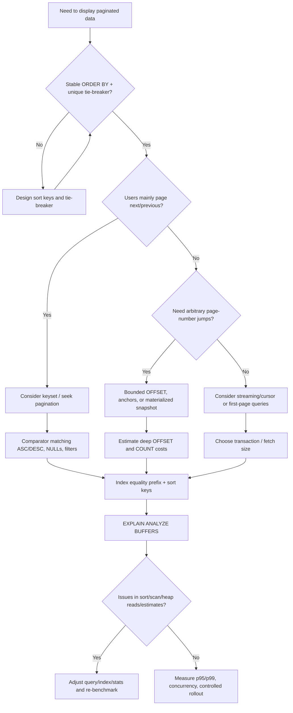

# Optimizing `ORDER BY`, `LIMIT`, and Deep Pagination in PostgreSQL

Displaying order lists, transaction histories, admin dashboards, or event logs commonly relies on a familiar query pattern:

```sql
SELECT event_id, created_at, title
FROM app_event
WHERE tenant_id = 10
ORDER BY created_at DESC
LIMIT 20 OFFSET 200000;
```

This SQL looks as if it only asks for **20 rows**, yet PostgreSQL may have to **walk through or sort enough data for the first 200,020 positions**, discard 200,000 rows, and return the final 20. If the query includes complex JOINs, filters, and sorts, the work grows even larger.

To optimize properly, separate three distinct concepts:

1. **`ORDER BY`** defines result ordering, which may require a `Sort` or be satisfied by an ordered scan.
2. **`LIMIT`** caps the number of returned rows; it **does not guarantee** PostgreSQL reads only that many rows.
3. **`OFFSET`** skips preceding rows; the deeper the page, the more skip work typically grows.

For infinite-scroll APIs or “Load more” feeds, **keyset pagination** (*seek pagination*) is usually faster and more stable than deep `OFFSET`, provided the application has a deterministic sort key and a proper cursor. Still, keyset cannot replace every feature: jumping directly to page 500, showing total page counts, or arbitrary multi-column sorting requires additional design.

This lesson belongs to the **Query Optimization** chapter of the *Database Engine Relational PostgreSQL* module. It covers how PostgreSQL executes sorts and limits, choosing B-tree indexes for filtering and ordering, designing safe cursors, verifying with `EXPLAIN (ANALYZE, BUFFERS)`, handling `NULL`s, multi-column keys, JOINs, concurrent mutations, and JDBC.

**DDL/DML statements are lab exercises for a test database—never run them directly on production.** Costs and execution plans vary with data, PostgreSQL version, statistics, configuration, and hardware.

## 1. Correct Results Matter More Than a Fast Query

Suppose an application displays the 20 newest events. The query:

```sql
SELECT event_id, created_at
FROM app_event
WHERE tenant_id = 10
LIMIT 20;
```

**does not guarantee** the 20 newest events. It merely caps output at 20 rows from whatever plan runs.

To request the newest records:

```sql
SELECT event_id, created_at
FROM app_event
WHERE tenant_id = 10
ORDER BY created_at DESC
LIMIT 20;
```

However, if multiple events share the same `created_at`, their relative order is **not fully deterministic**. For stable pagination, add a unique tie-breaker key:

```sql
SELECT event_id, created_at
FROM app_event
WHERE tenant_id = 10
ORDER BY created_at DESC, event_id DESC
LIMIT 20;
```

This defines an explicit ordering contract: sort by timestamp descending first, and break ties by ID descending.

### 1.1. Why Is a Unique Tie-Breaker Needed?

Suppose three rows share the same timestamp:

```text
event_id | created_at
---------+------------------------
101      | 2026-11-14 09:00:00+07
102      | 2026-11-14 09:00:00+07
103      | 2026-11-14 09:00:00+07
```

`ORDER BY created_at DESC` permits any permutation of 101, 102, and 103. A page boundary falling inside a tied timestamp group can duplicate or skip rows across requests.

`ORDER BY created_at DESC, event_id DESC` establishes a **total order** when `event_id` is unique, non-null, and compared under deterministic operators.

### 1.2. Deterministic Ordering Does Not Mean an Immutable Snapshot

A unique tie-breaker eliminates **ordering ambiguity when sort keys tie**. It does not prevent concurrent inserts, deletes, or updates from shifting rows between requests. That requires dedicated pagination and consistency strategies.

## 2. Three Display Patterns and Their Different Requirements

| Experience | Business Question | Technical Direction |
|---|---|---|
| First page of a list | “20 newest records?” | `ORDER BY ... LIMIT 20` with a matching index |
| User clicks “Load more” | “20 records right after the last item on the previous page?” | Keyset / seek pagination |
| User jumps to “Page 500” | “Skip 9,980 records and return 20?” | Capped `LIMIT/OFFSET` or dedicated page-lookup structures |
| Export full dataset in order | “Stream many rows consistently?” | Appropriate streaming / SQL cursor / transaction |
| Admin table with total pages | “Total rows matching the filter?” | `COUNT` or estimation / summary counters |
| Live-updating timeline | “What new records arrived since the last view?” | Cursor / sequence / watermark, not just `OFFSET` |

Not every API needs an immediate switch to keyset. Choose based on user behavior and correctness requirements, not merely a single query's runtime.

## 3. How Does PostgreSQL Execute `ORDER BY`?

There are two main execution approaches:

1. **Read along an access path already in the needed order**, typically a B-tree `Index Scan` or `Index Only Scan`.
2. **Read rows and sort them**, using nodes like `Sort` or `Incremental Sort`.

Example:

```sql
SELECT event_id, created_at
FROM app_event
WHERE tenant_id = 10
ORDER BY created_at DESC, event_id DESC
LIMIT 20;
```

The planner may choose:

```text
Limit
  -> Index Scan using idx_event_tenant_created_id
       Index Cond: (tenant_id = 10)
```

or:

```text
Limit
  -> Sort
       Sort Key: created_at DESC, event_id DESC
       -> Seq Scan on app_event
            Filter: (tenant_id = 10)
```

These plans are illustrative. PostgreSQL chooses based on **estimated cost**, not merely whether an index exists.

### 3.1. `ORDER BY` Does Not Always Produce a `Sort` Node

When an `Index Scan` already delivers rows in the requested order, PostgreSQL can omit a separate `Sort` step.

### 3.2. `Index Scan` Does Not Make `ORDER BY` Automatic in SQL

Even when a plan happens to emit rows in index order, **only an explicit `ORDER BY` guarantees result order in SQL**. Plans can shift after `ANALYZE`, PostgreSQL upgrades, or parameter changes.

## 4. B-Tree Is the Key Structure for `ORDER BY`

A B-tree stores keys in a deterministic order defined by its operator class and collation. It can support:

- `=` and ordering comparisons.
- `ORDER BY key ASC` or `DESC`.
- Ranges `<`, `<=`, `>`, `>=`.
- `LIMIT` combined with scanning from either end of a matching index slice.
- Multi-column indexes with properly aligned key order.
- `Index Only Scan` when visibility and column coverage permit.

Example:

```sql
CREATE INDEX idx_event_created
ON app_event (created_at);
```

When `created_at` is `NOT NULL`, an ascending B-tree index can be scanned **backward** to satisfy `ORDER BY created_at DESC`.

### 4.1. Forward and Backward Scans

A single-column B-tree defaults to:

```sql
CREATE INDEX idx_example_time
ON app_event (created_at ASC NULLS LAST);
```

Scanning forward yields `ASC NULLS LAST`; scanning backward yields `DESC NULLS FIRST`.

If a query requests `DESC NULLS LAST` on a **nullable column**, create an index with matching `NULL` ordering; do not assume backward scanning satisfies every `NULLS FIRST/LAST` combination.

### 4.2. `NULL` Ordering Defaults to Remember

In PostgreSQL:

- `ORDER BY x ASC` defaults to `NULLS LAST`.
- `ORDER BY x DESC` defaults to `NULLS FIRST`.

When building cursors, **explicitly specify `NULLS FIRST/LAST`** if a column is nullable; whenever possible, prefer `NOT NULL` sort keys to keep pagination logic simple.

### 4.3. B-Tree Ordering Does Not Make Heap Reads Free

An ordered `Index Scan` may fetch scattered heap pages, causing random I/O. If a query selects a large share of the table, the planner may pick `Seq Scan + Sort` even though a B-tree matches the sort order.

## 5. Multi-Column Indexes: Filter First, Order Second

A common API pattern:

```sql
SELECT event_id, created_at, title
FROM app_event
WHERE tenant_id = 10
ORDER BY created_at DESC, event_id DESC
LIMIT 20;
```

Candidate index:

```sql
CREATE INDEX idx_event_tenant_time_id
ON app_event (tenant_id, created_at DESC, event_id DESC);
```

Because `tenant_id = 10` is an equality predicate on the leading prefix, PostgreSQL can read just tenant 10's slice in `(created_at DESC, event_id DESC)` order.

```text
B-tree (tenant_id, created_at DESC, event_id DESC)

tenant_id = 9:  [...]
tenant_id = 10:
    newest created_at, high event_id
    ...
    older created_at, lower event_id
tenant_id = 11: [...]

WHERE tenant_id=10
ORDER BY created_at DESC, event_id DESC
LIMIT 20

→ Probe tenant 10 slice; can stop once 20 matching rows are retrieved.
```

### 5.1. Having All Columns in an Index Does Not Guarantee Order Support

An index:

```sql
CREATE INDEX idx_event_wrong_for_global_time
ON app_event (tenant_id, status, created_at DESC);
```

does not provide `ORDER BY created_at DESC` across **all statuses** for tenant 10, because entries are grouped by `status` first. If the query adds `status = 'PAID'`, it becomes an excellent access path again.

### 5.2. Equality Prefix Is a Core Design Rule

For:

```sql
WHERE tenant_id = 10
  AND status = 'PAID'
ORDER BY created_at DESC, event_id DESC
LIMIT 20
```

candidate index:

```sql
CREATE INDEX idx_event_tenant_status_time_id
ON app_event
    (tenant_id, status, created_at DESC, event_id DESC);
```

An equality prefix on `tenant_id` and `status` keeps the trailing keys sorted as required by the query.

### 5.3. Post-Index Filtering Can Still Be Expensive

If you use `(tenant_id, created_at DESC, event_id DESC)` with `WHERE status='RARE'`, PostgreSQL may have to walk past huge numbers of timestamps just to collect 20 rare rows.

A plan without a `Sort` node is **not automatically fast**. Inspect `Rows Removed by Filter`, index/heap pages read, and `Execution Time`.

## 6. Multiple `IN` Values Do Not Behave Like a Single Equality Prefix

Example:

```sql
SELECT event_id, created_at
FROM app_event
WHERE tenant_id = 10
  AND status IN ('NEW', 'PAID')
ORDER BY created_at DESC, event_id DESC
LIMIT 20;
```

Index `(tenant_id, status, created_at DESC, event_id DESC)` groups by `status` ahead of time; thus it does not provide a single **global chronological order across both statuses** in one contiguous scan the way `status='PAID'` does.

The planner may use a `Sort`, merge, bitmap, or another path. Here `(tenant_id, created_at DESC, event_id DESC)` with a filter on `status` can be very competitive depending on selectivity.

Never rewrite a multi-value `IN` into `=` just to hit an index—that changes query results.

## 7. Multi-Column Indexes and Mixed `ASC`/`DESC` Directions

On a single key, scanning a B-tree backward flips `ASC` ↔ `DESC`. On multiple keys, scanning backward flips **all keys simultaneously**.

Index:

```sql
CREATE INDEX idx_mixed_wrong
ON app_event (priority DESC, created_at DESC);
```

cannot directly serve:

```sql
ORDER BY priority DESC, created_at ASC
```

via a backward scan, because a backward scan yields `priority ASC, created_at ASC`.

Index matching the mixed order:

```sql
CREATE INDEX idx_mixed_order
ON app_event (priority DESC, created_at ASC, event_id DESC);
```

With an equality predicate on tenant as well:

```sql
CREATE INDEX idx_tenant_mixed_order
ON app_event (
    tenant_id,
    priority DESC,
    created_at ASC,
    event_id DESC
);
```

Match each column's direction to the **actual `ORDER BY`**. For nullable columns, specify `NULLS FIRST/LAST` too, not only `ASC`/`DESC`.

## 8. `LIMIT` Allows PostgreSQL to Stop Early—When Order Is Already Satisfied

Example:

```sql
SELECT event_id, created_at
FROM app_event
WHERE tenant_id = 10
ORDER BY created_at DESC, event_id DESC
LIMIT 20;
```

With a matching `Index Scan`, the executor can read 20 qualifying rows and stop instead of processing the whole tenant.

Illustrative plan:

```text
Limit (actual rows=20)
  -> Index Scan using idx_event_tenant_time_id
       Index Cond: (tenant_id = 10)
       (actual rows=20)
```

However, a **plan with extra post-scan filters** may scan far more index entries before finding 20 qualifying rows.

### 8.1. `LIMIT` Cannot Skip Mandatory Steps

If the query is:

```sql
SELECT customer_id, SUM(amount)
FROM app_event
GROUP BY customer_id
ORDER BY SUM(amount) DESC
LIMIT 20;
```

PostgreSQL generally must compute the group sums before knowing which 20 groups rank highest. A plain index on `amount` does not solve sorting by `SUM(amount)` per customer.

Evaluate the overall aggregation and query design instead of treating `LIMIT 20` as a guarantee of reading 20 rows.

### 8.2. `LIMIT` Without `ORDER BY`

```sql
SELECT event_id
FROM app_event
LIMIT 20;
```

returns at most 20 rows, **with no guarantee which 20**. PostgreSQL may switch plans as `LIMIT` changes; even on identical data, observed row order can vary.

## 9. What Forms Does `Sort` Take?

PostgreSQL's `Sort` node uses different methods depending on input, memory, and target:

- **Quicksort**: used when sorting all rows in memory.
- **Top-N heapsort**: used when only the top N rows are needed under `ORDER BY ... LIMIT`.
- **External merge**: appears when sorting spills to temp disk files because memory is exceeded or required by the plan.
- **Incremental Sort**: leverages inputs already sorted by a leading prefix.

These are execution methods shown in plans, not SQL keywords you specify.

### 9.1. Top-N Heapsort Does Not Mean Reading Only N Rows

Hypothetical plan:

```text
Limit
  -> Sort
       Sort Key: created_at DESC
       Sort Method: top-N heapsort  Memory: ...
       -> Seq Scan on app_event
```

Top-N heapsort bounds the number of candidates held in memory, yet **it still must examine the entire input** to find the top N unless an ordered access path exists.

It reduces sort memory usage, **not necessarily rows scanned**.

### 9.2. `work_mem` and Temp I/O

```sql
SHOW work_mem;
```

`work_mem` governs the memory budget per sort/hash node. When a sort spills, the plan may display:

```text
Sort Method: external merge  Disk: 180MB
Buffers: temp read=... written=...
```

Do not raise `work_mem` cluster-wide to a huge value to fix one query; a single query can contain multiple sort/hash nodes and many sessions run concurrently.

## 10. `Incremental Sort`: When Input Is Partially Sorted

Starting in PostgreSQL 13, `Incremental Sort` exploits inputs already ordered by a **prefix** of `ORDER BY`.

Example index:

```sql
CREATE INDEX idx_event_tenant_time
ON app_event (tenant_id, created_at DESC);
```

Query:

```sql
SELECT event_id, created_at
FROM app_event
WHERE tenant_id = 10
ORDER BY created_at DESC, event_id DESC
LIMIT 20;
```

An `Index Scan` yields rows ordered by `created_at DESC`, while rows sharing the same `created_at` are not yet ordered by `event_id DESC`. The planner can consider `Incremental Sort` to sort **within each tied timestamp group** instead of sorting the entire set.

### 10.1. Illustrative Plan

```text
Limit
  -> Incremental Sort
       Sort Key: created_at DESC, event_id DESC
       Presorted Key: created_at
       -> Index Scan ...
```

Whether it appears depends on statistics, duplicate groups, `LIMIT`, cost, and version.

### 10.2. `Incremental Sort` Is Not Always Optimal

If a prefix has only two distinct values and huge groups, exploiting presorted groups brings little benefit. Conversely, when the prefix is high-cardinality with tiny groups, incremental sorting can be very efficient.

Do not force `Incremental Sort` by name; measure group sizes, memory, temp I/O, and runtime.

### 10.3. Including All Sort Keys in the Index Can Be Better

If the workload consistently sorts by `created_at DESC, event_id DESC`, an index covering both keys avoids even incremental sorting—at the expense of larger index size and write maintenance. Balance against query share and `UPDATE` rate.

## 11. How `OFFSET` Behaves in Cost

Syntax:

```sql
SELECT event_id
FROM app_event
ORDER BY event_id
LIMIT 20 OFFSET 0;
```

```sql
SELECT event_id
FROM app_event
ORDER BY event_id
LIMIT 20 OFFSET 100000;
```

Even with a matching B-tree index, the executor starts from the beginning, **walks through roughly 100,000 preceding rows**, and then emits the next 20. PostgreSQL has no general mechanism to “jump straight to logical row 100,001” of an arbitrary query purely from a B-tree.

```text
ORDER BY event_id ASC

[1] [2] ... [100000] [100001] ... [100020]
 <--------- skip ----------->  <- return 20 ->

LIMIT 20 OFFSET 100000
```

### 11.1. Qualitative Complexity

With a matching `Index Scan`, work generally grows with the number of skipped rows:

\[
\text{work} \propto \text{OFFSET} + \text{LIMIT}
\]

This is a conceptual relationship, not an exact linear runtime formula. If the query also sorts, joins, filters, or aggregates, total cost depends on those nodes too.

### 11.2. `OFFSET` Can Cause the Planner to Switch Plans

A small `OFFSET` with `LIMIT 20` favors an early-stop `Index Scan`. With a massive `OFFSET`, the planner may view `Seq Scan + Sort` as cheaper because nearly the whole dataset must be traversed anyway.

**Never assume the same query at `OFFSET 0` and `OFFSET 100000` uses the same plan.**

### 11.3. `OFFSET` Is Not “Slow Because of Syntax”

It is slow when skipping many rows in a **filtered and sorted result set**. On a tiny set, `OFFSET 100` is harmless. On deep pagination across hundreds of thousands of rows, the cost becomes prominent.

## 12. Keyset Pagination: Seek by Key Position Rather Than Row Count

Instead of saying “skip 100,000 rows,” keyset says:

> Fetch the next 20 rows **after the last key of the previous page** in the defined sort order.

First page:

```sql
SELECT event_id, tenant_id, created_at, title
FROM app_event
WHERE tenant_id = 10
ORDER BY created_at DESC, event_id DESC
LIMIT 20;
```

Suppose the last row on the page has:

```text
created_at = 2026-11-13 08:30:00+00
event_id   = 728199
```

Next page:

```sql
SELECT event_id, tenant_id, created_at, title
FROM app_event
WHERE tenant_id = 10
  AND (
      created_at < TIMESTAMPTZ '2026-11-13 08:30:00+00'
      OR (
          created_at = TIMESTAMPTZ '2026-11-13 08:30:00+00'
          AND event_id < 728199
      )
  )
ORDER BY created_at DESC, event_id DESC
LIMIT 20;
```

Because both keys are `DESC`, “after the cursor” means an earlier timestamp, or the same timestamp with a smaller ID.

### 12.1. Cleaner Row-Value Comparison Form

When both columns are `NOT NULL` with compatible ordering:

```sql
WHERE tenant_id = 10
  AND (created_at, event_id)
      < (TIMESTAMPTZ '2026-11-13 08:30:00+00', 728199)
ORDER BY created_at DESC, event_id DESC
LIMIT 20;
```

Because **both keys are `DESC`**, tuple comparison `<` expresses the exact lexicographic condition required.

**Do not blindly apply this shorthand to mixed sort directions or nullable keys.** Those require different cursor predicates, covered later.

### 12.2. Why Keyset Is Usually Fast on Deep Pages

A B-tree index `(tenant_id, created_at DESC, event_id DESC)` can jump directly to the keys right **after the cursor** rather than walking through all prior pages.

```text
tenant_id = 10
B-tree range
     │
     ├─ rows newer than cursor (no need to walk and skip)
     ├─ cursor (created_at, event_id)
     └─ rows older than cursor → fetch next 20 rows
```

Cost is not completely independent of data: post-index filters, visibility checks, heap fetches, non-indexed predicates, and joins can still add reads. Yet with a matching index, keyset avoids **linear `OFFSET` traversal cost**.

## 13. Keyset Requires a Unique, Consistent Order

If you only use:

```sql
ORDER BY created_at DESC
```

and store only `created_at` in the cursor, then:

```sql
WHERE created_at < :last_created_at
```

will **skip** rows sharing the same timestamp that hadn't appeared yet on the previous page.

Example:

```text
Events sharing created_at = 09:00:00
event_id: 105, 104, 103, 102, 101

LIMIT 3 → 105,104,103
Page 2 WHERE created_at < '09:00:00'
    → skips 102,101 completely
```

Solution: add a unique tie-breaker key and store the **full key tuple of the last row**:

```sql
ORDER BY created_at DESC, event_id DESC
```

Cursor: `(created_at, event_id)`.

### 13.1. “Auto-Incrementing ID” Does Not Always Match Timestamp Order

If the UI sorts by event timestamp, `event_id` is merely a tie-breaker; never assume a larger ID always implies a newer timestamp. Use **both keys** in alignment with `ORDER BY`.

### 13.2. An Index Does Not Make `ORDER BY` Unique on Its Own

Even if an index covers `(created_at, event_id)`, a query specifying only `ORDER BY created_at` does not enforce deterministic ordering by `event_id`. SQL must state the tie-breaker explicitly.

## 14. Backward Pagination: Fetching the Previous Page from a Cursor

Suppose the list displays:

```sql
ORDER BY created_at DESC, event_id DESC
```

To page backward to rows **newer than** the first cursor on the current page, invert both the comparison and the sort direction **in the data-fetching query**:

```sql
SELECT event_id, created_at, title
FROM app_event
WHERE tenant_id = 10
  AND (created_at, event_id)
      > (TIMESTAMPTZ '2026-11-13 08:30:00+00', 728199)
ORDER BY created_at ASC, event_id ASC
LIMIT 20;
```

This retrieves the 20 rows **closest to the cursor on the newer side** thanks to `ASC` order. Once received, the application **reverses those 20 rows** to display them in `DESC` order.

### 14.1. Why Not Flip the Operator While Keeping `ORDER BY DESC`?

Using `> cursor` with `ORDER BY ... DESC LIMIT 20` would fetch the 20 **newest rows overall** instead of the 20 rows immediately adjacent to the cursor. On large datasets, that is not the previous page.

### 14.2. Reverse Scans on B-Trees

B-trees support backward scans. A single index with aligned key directions serves both forward and backward scans when all keys flip together; you do not automatically need two separate `ASC` and `DESC` indexes.

## 15. Setting Up a Lab to Reproduce Deep Pagination

Create a dedicated schema `demo_page` and table `activity` with many events. All create/write statements are strictly for the lab database.

```sql
CREATE SCHEMA IF NOT EXISTS demo_page;

CREATE TABLE demo_page.activity (
    event_id BIGINT GENERATED ALWAYS AS IDENTITY PRIMARY KEY,
    tenant_id INTEGER NOT NULL,
    customer_id INTEGER NOT NULL,
    status TEXT NOT NULL,
    priority INTEGER NOT NULL,
    created_at TIMESTAMPTZ NOT NULL,
    title TEXT NOT NULL,
    amount NUMERIC(12, 2) NOT NULL
);
```

To ensure many rows share timestamps, apply modulo over a range smaller than the row count:

```sql
INSERT INTO demo_page.activity
    (tenant_id, customer_id, status, priority,
     created_at, title, amount)
SELECT
    ((g - 1) % 4) + 1,
    ((g - 1) % 5000) + 1,
    CASE ((g / 7) % 4)
        WHEN 0 THEN 'NEW'
        WHEN 1 THEN 'PAID'
        WHEN 2 THEN 'CANCELLED'
        ELSE 'PROCESSING'
    END,
    (g % 5),
    TIMESTAMPTZ '2026-01-01 00:00:00+00'
       + (g % 95000) * INTERVAL '1 second',
    'Activity ' || g::text,
    ((g % 100000) / 100.0)::numeric(12, 2)
FROM generate_series(1, 200000) AS g;

ANALYZE demo_page.activity;
```

The new table contains 200,000 rows, 4 tenants, and roughly 50,000 rows per tenant. It has **many duplicate `created_at` values**, so pagination exercises cannot ignore tie-breakers.

### 15.1. Verify Dataset

```sql
SELECT
    COUNT(*) AS rows_total,
    COUNT(DISTINCT tenant_id) AS tenant_count,
    COUNT(DISTINCT created_at) AS timestamps_distinct
FROM demo_page.activity;

SELECT tenant_id, COUNT(*) AS rows_per_tenant
FROM demo_page.activity
GROUP BY tenant_id
ORDER BY tenant_id;

SELECT created_at, COUNT(*) AS duplicates
FROM demo_page.activity
GROUP BY created_at
HAVING COUNT(*) > 1
ORDER BY duplicates DESC, created_at
LIMIT 10;
```

Re-running the `INSERT` changes row counts; set up once on a clean schema.

## 16. Step A: Observe `ORDER BY` and `LIMIT` Without a Composite Index

The table has a primary-key B-tree on `event_id`, but no composite tenant/time index yet.

```sql
EXPLAIN (ANALYZE, BUFFERS)
SELECT event_id, created_at, title
FROM demo_page.activity
WHERE tenant_id = 1
ORDER BY created_at DESC, event_id DESC
LIMIT 20;
```

The planner may pick `Seq Scan + Sort + Limit`, possibly using top-N heapsort. Record:

- `actual rows` at the scan.
- `Rows Removed by Filter`.
- `Sort Method`.
- `Buffers shared hit/read`.
- `Execution Time`.

There is no fixed reference number; 200,000 rows may easily fit in cache on a learning machine.

### 16.1. `LIMIT 20` Does Not Guarantee Scanning Only 20 Rows

Without a suitably ordered access path, PostgreSQL must inspect tenant 1's rows to determine which 20 are newest.

## 17. Step B: Create an Index Matching Filter and Sort

```sql
CREATE INDEX idx_activity_tenant_time_id
ON demo_page.activity
    (tenant_id, created_at DESC, event_id DESC);

ANALYZE demo_page.activity;
```

Re-run:

```sql
EXPLAIN (ANALYZE, BUFFERS)
SELECT event_id, created_at, title
FROM demo_page.activity
WHERE tenant_id = 1
ORDER BY created_at DESC, event_id DESC
LIMIT 20;
```

This index supports the tenant equality prefix and the time/ID ordering. PostgreSQL can choose an `Index Scan`, stop after 20 rows, and skip sorting.

### 17.1. `Index Cond` vs `Filter`

In the plan:

```text
Index Cond: (tenant_id = 1)
```

shows the index bounds the scan to the tenant slice. If the query adds a `status` filter not covered in the index prefix, you may see:

```text
Filter: (status = 'PAID')
Rows Removed by Filter: ...
```

Finding 20 `PAID` rows may require reading many more than 20 rows in order.

### 17.2. Check Index Size

```sql
SELECT
    pg_size_pretty(
       pg_relation_size('demo_page.idx_activity_tenant_time_id')
    ) AS index_size,
    pg_size_pretty(
       pg_relation_size('demo_page.activity')
    ) AS heap_size;
```

A new index is not free: it uses disk space, memory/cache, and must be maintained on `INSERT`/`UPDATE`/`DELETE`.

## 18. Step C: Measure Deep `OFFSET`

First page:

```sql
EXPLAIN (ANALYZE, BUFFERS)
SELECT event_id, created_at
FROM demo_page.activity
WHERE tenant_id = 1
ORDER BY created_at DESC, event_id DESC
LIMIT 20 OFFSET 0;
```

Deep page within tenant 1's ~50,000 rows:

```sql
EXPLAIN (ANALYZE, BUFFERS)
SELECT event_id, created_at
FROM demo_page.activity
WHERE tenant_id = 1
ORDER BY created_at DESC, event_id DESC
LIMIT 20 OFFSET 40000;
```

Compare:

- Rows read/returned by the node beneath `Limit`.
- `Buffers shared hit/read`.
- `Execution Time`.
- Whether `Index Only Scan` or `Index Scan` was used.
- Whether a `Sort` appeared.

Even with the matching index, `OFFSET 40000` still walks past roughly 40,020 result positions, whereas `OFFSET 0` touches around 20. Differences in visibility and heap fetches further vary actual cost.

### 18.1. `OFFSET` Must Be Measured on the Same Dataset and Filter

Do not compare a deep `OFFSET` on a 100-row tenant against a shallow `OFFSET` on a 50,000-row tenant to infer algorithmic cost. Keep the predicate identical and vary only `OFFSET`.

## 19. Step D: Bootstrapping a Cursor for a Deep Page

In real APIs, page 2000's cursor comes from the **last row of the previous page**, not by running `OFFSET 39999` every time.

To obtain a lab anchor without typing manually, fetch the 40,000th row:

```sql
SELECT event_id, created_at
FROM demo_page.activity
WHERE tenant_id = 1
ORDER BY created_at DESC, event_id DESC
OFFSET 39999 LIMIT 1;
```

Finding this anchor **still pays deep-`OFFSET` cost**. It serves only to let us compare both pagination queries at the exact same position.

### 19.1. Keyset Query After the Anchor

```sql
WITH anchor AS (
    SELECT created_at, event_id
    FROM demo_page.activity
    WHERE tenant_id = 1
    ORDER BY created_at DESC, event_id DESC
    OFFSET 39999 LIMIT 1
)
SELECT a.event_id, a.created_at
FROM demo_page.activity AS a
CROSS JOIN anchor AS x
WHERE a.tenant_id = 1
  AND (a.created_at, a.event_id)
      < (x.created_at, x.event_id)
ORDER BY a.created_at DESC, a.event_id DESC
LIMIT 20;
```

This returns the page right after the anchor on a stable dataset. However, because the **`anchor` CTE still uses `OFFSET`**, the combined query has not eliminated deep traversal cost.

To demonstrate keyset's real benefit, obtain the cursor beforehand and **measure only the second `SELECT` with known cursor values**.

### 19.2. Keyset with Bound Values

```sql
PREPARE next_page(timestamptz, bigint) AS
SELECT event_id, created_at
FROM demo_page.activity
WHERE tenant_id = 1
  AND (created_at, event_id) < ($1, $2)
ORDER BY created_at DESC, event_id DESC
LIMIT 20;
```

Invoke once you have a cursor from the preceding page:

```sql
EXECUTE next_page(
    TIMESTAMPTZ '2026-01-02 00:00:00+00',
    12345
);
```

These literal values **only illustrate binding**, not the guaranteed 40,000th row in the lab. For a fair comparison, plug in the actual `created_at`/`event_id` returned by the anchor step, then run:

```sql
EXPLAIN (ANALYZE, BUFFERS)
EXECUTE next_page(
    TIMESTAMPTZ '2026-01-02 00:00:00+00',
    12345
);
```

Never report timings from placeholder values as if they were real deep-page measurements.

## 20. Optimal Keyset Plan Shape

With `(tenant_id, created_at DESC, event_id DESC)`, the plan can look like:

```text
Limit
  -> Index Only Scan using idx_activity_tenant_time_id
       Index Cond: (
           tenant_id = 1
           AND ROW(created_at, event_id) < ROW($1, $2)
       )
```

or `Index Scan` when extra heap columns are needed. The exact plan depends on PostgreSQL version, visibility map state, and query shape.

### 20.1. `Index Cond` Beats `Filter` for Cursors

One goal is ensuring the row comparison acts as an **index scan bound** rather than scanning the entire tenant slice and discarding millions of entries via `Filter`.

If the cursor predicate wraps columns in incompatible functions or casts, the planner may fail to use index range bounds.

### 20.2. `INDEX ONLY` Does Not Always Skip the Heap

Even when the query projects only `event_id, created_at` present in the index, PostgreSQL still verifies MVCC visibility. If heap pages are not all-visible, `Index Only Scan` reports `Heap Fetches > 0`.

### 20.3. Depth Does Not Vanish If Filters Aren't Indexed

If `status='RARE'` while the index covers only tenant and time, keyset may still scan many entries to gather 20 `RARE` rows. Design indexes for **both filters and ordering**, not cursor position alone.

## 21. Filtering by `status`: Choosing Between Two Indexes

Query:

```sql
SELECT event_id, created_at, title
FROM demo_page.activity
WHERE tenant_id = 1
  AND status = 'PAID'
ORDER BY created_at DESC, event_id DESC
LIMIT 20;
```

Two candidate strategies:

**Index A:**

```sql
CREATE INDEX idx_activity_tenant_status_time_id
ON demo_page.activity
    (tenant_id, status, created_at DESC, event_id DESC);
```

Places both equality predicates ahead of the sort keys.

**Index B:** the already created `idx_activity_tenant_time_id`, scanning by time and post-filtering `status`.

If `PAID` is rare, A is usually worth testing. If almost every row is `PAID`, B can be highly competitive while avoiding another index to maintain. PostgreSQL decides from statistics and costs.

### 21.1. Keyset with Filters Must Preserve the Contract

```sql
SELECT event_id, created_at, title
FROM demo_page.activity
WHERE tenant_id = 1
  AND status = 'PAID'
  AND (created_at, event_id) < ($1, $2)
ORDER BY created_at DESC, event_id DESC
LIMIT 20;
```

A cursor from `status='NEW'` **must never be silently reused** for `status='PAID'`. Changing the filter means paging over a different dataset.

### 21.2. Competing Indexes Cause Write Amplification

Every index adds maintenance and WAL overhead. In the lab you can create both to compare, whereas production should keep only indexes serving high-value query patterns. Never create an index for every ad-hoc filter/sort combination without analyzing the workload.

## 22. Partial Indexes for Frequently Queried Subsets

If the UI typically shows only open events:

```sql
CREATE INDEX idx_activity_open_time
ON demo_page.activity
    (tenant_id, created_at DESC, event_id DESC)
WHERE status = 'NEW';
```

Query:

```sql
SELECT event_id, created_at
FROM demo_page.activity
WHERE tenant_id = 1
  AND status = 'NEW'
ORDER BY created_at DESC, event_id DESC
LIMIT 20;
```

can use the smaller index if the planner proves the query satisfies the partial predicate.

### 22.1. Prepared Statements and Generic Plans

If the query is written:

```sql
WHERE tenant_id = $1
  AND status = $2
```

a generic plan cannot assume `$2='NEW'` across all calls. Consequently, the partial index may be skipped even when a literal `status='NEW'` benchmark used it.

Test custom vs generic plans with your actual driver and data instead of relying solely on hardcoded literals.

### 22.2. Frequent Status Changes Increase Write Cost

A partial index on `status` must update index membership whenever `status` transitions. Don't look only at the smaller index size; track `INSERT`/`UPDATE` costs and HOT-update rates.

## 23. `INCLUDE` Columns and Index-Only Scans

An API returning only:

```sql
SELECT event_id, created_at, title
FROM demo_page.activity
WHERE tenant_id = 1
ORDER BY created_at DESC, event_id DESC
LIMIT 20;
```

Index `(tenant_id,created_at,event_id)` **does not contain `title`**. PostgreSQL must fetch the heap to read `title`.

You can test:

```sql
CREATE INDEX idx_activity_tenant_time_cover
ON demo_page.activity
    (tenant_id, created_at DESC, event_id DESC)
INCLUDE (title);
```

When the query matches and the visibility map permits, the planner can pick `Index Only Scan` and reduce heap reads.

### 23.1. `INCLUDE` Is Not Free

`title` is stored inside the index; changing `title` updates the index and can prevent HOT updates. Very long `title` values bloat index tuples, consume space, or hit tuple size limits.

A covering index is justified only after measuring:

- `Heap Fetches`.
- Index size.
- Query latency for the requested page size.
- `title` update frequency.
- WAL / write cost.

**For a 20-row page, 20 heap fetches can be cheaper than maintaining a bulky covering index**, depending on cache and workload.

## 24. `NULL`s in Pagination Keys: The Tuple-Comparison Trap

With two `NOT NULL` keys, the condition:

```sql
(created_at, event_id) < (:time, :id)
```

is unambiguous. Yet if `created_at` is nullable, SQL row comparison can yield `NULL`/`UNKNOWN` whenever `NULL` is involved, even though `ORDER BY ... NULLS LAST` places `NULL` rows at a well-defined position.

As a result, a naive tuple comparison can **skip an entire group of `NULL` rows**.

### 24.1. Preferred Approach: Non-Null Sort Keys

Whenever the business contract permits:

```sql
created_at TIMESTAMPTZ NOT NULL
event_id   BIGINT PRIMARY KEY
```

keeps cursor design simple and reliable.

### 24.2. If `NULLS LAST` Is Required

Example:

```sql
ORDER BY nullable_score DESC NULLS LAST, event_id DESC
```

Cursor logic requires **two branches**:

1. Cursor `score` **is non-null**: smaller scores, or equal score with smaller ID, **plus** all `NULL`-score rows that follow.
2. Cursor `score` **is `NULL`**: only `NULL`-score rows with smaller ID.

Conceptual predicate when the cursor score is non-null:

```sql
WHERE score < :cursor_score
   OR (score = :cursor_score AND event_id < :cursor_id)
   OR score IS NULL
```

When the cursor score is `NULL`:

```sql
WHERE score IS NULL
  AND event_id < :cursor_id
```

Both keep the original base filters and `ORDER BY score DESC NULLS LAST, event_id DESC`. Never collapse them into `score < NULL`.

### 24.3. `COALESCE` Sentinels Have Trade-Offs

`COALESCE(score, -999999)` creates a uniform sort expression, yet the sentinel value must sit **strictly outside real domain values** and match business rules. An expression index may be required if filtering/sorting on `COALESCE`; avoid arbitrary sentinels.

## 25. Mixed Sort Directions: Do Not Blindly Use Tuple Comparisons

Suppose the UI requires:

```sql
ORDER BY priority DESC,
         created_at ASC,
         event_id DESC
```

where all three columns are `NOT NULL`.

Given cursor `(p, t, id)`, the “next rows” must satisfy:

- `priority` **less than** `p`; or
- `priority` equals `p` and `created_at` **greater than** `t`; or
- `priority` equals `p`, `created_at` equals `t`, and `event_id` **less than** `id`.

SQL:

```sql
WHERE priority < :cursor_priority
   OR (
       priority = :cursor_priority
       AND created_at > :cursor_created_at
   )
   OR (
       priority = :cursor_priority
       AND created_at = :cursor_created_at
       AND event_id < :cursor_event_id
   )
ORDER BY priority DESC, created_at ASC, event_id DESC
LIMIT 20;
```

You cannot replace that logic with:

```sql
-- WRONG when sort directions differ:
WHERE (priority, created_at, event_id)
    < (:p, :t, :id)
```

because row comparisons apply one uniform lexicographic direction across all elements and ignore that the second column is ascending.

### 25.1. Index Supporting Mixed Ordering

```sql
CREATE INDEX idx_activity_tenant_mixed
ON demo_page.activity
    (tenant_id, priority DESC, created_at ASC, event_id DESC);
```

A matching index can eliminate sorting; however, complex `OR` predicates may not always collapse into one optimal continuous range scan.

### 25.2. When Further Optimization Is Needed

Consider:

- A normalized sort key with clear semantics and a matching expression index.
- Splitting seek branches into valid bounded `UNION ALL` queries followed by a final sort/limit.
- Simplifying product sort options if UX allows.
- Checking `Index Cond`, `Filter`, and `Rows Removed by Filter` instead of guessing.

Never sacrifice correctness of a mixed-direction cursor just to make SQL shorter.

## 26. Expression `ORDER BY`: Index Must Match Expression

Example case-insensitive name sorting:

```sql
SELECT customer_id, full_name
FROM customer
ORDER BY lower(full_name), customer_id
LIMIT 20;
```

A B-tree index on raw `full_name` **is not equivalent** to an index on `lower(full_name)`.

Candidate index:

```sql
CREATE INDEX idx_customer_lower_name_id
ON customer (lower(full_name), customer_id);
```

Here `customer` is an illustrative table, not `demo_page.activity` in the lab.

When paginating by an expression:

```sql
WHERE (lower(full_name), customer_id)
    > (:last_lower_name, :last_id)
ORDER BY lower(full_name), customer_id
LIMIT 20;
```

The cursor must store the **normalized value produced by the exact SQL expression**, never a client-side lowercasing computed under a different collation.

### 26.1. Unicode and Collation

`lower()`, ICU collations, accent-insensitivity, NFC/NFD normalization, and Java `String` comparisons can follow different rules. Page boundaries must not be computed under a different sort definition on the client than in SQL.

If collation versions or normalization rules change, old cursors may no longer position accurately. Version your cursor contract or reset to page 1 after migrations.

## 27. `ORDER BY` with `JOIN`: Understand Cardinality

Example:

```sql
SELECT c.customer_id, c.full_name, o.order_id, o.created_at
FROM customer c
JOIN orders o ON o.customer_id = c.customer_id
ORDER BY o.created_at DESC, o.order_id DESC
LIMIT 20;
```

This returns 20 **JOIN result rows**, not 20 customers. One customer with 15 orders can occupy 15 slots on the page.

### 27.1. Paginating Parent Before Joining Child Can Change Meaning

If the goal is 20 **customers**, select 20 customers first and then join related data—keeping in mind the post-join row count can exceed 20.

If the goal is 20 **orders**, paginating `orders` by order keys first and then joining customer info (many-to-one) can shrink join work:

```sql
WITH page AS (
    SELECT order_id, customer_id, created_at
    FROM orders
    WHERE tenant_id = :tenant_id
    ORDER BY created_at DESC, order_id DESC
    LIMIT 20
)
SELECT p.order_id, p.created_at, c.full_name
FROM page p
JOIN customer c ON c.customer_id = p.customer_id
ORDER BY p.created_at DESC, p.order_id DESC;
```

This is a conceptual SQL pattern. Ensure the join neither drops nor multiplies rows unexpectedly. With one-to-many joins, paginating before vs after joining is **not equivalent**.

### 27.2. Child Filters Can Change the Valid Parent Set

If the requirement asks for “the 20 newest orders **that have a successful payment**,” filtering payment after `LIMIT 20` on `orders` can return fewer than 20 rows when not all of the 20 newest orders are paid.

Place the existence filter inside the page-selection step:

```sql
WITH page AS (
    SELECT o.order_id, o.customer_id, o.created_at
    FROM orders o
    WHERE o.tenant_id = :tenant_id
      AND EXISTS (
          SELECT 1 FROM payment p
          WHERE p.order_id = o.order_id
            AND p.status = 'SUCCESS'
      )
    ORDER BY o.created_at DESC, o.order_id DESC
    LIMIT 20
)
SELECT ...
FROM page ...
```

Getting semantics right matters more than blindly pushing `LIMIT` as deep as possible.

## 28. `DISTINCT ON`, `GROUP BY`, and Ordering

Scenario “each customer's latest order”:

```sql
SELECT DISTINCT ON (customer_id)
    customer_id, order_id, created_at
FROM orders
ORDER BY customer_id, created_at DESC, order_id DESC;
```

`DISTINCT ON` keeps the first row per group according to `ORDER BY`; without a tie-breaker, the chosen representative can be unstable.

An index on `(customer_id, created_at DESC, order_id DESC)` can help, though it **does not guarantee skipping all remaining rows of every group** across all versions and plans. Read `EXPLAIN`.

### 28.1. Paginating `DISTINCT ON` Results Differs from Paginating Raw Rows

In:

```sql
SELECT DISTINCT ON (customer_id) ...
FROM orders
ORDER BY customer_id, created_at DESC
LIMIT 20;
```

`LIMIT` applies after grouping/selecting one row per customer under SQL semantics—not taking 20 raw orders first and deduplicating per customer.

### 28.2. `GROUP BY` Ordered by an Aggregate

```sql
SELECT tenant_id, COUNT(*) AS cnt
FROM demo_page.activity
GROUP BY tenant_id
ORDER BY cnt DESC
LIMIT 3;
```

Aggregation must compute group counts before identifying the top 3. An index on `tenant_id` does not sort by `COUNT(*)`. When real-time top-N dashboards run on huge datasets, consider summary tables or materialized views with an appropriate refresh policy.

## 29. Window Function `ROW_NUMBER` Is Not a Free Alternative to `OFFSET`

A common pagination rewrite:

```sql
SELECT *
FROM (
    SELECT
        event_id, created_at,
        ROW_NUMBER() OVER (
            ORDER BY created_at DESC, event_id DESC
        ) AS rn
    FROM demo_page.activity
    WHERE tenant_id = 1
) s
WHERE rn BETWEEN 40001 AND 40020;
```

This pattern is useful for analytics and ranking, yet **is not automatically faster than `OFFSET 40000`**. The engine still has to establish row ordering and assign row numbers up to the required range, often processing large inputs.

When the goal is “the next page after a cursor,” prefer keyset pagination when business rules allow and an index exists.

## 30. `COUNT(*)` for Total Pages Is Its Own Problem

An API returning:

```text
items: 20 rows
totalCount: 1928453
totalPages: 96423
```

may have to execute:

```sql
SELECT COUNT(*)
FROM app_event
WHERE tenant_id = 10
  AND status = 'PAID';
```

Counting exact visible rows matching a predicate **is not O(1)** under MVCC. Indexes can help under some conditions, yet PostgreSQL must still respect snapshot visibility.

### 30.1. Keyset Does Not Automatically Provide Total Pages

Keyset easily answers “is there a next page?” rather than “where is page 96,423?” For infinite scroll UX, exact `totalCount` is often unnecessary.

### 30.2. `LIMIT page_size + 1` to Detect More Rows

Instead of fetching 20, fetch **21 rows**:

```sql
SELECT event_id, created_at
FROM demo_page.activity
WHERE tenant_id = 1
ORDER BY created_at DESC, event_id DESC
LIMIT 21;
```

If 21 rows arrive, return 20 and set `hasNextPage=true`; the 21st row must not be consumed as the cursor for the next page. The next cursor must use the **keys of the 20th row** (the last displayed row), not the 21st.

### 30.3. Estimates Instead of Exact `COUNT`

Some interfaces use:

- Table-level estimates from `pg_class.reltuples`.
- Separately maintained counters or summary tables.
- Approximate counts explicitly labeled “about.”
- A `hasNextPage` flag with no total displayed.

This is a product decision: **never present an estimate as an exact count**.

## 31. `OFFSET` and Mutating Data: Duplicates and Skipped Rows Across Pages

Suppose a descending list has:

```text
Page 1: [100, 99, 98]
Expected page 2: [97, 96, 95]
```

After the client loads page 1, event `101` is inserted at the top.

`OFFSET 3 LIMIT 3` now returns:

```text
[98, 97, 96]
```

Row 98 repeats; row 95 is pushed to the next page. Because `OFFSET` counts **current positions** in the result set, it shifts whenever rows are inserted or deleted ahead of it.

### 31.1. Keyset Reduces Positional Drift

If page 1 ends at ID 98 in descending ID order, the next page:

```sql
WHERE event_id < 98
ORDER BY event_id DESC
LIMIT 3;
```

starts cleanly at 97, unaffected by ID 101 arriving above the cursor.

This is a major advantage of keyset for append-only feeds ordered by monotonic keys.

### 31.2. Keyset Does Not Guarantee an Immutable Snapshot

If an already-viewed row changes its sort key, it can cross the cursor boundary. If an older row is deleted, it disappears. If a backdated event is inserted below the cursor, it can appear on a later page.

Distinguish:

- **Pagination stability:** avoiding positional drift from `OFFSET`.
- **Snapshot consistency:** every page viewing the exact same point-in-time snapshot.
- **Business freshness:** whether newly arriving items should appear while scrolling.

Keyset primarily solves the first; it does not automatically solve the other two.

## 32. MVCC and Transaction Snapshots Across Multiple Requests

Under `READ COMMITTED`, each statement typically sees a fresh snapshot. Page 1 and page 2 sent as separate HTTP requests can observe different commits.

A `REPEATABLE READ` transaction holds a consistent snapshot across multiple `SELECT`s **within the same transaction**, yet keeping a transaction open for minutes while a user scrolls can:

- Hold snapshots, locks, and resources open.
- Block `VACUUM` / HOT pruning.
- Tie up a connection from the pool.
- Fail on idle timeouts or client disconnects.

### 32.1. Never Hold a Transaction Open for Minutes Just to Pin Pages

Typical paginated APIs should not hold a PostgreSQL transaction open across user HTTP requests just to stop page drift. Usually you pick keyset meaning “continue after this key” and accept live updates per the API contract.

### 32.2. Need an Exact Point-in-Time Snapshot for Reporting?

When business requirements demand exporting an exact point-in-time state, use a dedicated export workflow, bounded transaction/cursor, or properly scoped snapshot coordination with strict lifetime limits. Never claim multi-request keyset pagination is a “consistent snapshot” without explicit guarantees.

### 32.3. Snapshot Export/Import Is an Advanced Technique

PostgreSQL provides `pg_export_snapshot()` and `SET TRANSACTION SNAPSHOT` for sharing snapshots under strict isolation and timing rules. A snapshot ID **is not an indefinite token** to embed in pagination URLs.

Reserve this for specialized batch/export jobs, not general infinite scroll.

## 33. Mutable Sort Keys: Handling Updated Events

Suppose a feed sorts by `updated_at DESC`. While a user reads page 1, an item on page 3 is updated, bumping its `updated_at` to the top.

Subsequent cursor pages may:

- No longer find that item at its old position.
- Observe items shifting over time.
- See total item counts change.

If strict audit/timeline stability is required, use an **immutable sort key** like `created_at` or `event_sequence` and model changes as append-only events.

### 33.1. Timestamps Alone Do Not Guarantee Commit Order

A client timestamp or `created_at` may not match commit order: an earlier transaction can obtain an earlier timestamp yet commit later. When strict commit/publication ordering is needed, design an explicit sequence/watermark/LSN or outbox mechanism rather than assuming timestamps equal commit order.

### 33.2. Sequence-Generated IDs Are Not Strict Commit Order Either

PostgreSQL sequences allocate values non-transactionally: a transaction drawing ID 100 can commit after a transaction drawing ID 101. Thus `event_id DESC` orders by ID, not strictly “most recently committed.”

Choose sort keys based on what users actually expect to see.

## 34. Cursor Tokens: What Data to Carry

A keyset token typically includes:

- Values of the last row's sort columns in exact order.
- Cursor format version.
- Sort mode (e.g., `created_at_desc_id_desc`).
- Tenant/status filter or canonical filter hash.
- Page size if required by contract.
- Expiration timestamp if needed.
- Signature/HMAC if clients must not forge or tamper with tokens.

Illustrative JSON model:

```json
{
  "version": 1,
  "sort": "created_at_desc_event_id_desc",
  "tenantId": 10,
  "status": "PAID",
  "lastCreatedAt": "2026-11-13T08:30:00Z",
  "lastEventId": 728199,
  "pageSize": 20
}
```

This JSON is purely illustrative, not a complete validation or security spec.

### 34.1. Base64 Is Not Encryption or Security

Base64-encoding JSON merely turns bytes into a URL-safe string. Anyone can decode and edit it unless the token is signed.

If a token carries context that users must not alter, sign it with an HMAC or validate it server-side. Never put secrets inside a payload just because it is Base64-encoded.

### 34.2. Tenant ID Inside a Token Does Not Replace Authorization

Even when the token carries `tenantId=10`, the backend must derive tenant/permissions from the **authenticated identity** and verify the token matches. Never grant read access based on a client-supplied tenant ID.

### 34.3. Invalidating Cursors When Filters or Sorts Change

If the user switches `status` from `PAID` to `NEW` or flips `ASC` ↔ `DESC`, restart from page 1 or issue a fresh cursor. Reusing a cursor across different queries causes skipped or duplicated rows.

## 35. Java/JDBC: Querying the Next Page with `PreparedStatement`

Example API filtering `tenant_id` and `status` with a two-column cursor:

```java
String sql = """
    SELECT event_id, tenant_id, status, created_at, title
    FROM demo_page.activity
    WHERE tenant_id = ?
      AND status = ?
      AND (created_at, event_id) < (?, ?)
    ORDER BY created_at DESC, event_id DESC
    LIMIT ?
    """;

try (PreparedStatement ps = connection.prepareStatement(sql)) {
    ps.setInt(1, tenantId);
    ps.setString(2, status);
    ps.setObject(3, cursorCreatedAt); // Driver-compatible OffsetDateTime.
    ps.setLong(4, cursorEventId);
    ps.setInt(5, pageSize + 1);

    try (ResultSet rs = ps.executeQuery()) {
        // Map rows to DTOs.
        // Display at most pageSize rows.
        // hasNextPage = result count > pageSize.
        // nextCursor = sort keys of the LAST DISPLAYED row.
    }
}
```

`cursorCreatedAt` should use a Java type mapped consistently to `timestamptz`, such as `OffsetDateTime` depending on your pgJDBC version.

### 35.1. First Page Without a Cursor

Never write:

```sql
AND (created_at, event_id) < (NULL, NULL)
```

because comparisons with `NULL` do not evaluate to `TRUE` as intended. Use **two clean queries**:

- First page: no cursor predicate.
- Subsequent pages: cursor predicate with both values bound.

Alternatively, write explicit `NULL`-guarded SQL branches, though inspect the plan because `OR` can affect index range bounds.

### 35.2. Never Let Clients Supply Raw SQL Identifiers

`?` binds **values**, not column names or `ASC`/`DESC` keywords. Backend code must whitelist valid sort options, e.g.:

```text
RECENT: ORDER BY created_at DESC, event_id DESC
OLDEST: ORDER BY created_at ASC, event_id ASC
PRIORITY: ORDER BY priority DESC, created_at ASC, event_id DESC
```

Each sort option has its own comparator and cursor contract. Never concatenate HTTP parameters directly into `ORDER BY`.

### 35.3. Guarding Public APIs Against Huge `OFFSET`s

If an API still supports numbered pages:

- Cap `pageSize`.
- Cap maximum `OFFSET` or maximum page number.
- Direct users toward exports or seek pagination for deep history.
- Configure timeouts and rate limits.
- Monitor slow queries per tenant/user.
- Return a clear error when page numbers exceed policy.

Never let a client request `OFFSET 100000000000` and burn database resources needlessly.

## 36. Server-Side Cursors: Distinct from Keyset Tokens

PostgreSQL provides SQL cursors:

```sql
BEGIN;

DECLARE activity_cursor NO SCROLL CURSOR FOR
SELECT event_id, created_at
FROM demo_page.activity
WHERE tenant_id = 1
ORDER BY created_at DESC, event_id DESC;

FETCH FORWARD 20 FROM activity_cursor;
FETCH FORWARD 20 FROM activity_cursor;

CLOSE activity_cursor;
COMMIT;
```

A server-side cursor maintains query state within a transaction/session. It fits sequential streaming/processing inside a single job holding a live connection.

### 36.1. Key Differences from Keyset Pagination

| Keyset Token | Server-Side Cursor |
|---|---|
| Each request can use any connection | Tied to a specific session/transaction |
| Last sort keys stored in client/server token | Server holds cursor/portal state |
| Each request reads its own transaction snapshot unless coordinated | Cursor follows query/transaction snapshot rules |
| Well suited to stateless APIs / infinite scroll | Well suited to streaming/exporting in a job |
| Holds no DB connection between requests | Holds connection/transaction while open |
| Can resume after restart depending on contract and data | Standard cursor ends when transaction/session closes |

### 36.2. `WITH HOLD` Is Not Free

Holdable cursors can outlive a commit under PostgreSQL rules, yet may have to materialize the entire result set into memory or temp disk storage. Never use `WITH HOLD` to keep millions of rows open while a user browses over days.

### 36.3. JDBC Fetch Size

Certain pgJDBC configurations use a server-side cursor automatically when autocommit is off and `fetchSize` is set. Verify driver version, transaction state, and how `ResultSet` is consumed.

Do not confuse `setFetchSize(100)` with keyset pagination: it governs **how the client streams one query's results**, not turning an `OFFSET` query into a seek.

## 37. Jumping Straight to Page 500: Keyset Doesn't Solve That Directly

If the UI lets users type “Page 500,” keyset needs the **last key of page 499** or a matching anchor. It cannot compute the coordinates of row 9,980 without scanning, counting, or auxiliary indexing.

Strategies:

1. **Bounded `OFFSET`** within an acceptable threshold when max depth is modest.
2. **Cursor navigation** (next/previous only), dropping arbitrary page-number jumps.
3. **Precomputed anchors/bookmarks** at fixed intervals, updated per defined rules on data changes.
4. **Materialized result sets/reports** for sessions requiring a fixed snapshot.
5. **Stronger search/filtering** to narrow results instead of paging to page 500.
6. **Export/streaming** when users truly need to inspect hundreds of thousands of records.

Never promise a B-tree index can “jump to page 500 in O(log N)” for arbitrary `ORDER BY` queries.

## 38. Page Size and Per-Request Cost

`LIMIT 20`, `LIMIT 100`, and `LIMIT 10000` each carry trade-offs:

- Small pages: more round trips, lighter responses, cheaper cancellation.
- Large pages: fewer round trips, higher DTO mapping, network memory, and latency.
- Large pages with weak `WHERE` selectivity: many heap pages touched.
- Continuous scrolling clients: prefetch conservatively with backpressure.

Deep pagination is not solely a PostgreSQL problem: JSON serialization, HTTP payloads, mobile rendering, and caching all contribute.

### 38.1. Page Size Is Part of the Cursor Contract

If a cursor token encodes `pageSize=20` and a later request asks for `100`, seeking “after the key” still works cleanly, though UX and rate-limit policies may shift. Backend code should decide whether changing page size is permitted or invalidates the cursor.

## 39. Negative or Huge `LIMIT`/`OFFSET` Inputs

`LIMIT`/`OFFSET` inputs must be validated. An API should verify:

- Positive page number per application rules.
- `pageSize` within allowed bounds.
- `(page - 1) * pageSize` does not overflow application integer bounds.
- `OFFSET` stays within the permitted cap.
- Negative values or invalid numbers are rejected rather than causing errors or wasted scans.
- `LIMIT ALL` / `LIMIT NULL` cannot accidentally bypass capping.

Never assume PostgreSQL protects the application from abusive pagination requests.

## 40. `LIMIT` Combined with Aggregates and `DISTINCT` Has Different Costs

Consider:

```sql
SELECT DISTINCT customer_id
FROM demo_page.activity
WHERE tenant_id = 1
ORDER BY customer_id
LIMIT 20;
```

`LIMIT 20` applies to **20 distinct `customer_id`s** in order—not reading 20 raw activity rows and deduplicating them.

If the first 20,000 activities belong to the same customer, PostgreSQL may have to read many rows to collect 20 distinct customers. An index on `(tenant_id, customer_id)` changes execution, yet still does not guarantee reading only 20 source rows.

Likewise with `GROUP BY` and window functions: adding `LIMIT` does not make underlying work disappear.

## 41. Parallel Plans, `Gather Merge`, and `ORDER BY`

On large tables, PostgreSQL can use parallel scans and parallel sorts.

A `Gather` node collects rows from workers without preserving order. `Gather Merge` merges **already-sorted** streams from parallel workers by the sort key.

Illustrative plan:

```text
Limit
  -> Gather Merge
       Workers Planned: 4
       -> Sort
            Sort Key: created_at DESC, event_id DESC
            -> Parallel Seq Scan ...
```

### 41.1. `ORDER BY` Must Still Be in SQL

Even if a plan uses `Gather Merge`, applications may rely on output order only when the SQL query explicitly specifies `ORDER BY`.

### 41.2. `LIMIT` Caps Output, Yet Workers Still Do Work

Never assume top-N beneath `Gather Merge` processes only 20 rows across all workers. Each worker can scan and sort substantial portions before the final limit cuts output.

### 41.3. Weigh Startup Cost Against Throughput

Parallel plans incur startup overhead. Fetching page 1 (20 rows) via a good index often beats a parallel scan/sort of the entire table, even though parallelism shines on large analytical reports.

## 42. Partitioning and Pagination

Suppose a table is partitioned by time or tenant. A query:

```sql
WHERE tenant_id = 10
ORDER BY created_at DESC, event_id DESC
LIMIT 20
```

can benefit from **partition pruning** when predicates align with the partition key.

However, a global `ORDER BY` spanning multiple partitions must still merge ordered streams. PostgreSQL may choose Append, Merge Append, or Sort depending on partition layout and per-partition indexes.

### 42.1. An Index per Partition Is Not One Global Sorted Index

If a query touches 100 partitions each indexed on `created_at DESC`, PostgreSQL still has to produce a globally ordered result. Never assume `LIMIT` touches only the newest partition unless the partition scheme, filters, and data guarantee it.

### 42.2. Cursors Must Include a Globally Unique Key

If `event_id` is unique only within each partition and can repeat across partitions, `(created_at, event_id)` is not globally unique. Use a tie-breaker unique across the entire partitioned table, such as including the partition key or a global identity.

## 43. Collation and String Sorting

`ORDER BY name` on `TEXT` depends on collation. Both the B-tree index and the query must share compatible collations/operator classes to use the stored order.

Example:

```sql
SELECT customer_id, full_name
FROM customer
ORDER BY full_name COLLATE "C", customer_id
LIMIT 20;
```

An index built under a different collation may not match the query's pathkeys.

### 43.1. Collation Version Upgrades Affect Cursors

If PostgreSQL, ICU, or `libc` changes text-sorting order, existing cursors holding string values may no longer land at the same positions. Alongside rebuilding indexes per collation-version procedures, the backend may need to invalidate or version cursor tokens.

### 43.2. Case-Insensitive `ORDER BY`

When sorting by `lower(full_name)`, use the exact same expression and collation in SQL and in the index, and store the expression key inside the cursor. Never rely on Java's client-side string ordering to drive a DB cursor.

## 44. Why Might the Planner Skip an Index Despite `ORDER BY ... LIMIT`?

Common causes:

- Table is small: `Seq Scan + Sort` is cheaper.
- `LIMIT` is large: nearly the whole set is needed anyway.
- Filter selects many rows or incurs heavy random heap fetches.
- Index lacks the equality prefix.
- Mixed `ASC`/`DESC` directions don't match the index.
- `NULLS FIRST`/`LAST` mismatch on nullable columns.
- `ORDER BY` expression or collation differs from the index.
- `JOIN`, `GROUP BY`, or `DISTINCT` alters required sort order.
- Statistics are stale or inaccurate.
- Keyset predicate isn't pushed into `Index Cond`.
- A parallel scan/sort is estimated cheaper.
- Query fetches many wide columns from the heap.
- Cache warmth and cost parameters differ from assumptions.

Never force an index just to make a plan look shorter. Compare total I/O, CPU, latency, and throughput.

## 45. Cost Parameters to Know

```sql
SHOW random_page_cost;
SHOW seq_page_cost;
SHOW effective_cache_size;
SHOW work_mem;
SHOW enable_incremental_sort;
```

Qualitative roles:

- `random_page_cost` weights index paths involving random I/O.
- `seq_page_cost` weights sequential scans.
- `effective_cache_size` is a **cache-size hint** for the planner, not RAM allocated to the query.
- `work_mem` sets per-node sort/hash memory budgets.
- `enable_incremental_sort` lets the planner consider incremental sorting where supported.

Do not change these parameters instance-wide just to force one query's plan. Inspect estimates, statistics, and workload first; test any parameter tweaks inside a lab session and measure the whole impact.

## 46. Reading `EXPLAIN (ANALYZE, BUFFERS)`

Example:

```sql
EXPLAIN (ANALYZE, BUFFERS, VERBOSE, SETTINGS)
SELECT event_id, created_at, title
FROM demo_page.activity
WHERE tenant_id = 1
ORDER BY created_at DESC, event_id DESC
LIMIT 20 OFFSET 40000;
```

Fields to watch:

| `EXPLAIN` Line | How to Read It |
|---|---|
| `Limit` | Node applying `LIMIT`/`OFFSET` |
| `Sort` | Sorts input when not already ordered |
| `Incremental Sort` | Leverages presorted prefix |
| `Sort Key` | Columns, expressions, and sort directions |
| `Presorted Key` | Prefix already sorted in incremental sort |
| `Sort Method` | `top-N heapsort`, `quicksort`, `external merge`, etc. |
| `Index Scan` | Reads index, may fetch heap |
| `Index Only Scan` | Can reduce heap reads if visibility allows |
| `Index Cond` | Predicates pushed into index bounds |
| `Filter` | Predicates checked after reading candidate rows |
| `Rows Removed by Filter` | Rows discarded at that node |
| `actual rows` | Real rows emitted per node/loop |
| `Buffers shared hit/read` | Cache hits and page reads |
| `Buffers temp read/written` | Temp I/O from sort/hash spills |
| `Heap Fetches` | Heap checks during `Index Only Scan` |
| `Planning Time` | Time spent planning |
| `Execution Time` | Server execution time |

### 46.1. Reading `LIMIT`'s Position Properly

In:

```text
Limit (actual rows=20)
  -> Index Scan (actual rows=40020)
```

the child node below `Limit` emitted 40,020 rows so `Limit` could discard 40,000 and keep 20. That is the inherent cost of `OFFSET`, even when `Index Scan` avoids a `Sort`.

### 46.2. Do Not Simply Add Node Timings

A parent node's `actual time` includes child node work; summing every node double-counts time. Inspect the critical path, buffer activity, loops, and estimated vs actual rows.

### 46.3. `EXPLAIN ANALYZE` Executes the Query

This lab uses `SELECT`. For DML, `EXPLAIN ANALYZE` actually modifies data; never run it on production DML without understanding side effects and protective transaction handling.

## 47. Prepared Statements Can Pick Generic or Custom Plans

APIs often execute:

```sql
WHERE tenant_id = $1
  AND status = $2
ORDER BY created_at DESC, event_id DESC
LIMIT $3
```

Tenant and status distributions can be heavily skewed. A parameter-specific custom plan can differ sharply from a reusable generic plan.

### 47.1. Why Can a Literal Query Be Fast While JDBC Is Slow?

Possible reasons:

- Generic plan uses average selectivity.
- Production tenant/status cardinality differs from the lab case.
- Parameter bind types change the operator or index condition.
- Partial index predicate cannot be proved in a generic plan.
- Request returns more columns or incurs heavy object mapping.
- Pool, network, and cache differ from `psql`.

Compare **actual query shapes and bind types**, not merely a single literal in `psql`.

### 47.2. Never Tune `plan_cache_mode` Server-Wide Arbitrarily

Modern PostgreSQL offers `plan_cache_mode` to test generic vs custom behavior. It is an advanced diagnostic knob, not a blanket guarantee of faster queries.

## 48. Write and Maintenance Costs of Indexes

Indexes speed up `ORDER BY LIMIT` reads at a price:

- `INSERT` must write additional index entries.
- `UPDATE` on indexed columns can block HOT updates.
- `DELETE` requires index cleanup.
- Indexes grow disk/WAL footprint and cache pressure.
- Overlapping indexes multiply maintenance costs.
- Indexing `updated_at` on a write-heavy table can be very costly.

Never create every permutation of `(tenant_id,status,priority,created_at,event_id)` just because a UI exposes 20 sort dropdowns. Profile real query patterns and prioritize indexes serving critical SLAs.

### 48.1. Wider Covering Indexes Are Not Automatically Better

An index with 8 keys and multiple `INCLUDE` columns can rival or exceed heap size in extreme cases, hurting cache efficiency and slowing writes. Check index size, `idx_scan`, latency, and HOT ratio before keeping one.

## 49. Sorting by Computed Aggregates

Example leaderboard:

```sql
SELECT seller_id, SUM(amount) AS revenue
FROM sales
GROUP BY seller_id
ORDER BY revenue DESC, seller_id DESC
LIMIT 20;
```

There is no direct B-tree index over `SUM(amount)` across **many base-table rows**. PostgreSQL must aggregate and sort the top groups unless a summary table or materialized view is maintained.

For high-traffic dashboards over huge datasets, consider:

- Batch- or stream-updated summary tables.
- Materialized views with a clear refresh policy.
- Caches with TTL or watermarks.
- Snapshot-based rankings.
- Accepting staleness bounds aligned with SLAs.

That is an architectural choice, not just `CREATE INDEX`.

## 50. Paginating Across Versions and Clients

A cursor token is a contract between backend and client. In multi-service systems:

1. Define sort keys explicitly.
2. Define timezone, precision, and timestamp serialization.
3. Define collation when sorting text.
4. Bind tokens to tenant and filters.
5. Version tokens to support safe migrations.
6. Never pass large `BIGINT` IDs through floating-point numbers.
7. Never rely on default JSON object key ordering.
8. Protect against token tampering and expiration.
9. Define behavior if the cursor record was deleted: keyset still works from **key values** stored in the token without needing the old row.
10. Never promise a page's starting item stays fixed if sort keys are mutable.

When using JavaScript frontends, remember large `BIGINT` values can exceed `Number`'s exact integer range; serialize IDs as strings when needed.

## 51. Exercise 1: `ORDER BY` Missing a Tie-Breaker

```sql
SELECT event_id, created_at
FROM demo_page.activity
WHERE tenant_id = 1
ORDER BY created_at DESC
LIMIT 20;
```

**Question:** What makes this unstable?

**Answer:** Ordering among events sharing the same `created_at`. Add `event_id DESC` (when IDs are unique) and include both keys in the cursor.

## 52. Exercise 2: Choosing the First Index

Query:

```sql
SELECT event_id, title
FROM demo_page.activity
WHERE tenant_id = 1
ORDER BY created_at DESC, event_id DESC
LIMIT 20;
```

**Question:** Between `(created_at DESC, event_id DESC)` and `(tenant_id, created_at DESC, event_id DESC)`, which is usually worth testing first?

**Answer:** The index with the `tenant_id` prefix matching the equality filter, allowing a scan over tenant 1's slice already sorted by time and ID—still subject to statistics, tenant share, and other queries.

## 53. Exercise 3: Explaining Deep `OFFSET`

With `LIMIT 20 OFFSET 40000`, why can an `Index Scan` still read roughly 40,020 rows?

**Answer:** PostgreSQL must walk past the first 40,000 rows **in sorted order** before returning 20. B-trees have no general direct lookup by arbitrary logical row position.

## 54. Exercise 4: Writing Keyset for `DESC`/`DESC`

Order:

```sql
ORDER BY created_at DESC, event_id DESC
```

Cursor:

```text
created_at=2026-11-13 08:30:00+00
event_id=728199
```

**Answer:**

```sql
WHERE tenant_id = 10
  AND (created_at, event_id)
      < (TIMESTAMPTZ '2026-11-13 08:30:00+00', 728199)
ORDER BY created_at DESC, event_id DESC
LIMIT 20;
```

With two `NOT NULL` keys, tuple comparison is appropriate.

## 55. Exercise 5: Timestamp Ties

If page 1 ends at `created_at='09:00:00'` while more rows share that timestamp, what goes wrong with `created_at < '09:00:00'`?

**Answer:** It skips remaining unseen rows with the same timestamp. Use a unique tie-breaker and store both timestamp and ID in the cursor.

## 56. Exercise 6: Querying the Previous Page

Displayed order is `DESC/DESC`, and you want the 20 rows closest to the cursor on the **newer** side.

**Guided Answer:**

```sql
WHERE (created_at, event_id) > (:t, :id)
ORDER BY created_at ASC, event_id ASC
LIMIT 20;
```

Then reverse the 20 rows in application code to display `DESC/DESC`, preserving base filters and auth scope.

## 57. Exercise 7: Mixed-Direction Cursor

Order:

```sql
ORDER BY priority DESC, created_at ASC, event_id DESC
```

**Question:** Is `(priority, created_at, event_id) < (:p, :t, :id)` valid?

**Answer:** No. The second column is `ASC` so it needs `created_at > :t` when `priority` ties; the third is `DESC` so it needs `event_id < :id` when the first two tie. Use the proper `OR`/DNF predicate as shown in section 25.

## 58. Exercise 8: `NULL`s and Cursors

Order is `score DESC NULLS LAST, id DESC`, and the cursor score is non-null. Is `WHERE score < :score OR (score=:score AND id<:id)` enough?

**Answer:** No. It skips `score IS NULL` rows, even though they sort after all non-null values. Add the `OR score IS NULL` branch (and handle `NULL` cursor scores separately).

## 59. Exercise 9: Top-N Heapsort

`EXPLAIN` shows:

```text
Limit
  -> Sort
       Sort Method: top-N heapsort
       -> Seq Scan (actual rows=3000000)
```

**Question:** Did the query read only 20 rows?

**Answer:** No. Top-N keeps only the top candidates in memory, yet the `Seq Scan` still read 3 million rows to find the top 20.

## 60. Exercise 10: `Incremental Sort`

An index exists on `(tenant_id, created_at DESC)`, and the query requests `ORDER BY created_at DESC, event_id DESC`.

**Question:** How can `Incremental Sort` help?

**Answer:** It exploits the `created_at` order from the index and sorts `event_id` only within tied timestamp groups rather than sorting the whole dataset, if the planner finds it cheaper.

## 61. Exercise 11: Status Filter

Query: `tenant_id=1 AND status='PAID' ORDER BY created_at DESC, event_id DESC`.

**Question:** Which index is usually worth considering?

**Guided Answer:** `(tenant_id, status, created_at DESC, event_id DESC)` lets PostgreSQL narrow both equality filters first and scan in sorted order. Weigh against `(tenant_id, created_at DESC, event_id DESC)` based on `PAID` selectivity and write overhead.

## 62. Exercise 12: Two-Value `IN` on `status`

Query: `status IN ('PAID', 'NEW')` with `ORDER BY created_at DESC`.

**Question:** Does `(tenant_id, status, created_at DESC)` directly give global `created_at` order across both statuses?

**Answer:** No. It groups by `status` first; the planner may need a sort/merge or a different index.

## 63. Exercise 13: Concurrent Changes Between Pages

Page 1 by ID `DESC` is `[100, 99, 98]`. Event `101` is inserted. Page 2 runs `OFFSET 3 LIMIT 3`.

**Answer:** Page 2 may repeat `98`. Keyset `WHERE id < 98` avoids positional drift from inserts above the cursor, though it still does not guarantee an immutable snapshot if sort keys mutate.

## 64. Exercise 14: `COUNT` and `hasNextPage`

An API needs only to know whether a next page exists, not total pages. With `pageSize=20`:

**Answer:** Query `LIMIT 21`, display 20, and set `hasNextPage = (21st row exists)`. Derive the next cursor from the **20th row**, not the 21st.

## 65. Exercise 15: `Index Only Scan` with `Heap Fetches`

`EXPLAIN` shows `Index Only Scan` with `Heap Fetches=900`.

**Question:** Is that a bug?

**Answer:** No. Index-only scans must verify MVCC visibility; heap pages not marked all-visible force heap fetches. `VACUUM`/visibility map state and `UPDATE` rates affect this, not an ignored index.

## 66. Exercise 16: Deep Pages with `ROW_NUMBER`

Someone proposes `ROW_NUMBER() OVER (ORDER BY ...)` with `WHERE rn BETWEEN 100001 AND 100020`.

**Question:** Is this guaranteed faster than deep `OFFSET`?

**Answer:** No. Numbering rows still requires processing huge inputs. If you only need the next 20 rows after a cursor, keyset with a matching index is usually better.

## 67. Exercise 17: Index Exists, Yet `Sort` Appears

Query:

```sql
WHERE tenant_id = 1
ORDER BY priority DESC, created_at ASC
```

Only `(tenant_id, priority DESC, created_at DESC)` exists.

**Answer:** `created_at` direction doesn't match. A backward scan flips both `priority` and `created_at`. You need either a `Sort` or a matching mixed-direction index if the workload warrants it.

## 68. Exercise 18: `LIMIT` Before `JOIN`

Business requirement: “the 20 newest orders with a successful payment.” A developer fetches 20 orders first and then `INNER JOIN`s `payment`.

**Question:** What is wrong?

**Answer:** Only a subset of those 20 newest orders may have a successful payment, yielding fewer than 20 rows instead of the 20 newest orders *that actually have a successful payment*. Filter existence before `LIMIT` to preserve semantics.

## 69. Exercise 19: Direct Jump to Page 500

**Question:** Can keyset jump straight to page 500 without knowing page 499's cursor?

**Answer:** Not in general. You need anchors, materialized rankings, bounded `OFFSET`, or cursor-only UX. B-trees do not support O(log N) jumping to an arbitrary query's logical row number.

## 70. Exercise 20: Tampered Cursor Token

A token simply Base64-encodes `tenantId, status, createdAt, id`.

**Question:** Is this secure?

**Answer:** No. Base64 neither prevents tampering nor proves authorization. The backend must derive tenant rights from auth context, sign/verify token integrity, and bind filters/sort options to the contract.

## 71. Exercise 21: Mutable Sort Keys

A feed sorts by `updated_at DESC`. A record on page 3 is updated and jumps to the top.

**Question:** Does keyset guarantee every record is seen exactly once?

**Answer:** No. When sort keys are mutable, records can move across page boundaries between requests. Fixed snapshots require another workflow; immutable event feeds should use append-only sequence keys.

## 72. Exercise 22: Where Is the Heavy Cost in `EXPLAIN`?

Plan:

```text
Limit (actual rows=20)
  -> Index Scan (actual rows=100020)
       Filter: (status = 'PAID')
       Rows Removed by Filter: ...
```

**Question:** There is no `Sort`, so why is it slow?

**Answer:** `Index Scan` had to walk and check ~100,020 rows before `Limit` could emit 20, due to `OFFSET` and/or a post-index `Filter`. Check exact predicates, index prefix, buffers, and keyset design rather than merely looking for `Sort` nodes.

## 73. Exercise 23: API with Two Sort Directions

An API supports:

- Newest: `created_at DESC, event_id DESC`.
- Oldest: `created_at ASC, event_id ASC`.

**Question:** Do you necessarily need two B-tree indexes with opposite directions on those two columns?

**Answer:** No. With a single multi-column B-tree having uniform directions and a matching equality prefix, backward scans flip all trailing keys simultaneously. Verify `NULL` ordering and real plans.

## 74. Exercise 24: String Sorting by Collation

The backend uses `ORDER BY lower(name) COLLATE "C", id`, while the frontend computes cursor keys with `name.toLowerCase()` in a different locale.

**Question:** What is the risk?

**Answer:** Java/client normalization or locale rules can differ from PostgreSQL, misaligning cursors. Always emit exact sort expression keys from the database, align collations, and version cursors on policy changes.

## 75. Pre-Deployment Pagination Checklist

1. **Does `ORDER BY` have a unique tie-breaker?** Never rely on arbitrary tie order.
2. **Can sort keys be `NULL`?** If so, define `NULLS FIRST/LAST` and cursor `NULL` branches.
3. **Can sort columns mutate during paging?** Document consistency expectations.
4. **Are tenant/auth filters preserved on every page?**
5. **Do `WHERE` and `ORDER BY` share identical data types, expressions, and collations?**
6. **Does the index have an equality prefix matching filters?**
7. **Does the index match any mixed `ASC`/`DESC` directions?**
8. **Does the `Index Scan` satisfy order, or is a `Sort` still running?**
9. **If `Sort` runs, is it top-N, incremental, or external spill?**
10. **Does `LIMIT` genuinely stop early, or do `GROUP BY`/`JOIN` precede it?**
11. **Is `OFFSET` becoming deep?** Can next/previous move to keyset?
12. **Does the cursor store all sort keys?**
13. **Do cursor comparators match direction and `NULL` handling?**
14. **Is previous-page navigation implemented cleanly by inverting comparator and sort order?**
15. **Do filter/sort/`pageSize` changes invalidate old cursors?**
16. **Are cursors validated, signed, and versioned where needed?**
17. **Does the API enforce `pageSize`/`OFFSET` caps and timeouts?**
18. **Is an exact total count truly needed, or is `hasNextPage` enough?**
19. **Could a one-to-many `JOIN` distort rows per page?**
20. **Can filters be pushed before `LIMIT` without changing semantics?**
21. **Do `EXPLAIN` estimated vs actual rows align closely?**
22. **Are indexes redundant or oversized?** Check write overhead.
23. **Do JDBC custom/generic plans differ from `psql` literals?**
24. **Do parallel plans use `Gather Merge`/`Sort` sensibly?**
25. **Does partition pruning work as expected?**
26. **Have both first-page and deep-page latencies been benchmarked?**
27. **Were concurrent inserts/deletes/updates tested between requests?**
28. **Are snapshots, time zones, and ID precisions consistent across tiers?**
29. **Are p95/p99, buffers, temp I/O, and query timeouts monitored?**
30. **Is an index/migration rollback plan ready if regressions occur?**

This checklist does not mandate keyset for every app; it helps pick the **right** strategy for your data, UX, and SLAs.

## 76. Method Selection Flowchart



## 77. Quick Reference Table

| Requirement | SQL Pattern / Tip |
|---|---|
| 20 newest rows | `ORDER BY created_at DESC, id DESC LIMIT 20` |
| Tenant + time index | `(tenant_id, created_at DESC, id DESC)` |
| Tenant + status + time index | `(tenant_id, status, created_at DESC, id DESC)` |
| First page | No cursor predicate |
| Next page (`DESC/DESC`) | `(created_at,id) < (:t,:id)` |
| Next page (`ASC/ASC`) | `(created_at,id) > (:t,:id)` |
| Previous page (`DESC/DESC`) | `(created_at,id) > (:t,:id) ORDER BY ... ASC LIMIT n`, then reverse |
| Mixed `ASC/DESC` | Explicit per-column comparator; don't misuse tuple `<` |
| Nullable columns | Explicit `NULLS FIRST/LAST` and `NULL` cursor branch |
| Detect next page | Fetch `pageSize + 1` rows |
| Jump to page N | Capped `OFFSET` / anchors / materialized view |
| Total count | `COUNT(*)` matching predicate and snapshot |
| Inspect plan | `EXPLAIN (ANALYZE, BUFFERS)` |
| Spot sort spills | `Sort Method` and `Buffers: temp` |
| Real index-only efficiency | `Heap Fetches` |
| Partially ordered index | `Incremental Sort` when planner sees benefit |
| Parallel ordered output | `Gather Merge` may apply |
| Long streaming | SQL cursor / JDBC fetch size in proper transaction |
| Stateless API | Verified, versioned keyset token |
| Mutating data | Define consistency contract; don't promise snapshots |

## 78. Summary

**Optimizing `ORDER BY`, `LIMIT`, and deep pagination combines result semantics with physical access paths.** A well-aligned index can return the top 20 rows almost instantly, yet `OFFSET 40000` still forces the engine to walk past huge amounts of data. Keyset pagination replaces “go to position N” with “resume after key K,” working very well for sequential scrolling when sort keys and indexes are designed together.

Six core takeaways:

1. **`ORDER BY` must establish a total order.** Use a unique tie-breaker like `event_id` to prevent unstable pages on timestamp ties.
2. **Multi-column B-trees are the primary tool.** Equality filter prefixes followed by sort keys matching direction and collation can eliminate sorts and let `LIMIT` stop early.
3. **`LIMIT` does not mean reading only `LIMIT` rows.** `Sort`, `Aggregate`, `JOIN`, post-index filters, and `OFFSET` can force the executor to process far more data.
4. **Deep `OFFSET` accumulates cost and drifts under writes.** Keyset handles key-based next/previous paging cleanly, yet does not provide random page jumps or an immutable snapshot by itself.
5. **Cursors must match every detail of `ORDER BY`.** Store all keys, handle mixed `ASC`/`DESC` and `NULL`s, bind tenant/filters, validate tokens, and version contracts on collation/sort changes.
6. **Measure the plan instead of guessing.** Check `Sort Method`, `Index Cond`, `Filter`, `Rows Removed by Filter`, `Buffers`, `Heap Fetches`, and actual rows beneath `Limit` on representative deep pages.

Three sharp questions before tuning: **“Do users need arbitrary page numbers or only the next page?”, “Does a B-tree index provide the exact order after filtering?”, and “How many rows does `EXPLAIN` show being read, sorted, or skipped to return 20 rows?”** Answering those three questions guides you cleanly between `LIMIT/OFFSET`, keyset, and streaming—rather than blindly raising `work_mem` or adding indexes by guesswork.
