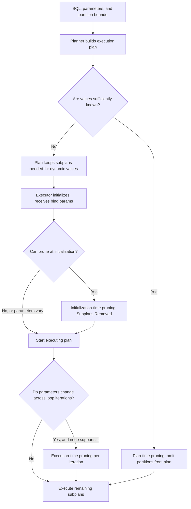

# Plan-Time and Execution-Time Partition Pruning in PostgreSQL

Splitting a PostgreSQL table into multiple partitions does not automatically speed up every query. If a `SELECT` only needs March data yet PostgreSQL scans all 60 monthly partitions, the partitioning benefit for that query can be minimal. **Partition pruning** is the mechanism that uses query predicates and partition boundaries to **skip partitions guaranteed unable to hold matching rows**.

An important detail often overlooked is that **pruning can occur at multiple stages**:

- **At planning time (plan-time pruning):** PostgreSQL has enough information while building the execution plan to remove irrelevant partitions from the plan immediately.
- **At execution initialization (initialization-time pruning):** parameter values are unknown during plan creation yet known when execution begins; unnecessary subplans are removed during the initialization phase.
- **During execution (execution-time pruning):** values determining the target partition change while the plan runs, such as on each iteration of a parameterized nested loop; the executor can skip matching subplans on each iteration.

Understanding these distinctions answers practical questions: Why does an SQL query with literals show only one partition in `EXPLAIN`? Why does a prepared statement list many partitions in its generic plan yet read only one partition at runtime? Why does `Subplans Removed` or `(never executed)` appear? And when does an expression on the partition key defeat pruning?

This lesson belongs to the PostgreSQL **Partitioning** chapter. It covers self-contained syntax and sample datasets, reading plans, examples with `PREPARE`/JDBC, dynamic pruning during joins, planner limitations, index and statistics impact, benchmarking strategies, common pitfalls, and hands-on exercises.

## 1. Partitioning and Partition Pruning Are Two Different Things

**Partitioning** describes how rows are stored across child relations. For instance, `orders` partitioned by `ordered_at`:

```text
orders (partitioned parent)
├── orders_2026_01  [2026-01-01, 2026-02-01)
├── orders_2026_02  [2026-02-01, 2026-03-01)
├── orders_2026_03  [2026-03-01, 2026-04-01)
├── orders_2026_04  [2026-04-01, 2026-05-01)
├── orders_2026_05  [2026-05-01, 2026-06-01)
├── orders_2026_06  [2026-06-01, 2026-07-01)
└── orders_default  [all values outside the ranges above]
```

A query:

```sql
SELECT COUNT(*)
FROM orders
WHERE ordered_at >= TIMESTAMPTZ '2026-03-01 00:00:00+00'
  AND ordered_at <  TIMESTAMPTZ '2026-04-01 00:00:00+00';
```

needs only March rows. When partition bounds are properly declared, PostgreSQL can **prune** the five other monthly partitions and the default partition.

Pruning does not mean PostgreSQL "picked the right index." It decides **which partitions may be accessed**. Afterward, inside each surviving partition, the planner still picks `Seq Scan`, `Index Scan`, `Bitmap Heap Scan`, or another access path.

| Mechanism | Question Answered |
| --- | --- |
| Partition routing on `INSERT` | Which partition should store the new row? |
| Partition pruning | Which partitions definitely cannot contain rows matching the query? |
| Index scan | Within a selected partition, how should rows be located via an index? |
| Predicate filtering | Do retrieved rows satisfy the entire `WHERE` clause? |
| Partitionwise join/aggregate | Can joins or aggregations be executed partition by partition? |

**Do not conflate pruning with routing, index selection, or partitionwise execution.** They work together, yet remain separate stages.

## 2. Why Proper Pruning Can Speed Up Queries

Suppose a table stores 120 months, each with tens of millions of rows. A report asks only for data from the last three days.

If PostgreSQL eliminates 119 partitions, it can avoid:

1. Opening and scanning irrelevant relations.
2. Reading heap and index pages of pruned partitions.
3. CPU time spent filtering rows and running operators on unneeded data.
4. Part of executor overhead, buffer accesses, and lower-level plan nodes.
5. Excess input volume fed into joins, sorts, and aggregations.

However, **pruning does not guarantee runtime drops in strict proportion to the number of eliminated partitions**. A query hitting a single large partition can still be slow if indexes are missing or millions of rows must be sorted. A query scanning the whole table for all-time stats has few partitions to prune.

### 2.1. Pruning Relies on Declared Data Bounds

PostgreSQL uses metadata from `PARTITION BY RANGE`, `LIST`, or `HASH` to know what values each partition can hold.

For example, with RANGE:

- `orders_2026_03` holds timestamps from the start of March up to **before** the start of April.
- When a query asks for March, the January partition cannot hold matching rows.
- PostgreSQL skips January **without scanning January rows to test `WHERE`**.

This is a fundamental difference from ordinary row-level predicate filtering.

## 3. Three Pruning Phases



The three phases relate closely, though not every query passes through all three visibly in `EXPLAIN`.

| Phase | When Values Are Known | Observable Signs |
| --- | --- | --- |
| Plan-time | When the planner builds the plan, e.g., fixed literals | Irrelevant partitions **do not appear** in the plan |
| Initialization-time | When the executor starts with bound parameters | `Subplans Removed: N` on supported nodes |
| During-execution | When a parameter varies per nested-loop iteration | Some subplans have fewer `loops` or `(never executed)` |
| No pruning | Missing compatible predicate or unsupported node/expression | Multiple partitions execute and filter rows |

**Never treat a single indicator as absolute proof.** `(never executed)` can also come from `LIMIT`, an untaken conditional branch, or a parent node not requesting rows—not solely from pruning.

## 4. Self-Contained Lab Dataset

Create a dedicated `prune_lab` schema in a learning PostgreSQL database. Never create or drop demo objects in a database containing production data.

### 4.1. Create the Partitioned Parent

```sql
CREATE SCHEMA IF NOT EXISTS prune_lab;

CREATE TABLE prune_lab.orders (
    order_id bigint NOT NULL,
    tenant_id integer NOT NULL,
    ordered_at timestamptz NOT NULL,
    status text NOT NULL
        CHECK (status IN ('pending', 'paid', 'cancelled')),
    amount numeric(12, 2) NOT NULL
        CHECK (amount >= 0),
    PRIMARY KEY (order_id, ordered_at)
) PARTITION BY RANGE (ordered_at);
```

Here:

- `ordered_at` is the **partition key**.
- `orders` is the declarative partitioned parent table.
- Primary key `(order_id, ordered_at)` includes the partition key to satisfy PostgreSQL's unique/primary key restrictions on partitioned tables.
- `timestamptz` stores absolute instants; examples use explicit `+00` offsets to avoid client timezone dependence.

### 4.2. Create Six Monthly Partitions

```sql
CREATE TABLE prune_lab.orders_2026_01
PARTITION OF prune_lab.orders
FOR VALUES FROM ('2026-01-01 00:00:00+00')
           TO ('2026-02-01 00:00:00+00');

CREATE TABLE prune_lab.orders_2026_02
PARTITION OF prune_lab.orders
FOR VALUES FROM ('2026-02-01 00:00:00+00')
           TO ('2026-03-01 00:00:00+00');

CREATE TABLE prune_lab.orders_2026_03
PARTITION OF prune_lab.orders
FOR VALUES FROM ('2026-03-01 00:00:00+00')
           TO ('2026-04-01 00:00:00+00');

CREATE TABLE prune_lab.orders_2026_04
PARTITION OF prune_lab.orders
FOR VALUES FROM ('2026-04-01 00:00:00+00')
           TO ('2026-05-01 00:00:00+00');

CREATE TABLE prune_lab.orders_2026_05
PARTITION OF prune_lab.orders
FOR VALUES FROM ('2026-05-01 00:00:00+00')
           TO ('2026-06-01 00:00:00+00');

CREATE TABLE prune_lab.orders_2026_06
PARTITION OF prune_lab.orders
FOR VALUES FROM ('2026-06-01 00:00:00+00')
           TO ('2026-07-01 00:00:00+00');

CREATE TABLE prune_lab.orders_default
PARTITION OF prune_lab.orders DEFAULT;
```

RANGE bounds follow **[FROM, TO)**: inclusive of `FROM` and **exclusive of `TO`**. The exact timestamp `2026-04-01 00:00:00+00` belongs to April, not March.

The default partition holds values outside all declared bounds. PostgreSQL must also account for potential rows in the default partition when deciding pruning, rather than assuming all data sits strictly inside the six months.

### 4.3. Insert Evenly Distributed Data Across Months

```sql
INSERT INTO prune_lab.orders
    (order_id, tenant_id, ordered_at, status, amount)
SELECT
    ((m.month_no - 1) * 6000 + g)::bigint,
    (g % 20 + 1)::integer,
    TIMESTAMPTZ '2026-01-01 00:00:00+00'
        + (m.month_no - 1) * INTERVAL '1 month'
        + ((g - 1) % 27) * INTERVAL '1 day'
        + (g % 24) * INTERVAL '1 hour',
    CASE
        WHEN g % 10 = 0 THEN 'cancelled'
        WHEN g % 3 = 0 THEN 'pending'
        ELSE 'paid'
    END,
    ((g % 10000)::numeric / 100)::numeric(12, 2)
FROM generate_series(1, 6) AS m(month_no)
CROSS JOIN generate_series(1, 6000) AS s(g);

CREATE INDEX idx_orders_tenant_time
ON prune_lab.orders (tenant_id, ordered_at);

ANALYZE prune_lab.orders;
```

This dataset contains **36,000 rows**, 6,000 per month, with zero rows in the default partition. Dates stay within days 1–27 of each month to avoid February edge cases.

`CREATE INDEX` on the partitioned parent creates/manages corresponding child indexes per PostgreSQL mechanics. This index demonstrates that **index scans and pruning can operate together**, rather than one replacing the other.

### 4.4. Inspect Actual Data per Partition

```sql
SELECT
    tableoid::regclass AS physical_partition,
    COUNT(*) AS rows_in_partition,
    MIN(ordered_at) AS min_time,
    MAX(ordered_at) AS max_time
FROM prune_lab.orders
GROUP BY tableoid
ORDER BY physical_partition;
```

`tableoid` shows which physical relation currently stores each row. Since the default partition is empty, `GROUP BY tableoid` returns only populated partitions.

Verify total count:

```sql
SELECT COUNT(*) AS total_orders
FROM prune_lab.orders;
```

Expect 36,000 rows when loaded once into an empty schema.

## 5. Plan-Time Pruning with Constant Predicates

Run:

```sql
EXPLAIN (COSTS ON, VERBOSE)
SELECT COUNT(*)
FROM prune_lab.orders
WHERE ordered_at >= TIMESTAMPTZ '2026-03-01 00:00:00+00'
  AND ordered_at <  TIMESTAMPTZ '2026-04-01 00:00:00+00';
```

At planning time, the planner sees both bounds and all partition bounds. It determines that only `orders_2026_03` can hold matching rows.

An **illustrative** plan shape (not guaranteed exact output):

```text
Aggregate
  -> Seq Scan on prune_lab.orders_2026_03
       Filter: ((ordered_at >= ...) AND (ordered_at < ...))
```

The planner may choose an index scan, index-only scan, parallel execution, or another node depending on statistics and configuration. What matters is that **no other monthly partitions are scanned**.

### 5.1. Why Might the Filter Condition Still Appear?

Pruning only proves which partitions **could** contain matching rows; in many plans, the executor must still check `WHERE` against fetched rows.

For instance, March holds all 31 days while a query asks for days 10 through 12. PostgreSQL prunes all other months, yet still must **filter or index-lookup** rows within March.

Therefore, seeing a `Filter` on the surviving partition **is not proof that pruning failed**.

### 5.2. A Surviving Partition Need Not Use an Index

```sql
EXPLAIN (ANALYZE, BUFFERS)
SELECT COUNT(*)
FROM prune_lab.orders
WHERE ordered_at >= TIMESTAMPTZ '2026-03-01 00:00:00+00'
  AND ordered_at <  TIMESTAMPTZ '2026-04-01 00:00:00+00';
```

If most of the 6,000 rows in March are needed, a `Seq Scan` on March can be cheaper than traversing an index and fetching heap pages. That can be the optimal plan.

**Successful pruning** answers **how many partitions must be read**, whereas **Index Scan vs. Seq Scan** answers **how to read rows inside that partition**.

### 5.3. Plan-Time Pruning vs. Querying a Child Partition Directly

Two queries:

```sql
SELECT COUNT(*)
FROM prune_lab.orders
WHERE ordered_at >= TIMESTAMPTZ '2026-03-01 00:00:00+00'
  AND ordered_at <  TIMESTAMPTZ '2026-04-01 00:00:00+00';
```

```sql
SELECT COUNT(*)
FROM prune_lab.orders_2026_03;
```

may both read March in this sample dataset, yet **are not semantically identical**:

- The first queries the partitioned parent using business predicates; PostgreSQL prunes via bounds.
- The second reads one partition directly with no time predicate; if partition bounds or definitions ever change, it may no longer represent the intended range.
- Querying the parent keeps applications decoupled from physical partition naming.

Never replace parent queries with hardcoded child partition names just to feel like "pruning happened."

## 6. Comparing with enable_partition_pruning Disabled

PostgreSQL exposes the planner parameter:

```sql
SHOW enable_partition_pruning;
```

Normally it is enabled. To observe the difference inside a **lab transaction**, temporarily disable it:

```sql
BEGIN;

SET LOCAL enable_partition_pruning = off;

EXPLAIN (ANALYZE, BUFFERS, VERBOSE)
SELECT COUNT(*)
FROM prune_lab.orders
WHERE ordered_at >= TIMESTAMPTZ '2026-03-01 00:00:00+00'
  AND ordered_at <  TIMESTAMPTZ '2026-04-01 00:00:00+00';

ROLLBACK;
```

Then run with the default setting:

```sql
EXPLAIN (ANALYZE, BUFFERS, VERBOSE)
SELECT COUNT(*)
FROM prune_lab.orders
WHERE ordered_at >= TIMESTAMPTZ '2026-03-01 00:00:00+00'
  AND ordered_at <  TIMESTAMPTZ '2026-04-01 00:00:00+00';
```

With pruning off, the plan includes scans across all partitions, e.g., an `Append` node beneath `Aggregate`. Final row counts still match `WHERE`; the difference lies in wasted work.

**Interpret carefully:** the planner may also switch scan/index types or other optimizations, so execution time doesn't change solely from pruning. Inspect the partitions in the plan, `actual rows`, `Buffers`, and timings across repeated runs under comparable conditions.

`SET LOCAL` stays scoped to the current transaction, preventing abnormal settings from leaking into the application session. Never disable `enable_partition_pruning` globally in production for benchmarking.

## 7. Initialization-Time Pruning: Parameters Known at Execution Start

Prepared statements are a key case. Clients send SQL with placeholders instead of embedded literals:

```sql
PREPARE orders_for_window(timestamptz, timestamptz) AS
SELECT COUNT(*)
FROM prune_lab.orders
WHERE ordered_at >= $1
  AND ordered_at <  $2;
```

When the planner builds a **generic plan**, it does not know concrete values of `$1` and `$2` at plan construction time, so the plan must keep subplans for multiple partitions.

Yet when the client runs:

```sql
EXECUTE orders_for_window(
    TIMESTAMPTZ '2026-03-01 00:00:00+00',
    TIMESTAMPTZ '2026-04-01 00:00:00+00'
);
```

the values are bound. The executor can **prune at initialization**, avoiding scans on the five other months simply because a generic plan was used.

### 7.1. Forcing a Generic Plan in the Lab

To observe this behavior easily, test:

```sql
BEGIN;

SET LOCAL plan_cache_mode = force_generic_plan;

EXPLAIN (ANALYZE, BUFFERS, VERBOSE, SETTINGS)
EXECUTE orders_for_window(
    TIMESTAMPTZ '2026-03-01 00:00:00+00',
    TIMESTAMPTZ '2026-04-01 00:00:00+00'
);

ROLLBACK;
```

On compatible plans and versions, `EXPLAIN` may show:

```text
Append
  Subplans Removed: 6
  -> ... orders_2026_03 ...
```

This is **illustrative**. Our dataset has six monthly partitions plus a default partition; the exact count removed varies with structure and plan shape. The key point is that `Subplans Removed` indicates subplans eliminated during the **executor initialization phase**, not that partitions were dropped from the schema.

If the planner picks a different node structure or prunes at another stage, `EXPLAIN` output varies. Read the actual plan tree rather than demanding word-for-word matches with an example.

### 7.2. Why Do Partitions Appear in a Generic Plan Without Being Read?

A generic plan must work across any parameter values: March today, May tomorrow, and a two-month span next time.

Keeping subplans in the generic plan does not mean **running all of them** on every execution. Those eliminated during initialization appear under `Subplans Removed`; only the remaining ones are considered by the executor.

Understand the distinction between:

- **Subplans present in the generic plan**.
- **Subplans remaining after parameters are bound**.
- **Nodes actually executed and reading buffers**.

### 7.3. Value of Custom Plans

PostgreSQL can also choose a **custom plan**, planned specifically for that invocation's parameter values. Those values enable plan-time pruning so fewer partitions appear in the plan from the start.

Test:

```sql
BEGIN;

SET LOCAL plan_cache_mode = force_custom_plan;

EXPLAIN (ANALYZE, BUFFERS, VERBOSE, SETTINGS)
EXECUTE orders_for_window(
    TIMESTAMPTZ '2026-03-01 00:00:00+00',
    TIMESTAMPTZ '2026-04-01 00:00:00+00'
);

ROLLBACK;
```

Clean up after the lab:

```sql
DEALLOCATE orders_for_window;
```

**Do not assume generic plans are always worse:** generic plans save planning overhead, and initialization-time pruning avoids unnecessary scans. Custom plans can be better when parameter selectivity varies wildly, yet incur planning cost on every execution.

When evaluating in applications, look at **planning time, execution time, and total latency** across real parameter distributions.

## 8. How Application Parameters Differ from Constant Expressions

Consider three examples:

```sql
-- Constants embedded in SQL.
SELECT COUNT(*)
FROM prune_lab.orders
WHERE ordered_at >= TIMESTAMPTZ '2026-03-01 00:00:00+00'
  AND ordered_at <  TIMESTAMPTZ '2026-04-01 00:00:00+00';
```

```sql
-- Parameterized prepared statement.
PREPARE count_since(timestamptz) AS
SELECT COUNT(*)
FROM prune_lab.orders
WHERE ordered_at >= $1;
```

```sql
-- Expression depending on current time.
SELECT COUNT(*)
FROM prune_lab.orders
WHERE ordered_at >= now() - INTERVAL '30 days';
```

Pruning behavior can differ:

- Typed literals typically allow plan-time pruning.
- Parameters in a generic plan are typically resolved at execution initialization.
- Stable expressions like `now()` can be evaluated during execution rather than treated as immutable planning constants; exact behavior depends on expression handling and PostgreSQL major version.

**Do not treat every expression on the right-hand side of an operator as a "planning-time constant."** PostgreSQL distinguishes immutability and when an expression's value becomes known.

## 9. Execution-Time Pruning When Parameters Change in a Nested Loop

Some queries have **partition-selecting values that change mid-execution**, such as a small table of reporting windows where each row fetches a few orders from its corresponding month.

Create demo data:

```sql
CREATE TABLE prune_lab.report_windows (
    window_id integer PRIMARY KEY,
    month_start timestamptz NOT NULL
);

INSERT INTO prune_lab.report_windows (window_id, month_start)
VALUES
    (1, TIMESTAMPTZ '2026-01-01 00:00:00+00'),
    (2, TIMESTAMPTZ '2026-03-01 00:00:00+00'),
    (3, TIMESTAMPTZ '2026-05-01 00:00:00+00');

ANALYZE prune_lab.report_windows;
```

Query using `LATERAL`:

```sql
EXPLAIN (ANALYZE, BUFFERS, VERBOSE)
SELECT
    w.window_id,
    w.month_start,
    x.order_id
FROM prune_lab.report_windows AS w
CROSS JOIN LATERAL (
    SELECT o.order_id
    FROM prune_lab.orders AS o
    WHERE o.ordered_at >= w.month_start
      AND o.ordered_at <  w.month_start + INTERVAL '1 month'
    LIMIT 3
) AS x
ORDER BY w.window_id, x.order_id;
```

`LIMIT 3` limits the `LATERAL` subquery to a small sample per outer row; without an inner `ORDER BY`, **which three orders are picked is non-deterministic**. This demonstrates the mechanism, not a query for "three latest orders."

In a plan using a parameterized nested loop and a pruning-capable partition scan node:

1. Outer relation `report_windows` emits the January window.
2. Inner subplan receives `w.month_start = 2026-01-01`.
3. Executor prunes partitions outside January.
4. Outer advances to March; inner subplan re-runs with the new value.
5. Executor prunes for the **new value**.
6. Same for May.

As a result, unneeded partitions are skipped **per loop iteration** rather than just once for the entire execution.

### 9.1. Why Must You Inspect the Actual Plan?

Not every `JOIN` or `LATERAL` automatically triggers runtime partition pruning. The planner may:

- Pick a different join strategy.
- Push or pull predicates differently.
- Rewrite the subquery.
- Choose `Append`, `MergeAppend`, or another node depending on ordering, indexes, and version.
- Estimate that a full scan/aggregation is cheaper than a parameterized path.

Thus, the query above only creates an **opportunity for pruning**. Check the actual plan for nested-loop parameterization and parameterized partition subplans.

### 9.2. Reading loops and "(never executed)"

An illustrative runtime pruning plan might look like:

```text
Nested Loop
  -> Seq Scan on report_windows w (... rows=3 loops=1)
  -> Limit (... loops=3)
       -> Append (... loops=3)
            -> Seq Scan on orders_2026_01 (... loops=1)
            -> Seq Scan on orders_2026_02 (never executed)
            -> Seq Scan on orders_2026_03 (... loops=1)
            -> Seq Scan on orders_2026_04 (never executed)
            -> Seq Scan on orders_2026_05 (... loops=1)
            -> Seq Scan on orders_2026_06 (never executed)
```

This is an **illustrative conceptual model**, not measured output; scans could be `Index Scan`, loop counts can vary, and `LIMIT` can leave nodes unexecuted.

In runtime pruning:

- Partitions hit on only some iterations show `loops` lower than the inner node's loop count.
- Partitions pruned across every iteration appear as `(never executed)`.
- `loops` need not equal the outer row count if extra nodes or optimizations exist.

**Important:** `(never executed)` can also stem from `LIMIT`, a `CASE`/one-time filter branch, or a parent node stopping early. To verify runtime pruning, read **the full plan tree and dynamic parameterization**, not a single phrase.

### 9.3. Limits by Plan Node Type and Version

Execution-time pruning depends on which executor nodes support it in your running major version. Plans using `Append`, `MergeAppend`, `ModifyTable`, or specialized variants can behave differently. Never assume every node over a partitioned parent supports every kind of runtime pruning.

When `ORDER BY` triggers `MergeAppend` or DML introduces `ModifyTable`, **verify the actual plan on your exact PostgreSQL version**. An example from another version may behave differently.

## 10. Reading "Subplans Removed" in Context

`Subplans Removed` in `EXPLAIN` refers to **subplans removed at executor initialization**, before data scans run.

Example:

```text
Append
  Subplans Removed: 6
  -> Index Scan using ... on orders_2026_03
```

Meaning:

- A generic plan or earlier phase kept those subplans.
- Once parameter values were known, the executor determined they were unnecessary.
- Those removed subplans were never executed as data scan nodes.

**Do not assume PostgreSQL never inspected metadata or paid any cost for those partitions.** Execution initialization runs **after planning**; metadata lookups, locks, and plan building can still incur overhead.

### 10.1. Locking of Partitions Pruned at Execution Initialization

Under PostgreSQL's documented execution-time pruning mechanics, partitions pruned **during the initialization phase** may already have been locked at execution start—unlike partitions eliminated early at plan time.

Therefore:

- Initialization-time pruning still avoids scanning data in eliminated partitions.
- Yet it does not guarantee eliminating **all locking/catalog overhead** the way plan-time pruning can.
- With thousands of partitions, planning and plan initialization can remain expensive even when only one partition is scanned at runtime.

This is why you should never create tens of thousands of partitions relying purely on "the executor will prune them eventually."

### 10.2. Absence of Subplans Removed Does Not Mean No Pruning

If plan-time pruning already dropped irrelevant partitions from the plan, **`Subplans Removed` will not appear**.

If runtime pruning happens across loop iterations, the evidence shows up in subplan `loops` rather than `Subplans Removed`.

Additionally, `EXPLAIN` layout and labels vary by plan node and PostgreSQL version.

**Diagnose holistically:** examine which partitions appear in the plan, `Subplans Removed`, `loops`, `Buffers`, along with the SQL and parameter values.

## 11. Which Query Predicates Enable Pruning?

Partition pruning generally works when PostgreSQL can link the **partition key** to determinable values or ranges.

### 11.1. A Half-Open Interval on a RANGE Key

```sql
SELECT order_id, amount
FROM prune_lab.orders
WHERE ordered_at >= TIMESTAMPTZ '2026-03-10 00:00:00+00'
  AND ordered_at <  TIMESTAMPTZ '2026-03-12 00:00:00+00';
```

This lies wholly inside March, so only March can contain matching rows.

### 11.2. Equality on the Partition Key

```sql
SELECT *
FROM prune_lab.orders
WHERE ordered_at = TIMESTAMPTZ '2026-03-10 08:00:00+00';
```

A specific timestamp maps to exactly one range partition (or default if outside all declared intervals). PostgreSQL uses bounds to pick the single candidate partition.

### 11.3. A Range Spanning Multiple Partitions

```sql
SELECT COUNT(*)
FROM prune_lab.orders
WHERE ordered_at >= TIMESTAMPTZ '2026-02-25 00:00:00+00'
  AND ordered_at <  TIMESTAMPTZ '2026-04-02 00:00:00+00';
```

The query spans late February, all of March, and early April. Proper pruning **does not always leave just one partition**: all three partitions are needed.

"Only one partition scanned" is not the definition of success for every query. The real standard is **never scanning partitions guaranteed unable to hold matching rows**.

### 11.4. IN and OR Predicates

```sql
SELECT order_id, ordered_at
FROM prune_lab.orders
WHERE ordered_at = TIMESTAMPTZ '2026-01-10 12:00:00+00'
   OR ordered_at = TIMESTAMPTZ '2026-05-10 12:00:00+00';
```

The two values belong to two distinct partitions. PostgreSQL can retain the corresponding candidate partitions depending on expression/plan handling.

With `IN (...)` or `= ANY(array)`, pruning effectiveness depends on the expression, parameter nature, and plan. Never assume every complex `OR` or array expression yields an optimal pruned tree.

### 11.5. Filtering Only on a Non-Partition Column

```sql
SELECT COUNT(*)
FROM prune_lab.orders
WHERE tenant_id = 7;
```

The table is partitioned by **`ordered_at`**, not tenant. Any month can contain tenant 7, so `tenant_id = 7` alone **cannot prune time partitions**.

An index `(tenant_id, ordered_at)` helps find rows within each partition, yet does not let PostgreSQL infer a specific month from `tenant_id` without another constraint guaranteeing it.

This is the distinction between a **partition key** and an **indexed column**.

## 12. Writing Time Predicates for Both Pruning and Business Correctness

### 12.1. Prefer `[start, end)` Intervals

For a March report:

```sql
WHERE ordered_at >= TIMESTAMPTZ '2026-03-01 00:00:00+00'
  AND ordered_at <  TIMESTAMPTZ '2026-04-01 00:00:00+00'
```

Avoid:

```sql
WHERE ordered_at BETWEEN
      TIMESTAMPTZ '2026-03-01 00:00:00+00'
  AND TIMESTAMPTZ '2026-04-01 00:00:00+00'
```

when intending "all of March": `BETWEEN` is inclusive at **both ends**, pulling in the exact start of April as well.

### 12.2. Avoid Wrapping the Partition Key in Functions When Pruning on the Raw Key

A query likely to lose pruning:

```sql
SELECT COUNT(*)
FROM prune_lab.orders
WHERE date_trunc('month', ordered_at)
    = TIMESTAMPTZ '2026-03-01 00:00:00+00';
```

The table is partitioned on the **raw `ordered_at` value**, whereas the predicate compares the **output of a function applied to the column**. PostgreSQL cannot necessarily invert that expression back into range bounds.

Furthermore, `date_trunc` on `timestamptz` has timezone-dependent semantics, potentially yielding unexpected results if clients run outside UTC.

If business logic means March in UTC, write explicitly:

```sql
SELECT COUNT(*)
FROM prune_lab.orders
WHERE ordered_at >= TIMESTAMPTZ '2026-03-01 00:00:00+00'
  AND ordered_at <  TIMESTAMPTZ '2026-04-01 00:00:00+00';
```

This makes boundaries unambiguous and relates the partition key directly to a range.

### 12.3. Casting the Partition Key to Date Can Block Pruning

Example:

```sql
SELECT *
FROM prune_lab.orders
WHERE ordered_at::date = DATE '2026-03-10';
```

Casting `timestamptz` to `date` depends on the session timezone and changes the left-hand expression type. The planner cannot safely convert arbitrary casts like this into fixed range bounds without safety guarantees.

Compute start/end instants in the business timezone in application code, then compare **`ordered_at` directly**:

```sql
WHERE ordered_at >= TIMESTAMPTZ '2026-03-10 00:00:00+00'
  AND ordered_at <  TIMESTAMPTZ '2026-03-11 00:00:00+00'
```

If the business timezone observes DST, **a "local calendar day" is not always 24 hours long**. Convert the start instants of both consecutive local dates to `timestamptz` rather than blindly adding 24 hours.

### 12.4. Expression Partition Keys Are a Different Case

PostgreSQL can also partition on an expression in allowed configurations. In that case, filtering directly on the **matching partition expression** can enable pruning.

Do not assume every function call always breaks pruning. What matters is **whether the partition key expression tree and query predicate can match or be inferred**, alongside function/operator and version limits.

## 13. How IMMUTABLE, STABLE, and VOLATILE Affect Pruning

PostgreSQL classifies function volatility:

| Category | General Meaning | Relation to Pruning |
| --- | --- | --- |
| `IMMUTABLE` | Same inputs always return the same output under guaranteed conditions | Can support expression folding at plan time if inputs are known |
| `STABLE` | Result stays constant within a single statement per PostgreSQL rules | Can be evaluated during execution when needed values are ready |
| `VOLATILE` | Can change across calls even within a single statement | Generally unsafe to treat as a fixed partition boundary for pruning |

Example:

```sql
SELECT COUNT(*)
FROM prune_lab.orders
WHERE ordered_at >= now() - INTERVAL '7 days';
```

`now()` is stable within a transaction, giving the query a chance to prune at an eligible phase. However, **never promise it always prunes at plan time** like a constant literal.

Contrast with:

```sql
SELECT COUNT(*)
FROM prune_lab.orders
WHERE ordered_at >= clock_timestamp() - INTERVAL '7 days';
```

`clock_timestamp()` is volatile and can advance mid-statement. The planner cannot safely treat it as a constant to eliminate partitions ahead of time.

Beyond performance, the two functions have different time semantics. Switch `clock_timestamp()` to `now()` only if business logic accepts a fixed transaction timestamp.

### 13.1. Never Mislabel Volatility to Force Pruning

A function reading database tables, timezones, session state, or wall-clock time must never be marked `IMMUTABLE` just to coax PostgreSQL into pruning early. Mislabeling volatility lets the planner cache or fold results and produce **wrong query answers**, far worse than scanning extra partitions.

Write clear predicates and assign accurate volatility categories.

## 14. Partition Pruning with LIST

With `PARTITION BY LIST`, each partition accepts an enumerated set of values.

Dedicated example:

```sql
CREATE TABLE prune_lab.jobs (
    job_id bigint NOT NULL,
    status text,
    payload text
) PARTITION BY LIST (status);

CREATE TABLE prune_lab.jobs_pending
PARTITION OF prune_lab.jobs FOR VALUES IN ('pending');

CREATE TABLE prune_lab.jobs_running
PARTITION OF prune_lab.jobs FOR VALUES IN ('running');

CREATE TABLE prune_lab.jobs_done
PARTITION OF prune_lab.jobs FOR VALUES IN ('done');

CREATE TABLE prune_lab.jobs_default
PARTITION OF prune_lab.jobs DEFAULT;

INSERT INTO prune_lab.jobs (job_id, status, payload)
VALUES
    (1, 'pending', 'A'),
    (2, 'running', 'B'),
    (3, 'done', 'C'),
    (4, 'failed', 'D');
```

Query:

```sql
EXPLAIN (ANALYZE, BUFFERS)
SELECT *
FROM prune_lab.jobs
WHERE status = 'pending';
```

can keep only `jobs_pending`. Similarly:

```sql
EXPLAIN
SELECT *
FROM prune_lab.jobs
WHERE status IN ('pending', 'done');
```

can keep only those two partitions, skipping `jobs_running` and default when bounds prove sufficient.

**NULL note:** in list partitioning, `NULL` follows explicit partition rules; in the example above no partition lists `NULL` explicitly, so default holds rows with `status IS NULL`. When querying `IS NULL`, pruning depends on actual bounds and version.

## 15. Partition Pruning with HASH

With `PARTITION BY HASH`, PostgreSQL distributes rows by the hash of the partition key using `MODULUS` and `REMAINDER`. This is **not** a time range.

```sql
CREATE TABLE prune_lab.tenant_events (
    event_id bigint NOT NULL,
    tenant_id integer NOT NULL,
    payload text
) PARTITION BY HASH (tenant_id);

CREATE TABLE prune_lab.tenant_events_h0
PARTITION OF prune_lab.tenant_events
FOR VALUES WITH (MODULUS 4, REMAINDER 0);

CREATE TABLE prune_lab.tenant_events_h1
PARTITION OF prune_lab.tenant_events
FOR VALUES WITH (MODULUS 4, REMAINDER 1);

CREATE TABLE prune_lab.tenant_events_h2
PARTITION OF prune_lab.tenant_events
FOR VALUES WITH (MODULUS 4, REMAINDER 2);

CREATE TABLE prune_lab.tenant_events_h3
PARTITION OF prune_lab.tenant_events
FOR VALUES WITH (MODULUS 4, REMAINDER 3);

INSERT INTO prune_lab.tenant_events (event_id, tenant_id, payload)
SELECT g, (g % 20 + 1)::integer, 'event-' || g::text
FROM generate_series(1, 2000) AS g;
```

Equality query:

```sql
EXPLAIN
SELECT COUNT(*)
FROM prune_lab.tenant_events
WHERE tenant_id = 7;
```

can prune down to the single hash partition holding tenant 7.

Whereas:

```sql
SELECT COUNT(*)
FROM prune_lab.tenant_events
WHERE tenant_id BETWEEN 3 AND 12;
```

does not map to a contiguous slice of hash partitions; hash partitioning scatters values via the hash function, so multiple partitions must typically be checked.

### 15.1. Do Not Guess Hash Partitions with tenant_id % 4

PostgreSQL hash partition routing uses hash support functions and hash-combination rules, not simple arithmetic `tenant_id % 4` across data types. To inspect where rows live, use `tableoid`:

```sql
SELECT
    tenant_id,
    tableoid::regclass AS physical_partition,
    COUNT(*) AS event_count
FROM prune_lab.tenant_events
GROUP BY tenant_id, tableoid
ORDER BY tenant_id;
```

With multi-column partition keys, guessing bucket assignment via raw modulo on one column is even less valid.

## 16. Composite Keys and Subpartitioning

A table with many tenants and years of history can use multi-level partitioning:

- Level 1: by tenant or tenant group.
- Level 2: by time.

Conceptual layout:

```text
events
├── tenant_group_A  (LIST tenant_group)
│   ├── events_A_2026_01 (RANGE event_time)
│   └── events_A_2026_02
└── tenant_group_B
    ├── events_B_2026_01
    └── events_B_2026_02
```

A query filtering **both tenant group and time** can prune at both levels. Filtering by time alone must still visit all relevant tenant groups unless something else eliminates them.

### 16.1. Multi-Column RANGE Keys Order Left-to-Right

`PARTITION BY RANGE (tenant_id, ordered_at)` does not mean PostgreSQL builds an independent two-dimensional tenant × month grid. Multi-column range partitioning compares bounds lexicographically as range tuples.

Do not declare a composite RANGE key assuming independent per-column pruning like two-level subpartitioning. Understand bound declarations, key distribution, and query predicates before choosing a design.

### 16.2. Too Many Partitions Also Carry Cost

A system with thousands of partitions incurs overhead:

- The planner must examine extensive metadata and candidate paths.
- The executor may have to initialize or lock many objects in certain phases.
- System catalogs and syscache experience heavier load.
- Autovacuum/analyze and index/partition administration grow complex.
- DDL migrations, grants, backup/restore, and monitoring take more effort.

Pruning skips scanning irrelevant data, yet does not reduce **the management cost of thousands of relations to zero**. Size your partition count according to retention, row counts, table footprint, operations, and workload.

## 17. Default Partitions and Pruning Opportunities

A default partition is not merely "the partition for extra months." It holds **every value not matching any declared partition**.

On our sample table:

```sql
INSERT INTO prune_lab.orders
    (order_id, tenant_id, ordered_at, status, amount)
VALUES
    (
        999999,
        7,
        TIMESTAMPTZ '2026-10-10 12:00:00+00',
        'paid',
        10.00
    );
```

This row goes into `orders_default` because it falls outside the first six months of 2026.

Verify:

```sql
SELECT tableoid::regclass AS partition_name, order_id
FROM prune_lab.orders
WHERE order_id = 999999;
```

Expected: `orders_default`.

Querying October:

```sql
EXPLAIN (ANALYZE, BUFFERS)
SELECT *
FROM prune_lab.orders
WHERE ordered_at >= TIMESTAMPTZ '2026-10-01 00:00:00+00'
  AND ordered_at <  TIMESTAMPTZ '2026-11-01 00:00:00+00';
```

can prune months 1–6 yet **cannot prune default**, because default can contain October rows.

### 17.1. Default Does Not Mean Every Query Must Scan It

When a March predicate lies strictly within the March partition's bounds and default's implicit constraint excludes March, the planner can prune default as well, based on actual bound metadata.

Hence there is no absolute rule like "default is always scanned" or "default is always pruned."

### 17.2. DEFAULT Requires Care When Adding New Partitions

If you later want to create an October partition after October rows already entered default, PostgreSQL must ensure no rows in default violate the new partition's bounds; creating/attaching and moving rows introduces scan and locking work that must be planned.

**Never treat current October pruning behavior as proof that an October partition can be added later without migrating data.**

## 18. Table Statistics and Indexes Still Matter After Pruning

Suppose pruning narrows a query to March alone, yet it remains slow:

```sql
EXPLAIN (ANALYZE, BUFFERS)
SELECT *
FROM prune_lab.orders
WHERE ordered_at >= TIMESTAMPTZ '2026-03-01 00:00:00+00'
  AND ordered_at <  TIMESTAMPTZ '2026-04-01 00:00:00+00'
  AND tenant_id = 7
ORDER BY amount DESC
LIMIT 20;
```

Pruning skips other months, yet inside March:

- Index `(tenant_id, ordered_at)` can filter by tenant.
- `ORDER BY amount DESC` may still require a sort.
- `SELECT *` requires heap fetches rather than an index-only scan.
- Per-partition statistics influence scan selection.
- Tenant skew can throw off row estimates.

Therefore, "pruning down to one partition" cannot substitute for `ANALYZE`, index design, or query optimization.

### 18.1. Multi-Scope Statistics

PostgreSQL tracks statistics per partition and across the parent/hierarchy according to version rules. After major row-count shifts, ensure appropriate statistics are refreshed.

On our lab dataset:

```sql
ANALYZE prune_lab.orders;
```

When benchmarking, note when `ANALYZE` ran, since updated statistics can alter planner choices even without changing pruning predicates.

### 18.2. Pruning and Partitionwise Aggregation Are Distinct

A query:

```sql
SELECT tenant_id, SUM(amount)
FROM prune_lab.orders
WHERE ordered_at >= TIMESTAMPTZ '2026-01-01 00:00:00+00'
  AND ordered_at <  TIMESTAMPTZ '2026-07-01 00:00:00+00'
GROUP BY tenant_id;
```

uses multiple partitions and may aggregate differently depending on planner choices and partitionwise aggregation. `enable_partitionwise_aggregate` is a separate setting—not a toggle for pruning.

Similarly, `enable_partitionwise_join` governs per-partition joining, **distinct from** pruning irrelevant partitions.

## 19. Pruning in JOINs: Predicates Supplied by Another Table

Suppose an application stores a table of reporting runs, each holding a time interval. A `JOIN` pulls boundaries from the outer table's rows.

For runtime pruning to occur, the plan must **parameterize the inner scan by outer row values**. Not every `JOIN` automatically turns into a loop pruning month by month.

### 19.1. Nested Loops Can Enable Pruning

Conceptual flow:

```text
Outer row #1: start = 2026-01-01  -> inner only needs January
Outer row #2: start = 2026-03-01  -> inner only needs March
Outer row #3: start = 2026-05-01  -> inner only needs May
```

If the inner scan is parameterized on `start` and the scan node supports pruning, the executor selects partitions per iteration.

### 19.2. Hash Joins May Not Yield the Same Dynamic Pruning

A hash join reads its inputs differently instead of invoking a parameterized inner partition scan per outer row. Expecting per-iteration `loops` pruning markers there is misguided.

**Never force `enable_hashjoin = off` in production just to see "(never executed)."** To explore alternative plans in a lab, toggle GUCs locally inside a transaction, revert afterward, and compare actual end-to-end performance.

### 19.3. Partitionwise Join Is a Separate Optimization

Two tables partitioned with compatible keys/bounds can be considered for **partitionwise join** under specific conditions, joining matching partition pairs directly.

Partitionwise join and runtime pruning may appear together or independently. Never cite multi-child join plans as proof of effective pruning.

## 20. Pruning with UPDATE and DELETE

DML statements on a partitioned parent can also use partition bounds to narrow which partitions are touched.

Example `DELETE` in March:

```sql
BEGIN;

EXPLAIN (ANALYZE, BUFFERS)
DELETE FROM prune_lab.orders
WHERE ordered_at >= TIMESTAMPTZ '2026-03-01 00:00:00+00'
  AND ordered_at <  TIMESTAMPTZ '2026-04-01 00:00:00+00'
  AND status = 'cancelled';

ROLLBACK;
```

In the lab database, `ROLLBACK` undoes the deletion. However, `EXPLAIN ANALYZE` **actually executes the `DELETE` before rolling back** and generates WAL and locks, so run it only in test environments.

Pruning skips partitions guaranteed to hold no matching rows. However, **execution-time pruning for DML depends on `ModifyTable`, underlying scan nodes, and PostgreSQL version**. Do not extrapolate `SELECT` behavior under `Append` to assume every dynamic-parameter `DELETE`/`UPDATE` exhibits identical pruning mechanics.

### 20.1. Updating the Partition Key Can Also Move Rows

```sql
UPDATE prune_lab.orders
SET ordered_at = TIMESTAMPTZ '2026-04-15 12:00:00+00'
WHERE order_id = 12345
  AND ordered_at >= TIMESTAMPTZ '2026-03-01 00:00:00+00'
  AND ordered_at <  TIMESTAMPTZ '2026-04-01 00:00:00+00';
```

This illustrates modifying the partition key: PostgreSQL may execute cross-partition row movement with corresponding concurrency and constraint rules. **Do not run this blindly without verifying the target row**; that `order_id` in the sample dataset may reside in another month and affect 0 rows.

Do not confuse selecting source partitions via `UPDATE`'s `WHERE` clause with **routing the new value to its destination partition**.

### 20.2. Inserts Use Routing, Not WHERE Pruning

`INSERT INTO parent VALUES (...)` uses tuple routing to locate the partition for each new row. It has no `WHERE` predicate to prune partitions like a `SELECT`. In `INSERT ... SELECT`, the source `SELECT` may prune independently while destination routing remains a separate step.

## 21. When Predicates Fail to Prune

Common scenarios preventing the planner/executor from eliminating many partitions:

| Predicate / Scenario | Why It Is Problematic | Improvement |
| --- | --- | --- |
| `WHERE tenant_id = 7` on an `ordered_at`-partitioned table | Does not constrain the partition key | Add a valid time range when business rules allow |
| `WHERE ordered_at::date = ...` | Function/cast applied to partition key | Compare range directly on `ordered_at` |
| `WHERE date_trunc('month', ordered_at) = ...` | Partition bounds are raw timestamps | Use `[start, end)` monthly range |
| `WHERE ordered_at >= clock_timestamp() - ...` | Volatile expression unsafe as fixed bound | Use a parameter or stable expression if valid |
| Complex `OR` preventing bound derivation | Planner cannot prove partitions irrelevant | Rewrite clearly or split query if equivalent |
| Partition key only produced after column math | Prevents direct key comparison | Rearrange condition onto raw key if valid |
| Dynamic parameter on unsupported plan node | Cannot prune per iteration as hoped | Inspect actual plan, version, and join strategy |
| Filter applied only after aggregation altering semantics | Cannot safely push filter below scan | Verify any rewrite preserves exact results |
| `enable_partition_pruning = off` | Optimization disabled | Re-enable in normal configuration |

Never apply a "fast rewrite" that alters query semantics. Switching to UTC day boundaries when business rules require `Asia/Ho_Chi_Minh` produces wrong reports even if pruning is faster.

## 22. Reading Plans Fairly: Does Pruning Actually Reduce Work?

Use:

```sql
EXPLAIN (ANALYZE, BUFFERS, VERBOSE, SETTINGS)
SELECT COUNT(*)
FROM prune_lab.orders
WHERE ordered_at >= TIMESTAMPTZ '2026-03-01 00:00:00+00'
  AND ordered_at <  TIMESTAMPTZ '2026-04-01 00:00:00+00';
```

Checklist of items to inspect:

1. How many partition scan nodes appear in the plan?
2. Does `Subplans Removed` appear? If so, which phase does it indicate?
3. What are `actual ... loops` on each partition scan?
4. Does `(never executed)` appear, and is it due to pruning or other control flow?
5. Are scans `Seq Scan`, `Index Scan`, or `Bitmap Heap Scan`?
6. How far do estimated `rows` diverge from `actual rows`?
7. How many `Buffers: shared hit/read` occurred?
8. How do `Planning Time` and `Execution Time` change?
9. Do parallel workers make two runs non-comparable?
10. Did any reported non-default settings differ?

### 22.1. BUFFERS Read Does Not Equal Physical Disk Read

`shared hit` indicates pages found in PostgreSQL's shared buffer cache; `shared read` indicates pages fetched into shared buffers. A `shared read` may be served from OS page cache rather than physical SSD/HDD I/O.

Two runs of the same plan can differ due to warm vs. cold caches. Judge pruning by **plan structure and partition accesses** first; judge latency across multiple runs under comparable load and cache state.

### 22.2. Planning Time Can Rise Even When Execution Time Drops

A design with thousands of partitions and generic plans can spend significant effort planning/initializing even when runtime pruning skips nearly all scans.

Never compare `Execution Time` alone and declare partitioning an overall win. For tiny queries executed hundreds of thousands of times, **planning overhead** can dominate total cost.

### 22.3. EXPLAIN ANALYZE Has Instrumentation Overhead

`EXPLAIN ANALYZE` instruments timing and row counts per node, adding overhead. To verify rows/loops/buffers with lower timer overhead, consider:

```sql
EXPLAIN (ANALYZE, BUFFERS, TIMING OFF)
SELECT COUNT(*)
FROM prune_lab.orders
WHERE ordered_at >= TIMESTAMPTZ '2026-03-01 00:00:00+00'
  AND ordered_at <  TIMESTAMPTZ '2026-04-01 00:00:00+00';
```

`TIMING OFF` does not remove all instrumentation, and total execution time is still reported. Also, for queries returning large result sets, network and serialization time in the application are not captured by a server-side `EXPLAIN`.

## 23. Java/JDBC PreparedStatement

Java applications should bind **strongly typed temporal parameters** so PostgreSQL can reason about predicates on the partition key.

PgJDBC example with `OffsetDateTime`:

```java
import java.math.BigDecimal;
import java.sql.Connection;
import java.sql.PreparedStatement;
import java.sql.ResultSet;
import java.sql.SQLException;
import java.time.OffsetDateTime;
import javax.sql.DataSource;

public class OrderRepository {
    private final DataSource dataSource;

    public OrderRepository(DataSource dataSource) {
        this.dataSource = dataSource;
    }

    public BigDecimal totalForMarch2026(int tenantId)
            throws SQLException {
        String sql = """
            SELECT COALESCE(SUM(amount), 0)
            FROM prune_lab.orders
            WHERE tenant_id = ?
              AND ordered_at >= ?
              AND ordered_at < ?
            """;

        OffsetDateTime start =
                OffsetDateTime.parse("2026-03-01T00:00:00Z");
        OffsetDateTime end =
                OffsetDateTime.parse("2026-04-01T00:00:00Z");

        try (Connection connection = dataSource.getConnection();
             PreparedStatement ps =
                     connection.prepareStatement(sql)) {

            ps.setInt(1, tenantId);
            ps.setObject(2, start);
            ps.setObject(3, end);

            try (ResultSet rs = ps.executeQuery()) {
                rs.next();
                return rs.getBigDecimal(1);
            }
        }
    }
}
```

Key details:

- `ordered_at` is `timestamptz`, so binding `OffsetDateTime` supplies an exact offset-aware instant under modern PgJDBC.
- Predicates compare the **partition key directly** against parameters, enabling pruning.
- The half-open interval avoids `"23:59:59.999"` issues.
- `COALESCE(SUM(amount), 0)` returns `0` when no matching orders exist.
- Connection and statement are safely closed via `try-with-resources`.

### 23.1. Do Not Cast the Key to Text Just for Convenient Binding

An anti-pattern to avoid:

```sql
WHERE ordered_at::text >= ?
```

Text comparison is not equivalent to instant comparison across formats and timezones, and it wraps the column in an expression distinct from the partition key.

Use properly typed temporal parameters and matching SQL predicates.

### 23.2. Prepared Statements Can Use Generic or Custom Plans

PgJDBC and PostgreSQL manage client-side vs. server-side prepares depending on configuration and execution count. The same Java SQL may run under a custom plan in one situation and a generic plan in another.

Therefore:

- Never assume every JDBC placeholder becomes a planning-time literal.
- Never assume a generic plan will scan every partition.
- When troubleshooting, reproduce with `PREPARE`/`EXECUTE` and `plan_cache_mode` in a test environment using realistic parameters.
- Measure total latency as well, since custom plans add per-execution planning time.

### 23.3. Do Not Query Physical Partitions Directly from Java

Constructing SQL like `SELECT ... FROM orders_2026_03` by concatenating monthly partition names creates several problems:

- SQL text changes every month, hurting statement caching.
- Schema migrations altering partition naming break application code.
- Multi-month queries grow awkward.
- Constructing identifiers from untrusted input invites SQL injection.
- Miscalculated boundaries can miss default or new partitions.

Applications should normally query the **partitioned parent** with clean predicates and let PostgreSQL handle pruning.

## 24. Joins and Foreign Keys Do Not Guarantee Pruning

Suppose a query filters by `order_id` without `ordered_at`:

```sql
SELECT o.order_id, o.amount
FROM prune_lab.orders AS o
WHERE o.order_id = 12000;
```

Even though `order_id` is part of the composite primary key, without constraints allowing PostgreSQL to deduce the timestamp, it may have to inspect multiple partitions because **the partition key is `ordered_at`**.

Likewise, having an index `(order_id, ordered_at)` across partitions does not enable pruning to one partition when only `order_id` is known.

### 24.1. Correct Results Do Not Require Pruning

An `order_id`-only query still returns exact results and can stay fast when partition counts are modest. Pruning is an optimization, not a requirement for SQL correctness. When partition counts grow huge, adding a legitimate business time constraint can make a major difference.

Never inject a guessed `ordered_at` into `WHERE` just to force pruning; if the guessed range is wrong, the query silently drops real orders.

## 25. What Does Runtime Pruning Mean for High-Partition-Count Systems?

In workloads with hundreds of partitions, prepared queries are the norm. When a generic plan is cached for reuse, no single month can be baked into the plan, yet runtime pruning keeps actual scans minimal.

Still account for:

- **Partition count in the generic plan:** affects plan size and planning/init overhead.
- **Query time span:** a legitimate three-year window still requires scanning many partitions.
- **Parameter availability:** if computed after complex operations, only supported nodes can prune.
- **Plan shape:** runtime pruning support varies across executor nodes and versions.
- **Locks/metadata:** execution pruning does not eliminate all upfront partition management overhead.
- **Caching:** separate heaps/indexes per partition can increase cache churn under heavy query loads.

Never see `Subplans Removed: 500` and conclude a 501-partition design is optimal. Measure planning time, execution time, memory, and concurrency impact.

## 26. Subtle Pruning Edge Cases

### 26.1. OR with One Unbounded Branch

```sql
SELECT *
FROM prune_lab.orders
WHERE ordered_at >= TIMESTAMPTZ '2026-03-01 00:00:00+00'
   OR tenant_id = 7;
```

Because `tenant_id = 7` can match in **any month**, PostgreSQL cannot eliminate non-March partitions based on the time branch.

This is not a planner bug—it is `OR` logic: a January row for tenant 7 satisfies the query.

### 26.2. NOT and Inequality Predicates

```sql
SELECT *
FROM prune_lab.orders
WHERE ordered_at <> TIMESTAMPTZ '2026-03-10 00:00:00+00';
```

`<>` can match nearly every partition, yielding little or no pruning. Evaluate the set of values matching the predicate rather than merely checking whether the partition key appears in `WHERE`.

### 26.3. Joins Blocking Predicate Pushdown

A predicate may sit above a `JOIN` or aggregation. The planner cannot push it down to relation scans if doing so would alter outer-join, null-extension, or aggregation semantics.

When optimizing, verify any query rewrite **preserves exact results** on representative data rather than judging purely by a tidier plan.

### 26.4. Volatile Functions on the Bound Side

Values that change per call are unsafe to use as pruning constants. If business logic allows, capture one timestamp in the application and bind it as a stable parameter—making semantics explicit and optimization straightforward.

### 26.5. DEFAULT Partition Holding Unexpected Data

When out-of-range rows land in `DEFAULT`, future queries covering those ranges must still check `DEFAULT`. Monitor `DEFAULT` row counts and keep partition pre-creation healthy; never treat `DEFAULT` as a "free bucket" of arbitrary size.

## 27. Misinterpretations When Reading EXPLAIN

| Observation | Wrong Conclusion | Accurate Interpretation |
| --- | --- | --- |
| Only `orders_2026_03` appears | "Definitely an Index Scan" | Partition pruned; inside it may still be a `Seq Scan` |
| No `Subplans Removed` | "Pruning is disabled" | Plan-time pruning likely removed partitions upfront |
| `Subplans Removed: 6` | "Planner never touched or locked six partitions" | That's initialization-time pruning; pre-execution overhead may remain |
| `(never executed)` | "Definitely caused by pruning" | Could also be `LIMIT` or other plan control flow |
| `loops=1` on March | "Query only had one outer row" | Interpret each node's `loops` within the whole tree |
| Generic plan lists many partitions | "It will scan every partition" | Initialization/runtime pruning can eliminate them once bound |
| Custom plan shows only one partition | "Custom always beats generic" | Account for planning overhead and real parameter patterns |
| `shared read=0` | "Query consumed zero resources" | CPU, buffer hits, temp, locks, and work still occurred |
| `Seq Scan` after pruning | "Pruning was useless" | Scanning one small surviving partition can be optimal |
| `WHERE date_trunc(...key)` | "Key is in WHERE so it must prune" | Wrapping the key in an expression can block bound derivation |
| `tenant_id = 7` on time-partitioned table | "Index on tenant_id reads only one month" | Indexes and partition pruning are separate mechanisms |
| `SELECT` prunes cleanly | "`UPDATE`/`DELETE` prune identically" | DML nodes and runtime support have distinct limits |
| Query ran fast once | "Because of pruning" | Could be warm cache, plan switch, or lighter system load |
| Pruned 99% of partitions | "Planning cost is zero" | Metadata, plan size, and pruning stages still incur cost |
| Partition named March | "Only March rows live here because of its name" | PostgreSQL relies on **partition bounds**, not table names |

## 28. Diagnostic Runbook for Missing Pruning

When a query on a partitioned table is slow, follow these steps:

**Step 1 — Verify the real partition key.** Read `PARTITION BY` and partition bounds; never guess from child table names.

**Step 2 — Inspect predicates.** Is there a direct condition on the partition key? Any casts/functions on the column or scope-widening `OR`s?

**Step 3 — Check parameter types.** Does the query use literals, bind placeholders, `now()`, or join-derived values? When do they become known?

**Step 4 — Get `EXPLAIN` first.** Inspect partitions in the plan, scan types, join/`Append` nodes, and estimated rows. Avoid running `EXPLAIN ANALYZE` on production DML.

**Step 5 — Run controlled `EXPLAIN ANALYZE` if needed.** Check `Subplans Removed`, `loops`, `Buffers`, and execution time in a safe environment/load window.

**Step 6 — Compare generic and custom plans.** Reproduce in a test session using `plan_cache_mode` with identical parameters and data.

**Step 7 — Compare with pruning off.** Use `SET LOCAL enable_partition_pruning = off` in a lab DB to gauge structural impact—never in production.

**Step 8 — Evaluate indexes and statistics.** If pruning already works yet the query stays slow, inspect index scans, estimates, sorts, hashes, `work_mem`, and cache.

**Step 9 — Evaluate partition counts.** If queries are tiny yet planning time is high, check whether partitions are too fine-grained or numerous.

**Step 10 — Measure end-to-end.** Check JDBC latency, result sizes, network, concurrency, and side effects on other queries. A clean plan alone doesn't guarantee application SLAs.

### 28.1. SQL to Inspect Partition Lists

Inspect catalog partition bounds:

```sql
SELECT
    c.oid::regclass AS partition_name,
    pg_get_expr(c.relpartbound, c.oid) AS partition_bound
FROM pg_inherits AS inh
JOIN pg_class AS c
    ON c.oid = inh.inhrelid
WHERE inh.inhparent = 'prune_lab.orders'::regclass
ORDER BY c.relname;
```

This reveals catalog bounds directly, without assuming a `_2026_03` suffix always holds the right range.

### 28.2. Check Related Settings

```sql
SHOW server_version;
SHOW enable_partition_pruning;
SHOW plan_cache_mode;
SHOW constraint_exclusion;
SHOW enable_partitionwise_join;
SHOW enable_partitionwise_aggregate;
```

Each setting plays a distinct role. `enable_partition_pruning` directly controls the optimization studied here; `constraint_exclusion` is a separate mechanism, and `enable_partitionwise_*` control other optimizations.

Never enable every flag blindly hoping to make the planner "faster": each carries trade-offs and version-dependent behavior.

## 29. Partition Pruning vs. Constraint Exclusion

Before declarative partitioning, PostgreSQL partitioned using inheritance and `CHECK` constraints. **Constraint exclusion** uses `CHECK` constraints to prove a child table cannot contain matching rows.

| Criterion | Partition Pruning | Constraint Exclusion |
| --- | --- | --- |
| Primary metadata source | Declarative partition bounds (`RANGE/LIST/HASH`) | Suitable `CHECK` constraints |
| Primary goal | Skip irrelevant partitions | Skip ineligible relations/branches via constraints |
| Planning cost | Engineered specifically for partition bounds | Can be expensive evaluating `CHECK`s across many relations |
| Execution-parameter pruning | Supported in appropriate nodes/versions | Does not inherently offer equivalent runtime pruning |
| Primary setting | `enable_partition_pruning` | `constraint_exclusion` |

In certain scenarios, constraint exclusion can still contribute via extra constraints. Still, **never treat `constraint_exclusion` as a replacement for declarative partitioning's runtime pruning**.

### 29.1. Do Not Mix Both Concepts When Debugging

A plan may drop partitions due to bound-based pruning, constraint exclusion, or other simplifications. To test a specific mechanism, use matching schemas, predicates, and GUCs while accounting for version limits.

Do not use legacy inheritance tables to draw exact conclusions about declarative partitioning in this lesson.

## 30. Impact on Observability and Monitoring

For applications running many parameterized queries, measure:

- Partition counts appearing in representative plans.
- `Planning Time` and `Execution Time`.
- `Subplans Removed` where applicable.
- Distribution of `loops` on partition scans.
- Buffer hits/reads and temp I/O.
- Estimated vs. actual rows and join shapes.
- API p50/p95/p99 latency, throughput, and error rates.
- Cache behavior, prepared-statement configuration, and background load.
- Partition counts over time and `DEFAULT` partition usage.

### 30.1. JSON EXPLAIN for Machine Storage

```sql
EXPLAIN (
    ANALYZE,
    BUFFERS,
    TIMING OFF,
    FORMAT JSON
)
SELECT COUNT(*)
FROM prune_lab.orders
WHERE ordered_at >= TIMESTAMPTZ '2026-03-01 00:00:00+00'
  AND ordered_at <  TIMESTAMPTZ '2026-04-01 00:00:00+00';
```

JSON is helpful for comparing node types, relation names, estimated/actual rows, loops, and runtime stats. However, JSON plan structures can vary across PostgreSQL versions, and pruning indicators do not occupy the exact same JSON path on every node.

Never diff raw timing numbers and conclude a plan changed; separate **plan structure**, **estimates**, and **runtime observations**.

### 30.2. Does pg_stat_statements Prove Pruning?

When `pg_stat_statements` is enabled, it tracks aggregate latency, call counts, blocks hit/read, and metrics per query fingerprint.

However, it does not record **which partitions were pruned per execution**, and it merges invocations with wildly different parameter behaviors. Explaining pruning still requires `EXPLAIN` with representative parameters.

## 31. Practice Exercises

All exercises use the `prune_lab` schema. Any exercise running `EXPLAIN ANALYZE DELETE/UPDATE` or changing GUCs must run on a learning database with proper transaction boundaries.

### Exercise 1 — Identifying Bounds

Inspect the partition list via `pg_inherits`/`pg_get_expr(relpartbound, ...)`. Explain why `2026-04-01 00:00+00` belongs to April, not March.

### Exercise 2 — Plan-Time Pruning by Month

```sql
EXPLAIN
SELECT COUNT(*)
FROM prune_lab.orders
WHERE ordered_at >= TIMESTAMPTZ '2026-03-01 00:00:00+00'
  AND ordered_at <  TIMESTAMPTZ '2026-04-01 00:00:00+00';
```

List the partitions appearing in the plan. Does `Subplans Removed` appear? Why can its absence still represent plan-time pruning?

### Exercise 3 — Disabling Pruning for Comparison

```sql
BEGIN;
SET LOCAL enable_partition_pruning = off;

EXPLAIN (ANALYZE, BUFFERS, TIMING OFF)
SELECT COUNT(*)
FROM prune_lab.orders
WHERE ordered_at >= TIMESTAMPTZ '2026-03-01 00:00:00+00'
  AND ordered_at <  TIMESTAMPTZ '2026-04-01 00:00:00+00';

ROLLBACK;
```

Compare the number of partition scan nodes and buffer accesses against the plan with pruning enabled. Do not draw conclusions from a single execution timing.

### Exercise 4 — Query Spanning Three Months

```sql
EXPLAIN
SELECT COUNT(*)
FROM prune_lab.orders
WHERE ordered_at >= TIMESTAMPTZ '2026-02-25 00:00:00+00'
  AND ordered_at <  TIMESTAMPTZ '2026-04-02 00:00:00+00';
```

Predict which partitions will be retained. Why doesn't proper pruning always leave just one partition?

### Exercise 5 — Filtering Only by tenant_id

```sql
EXPLAIN
SELECT COUNT(*)
FROM prune_lab.orders
WHERE tenant_id = 7;
```

Why does having an index on `tenant_id` not cause PostgreSQL to prune down to a single time partition?

### Exercise 6 — Functions on the Partition Key

Compare:

```sql
EXPLAIN
SELECT COUNT(*)
FROM prune_lab.orders
WHERE date_trunc('month', ordered_at)
    = TIMESTAMPTZ '2026-03-01 00:00:00+00';
```

against a direct range on `ordered_at`. Note the session timezone and explain why the two queries can differ semantically if the timezone changes.

### Exercise 7 — Generic Plans and Subplans Removed

```sql
PREPARE q_month(timestamptz, timestamptz) AS
SELECT COUNT(*)
FROM prune_lab.orders
WHERE ordered_at >= $1 AND ordered_at < $2;

BEGIN;
SET LOCAL plan_cache_mode = force_generic_plan;

EXPLAIN (ANALYZE, BUFFERS)
EXECUTE q_month(
    TIMESTAMPTZ '2026-03-01 00:00:00+00',
    TIMESTAMPTZ '2026-04-01 00:00:00+00'
);

ROLLBACK;
DEALLOCATE q_month;
```

If `Subplans Removed` appears, which phase does it correspond to? What overhead can eliminated partitions still incur?

### Exercise 8 — Comparing with a Custom Plan

Re-run `PREPARE` with `SET LOCAL plan_cache_mode = force_custom_plan` using **the exact same parameter values**. Compare partition counts in the plan and Planning/Execution Time. Is a custom plan always faster in total latency than a generic plan?

### Exercise 9 — Dynamic Pruning in LATERAL

Create `report_windows` and run the `CROSS JOIN LATERAL` query from Section 9. Check whether a nested loop and parameterized inner partition scan appear. Inspect `loops` and `(never executed)` if present.

Why can't you conclude pruning occurred solely because a node never executed?

### Exercise 10 — OR Widening the Scope

```sql
EXPLAIN
SELECT COUNT(*)
FROM prune_lab.orders
WHERE ordered_at >= TIMESTAMPTZ '2026-03-01 00:00:00+00'
   OR tenant_id = 7;
```

Why can't all partitions outside March be pruned?

### Exercise 11 — BETWEEN vs. Half-Open Intervals

Compare `BETWEEN '2026-03-01' AND '2026-04-01'` against `>= '2026-03-01' AND < '2026-04-01'` using a row timestamped right at the start of April.

Remember to use explicit `TIMESTAMPTZ` offsets. Do results differ? How can adding an April partition change the plan?

### Exercise 12 — Default Partition

Insert an October order into default, run an October-only query, and observe which partitions appear in the plan. Why must default be kept in this case?

### Exercise 13 — LIST Pruning

Create the `jobs` table partitioned by `status` from Section 14. Run `EXPLAIN` with `status='pending'` and `status IN ('pending','done')`. How many partitions does each query need?

### Exercise 14 — HASH Pruning

Create the hash-partitioned `tenant_events` table, and check plans for `tenant_id=7` versus `tenant_id BETWEEN 3 AND 12`.

Why shouldn't hash partitions be thought of as four contiguous tenant ID ranges?

### Exercise 15 — Index Scan and Pruning

Run a single-month query adding `tenant_id = 7` and observe the scan type inside the remaining partition. Ask: if PostgreSQL picks `Seq Scan`, did pruning fail?

### Exercise 16 — DML and Transaction Boundaries

In a learning database:

```sql
BEGIN;

EXPLAIN (ANALYZE, BUFFERS)
DELETE FROM prune_lab.orders
WHERE ordered_at >= TIMESTAMPTZ '2026-03-01 00:00:00+00'
  AND ordered_at <  TIMESTAMPTZ '2026-04-01 00:00:00+00'
  AND status = 'cancelled';

ROLLBACK;
```

Explain why `EXPLAIN ANALYZE` still executes the `DELETE` for real and why this pattern is unsafe on production.

### Exercise 17 — Binding Typed Timestamps in JDBC

Write a `PreparedStatement` with half-open bounds on `ordered_at` binding `OffsetDateTime`. Explain the difference between binding typed temporal parameters versus `ordered_at::text >= ?`.

### Exercise 18 — Identifying Partition-Count Limits

Suppose a table has 1,500 daily partitions and a prepared generic plan reads one day at a time. Propose how to measure:

- Planning Time.
- Initialization/execution work.
- Actual partition scan count.
- Lock/catalog overhead if any.
- p95 latency and concurrent request throughput.

Why doesn't pruning 1,499 partitions make total cost equal to querying a single unpartitioned table?

### Exercise 19 — Partition Pruning vs. Partitionwise Join

Two time-partitioned tables are joined. Explain three independent questions:

1. Are irrelevant partitions pruned?
2. Can the join execute per matching partition pair?
3. Can remaining partitions use index scans efficiently?

Never treat `enable_partitionwise_join` as a substitute for `enable_partition_pruning`.

### Exercise 20 — Production Incident Runbook

A monthly reporting API suddenly slowed down when switching from literal SQL to prepared statements. The generic plan shows many partitions, while `EXPLAIN ANALYZE` shows `Subplans Removed`.

Write a runbook covering:

- Verifying parameter types and range predicates.
- Inspecting partition bounds and plan-time vs. initialization pruning.
- Comparing generic vs. custom plans with identical parameters.
- Examining `loops`, `Buffers`, and Planning/Execution Time.
- Checking caches, indexes, and statistics.
- Measuring end-to-end JDBC/p95 rather than a single `EXPLAIN`.
- Checking PostgreSQL major version and supported plan nodes.
- Safe remediation steps without altering business data.

## 32. Summary

**Partition pruning** lets PostgreSQL avoid accessing partitions guaranteed unable to hold matching rows. Always distinguish **when** the optimization happens:

- **Plan-time pruning:** values are known during planning; irrelevant partitions disappear from the plan.
- **Initialization-time pruning:** the executor receives bound parameters at startup; `Subplans Removed` indicates subplans dropped in this phase.
- **Execution-time pruning:** a parameter changes mid-execution, such as per iteration of a parameterized nested loop; `loops` or `(never executed)` on partition subplans can reflect per-iteration skipping.
- **No pruning:** happens if predicates do not constrain the partition key, use expressions preventing bound inference, or hit unsupported plan nodes/versions.

Key principles to remember:

1. **Rely on partition bounds, never child table names.**
2. **Place predicates directly on the partition key** and use half-open intervals `>= start AND < end` for time.
3. **A generic plan does not mean scanning all partitions.** Initialization-time pruning can drop subplans once parameters are bound.
4. **Never rely on a single clue.** Read `Subplans Removed`, `loops`, `Buffers`, and plan tree structure together.
5. **Pruning is distinct from Index Scans and partitionwise joins.** Surviving partitions still need optimized scans, joins, and sorts.
6. **Execution-time pruning varies by plan node and version.** Verify on your running PostgreSQL server, especially for `ModifyTable` and specialized nodes.
7. **Excessive partition counts still incur overhead** in planning, initialization, catalogs, and operations even when most are pruned at runtime.
8. **Benchmark fairly:** match data, parameters, statistics, cache state, and concurrency; measure multiple runs and application latency.
9. **Never force pruning by changing query semantics.** A fast report with wrong date boundaries or missing orders is still wrong.
10. **Design partitions around workload and data lifecycle**, never treating pruning as a replacement for indexes, statistics, or sound SQL.

Understanding all three pruning phases lets you explain why PostgreSQL behaves differently across literal queries, prepared statements, and parameterized joins—making query-plan analysis accurate and optimization changes technically grounded.

## 33. PostgreSQL Documentation References

- [Table Partitioning — Declarative Partitioning and Partition Pruning](https://www.postgresql.org/docs/current/ddl-partitioning.html)
- [EXPLAIN — ANALYZE, BUFFERS, VERBOSE, and options](https://www.postgresql.org/docs/current/sql-explain.html)
- [Using EXPLAIN — Reading actual rows, loops, and plan nodes](https://www.postgresql.org/docs/current/using-explain.html)
- [Planner Method Configuration — enable_partition_pruning and partitionwise options](https://www.postgresql.org/docs/current/runtime-config-query.html)
- [PREPARE — Generic and custom plans](https://www.postgresql.org/docs/current/sql-prepare.html)
- [System Catalogs pg_class, pg_inherits, and pg_partitioned_table](https://www.postgresql.org/docs/current/catalogs.html)

Links containing `current` track the latest PostgreSQL release. When deploying to production, open the documentation for your server's **exact major version** to confirm execution-time pruning details, plan nodes, `EXPLAIN` output, and DML restrictions.
