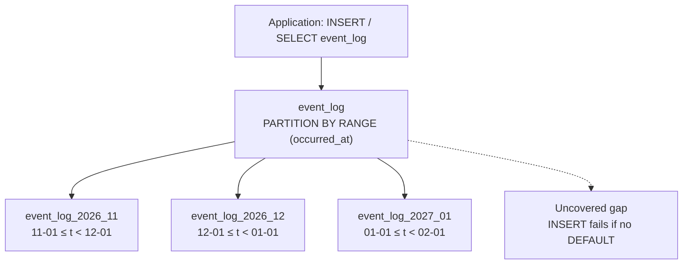
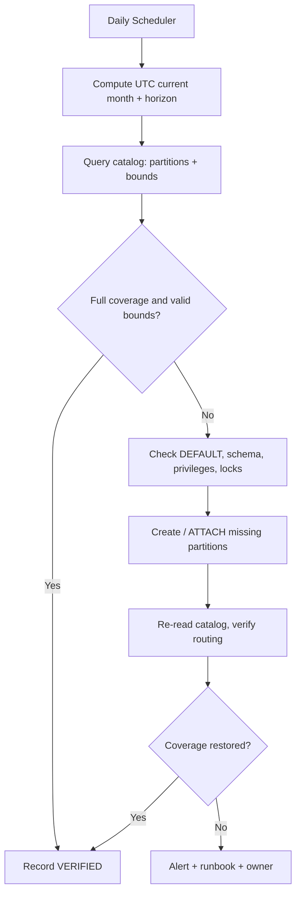

# Pre-Creating Partitions, Gap Detection, and Skew Monitoring in PostgreSQL

A PostgreSQL event table can grow from millions to billions of rows. If all data lives in one physical table, operations such as dropping old monthly data, maintaining indexes, scanning bounded time intervals, and managing storage lifecycles can become difficult. **Declarative partitioning** lets you split data across value ranges of a **partition key**, while applications continue querying a single parent table (*partitioned table*).

For example, an event-logging system:

```sql
CREATE TABLE event_log (
    event_id BIGINT NOT NULL,
    occurred_at TIMESTAMPTZ NOT NULL,
    tenant_id INTEGER NOT NULL,
    payload JSONB NOT NULL,
    PRIMARY KEY (occurred_at, event_id)
) PARTITION BY RANGE (occurred_at);
```

This parent table is a **partitioned table**. To accept events for the corresponding months, you must create child partitions:

```sql
CREATE TABLE event_log_2026_11
PARTITION OF event_log
FOR VALUES FROM ('2026-11-01 00:00:00+00')
         TO   ('2026-12-01 00:00:00+00');

CREATE TABLE event_log_2026_12
PARTITION OF event_log
FOR VALUES FROM ('2026-12-01 00:00:00+00')
         TO   ('2027-01-01 00:00:00+00');
```

**Three operational problems** surface immediately once a system runs over the long term:

1. **Pre-creating partitions:** if January 1, 2027 arrives without a matching partition, INSERTs will fail; you must pre-create far enough ahead and handle both late-arriving and future-dated data.
2. **Detecting gaps:** a month may be missing, boundaries may be misdefined, the wrong table may be attached, or a `DEFAULT` partition may silently absorb data that belongs in a primary partition.
3. **Detecting data skew:** one partition may grow abnormally large, hold a disproportionate volume of data, or receive excessive load from a specific tenant or time window, unbalancing queries and maintenance.

This lesson focuses on **proactive range governance**, not merely memorizing `CREATE TABLE ... PARTITION OF` syntax. A healthy system knows **which partitions must exist, which partitions actually exist, where data is landing, and what anomalies warrant alerts**.

## 1. Learning Objectives

After completing this lesson, you will be able to:

- Understand `RANGE` intervals with an **inclusive lower bound and exclusive upper bound**.
- Design daily/monthly partitions with UTC conventions, leap years, and 28/29/30/31-day months.
- Pre-create a **horizon** of future months to prevent boundary INSERT failures.
- Use `pg_partition_tree`, `pg_inherits`, `pg_class`, and `pg_get_expr` to inspect real partitions and bounds.
- Distinguish **a missing name**, **an unattached table**, **wrong bounds**, **a coverage gap**, and **a DEFAULT partition masking errors**.
- Write SQL to detect missing expected partitions against **a calendar and naming convention**, while verifying bounds.
- Measure skew across **row counts, storage bytes, day/hour, tenant, and DEFAULT routing rate**.
- Evaluate partition pruning via `EXPLAIN` and understand why omitting the partition key predicate forces scanning multiple partitions.
- Understand the difference between `CREATE TABLE ... PARTITION OF` and creating a standalone table followed by `ATTACH PARTITION` under load.
- Build pre-creation schedules, alerts, incident runbooks, late-arrival checks, and retention workflows.
- Avoid creating extreme numbers of partitions or trying to use partitioning as a replacement for every index.

## 2. What Is Declarative Partitioning?

PostgreSQL supports common partitioning strategies:

| Partitioning Type | Distribution Rule | Example |
| --- | --- | --- |
| `RANGE` | Contiguous ranges on key | Monthly time-series data |
| `LIST` | Specific discrete values | Regions, status groups |
| `HASH` | Hash function on key | Distributing load across tenants/accounts where appropriate |

In this lesson, we focus on `RANGE (occurred_at)` because **pre-creation, gap detection, and skew monitoring** arise most frequently in time-based partitioning.

A `PARTITION BY RANGE` parent table does not store rows like an ordinary heap table. Data is placed into **child partitions corresponding to the partition key value**. When an application runs:

```sql
INSERT INTO event_log (event_id, occurred_at, tenant_id, payload)
VALUES (
    1001,
    TIMESTAMPTZ '2026-11-14 10:30:00+00',
    42,
    '{"action":"checkout"}'::jsonb
);
```

PostgreSQL locates the partition covering that timestamp and routes the row there.

### 2.1. Diagram



Child table names are an **operational convention**. PostgreSQL actually routes according to **declared bounds**, not by inspecting a name like `event_log_2026_11` and assuming November.

### 2.2. Partitioning Is Not the Answer for Every Large Table

Potential benefits include:

- Partition pruning skips irrelevant data regions when queries include suitable predicates.
- Retention can be managed per partition, such as detaching/dropping an entire old month.
- Certain maintenance structures can be managed per partition.
- Enables partition-specific storage, indexing, and statistics policies where appropriate.

Trade-offs include:

- More relations and indexes in the system catalog.
- More complex DDL, monitoring, backups, replication, and schema migrations.
- Queries without partition key predicates may still have to touch many partitions.
- No general global uniqueness mechanism independent of the partition key for all constraint types.
- Creating too many partitions can increase planning time, metadata footprint, and operational overhead.

**Partitioning should be driven by data size, lifecycle, and query patterns**—not a rule that every 100,000-row table must be partitioned.

## 3. RANGE Intervals Have a Closed Lower Bound and Open Upper Bound

The declaration:

```sql
FOR VALUES FROM ('2026-11-01 00:00:00+00')
         TO   ('2026-12-01 00:00:00+00')
```

means:

```text
2026-11-01 00:00:00+00 ≤ occurred_at
occurred_at < 2026-12-01 00:00:00+00
```

That is the half-open interval **[start, end)**.

| occurred_at Value | November Partition? |
| --- | :---: |
| 2026-10-31 23:59:59.999999+00 | No |
| 2026-11-01 00:00:00+00 | Yes |
| 2026-11-14 10:30:00+00 | Yes |
| 2026-11-30 23:59:59.999999+00 | Yes |
| 2026-12-01 00:00:00+00 | No; belongs to December partition if it exists |

### 3.1. Why Not Use 23:59:59 as the Upper Bound?

PostgreSQL timestamps have sub-second precision. If November were defined to end at:

```text
2026-11-30 23:59:59
```

then instants like `23:59:59.000001` up to midnight would fall through. Using **the start of the next month as the open upper bound** prevents that gap.

### 3.2. Do Not Hardcode a Fixed Number of Days per Month

February can have 28 or 29 days; April has 30 days, July has 31 days.

Correct:

```sql
FOR VALUES FROM ('2027-02-01 00:00:00+00')
         TO   ('2027-03-01 00:00:00+00')
```

Do not naively add a fixed `INTERVAL '30 days'` to compute monthly boundaries.

### 3.3. Non-Overlapping Rule

Two child partitions at the same level cannot declare overlapping RANGE bounds. For example, November and December have valid boundaries:

```text
Nov: [2026-11-01, 2026-12-01)
Dec: [2026-12-01, 2027-01-01)
```

They are **adjacent** at 12-01 without intersecting, because Nov excludes the start of December.

PostgreSQL rejects creating or attaching a partition whose bounds overlap an existing partition. However, PostgreSQL **does not force ranges to cover the entire timeline**; you can still leave **gaps** between partitions.

## 4. TIMESTAMP vs. TIMESTAMPTZ: Choosing and Standardizing Timezones

When events carry absolute instants from multiple sources, `TIMESTAMPTZ` is generally more appropriate than `TIMESTAMP WITHOUT TIME ZONE`.

`TIMESTAMPTZ` stores an absolute instant in time and formats it according to the session timezone when displayed. The instant:

```sql
TIMESTAMPTZ '2026-11-01 00:00:00+00'
```

and an equivalent instant written with a different timezone offset represent **the exact same point in real time**. Do not create partitions labeled as "UTC months" while accidentally shifting boundaries via a session timezone.

### 4.1. Use UTC Consistently

Lesson conventions:

- Partition key: `occurred_at TIMESTAMPTZ NOT NULL`.
- Boundaries: midnight **UTC**, written explicitly with `+00` in literals.
- Partition name: `events_YYYY_MM` by **UTC month**.
- Dashboards using local time convert timezones at display/aggregation time.

Example instant:

```sql
SELECT
    TIMESTAMPTZ '2026-11-30 18:00:00+00'
        AT TIME ZONE 'Asia/Ho_Chi_Minh'
        AS local_time;
```

In Vietnam local time this renders as **2026-12-01 01:00**, yet it still belongs to the **November UTC partition**.

### 4.2. What If Business Requirements Demand Partitioning by Local Calendar Month?

If the domain demands "months in Hanoi/Ho Chi Minh timezone," compute the exact UTC instants corresponding to those boundaries, accounting for timezone rules and DST if the region observes clock changes. Never call a partition a local month while using UTC midnight bounds without explicitly documenting the semantics.

### 4.3. Avoid Casting the Key Column in Predicates That Hurts Pruning

Pruning-friendly query for RANGE:

```sql
WHERE occurred_at >= TIMESTAMPTZ '2026-11-01 00:00:00+00'
  AND occurred_at < TIMESTAMPTZ '2026-12-01 00:00:00+00'
```

The predicate:

```sql
WHERE occurred_at::date = DATE '2026-11-14'
```

depends on session timezone for `timestamptz::date` and can hinder direct range bound inference on the partition key. Prefer explicit range comparisons with typed bounds whenever filtering by the partition key.

## 5. Choosing Partition Granularity: Day, Week, Month, or Year?

There is no "always partition by month" rule.

| Unit | Pros | Risks |
| --- | --- | --- |
| Hourly | Isolates massive traffic spikes, hourly retention | Very high relation, DDL, and metadata count |
| Daily | Tight retention and daily size control | Partition count grows rapidly |
| Monthly | Moderate partition count for many workloads | Hot months can become very large |
| Quarterly/Yearly | Few partitions, simple management | Huge partitions, coarser pruning |

Consider:

1. Rows and bytes generated per day.
2. Retention period.
3. Typical query time ranges.
4. Expected number of relations, indexes, and partitions.
5. Frequency of partition create/drop DDL.
6. Whether daily or per-tenant volume is skewed.
7. Backup, archival, and retention requirements.

For instance, a system ingesting 5 TB/month may need daily partitioning or subpartitioning, while a 5 GB/month system works nicely with monthly partitions. Benchmark against real data and storage.

## 6. Why Pre-Create Partitions?

At month-end:

```text
23:59:59.999999 UTC -> rows route to current month's partition
00:00:00.000000 UTC -> rows must route to next month's partition
```

If next month's partition does not exist and there is no default:

```text
ERROR: no partition of relation "events" found for row
DETAIL: Partition key of the failing row contains ...
```

Applications may:

- Fail to write new data.
- Retry endlessly against the same missing structural error.
- Build up message consumer backlogs.
- Suffer business outages right at the period boundary.

A "run DDL right at 00:00" workflow can fail due to downtime, migration locks, missing permissions, a stalled scheduler, or data carrying **future timestamps**.

### 6.1. Pre-Creation Horizon

**Partition creation horizon** is how far ahead of the present partitions are already prepared.

Example:

```text
Current month: 2026-11
Available:     2026-11, 2026-12, 2027-01, 2027-02, 2027-03
Horizon:       through end of 2027-03 (UTC)
```

Once December arrives, the scheduler adds subsequent months so the horizon never drains.

### 6.2. Size the Horizon from Latency and Recovery Targets

The horizon should exceed:

- How far into the future applications can emit scheduled events.
- Maximum recovery time for a failed scheduler/DDL job.
- Time needed to complete and verify migrations.
- Safety margin for maintenance windows and holidays.

If events can be scheduled 60 days ahead, creating only one day ahead is clearly insufficient.

You do not necessarily need to pre-create 10 years of partitions if relation count would explode; base the horizon on **forecast windows, retry lag, and catalog cost**.

## 7. Building the Lab Schema

All hands-on exercises use a dedicated `partition_ops_lab` schema to avoid impacting other applications. Never run experimental partition creation/drop commands directly on production.

### 7.1. Create the Schema and Parent Table

```sql
CREATE SCHEMA IF NOT EXISTS partition_ops_lab;

CREATE TABLE partition_ops_lab.events (
    event_id BIGINT NOT NULL,
    occurred_at TIMESTAMPTZ NOT NULL,
    tenant_id INTEGER NOT NULL,
    event_type TEXT NOT NULL,
    metric_value NUMERIC(12, 2) NOT NULL DEFAULT 0,
    payload JSONB NOT NULL DEFAULT '{}'::jsonb,
    PRIMARY KEY (occurred_at, event_id)
) PARTITION BY RANGE (occurred_at);
```

Because a primary key on a partitioned table here must include the **partition key**, we use `PRIMARY KEY (occurred_at, event_id)` rather than `PRIMARY KEY (event_id)` alone.

**Important:** that constraint enforces uniqueness of the **pair** `(occurred_at, event_id)`, **not global uniqueness of `event_id` alone across all partitions**. If the domain needs globally unique event IDs, design an ID generator, constraint, or registry accordingly; do not assume PostgreSQL provides a global unique index independent of the partition key.

### 7.2. Create Partitions for Adjacent Months

```sql
CREATE TABLE partition_ops_lab.events_2026_11
PARTITION OF partition_ops_lab.events
FOR VALUES FROM ('2026-11-01 00:00:00+00')
         TO   ('2026-12-01 00:00:00+00');

CREATE TABLE partition_ops_lab.events_2026_12
PARTITION OF partition_ops_lab.events
FOR VALUES FROM ('2026-12-01 00:00:00+00')
         TO   ('2027-01-01 00:00:00+00');

CREATE TABLE partition_ops_lab.events_2027_01
PARTITION OF partition_ops_lab.events
FOR VALUES FROM ('2027-01-01 00:00:00+00')
         TO   ('2027-02-01 00:00:00+00');
```

These three partitions cover:

```text
[2026-11-01, 2026-12-01)
[2026-12-01, 2027-01-01)
[2027-01-01, 2027-02-01)
```

There is no gap between them, though anything from 2027-02-01 onward is not yet covered.

### 7.3. Index for Per-Tenant Queries Within Each Month

```sql
CREATE INDEX idx_lab_events_tenant_time
ON partition_ops_lab.events
    (tenant_id, occurred_at DESC);
```

When creating an index on a declarative partitioned parent, PostgreSQL creates and manages corresponding indexes on child partitions according to the version's features. Queries for one tenant in one month can leverage the matching local index.

Do not create an index on the parent and assume it is **a single physical B-tree spanning all partitions**. Each partition has its own data and index structures.

### 7.4. Inspect the Partition Tree

```sql
SELECT
    relid::regclass AS relation,
    parentrelid::regclass AS parent_relation,
    isleaf,
    level
FROM pg_partition_tree('partition_ops_lab.events'::regclass)
ORDER BY level, relid::text;
```

The output shows the parent at level 0 and three child partitions at level 1, with `isleaf` set to TRUE for the leaf partitions.

## 8. Loading Sample Data with Intentional Skew

We load three months with differing volumes while intentionally letting **tenant_id = 1** generate the majority of rows. This lets us observe both monthly skew and per-tenant skew.

### 8.1. November: 30,000 Events

```sql
INSERT INTO partition_ops_lab.events (
    event_id,
    occurred_at,
    tenant_id,
    event_type,
    metric_value,
    payload
)
SELECT
    g.n,
    TIMESTAMPTZ '2026-11-01 00:00:00+00'
        + (g.n % 30) * INTERVAL '1 day'
        + (g.n % 86400) * INTERVAL '1 second',
    CASE
        WHEN g.n % 10 < 8 THEN 1
        ELSE 2 + (g.n % 9)
    END,
    CASE WHEN g.n % 5 = 0 THEN 'PURCHASE' ELSE 'VIEW' END,
    (g.n % 5000)::numeric(12, 2),
    jsonb_build_object('source', 'lab-nov', 'n', g.n)
FROM generate_series(1, 30000) AS g(n);
```

### 8.2. December: 12,000 Events

```sql
INSERT INTO partition_ops_lab.events (
    event_id, occurred_at, tenant_id, event_type,
    metric_value, payload
)
SELECT
    30000 + g.n,
    TIMESTAMPTZ '2026-12-01 00:00:00+00'
        + (g.n % 31) * INTERVAL '1 day'
        + (g.n % 86400) * INTERVAL '1 second',
    CASE WHEN g.n % 10 < 8 THEN 1 ELSE 2 + (g.n % 9) END,
    'VIEW',
    (g.n % 3000)::numeric(12, 2),
    '{"source":"lab-dec"}'::jsonb
FROM generate_series(1, 12000) AS g(n);
```

### 8.3. January: 1,200 Events

```sql
INSERT INTO partition_ops_lab.events (
    event_id, occurred_at, tenant_id, event_type,
    metric_value, payload
)
SELECT
    42000 + g.n,
    TIMESTAMPTZ '2027-01-01 00:00:00+00'
        + (g.n % 31) * INTERVAL '1 day'
        + (g.n % 86400) * INTERVAL '1 second',
    CASE WHEN g.n % 10 < 8 THEN 1 ELSE 2 + (g.n % 9) END,
    'VIEW',
    (g.n % 1000)::numeric(12, 2),
    '{"source":"lab-jan"}'::jsonb
FROM generate_series(1, 1200) AS g(n);
```

### 8.4. Total Data

```sql
ANALYZE partition_ops_lab.events;

SELECT COUNT(*) AS total_events
FROM partition_ops_lab.events;
```

On a clean schema where the script ran once, the total is **43,200 events**.

Note: the 30,000–12,000–1,200 disparity is **deliberately synthesized by the lab**, not evidence that PostgreSQL misrouted rows. Detecting skew is step one; concluding whether it is abnormal requires comparing against days in the month, expected traffic, and real ingestion telemetry.

## 9. Explicitly Pre-Creating Upcoming Months

Extending the existing setup through March 2027:

```sql
CREATE TABLE partition_ops_lab.events_2027_02
PARTITION OF partition_ops_lab.events
FOR VALUES FROM ('2027-02-01 00:00:00+00')
         TO   ('2027-03-01 00:00:00+00');

CREATE TABLE partition_ops_lab.events_2027_03
PARTITION OF partition_ops_lab.events
FOR VALUES FROM ('2027-03-01 00:00:00+00')
         TO   ('2027-04-01 00:00:00+00');
```

Both new partitions **can be empty**; that is the normal state of future partitions.

### 9.1. An Empty Partition Does Not Mean Missing Data

Having 0 rows in the 2027-03 partition back in November 2026 is **expected** if the system emits no future-dated events.

When measuring skew or alerting on zero rows, distinguish between:

- Future partitions whose period has not started yet.
- Past partitions that should hold historical data.
- The current partition right as a period begins.
- Holidays or business windows with legitimately zero traffic.

**Do not page on "empty partition" solely from `COUNT = 0`.**

### 9.2. Earlier Creation Removes Midnight 00:00 Pressure

When new partitions are created months ahead, INSERTs crossing the month boundary do not depend on a last-second DDL statement succeeding.

## 10. Automating Pre-Creation with a PostgreSQL DO Block

Instead of hand-writing 12 DDL statements each year, you can generate monthly tables programmatically. The following example creates **the current UTC month plus four future months** (if missing), following the naming convention:

```sql
DO $body$
DECLARE
    base_month TIMESTAMP;
    month_start TIMESTAMP;
    month_end TIMESTAMP;
    partition_name TEXT;
    lower_utc TEXT;
    upper_utc TEXT;
BEGIN
    base_month :=
        date_trunc('month', now() AT TIME ZONE 'UTC');

    FOR month_start IN
        SELECT generate_series(
            base_month,
            base_month + INTERVAL '4 months',
            INTERVAL '1 month'
        )
    LOOP
        month_end := month_start + INTERVAL '1 month';
        partition_name :=
            'events_' || to_char(month_start, 'YYYY_MM');

        lower_utc :=
            to_char(month_start, 'YYYY-MM-DD') || ' 00:00:00+00';
        upper_utc :=
            to_char(month_end, 'YYYY-MM-DD') || ' 00:00:00+00';

        EXECUTE format(
            'CREATE TABLE IF NOT EXISTS partition_ops_lab.%I
             PARTITION OF partition_ops_lab.events
             FOR VALUES FROM (%L) TO (%L)',
            partition_name,
            lower_utc,
            upper_utc
        );
    END LOOP;
END;
$body$;
```

### 10.1. Why Use UTC date_trunc?

`now() AT TIME ZONE 'UTC'` produces a UTC timestamp, and `date_trunc('month', ...)` snaps to the start of the UTC month. From there we step by **calendar months**, never hardcoding 30 days.

`format('%I', name)` safely quotes identifiers and `%L` safely quotes string literals in dynamic SQL. Never concatenate untrusted input into table names or DDL boundary literals.

### 10.2. A DO Block Is a Lab Mechanism, Not a Production Scheduler

The block above only creates partitions **when invoked**. Real automation requires a scheduled job or operational migration workflow running periodically.

In production, add:

- Appropriate DDL privileges.
- Concurrency protection against overlapping job runs.
- Verification that any matching table name is **actually attached to the right parent with the right bounds**.
- Checks that no default-partition rows need migrating first.
- Lock wait timeouts.
- DDL change logging/auditing.
- Alerts on creation or verification failures.
- Synchronized index/schema checks for newly created partitions.

### 10.3. IF NOT EXISTS Does Not Verify Bounds

`CREATE TABLE IF NOT EXISTS ...` only suppresses "relation already exists" errors. It **does not verify that the existing table has the right structure, is attached to the right parent, or holds the right bounds**.

For example, if a table named `events_2027_03` accidentally carries April bounds, the name still exists. A job relying purely on `IF NOT EXISTS` would skip past without catching the bug.

Therefore **a verification step is mandatory**—never treat a zero DDL exit code as sufficient proof.

### 10.4. Preventing Two DDL Jobs from Running Simultaneously

If a scheduler runs multiple replicas, two workers could try creating the same partition at once. Coordinate at the job-orchestrator level or use an advisory lock carefully inside a controlled maintenance harness.

Conceptual flow:

```text
acquire partition-maintenance lock
  -> inspect catalog
  -> create missing partitions
  -> verify bounds/horizon
release lock
```

Never hold a session-level advisory lock longer than necessary; ensure release on every error branch so jobs do not hang. Locking against concurrency still does not replace post-DDL verification.

## 11. Inspecting the Catalog: Which Partitions Are Actually Attached?

PostgreSQL exposes partitioning metadata in system catalogs. Key views and functions include:

- `pg_partition_tree`: displays the partition tree of a parent.
- `pg_inherits`: parent–child inheritance links (also used for legacy inheritance).
- `pg_class`: relation metadata.
- `pg_namespace`: schemas.
- `pg_get_expr(relpartbound, oid)`: formats partition bounds as readable SQL.
- `pg_partitioned_table`: partitioned-table properties.

### 11.1. List Direct Partitions

```sql
SELECT
    child.oid::regclass AS partition,
    parent.oid::regclass AS parent,
    child.relkind,
    pg_get_expr(child.relpartbound, child.oid) AS partition_bound
FROM pg_inherits AS i
JOIN pg_class AS child
  ON child.oid = i.inhrelid
JOIN pg_class AS parent
  ON parent.oid = i.inhparent
WHERE i.inhparent = 'partition_ops_lab.events'::regclass
ORDER BY child.relname;
```

Example row:

```text
partition:       partition_ops_lab.events_2026_11
partition_bound: FOR VALUES FROM ('2026-11-01 00:00:00+00')
                 TO ('2026-12-01 00:00:00+00')
```

Exact rendered output may vary in casts, timezone formatting, and spacing. Use catalog metadata to **verify boundary semantics**, not brittle byte-for-byte string matching.

### 11.2. pg_partition_tree for Multi-Level Partitioning

```sql
SELECT
    relid::regclass,
    parentrelid::regclass,
    isleaf,
    level
FROM pg_partition_tree('partition_ops_lab.events'::regclass)
ORDER BY level, relid::text;
```

With subpartitioning, a level-1 child can itself be a **partitioned table** containing level-2 children. `pg_partition_tree` reveals the entire tree rather than only immediate children.

### 11.3. Do Not Treat relname as the Source of Truth

A relation named `events_2027_02` might be:

- An unattached standalone table.
- A partition of a different parent table.
- Attached with incorrect bounds from a manual mistake.
- Valid, but residing in another schema.

A reliable check verifies **schema + parent OID + attachment + bounds**, never just a name lookup in `pg_class`.

## 12. "Gaps" Can Mean Several Different Things

Never say "gap" without clarifying which kind:

| Type | Symptom | Consequence |
| --- | --- | --- |
| **True timeline gap in bounds** | No partition covers an interval | INSERTs in that interval fail unless DEFAULT exists |
| **Expected calendar name missing** | `events_YYYY_MM` not found | Partition missing or named differently |
| **Table exists by name but unattached** | Relation exists outside the tree | Parent does not route INSERTs into it |
| **Right name, wrong bounds** | Catalog range differs from expected | Data routes to wrong partition or fails |
| **DEFAULT holding a month's data** | INSERT succeeds, `tableoid` points to DEFAULT | Misconfiguration is silently masked |
| **Past month missing data** | Valid partition has 0 or too few rows | Likely ingestion outage, not a partition gap |
| **Days with zero events** | No rows on certain days | May be normal business behavior |

This calls for **two independent monitoring tracks**:

1. **Structural coverage:** Do attached partition bounds cover all intervals required by the system?
2. **Data completeness/distribution:** Do row volumes and ingestion activity match expectations?

## 13. SQL to Detect Missing Partitions by Calendar and Name

Suppose the convention is one partition per month named `events_YYYY_MM`, and the required horizon runs from 2026-11 through 2027-04.

```sql
WITH expected_months AS (
    SELECT
        gs::date AS lower_utc_date,
        (gs + INTERVAL '1 month')::date AS upper_utc_date,
        'events_' || to_char(gs, 'YYYY_MM') AS expected_name
    FROM generate_series(
        TIMESTAMP '2026-11-01 00:00:00',
        TIMESTAMP '2027-04-01 00:00:00',
        INTERVAL '1 month'
    ) AS gs
)
SELECT
    e.expected_name,
    e.lower_utc_date,
    e.upper_utc_date,
    child.oid::regclass AS found_relation,
    (i.inhrelid IS NOT NULL) AS attached_to_expected_parent,
    pg_get_expr(child.relpartbound, child.oid) AS actual_bound
FROM expected_months AS e
LEFT JOIN pg_class AS child
  ON child.relname = e.expected_name
 AND child.relnamespace = 'partition_ops_lab'::regnamespace
LEFT JOIN pg_inherits AS i
  ON i.inhrelid = child.oid
 AND i.inhparent = 'partition_ops_lab.events'::regclass
ORDER BY e.lower_utc_date;
```

### 13.1. How to Read the Output

For each month:

- `found_relation IS NULL`: no relation with the **expected name** exists in that schema.
- `attached_to_expected_parent = FALSE`: the relation is **not attached** to the expected parent.
- `actual_bound`: confirm it matches **[lower_utc_date 00:00 UTC, upper_utc_date 00:00 UTC)**.

This query **checks naming and attachment conventions**; it does not automatically parse raw bounds into typed intervals. A partition with a different name but valid bounds might still route rows properly, whereas this query flags policy-name deviations.

### 13.2. List Only Missing or Unattached Names

```sql
WITH expected_months AS (
    SELECT 'events_' || to_char(gs, 'YYYY_MM') AS expected_name
    FROM generate_series(
        TIMESTAMP '2026-11-01',
        TIMESTAMP '2027-04-01',
        INTERVAL '1 month'
    ) AS gs
)
SELECT e.expected_name AS missing_or_unattached_partition
FROM expected_months AS e
LEFT JOIN pg_class AS c
  ON c.relname = e.expected_name
 AND c.relnamespace = 'partition_ops_lab'::regnamespace
LEFT JOIN pg_inherits AS i
  ON i.inhrelid = c.oid
 AND i.inhparent = 'partition_ops_lab.events'::regclass
WHERE i.inhrelid IS NULL
ORDER BY e.expected_name;
```

When only Nov, Dec, and Jan exist, this reports 02, 03, and 04 missing. After creating 02 and 03, only 04 remains missing in this window.

### 13.3. Do Not Stop at "Names Present"

A table with the standard name attached to the right parent **still needs bound verification**. A migration might accidentally create `events_2027_04` with bounds 05-01 to 06-01. PostgreSQL will not auto-correct mismatched calendar expectations implied by table names.

For strict automation, maintain expected ranges as **typed timestamps** and compare them against real catalog bounds using reliable inspection logic. Never rely on ad-hoc regex parsing of `pg_get_expr` strings as the sole verification across PostgreSQL versions and formats.

## 14. Detecting Gaps Between Actual RANGE Intervals

For clean monthly partitions, the reasoning looks like:

```text
Expected:
  [2026-11-01, 2026-12-01)
  [2026-12-01, 2027-01-01)
  [2027-01-01, 2027-02-01)
  [2027-02-01, 2027-03-01)

Actual:
  [2026-11-01, 2026-12-01)
  [2026-12-01, 2027-01-01)
  [2027-02-01, 2027-03-01)

Gap:
  [2027-01-01, 2027-02-01)
```

If you maintain a **typed governance inventory** storing `lower_bound` and `upper_bound` reconciled from the catalog, you can detect gaps using a window function:

```sql
-- Illustrative inventory table; does not auto-sync with the catalog.
CREATE TABLE partition_ops_lab.partition_inventory (
    partition_name TEXT PRIMARY KEY,
    lower_bound TIMESTAMPTZ NOT NULL,
    upper_bound TIMESTAMPTZ NOT NULL,
    verified_at TIMESTAMPTZ NOT NULL DEFAULT now(),
    CHECK (lower_bound < upper_bound)
);
```

Populate the inventory **only after verifying actual partition bounds**, for example for the three lab months:

```sql
INSERT INTO partition_ops_lab.partition_inventory
    (partition_name, lower_bound, upper_bound)
VALUES
    ('events_2026_11', '2026-11-01 00:00:00+00',
                       '2026-12-01 00:00:00+00'),
    ('events_2026_12', '2026-12-01 00:00:00+00',
                       '2027-01-01 00:00:00+00'),
    ('events_2027_01', '2027-01-01 00:00:00+00',
                       '2027-02-01 00:00:00+00');
```

Detect gaps **between inventory entries**:

```sql
WITH ordered AS (
    SELECT
        partition_name,
        lower_bound,
        upper_bound,
        LAG(upper_bound) OVER (
            ORDER BY lower_bound, upper_bound
        ) AS previous_upper
    FROM partition_ops_lab.partition_inventory
)
SELECT
    partition_name,
    previous_upper AS gap_starts_at,
    lower_bound AS gap_ends_at
FROM ordered
WHERE previous_upper IS NOT NULL
  AND previous_upper < lower_bound
ORDER BY gap_starts_at;
```

### 14.1. Check Overlaps in the Inventory

```sql
WITH ordered AS (
    SELECT
        partition_name,
        lower_bound,
        upper_bound,
        MAX(upper_bound) OVER (
            ORDER BY lower_bound, upper_bound
            ROWS BETWEEN UNBOUNDED PRECEDING AND 1 PRECEDING
        ) AS prior_max_upper
    FROM partition_ops_lab.partition_inventory
)
SELECT *
FROM ordered
WHERE prior_max_upper > lower_bound;
```

PostgreSQL forbids overlapping sibling partitions at the same level; this query is still handy for validating a **planned manifest** prior to running DDL.

### 14.2. An Inventory Is Not Truth If Maintained Manually

`partition_inventory` **does not update automatically** when a partition is detached, dropped, or recreated elsewhere. Therefore:

- Treat the inventory as **expected/verified metadata**.
- Reconcile regularly against `pg_inherits` and `pg_get_expr`.
- Update the inventory inside the same workflow that executes DDL.
- Raise a **metadata drift** alert on mismatch.
- Never trust stale inventory records to prove a partition still exists.

**The authoritative source of routing is PostgreSQL's catalog**, not a custom inventory table.

## 15. Verify the Full Horizon, Not Just Internal Gaps

A `LAG` check only finds **holes between ranges present in the inventory**. It misses:

- Any gap from **horizon start** to the first partition.
- Any gap from the last partition to **horizon end**.

For example, if the inventory holds Nov–Jan cleanly while policy requires coverage through April, `LAG` cannot notice missing Feb–Apr without an expected horizon.

### 15.1. Horizon Endpoints Check

```sql
WITH desired AS (
    SELECT
        TIMESTAMPTZ '2026-11-01 00:00:00+00' AS start_at,
        TIMESTAMPTZ '2027-05-01 00:00:00+00' AS end_at
),
coverage AS (
    SELECT
        MIN(lower_bound) AS first_lower,
        MAX(upper_bound) AS last_upper
    FROM partition_ops_lab.partition_inventory
)
SELECT
    d.start_at,
    d.end_at,
    c.first_lower,
    c.last_upper,
    (c.first_lower <= d.start_at
      AND c.last_upper >= d.end_at) AS covers_outer_boundaries
FROM desired AS d
CROSS JOIN coverage AS c;
```

`covers_outer_boundaries` **only checks the outer edges** and misses internal holes; combine **both internal gap detection** and attachment/bounds verification.

### 15.2. Define an Explicit Coverage Contract

For monthly ranges, operational specifications should state:

```text
Coverage contract:
  parent = partition_ops_lab.events
  timezone = UTC
  granularity = calendar month
  required past window = 3 months
  required future window = 4 months
  naming = events_YYYY_MM
  gaps allowed = NO (within required window)
  default rows allowed = policy-defined (ideally monitored and rare)
```

With an explicit contract, verification jobs do not have to guess which months ought to exist.

## 16. Using Rollback-Safe Routing Probes in the Lab

In a **test database**, you can verify where a timestamp routes via an INSERT followed by ROLLBACK:

```sql
BEGIN;

INSERT INTO partition_ops_lab.events (
    event_id, occurred_at, tenant_id, event_type,
    metric_value, payload
)
VALUES (
    900001,
    TIMESTAMPTZ '2027-02-01 00:00:00+00',
    1,
    'ROUTING_PROBE',
    0,
    '{}'::jsonb
)
RETURNING
    tableoid::regclass AS routed_partition,
    occurred_at;

ROLLBACK;
```

If February exists, PostgreSQL routes the row to `events_2027_02`; `tableoid::regclass` reveals **the physical relation holding the row**.

### 16.1. Test Boundary Instants

Test sequentially:

- `2027-01-31 23:59:59.999999 UTC`
- `2027-02-01 00:00:00 UTC`
- `2027-02-28 23:59:59.999999 UTC`
- `2027-03-01 00:00:00 UTC`

Record `tableoid` for each probe. This builds concrete intuition for open upper bounds.

### 16.2. When a Partition Is Missing

If April does not exist and there is no DEFAULT:

```sql
BEGIN;
INSERT INTO partition_ops_lab.events
    (event_id, occurred_at, tenant_id, event_type)
VALUES (
    900002,
    TIMESTAMPTZ '2027-04-15 12:00:00+00',
    1,
    'ROUTING_PROBE'
);
-- Expected error because April has not been created yet.
ROLLBACK;
```

After an INSERT error inside a transaction, run `ROLLBACK` to clear the aborted transaction state.

**Do not run automated INSERT/ROLLBACK probes in production** where triggers, audits, external side effects, sequences, CDC, and live traffic exist. ROLLBACK does not undo external side effects or sequence increments; production systems should rely on catalog metadata and monitoring.

## 17. DEFAULT Partition: Safety Net or Error Mask?

PostgreSQL lets you create:

```sql
CREATE TABLE partition_ops_lab.events_default
PARTITION OF partition_ops_lab.events
DEFAULT;
```

Rows outside all explicit bounds then route into DEFAULT instead of failing with "no partition found."

### 17.1. Benefits

- Absorbs unexpected out-of-range timestamps instead of failing INSERTs.
- Captures abnormally past-dated or future-dated events for inspection.
- Prevents a class of missing-partition outages when paired with a fallback cleanup workflow.

### 17.2. Risks

- Scheduler failures may be **silently masked** because INSERTs keep succeeding.
- DEFAULT bloats across multiple months.
- Time-bounded queries may have to scan DEFAULT if pruning cannot eliminate it.
- When adding a new partition, PostgreSQL must prove DEFAULT holds no rows in the new range, potentially **scanning and locking DEFAULT**.
- Large row counts in DEFAULT make migration and ATTACH slow and complex.

**DEFAULT does not replace pre-creating partitions.** It is a trade-off that is safe only when backed by alerts and a runbook to drain rows into proper partitions.

### 17.3. Check How Many Rows Are in DEFAULT

```sql
SELECT COUNT(*) AS rows_in_default
FROM partition_ops_lab.events_default;
```

This returns an exact snapshot count, though it can be expensive if DEFAULT has grown large.

To inspect UTC monthly distribution inside DEFAULT:

```sql
SELECT
    date_trunc(
        'month',
        occurred_at AT TIME ZONE 'UTC'
    )::date AS utc_month,
    COUNT(*) AS event_count
FROM partition_ops_lab.events_default
GROUP BY 1
ORDER BY 1;
```

If DEFAULT contains rows from a month that already ought to have a dedicated partition, review ingestion/migration history at ATTACH time. **Never delete DEFAULT rows merely because an explicit partition was created.**

### 17.4. DEFAULT Is Not Long-Term Storage

If you choose to have a DEFAULT partition, establish:

```text
SLA: default rows must be triaged and processed
Alert: abnormal growth in default row count/age
Policy: timestamps too far in the future are rejected/quarantined
Runbook: create partition, safely migrate data, verify, and archive
```

## 18. Adding a Partition When DEFAULT Already Holds Data

Suppose `events_default` contains rows with `occurred_at` in April 2027 because April was not created in time.

If you execute:

```sql
CREATE TABLE partition_ops_lab.events_2027_04
PARTITION OF partition_ops_lab.events
FOR VALUES FROM ('2027-04-01 00:00:00+00')
         TO   ('2027-05-01 00:00:00+00');
```

PostgreSQL must verify DEFAULT holds no data inside the new range. When April rows exist in DEFAULT, adding the partition **cannot proceed as an empty-table attach**; it fails until those rows are moved or handled first.

### 18.1. Safe Operational Workflow (Conceptual)

1. Identify exact bounds for the new partition.
2. Count and inspect rows in DEFAULT matching that range.
3. Choose a migration window and writer-coordination mechanism so new matching rows do not keep landing in DEFAULT mid-move.
4. Prepare a target/staging table matching parent schema, constraints, and indexes.
5. Move rows in controlled batches or transactions with duplicate protection.
6. Ensure DEFAULT contains zero rows inside the bounds to be attached.
7. Create/ATTACH the partition and verify new routing.
8. Reconcile pre/post counts and content; preserve an audit trail.

### 18.2. Why Not Run Naive INSERT SELECT + DELETE in Production?

Consider:

```text
copy rows from DEFAULT to staging
delete rows from DEFAULT
attach staging
```

Between steps, concurrent writers can insert fresh April rows into DEFAULT. Without proper locks, transaction boundaries, or ingestion coordination, this introduces races, data loss/drift, or failed ATTACHes.

With foreign keys, triggers, CDC, or replication, moving rows needs careful planning; never copy lab snippets verbatim as production runbooks.

## 19. Standalone Table + ATTACH: Reducing Locks on the Parent

Two common patterns exist.

### 19.1. CREATE TABLE ... PARTITION OF

```sql
CREATE TABLE partition_ops_lab.events_2027_05
PARTITION OF partition_ops_lab.events
FOR VALUES FROM ('2027-05-01 00:00:00+00')
         TO   ('2027-06-01 00:00:00+00');
```

This is concise and convenient. However, creating a partition directly typically takes an **`ACCESS EXCLUSIVE` lock on the parent**, which can block live traffic.

### 19.2. Create a Standalone Table, Then ATTACH

In the lab environment, prepare the table first:

```sql
CREATE TABLE partition_ops_lab.events_2027_06 (
    LIKE partition_ops_lab.events
    INCLUDING DEFAULTS
    INCLUDING CONSTRAINTS
);

ALTER TABLE partition_ops_lab.events_2027_06
ADD CONSTRAINT chk_events_2027_06_bounds
CHECK (
    occurred_at >= TIMESTAMPTZ '2027-06-01 00:00:00+00'
    AND occurred_at < TIMESTAMPTZ '2027-07-01 00:00:00+00'
);
```

Once data, indexes, and constraints are ready:

```sql
ALTER TABLE partition_ops_lab.events
ATTACH PARTITION partition_ops_lab.events_2027_06
FOR VALUES FROM ('2027-06-01 00:00:00+00')
         TO   ('2027-07-01 00:00:00+00');
```

In production, ensure the table matches the partitioned parent's full definition—not just columns copied by `LIKE`. Inherited indexes/constraints, FKs, triggers, and grants must all be accounted for.

### 19.3. Why Does a CHECK Constraint Help?

If PostgreSQL can prove all rows in the standalone table fall within bounds using a **matching validated CHECK constraint**, it can skip a full-table validation scan during ATTACH.

Without a tight, validated CHECK, ATTACH may have to scan a huge table under strong locks to verify every row lies in bounds.

### 19.4. ATTACH Locks Still Need Evaluation

In modern PostgreSQL versions, `ATTACH PARTITION` typically takes:

- **`SHARE UPDATE EXCLUSIVE`** on the parent.
- **`ACCESS EXCLUSIVE`** on the child table being attached.
- Possibly locking/scanning the DEFAULT partition if one exists, specifically to prove no rows belong to the new range.

That is **less exclusive on the parent** than `CREATE TABLE ... PARTITION OF`, though it does not mean "ATTACH never blocks anything."

### 19.5. CHECK Bounds Must Be Exact and Complete

A CHECK written as:

```sql
CHECK (occurred_at >= TIMESTAMPTZ '2027-06-01 00:00:00+00')
```

only proves the lower bound, not that rows precede 07-01. PostgreSQL will still need to scan.

Also remember SQL CHECK NULL semantics. In the lab parent, the partition key is `NOT NULL`, making the range proof clear. Never rely on an incomplete CHECK or nullable key assuming it proves the full bounds.

## 20. Pre-Creation Schedule: From One-Off Script to Recurring Operations

In production, an operational workflow looks like:



### 20.1. Scheduler Cadence

For monthly partitions, running the job daily makes sense even though most days do not create a new partition. Typical tasks:

1. Check horizon coverage.
2. Pre-create if any period is missing.
3. Verify catalog state and bounds.
4. Emit metrics and alert if targets are missed.

Never wait until the first day of the month to check.

### 20.2. Operational Metadata per Managed Parent

Each managed partitioned table should track at minimum:

| Field | Example | Meaning |
| --- | --- | --- |
| parent | `partition_ops_lab.events` | Parent table |
| timezone | `UTC` | Boundary convention |
| granularity | `month` | Period unit |
| horizon_months | `4` | Future months required |
| retention_months | `18` | Historical window kept |
| schedule | `daily` | Check cadence |
| owner | `DB operations` | Responsible team |
| max_default_rows | per policy | Out-of-coverage threshold alert |

Do not auto-enable retention deletion just because a config field exists; deletion requires approved retention policies.

### 20.3. States to Track

```text
PLANNED -> CREATING -> ATTACHED -> VERIFIED
                          |
                          +-> INVALID / GAP / DRIFT -> ALERT
```

A creation job that "succeeded" without verifying bounds should still be considered **incomplete**.

## 21. Catching Incidents Before Month Rollover

Three proactive checks to run continuously:

### 21.1. Remaining Horizon

Compare the verified furthest upper bound from catalog/metadata against current UTC time. If coverage drops to a few days when policy requires three months ahead, alert immediately.

### 21.2. Is Next Month Ready?

Do not only check:

```sql
SELECT to_regclass('partition_ops_lab.events_2027_04');
```

because `to_regclass` only checks relation name existence. Verify **attachment to the right parent and exact bounds**.

### 21.3. Abnormal DEFAULT Growth

If DEFAULT grows rapidly near month rollover, causes may include:

- Missing next-month partition.
- Producers sending timestamps far in the future.
- Clock or timezone drift.
- Producer populating the wrong event-time field.
- Schema or migration drift across environments.

If monitoring only tracks INSERT success rates, missing-partition errors can go completely unnoticed.

## 22. Monthly Skew: Exact Counting on Moderate Tables

A helpful SQL query to see where every row actually resides:

```sql
SELECT
    tableoid::regclass AS physical_partition,
    COUNT(*) AS row_count
FROM partition_ops_lab.events
GROUP BY tableoid
ORDER BY physical_partition::text;
```

In the lab, the first three months produce:

| physical_partition | row_count |
| --- | ---: |
| `events_2026_11` | 30,000 |
| `events_2026_12` | 12,000 |
| `events_2027_01` | 1,200 |

Pre-created **empty partitions do not appear in this GROUP BY**. To include empty partitions, start from the system catalog and join counts/stats appropriately.

### 22.1. This Is an Exact COUNT and Can Be Expensive

`COUNT(*)` grouped by `tableoid` on the parent may scan multiple partitions. At billion-row scale, running this every minute is heavy I/O.

For routine monitoring, prefer statistical estimates, existing counters, or ingestion telemetry. Reserve exact `COUNT(*)` for audits, investigations, or scoped checks.

### 22.2. Do Not Equate Skew with Failure

30,000 rows in Nov vs. 1,200 in Jan may reflect:

- Intentionally uneven lab data.
- January having only one day of data elapsed at measurement time.
- Seasonal traffic variations.
- An ingestion pause or outage.
- Retention/archival trimming older data.

A naive threshold like "any partition under 10,000 rows is broken" creates noisy false positives.

## 23. Estimating Row Counts with pg_stat_user_tables

In production, low-cost statistical visibility comes from:

```sql
SELECT
    schemaname,
    relname,
    n_live_tup,
    n_dead_tup,
    last_analyze,
    last_autoanalyze,
    last_vacuum,
    last_autovacuum
FROM pg_stat_user_tables
WHERE schemaname = 'partition_ops_lab'
  AND relname LIKE 'events_%'
ORDER BY relname;
```

Meaning:

- `n_live_tup`: **estimated** live tuples.
- `n_dead_tup`: **estimated** dead tuples.
- `last_analyze/last_autoanalyze`: timestamps of recent statistics updates.
- `last_vacuum/last_autovacuum`: recent maintenance history.

### 23.1. n_live_tup Is Not an Exact COUNT(*)

It can diverge from exact counts, especially when:

- A partition is newly created / not yet analyzed.
- Heavy writes occurred before stats updated.
- A bulk load or DELETE just ran.
- Stats were reset.

Never use `n_live_tup` for financial reconciliation, compliance audits, or exact row accounting.

### 23.2. Drive from the Catalog to Include Empty Partitions

```sql
SELECT
    c.oid::regclass AS partition,
    COALESCE(s.n_live_tup, 0) AS estimated_live_rows,
    COALESCE(s.n_dead_tup, 0) AS estimated_dead_rows
FROM pg_inherits AS i
JOIN pg_class AS c
  ON c.oid = i.inhrelid
LEFT JOIN pg_stat_user_tables AS s
  ON s.relid = c.oid
WHERE i.inhparent = 'partition_ops_lab.events'::regclass
ORDER BY c.relname;
```

This includes partitions lacking stats rows, though `COALESCE(...,0)` here only means **no stats recorded yet or zero estimate**—not proof the physical table is empty.

## 24. Storage Skew: pg_relation_size and pg_total_relation_size

Two partitions with identical row counts can occupy different disk sizes due to:

- Differing JSONB/TEXT payload widths.
- Extra indexes on one partition.
- Bloat from UPDATEs/DELETEs.
- Differing TOAST usage.
- Changes in fillfactor, compression, or storage settings.

### 24.1. Inspect Size per Partition

```sql
SELECT
    c.oid::regclass AS partition,
    pg_size_pretty(pg_relation_size(c.oid)) AS heap_main_size,
    pg_size_pretty(pg_indexes_size(c.oid)) AS indexes_size,
    pg_size_pretty(pg_total_relation_size(c.oid)) AS total_size,
    pg_total_relation_size(c.oid) AS total_bytes
FROM pg_inherits AS i
JOIN pg_class AS c
  ON c.oid = i.inhrelid
WHERE i.inhparent = 'partition_ops_lab.events'::regclass
ORDER BY pg_total_relation_size(c.oid) DESC;
```

Meaning:

- `pg_relation_size(c.oid)` is typically the main fork size of the table heap.
- `pg_indexes_size(c.oid)` is the total size of indexes on the relation.
- `pg_total_relation_size(c.oid)` includes the heap plus associated structures such as indexes and TOAST per PostgreSQL's rules.

### 24.2. Do Not Query Only the Parent's Size

A partitioned parent table normally holds no heap rows. `pg_total_relation_size('partition_ops_lab.events')` **is not a valid way to measure total storage across child partitions**.

To sum across all leaf partitions:

```sql
SELECT
    SUM(pg_total_relation_size(relid)) AS total_leaf_bytes,
    pg_size_pretty(
        SUM(pg_total_relation_size(relid))
    ) AS pretty_total
FROM pg_partition_tree(
    'partition_ops_lab.events'::regclass
)
WHERE isleaf;
```

In multi-level partitioning, filter `isleaf` so intermediate partitioned parents are not counted alongside leaf storage.

## 25. Calculating Storage Share per Partition

```sql
WITH sizes AS (
    SELECT
        c.oid::regclass AS partition,
        pg_total_relation_size(c.oid) AS bytes
    FROM pg_inherits AS i
    JOIN pg_class AS c
      ON c.oid = i.inhrelid
    WHERE i.inhparent =
          'partition_ops_lab.events'::regclass
)
SELECT
    partition,
    pg_size_pretty(bytes) AS total_size,
    ROUND(
        100.0 * bytes
        / NULLIF(SUM(bytes) OVER (), 0),
        2
    ) AS percentage_of_total_bytes
FROM sizes
ORDER BY bytes DESC;
```

### 25.1. A Large Percentage Alone Does Not Prove Skew Error

A current partition holding 70% of total bytes may be normal if:

- Short retention keeps only a few historical partitions.
- The current month saw a major marketing campaign.
- Older partitions were archived out.

If a month that just started is already 10× larger than the previous completed month, that is a stronger signal to investigate.

### 25.2. Compare Row Counts Against Byte Counts

| Situation | Symptom | Causes to Check |
| --- | --- | --- |
| Rows and bytes grow proportionally | Data growth | Higher ingestion, seasonal load |
| Rows flat, bytes growing | Bloat/index/TOAST | UPDATEs, DELETEs, growing payloads |
| Few rows, huge bytes | Wide rows or heavy indexes | Large JSONB/TEXT, indexes, dead tuples |
| Unexpectedly low rows/bytes in completed month | Missing ingestion | Producer/consumer issues, timestamp errors, early retention |
| DEFAULT growing steadily | Missing horizon or skewed timestamps | Scheduler, clock/timezone, routing |

## 26. Measuring Average Bytes per Row by Partition

A rough metric:

```sql
SELECT
    c.oid::regclass AS partition,
    s.n_live_tup,
    pg_total_relation_size(c.oid) AS total_bytes,
    ROUND(
        pg_total_relation_size(c.oid)::numeric
        / NULLIF(s.n_live_tup, 0),
        2
    ) AS estimated_bytes_per_live_row
FROM pg_inherits AS i
JOIN pg_class AS c
  ON c.oid = i.inhrelid
LEFT JOIN pg_stat_user_tables AS s
  ON s.relid = c.oid
WHERE i.inhparent = 'partition_ops_lab.events'::regclass
ORDER BY estimated_bytes_per_live_row DESC NULLS LAST;
```

`estimated_bytes_per_live_row` **is not the exact physical tuple width**, because the numerator includes indexes/TOAST/bloat and the denominator is the estimated `n_live_tup`.

If that ratio spikes unusually, inspect payload sizes directly:

```sql
SELECT
    tableoid::regclass AS physical_partition,
    ROUND(AVG(pg_column_size(payload)), 2)
        AS avg_payload_bytes,
    MAX(pg_column_size(payload)) AS max_payload_bytes
FROM partition_ops_lab.events
WHERE occurred_at >= TIMESTAMPTZ '2026-11-01 00:00:00+00'
  AND occurred_at < TIMESTAMPTZ '2027-02-01 00:00:00+00'
GROUP BY tableoid
ORDER BY physical_partition::text;
```

The AVG/MAX query scans actual rows and incurs proportional cost; scope it carefully or run in test environments.

## 27. Normalizing by Month Length and Elapsed Days

Do not compare raw row counts between February and March when daily traffic is roughly uniform:

```text
February: 28 days
March:    31 days
```

At a constant 100,000 events/day, March naturally holds more rows than February.

### 27.1. Daily Average for Completed Months

With a verified `lower_bound/upper_bound` inventory and per-partition stats:

```sql
SELECT
    inv.partition_name,
    inv.lower_bound,
    inv.upper_bound,
    s.n_live_tup AS estimated_live_rows,
    ROUND(
        s.n_live_tup::numeric
        / NULLIF(
            EXTRACT(EPOCH FROM
                (inv.upper_bound - inv.lower_bound)) / 86400,
            0
          ),
        2
    ) AS estimated_rows_per_day
FROM partition_ops_lab.partition_inventory AS inv
LEFT JOIN pg_class AS c
  ON c.relname = inv.partition_name
 AND c.relnamespace = 'partition_ops_lab'::regnamespace
LEFT JOIN pg_stat_user_tables AS s
  ON s.relid = c.oid
ORDER BY inv.lower_bound;
```

Results depend on up-to-date inventory and stats. For a partial current month, dividing by the full month's days **underestimates the current ingestion rate**.

### 27.2. Normalize by Observation Window

To measure ingestion rate accurately, prefer **counting new events every 5 minutes/hour/day** via monitoring telemetry or bounded window queries:

```sql
SELECT
    date_trunc(
        'day',
        occurred_at AT TIME ZONE 'UTC'
    )::date AS day_utc,
    COUNT(*) AS events
FROM partition_ops_lab.events
WHERE occurred_at >= TIMESTAMPTZ '2026-11-01 00:00:00+00'
  AND occurred_at < TIMESTAMPTZ '2026-12-01 00:00:00+00'
GROUP BY 1
ORDER BY 1;
```

Filtering strictly to November lets PostgreSQL prune other partitions. At large scale, still account for scan and aggregation cost.

## 28. Per-Tenant Skew: One Customer Can Create a Hotspot

A monthly partition may look normal in total row count while 80% of its rows come from one tenant. This causes:

- Single-tenant queries scanning huge row volumes.
- Hot spots on `tenant_id` indexes.
- Worker contention processing concentrated tenant data.
- Disproportionately expensive per-tenant retention, archival, or aggregation.

### 28.1. Top Tenants Within a Month

```sql
SELECT
    tenant_id,
    COUNT(*) AS events,
    ROUND(
        100.0 * COUNT(*) / SUM(COUNT(*)) OVER (),
        2
    ) AS percent_of_month
FROM partition_ops_lab.events
WHERE occurred_at >= TIMESTAMPTZ '2026-11-01 00:00:00+00'
  AND occurred_at < TIMESTAMPTZ '2026-12-01 00:00:00+00'
GROUP BY tenant_id
ORDER BY events DESC
LIMIT 20;
```

In the lab, tenant 1 dominates because the sample generator weighted it that way.

### 28.2. Distribution by Partition and Tenant

```sql
SELECT
    tableoid::regclass AS physical_partition,
    tenant_id,
    COUNT(*) AS events
FROM partition_ops_lab.events
WHERE occurred_at >= TIMESTAMPTZ '2026-11-01 00:00:00+00'
  AND occurred_at < TIMESTAMPTZ '2027-02-01 00:00:00+00'
GROUP BY tableoid, tenant_id
ORDER BY physical_partition::text, events DESC;
```

### 28.3. When Is Tenant Skew Abnormal?

There is no universal rule that "tenant > 30% is broken." One large enterprise customer may legitimately drive 80% of volume.

Evaluate against:

- Tenant contract and quota.
- Intra-period growth rate.
- CPU, I/O, and query latency for both that tenant and neighbors.
- Query and index access patterns.
- Queued batches or background jobs.

**Skew is something to observe; optimizing or intervening makes sense only when it causes excessive cost or threatens invariants/SLAs.**

## 29. Hot Partition: One Range Absorbs Most INSERTs

With monthly time partitioning, nearly all real-time writes hit **the current month's partition**. That is natural.

```text
events_2026_09  historical, rare writes
events_2026_10  historical, rare writes
events_2026_11  current, nearly all new INSERTs
events_2026_12  future, empty
```

Time-based partitioning **does not spread current write load evenly across 12 partitions**. If the current month is a write hotspot, merely pre-creating more future months will not relieve it.

### 29.1. Root-Cause Mitigations to Evaluate

- Batch ingestion to reduce per-row overhead, while bounding transaction size.
- Fewer, better-targeted indexes on the hot partition.
- Daily partitioning if monthly partitions grow too large.
- Subpartitioning by `HASH (tenant_id)` within each month when schema and workload fit.
- Tuning worker concurrency and backpressure.
- Inspecting WAL, checkpoints, autovacuum, and hardware saturation.

Never assume adding more partitions automatically raises TPS: excessive partition counts can add planning, DDL, and maintenance overhead.

### 29.2. Two-Level RANGE + HASH

Design sketch:

```text
events (RANGE occurred_at)
  ├── 2026_11 (HASH tenant_id)
  │     ├── remainder 0
  │     ├── remainder 1
  │     ├── remainder 2
  │     └── remainder 3
  └── 2026_12 (HASH tenant_id)
        ├── remainder 0 ...
```

This is a **subpartitioning architecture**, not a ready-made script. Adding a HASH level multiplies relation count by months × buckets, requiring careful redesign of unique constraints, pruning, indexes, and retention.

## 30. Partitions Are Valid, Yet Timestamps Still Cause Temporal Skew

An event carries two distinct timestamps:

- **Event time:** when the action actually happened at the source.
- **Ingestion time:** when PostgreSQL receives/writes the record.

When the partition key is `occurred_at` (event time):

```text
Current date: 2026-11-14
Event arrives today with occurred_at = 2026-07-25
=> requires the July partition, not November
```

### 30.1. Late-Arriving Data

A pipeline may replay events from months earlier after an outage. If retention already dropped those historical partitions:

- INSERT fails if no matching partition or DEFAULT exists.
- Or rows spill into DEFAULT, causing data skew.

Thus **past coverage** matters just as much as future horizon.

### 30.2. Future-Dated Timestamps

Causes:

- Producer clock skew.
- Timezone or type conversion bugs.
- Legitimately scheduled future events.
- Milliseconds vs. seconds epoch conversion errors.

If a buggy producer emits `occurred_at` in year 2099, auto-creating 800+ monthly partitions for one bad row **is not a good solution**.

Design an explicit policy:

```text
if occurred_at too far in future:
    reject / quarantine / investigate
else if within allowed future horizon:
    insert normally
else if valid historical replay:
    ensure historical partition exists
```

Exact rules depend on business requirements; never silently overwrite original timestamps without an audit trail.

### 30.3. Decide Between Event Time and Ingestion Time

Event time supports querying by when actions happened, at the cost of handling late arrivals. Ingestion time keeps writes localized to the present and tracks pipeline progress, but event-time queries may prune poorly if partitioned by ingestion time.

Many systems store **both columns** and pick the partition key deliberately based on primary query and retention priorities.

## 31. Detecting Misrouted Data with tableoid

When selecting through the parent:

```sql
SELECT
    event_id,
    occurred_at,
    tenant_id,
    tableoid::regclass AS stored_in
FROM partition_ops_lab.events
WHERE event_id = 1001;
```

`tableoid` tells you which physical relation stores each row.

### 31.1. Use tableoid for Diagnostics, Not Application Logic

Normal applications should query the parent and let PostgreSQL route and prune. `tableoid` is especially useful for:

- Auditing DEFAULT rows.
- Auditing historical replays.
- Debugging timezone boundary issues.
- Confirming a backfill migration placed data into the intended partition.

Never couple business APIs to **child partition names** instead of data keys; partition naming and granularity may evolve during maintenance.

### 31.2. Check for Out-of-Month Records Inside a Partition

When inspecting a specific partition:

```sql
SELECT
    MIN(occurred_at) AS min_time,
    MAX(occurred_at) AS max_time,
    COUNT(*) AS rows
FROM partition_ops_lab.events_2026_11;
```

For an attached partition populated through PostgreSQL, min/max fall inside its bounds. For a standalone staging table or special state, verify constraints and bounds before ATTACH.

## 32. Partition Pruning: Verifying Effectiveness with EXPLAIN

Having the right partitions is not enough. Queries must be written so PostgreSQL knows **which partitions to read**.

### 32.1. Single-Month Query

```sql
EXPLAIN
SELECT COUNT(*)
FROM partition_ops_lab.events
WHERE occurred_at >= TIMESTAMPTZ '2026-11-01 00:00:00+00'
  AND occurred_at < TIMESTAMPTZ '2026-12-01 00:00:00+00';
```

The planner can choose to scan only the November partition. In simple plans, you may see only `events_2026_11`; more complex plans may include parent or aggregate nodes.

### 32.2. Query Missing a Partition Key Predicate

```sql
EXPLAIN
SELECT COUNT(*)
FROM partition_ops_lab.events
WHERE tenant_id = 1;
```

Because `tenant_id` is not the RANGE partition key, the query must check **all partitions**. The `(tenant_id, occurred_at)` index on each partition speeds up local lookups, yet **does not prune irrelevant months**.

### 32.3. Expressions Wrapping the Key Can Restrict Pruning

```sql
EXPLAIN
SELECT COUNT(*)
FROM partition_ops_lab.events
WHERE date_trunc('month', occurred_at AT TIME ZONE 'UTC')
        = TIMESTAMP '2026-11-01';
```

When the partition key is raw `occurred_at`, wrapping the column in functions can prevent the planner from deriving raw bounds as cleanly as two direct comparisons.

Not every expression breaks pruning in every version or plan, but **direct timestamp range predicates** are clearer and far easier for the planner to optimize.

### 32.4. EXPLAIN (ANALYZE, BUFFERS)

```sql
EXPLAIN (ANALYZE, BUFFERS)
SELECT
    tenant_id,
    COUNT(*) AS events
FROM partition_ops_lab.events
WHERE occurred_at >= TIMESTAMPTZ '2026-11-01 00:00:00+00'
  AND occurred_at < TIMESTAMPTZ '2026-12-01 00:00:00+00'
GROUP BY tenant_id;
```

Inspect:

- How many partitions were scanned?
- How many child branches appear under `Append` or `Parallel Append`?
- `actual rows` per branch?
- Shared buffer hits/reads?
- Did it scan old partitions or DEFAULT?
- Did Sort or HashAggregate spill to disk?

**Never run EXPLAIN ANALYZE on INSERT/UPDATE/DELETE in production just to inspect a plan**; ANALYZE actually executes the statement.

## 33. Runtime Pruning and Prepared Statements

Applications routinely issue parameterized queries:

```sql
PREPARE events_in_window(timestamptz, timestamptz) AS
SELECT COUNT(*)
FROM partition_ops_lab.events
WHERE occurred_at >= $1
  AND occurred_at < $2;

EXPLAIN (ANALYZE, BUFFERS)
EXECUTE events_in_window(
    TIMESTAMPTZ '2026-11-01 00:00:00+00',
    TIMESTAMPTZ '2026-12-01 00:00:00+00'
);

DEALLOCATE events_in_window;
```

PostgreSQL applies **plan-time pruning** or **execution-time pruning** depending on generic vs. custom plans, parameter values, and version.

In execution plans, `Subplans Removed` or `(never executed)` on child nodes indicates partitions pruned at runtime.

### 33.1. Do Not Count Nodes in a Generic Plan and Assume No Pruning

A generic plan may still list multiple partition subplans while pruning irrelevant ones dynamically once execution parameters are bound.

### 33.2. Do Not Confuse PREPARE Statement with Prepared Transactions

`PREPARE name(...) AS ...` prepares a **SQL statement**. It is unrelated to two-phase commit's `PREPARE TRANSACTION`.

## 34. Alerting on Row, Byte, and Temporal Skew

A practical observability dashboard should track:

| Signal | Source | Meaning |
| --- | --- | --- |
| Missing partition inside horizon | Calendar + catalog | Risk of INSERT failure |
| Partition attached wrongly / wrong parent | `pg_inherits` | Broken or invalid routing |
| Bounds mismatch vs. expected month | `pg_get_expr` + spec | Coverage gap or drift |
| DEFAULT rows | Query/stats on DEFAULT | Out-of-coverage data |
| Live rows / partition | `pg_stat_user_tables` | Distribution estimate |
| Total bytes / partition | `pg_total_relation_size` | Storage imbalance |
| Dead tuples / partition | `pg_stat_user_tables` | VACUUM/bloat suspicion |
| Events per hour/day | Ingest metrics or windowed SQL | Drop/spike detection |
| Top tenants / partition | Per-tenant aggregation | Hot tenant |
| Query latency / partitions scanned | EXPLAIN / metrics | Pruning and index health |
| DDL job failures/locks | Scheduler/logs/`pg_stat_activity` | Horizon may exhaust |

### 34.1. Defining Skew Thresholds

Establish baselines:

- Compare a completed month against **comparable completed months**.
- Normalize rows/day when month lengths differ.
- Compare time of day, day of week, and holidays.
- Distinguish newly onboarded tenants from anomalous traffic.
- Track growth rates, not just cumulative totals.

An alert saying "bytes grew 10×" becomes actionable when paired with **row counts, payload width, index counts, and bloat**.

### 34.2. An 80/20 Distribution Is Not Always an Incident

Many systems naturally have a few dominant tenants or event types. The goal is spotting **hotspots violating SLAs or budgets**, not forcing every partition or tenant to be equal.

## 35. Checking n_dead_tup and Bloat

A partition whose byte size grows while live row count stays flat may suffer from MVCC dead tuples or index bloat.

```sql
SELECT
    relname,
    n_live_tup,
    n_dead_tup,
    last_autovacuum,
    last_autoanalyze
FROM pg_stat_user_tables
WHERE schemaname = 'partition_ops_lab'
  AND relname LIKE 'events_%'
ORDER BY n_dead_tup DESC;
```

### 35.1. Why Do Dead Tuples Accumulate?

In PostgreSQL MVCC, UPDATEs create new row versions and DELETEs leave obsolete tuples for later cleanup. Partitions receiving heavy UPDATEs or DELETEs accumulate dead tuples until VACUUM reclaims them.

### 35.2. VACUUM Does Not Immediately Shrink OS Files

Regular `VACUUM` frees internal space for reuse and updates visibility maps, but usually does not return all disk blocks to the OS immediately. `VACUUM FULL` rewrites the relation under an exclusive lock; never use it reflexively just because partition size grew.

### 35.3. Long Transactions Block Cleanup

Long-running transactions/snapshots prevent VACUUM from reclaiming older dead tuple versions. Investigate open transactions and workload rather than merely cranking up vacuum frequency.

## 36. Retention: Dropping a Month via Partition Operations

A major advantage of partitioning is retiring old data at whole-partition granularity.

When **approved retention policy permits** removing November 2026:

```sql
-- ILLUSTRATIVE ONLY; DO NOT run if you still need the data.
-- ALTER TABLE partition_ops_lab.events
-- DETACH PARTITION partition_ops_lab.events_2026_11;
--
-- DROP TABLE partition_ops_lab.events_2026_11;
```

`DETACH` removes the partition from the parent tree; `DROP` deletes the physical table. These are two distinct operations and must be governed by retention, backup, and archival policies.

### 36.1. DETACH Does Not Delete Data

After DETACH, the child table remains intact standalone, though parent SELECTs no longer include its rows. Detaching early when applications still query historical parent data causes missing results.

### 36.2. DETACH PARTITION CONCURRENTLY

Modern PostgreSQL supports:

```sql
-- Reference syntax for supported environments:
-- ALTER TABLE partition_ops_lab.events
-- DETACH PARTITION partition_ops_lab.events_2026_11
-- CONCURRENTLY;
```

Capabilities and restrictions vary by version: it typically cannot run inside a transaction block and has restrictions with DEFAULT partitions and concurrent operations. If a `DETACH CONCURRENTLY` fails mid-way, you may need to resolve pending state and run `FINALIZE` per your server version's documentation.

Never deploy concurrent syntax without checking version support and actual transaction/lock requirements.

### 36.3. Intentional Gaps from Retention

Once old partitions age out past retention, those historical windows **no longer need coverage**. Gap-checking jobs must know the **required retention window** so they do not report every month prior to retention as a missing-partition alert.

Conversely, if producers might still replay data from dropped periods, define clear reject, recovery, or archival policies.

## 37. Partition Creation Failures and DDL Locks

Creating or attaching a partition is not completely free:

- Metadata and catalog locks.
- Waiting on active transactions reading/writing the parent or default.
- Building/attaching indexes and constraints.
- Scanning standalone/default tables if bounds are not proven.
- WAL and catalog updates.
- Permission or schema mismatch failures.

### 37.1. Set lock_timeout for Controlled Jobs

A DDL workflow can cap lock wait duration—for example inside a direct creation transaction in the lab:

```sql
BEGIN;

SET LOCAL lock_timeout = '3s';

CREATE TABLE partition_ops_lab.events_2027_07
PARTITION OF partition_ops_lab.events
FOR VALUES FROM ('2027-07-01 00:00:00+00')
         TO   ('2027-08-01 00:00:00+00');

COMMIT;
```

If the lock wait times out, DDL fails and the transaction rolls back; the job must **retry with backoff and alert**, never assume the partition exists.

Three seconds is merely an illustration—tune for your workload.

### 37.2. Inspect Who Is Waiting or Blocking

```sql
SELECT
    pid,
    datname,
    state,
    wait_event_type,
    wait_event,
    pg_blocking_pids(pid) AS blocking_pids,
    query
FROM pg_stat_activity
WHERE datname = current_database()
  AND wait_event_type = 'Lock';
```

If DDL jobs keep timing out on locks, investigate long transactions or maintenance conflicts instead of raising timeouts endlessly or waiting until month rollover to retry.

## 38. Checking Schema Drift Across Partitions

Long-lived systems accumulate schema changes:

- Adding columns.
- Adding CHECK constraints.
- Creating new indexes.
- Altering column types.
- Adding triggers or RLS policies.

Declarative partitioning enforces specific inheritance/synchronization rules between parent and partitions. When creating standalone tables prior to ATTACH, verify the target **matches the parent definition**; never create tables from outdated templates assuming ATTACH will succeed.

### 38.1. Compare Column Definitions in the Catalog

```sql
SELECT
    attrelid::regclass AS relation,
    attnum,
    attname,
    atttypid::regtype AS type,
    attnotnull
FROM pg_attribute
WHERE attrelid IN (
    'partition_ops_lab.events'::regclass,
    'partition_ops_lab.events_2026_11'::regclass
)
  AND attnum > 0
  AND NOT attisdropped
ORDER BY relation::text, attnum;
```

This checks basic columns, but alone does not prove identical defaults, generated columns, identities, indexes, constraints, storage options, or permissions.

### 38.2. Ensure New Partitions Have Workload-Appropriate Indexes

Inspect:

```sql
SELECT
    schemaname,
    tablename,
    indexname,
    indexdef
FROM pg_indexes
WHERE schemaname = 'partition_ops_lab'
  AND tablename LIKE 'events_%'
ORDER BY tablename, indexname;
```

Distinguish between:

- Indexes inherited from parent partitioned indexes.
- Partition-specific standalone indexes.
- Missing or `INVALID` indexes left behind by migrations.

Never assume matching name prefixes guarantee identical index performance across every partition.

## 39. Skew Caused by the Partition Key Design Itself

Choosing the wrong partition key causes structural imbalance:

### 39.1. Partitioned by created_at, Queried by updated_at

Applications frequently query:

```sql
WHERE updated_at >= ...
```

while the table is partitioned on `created_at`. PostgreSQL must inspect multiple partitions because the predicate lacks a partition key filter.

### 39.2. Partitioned by Tenant When One Tenant Dominates Volume

If one tenant generates 90% of rows, LIST partitioning by tenant creates one giant hot partition and many tiny ones. HASH subpartitioning or time partitioning may fit better depending on domain requirements.

### 39.3. Too Fine-Grained

One year of daily partitions yields 365 relations; ten years yields thousands—before multiplying by subpartitions and indexes. Queries that fail to prune cleanly incur heavy planning and metadata overhead.

### 39.4. Too Coarse-Grained

Yearly partitions can hold hundreds of millions of rows, forcing monthly retention to run slow row-by-row DELETEs instead of clean monthly DROPs. Choose granularity for your SLA, retention, and scale.

## 40. Monitoring Partitions by Ingestion Time

For streaming pipelines, useful metrics include:

```text
producer_events_total
ingestion_attempts_total
ingestion_success_total
ingestion_failure_total
partition_routing_default_total
ingestion_lag_seconds
events_by_utc_day
events_by_tenant
```

These are suggested custom metric names, **not built-in PostgreSQL counters**. Applications or monitoring pipelines must instrument them explicitly.

### 40.1. Why DB Row Counts Alone Are Not Enough

If producers emit 100,000 events and 20,000 fail before reaching PostgreSQL, the database only holds 80,000. Querying `COUNT(*)` sees stored rows, not lost upstream events.

Detecting missing data requires **reconciling upstream sources, queues, ingestion logs, retries, and DB counts**, not merely checking partition sizes.

### 40.2. Source Offsets and Watermarks

For Kafka or stream pipelines, track:

- Processed offsets and watermarks.
- Event time vs. ingestion time.
- Retry and dead-letter rates.
- Source consumer lag.
- Duplicate rates and idempotency handling.

Abnormally low partition volume often stems from upstream pipeline issues rather than DDL gaps.

## 41. Runbook: INSERT Fails with "no partition found"

**Step 1 — Capture context.**

Collect:

- Parent relation name and database/cluster.
- Failing partition key timestamp.
- Timezone of input values.
- Failure start time and affected request volume.
- Whether a DEFAULT partition exists.

**Step 2 — Determine missing bounds.**

For example, an event timestamp in 2027-04 UTC requires an April partition with:

```text
FROM 2027-04-01 00:00:00+00
TO   2027-05-01 00:00:00+00
```

**Step 3 — Inspect the catalog.**

```sql
SELECT
    child.oid::regclass,
    pg_get_expr(child.relpartbound, child.oid) AS bound
FROM pg_inherits AS i
JOIN pg_class AS child ON child.oid = i.inhrelid
WHERE i.inhparent = 'partition_ops_lab.events'::regclass
ORDER BY child.relname;
```

**Step 4 — Create/ATTACH the correct partition via approved procedure.**

If April is missing, inspect DEFAULT status, schema, locks, and indexes before running DDL.

**Step 5 — Verify.**

Re-query the catalog to confirm non-overlapping bounds and parent attachment. Verify ingestion resumes, retries clear, and replays do not introduce duplicates.

**Step 6 — Prevent recurrence.**

Determine why the scheduler or horizon alert missed it; strengthen controls rather than merely patching one partition manually.

## 42. Runbook: DEFAULT Partition Growing Large

**Step 1:** Measure row counts and UTC monthly distribution inside DEFAULT.

**Step 2:** Determine whether the cause is missing partitions, bad producer timestamps, or late arrivals.

**Step 3:** Check whether DEFAULT rows overlap any upcoming partition bounds you intend to attach.

**Step 4:** Design a safe backfill/move respecting writer concurrency, transaction/lock limits, idempotency, and auditability.

**Step 5:** Move rows, attach exact bounds, and verify routing via metadata and controlled checks.

**Step 6:** Confirm DEFAULT drops back within threshold and alerts are working.

**Never DELETE all rows from DEFAULT just to "clean it up"**—those are likely valid business records waiting for proper placement.

## 43. Runbook: One Partition Is Abnormally Large

Do not repartition blindly. Investigate:

1. **Rows growing or bytes growing?** Compare `n_live_tup` vs. `pg_total_relation_size`.
2. **Is the month finished?** Normalize by observed elapsed days.
3. **Did payload width grow?** Check JSONB/TEXT sizes and event types.
4. **Heavy UPDATE/DELETE traffic?** Inspect `n_dead_tup`, autovacuum, and bloat.
5. **Single tenant hotspot?** Query top tenants for that month/day.
6. **Clock/timezone bug?** Inspect min/max timestamps and sampled rows.
7. **Extra or different indexes?** Compare `pg_indexes_size` and index definitions.
8. **Replay backlog?** Check ingestion lag and source offsets.
9. **Are queries pruning properly?** Run `EXPLAIN` with partition key predicates.
10. **What is the lowest-risk action?** Adjust pipeline, indexes, partition granularity, or retention based on facts.

### 43.1. Do Not Wait Until an Incident to Split Huge Partitions

Converting a multi-terabyte partition into a subpartitioned tree requires heavy copying, DDL, locks, and I/O. If growth trends are predictable, plan capacity at least one cycle ahead.

## 44. Measuring Partition Sizes Across Multiple Levels

In a `RANGE → HASH` hierarchy, querying only level-1 `pg_inherits` misses leaf storage tables.

```sql
SELECT
    p.relid::regclass AS leaf_relation,
    p.parentrelid::regclass AS direct_parent,
    p.level,
    pg_total_relation_size(p.relid) AS bytes
FROM pg_partition_tree(
    'partition_ops_lab.events'::regclass
) AS p
WHERE p.isleaf
ORDER BY bytes DESC;
```

This gives leaf-level storage across the full tree; remember intermediate partitioned parents hold no heap rows of their own.

### 44.1. Parent Total Rows Differ from Sum of Leaf Statistics

`SELECT COUNT(*) FROM parent` returns an exact snapshot count, while summing `n_live_tup` across leaves is an **estimate**. Slight differences are normal, not automatic data corruption.

## 45. Safe Migrations and Post-Creation Verification

Standard verification checklist for every new partition:

1. Schema and table name are correct.
2. Parent partition OID matches.
3. Lower bound matches timezone convention.
4. Upper bound matches timezone convention and equals next period's exact start.
5. No overlaps and no gaps inside the required horizon.
6. Table, indexes, and constraints match the parent.
7. If attaching standalone, CHECK is validated and all rows sit in range.
8. If DEFAULT exists, verified zero overlapping rows inside the new bounds.
9. Privileges, ownership, RLS, and triggers match application expectations.
10. Planner prunes cleanly for core queries.
11. No DDL jobs are failing or timing out on locks.
12. Monitoring recognizes the new partition.
13. Backup, restore, and replication cover the partition.
14. Inventory/manifest updated from **post-verification** results, not just DDL completion.

### 45.1. Do Not Mark READY Before Verifying

Workflows should transition a partition to READY only after post-DDL catalog verification passes. If a script crashes between CREATE and verification, the next run should re-verify rather than assuming success.

### 45.2. Idempotency in Partition Migrations

Recurring jobs must re-run safely:

- Partition already exists with exact bounds → skip and log.
- Partition missing → create.
- Name exists but unattached or wrong bounds → **fail and alert**, never silently skip.
- DDL lock timeout → retry with backoff.
- Overlapping rows in DEFAULT → trigger controlled migration workflow, never delete blindly to force attach.

## 46. Common Anti-Patterns

| Anti-Pattern | Consequence | Better Alternative |
| --- | --- | --- |
| Creating next month right at 00:00 | Scheduler glitch breaks INSERTs | Pre-create multiple periods ahead |
| Adding 30 days to compute months | Gaps/overlaps on 28/31-day months | Calendar months |
| Timezone-less timestamp literals | Shifted boundaries | Explicit `TIMESTAMPTZ` with `+00` or clear rules |
| Trusting table name as proof of bounds | Right name, wrong range | Inspect catalog bounds |
| Relying solely on `IF NOT EXISTS` | Misses unattached tables or wrong bounds | Verify OID, attachment, and bounds |
| Checking `pg_class` by name alone | Table may not be attached | Join `pg_inherits` |
| Using `LAG` without checking horizon edges | Misses gaps at start/end of horizon | Check expected start/end explicitly |
| Brittle regex parsing on `pg_get_expr` as truth | Breaks on format/version changes | Typed metadata + catalog checks |
| Assuming DEFAULT eliminates pre-creation | DEFAULT bloats and masks scheduler failures | Monitor DEFAULT and maintain horizon |
| Deleting DEFAULT rows to unblock ATTACH | Silent data loss | Controlled migration |
| On-demand DDL inside INSERT triggers | Lock races and transaction failures | Pre-creation scheduler |
| Daily partitions on tiny tables | Excessive relations and indexes | Size granularity to data volume |
| Yearly partitions when daily retention is needed | Cannot drop small expired windows cleanly | Align granularity with retention |
| Checking only `pg_total_relation_size(parent)` | Misses child storage | Sum leaf partitions |
| Treating `n_live_tup` as exact `COUNT` | Stats are stale estimates | Run `COUNT` when exactness is required |
| Comparing partial current month to completed months | False skew alerts | Normalize by elapsed window |
| Comparing row counts while ignoring payload width | Misses cause of byte skew | Track rows, bytes, indexes, TOAST |
| Expecting every partition to be identical in size | Ignores business/traffic reality | Baseline per period and tenant |
| Monthly partitioning expecting even write distribution | Current month stays hot | Evaluate subpartitioning/batching |
| Querying without partition key predicates | Scans all partitions | Filter on raw partition key bounds |
| Always writing `occurred_at::date` in WHERE | Hurts pruning and adds timezone ambiguity | Direct `TIMESTAMPTZ` range comparisons |
| Auto-creating partitions out to year 2099 | Catalog and DDL explosion | Validate/quarantine future event times |
| Failing to plan for late-arriving data | Historical replays fail | Past coverage and retention policy |
| Running ALTER/ATTACH under heavy traffic blindly | Blocks queries | Pre-stage, validate CHECK, plan locks |
| Skipping child schema/index checks | Inconsistent plans across months | Synchronized migrations/verification |
| Dropping partitions before backup/archive | Permanent data loss | Approved retention + reconciliation |
| Confusing DETACH with deletion | Standalone table still consumes space | Distinguish DETACH from DROP |

## 47. Hands-On PostgreSQL Exercises

Execute in a practice database; never run destructive DDL or bulk data loads in production. Some exercises simulate faults—clean up temporary tables/partitions afterward.

1. **Concepts:** Explain RANGE partitioning and the difference between a parent table and leaf partitions.
2. **Half-open bounds:** For the 2026-11 partition, name three timestamps inside and two outside the range.
3. **Boundaries:** Why is `TO ('2026-12-01')` better than `TO ('2026-11-30 23:59:59')`?
4. **UTC:** Which UTC month partition receives `2026-11-30 18:00 UTC`? What calendar date is it in Vietnam local time?
5. **Schema:** Create `partition_ops_lab.events` partitioned by RANGE on `occurred_at`.
6. **Unique keys:** Why does the lab parent's PRIMARY KEY include both `occurred_at` and `event_id`?
7. **Create three months:** Create partitions 2026-11, 2026-12, and 2027-01 with contiguous bounds.
8. **Inspect catalog:** Run `pg_partition_tree` and identify level 0, level 1, and `isleaf`.
9. **Bounds:** Use `pg_inherits` and `pg_get_expr` to display each child's bounds.
10. **Load data:** Insert the Nov/Dec/Jan lab events and verify the total count.
11. **Routing:** Use `RETURNING tableoid::regclass` to confirm a November event lands in the right child.
12. **Month boundary:** Probe `2026-12-01 00:00:00 UTC` and explain why it does not enter the November partition.
13. **Missing partition:** INSERT a `2027-04` timestamp when that partition and DEFAULT do not exist. Note the error.
14. **Pre-create:** Create 2027-02 and 2027-03 partitions and confirm empty partitions are valid.
15. **Horizon:** If producers can emit events 45 days ahead, what monthly horizon should you maintain and why?
16. **DO block:** Read and run the DO block creating the current month plus four future months; explain `%I` and `%L` in `format()`.
17. **IF NOT EXISTS:** Why is it insufficient to prove an existing table has the right bounds?
18. **Missing name:** Run the `expected_months LEFT JOIN` catalog query to find missing expected partition names.
19. **Attachment:** Distinguish a standalone table named `events_2027_04` from an attached child with valid bounds.
20. **Internal gap:** Create the sample inventory missing 2027-01 and use `LAG` to detect the gap.
21. **Horizon edges:** Why does `LAG` miss gaps after the last partition? Add outer-bound verification.
22. **Overlaps:** Use the `MAX(upper_bound)` window query to check overlaps in the inventory.
23. **Metadata drift:** Why must inventory be reconciled against the catalog after DETACH/DROP?
24. **DEFAULT:** Create DEFAULT in the lab, insert an out-of-range month event, and inspect `tableoid`.
25. **DEFAULT distribution:** Query `GROUP BY` UTC month of `occurred_at` inside DEFAULT.
26. **ATTACH with DEFAULT rows:** Explain why a new partition cannot immediately attach if DEFAULT holds rows inside its bounds.
27. **Migrating DEFAULT data:** Outline steps to move rows out of DEFAULT safely with concurrent writers.
28. **CREATE PARTITION OF:** Explain parent locking and DML blocking risk.
29. **ATTACH:** Describe creating a standalone table, adding a bound CHECK, and attaching under plan control.
30. **Validated CHECK:** Why is a lower-bound-only CHECK insufficient to skip the scan during ATTACH?
31. **Locks:** Use `pg_stat_activity` and `pg_blocking_pids` to observe DDL lock waits in the lab.
32. **COUNT by tableoid:** Group events by physical partition and verify 30,000 / 12,000 / 1,200.
33. **Stats:** Compare exact `COUNT` against `n_live_tup` and explain why they diverge.
34. **Size:** Measure `pg_relation_size`, `pg_indexes_size`, and `pg_total_relation_size` per partition.
35. **Parent total:** Why does `pg_total_relation_size(parent)` fail to represent total data storage?
36. **Leaf size:** Use `pg_partition_tree WHERE isleaf` to sum total leaf bytes.
37. **Storage share:** Compute each partition's percentage of total bytes.
38. **Bytes/row:** Compute estimated bytes per live row; why is this not the exact size of a single tuple?
39. **Monthly skew:** Explain why fewer rows in an in-progress month than in a completed month does not prove missing ingestion.
40. **Rows/day:** Use the inventory to compute estimated rows/day for completed months.
41. **Tenant skew:** Query top tenants in November and calculate tenant 1's share.
42. **Hot partition:** Explain why current writes still hit only one partition even with 12 future months pre-created.
43. **Subpartitioning:** Sketch `RANGE month → HASH tenant` and evaluate total relation count growth.
44. **Late arrival:** An event arriving in November with a July `occurred_at` belongs in which partition? What happens if July was dropped?
45. **Future timestamp:** A producer sends year 2099. Why should you not auto-create hundreds of partitions?
46. **Pruning:** Run `EXPLAIN` filtering November by `occurred_at` bounds; which children are scanned?
47. **No pruning:** Run `EXPLAIN` with `WHERE tenant_id=1` and no `occurred_at` filter; explain what happens.
48. **Function predicate:** Compare `WHERE occurred_at::date` against direct `TIMESTAMPTZ` bounds on timezone handling and pruning.
49. **Parameterized plan:** Inspect `EXPLAIN EXECUTE` on a monthly window prepared statement and explain runtime pruning.
50. **Bloat:** A partition shows rising `n_dead_tup` and growing bytes while `n_live_tup` stays flat. How do you investigate?
51. **Retention:** Contrast `DETACH PARTITION` vs. `DROP TABLE`; what happens to parent `SELECT`s?
52. **Retention gaps:** Design a required past window so the gap checker ignores legitimately dropped historical months.
53. **DDL failure:** Build a runbook when `lock_timeout` prevents creating next month's partition.
54. **Schema drift:** Compare `pg_attribute` and `pg_indexes` between parent and child; why aren't matching names enough?
55. **Monitoring:** Design a dashboard covering horizon, gaps, DEFAULT, rows, bytes, `n_dead_tup`, and ingest lag.
56. **Incident analysis:** April shows 0 rows while producers report 100,000 emitted events. How do you trace from producer to DB?
57. **False positives:** Define rules to prevent alerts on empty future partitions or partial current months.
58. **Capacity planning:** At 2 TB/month with 24-month retention, compare daily vs. monthly partitioning across relation counts and retention drops.
59. **Migration concurrency:** Why is uncoordinated copy/delete from DEFAULT unsafe while writers are active?
60. **Capstone design:** Design an end-to-end workflow with a 4-month horizon, catalog/bounds verification, DEFAULT monitoring, daily/tenant skew checks, and 18-month retention.

## 48. Pre-Month-Rollover Operational Checklist

A concise checklist for every partitioned parent:

1. **UTC timezone standardized consistently.**
2. **Current month and all future horizon months have partitions.**
3. **Bounds are contiguous, inclusive lower / exclusive upper, with zero gaps inside the required window.**
4. **No standalone tables sit unattached under expected names or attached to the wrong parent.**
5. **All partitions share compatible schemas, indexes, and constraints.**
6. **If DEFAULT exists, its row count and timestamp spread remain within threshold.**
7. **New partition creation is free of lock timeouts or failures.**
8. **The scheduler ran recently and its last verification timestamp is fresh.**
9. **Late arrivals and valid future timestamps are accounted for.**
10. **Rows/day, bytes, dead tuples, and top tenants show no unexplained drift.**
11. **Time-windowed queries show clean partition pruning in `EXPLAIN`.**
12. **Runbook and DDL credentials are ready if a missing partition is detected.**
13. **Retention/archival has not dropped partitions still needed for replays.**
14. **Monitoring and alerts route directly to on-call owners.**

In production, automate this checklist as far as your platform allows—but **automation must alert and verify state**, never silently mask or "fix" unknown anomalies.

## 49. Architectural Question: Should You Use DEFAULT or Reject INSERTs?

There is no one-size-fits-all answer.

### 49.1. Prioritizing Write Availability

When losing an event is worse than temporarily landing out-of-range rows in a fallback table, DEFAULT works well if:

- Alerts and triage run rapidly.
- DEFAULT size stays tightly bounded.
- A clean migration workflow exists.
- Queries are not heavily degraded by scanning DEFAULT.
- The business accepts temporary fallback placement.

### 49.2. Prioritizing Invalid-Data Rejection

When an out-of-range timestamp indicates a severe upstream bug or year-2099 data is unacceptable, failing the INSERT and routing to a dead-letter queue or quarantine table is cleaner.

### 49.3. Hybrid Pattern

Many systems:

- Pre-create a multi-month future horizon.
- Retain enough historical window for SLA replays.
- Quarantine out-of-contract timestamps upstream.
- Optionally keep an audited DEFAULT partition for rare edge cases.

What matters is **making the policy explicit and testing boundary behavior**, rather than letting accidental defaults decide data fate.

## 50. Summary

With time-based PostgreSQL `PARTITION BY RANGE`, maintain three control pillars simultaneously:

```text
1. PROACTIVE PRE-CREATION
   UTC calendar boundaries
   current month + N future months
   past window for late arrivals
   migration + retry + lock management

2. VERIFY COVERAGE AND GAPS
   expected calendar ranges
   pg_partition_tree / pg_inherits / pg_class
   pg_get_expr(relpartbound, oid)
   attachment + bound verification
   default partition rows
   check both internal gaps and horizon endpoints

3. MONITOR SKEW
   n_live_tup, n_dead_tup  (estimates)
   pg_total_relation_size  (bytes)
   COUNT(*) / tableoid     (exact counts when warranted)
   rows/day and tenant distribution
   hot partitions / payload width / bloat
   ingestion lag, missing source events
```

Principles to remember:

- **RANGE uses half-open `[lower, upper)` bounds.** Use the first instant of the next month as the upper bound—never hardcode 30 days or `23:59:59`.
- **Create partitions well before write time.** Waiting for a scheduler to fire at `00:00:00` introduces unnecessary outage risk.
- **Table names do not control routing.** PostgreSQL routes strictly by catalog bounds and attachment, so `IF NOT EXISTS` or `to_regclass` alone never proves valid coverage.
- **Gap detection needs a required horizon.** Comparing only adjacent partitions misses gaps before the first or after the last partition.
- **DEFAULT prevents immediate INSERT errors but can hide missing partitions.** Monitor row counts and migrate rows safely before attaching new ranges.
- **Separate low counts from missing data.** Empty future partitions are normal; ingestion outages are confirmed using baselines, upstream telemetry, and elapsed time.
- **Skew monitoring spans rows, bytes, payloads, tenants, and bloat.** One large partition is not necessarily wrong; write concentration in the current time partition is expected.
- **Queries must include pruning-friendly partition key predicates.** Partitioning brings little read gain if queries still scan every month.
- **Creating/attaching/detaching partitions is DDL with locks and operational constraints.** Prepare CHECK constraints, manage DEFAULT safely, bound locks, and verify afterward.
- **Retire partitions strictly by approved retention and replay windows.** DETACH is not DROP; never delete data blindly to "fix gaps" or "shrink DEFAULT."

A well-run partitioned system is more than a collection of child tables. It **always knows which intervals must be covered, verifies through the catalog that PostgreSQL routes accurately, and catches data or storage skew early**. That foundation lets time-series tables scale while keeping write availability, query performance, and storage lifecycle firmly under control.
