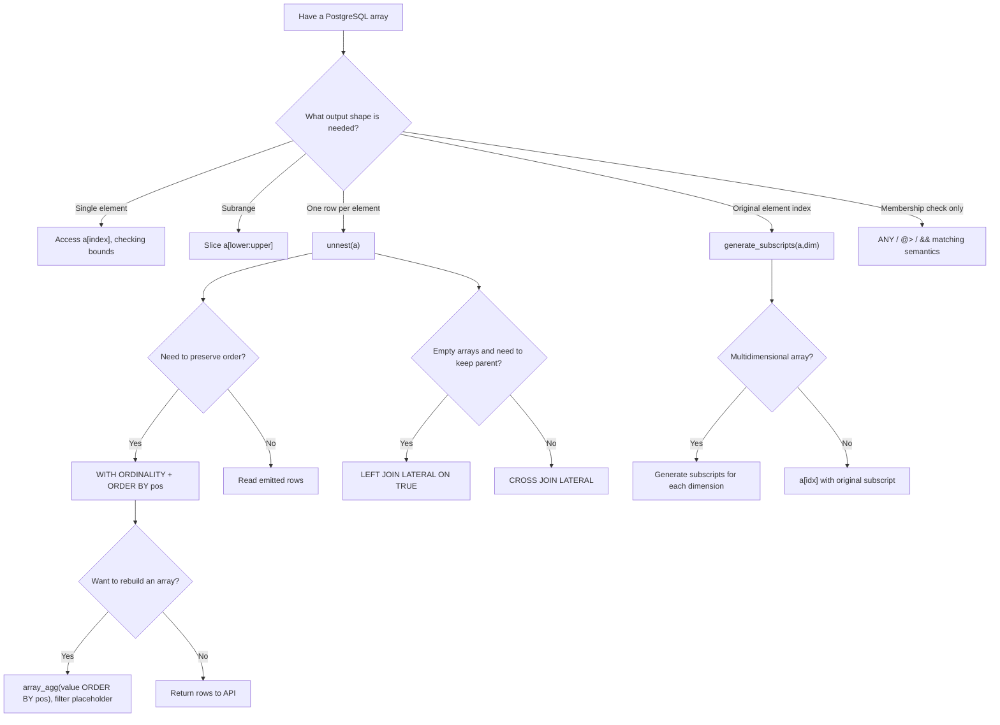

# Array Access, Slicing, unnest, and WITH ORDINALITY in PostgreSQL

PostgreSQL provides an **SQL array type** that allows storing multiple values of the same type in a single column or expression. Arrays are useful when a row needs to hold a relatively small structured set of values: tags, coordinates, scores, option lists, or intermediate processing results. However, reading elements, taking slices, expanding arrays into multiple rows, and tracking order must be understood accurately.

Example:

```sql
SELECT
    ARRAY['java', 'postgresql', 'sql']::text[] AS topics;
```

A PostgreSQL SQL array differs from a **JSON array**: normally, the first element of an SQL array is at position **1**, whereas the first element of a JSON array accessed with `->`/`->>` is at position **0**. PostgreSQL also allows some arrays to have a **lower bound other than 1**. Therefore, you should not guess indexes based on Java or JSON.

Four core operations:

- **Subscript:** `arr[2]` retrieves a single element.
- **Slice:** `arr[2:4]` retrieves a range including both endpoints.
- **`unnest(arr)`:** expands array elements into multiple rows in the result set.
- **`WITH ORDINALITY`:** adds a row-number column for the generated rows, starting at 1.

This lesson belongs to the **JSON and Arrays** chapter of the *Database Engine Relational PostgreSQL* module. We will progress from one-dimensional to multidimensional arrays; distinguish `NULL`, empty arrays, and NULL elements; combine `LATERAL`, `generate_subscripts`, and `array_agg`; and finally apply them in SELECTs, JOINs, JDBC APIs, and query optimization.

> The table-creation and data-modification statements are designed for a lab database. Do not run them directly in production without verifying the data and permissions.

## 1. What will you be able to do after this lesson?

1. Declare one-dimensional and two-dimensional arrays using `ARRAY[...]` or a cast literal.
2. Access elements by index and recognize `NULL` when accessing out of bounds.
3. Extract slices using `[lower:upper]` and understand **inclusive** bounds.
4. Use `array_lower`, `array_upper`, `array_length`, `cardinality`, and `array_dims` to inspect actual bounds.
5. Understand why an array can have a lower bound of 0 or a negative number.
6. Distinguish a `NULL` SQL array, an empty array `{}`, and an array containing `NULL` elements.
7. Use `unnest` in `FROM` to turn array data into rows.
8. Use `WITH ORDINALITY` to preserve the order emitted by a set-returning function.
9. Avoid confusing **ordinality** with the **array subscript**.
10. Use `generate_subscripts` when you need the original array indexes.
11. Retain rows with empty arrays using `LEFT JOIN LATERAL`.
12. Pair multiple arrays in parallel using the multi-argument form of `unnest` and understand NULL padding.
13. Rebuild an ordered array using `array_agg(... ORDER BY ...)`.
14. Handle arrays from Java/JDBC, JSON data, and queries that should instead be normalized into relational tables.

## 2. How is an SQL array structured?

An array contains elements of the same base type:

```sql
SELECT
    ARRAY[10, 20, 30]             AS integer_array,
    ARRAY['An', 'Bình', 'Chi']      AS text_array,
    ARRAY[TRUE, FALSE, TRUE]      AS boolean_array;
```

PostgreSQL usually infers the array type from the element types. In application code and prepared statements, you should **cast explicitly** when an array is empty or the element type could be ambiguous.

```sql
SELECT
    ARRAY[10, 20, 30]::integer[] AS scores,
    ARRAY['red', 'blue']::text[] AS labels,
    ARRAY[]::integer[] AS no_scores;
```

### 2.1. Two common representations

Using the constructor:

```sql
SELECT ARRAY[1, 2, 3]::integer[];
```

Using an array literal:

```sql
SELECT '{1,2,3}'::integer[];
```

**Do not confuse the literal `'{1,2,3}'` with JSON**. A JSON array is typically written `'[1,2,3]'::jsonb`, which has a different type and different access rules.

### 2.2. An array is a single value in a single column

```sql
CREATE TABLE demo_array.example (
    id BIGINT PRIMARY KEY,
    scores INTEGER[] NOT NULL
);
```

A row can hold the entire `{10,20,30}` array. This does not create three child rows; it is still **one SQL array value**.

If the system needs a foreign key, status, audit trail, or permissions on **each individual element**, putting everything in one array may not be the best model.

## 3. Creating the practice schema

All subsequent examples use the `demo_array` schema. Run them on a lab database where you are allowed to create tables.

```sql
CREATE SCHEMA IF NOT EXISTS demo_array;

CREATE TABLE demo_array.team (
    team_id BIGINT GENERATED ALWAYS AS IDENTITY PRIMARY KEY,
    team_name TEXT NOT NULL UNIQUE,
    members TEXT[] NOT NULL DEFAULT '{}'::text[],
    scores INTEGER[] NOT NULL DEFAULT '{}'::integer[],
    metadata JSONB NOT NULL DEFAULT '{}'::jsonb
);
```

Insert data:

```sql
INSERT INTO demo_array.team
    (team_name, members, scores, metadata)
VALUES
    (
        'Alpha',
        ARRAY['An', 'Bình', 'Chi'],
        ARRAY[5, 0, 7],
        '{"source":"internal","labels":["java","sql"]}'::jsonb
    ),
    (
        'Beta',
        ARRAY['Dũng', NULL, 'Em']::text[],
        ARRAY[2, NULL, 10]::integer[],
        '{"source":"external","labels":[]}'::jsonb
    ),
    (
        'Gamma',
        '{}'::text[],
        '{}'::integer[],
        '{"source":"internal","labels":["postgresql"]}'::jsonb
    );

ANALYZE demo_array.team;
```

We have three cases:

| Team | members | scores | Meaning |
|---|---|---|---|
| Alpha | `{An,Bình,Chi}` | `{5,0,7}` | All elements are non-NULL |
| Beta | `{Dũng,NULL,Em}` | `{2,NULL,10}` | Contains a NULL element at position 2 |
| Gamma | `{}` | `{}` | Empty array |

The array columns are declared `NOT NULL`, so neither `members` nor `scores` **can be a NULL array**, yet they can still be **arrays containing NULL elements**. These are two different kinds of NULL.

### 3.1. Inspecting the data

```sql
SELECT team_id, team_name, members, scores
FROM demo_array.team
ORDER BY team_id;
```

If you run the INSERT again on a schema that already has these three teams, the `team_name` unique constraint will raise a duplicate error. The hands-on sections below assume you run setup **once**.

## 4. Standard indexes start at 1

With the common array constructor:

```sql
WITH sample AS (
    SELECT ARRAY[10, 20, 30, 40] AS a
)
SELECT
    a[1] AS first_element,
    a[2] AS second_element,
    a[4] AS last_element
FROM sample;
```

Logical output:

| first_element | second_element | last_element |
|---:|---:|---:|
| 10 | 20 | 40 |

Unlike Java `int[]`, JavaScript arrays, and JSON arrays whose indexes start at 0, standard PostgreSQL SQL arrays start at **1**.

### 4.1. Accessing an array column

```sql
SELECT
    team_name,
    members[1] AS first_member,
    scores[2] AS second_score
FROM demo_array.team
ORDER BY team_id;
```

Meaning:

- Alpha: `members[1] = 'An'`, `scores[2] = 0`.
- Beta: `members[1] = 'Dũng'`, `scores[2] IS NULL`.
- Gamma: empty arrays, so `members[1]` and `scores[2]` return NULL.

### 4.2. Accessing an out-of-range index

```sql
WITH sample AS (
    SELECT ARRAY[10, 20, 30] AS a
)
SELECT
    a[0] AS before_first,
    a[99] AS after_last,
    a[-1] AS negative_index
FROM sample;
```

For this array, those expressions return **SQL NULL** rather than the “last element” as negative indexing does in some programming languages.

Do not use `a[-1]` to get the last element unless the array **actually** has a lower bound that includes -1.

## 5. Out-of-bounds NULL vs. a NULL element are not the same

Consider:

```sql
WITH sample AS (
    SELECT ARRAY[7, NULL, 9]::integer[] AS a
)
SELECT
    a[2] AS actual_null_element,
    a[99] AS out_of_range,
    a[3] AS value_9
FROM sample;
```

Both `a[2]` and `a[99]` can return NULL, but:

- `a[2]` is an **existing element** whose value is NULL.
- `a[99]` is a **non-existent position** in the array.

If the business logic needs to distinguish the two cases, you must check the **bounds**:

```sql
WITH sample AS (
    SELECT ARRAY[7, NULL, 9]::integer[] AS a
)
SELECT
    2 BETWEEN array_lower(a, 1) AND array_upper(a, 1)
        AS index_2_exists,
    99 BETWEEN array_lower(a, 1) AND array_upper(a, 1)
        AS index_99_exists,
    a[2] IS NULL AS element_2_is_null
FROM sample;
```

A normal one-dimensional array has contiguous indexes within its bounds. Thus you can know whether a position exists even though the value at that position is NULL.

## 6. Reading array length with array_length

```sql
SELECT
    team_name,
    array_length(members, 1) AS members_length,
    array_length(scores, 1) AS scores_length
FROM demo_array.team
ORDER BY team_id;
```

The second argument is the **dimension** to measure:

- `array_length(a, 1)`: number of elements along the first dimension.
- `array_length(a, 2)`: number of elements along the second dimension, if present.
- A one-dimensional array does not have a dimension 2.

### 6.1. For an empty array, array_length can be NULL

```sql
SELECT
    array_length('{}'::integer[], 1) AS empty_length,
    array_length(ARRAY[NULL::integer], 1) AS one_null_length;
```

Important result:

- `array_length('{}'::integer[], 1)` is **NULL**, not 0.
- An array containing one NULL element still has a length of **1**.

This is why you should not write a comparison expression like:

```sql
-- May not work as expected for empty arrays:
WHERE array_length(members, 1) = 0
```

For an empty array, `NULL = 0` evaluates to UNKNOWN, so the WHERE condition does not keep the row.

## 7. cardinality: total number of elements in the array

`cardinality(a)` returns the total number of elements, including positions holding NULL.

```sql
SELECT
    team_name,
    cardinality(members) AS member_slots,
    cardinality(scores) AS score_slots
FROM demo_array.team
ORDER BY team_id;
```

With the lab data:

| Team | cardinality(members) |
|---|---:|
| Alpha | 3 |
| Beta | 3 |
| Gamma | 0 |

### 7.1. cardinality differs from array_length for multiple dimensions

With a 2 × 3 array:

```sql
WITH sample AS (
    SELECT ARRAY[[1, 2, 3], [4, 5, 6]] AS m
)
SELECT
    array_length(m, 1) AS row_count,
    array_length(m, 2) AS column_count,
    cardinality(m) AS total_slots
FROM sample;
```

Result:

```text
row_count = 2
column_count = 3
total_slots = 6
```

If you need the total number of slots, `cardinality` is usually easier to read. It **counts NULL elements as well**; it does not count only non-NULL values.

### 7.2. A NULL array is still distinct from an empty array

```sql
SELECT
    cardinality(NULL::integer[]) AS null_array_count,
    cardinality('{}'::integer[]) AS empty_array_count,
    cardinality(ARRAY[NULL::integer]) AS one_null_slot;
```

The respective results are: **NULL, 0, 1**.

## 8. Arrays have lower and upper bounds

PostgreSQL allows an array's lower bound to be something other than 1.

```sql
SELECT
    array_lower(ARRAY[10, 20, 30], 1) AS lower_bound,
    array_upper(ARRAY[10, 20, 30], 1) AS upper_bound;
```

Normally: lower = 1, upper = 3.

However, you can also create:

```sql
SELECT '[0:2]={10,20,30}'::integer[] AS zero_based_array;
```

This array has:

```text
Subscript:  0   1   2
Value:     10  20  30
```

Reading the exact indexes:

```sql
WITH sample AS (
    SELECT '[0:2]={10,20,30}'::integer[] AS a
)
SELECT
    array_lower(a, 1) AS actual_lower,
    array_upper(a, 1) AS actual_upper,
    a[0] AS first_value,
    a[1] AS second_value,
    a[2] AS third_value
FROM sample;
```

### 8.1. Negative lower bounds can also exist

```sql
WITH sample AS (
    SELECT '[-2:0]={5,6,7}'::integer[] AS a
)
SELECT
    array_dims(a) AS dimension_text,
    a[-2] AS first_value,
    a[0] AS last_value
FROM sample;
```

Do not assume “negative indexes are always invalid.” They are only out of range on arrays whose bounds do not include that negative value.

### 8.2. array_dims displays bounds for each dimension

```sql
SELECT
    array_dims('[0:2]={10,20,30}'::integer[]) AS dims_1d,
    array_dims(ARRAY[[1,2,3],[4,5,6]]) AS dims_2d;
```

Illustrative result:

```text
dims_1d = [0:2]
dims_2d = [1:2][1:3]
```

`array_dims` returns a text representation of the bounds. When writing SQL that operates on positions, `array_lower`/`array_upper` and `generate_subscripts` are generally more flexible than parsing the dims string manually.

## 9. Distinguishing element value from element position

Here is an example that is very easy to confuse:

```sql
SELECT
    ARRAY[NULL::integer, 0, 3] AS a;
```

- Value **NULL** at subscript 1.
- Value **0** at subscript 2.
- Value **3** at subscript 3.
- No element at subscript 4.

`NULL` is not synonymous with 0. When rendering array results to an application, preserve length and position information instead of blindly filtering `WHERE value IS NOT NULL` and renumbering.

## 10. Array slicing: the [lower:upper] syntax

Given the array:

```text
Subscript:  1    2    3    4    5
Value:     10   20   30   40   50
```

`a[2:4]` extracts positions **2, 3, and 4**:

```sql
WITH sample AS (
    SELECT ARRAY[10, 20, 30, 40, 50] AS a
)
SELECT
    a[2:4] AS middle_three,
    a[1:2] AS first_two,
    a[4:5] AS last_two
FROM sample;
```

Logical output:

```text
middle_three = {20,30,40}
first_two    = {10,20}
last_two     = {40,50}
```

Both endpoints are **inclusive**. When lower ≤ upper and both lie within bounds, the valid slice length is typically `upper - lower + 1`.

### 10.1. Different from Python/Java slicing syntax

Python commonly uses `a[1:3]` to take positions 1 and 2, **excluding 3**. PostgreSQL slice `a[1:3]` includes position 3 as well.

Do not translate client-side indexes to SQL without accounting for differences in:

- 0-based vs. 1-based start.
- Inclusive vs. exclusive upper bound.
- Actual array bounds.
- NULL data and multidimensional arrays.

## 11. Out-of-bounds slicing

Example:

```sql
WITH sample AS (
    SELECT ARRAY[10, 20, 30] AS a
)
SELECT
    a[2:99] AS requested_past_end,
    a[10:20] AS entirely_outside
FROM sample;
```

A slice can return only the intersection with actual elements; if the range contains no valid elements, it can return an **empty array**, unlike `a[99]` which returns **NULL**.

Observe this in practice with:

```sql
WITH sample AS (
    SELECT ARRAY[10, 20, 30] AS a
)
SELECT
    cardinality(a[2:99]) AS kept_slots,
    cardinality(a[10:20]) AS empty_slots
FROM sample;
```

Do not use an out-of-bounds slice as a check for the value at a specific index; when you need to check existence, use `array_lower`/`array_upper` or `generate_subscripts`.

### 11.1. Reversed slice bounds do not reverse data

`a[4:2]` is **not** a way to reverse element order. If lower > upper, it does not produce a reverse slice as in some languages. To reverse elements, use `generate_subscripts(a,1,true)` and then `array_agg` with `ORDER BY`.

## 12. Does a slice preserve NULL elements?

Yes. A slice returns the positions within the range, including elements holding SQL NULL.

```sql
WITH sample AS (
    SELECT ARRAY[10, NULL, 30, 40]::integer[] AS a
)
SELECT
    a[1:3] AS first_three,
    cardinality(a[1:3]) AS number_of_slots
FROM sample;
```

The first slice has three slots, of which the second slot is NULL. You should not remove NULL elements unless a business rule requires dropping them.

## 13. Slicing is not relational pagination

`arr[101:120]` extracts a range from **an already existing array value**, unlike:

```sql
SELECT ...
FROM some_table
ORDER BY ...
LIMIT 20 OFFSET 100;
```

In relational SQL, row order is only defined when `ORDER BY` is present. By contrast, an array is a value with **intrinsic element order**. Mixing the two concepts can create bugs when `array_agg` omits an order specification.

### 13.1. Do not force all records into a giant array just to paginate

Building an `array_agg` of millions of values and then slicing `[100001:100020]` can consume far more memory/CPU than querying the source table with an index or keyset pagination. Slicing is appropriate when **the array already exists and has a reasonable size**, not as the default approach for deep pagination.

## 14. Two-dimensional arrays and double subscripting

PostgreSQL supports multidimensional arrays, such as a matrix:

```sql
SELECT ARRAY[
    [1, 2, 3],
    [4, 5, 6]
]::integer[][] AS matrix;
```

Represented in two dimensions:

```text
       column 1   column 2   column 3
row 1      1          2          3
row 2      4          5          6
```

Accessing elements:

```sql
WITH sample AS (
    SELECT ARRAY[[1,2,3],[4,5,6]] AS m
)
SELECT
    m[1][1] AS upper_left,
    m[1][3] AS upper_right,
    m[2][2] AS lower_middle,
    m[2][3] AS lower_right
FROM sample;
```

Result: 1, 3, 5, 6.

### 14.1. Length of each dimension

```sql
WITH sample AS (
    SELECT ARRAY[[1,2,3],[4,5,6]] AS m
)
SELECT
    array_ndims(m) AS dimensions,
    array_length(m, 1) AS rows_count,
    array_length(m, 2) AS columns_count,
    cardinality(m) AS total_elements,
    array_dims(m) AS bounds
FROM sample;
```

For this matrix:

```text
dimensions     = 2
rows_count     = 2
columns_count  = 3
total_elements = 6
bounds         = [1:2][1:3]
```

### 14.2. Multidimensional arrays must be rectangular

A constructor like:

```sql
-- INTENTIONALLY FAILS: subarrays do not have the same size.
SELECT ARRAY[[1,2],[3,4,5]];
```

PostgreSQL does not treat this as a valid 2D SQL array simply because JSON allows nested arrays of differing lengths. For ragged structures, JSONB or a relational table may be a better fit.

## 15. Slicing a two-dimensional array

Use `[lower_row:upper_row][lower_col:upper_col]`:

```sql
WITH sample AS (
    SELECT ARRAY[[1,2,3],[4,5,6]] AS m
)
SELECT
    m[1:2][2:3] AS last_two_columns,
    m[2:2][1:3] AS second_row_as_slice
FROM sample;
```

Meaning of the first slice:

```text
{{2,3},{5,6}}
```

It remains a **two-dimensional array**; it does not automatically become a one-dimensional array just because one of the slices selects a single row.

### 15.1. When slicing multidimensionally, write bounds for all dimensions explicitly

For readability and to avoid misinterpreting mixed subscript/slice syntax, prefer:

```sql
m[2:2][1:3]
```

instead of trying to mimic another language's `m[2][1:3]` syntax. If you only need a scalar element, use `m[2][3]`.

## 16. SQL arrays are not arbitrary “arrays of arrays”

Declarations like `integer[]` and `integer[][]` express intent, but PostgreSQL tracks the actual dimensionality/bounds inside the array value itself. In many contexts, the size or number of dimensions in the type declaration is not enforced as a strict fixed-matrix constraint like in some languages.

When business logic **requires 2 × 3** or an exact number of elements, you need appropriate explicit constraints or checks:

```sql
CREATE TABLE demo_array.fixed_matrix (
    matrix_id BIGINT GENERATED ALWAYS AS IDENTITY PRIMARY KEY,
    values_2x3 INTEGER[] NOT NULL,
    CONSTRAINT ck_matrix_size CHECK (
        array_ndims(values_2x3) = 2
        AND array_length(values_2x3, 1) = 2
        AND array_length(values_2x3, 2) = 3
    )
);
```

This example enforces two dimensions with the desired sizes; if you also need to forbid any NULL elements, add a separate validation policy.

## 17. unnest turns an array into multiple rows

`unnest` is a **set-returning function** (*SRF*): it emits each element of an array as a row.

```sql
SELECT element
FROM unnest(ARRAY[10, 20, 30]) AS u(element);
```

Result:

| element |
|---:|
| 10 |
| 20 |
| 30 |

Each element becomes a row. Unlike `arr[2]` (returns a scalar) or `arr[1:2]` (returns an array), `unnest(arr)` returns a **relation-like stream of rows**.

### 17.1. Aliases make SQL easier to read

```sql
SELECT u.member
FROM unnest(ARRAY['An','Bình','Chi']) AS u(member);
```

In `AS u(member)`:

- `u` is the alias for the table-function result.
- `member` is the column name holding the element value.

Do not choose aliases that collide with columns from other tables in queries with large JOINs; prefer clear, semantic aliases.

## 18. unnest with NULL elements

```sql
SELECT u.value
FROM unnest(ARRAY[10, NULL, 30]::integer[]) AS u(value);
```

The result still has **three rows**, with the second row holding NULL.

If you add:

```sql
SELECT u.value
FROM unnest(ARRAY[10, NULL, 30]::integer[]) AS u(value)
WHERE u.value IS NOT NULL;
```

then only two rows remain. That is a **query filtering decision**, not the default behavior of `unnest`.

### 18.1. Empty arrays produce zero rows

```sql
SELECT u.value
FROM unnest('{}'::integer[]) AS u(value);
```

The query returns **0 rows**.

### 18.2. NULL arrays also produce zero rows

```sql
SELECT u.value
FROM unnest(NULL::integer[]) AS u(value);
```

The query also returns **0 rows**. However, `NULL::integer[]` is not synonymous with `'{}'::integer[]` at the SQL value level; check which one occurs before flattening.

## 19. Unnesting each row's array with LATERAL

Applied to the `team` table:

```sql
SELECT
    t.team_id,
    t.team_name,
    u.member
FROM demo_array.team AS t
CROSS JOIN LATERAL unnest(t.members) AS u(member)
ORDER BY t.team_id;
```

Meaning: for **each row t**, run `unnest(t.members)` and combine the emitted rows.

### 19.1. Why LATERAL?

`LATERAL` allows an item in `FROM` to depend on values from a preceding item. Here `unnest(t.members)` references the `t.members` column of the current row.

For table functions in `FROM`, PostgreSQL allows referencing preceding columns without always requiring the `LATERAL` keyword, but writing `CROSS JOIN LATERAL` makes the intent explicit.

### 19.2. Rows with empty arrays disappear in CROSS JOIN

Team Gamma has `members='{}'`, so `unnest` emits 0 rows. `CROSS JOIN LATERAL` does not keep Gamma in the result.

This is a consequence of **JOIN cardinality**. If you need to keep every team, switch to `LEFT JOIN LATERAL`.

## 20. LEFT JOIN LATERAL keeps rows with empty arrays

```sql
SELECT
    t.team_id,
    t.team_name,
    u.member
FROM demo_array.team AS t
LEFT JOIN LATERAL unnest(t.members) AS u(member)
    ON TRUE
ORDER BY t.team_id;
```

For Gamma, there will be one result row with `u.member IS NULL` due to **outer join padding**, even though the source array has no elements.

### 20.1. Distinguishing three kinds of NULL rows under LEFT JOIN

A result row with `member=NULL` can come from:

1. **A real NULL element**, such as position 2 of Beta.
2. **An empty array**, where LEFT JOIN creates a placeholder row.
3. **A NULL array**, where LEFT JOIN also creates a placeholder if the column is nullable.

To distinguish them, add `WITH ORDINALITY` and inspect the ordinal position:

```sql
SELECT
    t.team_name,
    u.member,
    u.ordinality
FROM demo_array.team AS t
LEFT JOIN LATERAL unnest(t.members)
    WITH ORDINALITY AS u(member, ordinality)
    ON TRUE
ORDER BY t.team_id, u.ordinality;
```

- Beta, real NULL element: `u.ordinality = 2`.
- Gamma, LEFT JOIN placeholder row: `u.ordinality IS NULL`.

This is an important technique when you want to rebuild the array without introducing a spurious NULL into the result.

## 21. What is WITH ORDINALITY?

`WITH ORDINALITY` adds a `bigint` integer column numbering **the rows emitted by the set-returning function**, starting at 1:

```sql
SELECT
    u.value,
    u.position
FROM unnest(ARRAY['A', 'B', 'C'])
    WITH ORDINALITY AS u(value, position);
```

Result:

| value | position |
|---|---:|
| A | 1 |
| B | 2 |
| C | 3 |

### 21.1. WITH ORDINALITY is used in FROM

General pattern:

```sql
FROM unnest(array_expression)
WITH ORDINALITY AS alias(value_column, ordinal_column)
```

Do not write `WITH ORDINALITY` as an operator on a single scalar column. It appends an ordering column to the output of a table function in `FROM`.

### 21.2. Ordinality is not a query-wide ROW_NUMBER()

`WITH ORDINALITY` numbers the **order of rows emitted by the function**. When invoked via LATERAL for each parent row `t`, the sequence restarts for every function call:

```sql
SELECT
    t.team_name,
    u.member,
    u.pos
FROM demo_array.team AS t
CROSS JOIN LATERAL unnest(t.members)
    WITH ORDINALITY AS u(member, pos)
ORDER BY t.team_id, u.pos;
```

Alpha gets pos 1,2,3; Beta also gets pos 1,2,3. `WITH ORDINALITY` does not produce a single counter across all teams.

## 22. Ordinality differs from array subscript

This is the easiest bug to hit when working with custom lower bounds.

```sql
WITH sample AS (
    SELECT '[0:2]={10,20,30}'::integer[] AS a
)
SELECT
    u.value,
    u.pos
FROM sample AS s
CROSS JOIN LATERAL unnest(s.a)
    WITH ORDINALITY AS u(value, pos);
```

Result:

| value | pos |
|---:|---:|
| 10 | 1 |
| 20 | 2 |
| 30 | 3 |

However, the **actual subscripts** of those values are **0, 1, 2**.

`WITH ORDINALITY` numbers emitted rows starting at 1; it **does not preserve the original indexes** of the array.

### 22.1. Computing the real subscript for a 1D array

For a 1D array, element indexes are contiguous from the lower bound:

\[
\text{subscript} =
\text{array\_lower}(a,1) + \text{ordinality} - 1
\]

SQL:

```sql
WITH sample AS (
    SELECT '[0:2]={10,20,30}'::integer[] AS a
)
SELECT
    u.value,
    u.pos,
    array_lower(s.a, 1) + u.pos - 1
        AS original_subscript
FROM sample AS s
CROSS JOIN LATERAL unnest(s.a)
    WITH ORDINALITY AS u(value, pos);
```

Result:

```text
value   pos   original_subscript
10      1     0
20      2     1
30      3     2
```

This works cleanly for 1D. For multiple dimensions, do not use a simple additive formula for a single index; use `generate_subscripts` along each dimension instead.

## 23. generate_subscripts retrieves original indexes

`generate_subscripts(array, dimension)` returns the set of **valid subscripts** for the chosen dimension.

```sql
WITH sample AS (
    SELECT '[0:2]={10,20,30}'::integer[] AS a
)
SELECT
    s.idx,
    x.a[s.idx] AS value
FROM sample AS x
CROSS JOIN LATERAL generate_subscripts(x.a, 1) AS s(idx)
ORDER BY s.idx;
```

Result:

| idx | value |
|---:|---:|
| 0 | 10 |
| 1 | 20 |
| 2 | 30 |

`generate_subscripts` is useful when:

- The array lower bound does not default to 1.
- You need to label rows by their **original logical/physical index**.
- You need both the element and its position at the same time.
- You need to traverse each dimension of a multidimensional array.
- You need to iterate over indexes in reverse order.

### 23.1. The dimension parameter

```sql
SELECT s.idx
FROM generate_subscripts(
    ARRAY[10,20,30],
    1
) AS s(idx);
```

Dimension 1 exists and has three subscripts. If you request a dimension that does not exist, the function does not emit indexes as if it were a dummy dimension.

### 23.2. Counting slots using subscripts

```sql
WITH sample AS (
    SELECT ARRAY[10, NULL, 30]::integer[] AS a
)
SELECT COUNT(*) AS slots
FROM sample AS x
CROSS JOIN LATERAL generate_subscripts(x.a, 1) AS s(idx);
```

Returns 3; NULL elements still have valid subscripts.

## 24. Traversing an array in reverse order

`generate_subscripts` accepts a third boolean argument to reverse the order of generated subscripts:

```sql
WITH sample AS (
    SELECT ARRAY['A','B','C']::text[] AS a
)
SELECT
    s.idx,
    x.a[s.idx] AS value
FROM sample AS x
CROSS JOIN LATERAL generate_subscripts(x.a, 1, TRUE) AS s(idx);
```

Rows are emitted at indexes 3, 2, 1.

If you need to guarantee the order in the **final SQL result**, add `ORDER BY s.idx DESC`:

```sql
WITH sample AS (
    SELECT ARRAY['A','B','C']::text[] AS a
)
SELECT x.a[s.idx] AS value
FROM sample AS x
CROSS JOIN LATERAL generate_subscripts(x.a, 1) AS s(idx)
ORDER BY s.idx DESC;
```

A set-returning function may emit values in a particular order, but the final relational result only **guarantees order when ORDER BY is written**. This is especially important when JOIN/GROUP BY can alter the execution plan.

## 25. unnest on a 2D array: flattening in storage order

`unnest` on a multidimensional array produces **one row per scalar element**, traversing in storage order (*row-major*, with the last dimension index changing fastest).

```sql
SELECT
    u.value,
    u.pos
FROM unnest(ARRAY[[1,2,3],[4,5,6]])
    WITH ORDINALITY AS u(value, pos);
```

Result:

| value | pos |
|---:|---:|
| 1 | 1 |
| 2 | 2 |
| 3 | 3 |
| 4 | 4 |
| 5 | 5 |
| 6 | 6 |

The original array has a 2 × 3 structure, but the output from unnest is six rows. **Row/column position information is not readily available** if you only keep `value` and `pos`.

### 25.1. Do not arbitrarily derive two indexes from ordinality alone

You could compute row/column with integer division/modulo when you know the exact size and bounds of a rectangular matrix. However, if dimensionality changes, lower bounds differ from 1, or slicing is involved, hard-coded formulas break easily.

Prefer `generate_subscripts` to obtain coordinate pairs directly.

## 26. generate_subscripts for two-dimensional arrays

```sql
WITH sample AS (
    SELECT ARRAY[[1,2,3],[4,5,6]] AS m
)
SELECT
    r.row_idx,
    c.col_idx,
    s.m[r.row_idx][c.col_idx] AS cell_value
FROM sample AS s
CROSS JOIN LATERAL generate_subscripts(s.m, 1) AS r(row_idx)
CROSS JOIN LATERAL generate_subscripts(s.m, 2) AS c(col_idx)
ORDER BY r.row_idx, c.col_idx;
```

Result:

```text
row_idx col_idx cell_value
1       1       1
1       2       2
1       3       3
2       1       4
2       2       5
2       3       6
```

This is a clean way to turn a matrix into a `(row_index, column_index, value)` relation.

### 26.1. Use when full coordinates must be preserved

For instance, a score matrix that needs to be exported as a three-column CSV `row, col, score`; `generate_subscripts` preserves the coordinates instead of yielding only a flat 1..6 sequence from `unnest`.

## 27. Unnesting multiple arrays in parallel

PostgreSQL supports passing **multiple array arguments** to `unnest` when used in `FROM`:

```sql
SELECT
    u.member,
    u.score
FROM unnest(
    ARRAY['An','Bình','Chi']::text[],
    ARRAY[5,0,7]::integer[]
) AS u(member, score);
```

Result:

| member | score |
|---|---:|
| An | 5 |
| Bình | 0 |
| Chi | 7 |

The arrays are expanded **in parallel by position**, which is very useful when two arrays represent two attributes of the same positional list.

### 27.1. When lengths do not match

```sql
SELECT *
FROM unnest(
    ARRAY[10,20,30],
    ARRAY['A','B']::text[]
) AS u(number_value, label);
```

Result:

| number_value | label |
|---:|---|
| 10 | A |
| 20 | B |
| 30 | NULL |

The shorter array is **NULL-padded** so the row count equals the maximum length. This padding can easily be mistaken for a real NULL element in the source array.

### 27.2. The multi-argument form must be used in FROM

Do not treat `unnest(a,b)` as a regular scalar expression in `SELECT`. The multi-argument form is supported by PostgreSQL as a table function in `FROM`.

## 28. WITH ORDINALITY when unnesting multiple arrays

```sql
SELECT
    u.member,
    u.score,
    u.pos
FROM unnest(
    ARRAY['An','Bình','Chi']::text[],
    ARRAY[5,0]::integer[]
)
WITH ORDINALITY AS u(member, score, pos);
```

Result:

```text
member   score   pos
An       5       1
Bình     0       2
Chi      NULL    3
```

Ordinality numbers the **paired rows**, not each array separately. If the two arrays differ in length, positions continue up to the last element of the longest array.

### 28.1. Why can padding hide data bugs?

If `members` has 5 people but `scores` only has 4 scores, multi-argument unnest still runs and produces a row with a NULL score.

This is convenient in ETL, yet it can mask mismatches. If business rules require both arrays to always have the same number of elements, add a constraint:

```sql
ALTER TABLE demo_array.team
ADD CONSTRAINT ck_team_parallel_array_lengths
CHECK (cardinality(members) = cardinality(scores));
```

In the lab dataset, Alpha/Beta/Gamma all have equal cardinality across the two arrays. The constraint protects **equal length** without forbidding NULL elements.

## 29. Parallel unnest with a parent row

```sql
SELECT
    t.team_name,
    u.member,
    u.score,
    u.pos
FROM demo_array.team AS t
CROSS JOIN LATERAL unnest(t.members, t.scores)
    WITH ORDINALITY AS u(member, score, pos)
ORDER BY t.team_id, u.pos;
```

This is a common pattern for expanding two parallel arrays into a list of rows sharing the same position.

### 29.1. Avoid CROSS JOINing two independent unnests

This query is usually **wrong** if the goal is to pair elements at the same position:

```sql
SELECT
    m.member,
    s.score
FROM demo_array.team AS t
CROSS JOIN LATERAL unnest(t.members) AS m(member)
CROSS JOIN LATERAL unnest(t.scores) AS s(score)
WHERE t.team_name = 'Alpha';
```

If Alpha has 3 members and 3 scores, two `CROSS JOIN`s produce **3 × 3 = 9 pairs**, not 3 parallel pairs.

The right approach: use `unnest(members, scores)` in FROM, or unnest both sets with ordinality and JOIN on position.

## 30. Joining two lists by ordinality

When you prefer not to use multi-argument unnest, you can write:

```sql
SELECT
    m.member,
    s.score,
    m.pos
FROM unnest(ARRAY['An','Bình','Chi']::text[])
    WITH ORDINALITY AS m(member, pos)
JOIN unnest(ARRAY[5,0,7]::integer[])
    WITH ORDINALITY AS s(score, pos)
    ON s.pos = m.pos
ORDER BY m.pos;
```

Note: this is an **INNER JOIN** on position. If lengths differ, positions present only in the longer array **are dropped**, unlike multi-argument `unnest` which pads with NULL.

### 30.1. When all positions must be preserved

Use a `FULL JOIN` on ordinality if you want to keep both sides, or directly use `unnest(a,b)` with defined padding semantics. Choose based on business requirements, not merely shorter syntax.

## 31. array_agg rebuilds an array from multiple rows

`array_agg` is an aggregate function that collects values from multiple rows into an array:

```sql
SELECT array_agg(u.value ORDER BY u.pos) AS rebuilt
FROM unnest(ARRAY[10,20,30])
    WITH ORDINALITY AS u(value, pos);
```

Result: `{10,20,30}`.

### 31.1. ORDER BY inside the aggregate matters

Do not write:

```sql
SELECT array_agg(u.value)
FROM unnest(ARRAY[10,20,30]) AS u(value);
```

and assume the order of `array_agg` is **always guaranteed** to match the source order. In SQL, the input order to an aggregate can change due to JOINs, Sort, Hash Aggregate, or planner optimizations.

When order matters, write:

```sql
array_agg(u.value ORDER BY u.pos)
```

rather than only placing ORDER BY on the outer query.

### 31.2. array_agg includes NULL elements

```sql
SELECT array_agg(u.value ORDER BY u.pos)
FROM unnest(ARRAY[10, NULL, 30]::integer[])
    WITH ORDINALITY AS u(value, pos);
```

The result contains three slots, of which the second slot is NULL.

To exclude NULL elements, you must use an explicit filter and accept that the positions of the remaining elements will shift.

## 32. Rebuilding an array from LEFT JOIN LATERAL without creating spurious NULLs

Here is a real-world pitfall: for team Gamma with an empty array, `LEFT JOIN LATERAL` produces a placeholder row with `member=NULL`. If you call `array_agg(u.member)` directly, Gamma can end up with **`{NULL}`** instead of `{}`.

Correct pattern:

```sql
SELECT
    t.team_id,
    t.team_name,
    COALESCE(
        array_agg(u.member ORDER BY u.pos)
            FILTER (WHERE u.pos IS NOT NULL),
        '{}'::text[]
    ) AS rebuilt_members
FROM demo_array.team AS t
LEFT JOIN LATERAL unnest(t.members)
    WITH ORDINALITY AS u(member, pos)
    ON TRUE
GROUP BY t.team_id, t.team_name
ORDER BY t.team_id;
```

Explanation:

- Alpha gets its 3 elements back.
- Beta gets its 3 elements back, **preserving the real NULL at position 2**, because `pos=2`.
- Gamma has a placeholder row with `pos=NULL`, which FILTER removes; `array_agg` over zero values returns NULL, and `COALESCE` turns it into an empty array.

### 32.1. Why not FILTER member IS NOT NULL?

```sql
FILTER (WHERE u.member IS NOT NULL)
```

would delete Beta's **real** NULL element. When you need to preserve the original structure, use the presence of **ordinality** to distinguish real rows from LEFT JOIN padding.

## 33. NULL array vs. empty array: complete example

The `team` table has `members NOT NULL`. To illustrate a NULL array as well, use a standalone CTE:

```sql
WITH sample(id, values_array) AS (
    VALUES
        (1, ARRAY['A','B']::text[]),
        (2, '{}'::text[]),
        (3, NULL::text[]),
        (4, ARRAY[NULL::text])
)
SELECT
    id,
    values_array IS NULL AS is_null_array,
    cardinality(values_array) AS slots
FROM sample
ORDER BY id;
```

Logical output:

| id | is_null_array | slots |
|---:|---|---:|
| 1 | false | 2 |
| 2 | false | 0 |
| 3 | true | NULL |
| 4 | false | 1 |

### 33.1. unnest and OUTER JOIN

```sql
WITH sample(id, values_array) AS (
    VALUES
        (1, ARRAY['A','B']::text[]),
        (2, '{}'::text[]),
        (3, NULL::text[]),
        (4, ARRAY[NULL::text])
)
SELECT
    s.id,
    u.value,
    u.pos
FROM sample AS s
LEFT JOIN LATERAL unnest(s.values_array)
    WITH ORDINALITY AS u(value, pos)
    ON TRUE
ORDER BY s.id, u.pos;
```

How to read it:

- ID 1: two rows, pos 1 and 2.
- ID 2: one placeholder row, pos NULL.
- ID 3: one placeholder row, pos NULL.
- ID 4: one **real** NULL-element row, pos 1.

Use both `s.values_array IS NULL` and `u.pos` together if you need to distinguish all three cases.

## 34. COUNT(*) vs. COUNT(value) after unnest

```sql
SELECT
    t.team_name,
    COUNT(*) AS emitted_rows,
    COUNT(u.member) AS non_null_members
FROM demo_array.team AS t
CROSS JOIN LATERAL unnest(t.members) AS u(member)
GROUP BY t.team_name
ORDER BY t.team_name;
```

For Beta:

- `COUNT(*)` counts 3 rows emitted by `unnest`.
- `COUNT(u.member)` counts only the 2 non-NULL values.

Gamma does not appear because `CROSS JOIN LATERAL` emits 0 rows.

### 34.1. Keeping Gamma while still counting slots accurately

```sql
SELECT
    t.team_name,
    cardinality(t.members) AS slots,
    COUNT(u.pos) AS emitted_slots,
    COUNT(u.member) AS non_null_members
FROM demo_array.team AS t
LEFT JOIN LATERAL unnest(t.members)
    WITH ORDINALITY AS u(member, pos)
    ON TRUE
GROUP BY t.team_id, t.team_name, t.members
ORDER BY t.team_id;
```

For Gamma:

- `slots = 0`.
- `emitted_slots = 0` because the placeholder has `pos IS NULL`.
- `non_null_members = 0`.

Using `COUNT(*)` with LEFT JOIN here would yield at least 1 row even for an empty array, so it **does not reflect the array cardinality**.

## 35. Filtering elements with unnest

For example, finding members whose names start with the letter B:

```sql
SELECT
    t.team_name,
    u.member,
    u.pos
FROM demo_array.team AS t
CROSS JOIN LATERAL unnest(t.members)
    WITH ORDINALITY AS u(member, pos)
WHERE u.member LIKE 'B%'
ORDER BY t.team_id, u.pos;
```

In the logical query model, `WHERE` applies to each element **after unnesting the array**.

### 35.1. Dropping elements after filtering is intentional

If the original `members` is `{'An','Bình','Chi'}` and we only take members starting with B, the output only leaves Bình. Ordinality still carries the original position from the **unnest output**, e.g., pos=2.

If you later rebuild the array with `array_agg(member ORDER BY pos)`, the resulting array is shorter, yet the relative order among the kept elements remains correct.

### 35.2. Do not re-join by position after filtering one side

If you filter members first and then generate a new `row_number()` to join scores, positions will be renumbered and may pair the wrong scores. Use the original ordinality or multi-argument unnest to keep slots aligned.

## 36. Distinguishing WITH ORDINALITY and ROW_NUMBER()

`ROW_NUMBER()` is a **window function** operating over a relational set according to `OVER (ORDER BY ...)`; `WITH ORDINALITY` attaches sequence numbers as the table function emits rows.

Example:

```sql
SELECT
    t.team_name,
    u.member,
    u.pos AS original_array_order,
    ROW_NUMBER() OVER (
        PARTITION BY t.team_id
        ORDER BY u.member NULLS LAST
    ) AS alphabetical_rank
FROM demo_array.team AS t
CROSS JOIN LATERAL unnest(t.members)
    WITH ORDINALITY AS u(member, pos)
ORDER BY t.team_id, alphabetical_rank;
```

- `pos`: order **within the array**.
- `alphabetical_rank`: order by **member name** within each team.

They can differ. Do not substitute one function for the other just because both columns show 1,2,3 on a small dataset.

## 37. WITH ORDINALITY and ORDER BY in complex JOINs

`WITH ORDINALITY` assigns an emission sequence number, but it **does not force the final output to remain ordered by pos**.

Example:

```sql
SELECT
    t.team_name,
    u.member,
    u.pos
FROM demo_array.team AS t
CROSS JOIN LATERAL unnest(t.members)
    WITH ORDINALITY AS u(member, pos)
JOIN (
    VALUES ('Alpha'), ('Beta'), ('Gamma')
) AS allowed(team_name)
    ON allowed.team_name = t.team_name
ORDER BY t.team_name, u.pos;
```

`ORDER BY t.team_name, u.pos` is the explicit presentation requirement. The join planner may choose a different execution plan, yet the final result must still satisfy the order.

### 37.1. DISTINCT and GROUP BY can alter ordering

If you merely write:

```sql
SELECT DISTINCT u.member
FROM demo_array.team AS t
CROSS JOIN LATERAL unnest(t.members) AS u(member);
```

then there is no longer a unique original ordinality per name, since a name can appear in multiple teams/positions. To achieve deterministic ordering, you must define a new criterion: smallest `team_id,pos`, alphabetical, or another business ordering.

## 38. array_position and array_positions

When you need to find the position of a value in a one-dimensional array, PostgreSQL provides:

- `array_position(a, value)`: position of the first occurrence.
- `array_positions(a, value)`: array of all occurrence positions.

```sql
SELECT
    array_position(ARRAY['A','B','A']::text[], 'A')
        AS first_a,
    array_positions(ARRAY['A','B','A']::text[], 'A')
        AS all_a_positions;
```

Result:

```text
first_a        = 1
all_a_positions = {1,3}
```

### 38.1. Can search for NULL elements

`array_position`/`array_positions` use search semantics capable of matching SQL NULL elements as well:

```sql
SELECT
    array_position(ARRAY[5,NULL,9]::integer[], NULL::integer)
        AS null_position;
```

Result: 2.

If the function returns NULL because nothing was found or because the source array itself is NULL, distinguish the two by inspecting the source data and bounds when business rules require it.

### 38.2. Do not use on multidimensional arrays as a coordinate lookup

`array_position`/`array_positions` are intended for the one-dimensional case. If you need coordinates of a value in a matrix, use `generate_subscripts` on each dimension and filter `m[i][j]`.

## 39. Finding NULL elements while preserving positions

```sql
SELECT
    t.team_name,
    u.pos AS null_slot
FROM demo_array.team AS t
CROSS JOIN LATERAL unnest(t.members)
    WITH ORDINALITY AS u(member, pos)
WHERE u.member IS NULL
ORDER BY t.team_id, u.pos;
```

Result: Beta has one NULL element at pos 2.

This is a convenient way to validate data after ingesting arrays from an API. If you need the **original subscript** for an array that does not start at 1, use `generate_subscripts` instead of pos.

## 40. Slicing after filtering: two distinct problems

Problem A: “Take slots 2 through 4 of the original array.”

```sql
WITH sample AS (
    SELECT ARRAY['A','B','C','D','E']::text[] AS a
)
SELECT a[2:4]
FROM sample;
```

Result: B,C,D.

Problem B: “Filter elements by a condition and then take the first three elements of the filtered list.”

```sql
WITH sample AS (
    SELECT ARRAY['A','B','C','D','E']::text[] AS a
)
SELECT array_agg(value ORDER BY pos) AS result
FROM (
    SELECT u.value, u.pos
    FROM sample AS s
    CROSS JOIN LATERAL unnest(s.a)
        WITH ORDINALITY AS u(value, pos)
    WHERE u.value >= 'B'
    ORDER BY u.pos
    LIMIT 3
) AS selected;
```

Filtering occurs before LIMIT on the **relation of elements**, so it can produce a different result from slicing the original array. Clearly specify the ordering and filter required by the product.

## 41. Reversing a one-dimensional array

PostgreSQL does not require you to write a procedural function to reverse a small array:

```sql
WITH sample AS (
    SELECT ARRAY['A','B','C']::text[] AS a
)
SELECT array_agg(s.a[idx] ORDER BY idx DESC) AS reversed
FROM sample AS s
CROSS JOIN LATERAL generate_subscripts(s.a, 1) AS x(idx);
```

Result: `{C,B,A}`.

This is an example using `generate_subscripts` and `array_agg`; for large arrays, this operation still carries the cost of unnesting and sorting/aggregating, so it is not free.

## 42. Updating an element by subscript

PostgreSQL supports subscript assignment in `UPDATE`:

```sql
UPDATE demo_array.team
SET scores[2] = 8
WHERE team_name = 'Alpha';
```

Alpha's second value changes from 0 to 8. The entire row is still subject to MVCC/locks/constraints like a normal UPDATE.

### 42.1. Updating a slice

```sql
UPDATE demo_array.team
SET scores[1:2] = ARRAY[10, 20]
WHERE team_name = 'Alpha';
```

The command updates the first two slots. Running this in the lab may change score results in later exercises.

### 42.2. Updating an indexed array still has overhead

If the `scores` column is covered by a GIN index or expression index, modifying the array can require index maintenance, WAL writes, and reduced chances of a HOT update on the table.

Do not think of modifying one slot as “an in-place 4-byte edit that leaves the row version untouched.”

## 43. Appending and concatenating arrays

Commonly used functions/operators:

```sql
SELECT
    array_append(ARRAY[1,2], 3) AS appended,
    array_prepend(0, ARRAY[1,2]) AS prepended,
    ARRAY[1,2] || ARRAY[3,4] AS concatenated;
```

Logical output:

```text
appended     = {1,2,3}
prepended    = {0,1,2}
concatenated = {1,2,3,4}
```

### 43.1. Do not confuse adding an element with adding a dimension

`array_append` and the `||` operator have specific rules regarding dimensionality and argument types. Do not concatenate two 2D arrays of incompatible sizes expecting arbitrary JSON-like nested lists.

### 43.2. Check NULL behavior when concatenating

When the system allows NULL arrays, functions and operators have specific NULL semantics that you should verify on your target PostgreSQL version. If the application requires a non-NULL array, prefer `NOT NULL DEFAULT '{}'::type[]` in the schema.

## 44. Non-NULL elements vs. valid positions

To compute the average of **non-NULL** scores:

```sql
SELECT
    t.team_name,
    AVG(u.score)::numeric(10,2) AS average_non_null_score
FROM demo_array.team AS t
LEFT JOIN LATERAL unnest(t.scores) AS u(score)
    ON TRUE
GROUP BY t.team_id, t.team_name
ORDER BY t.team_id;
```

`AVG` ignores NULL values. For Gamma with no scores, aggregating over the placeholder NULL returns NULL, not 0.

If business logic wants 0 when there are no scores, apply `COALESCE(AVG(...),0)` **deliberately**, rather than treating it as a default mathematical rule.

### 44.1. Do not use COUNT(score) as array length

Beta has three slots, one of which is NULL; `COUNT(score)=2`, whereas `cardinality(scores)=3`. The two metrics answer two different questions.

## 45. Finding teams containing a specific element

Approach one: `ANY` on an array:

```sql
SELECT team_id, team_name
FROM demo_array.team
WHERE 'An' = ANY(members);
```

Approach two: array containment:

```sql
SELECT team_id, team_name
FROM demo_array.team
WHERE members @> ARRAY['An']::text[];
```

Approach three: `EXISTS` with unnest:

```sql
SELECT t.team_id, t.team_name
FROM demo_array.team AS t
WHERE EXISTS (
    SELECT 1
    FROM unnest(t.members) AS u(member)
    WHERE u.member = 'An'
);
```

All three forms may find the exact same teams in simple cases, yet they are **not strictly equivalent** when considering NULL elements, multiple values, duplicates, and operator types. Choose based on semantics and index access paths.

## 46. GIN index for array containment/overlap

PostgreSQL can often use a GIN index when querying matching array operators such as:

- `@>`: left array contains the required elements.
- `<@`: left array is contained by the right array.
- `&&`: the two arrays share common elements.

```sql
CREATE INDEX idx_team_members_gin
ON demo_array.team
USING gin (members);
```

Query:

```sql
SELECT team_name
FROM demo_array.team
WHERE members @> ARRAY['An']::text[];
```

Or:

```sql
SELECT team_name
FROM demo_array.team
WHERE members && ARRAY['An','Em']::text[];
```

The planner may choose GIN if row counts, statistics, and cost estimates favor it. With three lab rows, a Seq Scan is very likely cheaper.

### 46.1. = ANY(column_array) is not synonymous with a GIN index condition

`'An' = ANY(members)` is readable SQL for membership, but you should not assume PostgreSQL always converts it into the same index path as `members @> ARRAY['An']`.

When optimizing for GIN, use an operator supported by the operator class and verify with `EXPLAIN (ANALYZE, BUFFERS)`.

### 46.2. Duplicates inside arrays

Array containment does not treat repetition counts as **multiset containment** in all cases. Membership example:

```sql
SELECT ARRAY[1] @> ARRAY[1,1] AS contains_duplicate_values;
```

Returning true matches PostgreSQL's containment semantics: do not use this operator to prove an array contains **two separate copies** of the same number.

## 47. When should you use unnest instead of a membership operator?

Use `unnest` when you need:

- One row **per position**.
- Both elements and their order.
- A JOIN with a lookup table for each element.
- Aggregates over individual elements.
- Detection of NULL elements or duplicates by position.
- Pairing two arrays in parallel.

Use `ANY`/`@>`/`&&` when you only need to ask about **presence/overlap** of values, especially with a suitable index. Do not flatten millions of arrays just to answer a boolean check when a direct array operator suffices semantically.

## 48. Joining an array with a lookup table

Create a simple member directory table:

```sql
CREATE TABLE demo_array.member_directory (
    member_name TEXT PRIMARY KEY,
    department TEXT NOT NULL
);

INSERT INTO demo_array.member_directory
    (member_name, department)
VALUES
    ('An','Backend'),
    ('Bình','Data'),
    ('Chi','Frontend'),
    ('Dũng','Backend'),
    ('Em','QA');
```

Join element by element:

```sql
SELECT
    t.team_name,
    u.member,
    u.pos,
    d.department
FROM demo_array.team AS t
CROSS JOIN LATERAL unnest(t.members)
    WITH ORDINALITY AS u(member, pos)
LEFT JOIN demo_array.member_directory AS d
    ON d.member_name = u.member
ORDER BY t.team_id, u.pos;
```

Elements without a directory match (including NULL elements) are still preserved thanks to `LEFT JOIN` against the directory.

### 48.1. Output order must rely on pos

Even if the directory JOIN uses an index, the output is not guaranteed to preserve array order without `ORDER BY t.team_id, u.pos`.

### 48.2. You cannot enforce an FK per array element using GIN alone

A GIN index on `members` speeds up membership queries, **not** referential integrity requiring every name in the array to exist in `member_directory`. If you need a true foreign key on each team-member relationship, use a junction table:

```sql
CREATE TABLE demo_array.team_member (
    team_id BIGINT NOT NULL
        REFERENCES demo_array.team(team_id),
    member_name TEXT NOT NULL
        REFERENCES demo_array.member_directory(member_name),
    member_position INTEGER NOT NULL CHECK (member_position > 0),
    PRIMARY KEY (team_id, member_position)
);
```

A junction table supports FKs, indexes, and per-membership metadata. Order is stored in the `member_position` column. This is a strong option when lists are large, change frequently, and carry clear relational semantics.

## 49. JSON arrays vs. SQL arrays: indexing differences

PostgreSQL has both SQL arrays and JSONB arrays.

```sql
WITH sample AS (
    SELECT
        ARRAY['A','B','C']::text[] AS sql_array,
        '["A","B","C"]'::jsonb AS json_array
)
SELECT
    sql_array[1] AS sql_first,
    json_array ->> 0 AS json_first,
    json_array ->> 1 AS json_second
FROM sample;
```

Result:

- `sql_array[1]` = A.
- `json_array ->> 0` = A.
- `json_array ->> 1` = B.

**SQL arrays are 1-based by default; JSON arrays are 0-based.**

### 49.1. JSONB is not a homogeneous typed SQL array

A JSON array can mix text, numbers, objects, booleans, and JSON null. An SQL array has a uniform element type and specific multidimensional constraints.

Do not convert every JSON array into `text[]` without defining typing, null handling, and query goals.

## 50. jsonb_array_elements WITH ORDINALITY

A JSONB array also has set-returning functions:

```sql
SELECT
    j.element,
    j.pos,
    j.pos - 1 AS json_zero_based_index
FROM jsonb_array_elements(
    '["java","sql","postgresql"]'::jsonb
)
WITH ORDINALITY AS j(element, pos);
```

Result:

```text
element         pos   json_zero_based_index
"java"          1     0
"sql"           2     1
"postgresql"    3     2
```

### 50.1. JSON elements have type JSONB

`jsonb_array_elements` returns each item as `jsonb`. For JSON strings you often want:

```sql
SELECT
    j.value,
    j.pos
FROM jsonb_array_elements_text(
    '["java","sql","postgresql"]'::jsonb
)
WITH ORDINALITY AS j(value, pos);
```

The `value` output is `text`, making it convenient for comparisons against lookup tables. For JSON objects, choose the function matching the JSON structure.

### 50.2. Ordinality still starts at 1

Even though JSON `->0` points to the first element, `jsonb_array_elements(...) WITH ORDINALITY` still emits `pos=1` for the first row. If you need the JSON index, use `pos-1`.

### 50.3. JSON null and SQL NULL must be distinguished

A JSON `null` item can be returned as the JSONB value `'null'::jsonb` or converted to SQL NULL depending on the conversion path or text function used. When integrating JSON and SQL arrays, check types with `jsonb_typeof` alongside `IS NULL` checks, as they mean different things.

## 51. JSONB arrays inside columns with LATERAL

Using `metadata` from the `team` table:

```sql
SELECT
    t.team_name,
    j.label,
    j.pos
FROM demo_array.team AS t
CROSS JOIN LATERAL jsonb_array_elements_text(t.metadata -> 'labels')
    WITH ORDINALITY AS j(label, pos)
ORDER BY t.team_id, j.pos;
```

Gamma has `["postgresql"]`; Beta has `[]` and therefore emits no rows from the empty JSON array.

If the `labels` field is missing or not of JSON array type, behavior varies depending on input. Do not assume every JSONB object has a properly typed `labels`; you can check with:

```sql
SELECT
    team_name,
    jsonb_typeof(metadata -> 'labels') AS labels_json_type
FROM demo_array.team;
```

### 51.1. Keeping rows missing labels

Use `LEFT JOIN LATERAL` if you want to keep teams that have no labels:

```sql
SELECT
    t.team_name,
    j.label,
    j.pos
FROM demo_array.team AS t
LEFT JOIN LATERAL jsonb_array_elements_text(t.metadata -> 'labels')
    WITH ORDINALITY AS j(label, pos)
    ON TRUE
ORDER BY t.team_id, j.pos;
```

Remember that the placeholder row has `pos=NULL`; do not mistake it for a label at position 1.

## 52. Converting an SQL array to a JSON array

`to_jsonb` converts an SQL array into a JSONB value:

```sql
SELECT
    to_jsonb(ARRAY['A','B','C']::text[]) AS json_array;
```

The result is a JSON array with matching element order. When accessed using JSON operators, however, indexing starts at **0**.

### 52.1. Do not assume every JSON array can be cast directly with ::text[]

There is no general rule that:

```sql
-- Not a universal cast from a JSONB array to text[]:
SELECT '["A","B"]'::jsonb::text[];
```

can replace a properly designed conversion. When needed, use `jsonb_array_elements_text` and `array_agg(... ORDER BY ordinality)` or a verified conversion function.

```sql
SELECT array_agg(e.value ORDER BY e.pos) AS sql_array
FROM jsonb_array_elements_text('["A","B"]'::jsonb)
    WITH ORDINALITY AS e(value, pos);
```

For an empty JSON array, `array_agg` returns NULL because there are zero input rows; wrap with `COALESCE(..., '{}'::text[])` if you want an empty SQL array.

## 53. Ordered aggregation after JOIN

Suppose you want to build an array of departments ordered by each team's members:

```sql
SELECT
    t.team_name,
    COALESCE(
        array_agg(d.department ORDER BY u.pos)
            FILTER (WHERE u.pos IS NOT NULL),
        '{}'::text[]
    ) AS departments_in_member_order
FROM demo_array.team AS t
LEFT JOIN LATERAL unnest(t.members)
    WITH ORDINALITY AS u(member, pos)
    ON TRUE
LEFT JOIN demo_array.member_directory AS d
    ON d.member_name = u.member
GROUP BY t.team_id, t.team_name
ORDER BY t.team_id;
```

For a truly NULL member or when no directory row is found, the output department at that position will be NULL. That is useful information if you want to **preserve positions**, unlike dropping all unknown departments.

### 53.1. Multiple directory matches will change the length

In the lab, `member_name` is a PK, so at most one row matches. If you JOIN to a table that has multiple rows per member, each slot can multiply into multiple rows, making the resulting `array_agg` longer than the original array. Verify cardinality before rebuilding the array.

## 54. Performance: unnest multiplies query row count

If a table has 100,000 rows, each containing 50 elements on average, `CROSS JOIN LATERAL unnest` can emit roughly **5 million rows** before WHERE/GROUP/JOIN narrows them down.

```text
100.000 parent rows
         ×
50 elements / array
         =
5.000.000 unnested rows
```

That is the intermediate relational cost, before accounting for joins, sorts, network transfer, and serialization.

### 54.1. Inspecting the plan

```sql
EXPLAIN (ANALYZE, BUFFERS)
SELECT
    t.team_id,
    u.member
FROM demo_array.team AS t
CROSS JOIN LATERAL unnest(t.members) AS u(member)
WHERE u.member = 'An';
```

The plan typically includes a `Function Scan on unnest` node. Inspect:

- `actual rows`.
- `loops`.
- Filters and rows removed by filter.
- Buffer reads from the parent table.
- Subsequent Sort/Hash/Join nodes.
- Actual execution times, not just node names.

### 54.2. Do not use unnest if the query only checks membership and an index exists

For text arrays with a GIN index, compare `members @> ARRAY['An']` against `EXISTS (SELECT FROM unnest(...))` on real data. Do not rewrite every membership check as a flatten operation merely because the SQL looks familiar.

## 55. Filtering the parent table before unnest

If you only need team Alpha:

```sql
SELECT
    t.team_name,
    u.member,
    u.pos
FROM demo_array.team AS t
CROSS JOIN LATERAL unnest(t.members)
    WITH ORDINALITY AS u(member, pos)
WHERE t.team_name = 'Alpha'
ORDER BY u.pos;
```

PostgreSQL can usually apply selective filters on the parent table before executing unnest for matching rows, though the exact plan depends on SQL shape and the optimizer.

### 55.1. Materialized CTEs can affect optimization

If you place unnest inside a materialized CTE and filter afterward, the engine may unnest far more arrays than necessary. In modern PostgreSQL, some CTEs can be inlined; `MATERIALIZED` changes that choice. Inspect EXPLAIN rather than guessing from the presence of `WITH`.

## 56. Array size and design limits

There is no single element-count threshold that fits every system, but a very large array in a single row can cause:

- Rewriting a large amount of data when updating a single element.
- Significant TOAST compression/out-of-line storage and WAL volume.
- Unnest queries generating huge numbers of rows.
- Row-lock contention when multiple clients modify different slots of the **same row**.
- Difficulty defining FKs, UNIQUE constraints, or per-element metadata.
- Difficulty paginating or running specialized element filters.

If each element has its own lifecycle, faces concurrent updates, or needs multi-attribute indexing, a **relational child table** is usually better suited than an SQL array.

### 56.1. When are arrays appropriate?

- Small lists with a clearly bounded size.
- Elements share the same lifecycle as the parent row.
- Rarely needing to JOIN on individual elements.
- No requirement for complex per-element FKs/unique constraints.
- Order matters and the entire list is usually read together.

### 56.2. When should you normalize?

- Each element is an entity with its own ID, metadata, or permissions.
- Per-element updates/deletes happen under high concurrency.
- Queries filter across multiple element attributes.
- Per-element unique constraints or foreign keys are needed.
- Auditing or retention tracking is required per membership.

## 57. JDBC: reading an SQL array from ResultSet

With pgJDBC, you can retrieve a `java.sql.Array` object:

```java
String sql = """
    SELECT team_id, team_name, members
    FROM demo_array.team
    WHERE team_name = ?
    """;

try (PreparedStatement ps = connection.prepareStatement(sql)) {
    ps.setString(1, "Alpha");

    try (ResultSet rs = ps.executeQuery()) {
        if (rs.next()) {
            java.sql.Array dbArray = rs.getArray("members");

            if (dbArray != null) {
                try {
                    Object raw = dbArray.getArray();
                    // Convert/validate the array type according to the pgJDBC version.
                    System.out.println(java.util.Arrays.deepToString(
                        new Object[]{raw}
                    ));
                } finally {
                    dbArray.free();
                }
            }
        }
    }
}
```

Driver behavior and the exact Java array class returned can vary by SQL type, dimensionality, and pgJDBC version. Do not blindly cast every `getArray()` result to `String[]`/`Integer[]` when NULLs or multiple dimensions may exist.

### 57.1. Null elements and primitive arrays

`Integer[]` can hold `null`, whereas `int[]` cannot. If an SQL array permits NULL elements, mapping to a primitive array can lose data or throw an exception. Define your DTO policy clearly.

### 57.2. JDBC does not automatically preserve SQL lower bounds in Java array indexes

Even if an SQL array has a lower bound of 0, -2, or 5, Java arrays use Java's 0-based indexing. If business logic needs the **original SQL subscripts**, query them with `generate_subscripts` and return them as a separate column; do not infer them solely from Java indexes.

## 58. JDBC: passing an array to PreparedStatement

Use `Connection#createArrayOf`:

```java
String sql = """
    SELECT team_id, team_name
    FROM demo_array.team
    WHERE members && ?
    """;

java.sql.Array names = connection.createArrayOf(
    "text",
    new String[]{"An", "Em"}
);

try {
    try (PreparedStatement ps = connection.prepareStatement(sql)) {
        ps.setArray(1, names);

        try (ResultSet rs = ps.executeQuery()) {
            while (rs.next()) {
                System.out.println(rs.getString("team_name"));
            }
        }
    }
} finally {
    names.free();
}
```

This binds an SQL array value of type `text[]`. Never concatenate input directly into a `'{...}'` string literal in SQL due to escaping, NULLs, commas, braces, and SQL injection risks.

### 58.1. Do not use placeholders for column names

`?` binds values; it cannot substitute table or column names in `ORDER BY`. For dynamic SQL, whitelist valid identifiers and expressions in the application layer.

## 59. JDBC: mapping unnest and ordinality to a DTO

An API needs to return members along with their positions:

```java
String sql = """
    SELECT
        t.team_id,
        u.member,
        u.pos
    FROM demo_array.team AS t
    CROSS JOIN LATERAL unnest(t.members)
        WITH ORDINALITY AS u(member, pos)
    WHERE t.team_id = ?
    ORDER BY u.pos
    """;

try (PreparedStatement ps = connection.prepareStatement(sql)) {
    ps.setLong(1, teamId);

    try (ResultSet rs = ps.executeQuery()) {
        while (rs.next()) {
            long sqlOrdinality = rs.getLong("pos");
            String member = rs.getString("member");
            // member can be null even when pos > 0.
            // If the client needs a zero-based position:
            long zeroBasedPosition = sqlOrdinality - 1;
            System.out.println(zeroBasedPosition + ": " + member);
        }
    }
}
```

`WITH ORDINALITY` starts at 1. If the API expects a Java zero-based index over the **emitted list**, subtracting 1 is correct. For an SQL array whose lower bound is not 1, however, `pos-1` is **not** the original SQL subscript. Use `generate_subscripts` to return the actual subscript.

## 60. Exercise 1: where do indexes start?

```sql
SELECT (ARRAY[5,10,15]::integer[])[1];
```

**Answer:** 5. Standard PostgreSQL SQL arrays start at 1, not 0.

## 61. Exercise 2: last element

Given:

```sql
WITH src AS (
    SELECT '[0:2]={10,20,30}'::integer[] AS a
)
SELECT
    a[array_upper(a,1)] AS last_value
FROM src;
```

**Answer:** 30. Use `array_upper` instead of assuming `cardinality(a)` is always the last subscript.

## 62. Exercise 3: array_length of an empty array

```sql
SELECT
    array_length('{}'::integer[], 1),
    cardinality('{}'::integer[]);
```

**Answer:** the first value is NULL, the second is 0. When counting slots in an array that might be empty, `cardinality` is usually a better fit.

## 63. Exercise 4: are NULL elements counted?

```sql
SELECT cardinality(ARRAY[1,NULL,3]::integer[]);
```

**Answer:** 3, because cardinality counts slots, not non-NULL values.

## 64. Exercise 5: does a slice include the upper bound?

```sql
WITH s AS (
    SELECT ARRAY[10,20,30,40,50] AS a
)
SELECT a[2:4] FROM s;
```

**Answer:** `{20,30,40}`. A PostgreSQL slice includes both position 2 and position 4.

## 65. Exercise 6: taking the trailing slice using bounds

A one-dimensional array has an unusual lower bound. Write a slice expression that takes the last three slots without assuming the last subscript equals cardinality:

```sql
WITH s AS (
    SELECT '[5:9]={10,20,30,40,50}'::integer[] AS a
)
SELECT a[
    array_upper(a,1)-2 :
    array_upper(a,1)
] AS last_three
FROM s;
```

**Answer:** the values 30,40,50. When the array has fewer than three elements, the slice only returns the intersection within bounds; define the expected business behavior.

## 66. Exercise 7: does unnest drop NULL elements?

```sql
SELECT u.value
FROM unnest(ARRAY['A',NULL,'C']::text[]) AS u(value);
```

**Answer:** no. There are three rows, and the second row holds NULL.

## 67. Exercise 8: empty arrays and CROSS JOIN LATERAL

Team Gamma has `members='{}'`. The query uses:

```sql
FROM demo_array.team t
CROSS JOIN LATERAL unnest(t.members) AS u(member)
```

**Question:** Does Gamma still appear in the output?

**Answer:** no, because unnest emits 0 rows. Use `LEFT JOIN LATERAL ... ON TRUE` to keep the parent row.

## 68. Exercise 9: distinguishing placeholder NULL from a real NULL element

After `LEFT JOIN LATERAL unnest(... ) WITH ORDINALITY`:

- Beta has row `member=NULL, pos=2`.
- Gamma has row `member=NULL, pos=NULL`.

**Answer:** Beta's is a real NULL element, whereas Gamma's is a placeholder row from LEFT JOIN. When rebuilding the array, use `FILTER (WHERE pos IS NOT NULL)`, not `WHERE member IS NOT NULL`, if you want to preserve real NULLs.

## 69. Exercise 10: lower bound equal to 0

```sql
SELECT
    u.value,
    u.pos
FROM unnest('[0:2]={10,20,30}'::integer[])
    WITH ORDINALITY AS u(value, pos);
```

**Question:** Is `pos` for element 10 equal to 0 or 1?

**Answer:** 1. `WITH ORDINALITY` is independent of the array lower bound. The original subscript of value 10 is 0.

## 70. Exercise 11: choosing the right function for actual subscripts

Suppose you want to return:

```text
idx=0, value=10
idx=1, value=20
idx=2, value=30
```

for the array `'[0:2]={10,20,30}'::int[]`.

**Answer:** use `generate_subscripts(a,1)` and read `a[idx]`, rather than relying solely on `WITH ORDINALITY`.

## 71. Exercise 12: flattening a 2D array

```sql
SELECT value, pos
FROM unnest(ARRAY[[1,2],[3,4]])
    WITH ORDINALITY AS u(value, pos);
```

**Answer:** four values 1,2,3,4 with pos 1..4. `unnest` flattens in storage order and does not automatically return `(row,col)`.

## 72. Exercise 13: generating matrix coordinates

Write a query returning `(row_idx,col_idx,cell_value)` for a 2 × 2 matrix:

```sql
WITH sample AS (
    SELECT ARRAY[[1,2],[3,4]] AS m
)
SELECT r.idx AS row_idx,
       c.idx AS col_idx,
       s.m[r.idx][c.idx] AS cell_value
FROM sample AS s
CROSS JOIN LATERAL generate_subscripts(s.m,1) AS r(idx)
CROSS JOIN LATERAL generate_subscripts(s.m,2) AS c(idx)
ORDER BY row_idx, col_idx;
```

**Answer:** coordinates (1,1)=1; (1,2)=2; (2,1)=3; (2,2)=4.

## 73. Exercise 14: unnesting two arrays of unequal length

```sql
SELECT *
FROM unnest(
    ARRAY['A','B','C']::text[],
    ARRAY[1,2]::integer[]
) WITH ORDINALITY AS u(name,score,pos);
```

**Answer:** 3 rows; the third row has `name='C'`, `score=NULL`, `pos=3`. Multi-arg unnest pads the shorter array with NULL.

## 74. Exercise 15: how many rows from CROSS JOINing two unnests?

```sql
FROM unnest(ARRAY[1,2,3]) AS a(x)
CROSS JOIN unnest(ARRAY['A','B']) AS b(y)
```

**Answer:** 3 × 2 = 6 rows. If you need positional pairing, use multi-argument `unnest` or JOIN by ordinality.

## 75. Exercise 16: COUNT(*) vs. COUNT(member)

Beta has three member slots, one of which is NULL.

**Answer:** after `unnest(Beta.members)`, `COUNT(*)` is 3 and `COUNT(member)` is 2.

## 76. Exercise 17: rebuilding an ordered array

Suppose a query produces columns `value,pos` whose rows may be reordered by the planner.

```sql
SELECT array_agg(value ORDER BY pos)
FROM some_rows;
```

**Answer:** use `ORDER BY` inside `array_agg`. Do not rely on incidental ordering from source rows.

## 77. Exercise 18: empty arrays and array_agg

A `LEFT JOIN LATERAL` creates a placeholder NULL for Gamma. Using `array_agg(member)` would yield `{NULL}`.

**Answer:** use `array_agg(member ORDER BY pos) FILTER (WHERE pos IS NOT NULL)` and `COALESCE(..., '{}'::text[])` to restore the empty array while keeping real NULL elements.

## 78. Exercise 19: choosing a membership operator

You only need to check whether a team includes member An; the table has a GIN index on `members`.

**Guided answer:** test `members @> ARRAY['An']::text[]` against `'An'=ANY(members)` and EXISTS+unnest using EXPLAIN. There is no need to flatten everything when only boolean membership is needed, provided NULL and duplicate semantics match your requirements.

## 79. Exercise 20: JSON vs. SQL array indexing differences

```sql
WITH s AS (
    SELECT ARRAY['A','B']::text[] AS a,
           '["A","B"]'::jsonb AS j
)
SELECT a[1], j->>0 FROM s;
```

**Answer:** both return A. SQL arrays default to 1-based, JSONB arrays to 0-based.

## 80. Exercise 21: JSONB WITH ORDINALITY

`jsonb_array_elements_text('["A","B"]'::jsonb) WITH ORDINALITY` returns pos 1 and 2.

**Question:** how do you obtain the original JSON index?

**Answer:** for a JSON array, the corresponding index is `pos - 1`, namely 0 and 1. This is not an SQL array subscript.

## 81. Exercise 22: two arrays representing business entities

One column `product_ids bigint[]` and another column `quantities int[]` are updated separately by two services. One service deletes the second product but forgets to delete the second quantity.

**Guided answer:** the two parallel arrays have drifted out of positional alignment. If this represents items in an order, an `order_line(order_id,line_no,product_id,quantity)` table with PK/FK/constraints is far more reliable.

## 82. Exercise 23: using LEFT JOIN yet still losing a team

Query:

```sql
SELECT t.team_name, u.member
FROM demo_array.team t
LEFT JOIN LATERAL unnest(t.members) AS u(member) ON TRUE
WHERE u.member = 'An';
```

**Question:** Does Gamma remain?

**Answer:** no, because `WHERE u.member='An'` filters out the placeholder NULL. If you want to keep all teams and only show matching members, consider placing the filter condition inside the LATERAL/`ON` clause; be explicit about the desired semantics.

## 83. Exercise 24: array_length vs. cardinality on a matrix

Matrix `ARRAY[[1,2,3],[4,5,6]]`.

**Answer:** `array_length(m,1)=2`, `array_length(m,2)=3`, `cardinality(m)=6`.

## 84. Exercise 25: testing without running on production

You need to inspect the behavior of `UPDATE scores[2]=8` and a GIN index.

**Approach:** run inside a transaction on a lab schema; check row versions/EXPLAIN/stats according to your permissions. Never run UPDATE against business tables just to test syntax; even a rolled-back transaction generates WAL and holds locks for its duration.

## 85. Quick reference table

| Need | Syntax/concept |
|---|---|
| Create an integer array | `ARRAY[1,2,3]::integer[]` |
| Empty text array | `'{}'::text[]` |
| Second element | `a[2]` |
| Elements from 2 through 3 | `a[2:3]` |
| Matrix element | `m[2][3]` |
| Matrix slice | `m[1:2][2:3]` |
| Dimension 1 lower bound | `array_lower(a,1)` |
| Dimension 1 upper bound | `array_upper(a,1)` |
| Slots in dimension 1 | `array_length(a,1)` |
| Total slots | `cardinality(a)` |
| Display bounds | `array_dims(a)` |
| Expand array into rows | `unnest(a)` |
| Add row ordinal number | `unnest(a) WITH ORDINALITY` |
| Get real subscript | `generate_subscripts(a,1)` |
| Get 2D coordinates | `generate_subscripts(m,1)` × `generate_subscripts(m,2)` |
| Pair two arrays by position | `unnest(a,b)` in FROM |
| Keep parent when array is empty | `LEFT JOIN LATERAL ... ON TRUE` |
| Expand array per parent row | `CROSS JOIN LATERAL unnest(t.a)` |
| Restore array order | `array_agg(value ORDER BY pos)` |
| Exclude LEFT JOIN placeholder | `FILTER (WHERE pos IS NOT NULL)` |
| Empty array from zero aggregate rows | `COALESCE(array_agg(...),'{}'::type[])` |
| Find first occurrence in 1D | `array_position(a,value)` |
| Find all positions of a value | `array_positions(a,value)` |
| Membership | `value = ANY(a)` |
| Array contains | `a @> ARRAY[value]` |
| Array overlap | `a && other_array` |
| GIN index on array | `CREATE INDEX ... USING gin (array_col)` |
| First SQL array element | Usually `a[1]`, but check lower bound |
| First JSON array element | `j->0` or `j->>0` |
| JSON array into rows | `jsonb_array_elements(j)` |
| JSON text array into rows | `jsonb_array_elements_text(j)` |
| JDBC bind SQL array | `Connection#createArrayOf` + `PreparedStatement#setArray` |

## 86. Operation selection diagram



## 87. Practical checklist to avoid bugs

1. Have you confirmed whether the column type is `integer[]`/`text[]` or `jsonb`?
2. Are you confusing default 1-based SQL arrays with 0-based JSON/Java arrays?
3. Could any array have a custom lower bound?
4. Are you using `array_upper` instead of `cardinality` for the last index when the lower bound is not 1?
5. Do you distinguish a NULL array, an empty array, and a NULL element?
6. Do you use `cardinality` when you want to count NULL slots as well?
7. Did you remember that `array_length('{}',1)` is NULL?
8. Does your slice account for the **inclusive** upper boundary?
9. Did you accidentally write a reversed slice `[upper:lower]` expecting reversal?
10. Do multidimensional arrays have a valid rectangular shape?
11. Are you confusing `unnest` flattening a matrix with preserving coordinates?
12. Do you use `generate_subscripts` when you need actual SQL subscripts?
13. Are you confusing `WITH ORDINALITY` with the original subscript of a 0-based array?
14. Do you add `ORDER BY pos` when final result order matters?
15. Are you confusing `CROSS JOIN LATERAL` with `LEFT JOIN LATERAL` for empty arrays?
16. Did you accidentally filter `u.member IS NOT NULL` and drop real NULL elements?
17. Do you use `u.pos IS NOT NULL` to remove placeholder rows when rebuilding arrays?
18. Do you use `array_agg(... ORDER BY pos)` instead of relying on subquery order?
19. Are you aware that multi-argument `unnest` pads shorter arrays with NULL?
20. Did you create a Cartesian product by CROSS JOINing two separate `unnest` calls?
21. Should you add a CHECK constraint enforcing equal cardinality for parallel arrays?
22. Have you verified the business data does not require per-element foreign keys?
23. Is there an appropriate GIN index when queries only perform containment/overlap checks?
24. Have you measured `EXPLAIN` when unnest emits millions of rows?
25. Are NULL elements and SQL bounds mapped properly in JDBC?
26. Do you use bind values and `createArrayOf` instead of concatenating array literals from input?
27. Do you distinguish JSON `null` from SQL NULL?
28. Have you defined an array size/growth policy before storing large lists inside a single row?
29. Should you normalize into a child table when elements have independent lifecycles or concurrency?
30. Do your test suites cover empty arrays, lower bound 0, and duplicate values?

## 88. Summary

A PostgreSQL array is a data type with **order, dimensionality, and index bounds**. To use it accurately, separate four layers of operations:

1. **Element access:** `a[i]` retrieves a single value at an actual subscript; standard SQL arrays start at 1, though other lower bounds are possible.
2. **Slicing:** `a[l:u]` extracts a subarray over a range **inclusive of both ends**, unlike Python slices which exclude the upper bound.
3. **Expanding into a relation:** `unnest(a)` emits one row per element, including NULL elements; empty arrays and NULL arrays emit 0 rows.
4. **Attaching sequence numbers:** `WITH ORDINALITY` numbers emitted rows starting at **1**, which is not necessarily the original subscript. When you need real subscripts, use `generate_subscripts`.

When joining with a parent table, `CROSS JOIN LATERAL` drops rows with empty arrays, whereas `LEFT JOIN LATERAL` preserves the parent via a placeholder row. When re-aggregating with `array_agg`, include `ORDER BY` inside the aggregate and filter placeholders using **ordinality IS NOT NULL** if you want to keep real NULL elements.

For two-dimensional arrays, `unnest` flattens in storage order; `generate_subscripts` on each dimension preserves coordinates. For JSONB arrays, indexes with the `->` operator start at **0**, while `WITH ORDINALITY` still starts at 1. For application data, avoid turning an array column into a large collection of entities with individual FK/unique/concurrency needs; when true relational semantics are needed, a normalized child table is far easier to manage.

**Three practical questions to ask before writing SQL:** “Do I need a value, a slice, or rows?”, “Do I want emitted ordinality or the original subscript?”, and “Where can the data be empty or contain NULLs?”. Answering these three questions clearly helps you use subscripts, slices, `unnest`, and `WITH ORDINALITY` accurately and maintainably.
