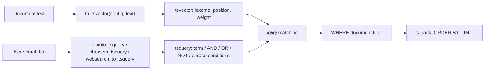

# to_tsvector, plainto_tsquery, phraseto_tsquery, and websearch_to_tsquery in PostgreSQL

Applications often need to search documents with phrases like "PostgreSQL search", "fat cat", or a search box accepting `postgresql OR database -legacy`. Using only `LIKE '%keyword%'` makes it hard to simultaneously support word normalization, stop-word removal, phrase search, and relevance ranking across large document sets.

PostgreSQL has built-in **full-text search (FTS)**. The four functions in this lesson form the foundation for using FTS properly:

- **`to_tsvector`**: transforms document text into searchable **lexemes**, along with positions and weights when appropriate.
- **`plainto_tsquery`**: takes plain search text and turns meaningful words into **AND** conditions.
- **`phraseto_tsquery`**: takes a plain phrase, preserving **word order and distance** to match words appearing as a phrase.
- **`websearch_to_tsquery`**: accepts syntax close to a web search box: plain words, quoted phrases, `OR`, and `-` for exclusion.

`to_tsvector` produces the **searchable document data**, while the three `*_tsquery` functions build the **search condition**. The `@@` operator matches the two sides:

```sql
SELECT
    to_tsvector('english', 'PostgreSQL provides fast text search')
    @@ plainto_tsquery('english', 'fast searches')
    AS matches;
```

Even though `searches` differs in form from `search`, the English configuration can normalize both to the same lexeme. This is a key distinction from pure character-string matching.

This lesson belongs to the **Text Search** chapter and focuses on the syntax, semantics, and practical pitfalls of these exact four functions; then it applies them to sample data, GIN indexes, ranking, Java/JDBC, and testing methodology.

## 1. Full-Text Search Model: Documents and Search Queries

Picture the pipeline:



During that process:

1. **Text search configuration** governs tokenization and dictionaries, e.g., the `english` configuration.
2. The parser recognizes tokens such as words, numbers, emails, or strings classified by dedicated rules.
3. Dictionaries can convert a token into a normalized lexeme, discard a stop word, or emit multiple lexemes.
4. `tsvector` stores those lexemes as a lookup representation for a document.
5. `tsquery` holds the structured search condition.
6. `@@` returns a Boolean: whether the document satisfies the condition.
7. A GIN index, if designed appropriately, can locate candidate documents faster than a full table scan.

### 1.1. "Lexeme" differs from "original word"

For example, in the `english` configuration, forms such as `run` and `running` can be folded to the same lexeme. Very common words like `the` or `and` are identified as **stop words** and dropped from the standard search representation.

Thus FTS answers "do the **normalized lexical units** appear according to the search rules?", rather than "does the byte sequence contain this substring?".

That brings both strengths and limits:

- Good for word-based content search.
- Can match stemmed word forms.
- Can shrink lookup size by dropping stop words.
- Not naturally suited for checking **exact emails, SKU codes, phone numbers, or strings with special punctuation**.
- Does not automatically solve word segmentation across all languages.

### 1.2. Two data types to distinguish

| Type | Represents | Typical constructor functions |
| --- | --- | --- |
| `tsvector` | List of lexemes for a **document**; may include positions and weights | `to_tsvector` |
| `tsquery` | Condition expression over lexemes and operators | `plainto_tsquery`, `phraseto_tsquery`, `websearch_to_tsquery`, `to_tsquery` |

A `tsquery` is not a SQL `SELECT` statement. Nor is a `tsvector` a copy of the original text. When you need to display titles or excerpts, you must still keep the original text data.

## 2. Quick Test of All Four Functions Before Creating Tables

The following SQL queries can be run directly on PostgreSQL with the standard `english` configuration.

### 2.1. to_tsvector

```sql
SELECT to_tsvector(
    'english',
    'The quick brown fox jumps over the lazy dogs'
) AS doc_vector;
```

The output consists of lexemes with positions, e.g. `'brown':3`, `'dog':9`, `'fox':4`, and others. **The display order of lexemes is not the sentence order**; the position numbers after `:` map back to the original order.

### 2.2. plainto_tsquery

```sql
SELECT plainto_tsquery(
    'english',
    'quick brown fox'
) AS plain_query;
```

Typical output:

```text
'quick' & 'brown' & 'fox'
```

The three words are joined with **AND**: all meaningful lexemes must appear in the document, though not necessarily adjacent or in order.

### 2.3. phraseto_tsquery

```sql
SELECT phraseto_tsquery(
    'english',
    'quick brown fox'
) AS phrase_query;
```

Typical output:

```text
'quick' <-> 'brown' <-> 'fox'
```

`<->` is the **FOLLOWED BY** operator with a distance of one position: lexemes must appear in order and adjacent in the FTS positional model.

### 2.4. websearch_to_tsquery

```sql
SELECT websearch_to_tsquery(
    'english',
    '"quick brown" OR "fat cat"'
) AS web_query;
```

Typical output:

```text
'quick' <-> 'brown' | 'fat' <-> 'cat'
```

Double quotes create a phrase requirement, and `OR` creates a disjunction. This is a syntax users can learn faster than raw `to_tsquery` expressions.

## 3. Self-Contained Hands-on Dataset

Create a `fts_lab` schema in a **learning database**. Never run the creation/deletion statements in this lesson against a production database with real data.

### 3.1. Articles table and generated tsvector column

```sql
CREATE SCHEMA IF NOT EXISTS fts_lab;

CREATE TABLE fts_lab.articles (
    article_id bigint PRIMARY KEY,
    title text NOT NULL,
    body text NOT NULL,
    visibility text NOT NULL
        CHECK (visibility IN ('public', 'private')),
    published_at timestamptz NOT NULL,

    search_document tsvector GENERATED ALWAYS AS (
        setweight(
            to_tsvector('english'::regconfig, coalesce(title, '')),
            'A'
        ) ||
        setweight(
            to_tsvector('english'::regconfig, coalesce(body, '')),
            'D'
        )
    ) STORED
);
```

Meaning:

- `search_document` is recomputed by PostgreSQL from `title` and `body` whenever a row is inserted or updated via the generated column mechanism.
- The `english` configuration is written **explicitly**, avoiding reliance on the session's default text search configuration.
- `setweight(..., 'A')` marks title lexemes with higher weight than `'D'` for the body when used with a suitable ranking function.
- The `||` operator between two `tsvector`s **concatenates vectors and shifts positions**, rather than performing ordinary SQL string concatenation.
- `coalesce` makes NULL handling explicit if the schema changes; currently `title` and `body` are `NOT NULL`.
- PostgreSQL requires generated column expressions to meet immutability rules; using `to_tsvector(regconfig, text)` with an explicit configuration is the standard pattern.

**Warning on phrases across field boundaries:** concatenating two `tsvector`s can place the final position of `title` right next to the first position of `body`. A phrase query could match across that boundary even though a reader does not see it as one continuous sentence. If your requirements forbid phrases crossing fields, check fields separately or use an appropriate boundary-spacing strategy.

### 3.2. Load sample documents

```sql
INSERT INTO fts_lab.articles
    (article_id, title, body, visibility, published_at)
VALUES
(
    1,
    'Fast PostgreSQL search',
    'PostgreSQL provides full text search and ranking for documents.',
    'public',
    TIMESTAMPTZ '2026-01-01 00:00:00+00'
),
(
    2,
    'PostgreSQL search guide',
    'Learn to build GIN indexes for text documents and query planning.',
    'public',
    TIMESTAMPTZ '2026-01-02 00:00:00+00'
),
(
    3,
    'Search text quickly',
    'A practical guide to fast search in PostgreSQL databases.',
    'public',
    TIMESTAMPTZ '2026-01-03 00:00:00+00'
),
(
    4,
    'Cats and dogs',
    'The fat cat chased a small dog through the garden.',
    'public',
    TIMESTAMPTZ '2026-01-04 00:00:00+00'
),
(
    5,
    'A cat and a dog',
    'A cat and a dog are friends in this story.',
    'public',
    TIMESTAMPTZ '2026-01-05 00:00:00+00'
),
(
    6,
    'Data engineering handbook',
    'Use SQL joins to analyze database events and reports.',
    'public',
    TIMESTAMPTZ '2026-01-06 00:00:00+00'
),
(
    7,
    'Fast search without PostgreSQL',
    'This article compares search engines in other products.',
    'public',
    TIMESTAMPTZ '2026-01-07 00:00:00+00'
),
(
    8,
    'Phrase matching example',
    'The quick brown fox jumps over the lazy dog.',
    'public',
    TIMESTAMPTZ '2026-01-08 00:00:00+00'
),
(
    9,
    'Private PostgreSQL design',
    'Internal plans for a search engine architecture.',
    'private',
    TIMESTAMPTZ '2026-01-09 00:00:00+00'
),
(
    10,
    'PostgreSQL GIN search indexes',
    'Learn to improve search performance using GIN indexes.',
    'public',
    TIMESTAMPTZ '2026-01-10 00:00:00+00'
),
(
    11,
    'Search troubleshooting',
    'A search query can return no rows when words are missing.',
    'public',
    TIMESTAMPTZ '2026-01-11 00:00:00+00'
);

ANALYZE fts_lab.articles;
```

The data is structured to illustrate three groups:

1. **PostgreSQL technical articles:** 1, 2, 3, 7, 9, 10, 11.
2. **Cat/dog phrases:** 4, 5.
3. **The phrase "quick brown fox":** 8.

Document 9 is `private` to remind us that **full-text search does not replace authorization**. Every user-facing query must retain the appropriate access-control predicates.

### 3.3. Verify the computed vectors

```sql
SELECT
    article_id,
    title,
    search_document
FROM fts_lab.articles
WHERE article_id IN (1, 4, 5, 8)
ORDER BY article_id;
```

You will see lexemes, positions, and weight suffixes such as `A` for title lexemes. PostgreSQL can store multiple positions for the same lexeme if the word appears multiple times.

This lesson does not require identical text formatting across every major version; always verify tokenization and dictionaries against the configuration on your actual server.

## 4. Text Search Configuration Determines the Output

All four functions accept a **configuration**:

```sql
SELECT
    to_tsvector('english', 'Cats are running'),
    plainto_tsquery('english', 'cats running'),
    phraseto_tsquery('english', 'cats running'),
    websearch_to_tsquery('english', 'cats OR running');
```

`english` is a configuration with a parser and English dictionaries, stop words, and stemming. `simple` is a basic configuration with minimal lexical transformation and no English stemming.

### 4.1. Same text, two configurations

```sql
SELECT
    to_tsvector('simple', 'The cats are running') AS simple_vector,
    to_tsvector('english', 'The cats are running') AS english_vector;
```

Typically:

- `simple` stores case-normalized words without stemming `cats` to `cat` the way English does.
- `english` drops `the`/`are`, stems `cats` to `cat`, and stems `running` to `run`.

**Configuration is part of query semantics**, not a cosmetic option.

### 4.2. Use the same configuration for vectors and queries

A mistake:

```sql
SELECT
    to_tsvector('english', 'Cats are running')
    @@ plainto_tsquery('simple', 'cats')
    AS mixed_configuration_match;
```

The English vector stores `cat`, while the Simple query searches for `cats`. The lexemes do not match, so the document can be missed even though a reader sees "Cats".

Consistent approach:

```sql
SELECT
    to_tsvector('english', 'Cats are running')
    @@ plainto_tsquery('english', 'cats')
    AS consistent_match;
```

### 4.3. Do not rely on default_text_search_config when consistency is needed

PostgreSQL allows omitting the configuration argument:

```sql
SELECT to_tsvector('Cats are running');
```

In that case, the result depends on the session or database's `default_text_search_config`.

```sql
SHOW default_text_search_config;
```

For indexes, generated columns, or applications using multiple connections with differing settings, **specify the config explicitly in both vectors and queries**. This reduces the risk of indexing with config A while searching with config B.

### 4.4. Inspecting parser and dictionaries with ts_debug

```sql
SELECT *
FROM ts_debug('english', 'The cats are running quickly');
```

`ts_debug` reveals the raw token, token type, participating dictionary, and final lexeme. It is an ideal tool when troubleshooting stemming, stop words, or punctuation.

Never guess lexemes solely by reading the input string; inspect what the actual configuration produces.

## 5. to_tsvector: From Text to Lexemes and Positions

Core syntax:

```sql
to_tsvector(config regconfig, document text)
```

Example:

```sql
SELECT to_tsvector(
    'english'::regconfig,
    'The fat cats chased the dogs'
) AS vector;
```

Typical output contains lexemes like `cat`, `chase`, `dog`, `fat`, along with positions. Words such as `the` may be removed by the stop-word dictionary.

### 5.1. Positions still map back to the original sentence

When dropping stop words, PostgreSQL does not simply glue the remaining words together continuously. The vector keeps positional data to support **phrase** search.

Example:

```sql
SELECT to_tsvector(
    'english',
    'The cat and the dog'
) AS vector;
```

The lexemes for `cat` and `dog` have positions reflecting the intervening words in the original text. That is the basis for distinguishing `'cat' <-> 'dog'` from `'cat' <4> 'dog'`.

### 5.2. One lexeme can appear at multiple positions

```sql
SELECT to_tsvector(
    'english',
    'Search engines search text and search documents'
);
```

The lexeme for `search` can record multiple positions. This helps ranking algorithms evaluate term frequency and proximity, not just mere presence.

### 5.3. What to_tsvector does not store

`tsvector` generally **does not preserve the complete original sentence** with spacing, punctuation, casing, and stop words. It is not the place to reconstruct passages for display.

Keep `title`/`body` in text columns and use `search_document` strictly as a **lookup representation**.

### 5.4. NULL and empty strings

```sql
SELECT
    to_tsvector('english', NULL::text) AS null_vector,
    to_tsvector('english', '') AS empty_vector,
    to_tsvector('english', 'the and or') AS stop_word_vector;
```

- Passing SQL `NULL` returns `NULL`.
- An empty string returns an empty `tsvector`.
- Text containing only stop words can also yield an empty vector under the English configuration.

For nullable fields:

```sql
SELECT to_tsvector(
    'english',
    coalesce(NULL::text, '')
);
```

`coalesce` is useful inside index or generated column expressions to convert missing text into an empty string.

## 6. Combining Multiple Fields and Weights in to_tsvector

A document commonly has `title`, `summary`, `body`, and `tags`. When searching, users often consider a **title** match more important than a **body** match.

### 6.1. Concatenating vectors with ||

```sql
SELECT
    to_tsvector('english', 'PostgreSQL search')
    ||
    to_tsvector('english', 'Search documents efficiently')
    AS combined_vector;
```

Here `||` takes two `tsvector` operands, performing **vector concatenation** and adjusting positions on the right-hand side. That differs from raw text concatenation with `||` when the operands are `text`.

### 6.2. setweight and levels A–D

```sql
SELECT
    setweight(to_tsvector('english', 'PostgreSQL search'), 'A')
    ||
    setweight(to_tsvector('english', 'Search documents efficiently'), 'D')
    AS weighted_vector;
```

Weights are commonly assigned as:

| Weight | Common Usage |
| --- | --- |
| `A` | Title or highest-priority field |
| `B` | Summary / headings |
| `C` | Tags or an intermediate field |
| `D` | Normal body content |

This is a **design convention**, not a rigid rule. Ranking functions can be tuned with custom weights, and assigning `A` does not change the true/false outcome of `@@` when a query checks ordinary lexemes.

### 6.3. Example combining multiple nullable fields

```sql
SELECT
    setweight(
        to_tsvector('english', coalesce('Fast search'::text, '')),
        'A'
    )
    ||
    setweight(
        to_tsvector('english', coalesce(NULL::text, '')),
        'B'
    )
    ||
    setweight(
        to_tsvector('english', coalesce('Indexing documents'::text, '')),
        'D'
    ) AS doc_vector;
```

When maintaining vectors in the database, use a generated column like the sample table or an appropriate trigger/materialized strategy. Avoid updating `title` and `search_document` in two separate application operations where they can drift out of sync.

## 7. plainto_tsquery: From Plain Text to AND

Syntax:

```sql
plainto_tsquery(config regconfig, querytext text)
```

Example:

```sql
SELECT plainto_tsquery(
    'english',
    'PostgreSQL fast search'
) AS query;
```

Meaningful lexemes are joined with `&`. Logically:

```text
postgresql AND fast AND search
```

Documents can contain those words at **any position** and still match.

### 7.1. Finding articles containing both PostgreSQL and search

```sql
SELECT article_id, title
FROM fts_lab.articles
WHERE visibility = 'public'
  AND search_document @@ plainto_tsquery(
      'english',
      'PostgreSQL search'
  )
ORDER BY article_id;
```

Public articles containing both lexemes include 1, 2, 3, 7, and 10 in the sample dataset. Article 9 also has matching content, but is excluded by `visibility='private'`.

### 7.2. AND does not care about word order

```sql
SELECT
    to_tsvector('english', 'A dog chased a cat')
        @@ plainto_tsquery('english', 'cat dog') AS match_a,
    to_tsvector('english', 'A cat chased a dog')
        @@ plainto_tsquery('english', 'cat dog') AS match_b;
```

Both match: the query only requires the presence of lexemes `cat` and `dog`, not adjacency.

### 7.3. Punctuation does not become boolean operators

```sql
SELECT
    plainto_tsquery('english', 'postgresql & search'),
    plainto_tsquery('english', 'postgresql | search'),
    plainto_tsquery('english', 'postgresql OR search');
```

`plainto_tsquery` treats input as **plain text**, not directly interpreting `&`/`|`/`!` logic syntax the way `to_tsquery` does. In the English config, the word `or` is treated as a stop word; it does not turn the expression into an `OR` operator.

If users genuinely need `OR`, use `websearch_to_tsquery` or build a controlled `tsquery`.

### 7.4. Plain text is not automatically a phrase

```sql
SELECT
    to_tsvector('english', 'The quick brown fox')
      @@ plainto_tsquery('english', 'brown quick') AS plain_matches,
    to_tsvector('english', 'The quick brown fox')
      @@ phraseto_tsquery('english', 'brown quick') AS phrase_matches;
```

The plain form matches because both words exist; the phrase form requiring `brown quick` does not match because the sentence has `quick brown`.

**When word order or proximity is required, use `phraseto_tsquery` rather than `plainto_tsquery`.**

### 7.5. Stop words can leave a query empty

```sql
SELECT
    plainto_tsquery('english', 'the and or') AS parsed,
    numnode(plainto_tsquery('english', 'the and or')) AS node_count;
```

If all words are removed by the stop-word dictionary, `tsquery` has zero useful search nodes. Applications should detect this and display an informative message rather than letting users think no matching data exists.

## 8. phraseto_tsquery: Building Phrase Conditions

Syntax:

```sql
phraseto_tsquery(config regconfig, querytext text)
```

Unlike a plain query, this function preserves **order** and **positional distance** between lexemes.

```sql
SELECT phraseto_tsquery('english', 'quick brown fox');
```

Output shape:

```text
'quick' <-> 'brown' <-> 'fox'
```

`<->` is shorthand for `<1>`: the right-hand word follows the left-hand word by one position.

### 8.1. Distinguishing AND from phrase on real data

```sql
SELECT article_id, title
FROM fts_lab.articles
WHERE visibility = 'public'
  AND search_document @@ phraseto_tsquery(
      'english',
      'quick brown'
  )
ORDER BY article_id;
```

Document 8 contains the phrase "quick brown" in its body.

If you search:

```sql
SELECT article_id, title
FROM fts_lab.articles
WHERE visibility = 'public'
  AND search_document @@ phraseto_tsquery(
      'english',
      'brown quick'
  )
ORDER BY article_id;
```

the order is reversed, so it does not match that phrase in the sample data.

### 8.2. Stop words do not erase distance

The subtlest feature of `phraseto_tsquery`: when stop words are dropped, **relative distance is preserved**.

```sql
SELECT
    phraseto_tsquery('english', 'cat dog') AS adjacent,
    phraseto_tsquery('english', 'cat and dog') AS one_gap,
    phraseto_tsquery('english', 'cat and a dog') AS two_gaps;
```

The expressions take forms like:

```text
'cat' <-> 'dog'
'cat' <2> 'dog'
'cat' <3> 'dog'
```

Explanation:

- `<->`/`<1>`: two adjacent lexemes.
- `<2>`: the second lexeme is **2 positions** after the first, corresponding to one intervening token.
- `<3>`: 3 positions apart, corresponding to two intervening tokens.

Stop words may be absent from `tsvector`, yet their positions still affect phrase matching.

### 8.3. Practicing on the two cat/dog documents

```sql
SELECT article_id, title
FROM fts_lab.articles
WHERE search_document @@ phraseto_tsquery(
    'english',
    'cat and a dog'
)
ORDER BY article_id;
```

Document 5 contains `A cat and a dog`. The distance between `cat` and `dog` is three positions under the corresponding tokenization, so it matches.

If changed to:

```sql
SELECT article_id, title
FROM fts_lab.articles
WHERE search_document @@ phraseto_tsquery('english', 'cat dog')
ORDER BY article_id;
```

you should not expect document 5 to match; the two words are not adjacent.

### 8.4. Phrase is not verbatim substring search

A phrase query relies on **lexemes and positions**, not raw byte-string comparison:

- Stop words can be dropped while still affecting distance.
- Words can be stemmed by dictionaries.
- Punctuation and parser token boundaries may differ from how users count characters.
- Two spelling variants may share a lexeme.
- Outcomes depend on the text search configuration.

If business rules require exact character-by-character matching including spaces and punctuation, use a different matching method alongside or instead of FTS phrases.

### 8.5. When should you use phraseto_tsquery?

Suitable when:

- Users choose a lexical **"exact phrase"** mode.
- You want to match a multi-word term like "query planning" rather than two words appearing far apart.
- Word order matters.
- You want to filter out documents that happen to contain all words scattered in unrelated sections.

Do not force phrase search by default on every search box if users expect words to match anywhere in any order.

## 9. websearch_to_tsquery: Search-Box-Friendly Syntax

Syntax:

```sql
websearch_to_tsquery(config regconfig, querytext text)
```

This function accepts familiar search conventions:

| User Input | Core Meaning |
| --- | --- |
| `postgresql search` | Both words must appear (AND) |
| `"quick brown"` | Two words as a phrase |
| `postgresql OR database` | Either branch present (OR) |
| `postgresql -legacy` | Contains PostgreSQL, excludes legacy |
| `"quick brown" OR "fat cat"` | Matches either phrase |
| `postgresql search -old` | Contains both positive words and excludes old |

### 9.1. Plain words default to AND

```sql
SELECT websearch_to_tsquery(
    'english',
    'postgresql search'
);
```

Produces two lexemes joined with `&`, similar to `plainto_tsquery` when input contains no special search syntax.

### 9.2. Double quotes create phrases

```sql
SELECT websearch_to_tsquery(
    'english',
    '"quick brown"'
);
```

Produces `<->`, equivalent in intent to calling `phraseto_tsquery` with `quick brown`.

If stop words appear inside the quotes, phrase spacing is also preserved.

### 9.3. OR must follow web search syntax

```sql
SELECT websearch_to_tsquery(
    'english',
    'postgresql OR database'
);
```

`OR` creates a `|` operator between branches. Plain words without `OR` remain joined by AND.

Do not assume the word `or` inside a `plainto_tsquery` string carries OR semantics. **That is a key difference between the two functions.**

### 9.4. Minus sign excludes words or phrases

```sql
SELECT websearch_to_tsquery(
    'english',
    'search -postgresql'
);
```

Intent: documents containing `search` but **not** `postgresql`. In the sample dataset, "Search troubleshooting" is a public candidate matching that condition.

In `tsquery`, negation is represented by `!`; it is **not arithmetic subtraction**.

### 9.5. Quotes, OR, and minus can be combined

```sql
SELECT websearch_to_tsquery(
    'english',
    '"quick brown" OR "fat cat"'
);
```

Query:

```sql
SELECT article_id, title
FROM fts_lab.articles
WHERE visibility = 'public'
  AND search_document @@ websearch_to_tsquery(
      'english',
      '"quick brown" OR "fat cat"'
  )
ORDER BY article_id;
```

Documents 4 and 8 match the respective phrases.

For complex combinations of AND/OR/NOT, **inspect what expression tree `SELECT websearch_to_tsquery(...)` produces** rather than guessing precedence by intuition.

### 9.6. Why does websearch_to_tsquery fit user input?

Unlike `to_tsquery`, `websearch_to_tsquery` is designed to handle free-form text from a search box—even awkward punctuation—without forcing users to learn strict `tsquery` syntax.

However, **not raising syntax errors does not mean queries cannot be expensive**. Long strings, many ORs, or overly broad negations still require limits on length, load, and access rights.

## 10. What websearch_to_tsquery Does NOT Do

### 10.1. It does not parse all to_tsquery syntax

`to_tsquery` supports advanced `tsquery` operators and forms, such as prefix matching `:*` or weight labels. `websearch_to_tsquery` **is not a general parser for all that syntax**.

For example, a user types:

```text
postgre:*
```

Do not assume this triggers a `to_tsquery` prefix search. Punctuation outside web search syntax is handled according to `websearch_to_tsquery`'s own rules.

If you want lexeme prefix search, design a dedicated feature using `to_tsquery` with expressions **safely built/validated by the application**:

```sql
SELECT to_tsquery('english', 'postgre:*');
```

Never pass raw user input verbatim into `to_tsquery` as an arbitrary expression unless the application intentionally exposes and validates the full syntax.

### 10.2. It does not understand all Google or Lucene syntax

`websearch_to_tsquery` supports a **subset** of familiar conventions: quotes, `OR`, minus, and plain words. It is not a clone of all web search operators such as `site:`, date filters, fuzzy matching, or arbitrary wildcard suffixes.

When those filters are needed, implement them as explicit SQL predicates on typed columns/indexes.

### 10.3. It is not fuzzy spelling correction

`postgresql` differs from `postgressql`; standard FTS configurations do not perform edit-distance fuzzy search. When typo tolerance or substring search is needed, consider `pg_trgm` or term suggestions as a separate layer.

Do not confuse `english` stemming with fuzzy matching or semantic/vector search.

### 10.4. It does not guarantee the best ranking by itself

`websearch_to_tsquery` builds the `tsquery` filter condition. To order documents by relevance, you still need `ts_rank`, `ts_rank_cd`, or a controlled application ranking formula.

## 11. Comparison Table of the Four Functions by Role

| Function | Input | Output | Main Meaning | Typical Use Case |
| --- | --- | --- | --- | --- |
| `to_tsvector` | Document text | `tsvector` | Normalizes searchable content | Storing/indexing title, body |
| `plainto_tsquery` | Plain text query | `tsquery` | Meaningful words joined with AND | Simple search box |
| `phraseto_tsquery` | A text phrase | `tsquery` | Order and distance of phrase | Searching a specific phrase |
| `websearch_to_tsquery` | Web-style search string | `tsquery` | Plain words, quotes, OR, minus | Search box with basic operators |

Direct comparison:

```sql
SELECT
    to_tsvector(
        'english', 'The quick brown fox'
    ) AS document_vector,

    plainto_tsquery(
        'english', 'quick brown'
    ) AS plain,

    phraseto_tsquery(
        'english', 'quick brown'
    ) AS phrase,

    websearch_to_tsquery(
        'english', '"quick brown" OR fox'
    ) AS web;
```

### 11.1. Choosing by user experience

- Search box accepting only plain keywords: **`plainto_tsquery`**.
- Lexical/positional "exact phrase" mode: **`phraseto_tsquery`**.
- Search box allowing quotes, `OR`, and `-`: **`websearch_to_tsquery`**.
- Any of the above still requires documents normalized via **`to_tsvector`** with a compatible configuration.

An application can combine multiple modes without separate indexing pipelines, provided the text search configuration and query design align.

## 12. Comparing AND, Phrase, and OR on the Same Data

### 12.1. Plain: contains both cat and dog

```sql
SELECT article_id, title
FROM fts_lab.articles
WHERE visibility = 'public'
  AND search_document @@ plainto_tsquery(
      'english', 'cat dog'
  )
ORDER BY article_id;
```

Documents 4 and 5 both contain the lexemes for `cat` and `dog`, despite different word order and spacing.

### 12.2. Phrase: cat immediately followed by dog

```sql
SELECT article_id, title
FROM fts_lab.articles
WHERE visibility = 'public'
  AND search_document @@ phraseto_tsquery(
      'english', 'cat dog'
  )
ORDER BY article_id;
```

On the sample data, do not expect document 5 to match: between `cat` and `dog` sit `and a`, even though those are English stop words. This clearly separates phrase from plain matching.

### 12.3. Phrase with a stop-word gap

```sql
SELECT article_id, title
FROM fts_lab.articles
WHERE visibility = 'public'
  AND search_document @@ phraseto_tsquery(
      'english', 'cat and a dog'
  )
ORDER BY article_id;
```

Document 5 has that exact spacing in its title/body, so it matches.

### 12.4. Web OR: cat or database

```sql
SELECT article_id, title
FROM fts_lab.articles
WHERE visibility = 'public'
  AND search_document @@ websearch_to_tsquery(
      'english', 'cat OR database'
  )
ORDER BY article_id;
```

The result set includes articles about cats/dogs **or** articles containing the `database` lexeme. This is not an AND join.

### 12.5. Using a diagnostic query to inspect the real condition

```sql
SELECT
    plainto_tsquery('english', 'cat and a dog') AS plain,
    phraseto_tsquery('english', 'cat and a dog') AS phrase,
    websearch_to_tsquery('english', '"cat and a dog"') AS quoted_web;
```

Observe `&` versus `<N>`. Also note how stop words are dropped while distance is preserved in both phrase constructors.

## 13. The @@ Operator Matches tsvector Against tsquery

In Full-Text Search:

```sql
tsvector @@ tsquery
```

returns `boolean` indicating whether the vector satisfies the query.

Table-free example:

```sql
SELECT
    to_tsvector('english', 'The fat cat sleeps')
      @@ plainto_tsquery('english', 'cat fat')
        AS both_words,

    to_tsvector('english', 'The fat cat sleeps')
      @@ phraseto_tsquery('english', 'fat cat')
        AS matching_phrase,

    to_tsvector('english', 'The fat cat sleeps')
      @@ phraseto_tsquery('english', 'cat fat')
        AS wrong_order;
```

The first two columns are true; the last column is false.

### 13.1. Do not confuse FTS @@ with operators on other types

PostgreSQL overloads operator symbols by data type. When you see `@@`, inspect **both operand types**:

- In FTS: `tsvector @@ tsquery`.
- In JSONPath: `jsonb @@ jsonpath` carries different semantics.

Sharing an operator symbol does not mean the two features share query structure or evaluation rules.

### 13.2. SQL WHERE still keeps independent predicates

```sql
SELECT article_id, title
FROM fts_lab.articles
WHERE visibility = 'public'
  AND published_at >= TIMESTAMPTZ '2026-01-01 00:00:00+00'
  AND search_document @@ plainto_tsquery(
      'english', 'postgresql search'
  );
```

FTS evaluates lexemes; `visibility` and `published_at` are normal SQL predicates. Never stuff strongly typed fields into FTS keywords.

## 14. Stop Words, Stemming, and Punctuation

### 14.1. Stop words alter search outcomes

```sql
SELECT
    to_tsvector('english', 'the cat and the dog') AS vector,
    plainto_tsquery('english', 'the and or') AS empty_or_small_query,
    phraseto_tsquery('english', 'cat and dog') AS spaced_phrase;
```

This illustrates:

- Words like `the` and `and` may not appear as lexemes.
- Phrase queries still preserve the gap where stop words appeared.
- A stop-word-only query can become empty, returning no useful matches.

### 14.2. Stemming is not exact literal word matching

```sql
SELECT
    to_tsvector('english', 'The cats were running')
    @@ plainto_tsquery('english', 'cat run')
    AS stemmed_match;
```

The English configuration normalizes `cats`/`cat` and `running`/`run` to shared lexemes, so the query matches.

This is an advantage for morphological search, yet if you need verbatim string matching, use another method or an additional filter.

### 14.3. Tokenization of product codes, emails, and numbers

Tokens like `SKU-RED`, `C++`, `user@example.test`, or `v2.1.0` may be split by the parser into special token types or multiple parts. Never assume every business identifier turns into a single verbatim lexeme.

Use:

```sql
SELECT *
FROM ts_debug(
    'english',
    'SKU-RED user@example.test PostgreSQL-v2.1'
);
```

to see how the parser/dictionaries actually process your data. For codes requiring exact equality, consider a **dedicated column + B-tree** instead of relying on FTS.

## 15. Fast but Wrong: Stop-Word-Only or Negation-Only Queries

A user may type only words discarded by the configuration:

```sql
SELECT
    numnode(plainto_tsquery('english', 'the and or')) AS plain_nodes,
    numnode(websearch_to_tsquery('english', 'the and or')) AS web_nodes;
```

When both return `0`, the application should usually report "no meaningful search keywords left after normalization".

### 15.1. Do not treat empty queries as "match all documents"

Never silently turn an empty query into:

```sql
SELECT *
FROM fts_lab.articles;
```

if the product only intended filtered search. That can trigger full scans, return huge payloads, and even leak unauthorized documents if permission checks are missed.

An explicit option:

```sql
WITH search AS (
    SELECT websearch_to_tsquery(
        'english', 'the and or'
    ) AS q
)
SELECT a.article_id, a.title
FROM fts_lab.articles AS a
CROSS JOIN search AS s
WHERE a.visibility = 'public'
  AND numnode(s.q) > 0
  AND a.search_document @@ s.q;
```

When the normalized query has zero nodes, the result set is empty and the app can show helpful guidance.

### 15.2. NOT-only queries can also be very expensive

```sql
SELECT websearch_to_tsquery('english', '-postgresql');
```

A negation-only predicate can match **almost every document not containing that word**. An index entry for the excluded term does not produce a small positive candidate list to search efficiently.

A practical search UI should generally require at least one **positive condition (term or phrase)**, limit result counts, and bound execution time. `numnode > 0` alone is **not enough** to confirm a query has a positive term, because negation nodes also count toward `numnode`.

## 16. Full-Text Search with Vietnamese

PostgreSQL ships `english` and `simple`, but **does not provide a built-in full Vietnamese text-search configuration with Vietnamese stemming and word segmentation**.

### 16.1. The simple configuration is a starting point

```sql
SELECT
    to_tsvector('simple', 'Tìm kiếm văn bản trong PostgreSQL')
        AS vi_document,
    plainto_tsquery('simple', 'tìm kiếm văn bản')
        AS vi_query;
```

`simple` normalizes letter case and preserves token lexemes. However, Vietnamese contains many multi-syllable compound words written with spaces, such as `cơ sở dữ liệu`. Simple whitespace tokenization is not equivalent to a natural-language tokenizer.

### 16.2. Vietnamese diacritics and unaccent

A user might type:

```text
tim kiem van ban
```

while the document contains:

```text
tìm kiếm văn bản
```

Do not assume `simple` strips Vietnamese diacritics automatically. PostgreSQL provides the **`unaccent`** extension to help remove diacritics when installed and configured appropriately.

If accent-insensitive search is needed, build a custom text-search configuration combining `unaccent` with an appropriate dictionary. Installing the extension, configuring token mappings, managing ownership, `search_path`, and index rebuilds are **explicit configuration tasks**; never mismatch vector and query configs and expect them to match automatically.

### 16.3. Strategy for multilingual corpora

If an application stores both English and Vietnamese documents:

- Store the document's language.
- Normalize/index using the matching configuration.
- Pick a query configuration consistent with the target document set.
- Test matching per language and on compound words.
- Consider external word segmenters/dictionaries if Vietnamese search quality is a core requirement.

Building a single `english` vector across all languages does not guarantee good results. If you change configurations on stored vectors later, you will generally need to **recompute the vectors and rebuild indexes**.

## 17. GIN Index for tsvector

On large tables, evaluating `@@` row-by-row by building vectors dynamically is expensive. PostgreSQL provides **GIN indexes** well-suited for many full-text search queries.

The sample table already has `search_document tsvector`. Create the index:

```sql
CREATE INDEX idx_articles_search_document_gin
ON fts_lab.articles
USING GIN (search_document);
```

Then update statistics:

```sql
ANALYZE fts_lab.articles;
```

Query:

```sql
EXPLAIN (ANALYZE, BUFFERS)
SELECT article_id, title
FROM fts_lab.articles
WHERE visibility = 'public'
  AND search_document @@ websearch_to_tsquery(
      'english', 'postgresql search'
  );
```

On an **11-row** dataset, PostgreSQL may pick `Seq Scan` because scanning a few rows is cheaper than using the index. That does not mean the index is broken. To evaluate effectiveness, test with data volumes and match ratios representative of real workloads.

### 17.1. Expression index instead of a generated column

When you do not want to store an extra `tsvector` column, you can build an expression index:

```sql
CREATE INDEX idx_articles_title_fts
ON fts_lab.articles
USING GIN (
    to_tsvector('english'::regconfig, title)
);
```

To allow the planner to use this index, the query must use the **matching expression**:

```sql
SELECT article_id, title
FROM fts_lab.articles
WHERE to_tsvector('english'::regconfig, title)
      @@ plainto_tsquery('english', 'PostgreSQL');
```

An index on `to_tsvector(..., title)` **is not automatically usable for queries** on `search_document` (which combines `title` + `body`). They are two different expressions.

### 17.2. Why specify the configuration explicitly in the index?

`to_tsvector(text)` has no fixed configuration and depends on `default_text_search_config`. Because expression indexes require deterministic/immutable functions, use the explicit `regconfig` form:

```sql
to_tsvector('english'::regconfig, title)
```

This also ensures keywords are normalized identically at index time and query time.

### 17.3. GIN accelerates lexeme lookup, while phrases may need rechecking

A full-text GIN index stores lexeme postings for fast lookup, yet not every detail of **phrase position/distance** is resolved solely inside the index. When a query uses `<->` or weight constraints, PostgreSQL may recheck candidate rows to verify full semantics.

That is why `EXPLAIN` can show `Bitmap Index Scan`, `Bitmap Heap Scan`, and `Recheck Cond`. It does not mean the index is faulty.

### 17.4. Indexes do not replace security or pagination

An FTS query matching millions of rows still needs:

- Tenant/visibility predicates from the authorization layer.
- Clear `ORDER BY`.
- Appropriate `LIMIT`/pagination.
- Status, date, or document-type filters.
- Latency and load monitoring.

A GIN index locates documents; **it never decides whether a user is allowed to see them**.

## 18. GIN vs GiST: Choosing an Index for the Workload

PostgreSQL supports full-text search indexes with either GIN or GiST in appropriate scenarios.

| Characteristic | GIN | GiST |
| --- | --- | --- |
| Common FTS usage | Usually the default choice to consider | Suits scenarios with different trade-offs |
| Lookup data | Indexes exact lexemes | Uses signature / lossy representation |
| Recheck | May be needed for phrases/weights | Often needed due to false positives/lossiness |
| DML cost | Maintenance overhead; may use pending list | Different write cost and trade-offs |
| Replaces all query needs | No | No |

There is no blanket rule that "GIN is always faster than GiST in every case". Still, for typical **`tsvector @@ tsquery`** workloads, GIN is usually the sensible starting point. Evaluate dataset size, lexeme count, write rate, and real queries.

## 19. Ranking Results with ts_rank and ts_rank_cd

`@@` answers **whether a document matches**. Many documents can match at once; search usually needs to put more relevant results first.

### 19.1. ts_rank

```sql
WITH q AS (
    SELECT websearch_to_tsquery(
        'english', 'postgresql search'
    ) AS search_query
)
SELECT
    a.article_id,
    a.title,
    ts_rank(a.search_document, q.search_query) AS relevance
FROM fts_lab.articles AS a
CROSS JOIN q
WHERE a.visibility = 'public'
  AND numnode(q.search_query) > 0
  AND a.search_document @@ q.search_query
ORDER BY relevance DESC, a.published_at DESC, a.article_id
LIMIT 10;
```

Meaning:

- `ts_rank` computes a score from `tsvector`/`tsquery` weights and term frequencies per PostgreSQL's algorithm.
- `ORDER BY relevance DESC` places higher-scoring documents first.
- Secondary ordering `published_at DESC, article_id` breaks ties deterministically.
- `LIMIT` caps how many documents are returned.

**Rank scores are not probability percentages ("90% relevant").** Never hardcode a universal threshold across queries/datasets without empirical evaluation.

### 19.2. ts_rank_cd

```sql
SELECT
    article_id,
    title,
    ts_rank_cd(
        search_document,
        phraseto_tsquery('english', 'quick brown')
    ) AS coverage_rank
FROM fts_lab.articles
WHERE visibility = 'public'
  AND search_document @@ phraseto_tsquery(
      'english', 'quick brown'
  )
ORDER BY coverage_rank DESC, article_id;
```

`ts_rank_cd` uses *cover density*, taking lexeme proximity into account, which helps when words appearing close together matter.

It relies on positional data; calling `strip` to remove positions from a `tsvector` affects this ranking method. Do not strip positions solely to save space if you still need phrases and cover-density behavior.

### 19.3. Title and body weights

Because the sample table weights `title` as `A` and `body` as `D`, ranking functions can favor title matches when other factors are equal.

However, actual ordering still depends on frequency, positions, query shape, document length, and ranking parameters. Never promise "title matches always rank first" from weight `A` alone.

## 20. Generating Excerpts with ts_headline

After searching, the UI can display a short snippet highlighting matching lexemes.

```sql
WITH q AS (
    SELECT websearch_to_tsquery(
        'english', '"quick brown"'
    ) AS search_query
)
SELECT
    a.article_id,
    a.title,
    ts_headline(
        'english',
        a.body,
        q.search_query,
        'StartSel=[, StopSel=], MaxWords=20, MinWords=5'
    ) AS highlighted_excerpt
FROM fts_lab.articles AS a
CROSS JOIN q
WHERE a.visibility = 'public'
  AND a.search_document @@ q.search_query
ORDER BY a.article_id;
```

The excerpt marks highlighted words with `[` and `]` in this example.

### 20.1. HTML injection warning

Never render `ts_headline` output directly as raw HTML on a web page when document sources can contain untrusted content. Both the highlight markers and the underlying content must be escaped/sanitized according to your UI framework.

`ts_headline` is an excerpt generator, **not an XSS filter**.

### 20.2. Excerpts do not replace relevance ranking

`ts_headline` helps display a snippet containing matched terms. `ts_rank`/`ts_rank_cd` scores are what handle FTS relevance ordering.

## 21. Parameterized Queries in SQL

Applications typically receive a search string from an HTTP request. SQL can pass that string into a `tsquery` constructor as a bound value.

PostgreSQL prepared statement example:

```sql
PREPARE search_articles(text) AS
SELECT article_id, title
FROM fts_lab.articles
WHERE visibility = 'public'
  AND search_document @@ websearch_to_tsquery('english', $1)
ORDER BY article_id
LIMIT 20;
```

Execution:

```sql
EXECUTE search_articles('postgresql search');
EXECUTE search_articles('"quick brown" OR "fat cat"');

DEALLOCATE search_articles;
```

Using parameters keeps user text out of **SQL syntax**. Note that `websearch_to_tsquery` still lets users influence **search semantics** using supported web operators like `OR` and `-` — that is a product feature to bound per requirements, not SQL injection.

### 21.1. Never concatenate strings into SQL

Wrong:

```java
String sql = "SELECT ... WHERE search_document @@ "
    + "websearch_to_tsquery('english', '" + userText + "')";
```

Even when only plain search text is expected, string concatenation risks broken quoting and SQL injection.

Right approach: create a **prepared statement** with SQL placeholders and bind values.

### 21.2. Restrict overly long inputs and broad queries

Prepared statements prevent unintended SQL syntax changes, but do not prevent:

- Queries with huge numbers of words or OR/NOT operators.
- Overly broad negation searches.
- Queries matching most of the table.
- Clients requesting huge `LIMIT` values.
- Heavy CPU usage during ranking, sorting, and excerpt generation.

Enforce input limits, result caps, pagination, timeouts, and access-control predicates.

## 22. Java/JDBC: Building a Safe Search Box

Example repository searching public articles using `websearch_to_tsquery` with one user parameter and a row limit.

```java
import java.sql.Connection;
import java.sql.PreparedStatement;
import java.sql.ResultSet;
import java.sql.SQLException;
import java.util.ArrayList;
import java.util.List;
import javax.sql.DataSource;

public class ArticleSearchRepository {
    private final DataSource dataSource;

    public ArticleSearchRepository(DataSource dataSource) {
        this.dataSource = dataSource;
    }

    public record ArticleHit(long id, String title, double score) {}

    public List<ArticleHit> search(String rawQuery, int requestedLimit)
            throws SQLException {
        if (rawQuery == null || rawQuery.isBlank()) {
            return List.of();
        }

        if (rawQuery.length() > 200) {
            throw new IllegalArgumentException("Query too long");
        }

        int limit = Math.max(1, Math.min(requestedLimit, 50));

        String sql = """
            WITH search AS (
                SELECT websearch_to_tsquery(
                    'english'::regconfig,
                    CAST(? AS text)
                ) AS q
            )
            SELECT
                a.article_id,
                a.title,
                ts_rank(a.search_document, search.q) AS score
            FROM fts_lab.articles AS a
            CROSS JOIN search
            WHERE a.visibility = 'public'
              AND numnode(search.q) > 0
              AND a.search_document @@ search.q
            ORDER BY score DESC, a.published_at DESC, a.article_id
            LIMIT ?
            """;

        List<ArticleHit> hits = new ArrayList<>();

        try (Connection connection = dataSource.getConnection();
             PreparedStatement statement =
                     connection.prepareStatement(sql)) {

            statement.setString(1, rawQuery);
            statement.setInt(2, limit);

            try (ResultSet rs = statement.executeQuery()) {
                while (rs.next()) {
                    hits.add(new ArticleHit(
                        rs.getLong("article_id"),
                        rs.getString("title"),
                        rs.getDouble("score")
                    ));
                }
            }
        }

        return hits;
    }
}
```

This is a standard SQL/JDBC example; real environments need the appropriate schema/role and configured `DataSource`.

### 22.1. Why pick websearch_to_tsquery for a search box?

- Users can enter plain words.
- They can add `"..."` for phrases.
- They can use `OR`.
- They can use `-keyword` to exclude results.
- You do not expose the full `to_tsquery` grammar.

If the UI only accepts plain keywords, `plainto_tsquery` can be simpler and easier to control.

### 22.2. Read permissions are an independent predicate

In the example, `visibility='public'` is an illustrative filter.

In a multi-tenant system, predicates must derive from the **authenticated tenant/owner**, never from the search string or untrusted client parameters that could be spoofed.

Conceptual example:

```sql
WHERE tenant_id = :authenticated_tenant
  AND search_document @@ :parsed_query
```

This line is pseudocode using named parameters; standard JDBC uses `?` placeholders, and the application must bind the tenant ID from the authenticated security context.

### 22.3. Prepared statements can use generic or custom plans

PostgreSQL can choose different prepared plans depending on parameters and session state. A query with a rare term may favor an index, whereas a very common term may make a `Seq Scan` cheaper.

Evaluate with realistic queries such as:

- A rare word.
- A common word.
- A phrase.
- A large OR.
- A NOT combined with a positive term.
- A stop-word-only query.

Never conclude an index "does not work" based on one parameter value on a tiny table.

## 23. Using EXPLAIN to Understand FTS Plans

```sql
EXPLAIN (ANALYZE, BUFFERS)
SELECT article_id, title
FROM fts_lab.articles
WHERE visibility = 'public'
  AND search_document @@ plainto_tsquery(
      'english', 'postgresql search'
  );
```

Plan patterns you may observe:

- `Seq Scan` on `articles` followed by filtering with `@@`.
- `Bitmap Index Scan` on GIN.
- `Bitmap Heap Scan` fetching rows and rechecking as needed.
- Sort/ranking nodes when using `ORDER BY ts_rank(...)`.

**`EXPLAIN (ANALYZE)` actually runs the query.** On a learning table with `SELECT`, that is convenient; on huge tables it can consume heavy CPU/I/O. Never run heavy queries in production just to inspect output.

### 23.1. Cost is not milliseconds

`cost=...` is a planner estimate; `actual time` is measured execution time including instrumentation overhead. Never convert cost directly into milliseconds.

### 23.2. BUFFERS is not physical SSD read count

`shared hit` counts page accesses found in shared buffers; `shared read` counts pages brought into the buffer pool, many of which may be served by the OS page cache.

When comparing two indexes, run multiple trials under comparable cache and load conditions, and also compare index size, write overhead, and p95 latency.

### 23.3. GIN does not come "pre-sorted by rank"

GIN finds lexeme matches; it does not produce a list pre-sorted by `ts_rank` for arbitrary queries. When many documents match, scoring, sorting, and limiting still carry cost.

Do not assume adding GIN makes `ORDER BY ts_rank DESC LIMIT 10` fast regardless of candidate count.

## 24. Pitfall of Phrases Spanning Concatenated Fields

The sample table uses:

```sql
setweight(to_tsvector('english', title), 'A')
||
setweight(to_tsvector('english', body), 'D')
```

Suppose:

```text
title = "Fast text"
body  = "search is useful"
```

After concatenating the `tsvector`s, the final word position of `title` and the first word position of `body` can sit right next to each other. A phrase search `"text search"` could match even though a reader sees them in two separate fields.

Depending on product requirements, you can:

1. **Allow** cross-boundary matches because title + body is treated as one continuous document.
2. **Disallow** them by searching phrases separately in `title` or `body` and combining with SQL `OR`.
3. Design vectors with intentional positional gaps, while testing FTS/phrase behavior and ranking impact carefully.

Do not call vector concatenation "wrong"; it is a **semantic decision** that must be made explicit.

## 25. Accuracy and Limits of Vietnamese Search

Example query for Vietnamese documents:

```sql
SELECT
    to_tsvector('simple', 'Cơ sở dữ liệu quan hệ')
        @@ plainto_tsquery('simple', 'dữ liệu quan hệ')
        AS match_vi_plain;
```

`simple` can match individual space-separated tokens, but it does not treat every compound word as a single semantic unit.

### 25.1. Plain vs phrase with Vietnamese

```sql
SELECT
    plainto_tsquery('simple', 'cơ sở dữ liệu') AS vi_plain,
    phraseto_tsquery('simple', 'cơ sở dữ liệu') AS vi_phrase;
```

- Plain requires the lexemes to appear, **not necessarily in order**.
- Phrase requires the tokens in sequence and position.
- However, syllable/token-level phrase matching **is not complete Vietnamese semantic analysis**.

### 25.2. Inspect the tokenizer before committing to quality

```sql
SELECT *
FROM ts_debug('simple', 'Hệ quản trị cơ sở dữ liệu PostgreSQL');
```

See which tokens are emitted and which query variants users submit. If accent-insensitive search, synonyms, multi-syllable segmentation, or typo tolerance are required, design an extended architecture rather than treating these four functions as the complete solution.

### 25.3. Do not switch English to Simple on one side only

If data was indexed with `english` while queries switch to `simple`, search will miss terms due to differing stemming and stop words.

Changing a text search configuration is a **derived-data change**: recompute vectors/indexes accordingly and roll out query code in sync.

## 26. When to Use LIKE, ILIKE, or pg_trgm Instead of FTS?

FTS shines when searching by words/lexemes, phrases, and Boolean logic. Other problems call for different tools:

| Requirement | Tool to Consider |
| --- | --- |
| Word/phrase search with stemming | FTS: `to_tsvector` + `tsquery` |
| Exact ID, email, identifier code | B-tree/equality on properly typed column |
| Well-defined string prefix lookup | Appropriate B-tree or prefix lookup design |
| Substring in the middle of a string | `LIKE`/`ILIKE`; consider `pg_trgm` when indexing is needed |
| Fuzzy matching for typos | `pg_trgm` or a fuzzy search layer |
| Semantic meaning / embeddings | Vector search (a different technology family) |
| Structural JSON matching | JSONB/JSONPath with suitable index |
| Search with date/tenant filters | Combine FTS with SQL predicates |

Never replace `WHERE article_id = ?` with full-text search over `body`. Conversely, avoid `LIKE '%postgresql%search%'` in place of a multi-term keyword query where semantics or performance suffer.

## 27. Common Mistakes When Using the Four Functions

| Misconception | Why It Is Wrong | Right Approach |
| --- | --- | --- |
| `to_tsvector` returns original text | It returns lexemes, positions/weights | Keep `title`/`body` columns for display |
| `plainto_tsquery` preserves word order | It joins terms with AND | Use `phraseto_tsquery` when phrases are needed |
| `phraseto_tsquery` matches byte-for-byte | It matches lexemes and positions | Use string matching when exact characters are required |
| Dropping stop words makes remaining words adjacent | Positional gaps are preserved | Inspect `<N>` in phrase queries |
| `websearch_to_tsquery` accepts all `to_tsquery` syntax | Only supports a web-style subset | Build a separate query builder for advanced syntax |
| `OR` in plain text becomes an OR operator | Plain treats input as text | Use websearch to parse `OR` |
| Minus sign is always a literal character | In websearch it can mean NOT | Design UX and validate queries |
| NOT-only queries are always fast | May match most of the table | Require positive terms, limit results |
| English vectors always match Simple queries | Different dictionaries/stemming | Use consistent configurations |
| English handles full Vietnamese stemming | Not a Vietnamese tokenizer | Choose a language-appropriate strategy |
| `numnode(q) > 0` proves selectivity | NOT-only queries also have nodes | Validate query scope and structure |
| GIN sorts results by relevance | GIN mainly finds candidates | Use `ts_rank` and sort |
| GIN not chosen means index is broken | Small tables / low selectivity favor Seq Scan | Inspect planner and table size |
| With GIN, phrases need no recheck | Positions/weights may need heap verification | Check plan / `Recheck Cond` |
| Rank is a percentage probability | Rank is an algorithmic score | Use it for relative ordering within context |
| Search automatically enforces permissions | `@@` knows nothing about tenants/ACL | Add authorization predicates in SQL |
| FTS handles all typos | Stemming is not fuzzy matching | Consider `pg_trgm`/fuzzy search |
| `EXPLAIN ANALYZE` only inspects the plan | It executes the query | Consider load and safety |
| Concatenating title/body never affects phrases | Vector concat creates adjacent positions | Define cross-field boundary semantics |
| Adding more FTS indexes is always better | Adds write/disk/WAL overhead | Choose indexes based on workload |

## 28. Runbook for Implementing Document Search

For an application with many articles, follow this sequence:

**Step 1 — Define product semantics.** Do users want all words, a lexeme phrase, or web search syntax with OR/minus?

**Step 2 — Define languages.** English, Vietnamese, or multilingual? Choose configs and diacritic/segmentation plans accordingly.

**Step 3 — Design searchable fields.** Which of title/body/tags enter the vector? What weights apply? Should phrases cross field boundaries?

**Step 4 — Build a maintainable tsvector.** Use a generated column or consistent update strategy. Specify `regconfig` explicitly.

**Step 5 — Choose query constructors.** `plainto_tsquery` for plain, `phraseto_tsquery` for phrases, `websearch_to_tsquery` for web syntax.

**Step 6 — Use SQL bind parameters.** Never concatenate raw input into SQL or uncontrolled `to_tsquery` expressions.

**Step 7 — Test edge cases.** Empty strings, stop words, NOT-only queries, excessive ORs, special characters, Unicode, mixed languages.

**Step 8 — Design indexes.** GIN on the normalized `tsvector`, or an expression index matching the query expression; check DML cost.

**Step 9 — Add access controls.** Search must enforce tenant ID, visibility, and ACL rules at the database/app layer.

**Step 10 — Rank and paginate.** Use `ts_rank`/`ts_rank_cd`, deterministic sorting, row limits, and safe excerpts.

**Step 11 — Measure on representative data.** Test rare/common terms, phrases, OR, NOT; review `EXPLAIN (ANALYZE, BUFFERS)`, p95, index size, and write latency.

**Step 12 — Monitor after rollout.** Track high zero-result queries, overly broad searches, rank/sort slowdowns, data distribution shifts, and authorization issues.

### 28.1. Metrics to track

- Total document count and average title/body length.
- Table and GIN index sizes.
- Query frequency by plain/phrase/web mode.
- Rate of empty queries after normalization.
- Search p50/p95/p99 latency.
- Candidate/match counts for common terms.
- CPU/I/O/temp files during ranking/sorting.
- `INSERT`/`UPDATE` impact on throughput and WAL.
- Results filtered out by ACL/visibility.
- Zero-result rates for accented vs unaccented Vietnamese.

Do not use lexeme count in a single document as a proxy for search quality; evaluate with a suite of real user queries.

## 29. Hands-on Exercises

The exercises below use `fts_lab.articles` and the SQL introduced above. For each exercise, predict the semantics first, then inspect the output and explain differences across documents, queries, and SQL filters.

### Exercise 1 — Reading lexemes and positions

```sql
SELECT to_tsvector(
    'english',
    'The quick brown fox jumps over the lazy dogs'
);
```

Identify at least three lexemes, their original positions, and dropped stop words. Why does the displayed lexeme order not match the sentence word order?

### Exercise 2 — Comparing simple and english

```sql
SELECT
    to_tsvector('simple', 'The cats are running') AS a,
    to_tsvector('english', 'The cats are running') AS b;
```

Explain differences in stemming, stop words, and the consequences when a query uses a config that mismatches the data.

### Exercise 3 — Building weighted vectors

Write an expression concatenating `title` weight `A` and `body` weight `D`. Run it on the "PostgreSQL search" document and inspect weight markers in the `tsvector`.

Do weights change a true `@@` match on ordinary lexemes to false?

### Exercise 4 — Plain query is AND

```sql
SELECT plainto_tsquery('english', 'postgresql search');
```

Find matching public articles. Reverse the user input to `search postgresql` and explain why both queries are logically equivalent.

### Exercise 5 — Plain ignores OR

```sql
SELECT
    plainto_tsquery('english', 'postgresql OR database'),
    websearch_to_tsquery('english', 'postgresql OR database');
```

Observe `&` vs `|`. When should you choose `websearch_to_tsquery` to satisfy user intent?

### Exercise 6 — Adjacent phrases

```sql
SELECT phraseto_tsquery('english', 'quick brown');
```

Test searching document 8 for `quick brown` and `brown quick`. Why does only one order match the phrase in the body?

### Exercise 7 — Stop-word distances

```sql
SELECT
    phraseto_tsquery('english', 'cat dog') AS a,
    phraseto_tsquery('english', 'cat and dog') AS b,
    phraseto_tsquery('english', 'cat and a dog') AS c;
```

Explain `<->`, `<2>`, `<3>` and test against document 5.

### Exercise 8 — Plain vs phrase on cat/dog

Search for `cat dog` using plain and phrase queries. Which documents appear in plain but not in phrase? Why?

### Exercise 9 — Web search with quotes

```sql
SELECT websearch_to_tsquery(
    'english',
    '"fat cat"'
);
```

Find matching documents, then remove the quotes. How does the query structure change?

### Exercise 10 — Web search OR

```sql
SELECT websearch_to_tsquery(
    'english',
    '"quick brown" OR "fat cat"'
);
```

Find matching `article_id`s and explain the semantics of the `|` operator.

### Exercise 11 — Exclusion with minus

```sql
SELECT websearch_to_tsquery('english', 'search -postgresql');
```

Find matching public documents. Why does this query differ from `search OR postgresql`?

### Exercise 12 — Stop-word-only query

```sql
SELECT
    plainto_tsquery('english', 'the and or') AS q,
    numnode(plainto_tsquery('english', 'the and or')) AS nodes;
```

Propose a UI experience when the normalized query is empty. Why shouldn't you automatically return all documents?

### Exercise 13 — NOT-only search

```sql
SELECT websearch_to_tsquery('english', '-postgresql');
```

Why is `numnode(q) > 0` insufficient to guarantee the query has a positive term and good selectivity?

### Exercise 14 — GIN index and Seq Scan

Create a GIN index on `search_document` and inspect:

```sql
EXPLAIN
SELECT article_id
FROM fts_lab.articles
WHERE search_document @@ plainto_tsquery(
    'english', 'postgresql'
);
```

If the planner chooses `Seq Scan` on 11 rows, is the index broken? What else is needed to evaluate real effectiveness?

### Exercise 15 — Expression index

Create a GIN expression index on `to_tsvector('english', title)`. Compare a query using that exact expression against a query on `search_document` (which combines title/body).

Why isn't an index on one expression automatically usable for another expression?

### Exercise 16 — ts_rank and weights

Search for `postgresql search`, sorting by `ts_rank` descending and `article_id` for stability. Experiment with changing title/body weights on a practice table if desired.

Why is rank not a probability percentage of relevance?

### Exercise 17 — Safe ts_headline

Generate an excerpt for `"quick brown"`. Try `StartSel=[, StopSel=]`. If the web UI switches to `<mark>`, what must be done to prevent XSS?

### Exercise 18 — English and Vietnamese

```sql
SELECT
    to_tsvector('simple', 'Tìm kiếm văn bản') AS doc,
    plainto_tsquery('simple', 'tìm kiếm') AS q,
    phraseto_tsquery('simple', 'tìm kiếm') AS p;
```

State the limitations of syllable/whitespace tokenization when searching the phrase "cơ sở dữ liệu". Why does stripping diacritics require separate configuration?

### Exercise 19 — JDBC PreparedStatement

Write a Java method accepting raw search text, passing it through `websearch_to_tsquery('english', ?)`, and capping `LIMIT` at 50.

Explain the difference between SQL injection prevention, controlling OR/NOT semantics, and bounding query cost.

### Exercise 20 — Authorization scenario

Document 9 has `visibility='private'` and contains `PostgreSQL`/`search`. Write a query ensuring public users never receive document 9, even if its rank is high.

Why must search keywords never be relied upon to infer document access rights?

### Exercise 21 — Phrases spanning title/body

Suppose `title` is `"Fast text"` and `body` is `"search is useful"`. Predict whether concatenating vectors with `||` allows the phrase `"text search"` to match.

Design a way to search phrases separately within `title` or `body` if the product forbids matching across the boundary.

### Exercise 22 — Prefix and advanced syntax

Compare:

```sql
SELECT
    to_tsquery('english', 'postgre:*') AS advanced,
    websearch_to_tsquery('english', 'postgre:*') AS web;
```

Why can't `websearch_to_tsquery` be treated as a parser for all of `to_tsquery`? When building user-entered prefix search, how must input be controlled?

### Exercise 23 — Evaluating multi-parameter queries

Build a test input set containing:

- `postgresql search`.
- `"quick brown"`.
- `postgresql OR database`.
- `search -postgresql`.
- `the and or`.
- A rare nonexistent word.
- A NOT-only query `-postgresql`.

Explain the structure of each `tsquery`, count public matches, and compare `EXPLAIN` if permitted in your learning environment.

### Exercise 24 — Practical system design

A website has 5 million articles (80% Vietnamese, 20% English), private documents, and continuously updated content. Design a plan covering:

1. Language-specific text search configs and diacritic handling.
2. Vectors for title/body, weights, and phrase boundaries.
3. Choosing plain/phrase/web search by UI mode.
4. Handling empty queries, NOT-only queries, and long inputs.
5. GIN indexes, write costs, and `EXPLAIN` verification.
6. Ranking, snippets, pagination, and XSS protection.
7. Tenant/visibility predicates and authorization.
8. Benchmarking with common terms, rare terms, OR/phrases, and unaccented Vietnamese.
9. Monitoring p95, index size, and rollback readiness.

The goal is not merely "creating a GIN index", but **building a semantically accurate, safe, and operable search feature**.

## 30. Mental Checklist When Reading Search Results

Before concluding an FTS query is right, answer:

1. **Which configuration converted the documents into vectors?**
2. **Did the user intend AND, phrase, or OR/NOT?**
3. **Did stop words or stemming alter the keywords?**
4. **Does the query still have useful nodes after normalization?**
5. **Is the requirement lexical matching or exact raw string matching?**
6. **How were title and body combined?**
7. **Is there a GIN index matching the exact expression?**
8. **Were tenant/visibility filters applied?**
9. **Are rank scores and highlighted excerpts handled safely?**
10. **Is behavior stable across Vietnamese/English and realistic parameters?**

If these answers are unclear, a query that runs quickly on a tiny dataset can still return unexpected results when deployed to real users.

## 31. Summary

The four functions in this lesson divide into two distinct responsibilities:

- **`to_tsvector(config, text)`** normalizes documents into `tsvector`s containing lexemes, positions, and optional weights.
- **`plainto_tsquery(config, text)`** turns plain input into **AND**-joined lexemes without enforcing order.
- **`phraseto_tsquery(config, text)`** builds **ordered, distance-aware** conditions (`<->`/`<N>`); stop words may be dropped while gaps are preserved.
- **`websearch_to_tsquery(config, text)`** lets users combine plain words, **double quotes**, **OR**, and **minus negation** in one search box.

To implement effectively:

- Use the **same text search configuration** on both document and query sides.
- Use `@@` to match `tsvector` against `tsquery`.
- Use an appropriate GIN index for large workloads, while measuring actual performance.
- Use `ts_rank` or `ts_rank_cd` for ranking, and `ts_headline` for safe excerpts.
- Use **SQL/JDBC bind parameters**; never concatenate raw user input into SQL.
- Guard against empty queries, negation-only queries, mixed languages, typos, and overly broad queries.
- Keep **authorization predicates** independent of search predicates.
- Never confuse FTS lexical matching with substring matching, fuzzy matching, or semantic search.

Once you master the distinction between **normalized documents** and **parsed search conditions**, you can design search boxes ranging from simple to advanced while explaining why a document matches, why a phrase misses, and when PostgreSQL can use indexes to speed up execution.

## 32. PostgreSQL Reference Documentation

- [Text Search Introduction — Documents and Queries](https://www.postgresql.org/docs/current/textsearch-intro.html)
- [Text Search Controls — to_tsvector, plainto_tsquery, phraseto_tsquery, websearch_to_tsquery, ranking and highlighting](https://www.postgresql.org/docs/current/textsearch-controls.html)
- [Parsing Documents — parser and dictionaries](https://www.postgresql.org/docs/current/textsearch-parsers.html)
- [Dictionaries — stemming, stop words and unaccent](https://www.postgresql.org/docs/current/textsearch-dictionaries.html)
- [Text Search Indexes — GIN and GiST](https://www.postgresql.org/docs/current/textsearch-indexes.html)
- [Text Search Features — ts_debug and helper functions](https://www.postgresql.org/docs/current/textsearch-features.html)
- [EXPLAIN — reading query plans](https://www.postgresql.org/docs/current/sql-explain.html)
- [pg_trgm — when similarity/substring is needed](https://www.postgresql.org/docs/current/pgtrgm.html)

The `current` links point to the latest PostgreSQL documentation. In real environments, run `SHOW server_version;` and consult the guide for your **exact major version** before relying on parser, dictionary, generated column, index, or planner behavior.
