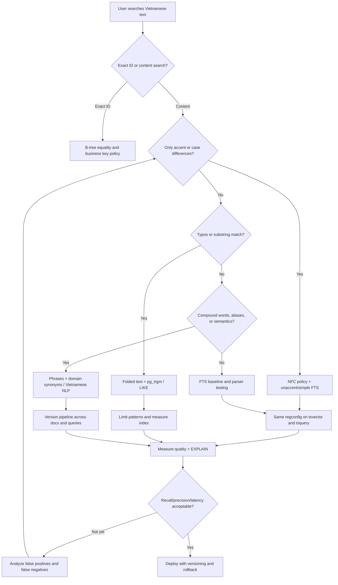

# Vietnamese Language Specifics, Diacritics, Normalization, and Dictionary Limits in PostgreSQL Full-Text Search

Vietnamese text search in PostgreSQL has an important distinction compared to plain string comparison: **“unaccented spelling”, “same Unicode representation”, “same word”, and “same meaning” are four different requirements**.

A user searching for `pho bo` usually expects to see `Phở bò` content. However, they might also search for `đường` meaning street (`đường phố`) or dietary sugar (`đường ăn`); an unaccented word `duong` cannot distinguish these two meanings on its own. Furthermore, Vietnamese commonly writes **a single compound word as multiple space-separated syllables**, such as `học sinh` (student), `sinh học` (biology), or `công nghệ thông tin` (information technology). PostgreSQL's default tokenizer splits on whitespace and punctuation and **does not automatically perform semantic Vietnamese word segmentation**.

This lesson belongs to the **Full-Text Search** chapter of the *Database Engine Relational PostgreSQL* module. It guides you through using `to_tsvector`, `tsquery`, text search configurations, the `unaccent` extension, Unicode normalization, `pg_trgm`, and controlled collations, while highlighting **limitations that must be handled at the application layer or in a dedicated language pipeline**.

> **Guidance:** PostgreSQL provides a very useful foundation for full-text indexing and querying. However, adding `unaccent` does not turn PostgreSQL into a complete Vietnamese morphological analyzer. Distinguish input typos, accent removal, spelling variants, word segmentation, synonyms, and ranking before choosing a technique.

The SQL examples use a test database with UTF-8 encoding and enabled extensions. Do not modify text search configurations, dictionary rules, or production indexes without a reindexing plan, migration strategy, and impact measurement.

## 1. Learning Objectives

After this lesson, you will be able to:

1. Explain Vietnamese specifics including tone/diacritic marks, the letters `đ/Đ`, spaces between syllables, and lexical ambiguity after accent removal.
2. Distinguish **Unicode NFC/NFD** from **accent folding** and **case folding**.
3. Inspect the parser, token types, dictionaries, and lexemes using `ts_debug`.
4. Understand why `english` stemming/stopwords are not an appropriate default configuration for a Vietnamese-only corpus.
5. Create a text search configuration combining `unaccent` and `simple`.
6. Use the same configuration to generate `tsvector` and construct `tsquery` on both stored content and user input.
7. Set up GIN indexes, accent-insensitive search, and weighted ranking.
8. Understand the difference between multi-token queries, phrase queries, and true **compound-word** search in Vietnamese.
9. Know when `pg_trgm`, `LIKE`, or B-tree/collation is more appropriate than FTS.
10. Design a consistent normalization workflow that prevents stale indexes after dictionary changes.
11. Write queries using JDBC bind parameters, limit user input, and handle results safely.
12. Build a precision/recall test suite covering accented text, unaccented text, abbreviations, and typos.

## 2. Quick Overview: Different Problems

| Problem | Example | Related Technique | Limitation |
|---|---|---|---|
| Case sensitivity | `PHỞ` ↔ `phở` | `lower`, dictionary, collation | Does not handle accents |
| Vietnamese accents | `phở` ↔ `pho` | `unaccent`/folding policy | Loses distinction between words |
| Different Unicode representations | `á` precomposed vs decomposed | `normalize(..., NFC)` | Does not remove accents |
| Đ/đ | `Đà` ↔ `Da` | `unaccent` mapping, rule testing | Not all transliteration standards match |
| Space-separated syllables | `học sinh` | Parser tokens, phrase search | Not yet a Vietnamese word segmenter |
| Compound words with different meanings | `học sinh` ↔ `sinh học` | `phraseto_tsquery`, lexeme positions | Depends on exact token order |
| Synonyms | `TP HCM` ↔ `Sài Gòn` | Alias/synonym dictionary or app mapping | No built-in complete Vietnamese thesaurus |
| Typos | `postgre` ↔ `postgres` | `pg_trgm`, fuzzy ranking | Can produce false positives |
| Proper nouns | `Đắk Lắk`, `Buôn Ma Thuột` | Custom alias/segmentation | Often has multiple spelling variants |
| Technical codes | `C++`, `Node.js`, `Q1/2026` | Exact key/prefix/trigram | FTS parser may strip punctuation |
| Ranking | `phở bò` vs `phở chay` | `ts_rank`, title boosts | Does not understand natural-language intent |

**No single operator** solves every row in this table.

## 3. Three Layers of Vietnamese Text Processing

A search pipeline typically has three independent layers:

```text
Original Text / Input
         │
         ▼
Unicode normalization (NFC/NFD if needed)
         │
         ▼
Case / accent folding per policy
         │
         ▼
Tokenization and FTS dictionaries
         │
         ▼
Lexemes → tsvector / tsquery
         │
         ▼
Index matching → ranking / filtering
```

This order is a conceptual diagram. In PostgreSQL, `unaccent` can operate **inside the FTS dictionary chain**, rather than requiring a pre-stripped text column first.

### 3.1. Representation Normalization Does Not Mean Removing Accents

Unicode NFC can convert the sequence `a` + combining acute into the precomposed character `á`, but it **still preserves the acute accent**. `unaccent` is what applies a folding policy such as `á → a` within supported mappings.

### 3.2. Accent Removal Does Not Mean Word Recognition

`phở bò` can become `pho bo`, but the two lexemes `pho` and `bo` do not tell the system that this is **a single dish name**. The search engine needs additional phrase constraints, entity dictionaries, or appropriate language processing if required by the business domain.

### 3.3. Word Segmentation Does Not Mean Semantic Understanding

Even with a Vietnamese word segmenter, the system still needs synonym/entity linking to connect `Sài Gòn` with `TP. Hồ Chí Minh` or `bệnh tim` (heart disease) with an equivalent set of medical terms.

## 4. Unicode and Vietnamese Diacritics

Vietnamese uses many Latin characters with diacritical marks and tone marks, such as:

```text
a, à, á, ả, ã, ạ
ă, ằ, ắ, ẳ, ẵ, ặ
â, ầ, ấ, ẩ, ẫ, ậ
e, è, é, ẻ, ẽ, ẹ
ê, ...
i, o, ô, ơ, u, ư, y
đ, Đ
```

`đ` and `Đ` are distinct letters in Vietnamese orthography, not just `d` with a combining Unicode tone mark attached.

### 4.1. NFC and NFD

Unicode can represent certain accented letters in two ways:

- **NFC** (*Normalization Form C*): prefers precomposed characters whenever possible.
- **NFD** (*Normalization Form D*): decomposes eligible characters into a base character plus combining marks.

Conceptual example:

```text
NFC:  "á"       (precomposed accented character)
NFD:  "a" + "◌́" (a plus combining acute accent)
```

Users see nearly identical visual shapes, yet the underlying Unicode code point sequences differ. If a system compares raw bytes or stores unnormalized search keys, this difference can cause search misses.

### 4.2. Verification in PostgreSQL

On a database with UTF8 server encoding:

```sql
SHOW server_encoding;

SELECT
    normalize(U&'a\0301', NFC) AS nfc_text,
    U&'\00E1' AS precomposed_a_acute,
    normalize(U&'a\0301', NFC) = U&'\00E1'
        AS nfc_same;
```

`U&'a\0301'` produces the letter `a` followed by a combining acute accent. `U&'\00E1'` produces the precomposed character `á`. The `nfc_same` result demonstrates normalization into the same canonical form.

PostgreSQL's `normalize(text, form)` function supports `NFC`, `NFD`, `NFKC`, and `NFKD`; it requires **UTF8 server encoding**. When running on older PostgreSQL releases, verify that the function is supported before writing migrations.

### 4.3. NFC Is Not unaccent

```sql
SELECT
    normalize('phở', NFC) AS preserved_accents;
```

The result still contains the character **ở**. Do not implement an “accent-insensitive search” feature simply by calling `normalize(..., NFC)`.

### 4.4. NFKC and NFKD Can Change Compatibility Semantics

`NFKC/NFKD` additionally perform compatibility normalization. Certain special characters may be transformed differently than under NFC/NFD. For SKUs, product names, or legal text, **do not default to NFKC** without checking its impact on identity and displayed data.

## 5. Case Sensitivity Is a Separate Problem

`lower` converts uppercase and lowercase according to the database locale:

```sql
SELECT
    lower('PHỞ BÒ') AS lowercase_text;
```

The expected value in an appropriate Unicode environment is `phở bò`: uppercase letters become lowercase, while **diacritics remain intact**.

### 5.1. Does ILIKE Remove Accents?

Normally, `ILIKE` performs **case-insensitive** pattern matching, with no default guarantee that `pho` matches `phở` regardless of accents.

```sql
SELECT
    'Phở bò' ILIKE '%phở%' AS case_insensitive_pattern;
```

Do not replace an accent-insensitive search requirement with `ILIKE '%pho%'` expecting every collation and version to fold accents identically. Even with special ICU nondeterministic collations, semantics depend on configuration and must be verified explicitly.

## 6. What Is unaccent?

The `unaccent` extension provides:

1. A **filtering text search dictionary** that transforms accented lexemes according to a rules file.
2. A utility function `unaccent(text)` usable in SQL expressions outside FTS.

Install the extension if permitted and not yet present:

```sql
CREATE EXTENSION IF NOT EXISTS unaccent WITH SCHEMA public;
```

Example:

```sql
SELECT
    public.unaccent('Phở bò Hà Nội') AS folded_food,
    public.unaccent('Đắk Lắk') AS folded_place;
```

Under common rules, the corresponding results are close to:

```text
Pho bo Ha Noi
Dak Lak
```

The exact output depends on the dictionary rules in use. **Test the actual Vietnamese characters in your system**, especially `đ/Đ` and Unicode combinations.

### 6.1. unaccent Is Different from Universal Transliteration

`unaccent` does not guarantee converting every language and every Unicode representation to ASCII under an invariant standard. It applies replacement rules shipped with the extension or explicitly configured.

For example, the rules may map `đ → d`, but do not assume every special character across every language has an equivalent mapping.

### 6.2. Which Schema Is the Extension Installed In?

The lab command specifies `public` so SQL can invoke `public.unaccent` and reference the `public.unaccent` dictionary.

If the extension already exists **in another schema**, `IF NOT EXISTS` will not move it into `public`. Inspect your environment and reference the actual schema instead of copying `public` blindly.

## 7. unaccent Is a Filtering Dictionary, Not a Tokenizer

In FTS, the parser determines **token boundaries** first. Dictionaries process the tokens emitted by the parser.

```text
"Phở bò Hà Nội"
    │
    ▼
Parser:   "Phở"  "bò"  "Hà"  "Nội"
    │
    ▼
unaccent: "Pho"  "bo"  "Ha"  "Noi"
    │
    ▼
simple:   "pho"  "bo"  "ha"  "noi"
```

This diagram illustrates behavior on ordinary strings. The parser may classify tokens differently depending on punctuation and characters; use `ts_debug` to observe actual server behavior.

**`unaccent` does not automatically merge “Hà Nội” into a single entity**, does not understand that “bò” means beef, and does not disambiguate homographs created after accent removal.

### 7.1. Why Is Another Dictionary Needed After unaccent?

`unaccent` is a *filtering dictionary*: it modifies the token and passes it onward to the next dictionary in the chain. Pairing it with `simple` accepts the transformed lexeme, typically lowercasing it and keeping words not in a stoplist.

### 7.2. Do Not Blindly Use the English Dictionary for Vietnamese

English stemming dictionaries are designed for English morphology, not Vietnamese tones, syllables, and word structure. A Vietnamese lexeme after accent removal can collide with an English word—for example, `thế` becomes `the`—and the English dictionary treats `the` as a **stop word** and discards it.

As a result, the system can drop a meaningful Vietnamese token. For basic Vietnamese FTS, `simple` is generally a safer baseline than `english` for the final dictionary step.

## 8. The Full-Text Parser: Tokens Differ from Vietnamese Words

Full-text search typically processes text in a pipeline:

```text
Document
   → parser tokens
   → dictionaries
   → normalized lexemes
   → tsvector positions
```

Example:

```sql
SELECT to_tsvector(
    'pg_catalog.simple'::regconfig,
    'Phở bò Hà Nội'
);
```

`simple` splits into lexemes corresponding to whitespace-delimited syllables. However, tone and diacritic marks remain inside the lexemes without `unaccent`.

### 8.1. Why Do Multi-Syllable Words Cause Difficulty?

In Vietnamese:

```text
"công nghệ thông tin"
"học sinh"
"sinh học"
"bánh mì"
"điện thoại"
```

spaces routinely occur **inside meaningful words and phrases**. The default parser does not mark “công nghệ” as an independent linguistic unit merely from seeing two syllables.

Therefore:

- Matching all syllables does not guarantee matching the compound concept the user intended.
- Phrase search constrains order and adjacency, yet still does not classify entities.
- Synonym search across compound words requires a dedicated dictionary or semantic layer.

### 8.2. Punctuation and Special Characters Do Not Guarantee Whole-Token Preservation

Strings such as `C++`, `C#`, `Node.js`, `TP.HCM`, `Q.1`, and `email@example.test` may be split or classified by the parser into special token types.

Do not guess tokenization solely from seeing dots or plus signs. Run `ts_debug` or `ts_parse` against real examples.

## 9. ts_debug: Your Best Observation Tool

`ts_debug(config, text)` returns each token along with how the dictionaries processed it.

```sql
SELECT
    alias,
    description,
    token,
    dictionaries,
    dictionary,
    lexemes
FROM ts_debug(
    'pg_catalog.simple'::regconfig,
    'Phở bò ở TP.HCM - C++ và Node.js'
);
```

Columns:

| Column | Meaning |
|---|---|
| `alias` | Token type emitted by the parser |
| `description` | Description of the token type |
| `token` | Raw token string before dictionary processing |
| `dictionaries` | List of dictionaries selected by the configuration mapping |
| `dictionary` | Dictionary that accepted the token |
| `lexemes` | Array of lexemes after processing; empty `{}` if dropped as a stop word |

### 9.1. Testing Very Short Words and Technical Symbols

```sql
SELECT alias, token, lexemes
FROM ts_debug(
    'pg_catalog.simple'::regconfig,
    'AI, C#, C++, TP.HCM, Wi-Fi, e-mail, Q1/2026'
);
```

The goal is not to memorize fixed outputs, but to see how your server parses them before deciding whether FTS is suitable for those codes and proper nouns.

### 9.2. Listing All Parser Token Types

```sql
SELECT *
FROM ts_token_type('pg_catalog.default');
```

Token types such as `word`, `asciiword`, `hword`, and hyphenated categories explain why different dictionary mappings can affect different inputs.

## 10. Creating a Basic Vietnamese Text Search Configuration

In the lab, use a dedicated schema:

```sql
CREATE SCHEMA IF NOT EXISTS demo_vi_search;
CREATE EXTENSION IF NOT EXISTS unaccent WITH SCHEMA public;
```

Create the configuration by copying `simple`:

```sql
CREATE TEXT SEARCH CONFIGURATION demo_vi_search.vi_fold (
    COPY = pg_catalog.simple
);
```

Then place `unaccent` before `simple` for common word token types:

```sql
ALTER TEXT SEARCH CONFIGURATION demo_vi_search.vi_fold
ALTER MAPPING FOR
    word,
    asciiword,
    hword,
    asciihword,
    hword_part,
    hword_asciipart
WITH public.unaccent, pg_catalog.simple;
```

This configuration is a **practical baseline**, not a “Vietnamese NLP dictionary”. It does not automatically add word segmentation or synonym rules.

### 10.1. Why Not Only ALTER MAPPING FOR word?

Mixed Vietnamese/ASCII/hyphenated text traverses multiple token types. Mapping only `word` can allow other word-like tokens to go straight through `simple` without passing through `unaccent`.

Use `ts_debug` to verify the actual token types in your data and add the necessary mappings; avoid blindly rewriting every token type without understanding specialized types like URLs, emails, numbers, and symbols.

### 10.2. Why Copy pg_catalog.simple?

It gives you the default parser and complete baseline token-type mappings, avoiding having to define every token type from scratch. You only replace the dictionary chain on the token classes you want to fold.

### 10.3. Configuration Names Should Be Schema-Qualified

Do not rely implicitly on `default_text_search_config` or `search_path` once data or indexes depend on a specific configuration.

Prefer:

```sql
'demo_vi_search.vi_fold'::regconfig
```

on both the `tsvector` side and the `tsquery` side.

## 11. Verifying the vi_fold Configuration

```sql
SELECT
    to_tsvector(
        'demo_vi_search.vi_fold'::regconfig,
        'Phở bò Hà Nội'
    ) AS folded_vector;
```

The expected output contains lexemes close to `'pho'`, `'bo'`, `'ha'`, and `'noi'` along with their positions.

Compare with `simple`:

```sql
SELECT
    to_tsvector(
        'pg_catalog.simple'::regconfig,
        'Phở bò Hà Nội'
    ) AS no_folding,
    to_tsvector(
        'demo_vi_search.vi_fold'::regconfig,
        'Phở bò Hà Nội'
    ) AS accent_folding;
```

### 11.1. Testing 'đ' and Uppercase Characters

```sql
SELECT
    to_tsvector(
        'demo_vi_search.vi_fold'::regconfig,
        'Đường phố, ĐÀ NẴNG, đậu xanh'
    ) AS test_d_and_tones;
```

Results depend on the dictionary rules; if folding `đ/Đ` to `d` is part of your contract, write automated tests for that exact character set rather than treating it as an incidental detail.

### 11.2. Running ts_debug on the New Configuration

```sql
SELECT alias, token, dictionaries, dictionary, lexemes
FROM ts_debug(
    'demo_vi_search.vi_fold'::regconfig,
    'Phở bò - điện thoại - C++ - TP.HCM'
);
```

From the observed output, you can distinguish cases where the parser failed to emit the expected token from cases where a dictionary accepted and modified or discarded it.

## 12. Lexemes, Positions, and Weights

A `tsvector` is not just a plain list of strings. It stores lexemes, optionally accompanied by **occurrence positions** and A/B/C/D weights.

Example:

```sql
SELECT to_tsvector(
    'demo_vi_search.vi_fold'::regconfig,
    'Phở bò và phở gà'
);
```

The lexeme `pho` can appear at multiple positions. Positions allow phrase search and certain ranking algorithms to determine where words appear.

### 12.1. Same Word Appearing Multiple Times

```sql
SELECT to_tsvector(
    'demo_vi_search.vi_fold'::regconfig,
    'phở phở phở'
);
```

Instead of storing three separate identical lexemes, `tsvector` stores a single lexeme accompanied by its corresponding positions according to text-search mechanics.

### 12.2. Compound Words Split into Multiple Lexemes

```sql
SELECT to_tsvector(
    'demo_vi_search.vi_fold'::regconfig,
    'công nghệ thông tin'
);
```

Do not assume a single lexeme `cong_nghe_thong_tin` will be produced. Achieving a single entity token like that requires a dedicated word segmentation/normalization/semantic pipeline.

## 13. tsquery Must Use the Same Policy as tsvector

A system that indexes text with `vi_fold` but queries with `english` can return wrong results because the lexemes no longer align.

Correct pattern:

```sql
SELECT
    to_tsvector(
        'demo_vi_search.vi_fold'::regconfig,
        'Phở bò Hà Nội'
    )
    @@
    plainto_tsquery(
        'demo_vi_search.vi_fold'::regconfig,
        'pho bo'
    ) AS is_match;
```

In a standard lab environment, the expected result is TRUE: both sides fold accents and produce compatible lexemes.

### 13.1. Common Bug: Accented Index, Unaccented Query

```sql
-- Do not design like this:
to_tsvector('pg_catalog.simple', title)
    @@ plainto_tsquery('demo_vi_search.vi_fold', $1)
```

The document side and query side do not apply the same normalization rules, so a query for `pho` may fail to match `phở`.

### 13.2. Do Not Rely on default_text_search_config

```sql
SHOW default_text_search_config;
```

This is a session/database setting and defaults to `pg_catalog.english` in many installations. Calling `to_tsvector(title)` without an explicit config depends on that setting, which is unsuitable for a system that must lock down a Vietnamese search policy.

## 14. plainto_tsquery, phraseto_tsquery, and websearch_to_tsquery

Query construction functions have different semantics:

| Function | Example Input | Purpose |
|---|---|---|
| `plainto_tsquery` | `học sinh` | Requires lexemes present, typically joined with AND |
| `phraseto_tsquery` | `học sinh` | Requires lexemes in adjacent order/positions |
| `websearch_to_tsquery` | `"học sinh" -đại học` | User-friendly web search syntax supporting quoted phrases, OR, and minus |
| `to_tsquery` | `'hoc' & 'sinh'` | Specialized raw tsquery syntax |

Practice:

```sql
SELECT
    plainto_tsquery(
        'demo_vi_search.vi_fold'::regconfig,
        'học sinh'
    ) AS any_order_tokens,
    phraseto_tsquery(
        'demo_vi_search.vi_fold'::regconfig,
        'học sinh'
    ) AS adjacent_tokens,
    websearch_to_tsquery(
        'demo_vi_search.vi_fold'::regconfig,
        '"học sinh"'
    ) AS quoted_phrase;
```

Typically:

```text
plainto_tsquery:   'hoc' & 'sinh'
phraseto_tsquery:  'hoc' <-> 'sinh'
websearch quoted:  'hoc' <-> 'sinh'
```

### 14.1. AND Does Not Preserve Order

The text `Sinh học và cách học của sinh viên` contains both lexemes `sinh` and `hoc`, yet does not necessarily contain the phrase `học sinh`.

### 14.2. Phrase Search Still Does Not Understand Compound Words

`'hoc' <-> 'sinh'` checks consecutive lexeme positions, but cannot distinguish in every scenario whether `học sinh` is functioning grammatically as one entity or whether two syllables merely happen to appear side by side.

Phrase search is a **token-position** tool, not a semantic analyzer.

## 15. Choosing a Function for User Input

For free-form search boxes, `websearch_to_tsquery` is usually friendlier than `to_tsquery` because it tolerates punctuation and supports familiar web-search syntax.

```sql
SELECT websearch_to_tsquery(
    'demo_vi_search.vi_fold'::regconfig,
    '"phở bò" OR "phở gà"'
);
```

`websearch_to_tsquery` recognizes:

- Unquoted words: generally combined with AND.
- Quoted text: phrase logic.
- `OR`: OR grouping.
- Minus sign: negates the corresponding token or phrase.

### 15.1. Do Not Concatenate User Input into Raw to_tsquery Syntax

`to_tsquery` expects specialized syntax such as `'pho' & 'bo'`. Unprocessed input like `phở bò !!!` can trigger syntax errors if passed verbatim where tsquery operators are expected.

Use `websearch_to_tsquery(config, ? )` or `plainto_tsquery(config, ?)` with bind parameters to reduce syntax-error and injection risks.

### 15.2. Overly Long Input Still Consumes Resources

Avoiding syntax errors does not mean a query is always cheap. Limit input length, term/clause counts, and request rates, and apply appropriate statement timeouts and monitoring.

## 16. Creating a Vietnamese Dataset for Practice

After creating `demo_vi_search.vi_fold`, create the table:

```sql
CREATE TABLE demo_vi_search.article (
    article_id BIGINT GENERATED ALWAYS AS IDENTITY PRIMARY KEY,
    tenant_id INTEGER NOT NULL,
    title TEXT NOT NULL,
    body TEXT NOT NULL DEFAULT '',
    category TEXT NOT NULL DEFAULT 'general',
    created_at TIMESTAMPTZ NOT NULL DEFAULT clock_timestamp(),

    search_vector TSVECTOR GENERATED ALWAYS AS (
        setweight(
            to_tsvector(
                'demo_vi_search.vi_fold'::regconfig,
                title
            ),
            'A'
        )
        ||
        setweight(
            to_tsvector(
                'demo_vi_search.vi_fold'::regconfig,
                body
            ),
            'B'
        )
    ) STORED
);
```

`search_vector` is a **stored generated column**, requiring PostgreSQL support for generated columns (PostgreSQL 12+). It is computed from `title` and `body` on row writes using the expression above.

### 16.1. Why Choose a Generated tsvector?

- Queries reference `search_vector` directly without repeating long `to_tsvector` expressions.
- The generated column updates automatically when `title` or `body` changes via PostgreSQL mechanisms.
- A GIN index on this column is easier to read and less error-prone than duplicating an expression index.
- `setweight` assigns weight A to `title` and weight B to `body`, allowing ranking to prioritize title matches.

However, the FTS configuration and dictionaries remain an **operational dependency**: if rules change, already-stored `search_vector` values are **not automatically backfilled merely because a dictionary was edited**. You need a corresponding recompute/reindex procedure.

### 16.2. Creating the GIN Index

```sql
CREATE INDEX idx_article_search_vector
ON demo_vi_search.article
USING GIN (search_vector);

CREATE INDEX idx_article_tenant_created
ON demo_vi_search.article (tenant_id, created_at DESC, article_id DESC);
```

The GIN index accelerates `tsvector` lookups with the `@@` operator. The second B-tree index serves other filters and sorts; PostgreSQL does not automatically merge two separate indexes into one multi-dimensional index.

## 17. Inserting Accented and Unaccented Text

```sql
INSERT INTO demo_vi_search.article
    (tenant_id, title, body, category)
VALUES
    (1, 'Phở bò Hà Nội',
        'Phở bò truyền thống với nước dùng và bánh phở.',
        'food'),
    (1, 'Phở gà Sài Gòn',
        'Món phở gà nóng hổi, ăn kèm hành và rau thơm.',
        'food'),
    (1, 'Bánh mì thịt',
        'Bánh mì Việt Nam với thịt, rau và nước sốt.',
        'food'),
    (1, 'Cà phê sữa đá',
        'Thức uống cà phê và sữa đặc, dùng cùng đá.',
        'drink'),
    (1, 'Cá kho tộ',
        'Món cá kho truyền thống của gia đình.',
        'food'),
    (1, 'Học sinh và nhà trường',
        'Học sinh tìm tài liệu để học môn sinh học.',
        'education'),
    (1, 'Sinh học phân tử',
        'Giáo trình sinh học, nghiên cứu tế bào.',
        'education'),
    (1, 'Thế hệ trẻ',
        'Một bài viết về thế hệ học sinh Việt Nam.',
        'culture'),
    (1, 'Đường phố Hà Nội',
        'Các con đường, ngõ phố và giao thông đô thị.',
        'travel'),
    (1, 'Đường trong thực phẩm',
        'Lượng đường trong đồ uống ngọt.',
        'health'),
    (1, 'Đà Nẵng và Đắk Lắk',
        'Địa danh và cách viết tên riêng có dấu.',
        'travel'),
    (1, 'C++ và Node.js',
        'Tài liệu lập trình C++, C#, Java và Node.js.',
        'technology'),
    (1, 'Dien thoai thong minh',
        'Nội dung nhập theo kiểu tiếng Việt không dấu.',
        'technology'),
    (2, 'Phở bò của tenant khác',
        'Dữ liệu này phải được kiểm soát quyền truy cập.',
        'food');

ANALYZE demo_vi_search.article;
```

A small dataset only verifies **semantics**. It does not prove production GIN performance; the planner may pick a Seq Scan because the table is tiny.

### 17.1. Inspecting the Generated Vectors

```sql
SELECT
    article_id,
    tenant_id,
    title,
    search_vector
FROM demo_vi_search.article
ORDER BY article_id;
```

You can inspect how both accented and unaccented words are represented as lexemes, as well as observe their `A`/`B` weights.

## 18. Searching "pho bo" and Finding "Phở bò"

```sql
SELECT article_id, title
FROM demo_vi_search.article
WHERE tenant_id = 1
  AND search_vector @@ websearch_to_tsquery(
      'demo_vi_search.vi_fold'::regconfig,
      'pho bo'
  )
ORDER BY article_id;
```

Rows titled `Phở bò Hà Nội` will match the folded lexemes.

### 18.1. Testing Accented Queries

```sql
SELECT article_id, title
FROM demo_vi_search.article
WHERE tenant_id = 1
  AND search_vector @@ websearch_to_tsquery(
      'demo_vi_search.vi_fold'::regconfig,
      'phở bò'
  )
ORDER BY article_id;
```

With the same configuration, both `pho bo` and `phở bò` typically produce equivalent lexemes under the mapping rules.

### 18.2. No Semantic Guarantee

Both `phở bò` (beef pho) and `phở bò chay` (vegetarian beef-style pho) can match the query; if exact dish classification is required, add dedicated category/entity tags, rules, and ranking.

## 19. AND Search Differs from Phrase Search

Normal query:

```sql
SELECT title
FROM demo_vi_search.article
WHERE tenant_id = 1
  AND search_vector @@ plainto_tsquery(
      'demo_vi_search.vi_fold'::regconfig,
      'học sinh'
  );
```

requires **both lexemes** `hoc` and `sinh`, without requiring them to stand next to each other.

Phrase query:

```sql
SELECT title
FROM demo_vi_search.article
WHERE tenant_id = 1
  AND search_vector @@ phraseto_tsquery(
      'demo_vi_search.vi_fold'::regconfig,
      'học sinh'
  );
```

requires `hoc` immediately before `sinh`.

### 19.1. Why Must You Test with Real Vietnamese Content?

An exact token-position phrase query can miss:

- Text with punctuation between two syllables.
- Hyphenated forms.
- Compound words with abbreviations or spelling variants.
- Synonyms that share no lexemes.
- Cases where the parser classifies technical tokens unusually.

The question is not merely “does the SQL run?” but **“do users get the results they expect?”**.

## 20. Accent Removal Helps Recall but Can Hurt Precision

Several distinct Vietnamese words become identical once accents are removed:

```text
ma, mà, má, mả, mã, mạ  →  ma
ca, cá, cà, cả, cã, cạ  →  ca
duong: đường / dương / dưỡng / ...
```

When accents are stripped, a user typing `ma` can retrieve `má` (cheek/mother), `mã` (code/horse), and `mà` (but/which). This is an **intentional consequence of normalization**, not necessarily a bug.

### 20.1. Precision and Recall

- **Recall:** out of all truly relevant documents, how many the system finds.
- **Precision:** out of all returned documents, how many are truly relevant.

Accent removal usually improves recall when users omit diacritics, but can reduce precision because unrelated words collapse together.

### 20.2. Practical Strategy: Dual Signals

An application can:

1. Retrieve candidate matches using accent-folded FTS.
2. Boost matches that **preserve the exact accents of the query** when the user enters diacritics.
3. Boost title matches, phrase matches, or exact product names.
4. Use category, tenant, and business signals to reduce ambiguity.

Do not simply take unaccented `ts_rank` scores and claim ranking understands Vietnamese semantics.

## 21. Ranking with Title/Body Weights

The lab table's `search_vector` assigns weight A to `title` and B to `body`. You can rank results as follows:

```sql
WITH q AS (
    SELECT websearch_to_tsquery(
        'demo_vi_search.vi_fold'::regconfig,
        'pho bo'
    ) AS query
)
SELECT
    a.article_id,
    a.title,
    ts_rank(
        ARRAY[0.05, 0.15, 0.4, 1.0]::real[],
        a.search_vector,
        q.query
    ) AS rank_score
FROM demo_vi_search.article AS a
CROSS JOIN q
WHERE a.tenant_id = 1
  AND a.search_vector @@ q.query
ORDER BY rank_score DESC, a.article_id DESC
LIMIT 20;
```

In `ts_rank`'s weight array, the order is **D, C, B, A**. The example above gives the title (A) the highest weight.

### 21.1. A Ranking Score Is Not a Relevance Probability

`ts_rank` and `ts_rank_cd` rely on lexemes, positions, frequency/weights, and specific formulas. The returned number is **not** the probability that a user wants that document.

### 21.2. One Unaccented Query Can Return Multiple Meanings

If `duong` matches street (`đường phố`), sugar (`đường ăn`), and positive test result (`dương tính`), `ts_rank` does not know domain intent. You may need semantic/synonym models and business-specific ranking.

### 21.3. Tiebreakers Stabilize Pagination

When multiple documents share the same rank, add `ORDER BY rank_score DESC, article_id DESC`. When ranks shift due to newly indexed data, deep pagination still requires an explicit consistency or cursor contract.

## 22. Prefix Search Differs from Substrings and Spelling Errors

FTS supports **lexeme prefix matching** in `to_tsquery`:

```sql
SELECT article_id, title
FROM demo_vi_search.article
WHERE tenant_id = 1
  AND search_vector @@ to_tsquery(
      'demo_vi_search.vi_fold'::regconfig,
      'dien:*'
  );
```

This query finds lexemes matching that prefix after normalization; for instance, `dien` can match `điện`.

### 22.1. Prefix Is Not %substring%

`dien:*` matches lexemes beginning with `dien`, but will not match cases where `dien` appears **in the middle** of a token.

### 22.2. Prefix Does Not Fix All Typos

If the user mistypes a character at the start or middle of a word, FTS prefix matching may miss it. `pg_trgm` or a suggestion pipeline may be a better fit.

### 22.3. Do Not Build Raw tsquery Syntax from Arbitrary Input

For prefix search, sanitize/escape tokens and enforce length limits; never concatenate raw user input into `'...:*'` without controlling special characters and parser semantics. `websearch_to_tsquery` does not automatically turn every user term into a prefix query.

## 23. Limits of “Vietnamese Dictionaries” in Standard PostgreSQL

Distinguish clearly among:

- **Parser:** identifies token boundaries.
- **Dictionary:** determines lexemes, stopwords, stems, and synonym transformations.
- **Text search configuration:** binds a parser to dictionaries per token type.
- **Thesaurus/synonym list:** rule sets provided by the system or administrator.
- **Vietnamese word segmenter:** an NLP component that identifies compound words vs standalone syllables.
- **Semantic search:** retrieves text close in meaning even without shared lexemes.

Core PostgreSQL provides built-in language configurations and dictionary mechanisms, but **does not ship a complete out-of-the-box Vietnamese FTS pipeline that automatically resolves compound words, accents, regional variants, and synonyms** solely via `default_text_search_config`.

### 23.1. The simple Dictionary Does Not Classify Compound Words

`simple` accepts tokens and turns them into lexemes (with lowercasing). It does not automatically turn `công nghệ thông tin` into a single synonym for `CNTT`.

### 23.2. unaccent Does Not Classify Compound Words

`unaccent` only performs rule-based character/string replacements; it does not decide which adjacent syllables form a single word.

### 23.3. The English Stemmer Is Not a Vietnamese Stemmer

Do not select `english` merely because it looks “smarter” than `simple` on English text. On Vietnamese text, it can drop accidental English stopword collisions or distort lexemes using another language's rules.

### 23.4. Custom Dictionaries Have Limitations

A synonym dictionary can map lexemes according to predefined rules. A thesaurus can handle multi-word rules through its own mechanism, yet the `unaccent` dictionary **cannot be used directly as a normalizing dictionary inside a thesaurus** in the current implementation. Combining dictionaries requires careful design and testing rather than chaining arbitrary names.

## 24. Synonym Dictionaries Must Live at the Right Layer

Conceptual examples:

```text
"TP HCM"       ↔ "Thành phố Hồ Chí Minh"
"Sài Gòn"      ↔ "TP HCM"
"CNTT"         ↔ "công nghệ thông tin"
"điện thoại"   ↔ "smartphone" (only in appropriate contexts)
```

There are at least three approaches:

1. **Alias table at the application/search layer:** stores canonical entity IDs and multiple surface forms.
2. **Indexing enriched processed terms:** documents are enriched with controlled tokens/synonyms.
3. **Custom text search dictionary/thesaurus:** suits certain lexeme rules, but requires maintenance and parser awareness.

### 24.1. Synonyms Are Not Universally Equivalent

`đường` in a cooking recipe differs from `đường` in traffic/directions. Blindly expanding synonyms can degrade search precision.

### 24.2. The Dictionary Update Problem

When alias rules change, previously normalized documents or pre-enriched tokens may need to be **recomputed/reindexed**. Do not update a dictionary and test only the query side; test existing indexed data as well.

## 25. Local Proper Nouns and Spelling Variants

Proper nouns are typically harder than common words:

```text
"Thành phố Hồ Chí Minh"
"TP.HCM"
"TP HCM"
"Sài Gòn"
"Ho Chi Minh City"
"HCMC"
```

Accent removal only solves part of the problem:

```text
"Thành phố Hồ Chí Minh"
   → "Thanh pho Ho Chi Minh"
```

It **does not automatically deduce** that `HCMC` or `Sài Gòn` is equivalent. Therefore, locations, products, and organizations often need an alias/entity table or a dedicated knowledge base.

### 25.1. Do Not Over-Normalize Identifiers

`ĐN01` might be a distinct business code; stripping accents and lowercasing everywhere could make it collide with another code. Separate:

- **Display text**: preserved verbatim.
- **Search text**: folded according to search policy.
- **Business identifier**: preserved with exact canonical identity and an appropriate unique constraint.

Never use a normalized search column as a transactional key if business identity distinguishes accents or case.

## 26. Common Vietnamese Input Errors

Users may enter:

- Unaccented text: `pho bo` instead of `phở bò`.
- Missing or non-standard tone placement.
- `d` instead of `đ`.
- Missing spaces: `dienthoai`.
- Extra spaces: `đi ện thoại`.
- Unconverted Telex keystrokes: `pho w`, `dduowngf`.
- Unconverted VNI keystrokes.
- Abbreviations like `HCM`, or mixed English and Vietnamese.
- Genuine misspellings, not just missing accents.

`unaccent` handles **certain accented/unaccented variants well**, but does not fix **unconverted Telex**, split/merged whitespace, typos, or abbreviations.

### 26.1. Telex Input Normalization Is Not unaccent's Job

If you need to interpret raw Telex strings, use a dedicated input processor or verified product logic. Do not chain a few naive `replace()` calls and assume you have built a complete Vietnamese input engine.

## 27. When to Use pg_trgm

The `pg_trgm` extension measures similarity using **trigrams** and provides GIN/GiST operator classes for fuzzy and pattern search.

```sql
CREATE EXTENSION IF NOT EXISTS pg_trgm WITH SCHEMA public;
```

Key operators and functions:

| Technique | Role |
|---|---|
| `similarity(a,b)` | Trigram similarity in the range 0..1 |
| `a % b` | True if similarity exceeds the current threshold |
| `a <% b` | Word similarity against a substring of `b` |
| `a <<% b` | Strict word similarity respecting word boundaries |
| `a <-> b` | Trigram distance = 1 - similarity |
| `gin_trgm_ops` | GIN index for similarity and pattern matching |
| `gist_trgm_ops` | GiST index, also useful for kNN distance ordering |

### 27.1. Trigrams Do Not Strip Vietnamese Accents Automatically

If the raw column holds `phở bò` while the input is `pho bo`, their trigram sets may differ. For unaccented + typo search, you generally need a consistently normalized **`search_folded` column** before creating the trigram index.

### 27.2. Trigrams Do Not Understand Meaning

`phở bò` and `phở gà` share many character sequences, yet they are different dishes. Trigrams return orthographic similarity, not semantic similarity.

## 28. Why You Cannot Easily Index unaccent(title) Directly

An index expression or generated column expression in PostgreSQL must satisfy **immutability** rules.

Because `unaccent(text)` depends on mutable dictionary rules, it is declared **STABLE**, not IMMUTABLE. Consequently, patterns such as:

```sql
-- DO NOT ASSUME THIS IS VALID:
CREATE INDEX idx_title_unaccent
ON demo_vi_search.article
USING GIN (
    public.unaccent(title) public.gin_trgm_ops
);
```

can be rejected by PostgreSQL because the index expression invokes a non-immutable function.

### 28.1. Do Not “Fix” It with a Fake IMMUTABLE Wrapper

Some online snippets wrap `unaccent` inside a function marked `IMMUTABLE` to bypass this check. However, if rules or the extension change, the function output can change for the same input data, violating the immutability contract.

As a consequence, the index can become inconsistent with computed values. Do not use such wrappers in serious systems without strict governance and an explicit rebuild strategy.

### 28.2. Safe Approach: A Persisted Column

Use a search text column computed and maintained by the application or a trigger, then build a `pg_trgm` index on that **column**. When normalization rules change, you can backfill the column in a controlled way and rebuild the index.

## 29. Adding search_folded for Fuzzy and Substring Search

On the lab table:

```sql
ALTER TABLE demo_vi_search.article
ADD COLUMN search_folded TEXT;
```

Backfill with explicit rules:

```sql
UPDATE demo_vi_search.article
SET search_folded = public.unaccent(
    lower(normalize(title || ' ' || body, NFC))
);
```

This expression:

1. Concatenates `title` and `body` with a space.
2. Normalizes Unicode to NFC.
3. Lowercases according to the database locale.
4. Removes accents using the extension rules.

### 29.1. The Search Column Must Stay Up to Date on Changes

A one-time `UPDATE` backfill is insufficient if the application keeps inserting rows or updating `title`/`body`. Options include:

- Application writes `search_folded` under the same rule version.
- Database trigger.
- Batch ETL/queue updates with an acceptable lag SLA.
- A dedicated external search service/index.

Never allow a normalized column to go stale while queries rely on it as authoritative.

## 30. Trigger to Maintain the Normalized Column

Lab example:

```sql
CREATE FUNCTION demo_vi_search.fill_search_folded()
RETURNS trigger
LANGUAGE plpgsql
AS $fn$
BEGIN
    NEW.search_folded := public.unaccent(
        lower(normalize(NEW.title || ' ' || NEW.body, NFC))
    );
    RETURN NEW;
END;
$fn$;

CREATE TRIGGER trg_article_search_folded
BEFORE INSERT OR UPDATE OF title, body
ON demo_vi_search.article
FOR EACH ROW
EXECUTE FUNCTION demo_vi_search.fill_search_folded();
```

Once the trigger is installed, every `INSERT` or `UPDATE` modifying `title` or `body` recomputes `search_folded`.

### 30.1. Existing Rows Still Need a One-Time Backfill

Triggers do not run retroactively on existing rows. We used an `UPDATE` earlier to backfill them. On large tables, backfills must be batched in controlled transactions while monitoring WAL volume, replica lag, and lock duration.

### 30.2. Triggers Are Not Free

They increase CPU usage and write amplification. If `title` or `body` is large, running normalization on every `UPDATE` can be expensive. Do not add triggers to every text column just because you can.

### 30.3. Do Not Enforce NOT NULL on search_folded Prematurely

Before adding `NOT NULL`, ensure all existing rows are backfilled and all write paths maintain the column. Check actual execution behavior under bulk ingestion, replication, or disabled triggers.

## 31. Creating a Trigram Index on search_folded

```sql
CREATE INDEX idx_article_search_folded_trgm
ON demo_vi_search.article
USING GIN (search_folded public.gin_trgm_ops);

ANALYZE demo_vi_search.article;
```

Search for an unaccented substring:

```sql
SELECT article_id, title
FROM demo_vi_search.article
WHERE tenant_id = 1
  AND search_folded LIKE '%pho bo%'
ORDER BY article_id;
```

Because `search_folded` is already lowercased and unaccented, `LIKE` with a lowercase literal can perform substring search in this example.

### 31.1. Dynamic Pattern Inputs Must Escape Wildcards

`%` and `_` are wildcards in `LIKE`. JDBC bind parameters protect against SQL injection when using `?`, but **do not automatically turn `%` or `_` into literal characters**.

If you want literal substring matching, escape wildcards using a consistent `ESCAPE` convention before wrapping with `%` on both sides. Never turn raw user input directly into unbounded patterns.

### 31.2. Very Short Patterns May Not Optimize Well

`pg_trgm` extracts trigrams from patterns. Short queries or queries without useful trigrams may scan many index entries or the entire index. Vietnamese contains many short syllables like `an`, `ba`, and `ly`, so measure real-world performance.

## 32. Typo Search with Trigram Similarity

```sql
SELECT
    article_id,
    title,
    similarity(search_folded, 'pho bo') AS sim
FROM demo_vi_search.article
WHERE tenant_id = 1
  AND search_folded % 'pho bo'
ORDER BY sim DESC, article_id DESC
LIMIT 20;
```

The `%` operator uses the session's `pg_trgm.similarity_threshold`.

### 32.1. Threshold Trade-offs

Low threshold:

- Can catch more typos.
- Can also return many weakly related documents.

High threshold:

- Can improve precision.
- Misses words with multiple mistyped characters.

Measure against a real query set rather than treating the default threshold as universal.

### 32.2. Whole-Document Similarity Can Perform Poorly

Comparing a short query like `pho bo` against a multi-paragraph body produces very low similarity due to the large number of unrelated trigrams in the document.

Consider instead:

- `word_similarity` / `strict_word_similarity` on targeted fields.
- Keeping title/keywords/terms in separate columns.
- FTS for candidate retrieval, trigram for reranking or fallback.
- Matching against a term dictionary rather than the entire body.
- A dedicated search engine when requirements grow complex.

Do not rely on raw similarity over long articles as your sole typo-search mechanism.

## 33. GIN and GiST Differ for Trigrams

Both GIN and GiST provide operator classes for `pg_trgm`, with notable differences:

- **GIN** is generally well suited to filtering queries by matching, similarity, or patterns with specific cost characteristics.
- **GiST** supports **k-nearest-neighbor (kNN) ordering** by trigram distance, such as `ORDER BY search_folded <-> query LIMIT n` in appropriate cases.
- GIN does not serve top-N distance sorting the same way GiST kNN does.

GiST index example **for lab comparison**:

```sql
CREATE INDEX idx_article_search_folded_gist
ON demo_vi_search.article
USING GiST (search_folded public.gist_trgm_ops);
```

And query:

```sql
SELECT article_id, title
FROM demo_vi_search.article
WHERE tenant_id = 1
ORDER BY search_folded <-> 'pho bo', article_id
LIMIT 10;
```

The planner may leverage GiST kNN distance ordering depending on filters and data distribution. **Do not keep both GIN and GiST trigram indexes in production merely because both use trigrams**; benchmark workload and write overhead.

## 34. Comparing Full-Text Search, Trigrams, and ILIKE

| Technique | What Does It Ask? | Good For | Does Not Do Automatically |
|---|---|---|---|
| `tsvector @@ tsquery` | Do lexemes satisfy the query? | Words/tokens, phrases, ranking, GIN | Arbitrary substrings, general typos |
| `ILIKE '%x%'` | Is there a pattern substring? | Substrings, case-insensitive | Default accent folding, semantic matching |
| `LIKE` on `search_folded` | Does folded text contain the pattern? | Unaccented + substring | Stemming / compound words |
| `pg_trgm` | Does the string/span share trigrams? | Typos, spelling similarity | Meaning / context understanding |
| B-tree equality | Are two keys equal under semantics? | Canonical ID/name, uniqueness | Searching all words in body |
| ICU collation | Compare/sort by locale/level? | Specific equality/order/case/accent policies | FTS language segmentation |

A strong search architecture often combines **multiple strategies**, keeping only indexes that genuinely serve measured workloads. Not every query needs to OR every technique together.

## 35. ICU Nondeterministic Collations as Another Option

PostgreSQL can use ICU collations configured to ignore accent and case differences in appropriate scenarios.

On a server built with ICU and privileges to create collations:

```sql
CREATE COLLATION demo_vi_search.ignore_accent_case (
    provider = icu,
    locale = 'und-u-ks-level1',
    deterministic = false
);
```

Example:

```sql
SELECT
    'café' = 'cafe'
        COLLATE demo_vi_search.ignore_accent_case
    AS same_under_selected_collation;
```

This illustrates accent-insensitive/case-insensitive equality at an ICU comparison level, **not a Vietnamese FTS dictionary**.

### 35.1. Collations Do Not Generate Corresponding Lexemes

If `search_vector` was built with `simple` and retains accents, changing a collation in an external text comparison **does not automatically re-generate the indexed tsvector**. The FTS pipeline still depends on its text search configuration.

### 35.2. Pattern Matching Support Depends on PostgreSQL Version

Pattern operators on nondeterministic collations have limitations that vary across PostgreSQL releases. Modern PostgreSQL supports `LIKE` for certain nondeterministic collation cases, whereas regex/`SIMILAR TO` still carry restrictions. Do not assume all `LIKE`, `ILIKE`, regex, and trigram indexes work seamlessly with every custom collation.

### 35.3. Collation Equality and UNIQUE Are Data Model Decisions

If you create a unique index using a collation that treats accented and unaccented strings as equal, the database may **reject two distinct names that the business wants to keep separate**. Use such collations for uniqueness only when that is truly the business rule.

## 36. Differences Between Accent Folding, Collations, and Unicode Normalization

Thought experiment:

```text
Input A: "café" (composed)
Input B: "café" (e + combining accent)
Input C: "cafe"
```

- `normalize(..., NFC)` converts A and B into the same canonical Unicode form, keeping the accent.
- `unaccent` converts A and B into a form matching C if the rules cover the representation.
- An ICU nondeterministic collation can **treat these strings as equal in comparisons** depending on strength, **without altering the stored bytes**.
- FTS dictionaries transform tokens into lexemes and can fold differences during indexing and querying.

### 36.1. Do Not Mutate Display Text Just to Search Without Accents

A safe strategy is:

```text
display_title: "Phở bò Hà Nội"
search_vector: folded lexemes
search_folded: "pho bo ha noi ..."
```

Users still see properly accented text, while the system queries normalized representations.

## 37. Why Normalize Unicode Even When unaccent Strips Accents?

Data may arrive from:

- Different mobile keyboards.
- Java or JavaScript APIs.
- CSV/Excel imports across operating systems.
- OCR and speech-to-text.
- Copy-pasting from documents.
- Repeated encode/decode pipelines.

Even if `unaccent` rules cover many cases, discrepancies can still occur with combining marks, compatibility characters, or glyphs. **Applying NFC before indexing and before building queries** reduces representation variance, especially when you also use equality checks, B-tree indexes, `pg_trgm`, or cache keys.

### 37.1. One Unified Policy

Example contract for the `search_folded` column:

```text
Version: vi-search-v1
1. Unicode NFC
2. lower according to DB locale
3. unaccent under current rules
4. preserve relative whitespace unless intentionally cleaned
```

If a Java backend applies a different algorithm than the database, the document's `search_folded` and the query's normalized input can diverge. It is best to maintain **one shared implementation/version** or enforce strict equivalence tests.

## 38. Generated Columns and Immutability

Generated columns require expressions that satisfy PostgreSQL's immutability rules.

In the lab table, the expression:

```sql
to_tsvector(
    'demo_vi_search.vi_fold'::regconfig,
    title
)
```

uses the overload taking an **explicit `regconfig`**, making it suitable for expression indexes and generated `tsvector` columns on supported PostgreSQL versions.

By contrast:

```sql
to_tsvector(title)
```

depends on the session/database default configuration and must not be used in expression indexes or generated columns expecting the same immutability as an explicit configuration.

### 38.1. Do Not Treat Dictionary Settings as Operationally Immutable

Even though `to_tsvector(config, text)` is allowed in indexes and generated columns, an administrator can modify dictionary/configuration rules outside the table data.

When upgrading:

```text
vi_fold_v1 → vi_fold_v2
```

plan to rebuild search vectors and indexes; do not leave new documents using new rules while old documents retain old lexemes without version tracking.

## 39. Dictionary Changes and Stale Indexes

Changes that can affect FTS include:

- `ALTER TEXT SEARCH CONFIGURATION` changing dictionary order or mappings.
- `ALTER TEXT SEARCH DICTIONARY` changing `RULES`.
- Editing the `unaccent` rules file.
- Upgrading extensions or changing custom dictionary logic.
- Changing application-side preprocessing or word segmentation.
- Renaming or restructuring columns included in `tsvector`.

### 39.1. Expression Indexes

If an index stores `to_tsvector(config, text_column)` directly, **index entries may no longer match the lexemes generated by current queries** after rules/config change. Perform a `REINDEX` under an appropriate procedure.

### 39.2. Stored Generated tsvector Columns

If `search_vector` is stored in the row, precomputed vectors are **not automatically recomputed for existing rows** just because a dictionary configuration changed. You must recompute/backfill the rows and maintain the index accordingly.

### 39.3. Persisted Normalized Text Columns

If you store `search_folded`, rule changes require backfilling that column and updating/rebuilding its index. Version your policy and test in staging before rollout.

**Never run only `REINDEX` on a GIN index over `search_vector` if the `search_vector` values stored in the heap are stale.** Rebuilding the index over old `tsvector` values still indexes the old lexemes.

## 40. A Zero-Data-Loss Versioning Workflow

Example rollout of a new version:

```text
vi_fold_v1 + search_vector_v1 (currently serving)
              │
              ▼
Create vi_fold_v2 / rules v2
              │
              ▼
Backfill search_vector_v2 / index v2
              │
              ▼
Test query set, precision/recall, latency
              │
              ▼
Canary route a portion of traffic
              │
              ▼
Switch read path to v2
              │
              ▼
Monitor results and rollback readiness
              │
              ▼
Retire v1 once no dependencies remain
```

Adding new generated columns, backfilling, and concurrent index creation all impose version-dependent lock, storage, and DDL constraints. Never execute these steps on very large tables without measuring WAL, replication lag, locks, and capacity.

## 41. EXPLAIN for Vietnamese Queries

```sql
EXPLAIN (ANALYZE, BUFFERS)
SELECT article_id, title
FROM demo_vi_search.article
WHERE tenant_id = 1
  AND search_vector @@ websearch_to_tsquery(
      'demo_vi_search.vi_fold'::regconfig,
      'pho bo'
  )
LIMIT 20;
```

Possible plan shapes include:

```text
Bitmap Heap Scan on article
  Recheck Cond: (search_vector @@ ...)
  -> Bitmap Index Scan on idx_article_search_vector
       Index Cond: (search_vector @@ ...)
```

or a `Seq Scan` when the table is small or the filter is unselective.

### 41.1. A GIN Index Does Not Guarantee GIN Usage

The planner relies on statistics, I/O costs, cache assumptions, and estimated row counts. On a 14-row lab table, a `Seq Scan` can be cheaper.

### 41.2. AND with tenant_id

The B-tree index on `tenant_id` and the GIN index on `search_vector` do not merge into a single index automatically. The planner may use a bitmap combine (`BitmapAnd`) or scan one side and filter the rest, depending on cost.

In multi-tenant systems, **authorization must be enforced separately** via application queries or RLS; do not treat the presence of a `tenant_id` predicate in an example as a complete security policy.

### 41.3. EXPLAIN ANALYZE Executes the Query

Here `SELECT` has minimal side effects, whereas `EXPLAIN ANALYZE` on DML actually executes the DML. Never run it on production `UPDATE`/`DELETE` statements without proper safeguards.

## 42. Debugging Zero-Result Queries

Start with four questions:

1. Did the parser emit the expected tokens?
2. Did the dictionaries emit lexemes or discard tokens as stopwords?
3. Do the query and indexed data use **the same config/version**?
4. Do the index and `tsvector` reflect **the latest data**?

Useful diagnostic queries:

```sql
SELECT *
FROM ts_debug(
    'demo_vi_search.vi_fold'::regconfig,
    'điện thoại'
);

SELECT to_tsvector(
    'demo_vi_search.vi_fold'::regconfig,
    'Điện thoại thông minh'
);

SELECT websearch_to_tsquery(
    'demo_vi_search.vi_fold'::regconfig,
    'dien thoai'
);
```

### 42.1. Token Dropped Due to Missing Mapping

`ts_debug` can reveal when a token is not accepted by any dictionary in the configuration. Inspect the token alias and mappings before adding a new dictionary.

### 42.2. Word Turned into a Stopword

If `lexemes={}`, a dictionary treated the token as a stopword and discarded it. When folded Vietnamese words resemble English words, avoid incompatible foreign stoplists.

### 42.3. Query Produces an Empty tsquery

Inputs containing only punctuation or stopwords yield an empty or non-indexable `tsquery`. Check `numnode()` and apply application-level validation; do not fall back to an unbounded full-table scan to “compensate” for an empty query.

```sql
SELECT
    numnode(
        websearch_to_tsquery(
            'demo_vi_search.vi_fold'::regconfig,
            '!!!'
        )
    ) AS query_node_count;
```

### 42.4. Data Is Indexed but Still Misses

Inspect `search_vector` on sample rows to verify whether it contains the expected normalized lexemes. If vectors were persisted under older rules, a bare `REINDEX` will not update persisted `tsvector` values.

## 43. Inspecting Dictionary Mappings from the Catalog

View existing configurations:

```sql
SELECT
    n.nspname AS schema_name,
    c.cfgname AS config_name
FROM pg_ts_config AS c
JOIN pg_namespace AS n ON n.oid = c.cfgnamespace
WHERE n.nspname = 'demo_vi_search';
```

Check how tokens are processed with `ts_debug` as shown earlier; it is usually clearer than writing long catalog joins.

### 43.1. Same Dictionary Name Does Not Guarantee Same Rules Version

Two databases can both have a dictionary named `unaccent` while having modified rules files or different extension versions. After restoring or migrating data, verify settings and test outputs rather than checking object names alone.

## 44. Highlighting Functions Do Not Return Safe HTML by Default

`ts_headline` can generate snippets highlighting matched terms:

```sql
WITH q AS (
    SELECT websearch_to_tsquery(
        'demo_vi_search.vi_fold'::regconfig,
        'pho bo'
    ) AS query
)
SELECT
    a.title,
    ts_headline(
        'demo_vi_search.vi_fold'::regconfig,
        a.body,
        q.query,
        'StartSel=<mark>, StopSel=</mark>, MaxWords=18'
    ) AS excerpt
FROM demo_vi_search.article AS a
CROSS JOIN q
WHERE a.tenant_id = 1
  AND a.search_vector @@ q.query;
```

**Security note:** `ts_headline` emits raw snippets from the input text alongside the configured markers. It must not be treated as HTML-escaped or safe for direct browser rendering.

If `title` or `body` contains user-supplied content, apply proper escaping/sanitization before rendering HTML to prevent XSS. Never let clients inject arbitrary markup options if doing so violates UI or security policies.

## 45. Exact Match, Normalization, and Business Identity

A display name may require accent-insensitive matching, whereas a product code or account identifier may require **exact equality**.

Example:

```sql
SELECT article_id
FROM demo_vi_search.article
WHERE title = 'Phở bò Hà Nội';
```

This is text equality whose semantics depend on collation and data type; it is different from lexeme matching with `@@`.

### 45.1. Do Not Replace a PRIMARY KEY with a Normalized Title

If two titles differ in accents yet fold identically, a unique key over the folded form treats distinct names as duplicates. Keep these roles separate:

- `article_id`: identity.
- `title`: display value.
- `search_vector` / `search_folded`: retrieval representations.

### 45.2. Proper Nouns May Require Preserving Accents for Legal Records

For legal documents, invoices, or company names, preserving the exact accented spelling is critical. Normalized search text is a secondary retrieval representation; never overwrite the source display text just to “make search faster”.

## 46. Vietnamese Compound Words: When Must They Be Handled Outside PostgreSQL FTS?

The challenge:

```text
"Công nghệ thông tin"
"trí tuệ nhân tạo"
"máy học"
"bất động sản"
"bảo hiểm nhân thọ"
```

You may need to recognize each phrase as a single entity/term. Splitting only on whitespace can match or score long phrases based on overly common individual syllables that lack specificity.

Advanced approaches:

1. **Pre-indexing word segmentation** using a suitable Vietnamese NLP tool.
2. Indexing both **surface text** and **normalized entity tokens** in search fields.
3. Creating controlled domain-specific **phrase synonyms**.
4. Indexing entity IDs or tags separately.
5. Combining FTS with semantic retrieval for complex queries.

### 46.1. An Example of Segmented Terms

Suppose a dedicated word segmenter produces:

```text
"công nghệ thông tin"
→ "công_nghệ thông_tin"
```

This is purely an **illustration of segmenter output**, not default PostgreSQL behavior. Passing underscore-joined strings into FTS causes the parser to apply specific token rules; confirm emitted lexemes with `ts_debug`.

If preserving exact entities matters, indexing **entity IDs in a dedicated column** is often safer than relying on underscore conventions.

### 46.2. The Segmentation Pipeline Must Match on Both Sides

Using segmented tokens on documents while leaving query syllables unsegmented can break matching. You must run the exact same algorithm and version on both indexing and query paths, or maintain a verified equivalence mapping.

### 46.3. Not Every Use Case Needs NLP

For small catalogs, modest article counts, and simple multi-word queries, `simple + unaccent + GIN` may suffice. Do not introduce an expensive NLP pipeline without evidence that you need it.

## 47. Vietnamese Stopwords: Do Not Discard Them Recklessly

Stopwords are tokens omitted from indexes and queries because they add little discriminative value. In Vietnamese, short words such as `và`, `là`, and `của` appear frequently, yet can still matter in proper nouns, titles, or phrase searches.

### 47.1. Dropping Stopwords Affects Phrase Positions

When stopwords are removed, phrase queries may have to account for position gaps. Configuration and dictionary choices directly affect `phraseto_tsquery` output.

### 47.2. Do Not Copy an English Stopword List

Unaccented Vietnamese words can collide with English words, causing a foreign stoplist to drop valid terms mistakenly. If building a Vietnamese stoplist, evaluate it against your domain corpus and monitor false negatives.

### 47.3. More Complex Dictionaries Cost More to Maintain

Synonyms, stopwords, custom parsers, and stemming must be versioned, backfilled, and tested like code/data pipelines—never treated as a harmless one-line `ALTER CONFIG`.

## 48. What Should an Evaluation Corpus Include?

A Vietnamese search test suite needs far more than five sample queries. Include:

| Category | Example Input | Expectation to Evaluate |
|---|---|---|
| Accented / unaccented | `pho bo` / `phở bò` | Same relevant dish group |
| Letter Đ | `da nang` / `Đà Nẵng` | `đ` maps per policy |
| NFC / NFD | precomposed / decomposed `á` | Same normalization |
| Polysemous words | `đường` | Domain disambiguation |
| Phrases | `học sinh` | Must not confuse with `sinh học` |
| Long compounds | `công nghệ thông tin` | Phrase/entity matching |
| Local names | `TP.HCM` / `Sài Gòn` | Alias policy |
| Technical terms | `C++` / `Node.js` | Accurate tokenization |
| Stopword collision | `thế` / `the` | Not dropped by an English stoplist |
| Typos | `phoe bo` | Fuzzy fallback within threshold |
| Very short | `AI` / `An` | Not dropped by trigram thresholds |
| Very long input | hundreds of characters | Bounded resource consumption |
| NULL / empty | empty string, punctuation only | No unbounded scan |
| Multi-tenant | identical titles across tenants | No cross-tenant result leakage |

### 48.1. Record Expected Documents, Not Only Booleans

A good test suite records:

- Input text and language policy.
- Expected list of relevant document IDs.
- Documents that must not appear.
- Expected top-k positions when ranking matters.
- Configuration/dictionary version.
- PostgreSQL and ICU versions where relevant.

## 49. Measuring Precision, Recall, and Result Order

Example: for a given query, 10 documents are truly relevant. The system returns 8 results, of which 6 are relevant.

\[
\text{Precision} = \frac{6}{8} = 0.75
\]

\[
\text{Recall} = \frac{6}{10} = 0.60
\]

If adding accent folding returns more results that are mostly irrelevant, recall can rise while precision drops.

### 49.1. Do Not Optimize Query Latency Alone

An FTS query that runs in 5 ms yet misses `điện thoại` when users type `dien thoai` can fail product requirements.

### 49.2. Do Not Optimize Recall Alone

A query for `ma` returning millions of documents containing `mà` or `má` makes it hard for users to find what they want. Consider exact-accent boosts, phrase matching, categories, and ranking.

### 49.3. Evaluation Data Must Be Representative

Include realistic document volumes, types, language mixes, accented/unaccented rates, regional terms, and diverse user queries. Results on a handful of lab rows only validate basic syntax and semantics.

## 50. Multilingual Systems Should Not Force One Configuration on Everything

If a table stores both Vietnamese and English:

- Vietnamese usually needs a `simple + unaccent` baseline plus appropriate compound-word handling.
- English can benefit from an English stemmer and stopwords.
- Mixed-language text may call for a combined strategy.

One option is storing `language_code` and building `tsvector` with per-language configurations, though using a dynamic per-row configuration in a generated column and index design requires validating expression rules and immutability.

### 50.1. Do Not Apply the English Dictionary Across All Vietnamese Documents

It can drop Vietnamese lexemes that collide with English stopwords. When language is uncertain, `simple` loses less information as a starting point, though it may underperform a language-specific pipeline on pure English documents.

### 50.2. Mixed Content Requires Testing

A document titled `Học PostgreSQL với Java` mixes Vietnamese and English. Being able to match `Java`, `PostgreSQL`, and `học` accurately may work with a basic configuration, whereas applying English stemming to a Vietnamese title can introduce side effects.

## 51. Java/JDBC: Binding Input Safely

Use `PreparedStatement` to pass user queries into `websearch_to_tsquery`:

```java
String sql = """
    SELECT article_id, title
    FROM demo_vi_search.article
    WHERE tenant_id = ?
      AND search_vector @@ websearch_to_tsquery(
          'demo_vi_search.vi_fold'::regconfig,
          ?
      )
    ORDER BY article_id DESC
    LIMIT ?
    """;

try (PreparedStatement ps = connection.prepareStatement(sql)) {
    ps.setInt(1, tenantId);
    ps.setString(2, queryText);
    ps.setInt(3, Math.min(requestedLimit, 50));

    try (ResultSet rs = ps.executeQuery()) {
        while (rs.next()) {
            long id = rs.getLong("article_id");
            String title = rs.getString("title");
            System.out.println(id + " - " + title);
        }
    }
}
```

### 51.1. Placeholders Do Not Bind Config or Table Names

`?` is a **value** placeholder, not a mechanism for passing SQL identifiers such as table names. The backend should choose the text search configuration from a strict allowlist based on language policy.

### 51.2. Limit Query Length and Page Size

If input is empty, punctuation-only, or unusually long, the application should return guidance or use a deliberate fallback rather than triggering a full table scan. Always cap page size and execution timeouts.

### 51.3. Avoid Unnecessary PII Logging

Search terms often contain personal names, phone numbers, or sensitive information. Do not log unlimited raw search inputs solely to debug FTS; apply sampling, redaction, and retention policies matching system governance.

## 52. Java Normalizer: NFC Does Not Strip Vietnamese Accents

In Java:

```java
import java.text.Normalizer;

String raw = "Phở bò";
String nfc = Normalizer.normalize(
    raw,
    Normalizer.Form.NFC
);

// NFC preserves accents: nfc is still accented Vietnamese.
System.out.println(nfc);
```

If an application chooses to strip combining marks after NFD, keep these subtleties in mind:

- `đ/Đ` does not turn into `d/D` merely by removing combining marks.
- Compatibility characters require an explicit policy.
- Java case conversion may differ from PostgreSQL/ICU depending on locale.
- Order of operations (normalize / case-fold / accent-fold) can alter output.

Never write a custom Java normalizer and assume it always produces identical output to `public.unaccent` inside the database.

### 52.1. Pick One Source of Truth for Search Keys

When multiple writers in Java, Go, Python, and mobile apps touch the same data, choose either:

1. Compute normalized search keys in the database using a single trigger/SQL rule; or
2. Ship a shared normalization library/version verified by cross-service test vectors.

Either way, document and test the policy and backfill whenever it changes.

## 53. SQL Injection and Other Risks

Prepared statements prevent SQL injection for bound values, yet do not automatically protect against:

- Overly long search queries causing high CPU usage.
- Overly broad prefix/wildcard queries.
- User manipulation of `LIKE` wildcards.
- Unescaped HTML rendered from `ts_headline`.
- Cross-tenant data leaks from missing authorization predicates.
- PII exposure in logs or analytics.
- Unapproved modifications to dictionary rules.
- Extension/schema `search_path` and object privilege misconfigurations.

### 53.1. Privileges for Extensions and Configurations

Creating extensions, text search configurations, and dictionaries requires elevated privileges. Managed PostgreSQL services often restrict custom rule files and arbitrary extension installation.

Never propose editing files directly inside the PostgreSQL installation directory on managed servers where your organization lacks host control.

### 53.2. Never Let Clients Supply Arbitrary Text Search Configurations

Allowing an API to interpolate a free-form `configName` into SQL introduces both injection risk and unpredictable semantics. The backend must select configurations via a language/domain allowlist.

## 54. Common Misconceptions

| Misconception | Correct Understanding |
|---|---|
| “NFC removes Vietnamese accents” | NFC normalizes Unicode representation while preserving accents |
| “`lower()` turns `Phở` into `pho`” | `lower()` only changes letter case according to locale |
| “`ILIKE` strips accents by default” | There is no universal guarantee of accent-insensitive matching |
| “`unaccent` is a Vietnamese word segmenter” | It transforms lexemes by rules and does not segment words |
| “Vietnamese uses spaces so the parser knows compound words” | Spaces routinely appear between syllables of compound words |
| “`simple` includes Vietnamese stemming” | `simple` is not a Vietnamese morphological analyzer |
| “`english` config is always better than `simple`” | English stopwords and stemming can drop Vietnamese tokens |
| “Matching `pho` and `phở` guarantees the same meaning” | Folding boosts recall at the cost of mixing meanings |
| “Adding GIN means queries always use Index Scan” | The cost-based planner may choose Seq Scan |
| “`unaccent(title)` can always be indexed directly” | `unaccent` depends on rules and is not immutable |
| “Marking a wrapper `IMMUTABLE` is harmless” | Changing rules can silently corrupt index consistency |
| “`REINDEX` refreshes stored `tsvector` columns” | Reindex does not recompute stale heap `tsvector` values |
| “`pg_trgm` understands Vietnamese” | Trigrams measure character similarity only |
| “FTS prefix fixes all typos” | Prefix search differs from fuzzy and substring matching |
| “With accent folding we don't need aliases” | `Sài Gòn` / `TP.HCM` still require synonym/entity mapping |
| “`ts_rank` equals relevance probability” | Ranking is heuristic, not a probability |
| “`ts_headline` output is always safe HTML” | Output must be escaped/sanitized |
| “Nondeterministic ICU collations replace FTS dictionaries” | Collations govern comparison; FTS operates on lexemes |
| “One configuration fits every language” | Stopwords, stemming, and segmentation are language-dependent |
| “Accent-insensitive search means stripping accents in display columns” | Keep original display text and maintain separate search representations |

## 55. Diagnostic Lab: Which Queries Fail to Match?

After creating `demo_vi_search.article`, run:

```sql
SELECT article_id, title
FROM demo_vi_search.article
WHERE tenant_id = 1
  AND search_vector @@ websearch_to_tsquery(
      'demo_vi_search.vi_fold'::regconfig,
      'dien thoai'
  );
```

Then compare with:

```sql
SELECT article_id, title
FROM demo_vi_search.article
WHERE tenant_id = 1
  AND search_vector @@ phraseto_tsquery(
      'demo_vi_search.vi_fold'::regconfig,
      'dien thoai'
  );
```

The first query looks for lexemes under standard websearch rules; the second requires adjacent phrase positions. Inspect the results, then use `ts_debug` to see why `'Dien thoai thong minh'` and accented variants may match differently.

### 55.1. Testing Unicode NFD

```sql
SELECT
    to_tsvector(
        'demo_vi_search.vi_fold'::regconfig,
        normalize(U&'a\0301', NFC)
    ) AS nfc_vector;
```

For NFD variants, test both indexing and query paths end-to-end rather than testing a standalone expression in isolation.

## 56. Exercise 1: NFC or unaccent?

**Prompt:** A user types `pho` and needs to find documents containing `phở`. Is calling `normalize(text, NFC)` alone sufficient?

**Answer:** No. NFC preserves accents; you need accent folding via `unaccent` (or an equivalent mechanism) applied consistently to both indexed documents and queries.

## 57. Exercise 2: Compound Words

**Prompt:** Why can `plainto_tsquery('học sinh')` return documents containing both syllables without containing the exact compound phrase `học sinh`?

**Answer:** It joins the lexemes with AND without enforcing adjacency or order. Use `phraseto_tsquery` or a quoted phrase in `websearch_to_tsquery` to constrain token positions, while recognizing that this still does not provide full NLP segmentation.

## 58. Exercise 3: English Stopwords

**Prompt:** Why might a Vietnamese document containing the word `thế` be affected when pairing `unaccent` with an English stemmer?

**Answer:** `thế` folds to `the`, which matches an English stopword and gets discarded. Use a `simple` baseline or a properly designed and tested Vietnamese dictionary rather than applying English stopwords.

## 59. Exercise 4: Đ and d

**Prompt:** If `Đắk Lắk` fails to match `dak lak` in your system, what should you inspect?

**Answer:** Check the extension/rules mapping for `Đ/đ` and tone marks, test NFC/NFD normalization, run `ts_debug` on both document and query, check mappings for the emitted token types, and confirm `search_vector` has been recomputed.

## 60. Exercise 5: Why Isn't the GIN Index Used Yet?

**Prompt:** The lab table has 14 rows and the `@@` query still uses a Seq Scan.

**Answer:** The cost-based planner generally finds a Seq Scan cheaper for tiny tables. Verify with `EXPLAIN` on a representative dataset before concluding the GIN index is broken.

## 61. Exercise 6: Ambiguous Meanings After Accent Folding

**Prompt:** A query for `duong` returns articles about city streets (`đường phố`) and dietary sugar (`đường trong thực phẩm`).

**Answer:** Both meanings share identical lexemes once accents are stripped. That is an inherent recall/precision trade-off; incorporate categories, exact-accent signals, or business ranking instead of expecting `unaccent` to disambiguate semantics.

## 62. Exercise 7: Building an Index with unaccent(text)

**Prompt:** `CREATE INDEX ON t (unaccent(title))` fails with an error stating the function is not immutable.

**Answer:** `unaccent` depends on mutable dictionary rules and is not marked immutable; store a normalized column maintained by a trigger or application, or use an FTS configuration with an appropriate `tsvector`/index. Never fake an `IMMUTABLE` wrapper to bypass the check.

## 63. Exercise 8: Updating Rules Causes Query Misses

**Prompt:** An administrator modifies the `unaccent` dictionary; new queries fold as expected, yet stored `search_vector` values still hold old lexemes.

**Answer:** You must rebuild/recompute persisted `tsvector` values under the new rules and maintain their indexes accordingly. Running `REINDEX` on a stale `tsvector` column does not update the stored heap values.

## 64. Exercise 9: Substring Search

**Prompt:** Users want to match substrings appearing inside the middle of a token, not just words sharing a lexeme.

**Answer:** FTS prefix/lexeme matching may be insufficient. Use `LIKE`/`ILIKE` or a trigram index over a consistently normalized representation, keeping short-pattern limits and wildcard escaping in mind.

## 65. Exercise 10: Typos in Long Documents

**Prompt:** `similarity(search_folded, 'pho bo')` is very low even though the title is `Phở bò`, because the body is long.

**Answer:** Whole-string similarity is diluted by many unrelated body trigrams. Compare against `title` separately, use `word_similarity`, suggest from a term dictionary, or retrieve candidates via FTS and rerank—rather than lowering thresholds across the entire body.

## 66. Exercise 11: Generated Columns and Default Config

**Prompt:** Someone wants to use `to_tsvector(title)` inside a generated column “to avoid specifying a config”.

**Answer:** The single-argument overload depends on the session/default configuration and lacks the immutability and consistency guarantees of `to_tsvector('schema.config'::regconfig, title)`. Always specify an explicit configuration and manage updates whenever that configuration changes.

## 67. Exercise 12: Tenant Isolation

**Prompt:** The GIN index returns matching titles, but the API forgot to filter by tenant.

**Answer:** An FTS index is not an authorization filter. Backend queries or RLS policies must restrict rows using the authenticated tenant identity; never trust an unverified client-supplied tenant ID.

## 68. Exercise 13: Distinguishing Quoted Phrases from AND Queries

```sql
SELECT
    websearch_to_tsquery(
        'demo_vi_search.vi_fold'::regconfig,
        'hoc sinh'
    ) AS and_query,
    websearch_to_tsquery(
        'demo_vi_search.vi_fold'::regconfig,
        '"hoc sinh"'
    ) AS phrase_query;
```

**Answer:** Unquoted input typically generates an AND query, whereas quoted input requires lexemes in phrase order. Test both against `Học sinh` and `Sinh học` to observe the difference.

## 69. Exercise 14: Never Render Raw HTML from ts_headline

**Prompt:** An API returns `ts_headline` over user-submitted content and the frontend renders it via `innerHTML`.

**Answer:** This introduces XSS risk because the output is not guaranteed to be safely HTML-escaped. Apply proper escaping/sanitization and safe rendering policies; do not assume the highlight markers inserted by `ts_headline` make the snippet safe.

## 70. Exercise 15: Choosing a Unicode Policy

**Prompt:** Two strings visually render as `á`, but one is NFC and the other is NFD. An API hashes raw bytes as a cache key.

**Answer:** Define a canonical normalization form such as NFC for keys whenever business logic treats both forms as equivalent, while preserving display text if original encoding fidelity is needed. Do not confuse this normalization with accent stripping.

## 71. Exercise 16: Proper Nouns

**Prompt:** A user enters `HCMC` and fails to find an article titled `Thành phố Hồ Chí Minh` even though `unaccent` is enabled.

**Answer:** `unaccent` only removes accents and replaces characters according to rules; it does not know `HCMC` is an alias. Add an alias/synonym/entity mapping table or enrich indexed terms.

## 72. Exercise 17: C++ and Node.js

**Prompt:** Searching by the language name `C++` does not match as expected.

**Answer:** Check `ts_debug` first. The full-text parser may handle plus signs and dots differently from expectations; for technical identifiers, use dedicated tags, canonical keywords, or appropriate exact/trigram matching.

## 73. Exercise 18: Improving Precision

**Prompt:** Searching for `má` returns both `ma` and `mà` after accent folding. You need to prioritize documents matching the original accents.

**Suggested answer:** Retrieve candidates with folded FTS, then add exact-accent match signals on `title`/`body`, phrase/category signals, and ranking boosts. Avoid disabling accent folding globally if users still expect unaccented queries to work; consider an explicit exact-match mode where needed.

## 74. Exercise 19: Choosing a Pattern Operator

**Prompt:** After persisting `search_folded`, you want to find the substring `pho`.

```sql
WHERE search_folded LIKE '%pho%'
```

**Answer:** Suitable for literal substring demos. For dynamic inputs, escape `%` and `_`, bind parameters, and consider a GIN trigram index. Remember that very short patterns may not utilize the index effectively.

## 75. Exercise 20: Stopwords and Phrase Search

**Prompt:** After adding a custom stopword list discarding `của` and `và`, why do phrase search results change?

**Answer:** Removing tokens changes lexeme sequences, positions, and gaps; `phraseto_tsquery` may account for stopword gaps differently. Test exact phrase behavior before and after dictionary changes, and recompute search vectors and indexes.

## 76. Exercise 21: Multi-Language Tables

**Prompt:** A single table holds both Vietnamese and English rows, and someone proposes applying English stemming to every row.

**Answer:** Do not apply it blindly; language-specific stopwords and stemming can corrupt Vietnamese tokens. Use an explicit language policy, separate configurations/fields, or an appropriate multi-language pipeline, and benchmark mixed data.

## 77. Exercise 22: Weighted Search Vector Tables

**Prompt:** A query matches the same lexemes in both `title` and `body`, and title matches should generally rank higher.

**Answer:** Store `setweight(to_tsvector(config, title), 'A') || setweight(to_tsvector(config, body), 'B')`, configure an appropriate weight array in `ts_rank`, and validate ranking against labeled test queries.

## 78. Exercise 23: Improving Recall Without Breaking Business Keys

**Prompt:** A table has a `UNIQUE` `product_code` column and a `product_name` column used for accent-insensitive search.

**Answer:** Keep `product_code` and its unique constraint for canonical business identity, and never use an accent-folded `product_name` as the primary key. Maintain a separate search representation for `product_name`.

## 79. Exercise 24: Planning a Migration

**Prompt:** You need to upgrade `vi_fold_v1` to `vi_fold_v2` on a 50-million-row table.

**Suggested answer:** Design parallel representations/indexes, backfill in controlled batches, verify GIN index validity, monitor WAL and replica lag, run quality regression tests, perform a canary rollout, and keep a rollback path. Never swap rules abruptly and leave half the table indexed with stale lexemes.

## 80. Technical Decision Matrix

| Actual Need | Approach to Try First | When It Is Not Enough |
|---|---|---|
| Unaccented query matching accented docs | `simple + unaccent` FTS config | Test `đ/Đ` mappings and NFC |
| Exact syllable phrase matching | `phraseto_tsquery` / quoted websearch | Word segmentation / entity matching |
| Domain compound terms | Phrases + tags/aliases | Vietnamese NLP pipeline |
| Place/synonym aliases | Alias/entity table | Search enrichment / semantic engine |
| Typos in titles | Folded title + `pg_trgm` | Suggestion dictionary / ranking |
| Substrings in body | Folded text + trigram / `LIKE` | Input limits and short-query guards |
| Exact product code | B-tree equality / `UNIQUE` | Canonical ID policy |
| Case/accent-insensitive equality | Tested ICU collation | Separate identity from display |
| Precomposed/decomposed Unicode | NFC normalization | Encoding checks and app parity |
| Multilingual data | Per-language config | Multi-field / hybrid retrieval |
| Fast queries at scale | GIN / filters / ranking | Scale benchmarks and partitioning/tenanting |
| Semantic search | Enriched entities/rules | Appropriate semantic/vector retrieval |

There is no universal “best choice”: search UX and correctness measured on a real corpus decide.

## 81. Vietnamese Search Implementation Checklist

1. Does the database server use UTF8 encoding?
2. Is an **NFC/NFD policy** defined at both ingestion and query time?
3. Is accented display text preserved unmodified?
4. Does accent folding handle `đ/Đ` according to policy?
5. Do you know which version of `unaccent` rules is active?
6. Which schema is the extension installed in?
7. Have you tested `unaccent` across the full Vietnamese alphabet and regional names?
8. Do you account for the parser splitting syllables rather than segmenting compound words?
9. Have you inspected punctuation, `C++`, emails, and abbreviations with `ts_debug`?
10. Have you avoided inappropriate English stopwords and stemming on Vietnamese text?
11. Is the dictionary chain ordered `unaccent → simple`?
12. Do document indexing and queries use the exact same `regconfig`?
13. Have you avoided relying implicitly on `default_text_search_config`?
14. Do you distinguish phrase queries from AND queries?
15. Have you tested `học sinh` vs `sinh học`?
16. Do you maintain aliases for places, abbreviations, and product names?
17. Have you evaluated recall and precision impact after accent folding?
18. Do you boost exact-accent matches where appropriate?
19. Are domain/category filters applied where disambiguation is needed?
20. Do you have a GIN index on `tsvector`?
21. Have you checked `EXPLAIN (ANALYZE, BUFFERS)` on representative data?
22. Do you keep in mind that `pg_trgm` measures character similarity rather than meaning?
23. Do you index persisted folded search text rather than a `STABLE` `unaccent` expression?
24. Does a trigger or application path update the normalized column when `title`/`body` changes?
25. Have existing rows been backfilled?
26. Do you have a plan to recompute persisted `tsvector` values if dictionary rules change?
27. Do you plan the right `REINDEX` procedure when configuration changes?
28. Are query length, page size, and timeouts bounded?
29. Are wildcards escaped for `LIKE` pattern inputs?
30. Are query strings bound safely via `PreparedStatement`?
31. Are tenant/auth/RLS checks enforced before returning results?
32. Is `ts_headline` output escaped/sanitized before rendering as HTML?
33. Have PII concerns in query logs been addressed?
34. Is search quality verified using a real regression query suite?
35. Is there a canary and rollback plan for normalization or search config updates?

## 82. Selection Flowchart



## 83. Official Documentation References

- [PostgreSQL 18 — Full Text Search](https://www.postgresql.org/docs/18/textsearch.html).
- [PostgreSQL 18 — Controlling Text Search](https://www.postgresql.org/docs/18/textsearch-controls.html).
- [PostgreSQL 18 — Dictionaries](https://www.postgresql.org/docs/18/textsearch-dictionaries.html).
- [PostgreSQL 18 — Testing and Debugging Text Search](https://www.postgresql.org/docs/18/textsearch-debugging.html).
- [PostgreSQL 18 — unaccent](https://www.postgresql.org/docs/18/unaccent.html).
- [PostgreSQL 18 — pg_trgm](https://www.postgresql.org/docs/18/pgtrgm.html).
- [PostgreSQL 18 — String Functions / Unicode normalize](https://www.postgresql.org/docs/18/functions-string.html).
- [PostgreSQL 18 — Collation Support](https://www.postgresql.org/docs/18/collation.html).

Consult the documentation for your **actual PostgreSQL major version** and test the extension and ICU rules in your deployment environment. The Vietnamese word-segmentation and alias capabilities described here are application architecture requirements, not a claim that they are built into core PostgreSQL.

## 84. Summary

Vietnamese search in PostgreSQL requires keeping clear boundaries between **character encoding representation**, **accent-folding rules**, **tokenization**, and **word meaning**.

Six key takeaways:

1. **NFC is not `unaccent`.** NFC normalizes Unicode representation without removing accents. `unaccent` transforms lexemes using a rules file; always test `đ/Đ` and real diacritic combinations.
2. **`unaccent + simple` is a helpful FTS baseline, not a Vietnamese word segmenter.** The PostgreSQL parser splits space-separated syllables; phrase search constrains token positions without fully understanding compound words.
3. **Documents and queries must share the same normalization, version, and configuration.** Specify `regconfig` explicitly, index `tsvector` with GIN, inspect behavior with `ts_debug`, and plan recomputation whenever dictionary rules change.
4. **Accent folding can boost recall while lowering precision.** `ma/má/mã`, `đường/dương`, and many other words collapse into identical lexemes; use exact-accent boosts, domains, aliases, or entity-level logic to reduce ambiguity.
5. **FTS, `pg_trgm`, collations, and B-trees solve different problems.** FTS searches lexemes/phrases; trigrams handle fuzzy and substring matching; ICU collations govern comparison/sorting equality; B-trees enforce exact identity. Never substitute them arbitrarily.
6. **Production search is a versioned pipeline backed by quality tests.** Preserve original display text, cap input sizes, enforce auth and HTML escaping, benchmark latency, and build regression suites spanning accented text, unaccented text, compound words, proper nouns, technical terms, and typos.

A practical rule of thumb is: **“Normalize to broaden recall, while retaining enough original data and semantic signals to keep results accurate.”** Once you understand dictionary limits, you can adopt `simple + unaccent` as a clean baseline and layer in the exact components your workload actually requires rather than expecting an accent-stripping extension to solve all of Vietnamese search.
