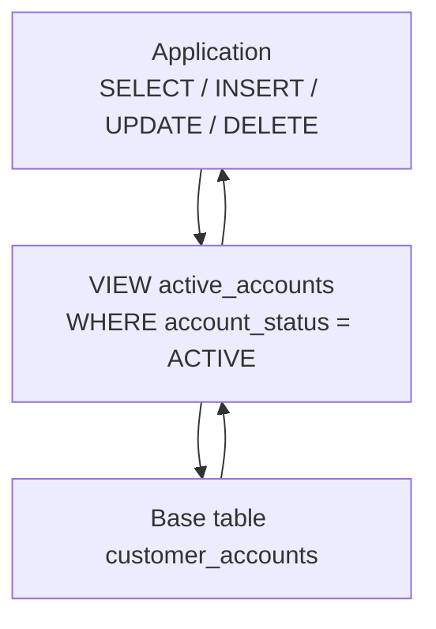
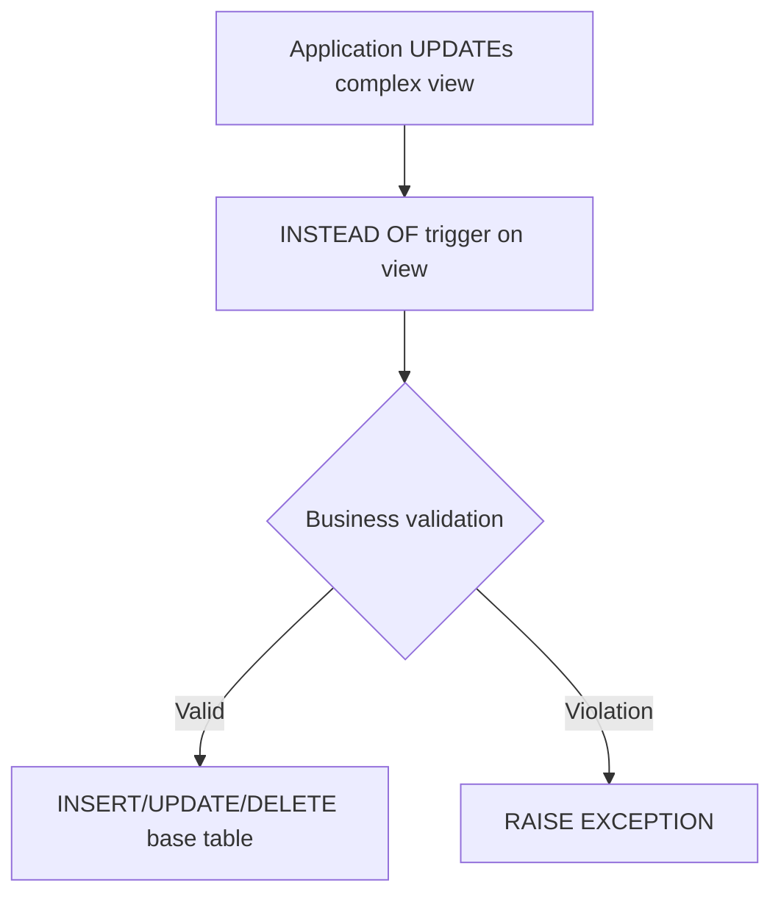

# Updatable Views and WITH CHECK OPTION in PostgreSQL

A **view** in PostgreSQL is a named object storing a **query definition**. Applications can `SELECT` from a view just as from a table. However, an even more important question arises when building write APIs: **Can you `INSERT`, `UPDATE`, or `DELETE` through a view, and what happens if an update causes a row to no longer satisfy the view's condition?**

Consider an accounts table with statuses:

```sql
SELECT account_id, display_name, account_status
FROM customer_accounts;
```

A view showing only active accounts:

```sql
CREATE VIEW active_accounts AS
SELECT account_id, display_name, account_status
FROM customer_accounts
WHERE account_status = 'ACTIVE';
```

Such a simple view can be **automatically updatable**. Surprisingly, without extra constraints, this statement:

```sql
UPDATE active_accounts
SET account_status = 'SUSPENDED'
WHERE account_id = 101;
```

can successfully update the row in the base table. Afterward, account 101 **disappears from the view** because it no longer satisfies `account_status = 'ACTIVE'`. The view's `WHERE` clause determines which rows are visible and targetable, **not automatically ensuring that new states also satisfy that condition**.

If the business requirement is that **every row written through the view must remain visible in the view after writing**, use:

```sql
CREATE VIEW active_accounts_checked AS
SELECT account_id, display_name, account_status
FROM customer_accounts
WHERE account_status = 'ACTIVE'
WITH CHECK OPTION;
```

When an `UPDATE` or `INSERT` through this view produces a row that fails the `WHERE` condition, PostgreSQL **rejects the operation** with a view check option error. That is the purpose of `WITH CHECK OPTION`.

This lesson explains that mechanism from simple examples through **multi-layer views, `LOCAL` and `CASCADED`, access permissions, RLS, JOIN/aggregate views, triggers, PostgreSQL catalogs, Java/JDBC applications, and common pitfalls**.

## 1. Learning Objectives

After this lesson, you will be able to:

1. Distinguish between base tables, regular views, automatically updatable views, read-only views, and trigger-updatable views.
2. Identify the conditions under which a simple PostgreSQL view supports automatic `INSERT`, `UPDATE`, and `DELETE`.
3. Explain accurately why a view's `WHERE` clause **is not equivalent** to `WITH CHECK OPTION`.
4. Predict the outcome of an `UPDATE` that causes a row to stop satisfying the view's predicate.
5. Use `WITH CHECK OPTION` to prevent `INSERT`/`UPDATE` from creating rows that fall outside the view.
6. Distinguish between `WITH LOCAL CHECK OPTION`, `WITH CASCADED CHECK OPTION`, and the default cascaded behavior for nested views.
7. Understand that base table constraints such as `NOT NULL`, `CHECK`, `UNIQUE`, FKs, defaults, and identity columns remain in effect.
8. Handle directly selected columns, computed columns, hidden columns, and columns needing defaults during inserts.
9. Know why views with `JOIN`, `GROUP BY`, `DISTINCT`, `LIMIT`, or similar constructs are not automatically updatable.
10. Understand the limitations of `INSTEAD OF` triggers/rules with respect to check option enforcement.
11. Combine views with `GRANT`, `security_invoker`, and Row-Level Security (RLS) without equating `WITH CHECK OPTION` with authorization.
12. Inspect view definitions and updatability properties via `information_schema.views`, `pg_views`, and `pg_get_viewdef`.
13. Read `EXPLAIN` when querying views and control both correctness and performance of DML through views.
14. Design test cases and error handling in Java/JDBC.

## 2. What Is a View and What Does "Updatable" Mean?

A regular view stores a `SELECT` query, not a separate copy of the data. When queried:

```sql
SELECT *
FROM active_accounts
WHERE account_id = 101;
```

PostgreSQL resolves the view definition against the base table to return results. Values live in the source table and are not duplicated into an independent store just because you created a view.

Diagram:



**Updatable view** means certain write statements targeting the view name are translated by PostgreSQL into operations on the underlying data. It does not mean the view stores its own mutable copy.

### 2.1. Distinguishing Three Cases

| Object | `SELECT` | Writing data through the view name |
| --- | --- | --- |
| Simple, automatically updatable view | Yes | PostgreSQL automatically translates `INSERT`/`UPDATE`/`DELETE` to the base table |
| Complex-structure, non-automatically-updatable view | Yes | Cannot be written directly without a custom write mechanism |
| View with an `INSTEAD OF` trigger or suitable rule | Yes | Write logic is defined by the trigger/rule; check option interaction limits apply |

### 2.2. Views vs. Materialized Views

`CREATE MATERIALIZED VIEW` stores a physical result refreshed through a separate mechanism. A materialized view **is not** an automatically updatable view via `INSERT`/`UPDATE`/`DELETE` as covered in this lesson.

If you need to update business tables through a conditional SQL interface, evaluate regular `CREATE VIEW`, not materialized views.

### 2.3. Why Do Applications Write Through Views?

A view can serve as an intentional interface to:

- Expose only a subset of table columns.
- Surface only rows in specific business states.
- Keep SQL column/API names stable during underlying schema changes.
- Decouple view permissions from direct table permissions.
- Provide a consistent data access layer across multiple applications.

However, **views do not automatically replace all constraints and security policies**. Strict data control requires considering view predicates, check options, constraints, privileges, RLS, triggers, and transactions together.

## 3. When Is a View Automatically Updatable?

PostgreSQL supports **automatically updatable views** for sufficiently simple views. Key criteria for the view definition include:

- **Exactly one entry** in the `FROM` list, referencing a **table** or another **updatable view**.
- At the top level of the query, no `WITH`, `DISTINCT`, `GROUP BY`, `HAVING`, `LIMIT`, or `OFFSET`.
- No set operations (`UNION`, `INTERSECT`, `EXCEPT`) at the top level.
- The `SELECT` target list contains no aggregates, window functions, or set-returning functions.
- A view column is **automatically writable** if its expression is a **simple reference to an updatable column** of the underlying table/view.

Simple example:

```sql
CREATE VIEW active_accounts AS
SELECT account_id, tenant_id, display_name, account_status
FROM customer_accounts
WHERE account_status = 'ACTIVE';
```

This matches the pattern for an automatically updatable view.

### 3.1. WHERE Does Not Make a View Non-Updatable

The condition:

```sql
WHERE account_status = 'ACTIVE'
```

only restricts the visible row set. It **does not make the view read-only**.

### 3.2. Computed Columns Can Be Read-Only

A view:

```sql
CREATE VIEW account_labels AS
SELECT
    account_id,
    display_name,
    upper(display_name) AS display_name_upper
FROM customer_accounts;
```

has `display_name_upper` as a **computed expression**. The view itself still has updatable columns like `display_name`, but you cannot assign directly to `display_name_upper` because it has no single base table column to update.

### 3.3. Can You INSERT Through a View Without Exposing All Columns?

Yes, provided base table columns **omitted from the view** receive valid values from defaults, identity generation, generated columns, nullability, or another database mechanism.

If the view hides a `NOT NULL` column with no default that the INSERT fails to supply, PostgreSQL rejects the statement due to the base table constraint.

### 3.4. Not Every SELECT Has an Unambiguous Reverse Write Mapping

An aggregated view:

```sql
SELECT tenant_id, COUNT(*) AS account_count
FROM customer_accounts
GROUP BY tenant_id
```

does not specify which **underlying rows** an `UPDATE account_count = 100` should modify. That is why aggregated views are not automatically updatable.

## 4. Practice Dataset: Multi-Tenant Accounts

We use a dedicated `updatable_view_lab` schema to avoid affecting existing tables. The SQL statements below are meant for a **test PostgreSQL database**. If you have already run them once, use a fresh test schema or clean up properly instead of rerunning duplicate `CREATE TABLE` commands.

### 4.1. Create the Schema

```sql
CREATE SCHEMA IF NOT EXISTS updatable_view_lab;
```

### 4.2. Base Table

```sql
CREATE TABLE updatable_view_lab.customer_accounts (
    account_id BIGINT GENERATED BY DEFAULT AS IDENTITY PRIMARY KEY,
    tenant_id INTEGER NOT NULL,
    email TEXT NOT NULL,
    display_name TEXT NOT NULL,
    account_status TEXT NOT NULL DEFAULT 'ACTIVE'
        CHECK (account_status IN ('ACTIVE', 'SUSPENDED', 'CLOSED')),
    credit_limit NUMERIC(12, 2) NOT NULL DEFAULT 0
        CHECK (credit_limit >= 0),
    created_at TIMESTAMPTZ NOT NULL DEFAULT now(),
    UNIQUE (tenant_id, email)
);
```

Design choices:

- `account_id` generates a value automatically if INSERT omits the ID.
- `tenant_id` is required and can be used to filter by tenant.
- `account_status` accepts only `ACTIVE`, `SUSPENDED`, or `CLOSED`.
- `credit_limit` is non-negative.
- The pair `(tenant_id, email)` is unique.
- `created_at` has a default, so views do not need to expose it for INSERTs.

### 4.3. Insert Sample Data

```sql
INSERT INTO updatable_view_lab.customer_accounts (
    account_id, tenant_id, email, display_name,
    account_status, credit_limit
)
VALUES
    (101, 10, 'an@example.test', 'An', 'ACTIVE', 1500),
    (102, 10, 'binh@example.test', 'Bình', 'SUSPENDED', 500),
    (103, 10, 'chi@example.test', 'Chi', 'ACTIVE', 3000),
    (201, 20, 'dung@example.test', 'Dũng', 'ACTIVE', 2000),
    (202, 20, 'ha@example.test', 'Hà', 'CLOSED', 0);
```

Because `GENERATED BY DEFAULT AS IDENTITY` permits explicit IDs when loading test data, we can use IDs 101/102/103/201/202 in the examples that follow.

**In real systems**, if you frequently insert manual IDs into an identity/sequence column, synchronize the sequence value appropriately to avoid future collisions. In this lab, sequence-generated IDs start at small numbers and will not collide with the sample IDs during initial tests.

### 4.4. Inspect Base Data

```sql
SELECT
    account_id, tenant_id, email,
    display_name, account_status, credit_limit
FROM updatable_view_lab.customer_accounts
ORDER BY account_id;
```

Expected:

| account_id | tenant_id | display_name | account_status |
| ---: | ---: | --- | --- |
| 101 | 10 | An | ACTIVE |
| 102 | 10 | Bình | SUSPENDED |
| 103 | 10 | Chi | ACTIVE |
| 201 | 20 | Dũng | ACTIVE |
| 202 | 20 | Hà | CLOSED |

## 5. Creating a Simple View Without CHECK OPTION

```sql
CREATE VIEW updatable_view_lab.active_accounts AS
SELECT
    account_id,
    tenant_id,
    email,
    display_name,
    account_status,
    credit_limit
FROM updatable_view_lab.customer_accounts
WHERE account_status = 'ACTIVE';
```

Query:

```sql
SELECT account_id, tenant_id, display_name, account_status
FROM updatable_view_lab.active_accounts
ORDER BY account_id;
```

Expected output shows accounts 101, 103, and 201, omitting 102 and 202.

### 5.1. Views Are Not Physical Copies

If an operation on the base table changes account 102 to ACTIVE:

```sql
BEGIN;

UPDATE updatable_view_lab.customer_accounts
SET account_status = 'ACTIVE'
WHERE account_id = 102;

SELECT account_id
FROM updatable_view_lab.active_accounts
WHERE account_id = 102;

ROLLBACK;
```

Inside the transaction, the view immediately reflects row 102 per the transaction's own snapshot rules. After `ROLLBACK`, the sample state reverts to normal.

### 5.2. The View Is Updatable Because It Maps to the Source Table

All columns in the view directly reference columns of `customer_accounts`. PostgreSQL routes writes through the view to that table without needing a custom trigger.

## 6. UPDATE Through a View Without CHECK OPTION: Rows Can Disappear

This is the central example of the lesson.

```sql
BEGIN;

UPDATE updatable_view_lab.active_accounts
SET account_status = 'SUSPENDED'
WHERE account_id = 101
RETURNING account_id, account_status;

SELECT account_id, account_status
FROM updatable_view_lab.active_accounts
WHERE account_id = 101;

SELECT account_id, account_status
FROM updatable_view_lab.customer_accounts
WHERE account_id = 101;

ROLLBACK;
```

Within the transaction, observe:

1. Initially account 101 is ACTIVE, so it **appears in the view**.
2. `UPDATE` through the view locates the existing row satisfying `account_status = 'ACTIVE'`.
3. PostgreSQL writes the new status `SUSPENDED` to the source table.
4. `UPDATE ... RETURNING` returns the updated record.
5. Re-running `SELECT` from the view no longer finds account 101.
6. Direct `SELECT` on the base table shows 101 is SUSPENDED.
7. `ROLLBACK` restores the initial state so later examples remain unaffected.

### 6.1. Why Doesn't PostgreSQL Reject This Automatically?

Because `WHERE account_status='ACTIVE'` in the view definition specifies **which rows belong to the visible set**, not a default constraint on newly written states.

Without `WITH CHECK OPTION`, a write operation can move a row outside the view's visible set.

### 6.2. The Data Was Not Deleted

After the update, the row **no longer matches the filter**; it was not `DELETE`d. It still exists in the base table.

### 6.3. Applications Can Misinterpret This

An API executing:

```text
UPDATE active_accounts SET account_status='SUSPENDED' ...
SELECT active_accounts WHERE id=101
```

will see the UPDATE succeed while the subsequent SELECT returns 0 rows. If the application treats 0 rows as "the record was deleted," that is a misinterpretation.

Decide the business intent clearly: **is transitioning a row out of the view valid**, or **must it be strictly forbidden through this interface**?

## 7. INSERT Through a View Without CHECK OPTION

INSERT through a simple view writes to the source table.

```sql
BEGIN;

INSERT INTO updatable_view_lab.active_accounts (
    tenant_id, email, display_name, account_status, credit_limit
)
VALUES (
    10, 'new-suspended@example.test', 'New Suspended',
    'SUSPENDED', 0
)
RETURNING account_id, account_status;

SELECT account_id
FROM updatable_view_lab.active_accounts
WHERE email = 'new-suspended@example.test';

SELECT account_id, account_status
FROM updatable_view_lab.customer_accounts
WHERE email = 'new-suspended@example.test';

ROLLBACK;
```

**Key observation:** the INSERT succeeds, yet the new row with `account_status='SUSPENDED'` **does not appear in `active_accounts`**.

### 7.1. Why?

Without a check option, the view filter does not verify whether newly inserted rows satisfy its predicate afterward.

### 7.2. Base Table Constraints Still Apply

If you INSERT:

```sql
INSERT INTO updatable_view_lab.active_accounts (
    tenant_id, email, display_name, account_status
)
VALUES (10, 'invalid@example.test', 'Invalid', 'DELETED');
```

then `account_status='DELETED'` is outside the allowed values of the **base table's CHECK constraint**. PostgreSQL rejects it because of the source table constraint, even though the view has no check option.

**View check options and table constraints are two distinct enforcement layers.**

## 8. WITH CHECK OPTION: Requiring New Rows to Satisfy WHERE

Create a view with a check option:

```sql
CREATE VIEW updatable_view_lab.active_accounts_checked AS
SELECT
    account_id,
    tenant_id,
    email,
    display_name,
    account_status,
    credit_limit
FROM updatable_view_lab.customer_accounts
WHERE account_status = 'ACTIVE'
WITH CHECK OPTION;
```

`WITH CHECK OPTION` is shorthand for the default **cascaded** behavior when neither LOCAL nor CASCADED is specified explicitly.

### 8.1. What Gets Checked?

When `INSERT` or `UPDATE` runs through the view:

```text
New row after operation
       |
       v
Satisfies view WHERE account_status = 'ACTIVE'?
       |
       +-- TRUE  --> allowed to proceed to constraints/permissions
       |
       +-- FALSE/UNKNOWN --> rejected by CHECK OPTION
```

This diagram illustrates the logical condition; the exact execution order of checks and triggers depends on PostgreSQL internals. Do not rely on the diagram to predict which error fires first when multiple constraints fail simultaneously.

### 8.2. Impact on SELECT?

No change in filtering logic:

```sql
SELECT *
FROM updatable_view_lab.active_accounts_checked;
```

still shows ACTIVE accounts. Check option **does not add a new SELECT filter**; it governs the validity of rows written through the view.

## 9. UPDATE Violating WITH CHECK OPTION

Try transitioning account 101 from ACTIVE to SUSPENDED through the checked view:

```sql
BEGIN;

UPDATE updatable_view_lab.active_accounts_checked
SET account_status = 'SUSPENDED'
WHERE account_id = 101;

-- PostgreSQL is expected to raise a check option error for the view.
-- After the error, end the transaction with ROLLBACK.
ROLLBACK;
```

Because the new row fails `account_status='ACTIVE'`, PostgreSQL rejects the operation. Typical error output:

```text
ERROR: new row violates check option for view "active_accounts_checked"
DETAIL: Failing row contains ...
```

Exact message details vary across versions, statement types, and contexts; never build application logic by parsing error message strings.

**Note when running in psql/JDBC:** if a statement puts the transaction into an error state, you must `ROLLBACK` before continuing. If your client stops immediately on SQL error, issue ROLLBACK afterward.

### 9.1. Is the Source Row Modified?

No. When a statement is rejected, the update is not committed. In the lab, account 101 remains ACTIVE.

### 9.2. What About Updating Other Columns?

```sql
BEGIN;

UPDATE updatable_view_lab.active_accounts_checked
SET display_name = 'An Updated',
    credit_limit = 1800
WHERE account_id = 101
RETURNING account_id, display_name, account_status, credit_limit;

ROLLBACK;
```

This satisfies the view predicate because `account_status` stays ACTIVE, and `credit_limit>=0`. Thus it succeeds if permissions and other constraints hold.

### 9.3. CHECK OPTION Does Not Forbid All Changes

It only requires **the post-operation row to satisfy the view's predicate**. Fields unrelated to that condition can still change subject to privileges and underlying constraints.

## 10. INSERT Violating WITH CHECK OPTION

```sql
BEGIN;

INSERT INTO updatable_view_lab.active_accounts_checked (
    tenant_id, email, display_name, account_status, credit_limit
)
VALUES (
    10, 'blocked@example.test', 'Blocked',
    'SUSPENDED', 100
);

-- Expected error: new row does not satisfy the view WHERE clause.
ROLLBACK;
```

Unlike the unchecked view, the checked view **refuses** to insert a SUSPENDED account through an interface restricted to ACTIVE accounts.

### 10.1. Valid INSERT

```sql
BEGIN;

INSERT INTO updatable_view_lab.active_accounts_checked (
    tenant_id, email, display_name, account_status, credit_limit
)
VALUES (
    10, 'new-active@example.test', 'New Active',
    'ACTIVE', 500
)
RETURNING account_id, tenant_id, email, account_status;

ROLLBACK;
```

This INSERT satisfies the view predicate. `ROLLBACK` simply keeps the lab dataset clean.

### 10.2. INSERT Omitting Columns with Defaults

Because `account_status TEXT NOT NULL DEFAULT 'ACTIVE'` on the base table:

```sql
BEGIN;

INSERT INTO updatable_view_lab.active_accounts_checked (
    tenant_id, email, display_name
)
VALUES (10, 'default-active@example.test', 'Default Active')
RETURNING account_id, account_status, credit_limit;

ROLLBACK;
```

PostgreSQL supplies default values:

- `account_status='ACTIVE'`.
- `credit_limit=0`.
- `account_id` generated by identity.
- `created_at=now()`.

Thus the new row satisfies both check option and base constraints.

### 10.3. What If the Default Fails the Predicate?

Suppose the base table defaulted to `'SUSPENDED'` while the view required `'ACTIVE'`. An INSERT omitting status would receive the default SUSPENDED value and **be rejected by CHECK OPTION**.

Do not assume hiding a column in a view automatically forces that column's value to satisfy WHERE. Defaults or explicit write logic determine its value.

## 11. Does the View's WHERE Check the Old Row or New Row?

This distinction is crucial:

| Scenario | Row before operation | Row after operation | Outcome with CHECK OPTION |
| --- | --- | --- | --- |
| Update ACTIVE account name | Visible in view | Still ACTIVE | Allowed |
| ACTIVE → SUSPENDED | Visible in view | No longer visible | Rejected |
| INSERT ACTIVE | Did not exist | Visible in view | Allowed |
| INSERT SUSPENDED | Did not exist | Not visible | Rejected |
| UPDATE SUSPENDED account via ACTIVE view | Not visible | No target row | Typically updates 0 rows |
| DELETE ACTIVE account via view | Visible in view | Row deleted | CHECK OPTION does not keep rows after DELETE |

### 11.1. Updating 0 Rows Differs from a Check Option Error

```sql
UPDATE updatable_view_lab.active_accounts_checked
SET account_status = 'ACTIVE'
WHERE account_id = 102;
```

Account 102 is SUSPENDED, so it is absent from the ACTIVE view. PostgreSQL finds no row **visible through the view** matching the UPDATE filter, so the statement updates **0 rows**.

Do not expect a checked view to "reactivate" a SUSPENDED account when the view cannot even see that row.

To reactivate an account, use an appropriate interface:

- Update the base table directly if the role and business rules allow.
- Use another view that exposes SUSPENDED accounts.
- Use a stored procedure/service with proper permissions and state transition checks.

### 11.2. WHERE in UPDATE Adds Additional Filtering

```sql
UPDATE updatable_view_lab.active_accounts_checked
SET credit_limit = 2000
WHERE tenant_id = 10
  AND credit_limit < 2000;
```

Both the **view's** WHERE and the **UPDATE statement's** WHERE narrow which rows are selected. Afterward, check option still requires the view predicate to hold.

### 11.3. CHECK OPTION Does Not Require UPDATE to Have a WHERE Clause

```sql
UPDATE updatable_view_lab.active_accounts_checked
SET credit_limit = credit_limit + 100;
```

if permitted, updates **every account visible through the view**, not just a single ID. Check option does not limit affected row count or substitute for targeting rows by key.

## 12. DELETE Through a View: CHECK OPTION Does Not Prevent Deletion

```sql
BEGIN;

DELETE FROM updatable_view_lab.active_accounts_checked
WHERE account_id = 101
RETURNING account_id, account_status;

SELECT account_id
FROM updatable_view_lab.customer_accounts
WHERE account_id = 101;

ROLLBACK;
```

When DELETE is permitted by grants and foreign keys, the row is removed from the source table. `WITH CHECK OPTION` governs **INSERTed/UPDATEd rows**, not requiring a DELETEd row to remain in the view.

### 12.1. DELETE Through a View Only Affects Visible Rows

A DELETE:

```sql
DELETE FROM updatable_view_lab.active_accounts_checked
WHERE account_id = 102;
```

cannot delete SUSPENDED account 102 because that row is not in the set exposed by the view.

### 12.2. What If Business Rules Forbid DELETE?

Do not use CHECK OPTION to block DELETE. Instead:

- Omit `DELETE` privileges on the view for that role.
- Or design a dedicated write interface/service.
- Combine constraints, triggers, and security policies as needed.

**WITH CHECK OPTION is a constraint on post-write row visibility, not a full CRUD authorization system.**

## 13. Base Table Constraints Remain Active

View check options are just **one layer**. The base table enforces its own rules.

### 13.1. NOT NULL

```sql
-- Base table NOT NULL error if execution reaches insert:
INSERT INTO updatable_view_lab.active_accounts_checked (
    tenant_id, email, display_name, account_status
)
VALUES (10, 'noname@example.test', NULL, 'ACTIVE');
```

### 13.2. CHECK

```sql
-- Base table CHECK credit_limit >= 0 error:
INSERT INTO updatable_view_lab.active_accounts_checked (
    tenant_id, email, display_name, account_status, credit_limit
)
VALUES (10, 'negative@example.test', 'Negative', 'ACTIVE', -100);
```

### 13.3. UNIQUE

```sql
-- Pair (tenant_id, email) already exists:
INSERT INTO updatable_view_lab.active_accounts_checked (
    tenant_id, email, display_name, account_status
)
VALUES (10, 'an@example.test', 'Duplicate', 'ACTIVE');
```

### 13.4. Foreign Keys

This lab did not declare an FK to a tenants table; in a real schema where `tenant_id` references a tenants table, INSERT/UPDATE through the view must still satisfy that FK.

### 13.5. Do Not Assume Simple Ordering of Errors

If a row violates both CHECK OPTION and a base table CHECK simultaneously, do not build business rules assuming PostgreSQL will **always** raise one fixed error before the other.

In Java/JDBC, classify errors using SQLSTATE/constraint metadata when needed and return stable business messages at the application layer.

## 14. LOCAL and CASCADED: Differences Appear in Nested Views

Suppose an application has two view layers:

```text
customer_accounts (base table)
      |
      v
tenant10_accounts (view WHERE tenant_id=10)
      |
      v
tenant10_active (view WHERE account_status='ACTIVE')
```

Suppose through the upper view, you update a tenant 10 account to tenant 20 while keeping it ACTIVE.

The new state:

- Satisfies `account_status='ACTIVE'` of the upper view.
- **Violates** `tenant_id=10` of the lower view.

If only the upper view's condition is checked, the UPDATE succeeds. If both layers are checked, it is rejected.

That is the difference between `LOCAL` and `CASCADED`.

## 15. Creating a Lower-Layer View Without CHECK OPTION

```sql
CREATE VIEW updatable_view_lab.tenant10_accounts AS
SELECT
    account_id,
    tenant_id,
    email,
    display_name,
    account_status,
    credit_limit
FROM updatable_view_lab.customer_accounts
WHERE tenant_id = 10;
```

This is an automatically updatable view showing only tenant 10 rows.

Query:

```sql
SELECT account_id, tenant_id, account_status
FROM updatable_view_lab.tenant10_accounts
ORDER BY account_id;
```

Returns 101, 102, and 103.

**Note:** the lower view **has no `WITH CHECK OPTION` yet**. This is intentional to demonstrate the difference when the upper view uses LOCAL vs. CASCADED.

## 16. Upper View Using WITH LOCAL CHECK OPTION

```sql
CREATE VIEW updatable_view_lab.tenant10_active_local AS
SELECT
    account_id,
    tenant_id,
    email,
    display_name,
    account_status,
    credit_limit
FROM updatable_view_lab.tenant10_accounts
WHERE account_status = 'ACTIVE'
WITH LOCAL CHECK OPTION;
```

When writing through `tenant10_active_local`:

- The condition declared by **this view layer** is `account_status='ACTIVE'`.
- `LOCAL` checks the current view's conditions, **while still respecting any check options explicitly declared on lower layers**.
- However, `tenant10_accounts` has no check option declared, so its tenant condition **does not become an enforced check option** under LOCAL.

### 16.1. UPDATE Changing Tenant While Keeping ACTIVE

```sql
BEGIN;

UPDATE updatable_view_lab.tenant10_active_local
SET tenant_id = 20
WHERE account_id = 101
RETURNING account_id, tenant_id, account_status;

SELECT account_id, tenant_id
FROM updatable_view_lab.tenant10_active_local
WHERE account_id = 101;

SELECT account_id, tenant_id, account_status
FROM updatable_view_lab.customer_accounts
WHERE account_id = 101;

ROLLBACK;
```

In this lab setup, the UPDATE succeeds:

- The account initially belongs to tenant 10 and is ACTIVE, so it is visible in the view.
- After UPDATE, status remains ACTIVE → **satisfies the upper view predicate**.
- Tenant changed to 20 → no longer satisfies the lower view.
- Because the lower view **has no check option of its own**, LOCAL does not enforce that lower condition as a check option.
- The row disappears from the view.

**This is expected behavior per LOCAL semantics, not a PostgreSQL bug.**

## 17. Upper View Using WITH CASCADED CHECK OPTION

```sql
CREATE VIEW updatable_view_lab.tenant10_active_cascaded AS
SELECT
    account_id,
    tenant_id,
    email,
    display_name,
    account_status,
    credit_limit
FROM updatable_view_lab.tenant10_accounts
WHERE account_status = 'ACTIVE'
WITH CASCADED CHECK OPTION;
```

Across **automatically updatable** views, `CASCADED` requires the post-write row to satisfy:

1. The target view's condition: `account_status='ACTIVE'`.
2. The underlying view's condition: `tenant_id=10`.
3. Conditions of any further underlying qualifying views.

### 17.1. UPDATE Changing Tenant Is Rejected

```sql
BEGIN;

UPDATE updatable_view_lab.tenant10_active_cascaded
SET tenant_id = 20
WHERE account_id = 101;

-- Expected CHECK OPTION error because the new row does not belong to tenant 10.
ROLLBACK;
```

Even though still ACTIVE, the new state is **not visible through `tenant10_accounts`**. With CASCADED, PostgreSQL rejects the change.

### 17.2. UPDATE Changing Status Is Also Rejected

```sql
BEGIN;

UPDATE updatable_view_lab.tenant10_active_cascaded
SET account_status = 'SUSPENDED'
WHERE account_id = 101;

-- Expected CHECK OPTION error at the layer requiring ACTIVE.
ROLLBACK;
```

### 17.3. Valid UPDATE

```sql
BEGIN;

UPDATE updatable_view_lab.tenant10_active_cascaded
SET credit_limit = 2500
WHERE account_id = 101
RETURNING account_id, tenant_id, account_status, credit_limit;

ROLLBACK;
```

The new row stays in tenant 10 and ACTIVE while obeying the base table's `credit_limit` constraint.

## 18. Comparing LOCAL, CASCADED, and Default

| Scenario | LOCAL on upper view | CASCADED on upper view |
| --- | --- | --- |
| New row violates **upper view's** WHERE | Rejected | Rejected |
| New row violates lower view's WHERE (**no check option**) | Allowed | Rejected |
| Lower view **has its own check option** and new row violates it | Still enforced by that check option | Rejected |
| Multiple automatically updatable layers | Checks self + declared underlying check options | Checks conditions across layers via cascading |

### 18.1. Default Is CASCADED

```sql
CREATE VIEW some_view AS
SELECT ...
FROM ...
WHERE ...
WITH CHECK OPTION;
```

When neither `LOCAL` nor `CASCADED` is written, PostgreSQL defaults to **CASCADED**.

### 18.2. LOCAL Does Not Mean "Ignore All Lower Layers"

If a lower view already declares `WITH CHECK OPTION`, that check option remains enforced when writing through an upper automatically updatable view using LOCAL.

Never design tenant security assuming LOCAL "checks only one layer and disables underlying checks."

### 18.3. CASCADED Is Not a Security Mode Crossing Arbitrary Triggers/Rules

The results above assume **every view in the chain is automatically updatable**. If a layer in the chain writes via an `INSTEAD OF` trigger or rule, check option enforcement has distinct limitations; do not assume this example's behavior extends across custom trigger-writable layers.

## 19. When the Underlying View Has Its Own CHECK OPTION

Create a lower layer enforcing tenant isolation:

```sql
CREATE VIEW updatable_view_lab.tenant10_checked AS
SELECT
    account_id,
    tenant_id,
    email,
    display_name,
    account_status,
    credit_limit
FROM updatable_view_lab.customer_accounts
WHERE tenant_id = 10
WITH CHECK OPTION;
```

Upper layer using LOCAL:

```sql
CREATE VIEW updatable_view_lab.tenant10_active_on_checked AS
SELECT
    account_id,
    tenant_id,
    email,
    display_name,
    account_status,
    credit_limit
FROM updatable_view_lab.tenant10_checked
WHERE account_status = 'ACTIVE'
WITH LOCAL CHECK OPTION;
```

Test:

```sql
BEGIN;

UPDATE updatable_view_lab.tenant10_active_on_checked
SET tenant_id = 20
WHERE account_id = 101;

-- Expected error: underlying view tenant10_checked already has CHECK OPTION.
ROLLBACK;
```

### 19.1. Conclusion

Even though the upper view uses LOCAL, the check option **declared on the lower view** is not bypassed. To understand a nested view completely, inspect **the entire chain of view definitions**.

## 20. NULL Predicates and SQL Three-Valued Logic

An SQL predicate can evaluate to:

- `TRUE`.
- `FALSE`.
- `UNKNOWN` (commonly involving NULL).

A view's `WHERE predicate` exposes only rows where the predicate evaluates to TRUE. With a checked view, a new row that **does not evaluate to TRUE** is rejected.

### 20.1. Hypothetical Example with a Nullable Field

Suppose a `products` table has `approved_at TIMESTAMPTZ NULL` and a view:

```sql
CREATE VIEW approved_products AS
SELECT product_id, approved_at, title
FROM products
WHERE approved_at >= TIMESTAMPTZ '2026-01-01 00:00:00+00'
WITH CHECK OPTION;
```

This is an **illustrative example**; do not run it directly in the lab since `products` does not exist.

If you INSERT `approved_at=NULL`, `NULL >= date` evaluates to UNKNOWN, so the row **would not appear in the view** and is rejected by CHECK OPTION.

### 20.2. When NULL Should Be Allowed

If business rules intentionally include unapproved rows with NULL, express that explicitly in the predicate, e.g.:

```sql
WHERE approved_at IS NULL
   OR approved_at >= TIMESTAMPTZ '2026-01-01 00:00:00+00'
```

Do not loosen the predicate solely to make an INSERT pass if it breaks the meaning of "approved products."

### 20.3. CHECK OPTION Does Not Treat "NULL as Empty"

`NULL` is not equal to an empty string, 0, or FALSE. If business rules require defaults, define explicit DEFAULT/NOT NULL/constraints instead of relying on application assumptions.

## 21. Views with Multi-Column Conditions

An interface restricted to active accounts in tenant 10 with positive credit limit:

```sql
CREATE VIEW updatable_view_lab.tenant10_active_credit AS
SELECT
    account_id,
    tenant_id,
    email,
    display_name,
    account_status,
    credit_limit
FROM updatable_view_lab.customer_accounts
WHERE tenant_id = 10
  AND account_status = 'ACTIVE'
  AND credit_limit > 0
WITH CHECK OPTION;
```

Then:

```sql
-- Valid if row 101 still has tenant 10, ACTIVE, and credit_limit > 0:
UPDATE updatable_view_lab.tenant10_active_credit
SET credit_limit = 1200
WHERE account_id = 101;
```

However:

```sql
BEGIN;

UPDATE updatable_view_lab.tenant10_active_credit
SET credit_limit = 0
WHERE account_id = 101;

-- Expected CHECK OPTION error because credit_limit > 0 no longer holds.
ROLLBACK;
```

This differs from the base table constraint:

- The base table permits `credit_limit=0`.
- The view `tenant10_active_credit` permits only rows with `credit_limit>0`.

**WITH CHECK OPTION can enforce a business condition narrower than the base table's constraints.**

## 22. Views with Hidden Columns: Understanding Defaults and INSERT Limits

A view exposing only:

```sql
CREATE VIEW updatable_view_lab.account_public_fields AS
SELECT
    account_id,
    tenant_id,
    display_name,
    account_status
FROM updatable_view_lab.customer_accounts
WHERE account_status = 'ACTIVE'
WITH CHECK OPTION;
```

This view hides:

- `email`.
- `credit_limit`.
- `created_at`.

If you attempt:

```sql
INSERT INTO updatable_view_lab.account_public_fields (
    tenant_id, display_name, account_status
)
VALUES (10, 'Partial Account', 'ACTIVE');
```

the base table requires `email TEXT NOT NULL` with no DEFAULT; the INSERT **cannot supply email** through the view and fails.

### 22.1. Views Do Not Define DEFAULTs for Hidden Columns

PostgreSQL cannot guess an email. To INSERT via this view, adjust the design:

- Expose `email` if it is a required input.
- Add a valid base table default if business rules allow.
- Use an API/stored procedure/trigger responsible for generating a valid email.
- Disallow INSERT on the view if it is only meant for SELECT/UPDATE of certain columns.

### 22.2. Hidden Columns Are Not Sufficient Security by Themselves

If a user still has SELECT privileges on the base table, hiding `email` in a view does not stop them from reading `email` directly. Audit `GRANT`s, schema privileges, and RLS.

### 22.3. Use Column-Level Privileges When Needed

You can grant privileges on specific columns, but you must understand view vs. base table privileges and all other access paths. Never treat "simply omitting email from the view" as a complete authentication/authorization mechanism.

## 23. Computed Columns and Updatable Columns

Create view:

```sql
CREATE VIEW updatable_view_lab.account_labels AS
SELECT
    account_id,
    tenant_id,
    display_name,
    upper(display_name) AS display_name_upper,
    account_status
FROM updatable_view_lab.customer_accounts
WHERE account_status = 'ACTIVE'
WITH CHECK OPTION;
```

### 23.1. Updating Base Columns

```sql
BEGIN;

UPDATE updatable_view_lab.account_labels
SET display_name = 'An Nguyễn'
WHERE account_id = 101
RETURNING account_id, display_name, display_name_upper;

ROLLBACK;
```

Changes to `display_name` map to the base column, and `display_name_upper` is recomputed when SELECTing/RETURNING from the view.

### 23.2. Updating Computed Columns

```sql
UPDATE updatable_view_lab.account_labels
SET display_name_upper = 'AN'
WHERE account_id = 101;
```

The `display_name_upper` column is the expression `upper(display_name)`, not a direct base column reference, so **it cannot be automatically UPDATEd**.

### 23.3. Views with Computed Columns Are Not Necessarily Completely Read-Only

Directly mapped columns remain updatable. This differs from aggregate/JOIN views whose overall structure disqualifies automatic updatability.

## 24. JOIN Views: Why Aren't They Automatically Updatable Like Single Tables?

Suppose we have:

```sql
CREATE TABLE updatable_view_lab.tenant_directory (
    tenant_id INTEGER PRIMARY KEY,
    tenant_name TEXT NOT NULL
);

INSERT INTO updatable_view_lab.tenant_directory
VALUES (10, 'Tenant Ten'), (20, 'Tenant Twenty');
```

A JOIN view:

```sql
CREATE VIEW updatable_view_lab.account_with_tenant_name AS
SELECT
    a.account_id,
    a.tenant_id,
    t.tenant_name,
    a.display_name,
    a.account_status
FROM updatable_view_lab.customer_accounts AS a
JOIN updatable_view_lab.tenant_directory AS t
  ON t.tenant_id = a.tenant_id;
```

Normally this **is not an automatically updatable view** because it has multiple FROM items.

### 24.1. Why?

For example:

```sql
UPDATE updatable_view_lab.account_with_tenant_name
SET tenant_name = 'New Name'
WHERE account_id = 101;
```

PostgreSQL does not have a universal update rule for arbitrary JOINs: should it update the accounts table or the tenants table, and how should duplicates be handled?

### 24.2. Not Every JOIN Can Be Safely Inferred

Even when a JOIN follows a many-to-one FK and a human knows which table to update, PostgreSQL's automatically updatable view rules do not infer that for general JOIN views.

### 24.3. If You Must Write Through a JOIN View

One option is writing an **INSTEAD OF trigger** on the view to validate and route DML. However, once using triggers, you must manage constraints/semantics yourself and should not rely on `WITH CHECK OPTION` behaving identically to simple views.

## 25. GROUP BY, DISTINCT, Aggregates, and LIMIT Prevent Automatic Updates

Aggregate example:

```sql
CREATE VIEW updatable_view_lab.account_counts AS
SELECT
    tenant_id,
    COUNT(*) AS total_accounts
FROM updatable_view_lab.customer_accounts
GROUP BY tenant_id;
```

There is no way to infer which exact account rows an operation like:

```sql
UPDATE updatable_view_lab.account_counts
SET total_accounts = 100
WHERE tenant_id = 10;
```

should insert, delete, or update.

### 25.1. DISTINCT

```sql
CREATE VIEW updatable_view_lab.distinct_account_statuses AS
SELECT DISTINCT account_status
FROM updatable_view_lab.customer_accounts;
```

Each view row is deduplicated from multiple source rows, with no one-to-one mapping for automatic UPDATE/DELETE.

### 25.2. LIMIT/OFFSET

```sql
CREATE VIEW updatable_view_lab.recent_accounts AS
SELECT
    account_id,
    tenant_id,
    display_name,
    account_status
FROM updatable_view_lab.customer_accounts
ORDER BY created_at DESC
LIMIT 10;
```

This view is not automatically updatable because it has a top-level LIMIT. Even if a user only wants to update a row in the Top 10, PostgreSQL does not treat it as automatically updatable.

### 25.3. ORDER BY Differs from LIMIT

Do not conflate `ORDER BY` with `LIMIT`. "No LIMIT/OFFSET" is one of the primary criteria; whether a view with just ORDER BY qualifies depends on the remaining conditions, rather than assuming every ORDER BY blocks updates.

For applications, SELECT ordering from a view should still specify `ORDER BY` in the outer query when deterministic ordering is required.

### 25.4. UNION, Window Functions, CTEs

Constructs such as `UNION`, window functions, or top-level `WITH` can disqualify automatic updatability. If an application needs a simple writable subset, separate the **writable base view** from **read-only reporting views**.

## 26. WITH CHECK OPTION Does Not "Turn" Complex Views Into Updatable Views

You cannot take an aggregate view and simply add `WITH CHECK OPTION` so PostgreSQL magically learns how to update base rows.

Conceptual example **invalid for automatic writes**:

```sql
-- Do not expect aggregates to automatically map writes back:
-- CREATE VIEW account_counts_checked AS
-- SELECT tenant_id, COUNT(*) AS n
-- FROM customer_accounts
-- GROUP BY tenant_id
-- WITH CHECK OPTION;
```

In PostgreSQL, check options are designed for visibility checks on **automatically updatable** views. If a view does not qualify, you face syntax errors or need a different design; check option does not invent logic to map an aggregate back to multiple source rows.

## 27. INSTEAD OF Triggers: Controlling Writes with Your Code

For a view that is not automatically updatable, PostgreSQL supports **INSTEAD OF triggers** to define what happens when an application runs INSERT/UPDATE/DELETE.

Diagram:



### 27.1. Triggers Can Enforce Required Conditions Manually

Inside the trigger, logic can validate `NEW.tenant_id` and `NEW.account_status` before writing to source tables.

However, this diagram is a **conceptual design**: real triggers must handle RETURNING, OLD/NEW, missing rows, concurrency, unique/FK constraints, errors, and atomicity.

### 27.2. Important Limitation of CHECK OPTION

Do not assume check options above or on a view with an `INSTEAD OF` trigger/rule will be enforced by PostgreSQL across the rewrite/trigger mechanism **identically** to a chain of automatically updatable views.

PostgreSQL's rules for CHECK OPTION with triggers/rules have limitations; some check options are ignored or do not cascade through that layer. If migrating from an automatically updatable view to a trigger-based view, **test and implement enforcement explicitly at the table/trigger/RLS layer**, rather than leaving `WITH CHECK OPTION` in place and assuming safety.

### 27.3. Use Base Table Constraints If Invariants Apply to Every Write Path

If no account in the table may **ever** have a negative credit_limit, use `CHECK (credit_limit >= 0)` on the table. Do not put that check solely in one view while other INSERT/UPDATE paths exist.

**System-wide invariants** must be enforced at the data layer active across all write paths, not just on one view interface.

## 28. Views, Access Privileges, and WITH CHECK OPTION

A view can act as a restricted interface, but distinguish **three mechanisms**:

1. **View predicate** determines rows visible on SELECT and targetable on UPDATE/DELETE.
2. **WITH CHECK OPTION** checks whether newly INSERTed/UPDATEd rows via the view still satisfy the predicate.
3. **GRANT/RLS/security configuration** determines which roles can read/write objects and which rows they can access.

No single mechanism fully replaces the other two.

### 28.1. Granting Privileges on Views

In a real system, a DBA might create a dedicated role for operations through the view:

```sql
-- Sample snippet; do not run without required privileges/roles.
-- CREATE ROLE account_app LOGIN;
-- GRANT USAGE ON SCHEMA updatable_view_lab TO account_app;
-- GRANT SELECT, INSERT, UPDATE
-- ON updatable_view_lab.active_accounts_checked TO account_app;
```

**Do not grant DELETE** if the application should not delete through the view.

Privileges on a view **do not automatically** mean the role can access base tables directly. Privilege evaluation through a view depends on security invoker/owner mode, ownership, RLS, and related settings.

### 28.2. Which Columns Can Be UPDATEd?

If an application should only edit `display_name`:

```sql
-- Authorization guidance example:
-- GRANT UPDATE (display_name)
-- ON updatable_view_lab.active_accounts_checked
-- TO account_app;
```

Instead of granting UPDATE on the entire view, consider **column-level privileges**. Still, a role with broad DML privileges elsewhere may have another write path; audit the entire privilege graph.

### 28.3. What If a Role Has Direct Base Table Access?

A user with UPDATE privileges on `customer_accounts` can change status directly without going through the view. CHECK OPTION on `active_accounts_checked` **does not block direct UPDATEs on the base table**.

Therefore, do not rely on a checked view as a table-wide guard if roles can bypass it.

## 29. security_invoker and View Privileges

On modern PostgreSQL supporting `security_invoker` (introduced in PostgreSQL 15), you can create a view that checks privileges on underlying relations as the **view caller** rather than the view owner:

```sql
CREATE VIEW updatable_view_lab.active_accounts_invoker
WITH (security_invoker = true)
AS
SELECT
    account_id, tenant_id, display_name,
    account_status, credit_limit
FROM updatable_view_lab.customer_accounts
WHERE account_status = 'ACTIVE'
WITH CHECK OPTION;
```

### 29.1. Default vs. security_invoker

Normally, access to a view's underlying tables is checked as the **view owner** by default. With `security_invoker=true`, privileges on base relations are evaluated as the invoking user, along with corresponding RLS rules.

### 29.2. Do Not Enable security_invoker Just to Fix a CHECK OPTION Error

The two features solve different problems:

- `security_invoker`: whose privileges on base tables are checked and which RLS policies apply.
- `WITH CHECK OPTION`: whether post-write rows continue satisfying the view predicate.

If the application role lacks base table privileges and you enable `security_invoker`, operations that succeeded through an owner-based view will **stop being permitted**. Design permissions from security requirements, not by toggling options at random.

### 29.3. Version Support

On PostgreSQL versions older than 15, `security_invoker` syntax for views is unavailable. The updatable view and check option examples remain valid independently on supported versions.

## 30. Row-Level Security and WITH CHECK OPTION

RLS lets you define **per-row read/write policies** on tables, such as by tenant or user. In PostgreSQL, RLS policies have two expressions:

- `USING` to determine which existing rows are visible/targetable in operations.
- `WITH CHECK` on the policy to validate newly inserted/updated rows under the policy.

Superficially they resemble view filters and check options, yet they are **not identical**.

| Mechanism | Where Defined | Scope |
| --- | --- | --- |
| View `WHERE` | View definition | Data visible when querying through the view |
| View `WITH CHECK OPTION` | View definition | Rows INSERTed/UPDATEd through an auto-updatable view |
| RLS `USING` | Policy on table | Row visibility/selection for RLS-subject commands |
| RLS `WITH CHECK` | Policy on table | New rows permitted by policy for RLS-subject DML |
| Table `CHECK` | Constraint on table | Data invariants across all applicable write paths |

### 30.1. Conceptual Tenant Policy Example

```sql
-- DESIGN PATTERN, do not run directly in the lab without
-- configuring roles, privileges, session context protection, and RLS workflow.
--
-- ALTER TABLE customer_accounts ENABLE ROW LEVEL SECURITY;
--
-- CREATE POLICY tenant_isolation ON customer_accounts
-- USING (tenant_id = current_setting('app.tenant_id')::integer)
-- WITH CHECK (tenant_id = current_setting('app.tenant_id')::integer);
```

A production design must account for:

- Who can SET the session context value?
- Does the connection pool clear context between requests?
- Which roles have BYPASSRLS or own the table?
- How do `security_invoker` vs. owner-based views interact?
- How are INSERT/UPDATE/DELETE policies combined?
- Do owner-privileged queries bypass RLS?

If users can freely set `app.tenant_id` and the system trusts it blindly, an RLS policy like this **does not guarantee tenant isolation**.

### 30.2. View Check Option Does Not Replace RLS

A checked view with `WHERE tenant_id=10` guards writes **through that view**, but does not protect against:

- Direct queries on the source table.
- Other unfiltered views.
- Overprivileged roles.
- Procedures/triggers writing to the table outside the checked view.

Database-level tenant isolation requires comprehensive privilege, RLS, and security design.

## 31. security_barrier and View Security Boundaries

PostgreSQL provides the `security_barrier` view option for scenarios requiring control over how the planner orders predicate evaluation, preventing certain data leaks via unsafe functions or operators.

Syntax pattern:

```sql
CREATE VIEW updatable_view_lab.active_accounts_barrier
WITH (security_barrier = true)
AS
SELECT
    account_id, tenant_id, email,
    display_name, account_status, credit_limit
FROM updatable_view_lab.customer_accounts
WHERE account_status = 'ACTIVE'
WITH CHECK OPTION;
```

### 31.1. Do Not Equate Barrier with Check Option

- `security_barrier` concerns **safety during optimization/evaluation of query predicates**.
- `WITH CHECK OPTION` concerns **post-write row visibility**.

### 31.2. Performance Impact

A security barrier can block certain predicate pushdowns across the view boundary, yielding different and sometimes slower plans. When using it as a security measure, benchmark on workloads with complex filters.

**Never conclude** that a `security_barrier` view is a complete authorization system. You still must audit grants, sensitive columns, function privileges, and RLS.

## 32. WITH CHECK OPTION and Business Transitions

Blocking ACTIVE → SUSPENDED is not always desirable.

For example:

- An "edit active account profile" page only updates name/email → a checked view fits well.
- A "suspend account" feature must transition ACTIVE → SUSPENDED → use a different interface, not a view restricted to keeping rows ACTIVE.

### 32.1. Design Two Distinct Operations

```text
PUT /accounts/101/profile
  -> Updates profile only, remains ACTIVE
  -> Can use checked active view

POST /accounts/101/suspend
  -> Transitions status ACTIVE -> SUSPENDED
  -> Use transition service/procedure with separate permissions
```

That a view rejects a transition **does not mean the transition is invalid business logic**. It simply means it is disallowed **through that specific interface**.

### 32.2. Do Not Add CHECK OPTION If Business Workflows Expect Rows to Leave the View

A view showing "open tasks" paired with an API to "mark complete" typically **needs** the updated task to leave the list. If you add CHECK OPTION to `WHERE done=false`, `UPDATE SET done=true` through the view will be rejected.

Thus, check option is a **deliberate design choice**, not a setting to turn on for every filtered view.

## 33. UPDATE Moving a Row Out of a View vs. DELETE

Two operations:

```sql
UPDATE active_accounts
SET account_status = 'SUSPENDED'
WHERE account_id = 101;
```

and:

```sql
DELETE FROM active_accounts
WHERE account_id = 101;
```

both remove account 101 from view output, yet have vastly different data effects:

| Action | Base Table Data | Business Effect |
| --- | --- | --- |
| UPDATE status via unchecked view | Row remains, status changed | Suspended / hidden from view |
| UPDATE via checked view violating predicate | Rejected | Status unchanged |
| DELETE via view | Row deleted if permitted | Removes data and triggers FK/cascades |

**Never infer from "the view no longer shows the row" that a DELETE occurred.** Inspect the DML statement and base table data.

## 34. INSERT/UPDATE with RETURNING

PostgreSQL supports `RETURNING` on applicable DML statements. When writing through an automatically updatable view:

```sql
BEGIN;

UPDATE updatable_view_lab.active_accounts_checked
SET display_name = 'An Mới'
WHERE account_id = 101
RETURNING
    account_id,
    display_name,
    account_status;

ROLLBACK;
```

### 34.1. Why Is RETURNING Useful?

- Retrieves generated IDs and persisted values.
- Avoids an extra SELECT round-trip in appropriate cases.
- Useful for identity-generated IDs.
- Helps the application layer detect 0-row UPDATEs.

### 34.2. Do Not Expect RETURNING on Columns Hidden from the View

Applications should only reference columns exposed by the view or valid RETURNING expressions in the view's context. If a base column is hidden from the view, do not assume you can `RETURNING hidden_column` through the view.

### 34.3. RETURNING Does Not Replace CHECK OPTION

If a view lacks a check option, using `RETURNING` on an UPDATE that moves a row out of the view **does not cause PostgreSQL to reject it**. It simply returns the affected row's values per DML semantics.

## 35. Multi-Row UPDATE and Atomicity

Consider this UPDATE:

```sql
BEGIN;

UPDATE updatable_view_lab.active_accounts_checked
SET account_status = CASE
    WHEN account_id = 101 THEN 'SUSPENDED'
    ELSE 'ACTIVE'
END
WHERE account_id IN (101, 103);

-- Expected error because at least one new row violates CHECK OPTION.
ROLLBACK;
```

In PostgreSQL, a single SQL statement is atomic: if the statement fails with an error, **no partial subset of rows from that statement is committed**.

### 35.1. Distinguish Row Counts from Partial Success

If an UPDATE touches 100 rows and one row violates check option, PostgreSQL does not commit the 99 valid rows as an independent partial update for that statement.

### 35.2. Multi-Statement Transactions

If a transaction runs multiple statements, an error in one statement puts the transaction into an aborted state requiring ROLLBACK or rolling back to an appropriate savepoint. Never rely on an earlier statement's count and attempt to COMMIT after an error.

### 35.3. SAVEPOINT When Testing Expected Errors

In a lab script:

```sql
BEGIN;
SAVEPOINT before_invalid_update;

-- Run the test statement expected to fail here.
-- Upon error, continue with ROLLBACK TO SAVEPOINT
-- in a client that allows subsequent statements.

ROLLBACK TO SAVEPOINT before_invalid_update;
ROLLBACK;
```

Savepoints are not mandatory for every example; the key point is **never leave failed transactions open holding locks on resources**.

## 36. Concurrency and Snapshot Semantics

Multi-user applications can edit the same account concurrently. View check options do not solve concurrency challenges on their own.

### 36.1. Example Scenario

```text
T1 reads ACTIVE account 101 via view.
T2 changes account 101 to SUSPENDED and COMMITs.
T1 attempts UPDATE account 101 via view.
```

Depending on isolation level and lock/snapshot timing, T1's UPDATE may find 0 matching rows or trigger serialization/conflict handling per PostgreSQL rules. You cannot assume check option is always the error cause in every race condition.

### 36.2. Optimistic Concurrency Control

To prevent overwriting stale versions, use a `version` or `updated_at` column in the WHERE clause:

```sql
-- Assuming a version column exists in another schema:
-- UPDATE active_accounts_checked
-- SET display_name = :new_name,
--     version = version + 1
-- WHERE account_id = :id
--   AND version = :expected_version
-- RETURNING version;
```

If 0 rows are updated, the application must distinguish "row no longer visible," "version conflict," and "ID does not exist" per its contract.

### 36.3. Do Not Use CHECK OPTION as an Optimistic Lock

CHECK OPTION validates the view predicate on the new row; **it does not prove the application is modifying the exact version it originally read**.

## 37. EXPLAIN: View Queries Can Be Optimized Like Standard SQL

Create an index for queries frequently filtering by status/tenant:

```sql
CREATE INDEX idx_lab_accounts_tenant_status
ON updatable_view_lab.customer_accounts
    (tenant_id, account_status, account_id);
```

Measure the view query:

```sql
ANALYZE updatable_view_lab.customer_accounts;

EXPLAIN
SELECT account_id, display_name
FROM updatable_view_lab.tenant10_active_cascaded
WHERE account_id = 101;
```

PostgreSQL expands views via rewrite/planner mechanisms so view predicates and query predicates can be combined in the plan where valid.

### 37.1. Views Have No Separate Heap

Do not measure:

```sql
SELECT pg_total_relation_size(
    'updatable_view_lab.tenant10_active_cascaded'
);
```

and assume the view occupies that storage with data. Regular views have no separate row heap like materialized views.

### 37.2. Illustrative EXPLAIN Tree

```text
Index Scan using customer_accounts_pkey on customer_accounts
  Index Cond: (account_id = 101)
  Filter: ((tenant_id = 10) AND (account_status = 'ACTIVE'))
```

This is an **illustrative shape**, not verbatim required output. On a 5-row table, Seq Scan is completely expected and cheaper than Index Scan.

### 37.3. Safe EXPLAIN ANALYZE Checks

```sql
EXPLAIN (ANALYZE, BUFFERS)
SELECT account_id, display_name
FROM updatable_view_lab.tenant10_active_cascaded
WHERE tenant_id = 10;
```

For SELECT on the lab, this measures actual rows, runtime, and buffers.

**Never run `EXPLAIN ANALYZE UPDATE/DELETE` in production thinking it only inspects the plan**: with `ANALYZE`, PostgreSQL actually executes the DML.

### 37.4. Indexes Do Not Bypass CHECK OPTION

Indexes locate rows; check option is still enforced per view semantics on writes. An index never replaces constraints or policies.

## 38. Reading View Properties from information_schema

PostgreSQL exposes helpful view metadata:

```sql
SELECT
    table_schema,
    table_name,
    is_updatable,
    is_insertable_into,
    check_option
FROM information_schema.views
WHERE table_schema = 'updatable_view_lab'
ORDER BY table_name;
```

These columns describe updatability, insertability, and check options for views visible to the current role via information_schema, formatted per version.

Values you may observe:

- `is_updatable = YES/NO`.
- `is_insertable_into = YES/NO`.
- `check_option = NONE / LOCAL / CASCADED`.

### 38.1. Do Not Treat is_updatable as Proof of Business Permission

A view may be structurally **updatable**, yet the connected role may lack UPDATE privileges or a constraint may still reject the write. Metadata about DML capability does not guarantee a given statement succeeds.

### 38.2. Checking Per-Column Updatability

```sql
SELECT
    table_schema,
    table_name,
    column_name,
    is_updatable
FROM information_schema.columns
WHERE table_schema = 'updatable_view_lab'
  AND table_name = 'account_labels'
ORDER BY ordinal_position;
```

This helps distinguish directly mapped columns from computed columns in `account_labels`.

## 39. Inspecting View Definitions with pg_get_viewdef

```sql
SELECT pg_get_viewdef(
    'updatable_view_lab.active_accounts_checked'::regclass,
    true
) AS view_sql;
```

`pg_get_viewdef` reads the SELECT query stored for the view.

### 39.1. CHECK OPTION Lives in Metadata Separate from SELECT Text

Do not rely solely on the text returned by `pg_get_viewdef` to assert whether a view **has or lacks a check option**. This function primarily reconstructs the query definition; check option settings reside in view metadata/options.

Combine `information_schema.views.check_option` with object definitions/configurations when auditing.

### 39.2. pg_views

```sql
SELECT
    schemaname,
    viewname,
    viewowner,
    definition
FROM pg_views
WHERE schemaname = 'updatable_view_lab'
ORDER BY viewname;
```

This shows the owner and SELECT definition. For exact permissions/DDL details, also inspect grants, options, dependencies, and related catalogs.

### 39.3. pg_class.reloptions

View options such as `security_barrier` or `security_invoker` are stored in catalog object options. When investigating, query:

```sql
SELECT
    c.oid::regclass AS view_name,
    c.relkind,
    c.reloptions
FROM pg_class AS c
JOIN pg_namespace AS n
  ON n.oid = c.relnamespace
WHERE n.nspname = 'updatable_view_lab'
  AND c.relkind = 'v'
ORDER BY c.relname;
```

Do not alter permissions or view definitions just because `reloptions` looks different across environments; review version and business requirements first.

## 40. CREATE OR REPLACE VIEW and Changing Conditions

In PostgreSQL, `CREATE OR REPLACE VIEW` can update a view definition subject to compatibility rules on existing columns.

Example:

```sql
CREATE OR REPLACE VIEW updatable_view_lab.active_accounts_checked AS
SELECT
    account_id,
    tenant_id,
    email,
    display_name,
    account_status,
    credit_limit
FROM updatable_view_lab.customer_accounts
WHERE account_status = 'ACTIVE'
  AND credit_limit >= 0
WITH CHECK OPTION;
```

In the lab, `credit_limit>=0` is already a base table CHECK constraint, so adding the predicate does not change valid rows under the table design; this is purely a syntax example.

### 40.1. Column Change Limits

During `CREATE OR REPLACE VIEW`, existing columns must keep compatible names, order, and data types per PostgreSQL rules; new columns can be appended at the end where appropriate. Do not use it to arbitrarily retype, remove, or rename columns without checking dependencies.

### 40.2. Changing Conditions Can Alter Operation Scope

If you change:

```text
WHERE account_status='ACTIVE'
```

to:

```text
WHERE account_status IN ('ACTIVE', 'SUSPENDED')
```

the row set roles can see and UPDATE/DELETE through the view **expands**.

Migrating a view definition is a contract/security change, not merely "refactoring a SELECT query."

### 40.3. Do Not Accidentally Drop CHECK OPTION

When replacing or recreating views via migration tools, re-verify `check_option`. Never assume updating a SELECT automatically preserves constraints if DDL/migrations accidentally omit options.

## 41. View Check Options and Base Table Triggers

In a real system, `customer_accounts` might have `BEFORE INSERT/UPDATE` triggers modifying values, or audit triggers.

Key considerations:

- Check option evaluates **the row actually written through the DML path** per PostgreSQL execution rules.
- Triggers can alter `NEW` on the base table or create side effects on other tables.
- Constraints, RLS, and check options coexist.
- Do not assume that a trigger completing successfully guarantees the overall DML statement will succeed.

### 41.1. Recommended Test Scenarios

If a trigger normalizes `account_status`, test:

1. INSERT through the checked view with status ACTIVE.
2. INSERT with status SUSPENDED.
3. Trigger altering status before write.
4. Whether the view still sees the row after commit.
5. Whether other write paths into the base table remain protected.

### 41.2. Avoid External Side Effects in Error-Testing Labs

A PostgreSQL transaction ROLLBACK does not undo emails, API calls, or external system actions fired by custom triggers or workers. Thus the "BEGIN; test INSERT; ROLLBACK" pattern is only safe in **labs with known triggers and no external side effects**.

## 42. Updating Through Views and JDBC Error Handling

Java applications should use `PreparedStatement`, bind parameters, explicit transactions, and distinguish:

- 1 row updated successfully.
- 0 rows updated because the row was invisible or the ID did not exist.
- Statement rejected by PostgreSQL due to check option or constraint.
- Transaction aborted, requiring rollback.

Java example:

```java
String sql = """
    UPDATE updatable_view_lab.active_accounts_checked
       SET display_name = ?
     WHERE account_id = ?
    """;

boolean originalAutoCommit = connection.getAutoCommit();
connection.setAutoCommit(false);

try (PreparedStatement ps = connection.prepareStatement(sql)) {
    ps.setString(1, "An Updated");
    ps.setLong(2, 101L);

    int updated = ps.executeUpdate();
    if (updated != 1) {
        throw new IllegalStateException(
            "Expected one visible account, updated=" + updated
        );
    }

    connection.commit();
} catch (SQLException | RuntimeException e) {
    connection.rollback();
    throw e;
} finally {
    connection.setAutoCommit(originalAutoCommit);
}
```

This snippet is illustrative, assuming `connection` exists and the method handles/declares checked exceptions properly. In applications using transaction managers or connection pools, follow the framework's contract rather than toggling autoCommit manually.

### 42.1. Never Concatenate Client Input into SQL

Do not write:

```java
String sql = "UPDATE active_accounts_checked SET display_name='"
    + userInput
    + "' WHERE account_id=" + id;
```

Always bind parameters with `?`. SQL injection and row-level security are separate concerns; view check options do not protect against SQL injection.

### 42.2. Catching SQLException Safely

When updating to an invalid status:

```java
String sql = """
    UPDATE updatable_view_lab.active_accounts_checked
    SET account_status = ?
    WHERE account_id = ?
    """;

try (PreparedStatement ps = connection.prepareStatement(sql)) {
    ps.setString(1, "SUSPENDED");
    ps.setLong(2, 101L);
    ps.executeUpdate();
} catch (SQLException e) {
    // Log appropriate SQLSTATE/metadata to classify the error.
    // Rollback transaction according to the framework.
    // Do not return raw database row details to the client.
    throw e;
}
```

Do not parse the English error string "violates check option" via substring matching as a permanent API contract. Prefer SQLSTATE codes/constraint metadata and map to stable business messages. Avoid logging sensitive payloads or full row values in error logs.

### 42.3. A View Can UPDATE 0 Rows Without Throwing an Exception

Account 102 is SUSPENDED, so:

```sql
UPDATE updatable_view_lab.active_accounts_checked
SET display_name = 'Bình Updated'
WHERE account_id = 102;
```

returns `UPDATE 0`, not a check option error. The API must decide whether to return 404, 409, or another status per authorization policy; **never leak the existence of out-of-scope accounts if that is sensitive information**.

## 43. Testing View Semantics

A reliable test suite verifies more than just `CREATE VIEW` succeeding. It must verify DML outcomes and base table state.

### 43.1. Essential Test Cases

| Test | Expected Outcome |
| --- | --- |
| SELECT checked view | Only ACTIVE rows visible |
| UPDATE display_name of ACTIVE account | Succeeds |
| UPDATE status ACTIVE → SUSPENDED via checked view | Rejected |
| INSERT ACTIVE via checked view | Succeeds |
| INSERT SUSPENDED via checked view | Rejected |
| UPDATE SUSPENDED account 102 via checked view | 0 rows |
| DELETE ACTIVE via checked view when role has privilege | Succeeds |
| INSERT invalid credit_limit | Rejected by base table constraint |
| LOCAL upper view, unchecked lower tenant view | Can change tenant and disappear |
| CASCADED upper view | Changing tenant out of range rejected |
| LOCAL upper view, checked lower view | Lower-layer violation still rejected |
| UPDATE computed column | Not automatically supported |

### 43.2. Testing Permissions

Test under the **actual application role**, not just superuser or owner:

- Does the role have only the intended SELECT/INSERT/UPDATE/DELETE privileges on the view?
- Does it have direct base table privileges?
- Can it read hidden columns via another object?
- Do `security_invoker`/owner settings and RLS behave properly?
- Can it modify `tenant_id` out of scope?

### 43.3. Testing Before and After Migrations

After `CREATE OR REPLACE VIEW`, re-verify:

- View query returns expected rows.
- `information_schema.views.check_option` is correct.
- Updatable columns match expectations.
- Constraints remain enforced.
- Privileges, owner, and dependencies have not drifted.

## 44. Common Misconceptions

| Misconception | Reality |
| --- | --- |
| Views are always read-only | Simple views can be automatically updatable |
| Creating a view gives it its own data copy | Regular views have no separate result heap |
| A view's WHERE enforces WHERE on INSERT/UPDATE | No; CHECK OPTION is required to keep written rows in the view |
| An UPDATE removing a row from the view means DELETE | The row still exists in the source table |
| CHECK OPTION allows all business status transitions | It intentionally blocks transitions that remove rows from the view |
| CHECK OPTION blocks DELETE | It governs INSERT/UPDATE, not DELETE |
| LOCAL ignores all check options on lower views | Declared check options on lower views remain active |
| CASCADED must be written explicitly to be default | `WITH CHECK OPTION` defaults to cascaded |
| CASCADED always enforces across arbitrary INSTEAD OF triggers | Limitations apply with trigger/rule-updatable views |
| CHECK OPTION replaces table CHECK/UNIQUE/FK | Underlying constraints are an independent layer |
| CHECK OPTION is a complete tenant security system | Roles, RLS, and other write paths still need protection |
| JOIN views can auto-update all tables because of FKs | JOIN views are generally not automatically updatable |
| One expression column makes every column read-only | Directly mapped columns remain writable |
| INSERT via view doesn't need hidden columns | Source table still needs valid values or defaults |
| UPDATE 0 rows is always a check option error | No visible target row may exist |
| Views with security_invoker are always easier to use | Changes base table/RLS privilege checks; must be designed |
| Views with security_barrier solve security | Does not replace grants, RLS, or authentication |
| Having an index makes check option unnecessary | Indexes are access paths, not business constraints |
| CREATE OR REPLACE VIEW is purely syntactic | Can alter rows, DML capability, and access scope |
| EXPLAIN ANALYZE UPDATE does not write data | It actually executes the DML |
| ROLLBACK undoes emails/API calls in triggers | External side effects do not roll back |
| Writing through a view always succeeds if structurally updatable | Privileges, constraints, RLS, and CHECK OPTION can still reject it |

## 45. PostgreSQL Practice Exercises

The exercises below use schema `updatable_view_lab`. When asked to trigger errors, run in a test database and end transactions cleanly. Never perform destructive DML on real data just for practice.

1. **Concepts:** explain how regular views differ from materialized views in storage and updates.
2. **Base table:** create `customer_accounts` with status CHECK and non-negative `credit_limit`.
3. **Seed data:** insert five accounts across two tenants and three statuses.
4. **Simple view:** create `active_accounts` with WHERE status ACTIVE, without CHECK OPTION.
5. **SELECT:** verify which accounts appear and why account 102 is omitted.
6. **UPDATE via view:** change `display_name` of account 101 in a transaction and rollback.
7. **Disappearing row:** change status of account 101 to SUSPENDED via the unchecked view; re-query both the view and base table.
8. **Distinguish DELETE:** explain why a row vanishing from the view does not prove it was deleted.
9. **Unchecked INSERT:** insert a SUSPENDED row via `active_accounts`, verify it exists in the base table but not in the view.
10. **Table CHECK:** attempt to INSERT a status outside ACTIVE/SUSPENDED/CLOSED; note which constraint blocks it.
11. **Create checked view:** write `active_accounts_checked ... WITH CHECK OPTION`.
12. **Blocked UPDATE:** try ACTIVE → SUSPENDED through the checked view and inspect the error.
13. **Blocked INSERT:** try inserting SUSPENDED through the checked view.
14. **Valid UPDATE:** update `credit_limit` from 1500 to 1800 through the checked view.
15. **Defaults:** INSERT into the checked view omitting `account_status`; explain why default ACTIVE allows it.
16. **NOT NULL:** attempt to omit `email` via a view that hides `email` and identify the base table error.
17. **UNIQUE:** insert duplicate `(tenant_id,email)` via the checked view; distinguish this error from check option.
18. **Invisible row:** UPDATE account 102 via the checked view; why is affected rows = 0?
19. **DELETE:** temporarily delete account 101 via the checked view then rollback; does check option prevent it?
20. **Multi-row:** write an UPDATE where one row violates the predicate; explain statement atomicity.
21. **Lower layer:** create `tenant10_accounts` filtering `tenant_id=10` without CHECK OPTION.
22. **LOCAL:** create `tenant10_active_local` with status ACTIVE and LOCAL CHECK OPTION.
23. **LOCAL changing tenant:** UPDATE account 101 tenant 10 → 20 via the local view; explain why it succeeds and disappears from the view.
24. **CASCADED:** create a similar view with CASCADED, then try updating tenant 10 → 20.
25. **CASCADED status:** try changing status ACTIVE → CLOSED via the cascaded view.
26. **Default:** compare `WITH CHECK OPTION` and `WITH CASCADED CHECK OPTION` on nested views.
27. **Checked lower layer:** create `tenant10_checked` and a LOCAL upper view; prove the lower condition remains protected.
28. **NULL:** build a predicate on a nullable column and explain why UNKNOWN fails check option.
29. **Multi-condition:** create a view requiring tenant=10, ACTIVE, `credit_limit>0`; test setting `credit_limit=0`.
30. **Base table vs. view:** the table allows `credit_limit=0` while the checked view requires `>0`; how do these two rules differ?
31. **Computed column:** create a view with `upper(display_name)` and try updating that column.
32. **Computed view:** prove you can still UPDATE `display_name` directly when the view is otherwise simple.
33. **JOIN view:** create `tenant_directory` and `account_with_tenant_name`; why is it not automatically updatable?
34. **Aggregates:** create a `COUNT(*) GROUP BY tenant_id` view and try updating COUNT; why is there no reverse mapping?
35. **DISTINCT:** why does DISTINCT prevent automatic updates?
36. **LIMIT:** create a Top 10 accounts view; distinguish it from a view with only WHERE/ORDER BY.
37. **INSTEAD OF trigger:** sketch the logic and invariants to check if writes must go through a JOIN view.
38. **Trigger caveat:** why shouldn't you rely on cascaded CHECK OPTION across a trigger-updatable view?
39. **GRANT:** propose least-privilege grants for a role allowed only to edit ACTIVE account names.
40. **Direct table access:** how can a role with UPDATE on the base table bypass a checked view?
41. **security_invoker:** explain the change in base privilege checks and PostgreSQL version requirement.
42. **RLS:** compare view CHECK OPTION with RLS `USING`/`WITH CHECK`, noting when both are needed.
43. **Tenant security:** propose how to protect `tenant_id` across all write paths rather than relying on a single checked view.
44. **security_barrier:** explain how its goal differs from check option and how it affects query plans.
45. **RETURNING:** UPDATE `display_name` with `RETURNING account_id/display_name` via the checked view.
46. **JDBC:** write a PreparedStatement updating the view, verifying affected row count, and committing/rolling back cleanly.
47. **SQLException:** handle check option errors using SQLSTATE/metadata rather than parsing message strings.
48. **Transactions:** explain why a failed statement in PostgreSQL requires ROLLBACK or a savepoint.
49. **Concurrency:** describe the race when one transaction reads ACTIVE while another changes it to SUSPENDED.
50. **Optimistic locking:** propose a `version` column and `WHERE expected_version`, distinguishing it from CHECK OPTION.
51. **EXPLAIN:** inspect SELECT through `tenant10_active_cascaded`, verifying predicates apply to the base table.
52. **EXPLAIN ANALYZE:** why should you never run it on a production UPDATE just to inspect the plan?
53. **Catalogs:** query `information_schema.views` for `is_updatable`, `is_insertable_into`, and `check_option`.
54. **Per-column:** query `information_schema.columns.is_updatable` for `account_labels`.
55. **View definition:** use `pg_get_viewdef` and `pg_views`, explaining the limits of reading SELECT text alone.
56. **Migration:** use `CREATE OR REPLACE VIEW` keeping columns intact while changing the predicate, and inspect impact on visible rows.
57. **Regression tests:** build a test matrix of valid and invalid INSERT/UPDATE/DELETE cases under LOCAL and CASCADED.
58. **Business transitions:** should an account suspension endpoint go through a checked active view or a dedicated service? Explain.
59. **Privileges and hidden columns:** if a view omits `email` while the table requires `email NOT NULL`, how must INSERTs be designed?
60. **Comprehensive design:** design interfaces for a multi-tenant app: profile SELECT view, checked profile UPDATE view, suspend workflow, RLS/GRANTs, error mapping, tests, and monitoring.

## 46. Design Checklist for an Updatable View

When reviewing a request to create an updatable view, answer:

1. **Is the view's source a single table or an updatable view?**
2. **Are there JOIN, GROUP BY, DISTINCT, LIMIT, window functions, UNION, or constructs that disable automatic updates?**
3. **Which columns map directly to base columns and are writable?**
4. **Which base columns are hidden yet NOT NULL with no DEFAULT?**
5. **Does the WHERE clause express a display filter or an invariant that must hold after writes?**
6. **If a row leaves the view after an UPDATE, is that valid under business rules?**
7. **If invalid, is WITH CHECK OPTION declared?**
8. **For nested views, was LOCAL or CASCADED chosen deliberately?**
9. **Do underlying views already have their own check options?**
10. **Are there INSTEAD OF triggers/rules altering enforcement behavior?**
11. **Do base table constraints protect invariants across every write path?**
12. **Does the application role have only the right SELECT/INSERT/UPDATE/DELETE grants on the view?**
13. **Can roles bypass the view via base table grants or other views?**
14. **Have RLS and `security_invoker`/`security_barrier` been evaluated for your version and requirements?**
15. **How does the API interpret UPDATE 0 rows?**
16. **Are CHECK OPTION and constraint errors handled and rolled back safely?**
17. **Have valid writes, disappearing-row cases, and multi-layer views been tested?**
18. **After migrations, are `check_option`, columns, privileges, and SELECT semantics verified?**
19. **Does EXPLAIN on key queries produce an appropriate plan?**
20. **Is there design evidence guaranteeing correctness as both data and privileges evolve?**

## 47. Summary

A simple view:

```sql
CREATE VIEW active_accounts AS
SELECT *
FROM customer_accounts
WHERE account_status = 'ACTIVE';
```

can be automatically updatable. However:

```sql
UPDATE active_accounts
SET account_status = 'SUSPENDED'
WHERE account_id = 101;
```

can cause the account to **leave the view** while the UPDATE still succeeds.

If the application **must not allow** a new row to fall outside the view through such writes:

```sql
CREATE VIEW active_accounts_checked AS
SELECT *
FROM customer_accounts
WHERE account_status = 'ACTIVE'
WITH CHECK OPTION;
```

then PostgreSQL rejects `INSERT`/`UPDATE` statements producing rows that fail `account_status='ACTIVE'`.

Core principles:

- **Views are automatically updatable** when the SELECT structure is simple enough for PostgreSQL to route DML to the base table/view. A view is not a physical data copy.
- **WHERE defines the visible row set; CHECK OPTION defines the condition new rows must continue satisfying when written through the view.** Never conflate the two roles.
- **Without CHECK OPTION, an INSERT/UPDATE through a filtered view can succeed while the row vanishes from subsequent view queries.**
- **WITH CHECK OPTION** guards predicates on INSERT and UPDATE; **it is not used to block DELETE**.
- **WITH LOCAL CHECK OPTION** primarily checks the current layer's condition plus existing underlying check options; **WITH CASCADED CHECK OPTION** checks conditions across underlying automatically updatable layers. **CASCADED is the default** when writing bare `WITH CHECK OPTION`.
- **Base tables still enforce NOT NULL, CHECK, UNIQUE, FK, defaults, and other constraints.** CHECK OPTION does not replace them.
- **Computed columns are not automatically updatable** just because other columns in the view are simple. JOIN/aggregate/DISTINCT/LIMIT views are generally not automatically updatable.
- **INSTEAD OF triggers/rules have different boundaries from automatic updatability and check options.** When using triggers, implement enforcement, testing, and auditing explicitly.
- **WITH CHECK OPTION is not an authorization system.** Evaluate `GRANT`, RLS, ownership, `security_invoker`, and all other write paths.
- **Testing before/after state, affected row counts, and transaction rollbacks** matters far more than verifying that DDL runs without error.

Understanding **updatable views** and **WITH CHECK OPTION** lets you build SQL interfaces that are both convenient for applications and semantically unambiguous: **which rows are visible, which writes are allowed, which conditions must hold afterward, and which privileges actually protect the data**.
