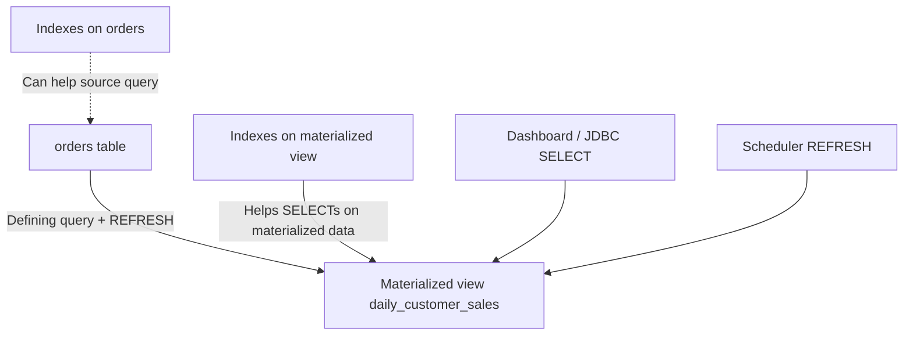

# Indexes on Materialized Views and Read Queries in PostgreSQL

A reporting query may have to scan millions of orders, group by customer and day, sum revenue, and sort results. When that report is opened repeatedly throughout the day, recomputing the same aggregation per request creates heavy load.

PostgreSQL **materialized views** store the result of a `SELECT` query as a physical data-bearing relation. Unlike regular views, **you can create indexes directly on a materialized view** so read queries can locate and sort materialized rows just like a table.

Conceptual layout:

```text
orders (source table, millions of rows)
       |
       | SELECT customer_id, date, SUM(amount), COUNT(*)
       v
daily_customer_sales (materialized view, stored aggregated data)
       |
       +-- UNIQUE B-tree (customer_id, sale_day)
       |      +-- queries for a single customer
       |      +-- mandatory prerequisite for REFRESH CONCURRENTLY
       |
       +-- B-tree (sale_day, paid_revenue DESC, customer_id)
              +-- top customers per day dashboard
```

This lesson belongs to the **View** chapter and focuses on two closely linked questions:

1. **Which indexes should you create on a materialized view to optimize `SELECT` read queries?**
2. **How do you design indexes and refresh workflows so data stays accurate, readable during refreshes, and sufficiently fresh?**

After this lesson, you will be able to build a complete materialized view, add unique and non-unique indexes, read `EXPLAIN`, meet `REFRESH MATERIALIZED VIEW CONCURRENTLY` requirements, diagnose stale data, and query safely from Java/JDBC applications.

## 1. How Do Regular Views, Materialized Views, and Tables Differ?

| Characteristic | Regular View | Materialized View | Regular Table |
| --- | --- | --- | --- |
| Stores its own result rows | No | **Yes** | Yes |
| Does each `SELECT` re-run the defining query? | Rewritten/executed over source data per plan | **No**; reads stored materialized rows | Reads table rows |
| Direct indexes on the object | **No** | **Yes** | Yes |
| Automatically reflects source table edits | Reflects visible state per query/transaction | **No**; requires refresh | Table data updated by DML |
| Direct `INSERT/UPDATE/DELETE` | Supported on some updatable views | **No** via normal DML | Yes |
| Data sync basis | Source read query | Last `REFRESH` | DML transactions |
| Good fit for | Encapsulating SQL/joins, query interfaces | Report aggregates, expensive remote data | Primary transactional data |

**Key takeaway:** a materialized view is not "a regular view with an automatic cache." It is a **persisted result snapshot** updated via explicit refresh commands.

### 1.1. Regular Views Cannot Have Direct Indexes

Example:

```sql
CREATE VIEW recent_orders AS
SELECT *
FROM orders
WHERE placed_at >= CURRENT_DATE - INTERVAL '30 days';
```

You cannot run `CREATE INDEX ... ON recent_orders (...)` to create a physical index directly on a regular view in PostgreSQL.

The planner can leverage **indexes on the `orders` table** when querying through the view, depending on SQL rewrite and planning. That optimizes the **source table**, not an index on the view.

### 1.2. Materialized Views Have Their Own Data and Indexes

```sql
CREATE MATERIALIZED VIEW daily_sales AS
SELECT sale_day, SUM(amount) AS revenue
FROM some_source
GROUP BY sale_day;

CREATE INDEX idx_daily_sales_day
ON daily_sales (sale_day);
```

This is a conceptual pattern; running it requires an actual `some_source` table. The index keys the **rows stored inside the materialized view**, not rows in the source table.

### 1.3. SELECT on a Materialized View Does Not Re-Run Aggregation

When running:

```sql
SELECT *
FROM daily_sales
WHERE sale_day = DATE '2026-03-01';
```

PostgreSQL reads data persisted in `daily_sales`. It does not automatically re-run `SELECT ... GROUP BY ...` against source tables on read.

**Consequence:** queries can be very fast, yet results can be **stale** relative to source tables. Indexes locate already-stored rows; they never update materialized view contents.

## 2. Two Index Layers in Systems Using Materialized Views

Systems typically have:

- **Source table indexes:** speed up queries on source tables and can assist materialized view builds/refreshes when the defining query has matching predicates or joins.
- **Materialized view indexes:** speed up queries **reading the materialized view** and can provide row identity for concurrent refresh.

Diagram:



Avoid four common mistakes:

1. **Indexes on source tables are not inherited automatically by the materialized view.**
2. **Indexes on the materialized view do not speed up direct queries on source tables.**
3. **Indexes on the materialized view do not turn refresh into automatic incremental refresh.**
4. **PostgreSQL does not automatically rewrite source-table queries to hit a materialized view.** Applications must query the materialized view explicitly or use a dedicated query routing layer.

### 2.1. Why Are Indexes on Materialized Views Valuable?

A materialized view may hold:

- Aggregated data compacted to a smaller row set.
- Stored outputs of expensive JOINs.
- Data fetched from foreign tables or remote sources.
- Precomputed CPU-intensive expressions.
- Frequently queried reporting columns.

When a dashboard fetches a single customer or single day, the right index reads a **tiny slice** instead of scanning the entire materialized view.

### 2.2. When Are Extra Indexes Unnecessary?

If a materialized view holds only 50 rows and every request scans/displays **all 50 rows**, a `Seq Scan` is cheaper than a B-tree lookup.

If the primary query is `SELECT SUM(...) FROM mv` across the **entire MV**, an index rarely reduces work. Evaluate predicates, sorts, joins, and selectivity rather than creating indexes by habit.

## 3. Practice Dataset: Orders and Daily Revenue

Examples use schema `mv_lab` in a learning database. Run creation and data-loading statements only on a fresh/empty schema; never on production tables.

### 3.1. Create the Source Table

```sql
CREATE SCHEMA IF NOT EXISTS mv_lab;

CREATE TABLE mv_lab.orders (
    order_id bigint GENERATED ALWAYS AS IDENTITY PRIMARY KEY,
    customer_id bigint NOT NULL,
    placed_at timestamptz NOT NULL,
    status text NOT NULL
        CHECK (status IN ('paid', 'pending', 'cancelled')),
    amount numeric(12, 2) NOT NULL
        CHECK (amount >= 0)
);
```

Columns:

- `order_id`: unique order identifier.
- `customer_id`: customer reference.
- `placed_at`: order timestamp with timezone.
- `status`: payment status.
- `amount`: order value.

### 3.2. Seed 60,000 Sample Orders

```sql
INSERT INTO mv_lab.orders (customer_id, placed_at, status, amount)
SELECT
    (g % 500 + 1)::bigint,
    TIMESTAMPTZ '2026-01-01 00:00:00+00'
        + (g % 120) * INTERVAL '1 day'
        + (g % 24) * INTERVAL '1 hour',
    CASE
        WHEN g % 13 = 0 THEN 'cancelled'
        WHEN g % 7 = 0 THEN 'pending'
        ELSE 'paid'
    END,
    ((g % 20000)::numeric / 100)::numeric(12, 2)
FROM generate_series(1, 60000) AS s(g);

ANALYZE mv_lab.orders;
```

Intentional shape:

- **60,000 orders**.
- **500 customers**.
- Spanning 120 days from early January 2026.
- Three distinct statuses.
- Formula-generated amounts suitable for aggregation practice.

Do not extrapolate production performance of hundred-million-row tables from this synthetic dataset. It demonstrates SQL behavior and index selection.

### 3.3. A Direct Report Query on the Source Table

```sql
SELECT
    customer_id,
    (placed_at AT TIME ZONE 'UTC')::date AS sale_day,
    COUNT(*) AS total_order_count,
    COUNT(*) FILTER (WHERE status = 'paid') AS paid_order_count,
    COALESCE(
        SUM(amount) FILTER (WHERE status = 'paid'),
        0
    )::numeric(16, 2) AS paid_revenue
FROM mv_lab.orders
GROUP BY
    customer_id,
    (placed_at AT TIME ZONE 'UTC')::date
ORDER BY sale_day DESC, paid_revenue DESC
LIMIT 20;
```

When dashboards invoke this continuously, the database recomputes the source aggregation repeatedly.

A materialized view is appropriate **when the report tolerates update lag** and the aggregation is expensive enough to justify storing results.

## 4. Creating the Aggregated Materialized View

```sql
CREATE MATERIALIZED VIEW mv_lab.daily_customer_sales AS
SELECT
    customer_id,
    (placed_at AT TIME ZONE 'UTC')::date AS sale_day,
    COUNT(*) AS total_order_count,
    COUNT(*) FILTER (WHERE status = 'paid') AS paid_order_count,
    COALESCE(
        SUM(amount) FILTER (WHERE status = 'paid'),
        0
    )::numeric(16, 2) AS paid_revenue,
    MAX(placed_at) AS last_order_at
FROM mv_lab.orders
GROUP BY
    customer_id,
    (placed_at AT TIME ZONE 'UTC')::date
WITH DATA;
```

Notes:

- `WITH DATA` runs the source query immediately to populate rows; this is also the default when `WITH NO DATA` is omitted.
- Each MV row represents **one `(customer_id, sale_day)` pair**.
- `sale_day` is computed in **UTC**, preventing shifts from session `TimeZone` settings.
- `total_order_count` counts all orders, while `paid_order_count` and `paid_revenue` count only paid orders.
- `last_order_at` records the latest order timestamp in the group; it is **not** "when the MV was refreshed."

### 4.1. Querying Materialized Data

```sql
SELECT
    customer_id,
    sale_day,
    total_order_count,
    paid_order_count,
    paid_revenue,
    last_order_at
FROM mv_lab.daily_customer_sales
ORDER BY sale_day DESC, customer_id
LIMIT 20;
```

Note: referencing the MV in `FROM` **does not use the VIEW keyword**. Queries read it like a regular relation.

### 4.2. Checking MV Size

```sql
SELECT
    COUNT(*) AS summary_rows,
    MIN(sale_day) AS first_day,
    MAX(sale_day) AS last_day
FROM mv_lab.daily_customer_sales;
```

Measure storage:

```sql
SELECT
    pg_size_pretty(
        pg_relation_size('mv_lab.daily_customer_sales'::regclass)
    ) AS mv_heap_size,
    pg_size_pretty(
        pg_indexes_size('mv_lab.daily_customer_sales'::regclass)
    ) AS total_indexes_size,
    pg_size_pretty(
        pg_total_relation_size('mv_lab.daily_customer_sales'::regclass)
    ) AS total_relation_size;
```

Right after creating the MV before adding indexes, `total_indexes_size` is 0.

## 5. Materialized Views Do Not Inherit a PRIMARY KEY

The source table has `PRIMARY KEY (order_id)`. Yet the MV contains **GROUP BY** summaries without `order_id` in the output.

A materialized view never automatically inherits:

- Source table primary keys.
- Source table unique constraints.
- Indexes on `orders(placed_at)`.
- Source foreign keys.
- Indexes used by JOINs in the defining query.

A PostgreSQL materialized view can hold **unique indexes** enforcing uniqueness on output columns, though a unique index is **not a PRIMARY KEY constraint inherited** from the source table.

Here, each `(customer_id, sale_day)` pair appears once due to `GROUP BY`. That is the **natural business key of the summary**.

## 6. Creating a UNIQUE Index on the Output Key

```sql
CREATE UNIQUE INDEX ux_daily_customer_sales_customer_day
ON mv_lab.daily_customer_sales (customer_id, sale_day);
```

This index serves two purposes:

1. **Reads:** provides a B-tree lookup path by `customer_id` and `sale_day`.
2. **Concurrent refresh:** satisfies a mandatory prerequisite for `REFRESH MATERIALIZED VIEW CONCURRENTLY` alongside the other requirements.

### 6.1. Verify Uniqueness Before Creating the Index

On an already populated MV, check:

```sql
SELECT
    customer_id,
    sale_day,
    COUNT(*) AS duplicate_rows
FROM mv_lab.daily_customer_sales
GROUP BY customer_id, sale_day
HAVING COUNT(*) > 1
ORDER BY duplicate_rows DESC, customer_id, sale_day;
```

Expect **zero rows** on `GROUP BY` output. Any duplicates cause `CREATE UNIQUE INDEX` to fail.

Check NULLs:

```sql
SELECT COUNT(*) AS rows_with_null_key
FROM mv_lab.daily_customer_sales
WHERE customer_id IS NULL
   OR sale_day IS NULL;
```

With non-null `customer_id` and `placed_at` in the source table, expect 0 here.

**Why check NULLs?** Standard PostgreSQL unique indexes treat NULLs as distinct by default; business key uniqueness must be designed explicitly rather than assuming defaults when keys can be null.

### 6.2. Left-Prefix B-Tree Lookups

`CREATE UNIQUE INDEX ... (customer_id, sale_day)` supports:

```sql
SELECT *
FROM mv_lab.daily_customer_sales
WHERE customer_id = 42;
```

and:

```sql
SELECT *
FROM mv_lab.daily_customer_sales
WHERE customer_id = 42
  AND sale_day >= DATE '2026-02-01'
  AND sale_day <  DATE '2026-03-01'
ORDER BY sale_day;
```

Composite B-trees work well when filters start at the **leading key column**. This index is not optimal for queries filtering solely on `sale_day`, since `sale_day` is the second column.

### 6.3. A Unique Index Does Not Force the Planner to Use It

On a small materialized view of a few thousand rows, the planner may pick `Seq Scan`, especially when returning many rows.

An index gives the planner an **option**, not a mandate.

## 7. Designing Another Index for Daily Dashboard Queries

Dashboards commonly ask: "Top 20 highest-revenue customers on day D."

```sql
SELECT
    customer_id,
    paid_revenue,
    paid_order_count
FROM mv_lab.daily_customer_sales
WHERE sale_day = DATE '2026-02-10'
ORDER BY paid_revenue DESC, customer_id
LIMIT 20;
```

The `(customer_id, sale_day)` index is not ordered to fetch all customers for one day sorted by revenue.

Create a matching index for that access pattern:

```sql
CREATE INDEX idx_daily_sales_day_revenue_customer
ON mv_lab.daily_customer_sales (
    sale_day,
    paid_revenue DESC,
    customer_id
);
```

Strengths:

- Leading `sale_day` serves `WHERE sale_day = ...`.
- `paid_revenue DESC` matches descending revenue sort order.
- `customer_id` acts as a deterministic tie-breaker when revenues match.
- `LIMIT 20` lets PostgreSQL stop scanning early from the index instead of sorting the entire day's rows, depending on plan.

### 7.1. Inspecting the Plan with EXPLAIN

```sql
ANALYZE mv_lab.daily_customer_sales;

EXPLAIN (ANALYZE, BUFFERS)
SELECT
    customer_id,
    paid_revenue,
    paid_order_count
FROM mv_lab.daily_customer_sales
WHERE sale_day = DATE '2026-02-10'
ORDER BY paid_revenue DESC, customer_id
LIMIT 20;
```

When reading the plan, inspect:

- `Index Scan`/`Index Only Scan` vs. `Seq Scan`?
- Is there a `Sort` node?
- Does `Index Cond` use `sale_day`?
- What are `actual rows` and `loops`?
- What are `Buffers: shared hit/read` and `Execution Time`?
- Did `LIMIT` stop the scan early?

Because the sample dataset is modest, plans may differ from large-scale tables. The goal is learning to **align index definitions with WHERE, ORDER BY, and LIMIT**, not forcing `Index Scan` everywhere.

### 7.2. Avoid Redundant Overlapping Indexes

Once `idx_daily_sales_day_revenue_customer` exists, a standalone index on `(sale_day)` is **overlapping** for some queries.

Still, never drop a single-column index blindly just because its column leads a composite index; size, selectivity, and actual queries determine whether keeping it pays off.

In this example, start with **two distinct-purpose indexes** and measure before adding more.

## 8. Covering Indexes with INCLUDE and Index-Only Scans

A daily query may request a couple of extra columns without needing frequent heap fetches.

Example index design:

```sql
-- Illustrates an alternative approach; not necessarily needed
-- in addition to the existing report index.
CREATE INDEX idx_daily_sales_covering
ON mv_lab.daily_customer_sales (
    sale_day,
    paid_revenue DESC,
    customer_id
)
INCLUDE (paid_order_count, total_order_count);
```

`INCLUDE` stores extra payload columns in the B-tree leaf pages without adding them to the search/sort keys.

For the query:

```sql
SELECT
    customer_id,
    paid_revenue,
    paid_order_count,
    total_order_count
FROM mv_lab.daily_customer_sales
WHERE sale_day = DATE '2026-02-10'
ORDER BY paid_revenue DESC, customer_id
LIMIT 20;
```

the index holds every requested column so the planner can consider an `Index Only Scan`.

### 8.1. Index-Only Scans Do Not Always Skip the Heap

PostgreSQL checks the visibility map to confirm whether index entries are visible to all transactions without visiting the heap.

Right after a refresh or when visibility map bits are unset, `Index Only Scan` still incurs `Heap Fetches`. Thus:

- Having all queried columns in the index is **necessary but not sufficient**.
- Visibility map / MVCC state determines actual heap fetches.
- Appropriate `VACUUM` updates the visibility map, though never run it recklessly solely to polish a benchmark.

### 8.2. INCLUDE Increases Costs

Covering indexes are wider:

- More disk space.
- Higher index build cost.
- Higher maintenance work during refreshes.
- More buffer cache pressure.

Do not create both a regular index and an identical covering index without benchmark proof. In production, pick **one winning design** after measuring.

## 9. Other Index Types Available on Materialized Views

Because materialized views persist physical relations, PostgreSQL allows standard index access methods as on tables, subject to column types and operators.

| Index Type | When to Consider | Notes |
| --- | --- | --- |
| **B-tree** | Equality/range, `ORDER BY`, `LIMIT`, unique keys | Default starting point for daily/customer reports |
| **GIN** | `jsonb`, `tsvector`, or array/multi-element data | Requires matching operator class and operators |
| **GiST** | Spatial, range, or similarity queries | May require heap recheck |
| **BRIN** | Huge MVs physically correlated on time/sequence columns | Summarizes page ranges; allows false positives |
| **Hash** | Specific equality lookups | Does not help sorts/ranges and cannot replace unique B-tree |

Monthly B-tree expression example:

```sql
CREATE INDEX idx_daily_sales_month_expression
ON mv_lab.daily_customer_sales (
    (date_trunc('month', sale_day::timestamp))
);
```

This expression index helps when queries repeat the exact expression:

```sql
SELECT COUNT(*)
FROM mv_lab.daily_customer_sales
WHERE date_trunc('month', sale_day::timestamp)
      = TIMESTAMP '2026-02-01 00:00:00';
```

However, since `sale_day` is a `date`, range predicates are cleaner and use a standard B-tree on `sale_day`:

```sql
SELECT COUNT(*)
FROM mv_lab.daily_customer_sales
WHERE sale_day >= DATE '2026-02-01'
  AND sale_day <  DATE '2026-03-01';
```

**Never create expression indexes just to demonstrate syntax.** If applications can write simple range queries using existing indexes, an extra expression index adds pure overhead.

### 9.1. When to Consider GIN on an MV?

If an MV stores a `search_document tsvector` or `metadata jsonb` column, a GIN index accelerates matching searches.

Conceptual template (**applicable only when the materialized view actually has `search_document`**):

```sql
-- Template: requires the MV to have a tsvector column search_document.
CREATE INDEX idx_document_cache_fts
ON your_schema.document_cache
USING GIN (search_document);
```

Do not run this template on `mv_lab.daily_customer_sales` since it lacks a `search_document` column.

This lesson focuses on **B-trees over aggregated outputs**, though choosing GIN/GiST/BRIN still hinges on operators, data types, table size, and actual workload.

## 10. REFRESH MATERIALIZED VIEW: How Data Gets Updated

When source tables change, materialized views **do not update automatically**.

The command:

```sql
REFRESH MATERIALIZED VIEW mv_lab.daily_customer_sales;
```

re-executes the defining query to replace stored contents with new results. This is a **built-in full refresh**, not a trigger applying incremental row deltas from source tables.

### 10.1. Stale Data Experiment

Insert a July order outside the initial 120-day sample range:

```sql
INSERT INTO mv_lab.orders (
    customer_id,
    placed_at,
    status,
    amount
)
VALUES (
    42,
    TIMESTAMPTZ '2026-07-01 12:00:00+00',
    'paid',
    199.00
);
```

Check the source table:

```sql
SELECT
    COUNT(*) AS source_orders,
    SUM(amount) AS source_paid_revenue
FROM mv_lab.orders
WHERE customer_id = 42
  AND placed_at >= TIMESTAMPTZ '2026-07-01 00:00:00+00'
  AND placed_at <  TIMESTAMPTZ '2026-07-02 00:00:00+00'
  AND status = 'paid';
```

On the sample data just seeded, expect 1 paid order and 199.00 revenue (assuming no duplicate inserts).

**Immediately before refreshing**, run:

```sql
SELECT *
FROM mv_lab.daily_customer_sales
WHERE customer_id = 42
  AND sale_day = DATE '2026-07-01';
```

Expect **zero rows**. The order is committed in `orders`, yet the materialized summary has not been refreshed.

### 10.2. Refresh and Re-Read

```sql
REFRESH MATERIALIZED VIEW mv_lab.daily_customer_sales;
```

Then:

```sql
SELECT *
FROM mv_lab.daily_customer_sales
WHERE customer_id = 42
  AND sale_day = DATE '2026-07-01';
```

Now the July 1 summary row appears with `paid_order_count=1` and `paid_revenue=199.00`.

**Takeaway:** MV indexes find that row fast once **it has been refreshed**, but never make new data appear sooner than the refresh schedule.

## 11. Standard REFRESH vs. REFRESH CONCURRENTLY

PostgreSQL supports two refresh modes:

```sql
REFRESH MATERIALIZED VIEW mv_lab.daily_customer_sales;
```

and:

```sql
REFRESH MATERIALIZED VIEW CONCURRENTLY
    mv_lab.daily_customer_sales;
```

| Aspect | Standard REFRESH | REFRESH CONCURRENTLY |
| --- | --- | --- |
| Updates MV contents | Yes | Yes |
| Can block reader `SELECT`s via refresh lock | **Yes** during refresh | Designed **not to block concurrent SELECTs** on the MV |
| Requires qualifying UNIQUE index | No | **Yes** |
| Requires MV to already be populated | Not strictly if starting from `WITH NO DATA` | **Yes** |
| Combines with `WITH NO DATA` | Yes | **No** |
| Can consume more resources diffing edits | Depends on workload | Possible; not automatically faster |
| Automatic incremental refresh on source tables | No | **No** |

### 11.1. Concurrent Refresh Prioritizes Read Availability

Without `CONCURRENTLY`, refresh acquires a lock blocking concurrent sessions trying to read the MV.

With `CONCURRENTLY`, PostgreSQL updates the MV while letting concurrent `SELECT`s read a consistent MVCC snapshot.

This **does not mean**:

- Zero lock waits ever occur.
- Zero extra I/O, CPU, or WAL is consumed.
- New data appears the instant the job starts.
- Multiple refreshes on the same MV can run in parallel.
- Unrelated DDL/DML is completely unaffected.
- Only newly changed source rows are scanned.

### 11.2. Only One Active REFRESH per MV at a Time

Even with `CONCURRENTLY`, PostgreSQL forbids running multiple independent refreshes simultaneously on the same materialized view.

If a scheduler triggers too frequently, jobs queue behind each other, building backlogs and increasing data lag.

Measure **actual refresh runtimes**, prevent overlapping schedules, and monitor jobs actively.

## 12. UNIQUE Index Requirements for REFRESH MATERIALIZED VIEW CONCURRENTLY

This is the core rule when designing indexes for materialized views.

Per PostgreSQL documentation, to run:

```sql
REFRESH MATERIALIZED VIEW CONCURRENTLY
    mv_lab.daily_customer_sales;
```

the MV needs **at least one qualifying valid UNIQUE index**:

1. Index is created **on the materialized view itself**.
2. Index is a **UNIQUE index**.
3. Keys reference **column names only**, not expressions.
4. Index covers **all rows** of the MV—i.e., **no `WHERE` clause**.
5. Materialized view is **already populated**.

In our example:

```sql
CREATE UNIQUE INDEX ux_daily_customer_sales_customer_day
ON mv_lab.daily_customer_sales (customer_id, sale_day);
```

meets every requirement: UNIQUE, keys are two plain columns, no partial predicate.

### 12.1. Non-Unique Indexes Are Insufficient

```sql
-- This index helps some SELECTs but does not satisfy
-- the UNIQUE requirement of REFRESH CONCURRENTLY.
CREATE INDEX idx_daily_sales_customer_day_nonunique
ON mv_lab.daily_customer_sales (customer_id, sale_day);
```

Having the same columns without `UNIQUE` is insufficient.

In production, never create both a unique and an identical non-unique B-tree without a compelling reason, as they duplicate storage and maintenance work.

### 12.2. Partial UNIQUE Indexes Are Insufficient

Suppose you create:

```sql
-- Illustrates an index not eligible for REFRESH CONCURRENTLY.
CREATE UNIQUE INDEX ux_daily_sales_positive_only
ON mv_lab.daily_customer_sales (customer_id, sale_day)
WHERE paid_revenue > 0;
```

This is a **partial unique index**. It covers only rows satisfying `paid_revenue > 0`, not every row in the MV.

Even with the `UNIQUE` keyword, it **does not satisfy** `REFRESH ... CONCURRENTLY`.

Because the lab already has a full unique index, do not create this partial unique index; it serves solely to illustrate the rule difference.

### 12.3. Expression UNIQUE Indexes Are Insufficient

```sql
-- Illustrates a non-qualifying case:
CREATE UNIQUE INDEX ux_daily_sales_expr_example
ON mv_lab.daily_customer_sales (
    customer_id,
    (sale_day + 0)
);
```

Here the second key is an expression, even if arithmetically equivalent to the date column. PostgreSQL requires qualifying unique indexes to use **direct column names**, so expression unique indexes **cannot substitute**.

**Never assume "logically unique" equals "syntactically and catalog-eligible for concurrent refresh."**

### 12.4. Multi-Column Indexes Qualify If Keys Are Plain Columns

`(customer_id, sale_day)` is the MV's natural composite key. PostgreSQL does not restrict unique indexes to a single column.

What matters is distinguishing rows at the right business grain while obeying the index definition rules.

### 12.5. Match the Unique Key to the Materialized View's Grain

When each row holds revenue **per customer/day**, the natural key is:

```text
(customer_id, sale_day)
```

If the MV changes to report **per customer/day/status**, the new grain becomes:

```text
(customer_id, sale_day, status)
```

The old two-column unique index becomes invalid because multiple status rows share the same customer and day. Whenever an MV's definition changes, redesign its unique key and indexes accordingly.

Never pick a key just because it "looks unique" on small sample data. Verify business rules and future group combinations.

## 13. REFRESH CONCURRENTLY Requires a Populated MV

A common pattern creates a materialized view with `WITH NO DATA`:

```sql
CREATE MATERIALIZED VIEW mv_lab.customer_order_counts AS
SELECT
    customer_id,
    COUNT(*) AS order_count
FROM mv_lab.orders
GROUP BY customer_id
WITH NO DATA;
```

It stores the query definition yet **has no stored data to read**.

### 13.1. SELECT on an Unpopulated MV

```sql
-- Illustrates a query that cannot read until refreshed:
SELECT *
FROM mv_lab.customer_order_counts;
```

PostgreSQL raises an error because the materialized view is **unscannable**, not because the source table is empty.

### 13.2. Cannot Use CONCURRENTLY for Initial Population

```sql
-- Invalid when MV is not yet populated.
REFRESH MATERIALIZED VIEW CONCURRENTLY
    mv_lab.customer_order_counts;
```

Valid workflow:

```sql
-- 1. Populate via standard refresh.
REFRESH MATERIALIZED VIEW mv_lab.customer_order_counts;

-- 2. Create unique index on output.
CREATE UNIQUE INDEX ux_customer_order_counts_customer
ON mv_lab.customer_order_counts (customer_id);

-- 3. Subsequent runs can refresh concurrently.
REFRESH MATERIALIZED VIEW CONCURRENTLY
    mv_lab.customer_order_counts;
```

Not every MV has a simple unique key; if no qualifying unique index can exist on the output columns, revisit the grain/design or use standard refresh.

### 13.3. WITH NO DATA Cannot Combine with CONCURRENTLY

```sql
-- Syntax rejected by PostgreSQL:
REFRESH MATERIALIZED VIEW CONCURRENTLY
    mv_lab.customer_order_counts
WITH NO DATA;
```

To discard stored data and leave the MV unreadable until the next load, `REFRESH MATERIALIZED VIEW ... WITH NO DATA` is a distinct operation with severe availability impact.

**Never run `WITH NO DATA` on an MV actively serving dashboards** without a recovery plan and approved read downtime.

## 14. How Do Indexes Persist and Behave After REFRESH?

Indexes on a materialized view are **managed schema objects**, not temporary structures lasting only until the next refresh.

After:

```sql
REFRESH MATERIALIZED VIEW mv_lab.daily_customer_sales;
```

all declared indexes remain part of the schema and continue serving read queries.

However, refresh must bring new data into sync with all indexes and uniqueness constraints. That carries **real cost**.

### 14.1. Non-Concurrent Refresh Rebuilds Stored Data and Indexes

Standard `REFRESH MATERIALIZED VIEW` replaces the MV's physical contents and rebuilds its indexes to match the new data.

Account for:

- Running the source query.
- Storage for the new materialized dataset.
- Rebuilding index structures.
- I/O, WAL, and relation management.
- Locks blocking readers.

Never judge refresh cost by the execution time of one `SELECT` on the MV.

### 14.2. Concurrent Refresh Adds Diffing and Update Work

With `CONCURRENTLY`, PostgreSQL preserves concurrent read access by diffing new results against existing contents and applying changes row-by-row.

This is **not automatic incremental view maintenance** driven by source changes. The defining MV query still executes in full to compute the new state.

For an MV where almost every row changes on each refresh, concurrent refresh can take longer than standard refresh. Benchmark on realistic workloads.

### 14.3. More Indexes Increase Refresh Cost

Each additional index:

- Consumes disk space.
- Adds build/rebuild or maintenance overhead when MV data changes.
- Consumes buffer cache and I/O.
- Lengthens refresh duration.
- Increases maintenance when definitions evolve.

**Aim for the minimal index set covering actual read queries and concurrent refresh**, not as many indexes as possible.

## 15. Read Availability During Refresh and MVCC

On an active dashboard:

1. User A runs `SELECT` on the materialized view.
2. Scheduler starts a refresh.
3. User B also reads the MV.
4. Refresh commits, and subsequent reads see new data per transaction snapshots.

Depending on refresh mode:

- **Standard:** new readers wait on the lock held by refresh.
- **Concurrent:** concurrent `SELECT`s keep reading without blocking behind standard refresh locks.

`CONCURRENTLY` does not mean "every SELECT sees new values the instant the refresh begins." PostgreSQL uses **transaction snapshots**, so concurrent sessions at different points in time see different versions.

### 15.1. Freshness Is Measured from Successful Completion

If a refresh starts at 02:00, runs 6 minutes, and commits at 02:06, users before 02:06 cannot expect 02:00 data yet.

Distinguish:

- **Job started at.**
- **Job completed successfully at.**
- **Source data watermark:** up to which timestamp source data is reflected.
- **Freshness lag:** wall-clock age relative to reflected source state.

Materialized views have no built-in `last_refreshed_at` column. If applications need freshness telemetry, log job history or metadata explicitly.

### 15.2. Source Data Snapshot

Refresh evaluates the defining query under its transaction snapshot. Source edits committed **after that snapshot** are absent from that refresh.

Even right after a refresh finishes, an MV is not guaranteed to be "accurate to the current millisecond." Financial reconciliation dashboards need explicit watermarks and snapshot boundaries.

## 16. Reading an Indexed MV vs. Querying Source Tables Directly

Same goal: fetch customer 42's February revenue.

### 16.1. Reading Source Tables and Aggregating on the Fly

```sql
SELECT
    customer_id,
    (placed_at AT TIME ZONE 'UTC')::date AS sale_day,
    COUNT(*) AS total_order_count,
    COUNT(*) FILTER (WHERE status = 'paid') AS paid_order_count,
    COALESCE(
        SUM(amount) FILTER (WHERE status = 'paid'),
        0
    )::numeric(16, 2) AS paid_revenue
FROM mv_lab.orders
WHERE customer_id = 42
  AND placed_at >= TIMESTAMPTZ '2026-02-01 00:00:00+00'
  AND placed_at <  TIMESTAMPTZ '2026-03-01 00:00:00+00'
GROUP BY
    customer_id,
    (placed_at AT TIME ZONE 'UTC')::date
ORDER BY sale_day;
```

The query scans matching source orders and aggregates on demand.

### 16.2. Reading from the Materialized View

```sql
SELECT
    customer_id,
    sale_day,
    total_order_count,
    paid_order_count,
    paid_revenue
FROM mv_lab.daily_customer_sales
WHERE customer_id = 42
  AND sale_day >= DATE '2026-02-01'
  AND sale_day <  DATE '2026-03-01'
ORDER BY sale_day;
```

The query reads pre-aggregated rows. The unique B-tree `(customer_id, sale_day)` gives a natural index path.

### 16.3. Never Compare Performance When Freshness Differs

If new orders arrived since the last refresh, the source query returns different figures than the MV.

A fair **performance** benchmark requires:

- Matching source snapshot/data.
- Refreshing the MV at a known point.
- Verifying result equivalence before comparing timings.
- Multiple runs under comparable cache and load state.
- Documenting tolerated data lag.

If an MV returns stale wrong numbers, low query latency does not make it a "good optimization."

## 17. Source Table Indexes May Still Be Needed

In practice, transactional screens still query individual order details per customer:

```sql
SELECT
    order_id,
    placed_at,
    status,
    amount
FROM mv_lab.orders
WHERE customer_id = 42
  AND placed_at >= TIMESTAMPTZ '2026-02-01 00:00:00+00'
  AND placed_at <  TIMESTAMPTZ '2026-03-01 00:00:00+00'
ORDER BY placed_at DESC
LIMIT 20;
```

MV indexes **provide zero direct help** here because the SQL targets `mv_lab.orders`.

Consider:

```sql
CREATE INDEX idx_orders_customer_placed
ON mv_lab.orders (customer_id, placed_at DESC);
```

This helps customer/date detail queries—not because the MV needs an identically named index on the source table.

### 17.1. Does the Refresh Query Benefit from Source Indexes?

`daily_customer_sales`'s defining query groups **every order**. Without selective filters, the planner typically chooses sequential scan + hash aggregate over an index on `customer_id` or `placed_at`.

Source indexes help refreshes when the defining query contains:

- Selective `WHERE` filters.
- `JOIN` keys needing indexed lookups.
- Targeted `ORDER BY` or specific aggregation strategies.
- Partitioned or remote access paths.

Still, **not every source index speeds up refresh**. Inspect `EXPLAIN` on the defining query separately and measure.

### 17.2. An MV Reduces Rows, Yet Can Still Be Huge

If an MV copies nearly the entire source table without filtering or aggregating, MV size plus its indexes can rival or exceed the source table.

Ask whether read isolation or query savings justify the extra disk, WAL, and refresh cost.

## 18. Reading EXPLAIN on Materialized Views

Run:

```sql
EXPLAIN (ANALYZE, BUFFERS, VERBOSE)
SELECT
    customer_id,
    sale_day,
    paid_revenue
FROM mv_lab.daily_customer_sales
WHERE customer_id = 42
  AND sale_day BETWEEN DATE '2026-02-01'
                   AND DATE '2026-02-28'
ORDER BY sale_day DESC;
```

Nodes you may encounter:

- `Seq Scan on daily_customer_sales`.
- `Index Scan using ux_daily_customer_sales_customer_day`.
- `Bitmap Heap Scan` + `Bitmap Index Scan`.
- `Index Only Scan` when columns and visibility allow.
- `Sort` when no index matches the requested sort order.

**Never promise PostgreSQL will always pick Index Scan.** The planner chooses Seq Scan when the relation is small or predicates match a large fraction of rows.

### 18.1. Key Plan Fields

| Plan Field | How to Use It |
| --- | --- |
| `cost=start..total` | Planner estimate, not milliseconds |
| `rows` | Estimated rows returned by node |
| `actual rows` | Actual rows, averaged per `loop` |
| `Index Cond` | Predicate evaluated using the index |
| `Filter` | Residual predicate checked after access |
| `Buffers: shared hit/read` | PostgreSQL buffer cache activity |
| `Heap Fetches` | Key metric during `Index Only Scan` |
| `Sort Method` | Sort algorithm and disk spill indicator |
| `Planning Time` | Measured planning duration |
| `Execution Time` | Measured execution duration |

### 18.2. BUFFERS Read Does Not Prove Physical Disk I/O

`shared read` means the page was absent from PostgreSQL shared buffers at access time; the OS page cache may satisfy it without physical disk reads.

When comparing two indexes, never run index B right after index A warmed the cache and declare B faster from a single measurement.

### 18.3. Measure Key Queries Under Realistic Load

A dashboard hitting 20 queries/sec vs. an end-of-day report run once have completely different indexing priorities.

Optimize for:

- Query frequency.
- p95/p99 latency.
- Returned row count.
- MV and index size.
- Refresh/write-to-read ratio.
- SLA and freshness targets.

Never extrapolate production behavior solely from `EXPLAIN` on a 3,000-row dataset.

## 19. Indexes and ORDER BY: Never Trust Storage Order

Even if a materialized view's defining query has:

```sql
CREATE MATERIALIZED VIEW some_mv AS
SELECT ...
ORDER BY sale_day DESC;
```

PostgreSQL **does not guarantee refreshes preserve physical order** so un-ordered `SELECT`s return sorted rows.

A query:

```sql
SELECT *
FROM mv_lab.daily_customer_sales
LIMIT 20;
```

has no guaranteed row order. Having an index does not replace SQL sorting requirements either.

For deterministic output:

```sql
SELECT
    customer_id, sale_day, paid_revenue
FROM mv_lab.daily_customer_sales
ORDER BY sale_day DESC, customer_id
LIMIT 20;
```

Indexes speed up `ORDER BY`, yet **SQL must explicitly include `ORDER BY`** whenever order matters.

### 19.1. Pagination Requires Tie-Breakers

A dashboard paginating with:

```sql
ORDER BY paid_revenue DESC
LIMIT 20 OFFSET 20
```

is non-deterministic when multiple customers tie on revenue.

Add `customer_id` or a unique key as a tie-breaker. Even then, data shifting across refreshes can cause offset pagination drift; use keyset pagination or snapshot/version pinning for critical UX.

### 19.2. Separate DESC Indexes Are Not Always Needed

PostgreSQL B-trees scan forward and backward. For a single column or uniform direction, an ASC index often serves `ORDER BY DESC` via backward scan.

For multi-column indexes with mixed directions, evaluate `ASC/DESC` and `NULLS FIRST/LAST` specifically. Match indexes to real queries rather than mechanically duplicating ASC and DESC variants.

## 20. ANALYZE on Materialized Views to Help the Planner

After creating or refreshing an MV, distribution statistics may need updating so the planner estimates selectivity accurately.

```sql
ANALYZE mv_lab.daily_customer_sales;
```

This is a statistics operation; it does not refresh data from source tables.

**Distinguish:**

- `REFRESH MATERIALIZED VIEW`: updates **data rows** of the MV from its defining query.
- `ANALYZE`: updates **planner statistics** over current stored rows.
- `VACUUM`: reclaims dead tuples and updates visibility map metadata.
- `REINDEX`: rebuilds index structures when justified.

Never expect `ANALYZE` to bring new orders into an MV, and never expect `REFRESH` alone to keep planner stats optimal across every workload.

### 20.1. Comparing Estimated vs. Actual Rows

```sql
EXPLAIN (ANALYZE, BUFFERS)
SELECT *
FROM mv_lab.daily_customer_sales
WHERE sale_day = DATE '2026-02-10';
```

Compare `rows` with `actual rows`. If estimates diverge heavily after data shifts, run `ANALYZE` and review statistics targets.

### 20.2. Is VACUUM Needed After Refresh?

That depends on refresh mode, change volume, visibility needs, autovacuum activity, and workload.

For read-heavy MVs, the visibility map matters for `Index Only Scan`. Never run `VACUUM FULL` routinely just to chase index-only scans, as it takes heavy locks and rewrites storage.

In benchmarks, note exactly when `ANALYZE`/`VACUUM` ran because both change plans and caching.

## 21. Monitoring Index Size and Usage

### 21.1. Listing Indexes on an MV

```sql
SELECT
    indexname,
    indexdef
FROM pg_indexes
WHERE schemaname = 'mv_lab'
  AND tablename = 'daily_customer_sales'
ORDER BY indexname;
```

`pg_indexes` displays SQL index definitions; to check uniqueness, validity, or scan counts, inspect additional catalogs and stats views.

### 21.2. Per-Index Usage Stats and Sizes

```sql
SELECT
    s.indexrelid::regclass AS index_name,
    s.idx_scan,
    s.idx_tup_read,
    s.idx_tup_fetch,
    pg_relation_size(s.indexrelid) AS index_bytes,
    pg_size_pretty(pg_relation_size(s.indexrelid)) AS index_size
FROM pg_stat_user_indexes AS s
WHERE s.relid = 'mv_lab.daily_customer_sales'::regclass
ORDER BY index_bytes DESC, index_name;
```

How to read this:

- Low `idx_scan` does not automatically mean an index is unused/redundant.
- A UNIQUE index may be required for `REFRESH CONCURRENTLY` even if the planner rarely picks it for reads.
- A month-end batch index may show zero scans over a few normal weekdays.
- Stats accumulate over a window and can be reset or lag index creation.

**Never auto-drop a required concurrent-refresh unique index just because `idx_scan = 0`.**

### 21.3. Checking Catalog Validity

```sql
SELECT
    i.indexrelid::regclass AS index_name,
    i.indisunique,
    i.indisvalid,
    i.indisready,
    i.indisprimary,
    pg_get_indexdef(i.indexrelid) AS definition
FROM pg_index AS i
WHERE i.indrelid = 'mv_lab.daily_customer_sales'::regclass
ORDER BY index_name;
```

If an index is invalid due to a failed concurrent index build, do not treat it as eligible for reads or refreshes. Inspect state and follow cleanup runbooks.

## 22. pg_matviews: Checking State and Definitions

PostgreSQL provides `pg_matviews`:

```sql
SELECT
    schemaname,
    matviewname,
    matviewowner,
    tablespace,
    hasindexes,
    ispopulated,
    definition
FROM pg_matviews
WHERE schemaname = 'mv_lab'
ORDER BY matviewname;
```

Useful fields:

| Column | Meaning |
| --- | --- |
| `schemaname` | Schema containing the materialized view |
| `matviewname` | MV name |
| `matviewowner` | Owner role |
| `tablespace` | Tablespace if specified |
| `hasindexes` | Whether MV has or recently had indexes in metadata |
| `ispopulated` | Whether MV is currently populated |
| `definition` | Stored defining SQL |

### 22.1. ispopulated Does Not Mean "Data Is Fresh"

`ispopulated = true` only means the MV is populated and scannable; it does not tell you:

- How long ago the last refresh ran.
- Whether the latest refresh job succeeded.
- Whether unrefreshed source orders exist.
- What source watermark the data reflects.

An MV populated a year ago still reports `ispopulated=true`.

### 22.2. hasindexes Does Not Prove a Qualifying Unique Index

`hasindexes` does not indicate:

- Whether any index is UNIQUE.
- Whether indexes have partial predicates.
- Whether keys use expressions.
- Whether indexes are valid.
- Whether keys match the required grain.

To verify `REFRESH ... CONCURRENTLY` readiness, inspect **actual index definitions** via `pg_indexes` and `pg_index`.

### 22.3. Store Refresh Audit History Separately

`pg_matviews` lacks a standard `last_successful_refresh_at` column. When SLAs require freshness tracking, have your scheduler or admin pipeline log refresh timestamps, outcomes, row counts, durations, and watermarks in a dedicated audit table.

Never infer "last refresh time" from relation file mtimes or `pg_stat_*` counters—they are not reliable business audit trails.

## 23. Partial Indexes on MVs Help SELECTs, Not Concurrent Refresh

Suppose a dashboard only shows customers with positive revenue:

```sql
SELECT
    customer_id,
    paid_revenue
FROM mv_lab.daily_customer_sales
WHERE sale_day = DATE '2026-02-10'
  AND paid_revenue > 0
ORDER BY paid_revenue DESC, customer_id
LIMIT 20;
```

You could consider a partial index:

```sql
CREATE INDEX idx_daily_sales_positive
ON mv_lab.daily_customer_sales (
    sale_day,
    paid_revenue DESC,
    customer_id
)
WHERE paid_revenue > 0;
```

It indexes only rows matching the predicate. When most rows have `paid_revenue=0`, the partial index stays compact and accelerates positive-only queries.

However:

1. Queries must include predicates the planner can **prove imply** the partial-index predicate.
2. Queries omitting `paid_revenue > 0` cannot use the partial index.
3. This index **cannot** satisfy the unique index requirement for concurrent refresh.
4. If a full composite index of the same shape already exists, both overlap and add maintenance overhead.

Never create partial indexes just because they sound "more optimized." Measure the fraction of matching rows and query frequency.

## 24. Designing Indexes for JOINs Between MVs and Other Tables

Not every dashboard queries an MV in isolation.

Suppose there is a customers table:

```sql
CREATE TABLE mv_lab.customers (
    customer_id bigint PRIMARY KEY,
    display_name text NOT NULL
);

INSERT INTO mv_lab.customers (customer_id, display_name)
SELECT g, 'Customer ' || g::text
FROM generate_series(1, 500) AS s(g);
```

Query:

```sql
SELECT
    c.display_name,
    d.sale_day,
    d.paid_revenue
FROM mv_lab.daily_customer_sales AS d
JOIN mv_lab.customers AS c
  ON c.customer_id = d.customer_id
WHERE d.sale_day = DATE '2026-02-10'
ORDER BY d.paid_revenue DESC, c.customer_id
LIMIT 20;
```

`(sale_day, paid_revenue DESC, customer_id)` on the MV retrieves matching rows in day/revenue order. The primary key on `customers(customer_id)` aids name lookups if the planner selects a nested loop.

Still, the planner may opt for a hash join or separate sort. MV indexes alone do not dictate the entire join strategy.

### 24.1. Materializing Joined Columns Directly

If dashboards always need customer names, you can include `display_name` in the MV's defining query, though that adds a freshness dependency: **renaming a customer in the source table now requires refreshing the MV** to show the new name.

Keeping only summary metrics in the MV and joining `customers` dynamically keeps dimension attributes live. This trades join cost for dimension freshness.

## 25. MV Indexes and Data Freshness: Consistency Concerns

A revenue dashboard has two requirements:

- **Speed:** respond within target latency.
- **Freshness:** reflect source edits within an acceptable lag window.

Indexes serve the first requirement. Refresh scheduling serves the second.

### 25.1. Common Freshness Tiers

| Requirement | Design Direction |
| --- | --- |
| Last month's report; overnight updates acceptable | MV + nightly refresh |
| Operations dashboard tolerating 5-minute lag | MV + periodic refresh, verifying refresh fits within SLA |
| Inventory/permissions must be exact in current transaction | Query source directly or use transactional update design |
| Stable history with rapidly changing today | Materialized history + live today query, ensuring zero double-counting |

**Never use an MV for an invariant requiring instant consistency solely because SELECTs are fast.**

### 25.2. Reading an MV to Drive Write Decisions

Suppose a billing check tests credit limits using unrefreshed `paid_revenue`. Fast index lookups do not eliminate the risk of acting on stale numbers.

Whenever transactional consistency is required, read authoritative tables with proper concurrency semantics rather than a periodically refreshed snapshot.

### 25.3. Communicating Freshness in APIs

An API might return:

```json
{
  "customerId": 42,
  "saleDay": "2026-07-01",
  "paidRevenue": "199.00",
  "dataAsOf": "2026-07-01T02:10:00Z"
}
```

`dataAsOf` here **is an API illustration**, not a built-in PostgreSQL MV column. Applications should surface only verified timestamps logged by the refresh/data pipeline.

## 26. Scheduling Periodic Refreshes

PostgreSQL does not auto-generate refresh schedules for your application's needs.

Operational options include:

- Application schedulers.
- Cron or external job runners.
- Workflow orchestration tools.
- Extensions like `pg_cron` where supported, installed, and permitted.

A scheduled job can run:

```sql
REFRESH MATERIALIZED VIEW CONCURRENTLY
    mv_lab.daily_customer_sales;
```

**Provided a qualifying unique index exists and the MV is populated.**

### 26.1. Never Run Unbounded Overlapping Refreshes

Suppose:

- Refresh takes 7 minutes.
- Scheduler fires every 2 minutes.
- Only one refresh per MV runs at a time.

Jobs queue up behind each other while freshness never improves.

Schedulers must:

- Prevent concurrent runs on the same MV.
- Log start and end timestamps.
- Bound retries.
- Alert on errors and enforce timeouts.
- Record duration and row metrics.
- Prevent duplicate triggers across multiple app instances.

### 26.2. REFRESH CONCURRENTLY Does Not Prevent All Lock Waits

Unrelated DDL, long-running transactions, I/O bottlenecks, locks, and snapshot retention still affect refresh duration.

Never guarantee absolute "zero downtime" just because `CONCURRENTLY` is used. It keeps concurrent SELECTs unblocked under PostgreSQL's documented semantics, yet still requires monitoring and runbooks.

## 27. Refresh Failure Scenarios

Refreshes can fail or miss SLAs due to:

- Broken defining queries after base table/column/function changes.
- Unique index violations when new output duplicates a key.
- Deadlocks or long lock waits.
- Disk/WAL exhaustion or out-of-memory errors.
- Statement timeouts.
- Insufficient refresh/maintenance privileges.
- Runtime type/expression errors in source data.
- Refresh durations exceeding the schedule interval.

### 27.1. Unique Indexes Do Not Deduplicate Bad Data

If an MV query outputs two rows for `(customer_id, sale_day)` while the unique index permits one, PostgreSQL cannot "pick one right row" on refresh.

You must:

1. Review the MV's grain.
2. Check `GROUP BY` and JOINs for fan-out.
3. Identify the true unique key.
4. Fix the defining query and deployment workflow.
5. Verify in staging before refreshing production.

### 27.2. On Error, Never Drop the Unique Index Impulsively

Dropping the unique index "just to let refresh finish" is dangerous.

Removing it disables concurrent refresh or hides a real data modeling bug.

**Fix the root data/key issue first; never strip constraints to silence errors.**

### 27.3. Inspecting State After Failures

Check:

```sql
SELECT
    schemaname,
    matviewname,
    ispopulated,
    hasindexes
FROM pg_matviews
WHERE schemaname = 'mv_lab';
```

and index validity:

```sql
SELECT
    indexrelid::regclass AS index_name,
    indisunique,
    indisvalid,
    indisready
FROM pg_index
WHERE indrelid = 'mv_lab.daily_customer_sales'::regclass;
```

These views show current catalog state, yet **do not replace job error logs**. Always capture error messages and transaction/session context in your job runner.

## 28. DDL and Locks: Adding Indexes to Active Read MVs

Building a new index on a large MV consumes CPU, I/O, disk, and acquires locks.

Standard syntax:

```sql
CREATE INDEX idx_daily_sales_customer_only
ON mv_lab.daily_customer_sales (customer_id);
```

Consider `CONCURRENTLY` for index creation where supported and lock reduction is required. Note:

- `CREATE INDEX CONCURRENTLY` has operational constraints—notably **it cannot run inside an explicit transaction block**.
- It takes longer and requires multiple scan/wait phases.
- If interrupted, it can leave an `INVALID` index requiring cleanup.
- Not every index type or partitioned setup supports concurrent builds identically.

### 28.1. Do Not Confuse CREATE INDEX CONCURRENTLY with REFRESH CONCURRENTLY

These are **two independent commands**:

```sql
CREATE UNIQUE INDEX CONCURRENTLY ux_daily_customer_sales_customer_day
ON mv_lab.daily_customer_sales (customer_id, sale_day);
```

and:

```sql
REFRESH MATERIALIZED VIEW CONCURRENTLY
    mv_lab.daily_customer_sales;
```

The first **builds an index**; the second **refreshes materialized data**.

In our lesson, the unique index was already created; `CREATE UNIQUE INDEX CONCURRENTLY` above is an **illustrative alternative syntax—do not rerun it with an existing index name**.

### 28.2. Migration Runners May Wrap Scripts in Transactions

Many migration tools automatically wrap scripts in `BEGIN/COMMIT`. For `CREATE INDEX CONCURRENTLY`, configure the runner to disable transactions since it cannot run inside an explicit transaction block.

Do not assume `REFRESH MATERIALIZED VIEW CONCURRENTLY` shares **all the same transaction restrictions** as `CREATE INDEX CONCURRENTLY` merely because both use `CONCURRENTLY`. Always verify each command's exact rules for your PostgreSQL version.

### 28.3. Handle Invalid Indexes Explicitly

If a concurrent index build fails and leaves an invalid index, inspect `pg_index.indisvalid` and follow your version's cleanup runbook. Never treat an index as usable just because its name appears in `pg_indexes`.

## 29. Should You Put a UNIQUE Index on a Revenue Column?

Example:

```sql
CREATE UNIQUE INDEX ux_wrong_business_key
ON mv_lab.daily_customer_sales (paid_revenue);
```

This is almost always **wrong**: two customers can share identical revenue, and multiple days can tie at 0.

Never pick a unique index solely "to pass concurrent refresh at any cost." It must reflect the **true row-identifying key**.

In our sample table, the right key is `(customer_id, sale_day)`, never `paid_revenue` or `last_order_at`.

### 29.1. Accidental Uniqueness in Sample Data Is Insufficient

A 1,000-row sample may happen to have unique `paid_revenue` values. At larger scale or under changing data, duplicates will appear and break refreshes.

Analyze grouping grain and invariants before adding unique indexes. Unique indexes enforce relation-level constraints that govern refresh success.

### 29.2. Business Keys vs. Surrogate Keys in MVs

You can compute a composite key expression, yet **expression unique indexes** fail concurrent refresh requirements. If storing a materialized surrogate key column in the MV, verify stable uniqueness, collision handling, and NULL semantics.

For `GROUP BY` reports with clear keys, indexing the grouping key columns directly is simpler and safer.

## 30. Refreshing Dependent Materialized Views in Order

Large systems may chain MVs:

```text
orders
  -> daily_customer_sales
       -> monthly_customer_sales
            -> executive_dashboard_mv
```

When a downstream MV reads an upstream MV, freshness depends on **refresh order**.

For example:

1. `orders` receives new data.
2. Refresh `monthly_customer_sales` first.
3. Refresh `daily_customer_sales` afterward.

Monthly summaries now reflect **yesterday's** daily summary even though daily refreshed afterward.

### 30.1. Indexes Do Not Solve Dependency Freshness

Indexes on `monthly_customer_sales` speed up dashboard queries, yet cannot compensate for out-of-order refreshes.

Schedulers must enforce DAG ordering, track watermarks, and stop downstream refreshes when upstream steps fail rather than falsely reporting fresh dashboards.

### 30.2. Creating Too Many MVs Adds Overhead

Every new MV adds:

- Data storage.
- Dedicated indexes.
- Refresh jobs.
- Access controls and monitoring.
- Schema/query dependencies.
- End-to-end latency in the data pipeline.

Create MVs only where query frequency and compute savings outweigh maintenance costs and lag fits the contract.

## 31. Java/JDBC: Reading from Materialized Views

Java applications read MVs just like tables:

```java
import java.math.BigDecimal;
import java.sql.Connection;
import java.sql.PreparedStatement;
import java.sql.ResultSet;
import java.sql.SQLException;
import java.time.LocalDate;
import java.util.ArrayList;
import java.util.List;
import javax.sql.DataSource;

public class SalesReportRepository {
    private final DataSource dataSource;

    public SalesReportRepository(DataSource dataSource) {
        this.dataSource = dataSource;
    }

    public record DailySales(
            long customerId,
            LocalDate saleDay,
            long paidOrders,
            BigDecimal paidRevenue
    ) {}

    public List<DailySales> readCustomerSales(
            long customerId,
            LocalDate fromInclusive,
            LocalDate toExclusive
    ) throws SQLException {
        if (!fromInclusive.isBefore(toExclusive)) {
            throw new IllegalArgumentException("Invalid date range");
        }

        String sql = """
            SELECT
                customer_id,
                sale_day,
                paid_order_count,
                paid_revenue
            FROM mv_lab.daily_customer_sales
            WHERE customer_id = ?
              AND sale_day >= ?
              AND sale_day < ?
            ORDER BY sale_day, customer_id
            """;

        List<DailySales> result = new ArrayList<>();

        try (Connection connection = dataSource.getConnection();
             PreparedStatement ps = connection.prepareStatement(sql)) {
            ps.setLong(1, customerId);
            ps.setObject(2, fromInclusive);
            ps.setObject(3, toExclusive);

            try (ResultSet rs = ps.executeQuery()) {
                while (rs.next()) {
                    result.add(new DailySales(
                        rs.getLong("customer_id"),
                        rs.getObject("sale_day", LocalDate.class),
                        rs.getLong("paid_order_count"),
                        rs.getBigDecimal("paid_revenue")
                    ));
                }
            }
        }

        return result;
    }
}
```

Key details:

- Query filters `WHERE customer_id = ?` then ranges on `sale_day`, matching the unique B-tree `(customer_id, sale_day)`.
- Java `LocalDate` maps cleanly to SQL `date`.
- `BigDecimal` preserves exact decimal precision for `numeric`.
- Bind parameters prevent concatenating user input into SQL.
- `try-with-resources` closes JDBC resources cleanly.

### 31.1. Java Does Not Know When the MV Was Refreshed Automatically

Repositories merely read stored rows. If an API returns "data updated as of 10:00," read recorded scheduler/watermark metadata explicitly.

Never call `LocalDate.now()` and claim it as the refresh timestamp.

### 31.2. JDBC Queries Can Pick Different Plans by Parameter

One customer has 5 rows; another has 5,000. Prepared statements and the PostgreSQL planner choose plans based on selectivity and generic/custom plan caching.

When performance varies, inspect `EXPLAIN` using **representative parameter values** instead of forcing indexes simply because they exist.

### 31.3. Never Refresh Inside Every HTTP Request

Anti-pattern:

```java
// Do not use this pattern for normal read endpoints.
// SELECT from MV is fast, but refreshing the whole MV per request
// creates heavy load and refresh contention.
```

Per-request refreshes spike latency, turn reporting into a single-file lock queue, and defeat materialization.

Separate cleanly:

- **Source write path**.
- **MV refresh job**.
- **Dashboard read path**.

## 32. Java/JDBC: Running Controlled REFRESHes

If an application scheduler owns refreshes, execute a fixed SQL statement:

```java
import java.sql.Connection;
import java.sql.SQLException;
import java.sql.Statement;
import javax.sql.DataSource;

public class MaterializedViewRefresher {
    private final DataSource maintenanceDataSource;

    public MaterializedViewRefresher(DataSource maintenanceDataSource) {
        this.maintenanceDataSource = maintenanceDataSource;
    }

    public void refreshDailySales() throws SQLException {
        String sql = """
            REFRESH MATERIALIZED VIEW CONCURRENTLY
                mv_lab.daily_customer_sales
            """;

        try (Connection connection =
                     maintenanceDataSource.getConnection();
             Statement statement = connection.createStatement()) {
            statement.setQueryTimeout(120);
            statement.execute(sql);
        }
    }
}
```

This demonstrates a single refresh call. In production:

- The scheduler account needs `MAINTAIN` on modern PostgreSQL versions supporting it, or ownership/delegation on older versions.
- `Statement.setQueryTimeout` behavior depends on the JDBC driver; never rely on it instead of server-side `statement_timeout` and lock policies.
- Monitor durations, log errors, cap retries, and block overlapping runs.
- Never interpolate MV names from user input.
- If pools alter autocommit or transaction state, manage connection lifecycle carefully; concurrent index builds carry separate rules.
- Route heavy refreshes through a separate maintenance pool/role so they never starve user-facing traffic.

### 32.1. SELECT Privileges Differ from Refresh Privileges

Frontend services only need **SELECT** on the MV. Never grant DDL/`MAINTAIN` rights to request-serving roles merely because queries and refreshes touch the same object.

When using Row-Level Security or tenant isolation, review architecture carefully: an MV persists physical rows whose access controls **do not automatically inherit base table policies**. Never assume source table RLS automatically filters materialized results for every role.

## 33. MV Indexes vs. Application-Level Caches

Systems often already run Redis or in-memory caches. Why still use materialized views?

| Option | Stored Content | Strengths | Limitations |
| --- | --- | --- | --- |
| Materialized view + indexes | SQL result rows inside PostgreSQL | Flexible SQL, joins/filters/indexes, MVCC | Refresh lag and compute cost |
| App-level key cache | Serialized response/JSON per key | Ultra-fast cache hits | Invalidation complexity, key explosion, rigid queries |
| Manually maintained summary table | Custom summary rows | Supports app-driven incremental deltas | Sync complexity, consistency burden |
| Direct source table queries | Live source rows | Transaction/snapshot freshness | Heavy aggregations/joins can be costly |

Pick tools by freshness needs, query variety, update patterns, operational overhead, and consistency; MVs do not replace every cache.

### 33.1. MVs Do Not Cache Individual SQL Requests

A query with `WHERE customer_id=42` reads materialized rows and indexes. PostgreSQL still filters, scans, joins, and sorts per plan; an MV does not cache separate responses for every API parameter combination.

Indexes are what give **flexible, fast reads over the stored result set**.

## 34. Fair Benchmark Comparisons

Suppose a team reports:

```text
Direct source query: 2,000 ms
MV query: 10 ms
=> System is definitely 200x faster with zero downsides.
```

That conclusion omits critical context:

- How fresh is the MV data?
- Do the source query and MV query return **identical results**?
- Did 2,000 ms omit source indexes?
- Was 10 ms measured on a warm cache?
- Did the source query return 1 million rows while the MV returned 20?
- How often is the MV refreshed and at what daily cost?
- How many MV indexes exist, and what is their disk/WAL cost?
- Were concurrent readers active during refresh?
- Did both queries enforce identical visibility/tenant filters?

A fair benchmark includes:

1. Synchronized source snapshot/refresh baseline.
2. Equivalent query logic.
3. `EXPLAIN (ANALYZE, BUFFERS)` for both read paths.
4. Multiple runs under comparable cache and load state.
5. p50/p95 read latencies.
6. Refresh duration and resource cost.
7. MV, index, and WAL footprint.
8. Data freshness lag.
9. Impact when refresh jobs run concurrently with SELECTs.

**Optimize total system cost within the SLA**, not the runtime of a single isolated `SELECT`.

## 35. Common Misconceptions

| Misconception | Why It Is Wrong | Correct Understanding |
| --- | --- | --- |
| Materialized views work like regular views | MVs persist physical rows | Support direct indexes and require refreshes |
| Source table indexes speed up MV SELECTs directly | MV SELECTs read a separate relation | Indexes on the MV itself speed up MV SELECTs |
| MV indexes auto-sync source edits into the MV | Indexes never refresh data | Schedule `REFRESH` |
| `REFRESH CONCURRENTLY` is incremental refresh | Built-in refresh still runs the source query | Measure full refresh work |
| Any index enables `REFRESH CONCURRENTLY` | Requires a qualifying **UNIQUE** index | Plain column names, full coverage, populated MV |
| A partial UNIQUE index works since it's unique | Does not cover all rows | Use an unfiltered unique index without `WHERE` |
| An expression UNIQUE index qualifies | Rules require plain column names | Index output columns directly |
| A UNIQUE index on `paid_revenue` is fine | Two groups can have equal revenue | Pick the true grain key |
| A `WITH NO DATA` MV can be read right away | Unpopulated, unscannable | Run standard refresh first |
| `CONCURRENTLY` combines with `WITH NO DATA` | Disallowed by PostgreSQL | Choose the right operation per goal |
| `CONCURRENTLY` uses zero locks | Locks and resource contention still occur | Allows concurrent SELECTs |
| Multiple refreshes can run simultaneously on one MV | Only one refresh per MV at a time | Prevent job overlaps |
| `REFRESH` preserves prior row order | Physical order is never guaranteed | Put `ORDER BY` in SELECTs |
| Having a B-tree forces Index Scan on every query | Planner picks based on cost | Inspect `EXPLAIN` |
| `Index Only Scan` guarantees 0 heap fetches | Visibility map / MVCC govern fetches | Check `Heap Fetches` |
| `ispopulated=true` means recently refreshed | Only means scannable data exists | Track refresh audits separately |
| `hasindexes=true` proves a qualifying unique index exists | Says nothing about type or predicate | Inspect `pg_indexes`/`pg_index` |
| More indexes always means faster | Increases refresh, disk, WAL, and cache cost | Index strictly for workload |
| Source queries auto-rewrite to hit MVs | PostgreSQL does not auto-substitute MVs | Query the MV explicitly |
| `ANALYZE` refreshes MV data | It updates planner statistics | Run `REFRESH` to update data |
| MVs fit every real-time requirement | MVs always carry freshness lag | Use mechanisms with matching consistency |
| MV indexes enforce source table RLS/permissions | MV access is governed separately | Design explicit ACLs and tenant isolation |

## 36. Operational Runbook for Indexed Materialized Views

A production rollout should cover these steps:

**Step 1 — Define the data contract.** How accurate must dashboards be? How many minutes of lag are tolerable? If refresh fails, can stale data stay online?

**Step 2 — Pick the MV grain.** One row per customer/day, product/month, or region/hour? Which grouping columns form a unique key?

**Step 3 — Write an accurate defining query.** Check JOIN fan-out, NULLs, timezones, aggregate formulas, and filters. Reconcile directly against source queries.

**Step 4 — Create a populated MV.** `CREATE MATERIALIZED VIEW ... WITH DATA`, or `WITH NO DATA` followed by standard refresh.

**Step 5 — Create a qualifying UNIQUE index if using concurrent refresh.** Column names only, no expressions or `WHERE`, covering all rows.

**Step 6 — Add read indexes matching query patterns.** Prioritize real `WHERE`/`JOIN`/`ORDER BY`/`LIMIT` paths; avoid duplicates.

**Step 7 — Run ANALYZE and inspect plans.** Capture `EXPLAIN (ANALYZE, BUFFERS)` across representative queries once indexed.

**Step 8 — Measure refresh overhead.** Track duration, I/O/WAL, locks, disk usage, impact on concurrent reads, and SLA fit.

**Step 9 — Schedule with overlap protection.** Enforce timeouts, bounded retries, alerts, audit logs, and failure policies.

**Step 10 — Enforce least privilege.** Frontend gets read-only; maintenance workers get refresh; enforce tenant isolation where required.

**Step 11 — Monitor staleness.** Log verified last-success timestamps and source watermarks; never use `ispopulated` as a freshness metric.

**Step 12 — Re-verify after schema changes.** When source columns or JOINs change, audit MV definitions, indexes, and unique key validity.

**Step 13 — Maintain a recovery plan.** Keep MV/index DDL, baselines, and refresh schedules versioned; define fallback to source queries or prior MVs if latency/freshness degrades.

### 36.1. Checklist for Deploying a New Index

- Which queries benefit?
- Which index access method fits?
- Are filter/sort columns in the right order?
- Does it overlap an existing index?
- What is the MV row count and filter selectivity?
- Does it serve `REFRESH CONCURRENTLY` or only SELECTs?
- Will it noticeably slow down index builds/refreshes?
- Should `CREATE INDEX CONCURRENTLY` be used for online rollout?
- Are rollback steps and regression monitoring ready?
- Is DDL approval logged?

Never drop a unique index supporting concurrent refresh solely because its scan count is low.

## 37. Practice Exercises

Use the `mv_lab` schema from earlier sections. Exercises are learning activities on a practice database, not production runbooks to execute verbatim.

### Exercise 1 — Distinguishing VIEW and MATERIALIZED VIEW

Create a regular view returning daily revenue and a materialized view with identical logic.

Try creating an index directly on the regular view (observe the error). Then create a B-tree index on the materialized view. Explain why behavior differs.

### Exercise 2 — Checking MV Output

```sql
SELECT COUNT(*) FROM mv_lab.orders;

SELECT COUNT(*) FROM mv_lab.daily_customer_sales;
```

Why is the MV row count smaller than the source row count? What does a single MV row represent?

### Exercise 3 — Unique Grain

```sql
SELECT customer_id, sale_day, COUNT(*)
FROM mv_lab.daily_customer_sales
GROUP BY customer_id, sale_day
HAVING COUNT(*) > 1;
```

Explain why a unique index on `(customer_id, sale_day)` is sound while `(paid_revenue)` is unsafe.

### Exercise 4 — Single-Customer Query

```sql
EXPLAIN (ANALYZE, BUFFERS)
SELECT *
FROM mv_lab.daily_customer_sales
WHERE customer_id = 42
  AND sale_day >= DATE '2026-02-01'
  AND sale_day <  DATE '2026-03-01'
ORDER BY sale_day;
```

Which index can be used? Why might `Seq Scan` still be chosen on a small sample table?

### Exercise 5 — Top Customers for a Day

```sql
EXPLAIN (ANALYZE, BUFFERS)
SELECT customer_id, paid_revenue
FROM mv_lab.daily_customer_sales
WHERE sale_day = DATE '2026-02-10'
ORDER BY paid_revenue DESC, customer_id
LIMIT 20;
```

Compare `(customer_id, sale_day)` against `(sale_day, paid_revenue DESC, customer_id)`. Why do they serve different query patterns?

### Exercise 6 — ORDER BY Remains Mandatory

Run:

```sql
SELECT customer_id, sale_day
FROM mv_lab.daily_customer_sales
LIMIT 10;
```

Then add `ORDER BY sale_day DESC, customer_id`. Why can't you rely on physical order or an index to guarantee the first query's order?

### Exercise 7 — Covering Index

Design an index with `INCLUDE (paid_order_count)` for the top-revenue query. Check `EXPLAIN` for `Index Only Scan` or `Heap Fetches`.

Why doesn't INCLUDE guarantee heap fetches are always 0?

### Exercise 8 — Partial Index

```sql
SELECT customer_id, paid_revenue
FROM mv_lab.daily_customer_sales
WHERE sale_day = DATE '2026-02-10'
  AND paid_revenue > 0;
```

Propose a matching partial index; explain why a partial unique index **does not qualify** for `REFRESH CONCURRENTLY`.

### Exercise 9 — Comparing Source and MV

Write a source query and an MV query returning daily revenue for customer 42 in February. Verify result equality using `EXCEPT ALL` right after a refresh.

Never benchmark two queries whose outputs are not yet equivalent.

### Exercise 10 — Proving Stale Data

Insert a new July order for customer 42. Query `orders` and then `daily_customer_sales` **before refreshing**.

Why do the two results differ? Can an index on the MV solve this?

### Exercise 11 — Standard Refresh

```sql
REFRESH MATERIALIZED VIEW mv_lab.daily_customer_sales;
```

Re-query the July order and check the revenue amount. Explain what changed inside the MV.

### Exercise 12 — Concurrent Refresh

```sql
REFRESH MATERIALIZED VIEW CONCURRENTLY
    mv_lab.daily_customer_sales;
```

State the UNIQUE index prerequisites, populated prerequisite, concurrent read availability, and single-refresh-per-MV constraint.

### Exercise 13 — WITH NO DATA

Using `mv_lab.customer_order_counts` from Section 13, confirm `ispopulated=false` after creation `WITH NO DATA`.

Attempt `REFRESH ... CONCURRENTLY` before populating (expect an error); then run standard refresh, create the unique index, and retry concurrently.

### Exercise 14 — Partial Unique Indexes Cannot Substitute

Suppose the MV has only:

```sql
CREATE UNIQUE INDEX ux_positive
ON mv_lab.daily_customer_sales (customer_id, sale_day)
WHERE paid_revenue > 0;
```

Explain why this fails concurrent refresh requirements even if current data contains zero duplicates.

### Exercise 15 — Expression Unique Indexes Cannot Substitute

Consider:

```sql
CREATE UNIQUE INDEX ux_expression_example
ON mv_lab.daily_customer_sales (customer_id, (sale_day + 0));
```

Why does this expression structure fail the UNIQUE index rules for concurrent refresh?

### Exercise 16 — pg_matviews

```sql
SELECT
    matviewname,
    hasindexes,
    ispopulated,
    definition
FROM pg_matviews
WHERE schemaname = 'mv_lab';
```

What do `hasindexes` and `ispopulated` tell you? What do they **fail** to tell you about freshness and qualifying unique indexes?

### Exercise 17 — Index Usage Statistics

```sql
SELECT
    indexrelid::regclass AS index_name,
    idx_scan,
    idx_tup_read,
    idx_tup_fetch
FROM pg_stat_user_indexes
WHERE relid = 'mv_lab.daily_customer_sales'::regclass;
```

Should you delete a unique index with `idx_scan = 0`? Which functional dependencies must you check?

### Exercise 18 — Source Table Indexes

Create a B-tree on `mv_lab.orders(customer_id, placed_at)` and measure a customer detail query. Why won't this index automatically speed up `SELECT` queries on `daily_customer_sales`?

### Exercise 19 — Joining with Customers

Create `mv_lab.customers` per Section 24 and run the dashboard query including display names. Inspect `EXPLAIN`.

Explain when joining dynamically keeps customer names fresh vs. storing names inside the MV.

### Exercise 20 — Evaluating Refresh Cost

Suppose 2 million orders arrive/update every hour while a dashboard is read only 5 times per day. Should you add 8 indexes to the MV and run concurrent refresh every minute?

Analyze read frequency, refresh runtime, WAL, disk, locking, and freshness SLA.

### Exercise 21 — Preventing Scheduler Overlap

An MV takes 9 minutes to refresh while a scheduler triggers every 3 minutes. Propose overlap prevention, timeouts, bounded retries, and stale-data alerting.

### Exercise 22 — Schema Changes

Suppose the MV adds `status` to `GROUP BY`. Is `(customer_id, sale_day)` still unique?

Redesign the unique index and read queries for the new grain, and outline safe migration steps.

### Exercise 23 — Implementing Privileges

An API only reads dashboards. Propose a `SELECT`-only MV role and a maintenance role for refreshes, and analyze the risk of an MV holding multi-tenant data.

### Exercise 24 — Production Runbook

A system has 150 million orders, a daily revenue MV for dashboards with a p95 read SLA under 100 ms, and data at most 10 minutes stale.

Draft a runbook covering:

1. Output key/grain and aggregation definition.
2. SELECT indexes and qualifying unique index configuration.
3. `pg_matviews`/`pg_index` checks.
4. Benchmarking source queries vs. MV on representative data.
5. Benchmarking refresh runtime and resource cost.
6. Overlap prevention plan.
7. Freshness watermark and error rate monitoring.
8. `SELECT` vs. refresh privilege separation.
9. Rollback if freshness or latency breaches targets.
10. Plan for re-evaluating indexes as workloads shift.

The ultimate goal is balancing **read query speed, data correctness, and refresh overhead**.

## 38. Summary

**Indexes on materialized views** are a key PostgreSQL capability for serving fast read queries over stored result sets. Core principles:

1. **Regular views have no physical indexes of their own; materialized views can be indexed like data-bearing relations.**
2. **Source table indexes and MV indexes serve different roles.** Source indexes assist defining/detail queries; MV indexes directly accelerate `SELECT`s from the MV.
3. **Design B-trees around real `WHERE`, `JOIN`, `ORDER BY`, and `LIMIT` clauses.** Never add indexes based solely on column names.
4. **Unique indexes on output columns** support lookups and satisfy a mandatory prerequisite for `REFRESH MATERIALIZED VIEW CONCURRENTLY`.
5. **Concurrent refresh requires at least one column-only, full-coverage, non-expression, non-partial UNIQUE index, plus a populated MV.**
6. **`REFRESH CONCURRENTLY` is not automatic incremental refresh**; it keeps concurrent `SELECT`s unblocked per PostgreSQL semantics while still carrying recomputation cost and constraints.
7. **Indexes never auto-update an MV.** Fresh data requires `REFRESH`; `ANALYZE` updates only statistics.
8. **No row order is guaranteed if `SELECT` omits `ORDER BY`**, even when the MV definition includes `ORDER BY` or a B-tree index exists.
9. **More indexes is not always better**: storage, refresh work, WAL, and buffer cache all carry trade-offs.
10. **Maintain freshness contracts, access controls, and monitoring separately**: `pg_matviews.ispopulated` is not the last refresh timestamp.
11. **Inspect `EXPLAIN` and benchmark fairly** across equivalent queries, datasets, warm/cold caches, and real workloads—never judge from planner cost or a single run.
12. **For Java/JDBC applications**, query MVs with prepared statements and trigger refreshes from controlled schedulers—never inside individual user requests.

A well-designed materialized view combines **a precomputed dataset with a clear read purpose, a minimal well-chosen index set, and an observable refresh pipeline**. All three—stored results, indexes, and refresh mechanics—must be evaluated together.

## 39. PostgreSQL Documentation References

- [Materialized Views — storage, querying, and index examples](https://www.postgresql.org/docs/current/rules-materializedviews.html)
- [CREATE MATERIALIZED VIEW — creating MVs, WITH DATA / WITH NO DATA](https://www.postgresql.org/docs/current/sql-creatematerializedview.html)
- [REFRESH MATERIALIZED VIEW — CONCURRENTLY and UNIQUE index prerequisites](https://www.postgresql.org/docs/current/sql-refreshmaterializedview.html)
- [CREATE INDEX — indexes on tables or materialized views](https://www.postgresql.org/docs/current/sql-createindex.html)
- [pg_matviews — metadata, hasindexes, and ispopulated](https://www.postgresql.org/docs/current/view-pg-matviews.html)
- [Indexes — index types and selection](https://www.postgresql.org/docs/current/indexes.html)
- [EXPLAIN — ANALYZE, BUFFERS, and query plans](https://www.postgresql.org/docs/current/sql-explain.html)
- [Monitoring Statistics — index/table usage stats](https://www.postgresql.org/docs/current/monitoring-stats.html)

`/current/` links reflect the latest PostgreSQL documentation and can differ across major versions. Before applying to production, run `SHOW server_version;` and verify the **exact documentation for your deployed version**, particularly regarding the `MAINTAIN` privilege, concurrent DDL options, and refresh semantics.
