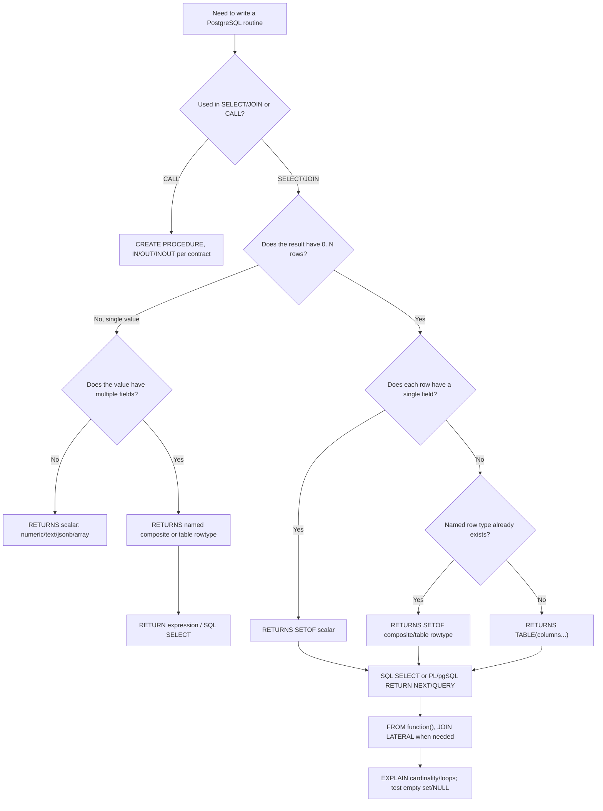

# Returning Scalar, Composite, TABLE, and SETOF Values in PostgreSQL

When writing a function in PostgreSQL, the first decision is not only **what to compute**, but **what shape of data to return**. A function can return a single number, a `jsonb` value, a multi-field record, a row matching a table's structure, or **multiple rows** with a fixed schema. These shapes determine how the function is called in `SELECT`, how it joins with other data, how types are declared, how results are handled in JDBC, and even how PostgreSQL optimizes the query.

Consider the same invoicing domain:

```sql
-- A single number:
SELECT demo_ret.paid_total(1);

-- A composite record:
SELECT *
FROM demo_ret.customer_overview(1);

-- Multiple rows with a fixed structure:
SELECT *
FROM demo_ret.list_invoices(1);

-- Multiple rows with a table's row type:
SELECT *
FROM demo_ret.paid_invoices(100);
```

These functions will be built progressively throughout this lesson. They illustrate four distinct return contracts.

This lesson belongs to the **Functions and Procedures** chapter of the *Database Engine Relational PostgreSQL* module and focuses specifically on **returning scalars, composite types, `RETURNS TABLE`, and `SETOF`**. Beyond `LANGUAGE sql` and `LANGUAGE plpgsql` syntax, it explores `RETURN`, `RETURN NEXT`, `RETURN QUERY`, `OUT` parameters, `record`, `LATERAL`, NULL records, data-type limits, performance, and Java/JDBC integration.

> **Terminology distinction:** A *composite type* is a value composed of multiple named fields with their own types; it is **not** an *aggregate function* such as `SUM`, `COUNT`, or `AVG`. A function returning a composite type may use aggregates internally, yet the two concepts are independent.

The SQL statements creating tables, functions, and procedures in this lesson use the `demo_ret` schema for a test database; do not run data-modifying steps directly on production.

---

## 1. Four axes to distinguish

Before diving into syntax, distinguish **value count**, **row count**, **column count**, and **result type**.

| Return contract | Example | Result when called in `FROM` |
|---|---|---|
| `RETURNS numeric` | A total amount | One value, typically one row |
| `RETURNS demo_ret.customer_overview` | One record with 4 fields | One composite row with the type's columns |
| `RETURNS SETOF bigint` | Multiple IDs | 0..N rows, single column |
| `RETURNS SETOF demo_ret.invoice` | Multiple invoice records | 0..N rows with the row type's columns |
| `RETURNS TABLE(id bigint, name text)` | Multiple two-column rows | 0..N rows, two named columns |
| `RETURNS record` | A record defined at the call site | Must supply column definitions when no OUT type metadata exists |
| `RETURNS void` | No meaningful data payload | Callable with `SELECT`, not a business row set |

Common pitfall: **a composite result with multiple fields is not the same as `SETOF`**. Conversely, `SETOF bigint` returns multiple rows, yet each row is only a single value.

### 1.1. Mental diagram

```text
                 CREATE FUNCTION ...
                          │
                     Return shape
                          │
        ┌─────────────────┼───────────────────┐
        ▼                 ▼                   ▼
   Single value     One composite         Multiple rows
   RETURNS T        RETURNS type          SETOF T / TABLE
        │                 │                   │
   numeric/text      ROW(a,b,c)        0, 1, or N rows
   jsonb/array       or table row         │
        │                 │               JOIN LATERAL
      RETURN             RETURN          RETURN NEXT/QUERY
```

PostgreSQL does not automatically turn "one record" into "multiple records" simply because the internal `SELECT` expression has multiple columns.

## 2. How do functions differ from procedures?

In PostgreSQL, a **function** is used inside SQL expressions:

```sql
SELECT demo_ret.paid_total(1);
SELECT * FROM demo_ret.list_invoices(1);
```

Whereas a **procedure** is called via `CALL`:

```sql
CALL demo_ret.write_audit('Completed operation');
```

A function declares its return type via `RETURNS ...` or `OUT` parameters. A procedure **does not declare `RETURNS TABLE` or `RETURNS SETOF`** like a function. Procedures can use `OUT`/`INOUT` parameters in supported versions to return parameter values from `CALL`, though that is not a table-valued function you can `JOIN` in `FROM`.

### 2.1. Version milestones to remember

- PostgreSQL 11 introduced SQL procedures and `CALL`.
- `LANGUAGE sql` and `LANGUAGE plpgsql` support writing functions with different result-returning mechanisms.
- `RETURNS TABLE`, `SETOF`, and `OUT` are not strictly interchangeable syntax forms.
- Procedure features, transaction control, and SQL-body syntax vary across major versions; verify against your target server.

The final sections include an illustrative procedure, while the main focus remains **function return contracts**.

## 3. Preparing the practice schema

Use a small customer-and-invoice model to compare return types over the same dataset.

```sql
CREATE SCHEMA IF NOT EXISTS demo_ret;

CREATE TABLE demo_ret.customer (
    customer_id BIGINT PRIMARY KEY,
    full_name TEXT NOT NULL,
    customer_tier TEXT NOT NULL
        CHECK (customer_tier IN ('STANDARD', 'VIP'))
);

CREATE TABLE demo_ret.invoice (
    invoice_id BIGINT PRIMARY KEY,
    customer_id BIGINT NOT NULL
        REFERENCES demo_ret.customer(customer_id),
    issued_at TIMESTAMPTZ NOT NULL,
    amount NUMERIC(12, 2) NOT NULL
        CHECK (amount >= 0),
    status TEXT NOT NULL
        CHECK (status IN ('NEW', 'PAID', 'CANCELLED'))
);
```

Lab data:

```sql
INSERT INTO demo_ret.customer
    (customer_id, full_name, customer_tier)
VALUES
    (1, 'An',   'VIP'),
    (2, 'Bình', 'STANDARD'),
    (3, 'Chi',  'STANDARD'),
    (4, 'Dũng', 'VIP');

INSERT INTO demo_ret.invoice
    (invoice_id, customer_id, issued_at, amount, status)
VALUES
    (1001, 1, '2026-10-01 08:00:00+07', 120.00, 'PAID'),
    (1002, 1, '2026-11-02 08:00:00+07',  80.00, 'NEW'),
    (1003, 2, '2026-11-03 10:00:00+07', 200.00, 'PAID'),
    (1004, 2, '2026-11-04 10:00:00+07',  20.00, 'CANCELLED'),
    (1005, 4, '2026-11-05 09:00:00+07', 350.00, 'PAID');

ANALYZE demo_ret.customer;
ANALYZE demo_ret.invoice;
```

The `customer` table has **4 rows**. The `invoice` table has **5 rows**. Customer Chi (ID 3) **has no invoices**. This is an essential test case to distinguish:

- A function returning a **scalar NULL**.
- A function returning a **composite with zero counts**.
- A function returning **0 rows**.
- A `LEFT JOIN LATERAL` retaining the parent row when a function returns 0 rows.

### 3.1. Verifying the dataset

```sql
SELECT c.customer_id, c.full_name,
       COUNT(i.invoice_id) AS invoices
FROM demo_ret.customer AS c
LEFT JOIN demo_ret.invoice AS i
    ON i.customer_id = c.customer_id
GROUP BY c.customer_id, c.full_name
ORDER BY c.customer_id;
```

Expected invoice counts are **2, 2, 0, 1** respectively.

Re-running the `INSERT` blocks on the same schema will trigger primary key conflicts; examples assume a fresh single-initialization lab.

## 4. RETURNS scalar: one value of a single type

Simple form:

```sql
CREATE FUNCTION demo_ret.apply_tax(
    p_amount NUMERIC,
    p_rate NUMERIC DEFAULT 0.10
)
RETURNS NUMERIC
LANGUAGE sql
IMMUTABLE
STRICT
AS $$
    SELECT round(p_amount * (1 + p_rate), 2);
$$;
```

Invocation:

```sql
SELECT demo_ret.apply_tax(100) AS amount_with_tax;
SELECT demo_ret.apply_tax(100, 0.08) AS amount_with_tax;
```

Expected results are **110.00** and **108.00** according to the programmed rounding.

### 4.1. Reading the contract

- `RETURNS NUMERIC`: the result is **one numeric value**, not a table.
- `LANGUAGE sql`: the function body is SQL.
- `IMMUTABLE`: for identical inputs under valid conditions, the result never depends on database state or time.
- `STRICT`: if any input argument is SQL NULL, PostgreSQL returns NULL without executing the body.
- `DEFAULT 0.10`: used when the caller omits `p_rate`.

### 4.2. Scalar does not have to be numeric

Examples of scalar types:

```text
RETURNS bigint
RETURNS boolean
RETURNS text
RETURNS date
RETURNS timestamptz
RETURNS numeric
RETURNS uuid
RETURNS jsonb
RETURNS integer[]
```

A `jsonb` value can hold a huge object or array, yet in SQL terms it remains **a single scalar value**. `RETURNS jsonb` is not equivalent to returning multiple rows from a table function.

## 5. Scalar function reading table data

Create a function returning the **total amount of PAID invoices** for a customer:

```sql
CREATE FUNCTION demo_ret.paid_total(
    p_customer_id BIGINT
)
RETURNS NUMERIC
LANGUAGE sql
STABLE
AS $$
    SELECT COALESCE(
        SUM(i.amount),
        0::numeric
    )
    FROM demo_ret.invoice AS i
    WHERE i.customer_id = p_customer_id
      AND i.status = 'PAID';
$$;
```

Invocation:

```sql
SELECT
    c.customer_id,
    c.full_name,
    demo_ret.paid_total(c.customer_id) AS paid_amount
FROM demo_ret.customer AS c
ORDER BY c.customer_id;
```

Expected output:

| Customer | paid_amount |
|---|---:|
| An | 120.00 |
| Bình | 200.00 |
| Chi | 0 |
| Dũng | 350.00 |

### 5.1. Why STABLE instead of IMMUTABLE?

The result depends on **data in the invoice table**. For the same customer ID, if an invoice is paid later, the total changes. Hence `IMMUTABLE` is semantically wrong. `STABLE` fits table reads that remain consistent within a statement's snapshot.

### 5.2. COALESCE distinguishes NULL from 0

`SUM` over an empty set returns NULL. `COALESCE(...,0)` is a **business decision**: report 0 for customers with no PAID invoices.

If you need to distinguish "no data" from "sum equals 0," do not apply `COALESCE` automatically.

### 5.3. A summing function is not necessarily faster than JOIN/GROUP BY

Calling `paid_total(customer_id)` for 100,000 customers can force PostgreSQL to execute many repeated lookups. A set-based `JOIN + GROUP BY` can be much faster depending on SQL-function inlining, indexes, and the planner.

Never treat a function as an automatic cache or standalone query optimizer.

## 6. Scalar with PL/pgSQL and RETURN

`LANGUAGE plpgsql` is suitable when control flow is required:

```sql
CREATE FUNCTION demo_ret.customer_category(
    p_amount NUMERIC
)
RETURNS TEXT
LANGUAGE plpgsql
IMMUTABLE
AS $$
BEGIN
    IF p_amount IS NULL THEN
        RETURN 'UNKNOWN';
    ELSIF p_amount >= 300 THEN
        RETURN 'LARGE';
    ELSIF p_amount >= 100 THEN
        RETURN 'MEDIUM';
    ELSE
        RETURN 'SMALL';
    END IF;
END;
$$;
```

Invocation:

```sql
SELECT
    demo_ret.customer_category(450) AS c1,
    demo_ret.customer_category(150) AS c2,
    demo_ret.customer_category(20) AS c3,
    demo_ret.customer_category(NULL) AS c4;
```

Expected: `LARGE`, `MEDIUM`, `SMALL`, `UNKNOWN`.

### 6.1. RETURN expression terminates the function

In scalar PL/pgSQL functions:

```sql
RETURN some_expression;
```

both supplies the return value and **immediately terminates** that function call.

If a function declares a normal return value but reaches the end without executing a valid `RETURN`, PostgreSQL raises a runtime error. Structure `IF/CASE` branches so every execution path fulfills the contract.

### 6.2. STRICT changes NULL handling

Adding `STRICT` to `customer_category` makes PostgreSQL return SQL NULL immediately when `p_amount=NULL`, **skipping the `'UNKNOWN'` branch**. Therefore, omit `STRICT` when business rules must classify NULL explicitly.

## 7. Functions returning void

Sometimes a function only performs a side effect and has no meaningful data to return:

```sql
CREATE FUNCTION demo_ret.emit_notice(
    p_message TEXT
)
RETURNS void
LANGUAGE plpgsql
VOLATILE
AS $$
BEGIN
    RAISE NOTICE 'Message: %', p_message;
END;
$$;
```

Invocation:

```sql
SELECT demo_ret.emit_notice('Hello');
```

`void` is a pseudo-type indicating there is no business result payload. Syntactically, the function is still invoked in `SELECT`.

### 7.1. When should you use a procedure?

If the primary goal is **executing a data-modification workflow**, especially needing procedure-specific transaction control, consider `CREATE PROCEDURE ... CALL` instead of mimicking a table-valued function.

Remember that functions and procedures **have different transaction and invocation semantics**—you do not simply swap one keyword for the other.

## 8. What happens if a scalar SQL function matches multiple rows?

An SQL function may declare `RETURNS bigint`, yet its final `SELECT` could match multiple rows:

```sql
-- Design example that can be misleading:
CREATE FUNCTION demo_ret.any_invoice_id(
    p_customer_id BIGINT
)
RETURNS BIGINT
LANGUAGE sql
STABLE
AS $$
    SELECT i.invoice_id
    FROM demo_ret.invoice AS i
    WHERE i.customer_id = p_customer_id;
$$;
```

In an SQL-language function **not declared SETOF**, if the final query produces multiple rows, PostgreSQL returns **the first row** as the scalar result. If no row matches, it returns NULL.

### 8.1. Do not rely on "an arbitrary row"

If you want the newest invoice, make the rule explicit:

```sql
CREATE FUNCTION demo_ret.latest_invoice_id(
    p_customer_id BIGINT
)
RETURNS BIGINT
LANGUAGE sql
STABLE
AS $$
    SELECT i.invoice_id
    FROM demo_ret.invoice AS i
    WHERE i.customer_id = p_customer_id
    ORDER BY i.issued_at DESC, i.invoice_id DESC
    LIMIT 1;
$$;
```

`ORDER BY` with an ID tiebreaker determines which row is chosen. `LIMIT 1` makes the intent obvious to readers.

### 8.2. "No result" in a scalar function

```sql
SELECT demo_ret.latest_invoice_id(3);
```

Customer Chi has no invoices, so the result column is **NULL** in **one SELECT row**. That differs from a `SETOF` function returning **0 rows**.

## 9. SETOF scalar: one column, potentially many rows

`SETOF` stands for **set of**—a set of values of the declared type.

```sql
CREATE FUNCTION demo_ret.paid_invoice_ids(
    p_customer_id BIGINT
)
RETURNS SETOF BIGINT
LANGUAGE sql
STABLE
AS $$
    SELECT i.invoice_id
    FROM demo_ret.invoice AS i
    WHERE i.customer_id = p_customer_id
      AND i.status = 'PAID'
    ORDER BY i.issued_at DESC, i.invoice_id DESC;
$$;
```

Calling in `FROM`:

```sql
SELECT s.invoice_id
FROM demo_ret.paid_invoice_ids(1) AS s(invoice_id);
```

For An: one row containing `1001`.

For Chi:

```sql
SELECT *
FROM demo_ret.paid_invoice_ids(3);
```

Returns **zero rows**, rather than one row containing SQL NULL.

### 9.1. SETOF scalar vs. array scalar

```sql
RETURNS SETOF BIGINT   -- 0..N rows, one BIGINT per row.
RETURNS BIGINT[]       -- A single value of type BIGINT[].
```

These two types are not casually interchangeable. If the application needs to join each ID with another table, `SETOF BIGINT` is usually more convenient; if it needs a single JSON or array payload, aggregating into a scalar array may fit better.

## 10. Prefer calling SRFs in FROM

PostgreSQL permits set-returning functions (SRFs) in certain `SELECT` target-list expressions:

```sql
SELECT demo_ret.paid_invoice_ids(1);
```

However, in queries combining multiple data sources or multiple SRFs, target-list placement makes cardinality and planning harder to follow.

Cleaner form:

```sql
SELECT ids.invoice_id
FROM demo_ret.paid_invoice_ids(1) AS ids(invoice_id);
```

When the function depends on another row:

```sql
SELECT
    c.customer_id,
    ids.invoice_id
FROM demo_ret.customer AS c
CROSS JOIN LATERAL
    demo_ret.paid_invoice_ids(c.customer_id) AS ids(invoice_id)
ORDER BY c.customer_id, ids.invoice_id;
```

`LATERAL` lets the function reference `c.customer_id` from each preceding row. `CROSS JOIN` excludes customers for whom the function returns 0 rows.

## 11. What is a composite type?

A composite type contains **multiple named fields with their own types**.

Example of a standalone type definition:

```sql
CREATE TYPE demo_ret.customer_overview AS (
    customer_id BIGINT,
    full_name TEXT,
    paid_invoice_count BIGINT,
    paid_total NUMERIC
);
```

A value of this type behaves like a "record":

```text
customer_id        = 1
full_name          = "An"
paid_invoice_count = 1
paid_total         = 120.00
```

It is **neither four independent scalar results** nor a multi-row table.

### 11.1. Composite types do not have primary keys

`CREATE TYPE ... AS (...)` defines the structure of a value. It does not create a table storing rows, nor does it have `PRIMARY KEY`, `FOREIGN KEY`, `UNIQUE`, or indexes.

Never use a composite type in place of a relational table when the domain needs row storage, keys, or indexing.

### 11.2. Composite types are also created automatically from tables

When you create `demo_ret.customer` or `demo_ret.invoice`, PostgreSQL creates a corresponding row type matching the table's columns. You can write:

```sql
RETURNS demo_ret.customer
RETURNS demo_ret.invoice
```

without defining a separate `CREATE TYPE` duplicating the fields.

## 12. Function returning a composite value

Create a function returning summary information for one customer:

```sql
CREATE FUNCTION demo_ret.customer_overview(
    p_customer_id BIGINT
)
RETURNS demo_ret.customer_overview
LANGUAGE sql
STABLE
AS $$
    SELECT ROW(
        c.customer_id,
        c.full_name,
        COUNT(i.invoice_id)
            FILTER (WHERE i.status = 'PAID'),
        COALESCE(
            SUM(i.amount)
                FILTER (WHERE i.status = 'PAID'),
            0::numeric
        )
    )::demo_ret.customer_overview
    FROM demo_ret.customer AS c
    LEFT JOIN demo_ret.invoice AS i
        ON i.customer_id = c.customer_id
    WHERE c.customer_id = p_customer_id
    GROUP BY c.customer_id, c.full_name;
$$;
```

Explanation:

- `ROW(...)` builds a composite/row expression.
- `::demo_ret.customer_overview` casts it to the desired named composite type.
- `COUNT(...)` returns `bigint`, matching the third field.
- `SUM(numeric)` returns `numeric`; `COALESCE` handles customers with no PAID invoices.
- `GROUP BY` produces one row if the customer exists.
- If `WHERE` matches no customer, the scalar composite function returns NULL.

### 12.1. Calling a composite function in FROM

```sql
SELECT *
FROM demo_ret.customer_overview(1);
```

The resulting columns are `customer_id`, `full_name`, `paid_invoice_count`, and `paid_total`.

### 12.2. Calling as a single value

```sql
SELECT demo_ret.customer_overview(1) AS summary_value;
```

Here `SELECT` returns **one column** of type `demo_ret.customer_overview`. Clients may render it as composite record text rather than four separate columns.

### 12.3. Why do the two calling forms differ?

`SELECT f()` treats the result as **a single expression value**. `SELECT * FROM f()` treats the function as a relational source and expands the composite's fields into columns.

This difference directly impacts `ResultSet` consumption in JDBC and ORM mapping.

## 13. Accessing composite fields

If a function returns a composite, you can access a single field:

```sql
SELECT
    (demo_ret.customer_overview(1)).full_name AS customer_name;
```

Parentheses around the function call help PostgreSQL parse the field-access syntax unambiguously.

### 13.1. Be careful with (f()).*

Writing:

```sql
SELECT (demo_ret.customer_overview(1)).*;
```

can be expanded by the planner once per field. With complex or volatile expressions, such expansion can cause **the function to be evaluated multiple times** unless handled carefully.

To enforce the contract "evaluate once and expose all fields," place the function in `FROM`:

```sql
SELECT x.customer_id, x.full_name,
       x.paid_invoice_count, x.paid_total
FROM demo_ret.customer_overview(1) AS x;
```

When joining with the customer table, use `LATERAL` as shown later.

### 13.2. Composite fields can also be NULL

A composite type does not enforce non-nullness on its fields. For example, `full_name` in a standalone type is `TEXT` without inheriting `NOT NULL` constraints from the `customer` table. Applications must still handle potentially missing field values.

## 14. Function returning a table's row type

We have table `demo_ret.customer` and its matching row type:

```sql
CREATE FUNCTION demo_ret.find_customer(
    p_customer_id BIGINT
)
RETURNS demo_ret.customer
LANGUAGE sql
STABLE
AS $$
    SELECT c
    FROM demo_ret.customer AS c
    WHERE c.customer_id = p_customer_id;
$$;
```

`SELECT c` selects the **whole-row value** of table alias `c`.

Invocation:

```sql
SELECT *
FROM demo_ret.find_customer(2);
```

The output contains the current columns of `customer`: ID, full name, and tier.

### 14.1. Whole-row vs. field list

Compare these two forms:

```sql
SELECT c
FROM demo_ret.customer AS c;

SELECT c.*
FROM demo_ret.customer AS c;
```

In the first query, `c` is **a single composite value**. In the second, `c.*` expands its fields into separate `SELECT` columns. When declaring `RETURNS demo_ret.customer`, express the body clearly and verify the return shape/type.

### 14.2. Row types are coupled to the table schema

`RETURNS demo_ret.customer` binds the return contract to the table's definition. If a future `ALTER TABLE ADD COLUMN` runs, the row type changes and consumers of that composite may be affected.

This is a trade-off:

- Convenience: avoids repeating column lists.
- Risk: the database API shape mutates whenever the underlying table evolves.

For a public API shared across multiple clients, a named composite type or `RETURNS TABLE` with explicit columns is usually easier to version.

## 15. ROW constructor and composite casting

Example constructing a composite value manually:

```sql
SELECT ROW(
    1::bigint,
    'An'::text,
    1::bigint,
    120::numeric
)::demo_ret.customer_overview AS overview;
```

`ROW(...)` builds a row expression. Explicit casting tells PostgreSQL it must conform to `customer_overview` rather than remaining an anonymous record.

### 15.1. Column count and order must match

For a 4-field type, the expression below **has the wrong shape**:

```sql
-- Intentionally illustrates an error:
SELECT ROW(1::bigint, 'An'::text)
    ::demo_ret.customer_overview;
```

Do not assume omitted trailing fields will be filled with defaults like an `INSERT` into a table. Standalone composite types do not apply column defaults in `ROW(...)` casts.

### 15.2. Numeric, bigint, and text must align

`COUNT(*)` returns `bigint`, whereas `COUNT(*)::integer` can overflow on large datasets. Do not cast row counts down to `integer` just to match a hastily written signature.

If a source column is `varchar(n)` and the return field is `text`, understand how casts behave; especially in PL/pgSQL `RETURN QUERY`, type mismatch errors occur even when two types appear similar.

## 16. A NULL composite is not the same as a row with zero values

`demo_ret.customer_overview(3)` returns a valid composite for Chi:

```text
customer_id        = 3
full_name          = Chi
paid_invoice_count = 0
paid_total         = 0
```

`demo_ret.customer_overview(999)` finds no customer: the scalar function has no source row and returns a **NULL composite value** under SQL function semantics.

### 16.1. Avoid confusing "no customer" with "customer with 0 invoices"

Never apply `COALESCE(...,0)` across an entire logical record if doing so turns "customer does not exist" into "existing customer with total 0."

Check existence explicitly when needed:

```sql
SELECT EXISTS (
    SELECT 1
    FROM demo_ret.customer
    WHERE customer_id = 999
) AS customer_exists;
```

### 16.2. Composite IS NULL has special semantics

PostgreSQL evaluates `IS NULL` on rows/composites differently from scalars: a row where **all fields are NULL** satisfies `IS NULL`, whereas a row with a mix of NULL and non-NULL fields satisfies **neither `IS NULL` nor `IS NOT NULL`**.

Example:

```sql
SELECT
    ROW(NULL::integer, NULL::text) IS NULL
        AS all_fields_null,
    ROW(NULL::integer, 'A'::text) IS NULL
        AS mixed_is_null,
    ROW(NULL::integer, 'A'::text) IS NOT NULL
        AS mixed_is_not_null;
```

Do not use row-level `IS NULL` as a general test to distinguish a **NULL composite** from a **record whose fields are all NULL**. When existence matters, check an identifier key or a dedicated boolean flag.

## 17. OUT parameters: declaring outputs right in the signature

Besides `RETURNS some_type`, PostgreSQL supports **output parameters**:

```sql
CREATE FUNCTION demo_ret.paid_count_out(
    IN p_customer_id BIGINT,
    OUT paid_count BIGINT
)
LANGUAGE sql
STABLE
AS $$
    SELECT COUNT(*)
    FROM demo_ret.invoice AS i
    WHERE i.customer_id = p_customer_id
      AND i.status = 'PAID';
$$;
```

Invocation:

```sql
SELECT demo_ret.paid_count_out(1) AS count_value;
```

### 17.1. IN vs. OUT

- `IN`: passed by caller; participates in function signature identity.
- `OUT`: supplied by the function as output; callers do not pass arguments for OUT parameters in `SELECT`.
- `INOUT`: carries both input and output, depending on the function/procedure contract.

With a single OUT parameter, the return type is inferred directly from that parameter.

### 17.2. OUT is more than just an alias

An OUT parameter is part of the result shape metadata in the system catalog. It affects how the function is described and invoked, not merely the column alias in an outer `SELECT`.

## 18. Multiple OUT parameters: a composite-like record

Function returning paid invoice count and total amount:

```sql
CREATE FUNCTION demo_ret.paid_metrics(
    IN p_customer_id BIGINT,
    OUT paid_count BIGINT,
    OUT paid_amount NUMERIC
)
LANGUAGE sql
STABLE
AS $$
    SELECT
        COUNT(*),
        COALESCE(SUM(i.amount), 0::numeric)
    FROM demo_ret.invoice AS i
    WHERE i.customer_id = p_customer_id
      AND i.status = 'PAID';
$$;
```

Call as two columns:

```sql
SELECT *
FROM demo_ret.paid_metrics(1);
```

Logical result:

| paid_count | paid_amount |
|---:|---:|
| 1 | 120.00 |

A function using multiple OUT parameters has its result row shape fixed at declaration time. This **differs** from bare `RETURNS record`, which exposes no field names or types in the signature.

### 18.1. Cannot overload by OUT parameters alone

Function identity depends on the name and input argument types. You cannot create two functions with identical names and `IN` signatures differing only in OUT names or OUT types expecting PostgreSQL to dispatch by "caller return context."

### 18.2. OUT names can collide with column names

In PL/pgSQL, output parameter names also act as variables. If `paid_count` matches a query column name, unqualified references become ambiguous. Always qualify table columns with aliases like `i.invoice_id` and avoid generic names colliding across columns.

## 19. RETURNS TABLE: named columns and multiple rows

`RETURNS TABLE` declares the result set's columns directly inside the function signature.

```sql
CREATE FUNCTION demo_ret.list_invoices(
    p_customer_id BIGINT,
    p_status TEXT DEFAULT NULL
)
RETURNS TABLE (
    invoice_id BIGINT,
    issued_at TIMESTAMPTZ,
    amount NUMERIC,
    status TEXT
)
LANGUAGE sql
STABLE
AS $$
    SELECT
        i.invoice_id,
        i.issued_at,
        i.amount,
        i.status
    FROM demo_ret.invoice AS i
    WHERE i.customer_id = p_customer_id
      AND (
          p_status IS NULL
          OR i.status = p_status
      )
    ORDER BY i.issued_at DESC, i.invoice_id DESC;
$$;
```

Invocation:

```sql
SELECT *
FROM demo_ret.list_invoices(1);
```

For An, returns two rows ordered newest to oldest: invoice 1002 (NEW), then 1001 (PAID).

### 19.1. Filtering by the second parameter

```sql
SELECT *
FROM demo_ret.list_invoices(1, 'PAID');
```

Returns only invoice 1001.

### 19.2. Defaulting a filter parameter to NULL is an API decision

In this example, `p_status = NULL` means **do not filter by status**. If an application ever needed "status is actually NULL," a different design would be required. The lab table forbids NULL status, though in general systems never assume a `NULL` parameter universally means "all."

### 19.3. RETURNS TABLE can return 0 rows

```sql
SELECT *
FROM demo_ret.list_invoices(3);
```

For Chi, this returns **0 rows**, not a row with four NULL fields. That is the set-returning contract.

## 20. RETURNS TABLE means "SETOF named rows"

Practically, `RETURNS TABLE (id bigint, name text)` expresses:

- The result can have **0..N rows**.
- Each row contains two fields: `id` and `name`.
- Columns and types are declared right in the function signature.
- In PL/pgSQL, those output column names are assignable OUT variables.

Conceptually it resembles declaring **OUT parameters + a set result**, though `RETURNS TABLE` syntax cannot be mixed with a `RETURNS some_type` clause or separate `OUT` parameter list.

### 20.1. Difference from RETURNS record

`RETURNS TABLE` tells both PostgreSQL and callers the column names and types upfront, so:

```sql
SELECT invoice_id, amount
FROM demo_ret.list_invoices(1);
```

requires no column definition list at the call site.

### 20.2. Difference from RETURNS SETOF scalar

`RETURNS SETOF bigint` returns one column of `bigint` values. `RETURNS TABLE(invoice_id bigint, amount numeric)` returns two columns per row.

### 20.3. RETURNS TABLE does not guarantee at least one row

The word "TABLE" does not guarantee non-empty results. If `WHERE` matches nothing or the function intentionally produces no rows, the query returns 0 rows—not an error.

## 21. RETURNS SETOF named composite type

Using the table's built-in row type:

```sql
CREATE FUNCTION demo_ret.paid_invoices(
    p_min_amount NUMERIC DEFAULT 0
)
RETURNS SETOF demo_ret.invoice
LANGUAGE sql
STABLE
AS $$
    SELECT i.*
    FROM demo_ret.invoice AS i
    WHERE i.status = 'PAID'
      AND i.amount >= p_min_amount
    ORDER BY i.issued_at DESC, i.invoice_id DESC;
$$;
```

Invocation:

```sql
SELECT
    p.invoice_id,
    p.customer_id,
    p.amount,
    p.status
FROM demo_ret.paid_invoices(100) AS p
ORDER BY p.amount DESC, p.invoice_id DESC;
```

### 21.1. When to use SETOF table_rowtype?

When you want the function to return **the exact row structure** of a table, `SETOF demo_ret.invoice` is concise and avoids duplicating column lists.

Trade-off: adding, removing, or altering columns on the table changes the row type's shape. Clients sensitive to column order or types may require updates after migrations.

### 21.2. When to use RETURNS TABLE?

When the API should expose only a fixed subset of fields:

```text
invoice_id, issued_at, amount, status
```

rather than every internal table column, `RETURNS TABLE(...)` expresses a cleaner public contract.

### 21.3. Do not create a new TYPE for every single SELECT

If an existing table row type is stable and appropriate, `SETOF table_type` suffices. If the shape must be shared across multiple functions or decoupled from table DDL, a named composite type is advantageous.

## 22. SETOF a table-independent named composite type

The type `demo_ret.customer_overview` was created earlier. A function can return **multiple overview records**:

```sql
CREATE FUNCTION demo_ret.all_customer_overviews()
RETURNS SETOF demo_ret.customer_overview
LANGUAGE sql
STABLE
AS $$
    SELECT ROW(
        c.customer_id,
        c.full_name,
        COUNT(i.invoice_id)
            FILTER (WHERE i.status = 'PAID'),
        COALESCE(
            SUM(i.amount)
                FILTER (WHERE i.status = 'PAID'),
            0::numeric
        )
    )::demo_ret.customer_overview
    FROM demo_ret.customer AS c
    LEFT JOIN demo_ret.invoice AS i
        ON i.customer_id = c.customer_id
    GROUP BY c.customer_id, c.full_name
    ORDER BY c.customer_id;
$$;
```

Invocation:

```sql
SELECT *
FROM demo_ret.all_customer_overviews();
```

This returns **4 rows**, each with 4 fields. Chi still appears with a total of 0 thanks to `LEFT JOIN`.

### 22.1. Comparing with the scalar composite function

`demo_ret.customer_overview(1)` returns one composite for one customer. `demo_ret.all_customer_overviews()` returns a **set of composite values**.

Both use `customer_overview`, yet their row counts differ. Never infer that `RETURNS composite` is set-returning just because the type has multiple fields.

## 23. RETURNS record: shape specified at call time

`record` is a pseudo-type representing a row structure not fixed to a named composite type.

Example function:

```sql
CREATE FUNCTION demo_ret.dynamic_customer_record(
    p_customer_id BIGINT
)
RETURNS record
LANGUAGE sql
STABLE
AS $$
    SELECT c.customer_id, c.full_name
    FROM demo_ret.customer AS c
    WHERE c.customer_id = p_customer_id;
$$;
```

When used in `FROM`, because the signature does not publish concrete field names or types, the caller must supply a column definition list:

```sql
SELECT *
FROM demo_ret.dynamic_customer_record(1)
    AS r(customer_id BIGINT, full_name TEXT);
```

### 23.1. What if the caller specifies the wrong types or column count?

The SQL caller raises a structure mismatch error if the actual returned row differs from the column definition list. `record` is **not** a free-for-all "accept anything and coerce arbitrarily."

### 23.2. When is record appropriate?

- Migration or reporting utilities whose output schema depends on runtime parameters.
- Generic functions where callers know the expected shape.
- Certain internal PL/pgSQL helpers.

For stable public APIs, `RETURNS TABLE` or a named composite type is far easier to read, consume via JDBC, and migrate safely.

## 24. RETURNS SETOF record: dynamic shape and row count

You can define:

```sql
CREATE FUNCTION demo_ret.dynamic_invoice_pairs(
    p_customer_id BIGINT
)
RETURNS SETOF record
LANGUAGE sql
STABLE
AS $$
    SELECT i.invoice_id, i.amount
    FROM demo_ret.invoice AS i
    WHERE i.customer_id = p_customer_id
    ORDER BY i.invoice_id;
$$;
```

Call with explicit shape:

```sql
SELECT *
FROM demo_ret.dynamic_invoice_pairs(1)
    AS x(invoice_id BIGINT, amount NUMERIC);
```

For An, returns two rows: `(1001,120.00)` and `(1002,80.00)`.

### 24.1. Comparing the two declarations

```text
RETURNS SETOF record
    → Caller typically must supply (column_name column_type, ...).

RETURNS TABLE(invoice_id bigint, amount numeric)
    → Function declares the shape upfront; caller does not have to redeclare it.
```

Do not pick `record` merely because the answer has multiple columns. Multiple **known** columns is the textbook use case for `RETURNS TABLE`.

## 25. PL/pgSQL: RETURN for scalars and composites

In PL/pgSQL, `RETURN expression;` returns a value and ends execution.

Example returning a composite:

```sql
CREATE FUNCTION demo_ret.make_overview_sample(
    p_customer_id BIGINT,
    p_name TEXT
)
RETURNS demo_ret.customer_overview
LANGUAGE plpgsql
IMMUTABLE
AS $$
DECLARE
    v_result demo_ret.customer_overview;
BEGIN
    v_result := ROW(
        p_customer_id,
        p_name,
        0::bigint,
        0::numeric
    )::demo_ret.customer_overview;

    RETURN v_result;
END;
$$;
```

Invocation:

```sql
SELECT *
FROM demo_ret.make_overview_sample(99, 'Sample');
```

The result is **one composite value** with 4 fields.

### 25.1. Variables of a named composite type

`v_result demo_ret.customer_overview;` declares a variable matching the composite's structure. Fields can be assigned individually:

```plpgsql
v_result.full_name := p_name;
```

This is an illustrative PL/pgSQL snippet inside a function body, not a standalone SQL query.

### 25.2. RETURN NULL for composites

A function returning `demo_ret.customer_overview` can return SQL NULL if business rules represent "record does not exist" that way. Never synthesize a fake record with ID 0 and an empty name instead of NULL if clients might mistake it for a valid customer.

## 26. PL/pgSQL: RETURN NEXT in SETOF functions

`RETURN NEXT` appends **one value or row** to the result set and continues execution. It **does not terminate the function** like `RETURN expression` in a scalar function.

Example generating even numbers:

```sql
CREATE FUNCTION demo_ret.even_numbers(
    p_max INTEGER
)
RETURNS SETOF INTEGER
LANGUAGE plpgsql
IMMUTABLE
AS $$
DECLARE
    v_num INTEGER;
BEGIN
    IF p_max IS NULL OR p_max < 2 THEN
        RETURN;
    END IF;

    FOR v_num IN 1..p_max LOOP
        IF v_num % 2 = 0 THEN
            RETURN NEXT v_num;
        END IF;
    END LOOP;

    RETURN;
END;
$$;
```

Invocation:

```sql
SELECT n
FROM demo_ret.even_numbers(10) AS x(n);
```

Expected: 2, 4, 6, 8, 10.

### 26.1. Three RETURN forms with distinct meanings

| PL/pgSQL statement | Applies to | Meaning |
|---|---|---|
| `RETURN expression;` | Non-SETOF scalar/composite function | Returns value and terminates |
| `RETURN NEXT expression;` | SETOF without output parameters | Appends one row to the result set |
| `RETURN;` | SETOF or eligible void/output-parameter functions | Terminates function without adding a row |
| `RETURN QUERY sql_query;` | SETOF/`RETURNS TABLE` | Appends all rows from the query to the result set |

### 26.2. RETURN NEXT does not immediately stream each row to the client

PL/pgSQL set-returning functions generally accumulate rows in a tuplestore before returning the completed set to the caller. For huge result sets, this consumes memory and temporary disk space; do not mistake `RETURN NEXT` for statement-by-statement HTTP streaming.

## 27. PL/pgSQL: RETURN NEXT with RETURNS TABLE

When a function uses `RETURNS TABLE`, its output fields are variables. In that case `RETURN NEXT` is written **without an expression**, after assigning the output variables.

```sql
CREATE FUNCTION demo_ret.counter_labels(
    p_limit INTEGER
)
RETURNS TABLE (
    seq_no INTEGER,
    label TEXT
)
LANGUAGE plpgsql
IMMUTABLE
AS $$
DECLARE
    v_idx INTEGER;
BEGIN
    IF p_limit IS NULL OR p_limit < 1 THEN
        RETURN;
    END IF;

    FOR v_idx IN 1..p_limit LOOP
        seq_no := v_idx;
        label := 'Item ' || v_idx::text;
        RETURN NEXT;
    END LOOP;

    RETURN;
END;
$$;
```

Invocation:

```sql
SELECT *
FROM demo_ret.counter_labels(3);
```

Result:

| seq_no | label |
|---:|---|
| 1 | Item 1 |
| 2 | Item 2 |
| 3 | Item 3 |

### 27.1. Why not RETURN NEXT ROW(...) here?

`seq_no` and `label` are already OUT variables created by `RETURNS TABLE`. In this form, `RETURN NEXT;` takes **the current values of the output variables** to emit a row. Do not pass an arbitrary expression as you would with `SETOF scalar`.

## 28. PL/pgSQL: RETURN QUERY for datasets

`RETURN QUERY` is typically shorter and easier to optimize than a `RETURN NEXT` loop whenever the result can be expressed via set-based SQL.

```sql
CREATE FUNCTION demo_ret.invoice_page(
    p_customer_id BIGINT,
    p_min_amount NUMERIC DEFAULT 0
)
RETURNS TABLE (
    invoice_id BIGINT,
    amount NUMERIC,
    status TEXT
)
LANGUAGE plpgsql
STABLE
AS $$
BEGIN
    RETURN QUERY
    SELECT
        i.invoice_id,
        i.amount,
        i.status
    FROM demo_ret.invoice AS i
    WHERE i.customer_id = p_customer_id
      AND i.amount >= p_min_amount
    ORDER BY i.invoice_id;

    RETURN;
END;
$$;
```

Invocation:

```sql
SELECT *
FROM demo_ret.invoice_page(1, 50);
```

Returns An's two invoices 1001 and 1002.

### 28.1. RETURN QUERY appends rows without ending immediately

After `RETURN QUERY`, the function continues running and can append further rows via additional `RETURN QUERY` or `RETURN NEXT` statements. Only `RETURN;` (or reaching `END`) finishes execution.

### 28.2. Avoid accidental row duplication

If you execute two `RETURN QUERY` statements with overlapping predicates, duplicate rows will appear unless filtered explicitly. Set-returning functions do not deduplicate appended batches automatically.

### 28.3. Avoid looping over invoices when one SELECT suffices

Instead of:

```plpgsql
FOR r IN SELECT ... LOOP
    RETURN NEXT r;
END LOOP;
```

a direct `RETURN QUERY SELECT ...` states the intent clearly and lets the SQL executor optimize the `SELECT` cleanly.

## 29. RETURN QUERY EXECUTE for dynamic SQL

When table structures or conditions must be chosen dynamically, PL/pgSQL supports:

```plpgsql
RETURN QUERY EXECUTE some_sql_text
USING input_value_1, input_value_2;
```

Example of a safe status filter:

```sql
CREATE FUNCTION demo_ret.dynamic_status_invoices(
    p_status TEXT
)
RETURNS TABLE (
    invoice_id BIGINT,
    amount NUMERIC
)
LANGUAGE plpgsql
STABLE
AS $$
BEGIN
    RETURN QUERY EXECUTE
        'SELECT i.invoice_id, i.amount
         FROM demo_ret.invoice AS i
         WHERE i.status = $1
         ORDER BY i.invoice_id'
    USING p_status;
END;
$$;
```

### 29.1. Dynamic SQL is unnecessary here

Because the query has no dynamic table or column names, a static `RETURN QUERY SELECT ... WHERE i.status = p_status` is simpler and clearer. This example only introduces `EXECUTE ... USING`.

### 29.2. Never concatenate raw input into SQL strings

`EXECUTE '... WHERE status = ''' || p_status || ''''` risks escaping bugs and SQL injection. Always use `USING` for **values**, and use `format('%I', identifier)` backed by whitelists only when dynamic identifiers are truly required.

### 29.3. Dynamic shapes do not arbitrarily fit fixed RETURNS TABLE

Even when SQL text is built dynamically, its output columns must still match the declared `RETURNS TABLE` schema. If column counts or types vary per call, use a `record` or schema-aware contract—do not expect PostgreSQL to accept arbitrary mismatched shapes.

## 30. Comparing RETURN NEXT and RETURN QUERY

| Criterion | `RETURN NEXT` | `RETURN QUERY` |
|---|---|---|
| Unit appended | One scalar or composite row | All rows from an SQL query |
| Used in | Appropriate `SETOF`/`RETURNS TABLE` | `SETOF`/`RETURNS TABLE` |
| Best suited for | Loops with per-row procedural logic | Data retrievable via set-based `SELECT` |
| Terminates function? | No | No |
| Can be called multiple times? | Yes | Yes |
| Implies direct streaming? | Not by default | Not by default |

Use `RETURN NEXT` when each row must be constructed through custom procedural loop logic. Use `RETURN QUERY` when an SQL query already produces the desired rows.

**Do not use `RETURN QUERY` in a function declaring `RETURNS numeric`**, as it is strictly for set-returning results.

## 31. SQL-language SETOF functions do not need RETURN QUERY

In `LANGUAGE sql`:

```sql
CREATE FUNCTION demo_ret.customer_ids_above(
    p_min_id BIGINT
)
RETURNS SETOF BIGINT
LANGUAGE sql
STABLE
AS $$
    SELECT c.customer_id
    FROM demo_ret.customer AS c
    WHERE c.customer_id > p_min_id
    ORDER BY c.customer_id;
$$;
```

The final `SELECT` directly supplies all rows for the function result.

In `LANGUAGE plpgsql`, by contrast, `RETURN NEXT` or `RETURN QUERY` is required to populate the result set.

### 31.1. Do not mix the two body styles

`BEGIN ... END` and `RETURN QUERY` are PL/pgSQL syntax, not valid inside plain `LANGUAGE sql AS $$ SELECT ... $$`.

Choose the function language to fit your logic. For a single straightforward `SELECT`, `LANGUAGE sql` is more concise and more amenable to planner optimization.

## 32. Full comparison: 7 return styles

| Declaration | Logical row count | Logical column count | What caller needs to know |
|---|---|---|---|
| `RETURNS numeric` | One scalar value | 1 | Numeric |
| `RETURNS integer[]` | One array value | 1 | Array type |
| `RETURNS jsonb` | One JSON value | 1 | JSONB |
| `RETURNS demo_ret.customer_overview` | One composite value | 4 fields | Named composite type |
| `RETURNS SETOF bigint` | 0..N | 1 | Scalar element type |
| `RETURNS SETOF demo_ret.invoice` | 0..N | Rowtype fields | Named table rowtype |
| `RETURNS TABLE(id bigint, name text)` | 0..N | 2 | Column names/types already known |
| `RETURNS record` | One record | Caller-defined | Column definition list if shape isn't published |
| `RETURNS SETOF record` | 0..N | Caller-defined | Column definition list if shape isn't published |

"One" for scalar/composite refers to **one function result value**, not a guarantee that `SELECT * FROM f()` always yields a meaningful non-null row when the function returns NULL.

## 33. Scalar NULL, composite NULL, and empty sets

Three cases:

```sql
SELECT demo_ret.latest_invoice_id(3) AS missing_invoice;

SELECT demo_ret.customer_overview(999) AS missing_customer;

SELECT *
FROM demo_ret.list_invoices(3);
```

Semantics:

1. `latest_invoice_id(3)`: one scalar column containing NULL.
2. `customer_overview(999)`: one NULL composite return value.
3. `list_invoices(3)`: **0 rows**.

### 33.1. Do not use COALESCE to fix "0 rows"

The query:

```sql
SELECT COALESCE(invoice_id, 0)
FROM demo_ret.list_invoices(3);
```

still returns **0 rows**, because `COALESCE` only evaluates on existing rows.

To emit a fallback row, change the query shape or join logic appropriately—such as `LEFT JOIN LATERAL` or a conditional `UNION ALL`. That is not a simple NULL substitution.

### 33.2. COUNT(*) on an empty set

```sql
SELECT COUNT(*)
FROM demo_ret.list_invoices(3);
```

Returns **one row** with value **0**, because `COUNT(*)` over zero input rows still produces an aggregate result.

## 34. JOIN LATERAL with SETOF

Suppose we want each customer alongside their invoices:

```sql
SELECT
    c.customer_id,
    c.full_name,
    i.invoice_id,
    i.amount
FROM demo_ret.customer AS c
CROSS JOIN LATERAL demo_ret.list_invoices(c.customer_id)
    AS i
ORDER BY c.customer_id, i.invoice_id;
```

For customer Chi, `list_invoices(3)` returns 0 rows, so **`CROSS JOIN` drops Chi**.

### 34.1. To keep all customers: LEFT JOIN LATERAL

```sql
SELECT
    c.customer_id,
    c.full_name,
    i.invoice_id,
    i.amount
FROM demo_ret.customer AS c
LEFT JOIN LATERAL demo_ret.list_invoices(c.customer_id)
    AS i ON TRUE
ORDER BY c.customer_id, i.invoice_id;
```

Chi remains in the result with `i.invoice_id` and `i.amount` set to NULL via outer join padding.

### 34.2. Functions in FROM can reference preceding tables

For table functions in `FROM`, PostgreSQL permits referencing columns from earlier `FROM` items with implicit LATERAL semantics even when the `LATERAL` keyword is omitted. Writing `CROSS JOIN LATERAL` or `LEFT JOIN LATERAL` explicitly makes cardinality and dependencies unmistakable to readers.

## 35. LATERAL with scalar composite functions

A scalar composite function can also supply fields for each customer row:

```sql
SELECT
    c.customer_id,
    o.paid_invoice_count,
    o.paid_total
FROM demo_ret.customer AS c
CROSS JOIN LATERAL
    demo_ret.customer_overview(c.customer_id) AS o
ORDER BY c.customer_id;
```

Here each customer yields one composite record with fields rather than a multi-row invoice set. Placing the function in `FROM` cleanly expands its fields.

### 35.1. Know maximum cardinality when joining tables

`customer_overview(p_id)` is designed to return at most one composite value since `p_id` is a PK. `list_invoices(p_id)` can return many rows. Joining both without tracking cardinality can multiply rows unexpectedly.

## 36. COUNT with LEFT JOIN LATERAL

`LEFT JOIN LATERAL` produces one padded row for customers with empty invoice sets. Therefore:

```sql
SELECT
    c.customer_id,
    COUNT(*) AS output_rows,
    COUNT(i.invoice_id) AS actual_invoice_rows
FROM demo_ret.customer AS c
LEFT JOIN LATERAL demo_ret.list_invoices(c.customer_id)
    AS i ON TRUE
GROUP BY c.customer_id
ORDER BY c.customer_id;
```

For Chi:

```text
output_rows         = 1
actual_invoice_rows = 0
```

Reason: `COUNT(*)` counts the `LEFT JOIN` placeholder row, whereas `COUNT(i.invoice_id)` ignores NULL padding.

If the set-returning function could legitimately emit a row with a NULL `invoice_id`, rely on a non-null marker column to count actual rows rather than assuming NULL only comes from outer join padding.

## 37. WITH ORDINALITY for SETOF results

Table functions can use `WITH ORDINALITY` to attach a sequential row number to emitted rows:

```sql
SELECT
    x.invoice_id,
    x.issued_at,
    x.amount,
    x.pos
FROM demo_ret.list_invoices(1)
    WITH ORDINALITY AS x(invoice_id, issued_at, amount, status, pos)
ORDER BY x.pos;
```

`pos` numbers rows starting at 1 in the order emitted by the function.

### 37.1. Ordinality is not a primary key

`pos` reflects emission order for that single call, not a persistent identifier. If data or plans change, order may shift. Always specify an explicit `ORDER BY` in the outer query when display order must be guaranteed.

### 37.2. LATERAL resets ordinality per invocation

```sql
SELECT
    c.customer_id,
    x.invoice_id,
    x.pos
FROM demo_ret.customer AS c
CROSS JOIN LATERAL
    demo_ret.list_invoices(c.customer_id)
    WITH ORDINALITY AS x(
        invoice_id, issued_at, amount, status, pos
    )
ORDER BY c.customer_id, x.pos;
```

Ordinality starts from 1 for each individual function invocation. It does not produce a globally unique sequence across the entire joined customer output.

## 38. Where does ORDER BY form the final contract?

A function body may include:

```sql
SELECT ...
FROM ...
ORDER BY issued_at DESC;
```

Yet **the relational result of an outer query has no guaranteed ordering unless the outer query specifies `ORDER BY`**.

Example:

```sql
SELECT *
FROM demo_ret.list_invoices(1) AS i
ORDER BY i.issued_at DESC, i.invoice_id DESC;
```

This states the required output order at the outer boundary.

### 38.1. Outer ORDER BY and LIMIT

```sql
SELECT *
FROM demo_ret.paid_invoices(0) AS i
ORDER BY i.amount DESC, i.invoice_id DESC
LIMIT 3;
```

Want only the top 3? An outer `LIMIT` enforces output cardinality, yet PostgreSQL cannot always push `LIMIT` into a PL/pgSQL function. Measure the plan and cost at both levels.

### 38.2. Do not assume outer LIMIT reduces work inside the function

A set-returning PL/pgSQL function typically materializes all rows before an outer `LIMIT` truncates them, so an outer `LIMIT 20` **does not guarantee** only 20 rows are processed internally.

For very large datasets, push filters and limits inside the SQL function/query or use cursors/keyset pagination.

## 39. RETURNS TABLE for pagination: push predicates into the function

Example enforcing a max page cap and keyset cursor by ID:

```sql
CREATE FUNCTION demo_ret.invoice_after_id(
    p_customer_id BIGINT,
    p_last_invoice_id BIGINT DEFAULT NULL,
    p_page_size INTEGER DEFAULT 20
)
RETURNS TABLE (
    invoice_id BIGINT,
    amount NUMERIC,
    status TEXT
)
LANGUAGE sql
STABLE
AS $$
    SELECT
        i.invoice_id,
        i.amount,
        i.status
    FROM demo_ret.invoice AS i
    WHERE i.customer_id = p_customer_id
      AND (
          p_last_invoice_id IS NULL
          OR i.invoice_id < p_last_invoice_id
      )
    ORDER BY i.invoice_id DESC
    LIMIT LEAST(GREATEST(p_page_size, 1), 100);
$$;
```

Invocation:

```sql
SELECT *
FROM demo_ret.invoice_after_id(1, NULL, 2);
```

This implements **keyset pagination by `invoice_id DESC`**. If business ordering uses `issued_at`, the cursor must include both timestamp and ID to maintain a strict total order—never substitute ID for issue timestamp blindly.

### 39.1. NULL page size

This sample does not implement custom handling for `p_page_size = NULL`: `LEAST`/`GREATEST` follow PostgreSQL's NULL rules (ignoring NULL arguments unless all are NULL). Before production, explicitly handle null, negative, and oversized inputs and enforce API bounds.

### 39.2. Internal limits prevent runaway results

When a function serves as a shared API, enforcing a page-size cap inside the contract protects against overly expensive queries. Conversely, reporting exports requiring complete datasets should not use a capped pagination function.

## 40. Aggregate functions are not composite types

`SUM`, `AVG`, and `COUNT` are **aggregate functions**:

```sql
SELECT
    COUNT(*) AS invoice_count,
    SUM(amount) AS invoice_total
FROM demo_ret.invoice;
```

They collapse multiple input rows into one summary row per group.

Meanwhile, a composite type:

```sql
CREATE TYPE demo_ret.customer_overview AS (
    customer_id BIGINT,
    full_name TEXT,
    paid_invoice_count BIGINT,
    paid_total NUMERIC
);
```

merely describes a value structure. A function returning `customer_overview` can compute two fields using aggregates, yet its result remains **a single composite value** without `SETOF`.

### 40.1. jsonb_agg and array_agg also return scalars

```sql
SELECT jsonb_agg(i.invoice_id ORDER BY i.invoice_id)
FROM demo_ret.invoice AS i
WHERE i.customer_id = 1;
```

The result is **one JSONB array value**, not `SETOF BIGINT`.

```sql
SELECT array_agg(i.invoice_id ORDER BY i.invoice_id)
FROM demo_ret.invoice AS i
WHERE i.customer_id = 1;
```

The result is **one SQL `bigint[]` value**.

### 40.2. Zero input rows vs. empty arrays

`jsonb_agg` and `array_agg` over zero rows return SQL NULL, not `[]` or `{}`. If your contract expects an empty array:

```sql
SELECT COALESCE(
    jsonb_agg(i.invoice_id ORDER BY i.invoice_id),
    '[]'::jsonb
)
FROM demo_ret.invoice AS i
WHERE i.customer_id = 3;
```

Do not equate an empty set with NULL or an empty array.

## 41. Trade-offs of replacing TABLE with JSONB

An API might return:

```sql
RETURNS JSONB
```

with:

```sql
jsonb_build_object(
    'invoiceId', i.invoice_id,
    'amount', i.amount
)
```

Advantage: flexible shape for HTTP JSON, easily wrapping nested structures.

Disadvantages:

- SQL callers have a harder time joining on fields without parsing JSON.
- Weaker static type checking per JSON key.
- Ordering and NULL semantics require explicit conventions.
- Functions easily degenerate into opaque "JSON blob builders" that are hard to optimize.

If a function is consumed by **other SQL queries**, `RETURNS TABLE` or `SETOF composite` provides a clearer schema. If the function sits at a JSON response boundary, a scalar JSONB payload can make sense.

## 42. Type mismatches in RETURNS TABLE

PL/pgSQL `RETURN QUERY` must return the exact number of columns with types compatible with the declaration.

Error example:

```sql
-- Illustrative only; do not create this function in the main lab:
CREATE FUNCTION demo_ret.bad_column_type()
RETURNS TABLE (invoice_id INTEGER)
LANGUAGE plpgsql
AS $$
BEGIN
    RETURN QUERY
    SELECT i.invoice_id
    FROM demo_ret.invoice AS i;
END;
$$;
```

`i.invoice_id` is `BIGINT`, whereas `invoice_id` is declared `INTEGER`. In PL/pgSQL, `RETURN QUERY` raises a structure/type mismatch error (typically SQLSTATE `42804`) rather than silently narrowing `bigint`.

Correct form:

```sql
CREATE FUNCTION demo_ret.good_column_type()
RETURNS TABLE (invoice_id BIGINT)
LANGUAGE plpgsql
STABLE
AS $$
BEGIN
    RETURN QUERY
    SELECT i.invoice_id
    FROM demo_ret.invoice AS i;
END;
$$;
```

### 42.1. Do not rely on ambiguous implicit casts

`VARCHAR(50)` vs `TEXT`, `INTEGER` vs `BIGINT`, `NUMERIC` with typmods, and `TIMESTAMP` vs `TIMESTAMPTZ` can cause errors or silent semantic loss if mismatched. Declare exact matching types or cast explicitly when converting.

### 42.2. COUNT(*) returns bigint

```sql
SELECT pg_typeof(COUNT(*))
FROM demo_ret.invoice;
```

The result is `bigint`. If `RETURNS TABLE(invoice_count integer)` uses `COUNT(*)`, update the output column to `bigint` rather than risking overflow with a cast to `integer`.

## 43. Ambiguous column names in PL/pgSQL TABLE output

Names listed in `RETURNS TABLE` become PL/pgSQL variables:

```sql
RETURNS TABLE (
    invoice_id BIGINT,
    amount NUMERIC
)
```

If the body writes:

```sql
-- Prone to ambiguity in PL/pgSQL:
SELECT invoice_id, amount
FROM demo_ret.invoice;
```

PostgreSQL cannot tell whether `invoice_id` refers to the output variable or the table column.

### 43.1. How to avoid this

Always qualify table columns with table aliases:

```sql
RETURN QUERY
SELECT i.invoice_id, i.amount
FROM demo_ret.invoice AS i;
```

Prefixing input parameters with `p_` and local variables with `v_` also prevents name collisions.

### 43.2. Do not casually alter plpgsql.variable_conflict

Settings exist to override how ambiguous names resolve, yet altering system-wide conflict rules can mask real bugs. Writing explicit aliases and distinct variable names is far better.

## 44. Internal RECORD variables vs. RETURNS record

PL/pgSQL can declare:

```plpgsql
DECLARE
    v_row RECORD;
```

A `RECORD` variable adopts the shape of whatever row `SELECT`/`FETCH` assigns to it at runtime. That **does not mean** the function must declare `RETURNS record`.

For example, a function still returning a scalar:

```sql
CREATE FUNCTION demo_ret.latest_invoice_amount(
    p_customer_id BIGINT
)
RETURNS NUMERIC
LANGUAGE plpgsql
STABLE
AS $$
DECLARE
    v_invoice RECORD;
BEGIN
    SELECT i.invoice_id, i.amount
    INTO v_invoice
    FROM demo_ret.invoice AS i
    WHERE i.customer_id = p_customer_id
    ORDER BY i.issued_at DESC, i.invoice_id DESC
    LIMIT 1;

    RETURN v_invoice.amount;
END;
$$;
```

If no row is found, accessing fields of an unassigned record requires care; in production code, check `FOUND` or use `SELECT INTO STRICT` depending on your contract.

### 44.1. FOUND after SELECT INTO

`FOUND` indicates whether `SELECT INTO` found a row in PL/pgSQL:

```plpgsql
SELECT ... INTO v_invoice FROM ... LIMIT 1;
IF NOT FOUND THEN
    RETURN NULL;
END IF;
```

Do not confuse `FOUND` with the number of rows returned by an outer `SETOF` function.

## 45. SELECT INTO and RETURN QUERY have different roles

In PL/pgSQL:

```plpgsql
SELECT i.amount
INTO v_amount
FROM demo_ret.invoice AS i
WHERE i.invoice_id = p_invoice_id;
```

loads data into an **internal variable**.

Whereas:

```plpgsql
RETURN QUERY
SELECT i.invoice_id, i.amount
FROM demo_ret.invoice AS i;
```

appends rows to the **function's result set**.

Never run `SELECT INTO` expecting it to return data to the caller. Functions must use `RETURN`, `RETURN NEXT`, or `RETURN QUERY` as dictated by their contract.

### 45.1. SELECT INTO STRICT

`INTO STRICT` requires **exactly one row**; 0 rows or multiple rows raise an exception. This is valuable when a business invariant requires "one and only one record" and silently picking the first row would hide bugs.

## 46. Changing return types in DDL and CREATE OR REPLACE FUNCTION

`CREATE OR REPLACE FUNCTION` lets you update the body or select attributes, yet **it cannot arbitrarily change an existing function's return type** via `REPLACE` with the same input signature.

Given:

```sql
CREATE FUNCTION demo_ret.latest_invoice_id(bigint)
RETURNS bigint ...
```

You cannot run:

```sql
-- Illustrates a contract change not allowed via direct REPLACE:
CREATE OR REPLACE FUNCTION demo_ret.latest_invoice_id(bigint)
RETURNS TABLE(invoice_id bigint, amount numeric)
...
```

expecting PostgreSQL to swap the output shape while keeping all dependencies intact.

### 46.1. Proper migration

- Create a new function with a distinct name/version, e.g. `latest_invoice_v2`.
- Update callers.
- Audit dependencies and `GRANT`s.
- Drop the old function only once no dependencies remain.
- If you must drop and recreate with the same name, plan downtime, ownership, and privileges.

Never run `DROP ... CASCADE` in production just to "bypass a return type change error" without inspecting dependent views and functions.

## 47. Function overloading does not consider return type

Two functions with the same name can differ by **input argument types**:

```sql
CREATE FUNCTION demo_ret.identity_example(p_value INTEGER)
RETURNS INTEGER
LANGUAGE sql IMMUTABLE
AS $$ SELECT p_value; $$;

CREATE FUNCTION demo_ret.identity_example(p_value TEXT)
RETURNS TEXT
LANGUAGE sql IMMUTABLE
AS $$ SELECT p_value; $$;
```

Invocation:

```sql
SELECT demo_ret.identity_example(10::integer);
SELECT demo_ret.identity_example('abc'::text);
```

You cannot overload the same name and `IN` types while merely changing `RETURNS integer` to `RETURNS text`.

### 47.1. Default arguments can create ambiguity

If multiple overloads use default parameters, calls with fewer arguments may match multiple signatures. In critical APIs, avoid multi-level overloads with overlapping defaults and cast inputs explicitly.

### 47.2. Error messages are not parser bugs

When PostgreSQL reports a missing or ambiguous function, inspect actual bound types (`integer` vs `bigint`), parameter order/names, `search_path`, and existing overloads. Never slap on random casts that lose data precision.

## 48. Output contracts: ORDER BY, NULL, and duplicates

A `SETOF`/`TABLE` function is a relational source. Answer three questions:

1. **How many rows can appear?** 0, 1, or N?
2. **Can duplicate rows occur?** `SETOF` does not enforce uniqueness.
3. **What ordering is required?** Outer `ORDER BY` defines the final order contract.

Example:

```sql
SELECT invoice_id, status
FROM demo_ret.list_invoices(1)
ORDER BY issued_at DESC, invoice_id DESC;
```

If deduplication is needed, apply `DISTINCT` or `GROUP BY` properly—never mistake the word `SET` in `SETOF` for SQL `DISTINCT`.

### 48.1. SETOF does not remove duplicates automatically

`SETOF` is PostgreSQL's terminology for set-returning types; SRF outputs can still contain identical rows. SQL queries follow multiset/bag semantics unless `DISTINCT` is explicitly applied.

## 49. Functions with array parameters and TABLE output

A function can accept **an array** and return **multiple rows**:

```sql
CREATE FUNCTION demo_ret.lookup_customers(
    p_customer_ids BIGINT[]
)
RETURNS TABLE (
    customer_id BIGINT,
    full_name TEXT
)
LANGUAGE sql
STABLE
AS $$
    SELECT c.customer_id, c.full_name
    FROM demo_ret.customer AS c
    WHERE c.customer_id = ANY(p_customer_ids)
    ORDER BY c.customer_id;
$$;
```

Invocation:

```sql
SELECT *
FROM demo_ret.lookup_customers(ARRAY[1,3,4]::bigint[]);
```

Returns 3 rows.

### 49.1. Input array order does not dictate output order

`ANY(p_customer_ids)` checks membership and makes no promise to preserve `[1,3,4]` ordering. If the application requires preserving input order and duplicates, use `unnest(...) WITH ORDINALITY` and join on `pos`.

### 49.2. NULL arrays and empty arrays

`NULL::bigint[]` and `'{}'::bigint[]` are distinct SQL values. Under `= ANY(...)`, both yield zero matches here; define explicit API semantics so "no filter" isn't confused with "filter by an empty list."

## 50. Using WITH ORDINALITY to preserve input order

```sql
CREATE FUNCTION demo_ret.lookup_customers_in_input_order(
    p_customer_ids BIGINT[]
)
RETURNS TABLE (
    input_position BIGINT,
    customer_id BIGINT,
    full_name TEXT
)
LANGUAGE sql
STABLE
AS $$
    SELECT
        u.pos,
        c.customer_id,
        c.full_name
    FROM unnest(p_customer_ids)
        WITH ORDINALITY AS u(customer_id, pos)
    LEFT JOIN demo_ret.customer AS c
        ON c.customer_id = u.customer_id
    ORDER BY u.pos;
$$;
```

Invocation:

```sql
SELECT *
FROM demo_ret.lookup_customers_in_input_order(
    ARRAY[4,1,4,999]::bigint[]
);
```

Expected four rows matching input positions: 1 → Dũng, 2 → An, 3 → Dũng, 4 → customer not found (table `c` ID is NULL).

### 50.1. Do not confuse input ID with lookup ID

In this function, `u.customer_id` is the requested ID from input, while `c.customer_id` is the matched ID from the table. When no match exists, `c.customer_id` is NULL while `u.customer_id` remains 999.

If callers need the requested ID echoed back, expose a dedicated `requested_customer_id` column rather than silently replacing `c.customer_id` with `u.customer_id`.

## 51. JDBC reading scalar functions

A `RETURNS numeric` function is typically read as a single column:

```java
String sql = "SELECT demo_ret.paid_total(?) AS paid_amount";

try (PreparedStatement ps = connection.prepareStatement(sql)) {
    ps.setLong(1, customerId);

    try (ResultSet rs = ps.executeQuery()) {
        if (rs.next()) {
            java.math.BigDecimal amount =
                rs.getBigDecimal("paid_amount");
            // amount can be null if the function contract permits.
            System.out.println(amount);
        }
    }
}
```

### 51.1. Never use double for exact monetary amounts

Map `NUMERIC` to `BigDecimal` to avoid binary floating-point precision loss in financial workflows.

### 51.2. A scalar NULL is a null column, not an empty ResultSet

`SELECT f(?)` generally returns one row. Even when the function returns SQL NULL, `rs.next()` is still `true`; check for `null` / `wasNull()` rather than assuming row presence means non-null data.

## 52. JDBC reading RETURNS TABLE

Use `SELECT * FROM function(?)`:

```java
String sql = """
    SELECT invoice_id, issued_at, amount, status
    FROM demo_ret.list_invoices(?, ?)
    ORDER BY issued_at DESC, invoice_id DESC
    """;

try (PreparedStatement ps = connection.prepareStatement(sql)) {
    ps.setLong(1, customerId);
    ps.setString(2, statusFilter); // null = no filter in this example.

    try (ResultSet rs = ps.executeQuery()) {
        while (rs.next()) {
            long invoiceId = rs.getLong("invoice_id");
            java.time.OffsetDateTime issuedAt =
                rs.getObject(
                    "issued_at",
                    java.time.OffsetDateTime.class
                );
            java.math.BigDecimal amount =
                rs.getBigDecimal("amount");
            String status = rs.getString("status");

            // Map to DTO; do not assume at least one row exists.
        }
    }
}
```

### 52.1. Empty set = loop never runs

When customer 3 has no invoices, `rs.next()` returns `false` immediately. No dummy DTO with null fields is created.

### 52.2. Mapping timestamp types

`TIMESTAMPTZ` does not store the original timezone name; verify how your pgJDBC driver version maps `OffsetDateTime`. Never assume an original `+07` offset string round-trips verbatim from the server.

### 52.3. Function output is an API contract

Renaming `issued_at` to `created_at` in `RETURNS TABLE` breaks `rs.getObject("issued_at")`. Version function contracts just like APIs.

## 53. Java calling scalar composite functions

A scalar composite function returns a PostgreSQL composite value in a single column:

```sql
SELECT demo_ret.customer_overview(?);
```

JDBC drivers return composite values as database-specific objects or text representations; direct mapping to Java records does not happen automatically.

In JDBC, the cleaner path is:

```sql
SELECT customer_id, full_name,
       paid_invoice_count, paid_total
FROM demo_ret.customer_overview(?);
```

Then map the columns into a DTO:

```java
record CustomerOverview(
    long customerId,
    String fullName,
    long paidInvoiceCount,
    java.math.BigDecimal paidTotal
) {}
```

### 53.1. Never parse composite text by splitting on commas

PostgreSQL's composite text format uses quoting and escaping rules and may contain commas, parentheses, and NULL fields. Expand fields into columns in `FROM` or use database-aware mapping instead of `split(",")`.

## 54. Procedures with CALL are not RETURNS TABLE

Create a log table:

```sql
CREATE TABLE demo_ret.audit_log (
    audit_id BIGINT GENERATED ALWAYS AS IDENTITY PRIMARY KEY,
    logged_at TIMESTAMPTZ NOT NULL DEFAULT now(),
    message TEXT NOT NULL
);
```

Create a procedure:

```sql
CREATE PROCEDURE demo_ret.write_audit(
    IN p_message TEXT
)
LANGUAGE plpgsql
AS $$
BEGIN
    INSERT INTO demo_ret.audit_log(message)
    VALUES (p_message);
END;
$$;
```

Call:

```sql
CALL demo_ret.write_audit('Invoice processed');
```

Verify:

```sql
SELECT audit_id, logged_at, message
FROM demo_ret.audit_log
ORDER BY audit_id DESC;
```

### 54.1. CALL does not make a procedure a FROM row source

Do not write:

```sql
-- INTENTIONALLY WRONG:
SELECT *
FROM demo_ret.write_audit('test');
```

`write_audit` is a procedure invoked via `CALL`. It does not return `SETOF` or `TABLE` for joining.

### 54.2. Procedures and transaction control

Certain procedures can perform transaction control under top-level `CALL` and call-stack rules. This **differs from functions**, which cannot self-commit transactions outside the caller's transaction. Never insert `COMMIT` into a procedure called inside an explicit transaction without checking PostgreSQL's rules.

## 55. INOUT procedures returning values via CALL

A procedure can return a value through an `INOUT` parameter:

```sql
CREATE PROCEDURE demo_ret.increment_value(
    INOUT p_value INTEGER
)
LANGUAGE plpgsql
AS $$
BEGIN
    p_value := p_value + 1;
END;
$$;
```

Call:

```sql
CALL demo_ret.increment_value(10);
```

The `CALL` result can include output parameter `p_value = 11`. These remain **procedure output parameters**, not `CREATE FUNCTION ... RETURNS INTEGER` or `RETURNS TABLE`.

### 55.1. Choose by usage pattern

- Need to use in `SELECT`, `WHERE`, `JOIN`: **function**.
- Need to execute a business command via `CALL` with matching transaction semantics: **procedure**.
- Need multiple rows with an explicit schema for `SELECT`/`JOIN`: **`RETURNS TABLE`** or **`SETOF composite`**.

## 56. Transactions and side effects in functions

Not every function is read-only. A `VOLATILE` function can modify data when called in an eligible context.

However, placing side-effecting functions in `SELECT` requires care:

- The planner can alter expression evaluation order and frequency under SQL semantics and volatility rules.
- A query can invoke the function multiple times across rows.
- Transaction rollback also rolls back modifications made by the function.
- Functions cannot manage sub-commits using `COMMIT`/`ROLLBACK` the way eligible top-level procedures can.

When the goal is executing a side-effecting command, a procedure or direct DML statement is usually easier to understand and monitor.

### 56.1. Never fake IMMUTABLE

Functions that read tables, call `clock_timestamp()`, or generate random numbers **must not be marked IMMUTABLE** just for planner caching. Wrong volatility declarations lead to wrong query results.

## 57. STABLE, IMMUTABLE, and VOLATILE for TABLE-returning functions

| Volatility | General meaning | Example |
|---|---|---|
| `IMMUTABLE` | Output depends solely on inputs; reads no mutable DB state or clock | `apply_tax(amount, rate)` |
| `STABLE` | Can read data/snapshots and stays consistent within a single statement | `list_invoices(customer_id)` |
| `VOLATILE` | Can vary between calls, cause side effects, or read real-time clock state | Audit-writing functions or calling `random()` |

`STABLE` does not mean the function returns the same result across days. Newly inserted invoices change the result in subsequent statements.

### 57.1. The planner optimizes based on volatility

Volatility governs function inlining, constant folding/caching, and snapshot visibility. Thus, misdeclaring it is not just a bad comment—it can produce genuinely wrong results.

### 57.2. Never mark writing functions as STABLE

Functions executing DML require `VOLATILE`. Never use `STABLE` just because a routine is "mostly reads with occasional writes."

## 58. STRICT and SETOF functions

`STRICT` (or `RETURNS NULL ON NULL INPUT`) means:

- For non-SETOF scalars/composites: if any input is NULL, returns NULL without running the body.
- For set-returning functions: on NULL input, the call returns **0 rows** under strict SRF semantics.

Example:

```sql
CREATE FUNCTION demo_ret.positive_values(
    p_values INTEGER[]
)
RETURNS SETOF INTEGER
LANGUAGE sql
IMMUTABLE
STRICT
AS $$
    SELECT u.value
    FROM unnest(p_values) AS u(value)
    WHERE u.value > 0;
$$;
```

Invocation:

```sql
SELECT *
FROM demo_ret.positive_values(ARRAY[-2,0,3,5]::integer[]);
```

Returns 3 and 5.

Given `NULL::integer[]`, a strict function skips execution rather than treating it as a single-element NULL array. A **NULL array** and an **array containing NULL elements** are not the same.

### 58.1. STRICT does not guarantee outputs contain no NULLs

`STRICT` checks **input arguments**. It does not prevent composite fields or output rows from containing NULLs. If output rows can legitimately have NULL fields, handle them in the contract.

## 59. COST and ROWS: planner hints

PostgreSQL allows declaring estimated execution cost and row count for functions:

```sql
ALTER FUNCTION demo_ret.paid_invoices(NUMERIC)
COST 100
ROWS 50;
```

`ROWS` applies to **set-returning functions** and estimates the expected rows per call when no better statistics exist. It is **not a LIMIT** and will not stop a function from returning 500 rows.

### 59.1. Why can inaccurate ROWS hurt plans?

If the planner expects 10 rows when the function actually emits 1 million, it may pick a disastrous join algorithm or loop order. Conversely, setting `ROWS` absurdly high can steer the planner away from optimal strategies for small results.

Set estimates from statistics and benchmarks, not arbitrary values as a "speedup hack."

### 59.2. COST is not measured in milliseconds

`COST` is a relative unit in the planner's cost model, not a guarantee of 100 ms runtime. Evaluate actual performance via `EXPLAIN`, actual rows, loops, and I/O.

## 60. SQL-function inlining vs. PL/pgSQL materialization

Two functions returning identical results can produce very different query plans:

```sql
CREATE FUNCTION demo_ret.paid_invoices_sql(
    p_min_amount NUMERIC
)
RETURNS SETOF demo_ret.invoice
LANGUAGE sql
STABLE
AS $$
    SELECT i.*
    FROM demo_ret.invoice AS i
    WHERE i.status = 'PAID'
      AND i.amount >= p_min_amount;
$$;
```

Compared with PL/pgSQL:

```sql
CREATE FUNCTION demo_ret.paid_invoices_plpgsql(
    p_min_amount NUMERIC
)
RETURNS SETOF demo_ret.invoice
LANGUAGE plpgsql
STABLE
AS $$
BEGIN
    RETURN QUERY
    SELECT i.*
    FROM demo_ret.invoice AS i
    WHERE i.status = 'PAID'
      AND i.amount >= p_min_amount;
END;
$$;
```

### 60.1. SQL functions can be inlined

Under suitable conditions, the planner can **inline SQL-language functions** into the outer query, enabling predicate pushdown and better index plans.

Inlining is not guaranteed for all SQL functions: volatility, body structure, `SET` clauses, `SECURITY DEFINER`, and other factors affect eligibility.

### 60.2. PL/pgSQL set-returning functions materialize

PL/pgSQL `RETURN QUERY` typically buffers rows in a tuplestore before returning them to the caller, consuming memory or temporary disk files for huge sets. Returning one million rows does not stream one million network packets immediately.

### 60.3. Benchmark both paths

```sql
EXPLAIN (ANALYZE, BUFFERS)
SELECT *
FROM demo_ret.paid_invoices_sql(100);

EXPLAIN (ANALYZE, BUFFERS)
SELECT *
FROM demo_ret.paid_invoices_plpgsql(100);
```

Inspect the actual execution plans rather than assuming identical output means identical performance.

## 61. EXPLAIN: Function Scan and loop counts

Example:

```sql
EXPLAIN (ANALYZE, BUFFERS)
SELECT c.customer_id, i.invoice_id
FROM demo_ret.customer AS c
CROSS JOIN LATERAL demo_ret.list_invoices(c.customer_id) AS i;
```

Key things to check:

- Does `Function Scan` appear?
- How many `loops` did the function/scan execute?
- Does `actual rows` diverge sharply from estimated `rows`?
- Which `Index Scan` nodes sit inside an inlined query or inside the function?
- `shared hit/read`, `temp read/written`, and `Execution Time`.
- Is a `Nested Loop` evaluating the function per customer appropriate at production scale?

### 61.1. Never judge cost from node name alone

A `Function Scan` over 3 rows can be negligible, whereas an `Index Scan` executed in millions of loops can be expensive. Check row counts, loop counts, buffers, and overall query shape.

### 61.2. EXPLAIN ANALYZE executes the statement

Use `SELECT` safely in labs; for `VOLATILE` functions with side effects, `EXPLAIN (ANALYZE) SELECT f()` **executes those side effects**. Never run it carelessly on production simply because the outer command is `SELECT`.

## 62. Function or view?

If a query needs no parameters:

```sql
SELECT *
FROM demo_ret.all_customer_overviews();
```

consider a **VIEW**:

```sql
CREATE VIEW demo_ret.v_customer_overviews AS
SELECT
    c.customer_id,
    c.full_name,
    COUNT(i.invoice_id)
        FILTER (WHERE i.status = 'PAID')
        AS paid_invoice_count,
    COALESCE(
        SUM(i.amount)
            FILTER (WHERE i.status = 'PAID'),
        0::numeric
    ) AS paid_total
FROM demo_ret.customer AS c
LEFT JOIN demo_ret.invoice AS i
    ON i.customer_id = c.customer_id
GROUP BY c.customer_id, c.full_name;
```

### 62.1. When is a function appropriate?

- Requires input parameters (`customerId`, `status`, `minAmount`).
- Needs procedural control flow or encapsulated logic.
- Needs an explicit signature with defined volatility and `EXECUTE` permissions.

### 62.2. When is a view appropriate?

- Shared query without parameters.
- SQL callers should freely add predicates and joins.
- Result schema should behave like a standard relation.

A regular view does not cache results; materialized views have separate storage and refresh semantics. Do not wrap every `SELECT` in a function needlessly.

## 63. Function results are not indexed tables

`RETURNS TABLE(...)` makes a result **look like a table** in `FROM`, yet it does not create a physical table or B-tree index on the output.

Example:

```sql
SELECT *
FROM demo_ret.list_invoices(1)
ORDER BY amount DESC;
```

PostgreSQL may have to sort the returned rows. Indexes on the underlying `invoice` table help if the planner optimizes the inner query, though there is no `CREATE INDEX ON function result`.

### 63.1. Need to reuse large intermediate results?

Consider:

- A temporary table within the appropriate transaction or batch job.
- A materialized view.
- An application caching layer with clear invalidation.
- Direct set-based SQL instead of a function returning huge sets.
- Proper indexes on base tables.

Do not materialize every function result prematurely just because row counts look large; measure the workload first.

## 64. Optimizing multi-row returning queries

Quick checklist before creating a `SETOF` function:

1. Do filters bound input scope clearly?
2. Are key predicates backed by indexes?
3. Is a page-size cap needed?
4. Does the function return unnecessarily wide/large columns?
5. Will an outer join invoke the function once per parent row?
6. Is a PL/pgSQL loop being used where plain SQL `SELECT` suffices?
7. Can an SQL-language function be inlined?
8. Is the `ROWS` estimate realistic?
9. Is an appropriate outer `ORDER BY` used?
10. Are 0 rows cleanly distinguished from a NULL composite?
11. Does volatility stay accurate as underlying data changes?
12. Are `EXECUTE` privileges restricted by user/role?

These are pre-deployment design questions, not a grading rubric.

## 65. EXECUTE privileges and SECURITY INVOKER

By default, functions run with the **caller's** privileges (`SECURITY INVOKER`) unless declared `SECURITY DEFINER`.

A call:

```sql
SELECT *
FROM demo_ret.list_invoices(1);
```

does not automatically grant a user permission to read restricted data. Still, exact privileges, RLS policies, and role contexts must be verified per environment.

### 65.1. Controlling EXECUTE privileges

Administration pattern:

```sql
-- Privilege example; run only once the appropriate role exists.
REVOKE ALL ON FUNCTION demo_ret.list_invoices(BIGINT, TEXT)
FROM PUBLIC;

-- GRANT EXECUTE ON FUNCTION
-- demo_ret.list_invoices(BIGINT, TEXT) TO app_reader;
```

In PostgreSQL, newly created functions receive `EXECUTE` for `PUBLIC` under default privileges, so security migrations often revoke `PUBLIC` in the same transaction before exposing the function.

### 65.2. Accepting an ID parameter does not enforce authorization

Having `p_customer_id = 1` does not mean any caller is allowed to see customer 1's invoices. The application must authenticate callers and enforce tenant/ownership checks; RLS and SQL privileges must align consistently.

## 66. SECURITY DEFINER risks if search_path is wrong

`SECURITY DEFINER` executes with the function owner's privileges—helpful at controlled boundaries, yet dangerous if dynamic SQL or `search_path` is unsafe.

Controlled skeleton example:

```sql
CREATE FUNCTION demo_ret.count_customers_privileged()
RETURNS BIGINT
LANGUAGE sql
STABLE
SECURITY DEFINER
SET search_path = pg_catalog, demo_ret, pg_temp
AS $$
    SELECT COUNT(*) FROM demo_ret.customer;
$$;
```

### 66.1. Controls to enforce

- The function owner is a tightly managed role.
- Tables and functions are schema-qualified where needed.
- `search_path` is pinned to exclude schemas where untrusted users could create shadowing objects ahead of trusted names.
- Never concatenate dynamic SQL strings from inputs.
- Grant `EXECUTE` strictly to intended roles.
- Test RLS and permission semantics rather than assuming "it runs, so it's secure."

Never convert all read APIs to `SECURITY DEFINER` just to avoid granting table privileges or bypass permission errors; that undermines data access controls.

## 67. Function return types are API contracts

If multiple services call a function, changing:

```text
RETURNS TABLE(invoice_id bigint, amount numeric)
```

to:

```text
RETURNS TABLE(invoice_id text, amount numeric, currency text)
```

is a **breaking change** even if the underlying tables remain compatible.

### 67.1. Versioning signatures

A clean management approach:

```text
demo_ret.get_invoice_v1(...)
demo_ret.get_invoice_v2(...)
```

or separating versioned API schemas explicitly.

Keep older versions during a transition window while clients upgrade. Avoid dropping table rowtypes while dependent functions or views still rely on them.

### 67.2. Never publish SELECT * as an indefinite public contract

If a function returns a table rowtype, `SELECT *` exposes every column on that table. Public APIs should project explicit fields so adding internal columns in future migrations doesn't leak them.

## 68. Result shapes in outer JOINs and aggregations

`RETURNS TABLE` lets a function participate in SQL like any relation:

```sql
SELECT
    i.status,
    COUNT(*) AS invoice_count,
    SUM(i.amount) AS total_amount
FROM demo_ret.list_invoices(1) AS i
GROUP BY i.status
ORDER BY i.status;
```

For An, output shows one `NEW` and one `PAID`.

### 68.1. Aggregating outside vs. inside the function

You can aggregate inside the function to return a summary composite, or return raw rows and `GROUP BY` in the outer query. Trade-offs:

- Inside the function: clear summary API, reusable.
- Outside the function: caller controls grouping/sorting, though potentially over more rows.
- SQL function inlining and optimizer behavior can tilt the real cost.

Never declare one approach universally faster without checking `EXPLAIN`.

## 69. Java ORM mapping: avoid assuming full entities

A function returning `RETURNS TABLE(invoice_id, amount, status)` returns a **projection**, missing other columns of `invoice`. Mapping it directly to a full ORM entity can cause:

- Missing required fields.
- Broken primary-key or cache identity assumptions.
- Unintended defaults for omitted columns.
- Unexpected lazy-loading failures.

Map to a DTO or projection matching the output contract. Even if a function returns full `SETOF demo_ret.invoice` with a valid PK, verify actual ORM and driver behavior.

## 70. Functions with OUT params and JDBC metadata

With:

```sql
SELECT * FROM demo_ret.paid_metrics(1);
```

JDBC receives two named columns: `paid_count` and `paid_amount`. This is far more convenient than retrieving a single composite column and parsing it.

When interacting with stored routines via `CallableStatement`, exact support for `OUT` parameters on functions vs. procedures depends on pgJDBC version and escape syntax settings. Never assume `registerOutParameter` behaves identically to Oracle or SQL Server across all routine types.

A clean pattern in PostgreSQL is **`PreparedStatement + SELECT * FROM function(?)`** with named output columns.

## 71. Exercise 1: scalar or set?

Prompt:

```sql
CREATE FUNCTION f() RETURNS bigint
LANGUAGE sql AS $$ SELECT 1::bigint; $$;
```

**Question:** Does the function return one row or multiple rows?

**Answer hint:** `RETURNS bigint` defines a scalar value, not a result set. `SELECT f()` produces a single expression column with value 1.

## 72. Exercise 2: SETOF scalar

Prompt:

```sql
CREATE FUNCTION f() RETURNS SETOF integer
LANGUAGE sql AS $$ SELECT generate_series(1,3); $$;
```

**Answer:** `SELECT * FROM f()` produces three rows, each containing an integer (1, 2, 3); unlike `RETURNS integer[]`, which returns a single array value.

## 73. Exercise 3: one composite with multiple fields

`demo_ret.customer_overview(1)` returns a type with four fields.

**Question:** Is it automatically `SETOF`?

**Answer:** No. The function declares `RETURNS demo_ret.customer_overview`, so it returns one composite value. For 0..N overview rows, declare `RETURNS SETOF demo_ret.customer_overview` or an appropriate table shape.

## 74. Exercise 4: COUNT on an empty set

```sql
SELECT COUNT(*)
FROM demo_ret.list_invoices(3);
```

**Answer:** One row containing 0. The function returns zero rows, yet `COUNT(*)` over zero input rows evaluates to scalar 0.

## 75. Exercise 5: distinguishing scalar NULL

```sql
SELECT demo_ret.latest_invoice_id(3);
```

**Answer:** `SELECT` returns one row containing a NULL column; it is not equivalent to `SELECT * FROM demo_ret.list_invoices(3)`, which returns zero rows.

## 76. Exercise 6: writing a TABLE function

Write a function taking a customer ID and returning `invoice_id bigint` and `amount numeric` for their invoices.

**Hint:**

```sql
CREATE FUNCTION demo_ret.simple_invoice_list(p_id BIGINT)
RETURNS TABLE(invoice_id BIGINT, amount NUMERIC)
LANGUAGE sql STABLE
AS $$
    SELECT i.invoice_id, i.amount
    FROM demo_ret.invoice AS i
    WHERE i.customer_id = p_id;
$$;
```

## 77. Exercise 7: does RETURNS TABLE require caller column definitions?

```sql
SELECT * FROM demo_ret.simple_invoice_list(1);
```

**Answer:** No. `RETURNS TABLE(invoice_id bigint, amount numeric)` already defines the output column names and types.

## 78. Exercise 8: does RETURNS record require column definitions?

```sql
SELECT *
FROM demo_ret.dynamic_customer_record(1)
    AS r(customer_id BIGINT, full_name TEXT);
```

**Answer:** Yes, when the function only declares `RETURNS record` without other OUT shape metadata. Named composites or `RETURNS TABLE` are simpler for public callers.

## 79. Exercise 9: RETURN vs. RETURN NEXT

A PL/pgSQL function declared `RETURNS SETOF integer` runs a loop.

**Answer:** `RETURN NEXT n;` appends `n` to the result set and continues the loop. `RETURN;` terminates the function; `RETURN n;` is not valid for yielding elements in `SETOF`.

## 80. Exercise 10: RETURN QUERY

```plpgsql
RETURN QUERY SELECT invoice_id, amount FROM ...;
```

**Question:** Does it terminate the function automatically?

**Answer:** No. It appends all rows from the `SELECT` to the result set; execution continues until `RETURN;` or the end of the body.

## 81. Exercise 11: RETURNS TABLE and RETURN NEXT

A function declares:

```sql
RETURNS TABLE(seq_no integer, label text)
```

**Answer:** In PL/pgSQL, assign `seq_no := ...; label := ...;` and call `RETURN NEXT;` with no expression, because the output fields act as variables.

## 82. Exercise 12: COUNT(*) type mismatch

A function declares `RETURNS TABLE(cnt integer)` and runs `RETURN QUERY SELECT COUNT(*)`.

**Answer:** `COUNT(*)` returns `bigint`. Change the output column to `bigint` or apply an explicit cast only if proven safe against overflow—never rely on uncertain implicit conversions.

## 83. Exercise 13: ambiguous output names

A function has an output column `invoice_id`, and the inner `SELECT` writes bare `invoice_id` from table `invoice`.

**Answer:** In PL/pgSQL this is ambiguous with the output variable. Qualify with `i.invoice_id` using a consistent table alias.

## 84. Exercise 14: left join lateral

Include Chi even when Chi has no invoices:

```sql
SELECT c.full_name, i.invoice_id
FROM demo_ret.customer c
LEFT JOIN LATERAL demo_ret.list_invoices(c.customer_id) i
    ON TRUE;
```

**Answer:** Chi appears with `invoice_id` as NULL from outer join padding; `CROSS JOIN LATERAL` would exclude Chi.

## 85. Exercise 15: does COUNT(*) count invoices accurately?

In `LEFT JOIN LATERAL`, customer Chi gets one padded placeholder row.

**Answer:** `COUNT(*)` returns 1 instead of 0. `COUNT(i.invoice_id)` returns 0 provided `invoice_id` is `NOT NULL` on actual rows.

## 86. Exercise 16: SELECT f() vs. FROM f()

```sql
SELECT demo_ret.customer_overview(1);
SELECT * FROM demo_ret.customer_overview(1);
```

**Answer:** The first returns a single composite column; the second expands fields into individual columns. JDBC mapping differs accordingly.

## 87. Exercise 17: schema evolution

Table `invoice` gains a new column. A function `RETURNS SETOF demo_ret.invoice` is consumed by a public API.

**Answer:** The table rowtype changes, altering the result shape and potentially breaking clients. Use a DTO-like `RETURNS TABLE` with explicit columns when a stable contract is needed.

## 88. Exercise 18: duplicate rows in SETOF

Does `SETOF` automatically eliminate duplicates like `DISTINCT`?

**Answer:** No. A function can emit identical rows. Use `DISTINCT` or proper query logic if uniqueness is required.

## 89. Exercise 19: volatility

`paid_total(customer_id)` reads the `invoice` table. Is declaring `IMMUTABLE` to speed up queries valid?

**Answer:** No. Results change whenever the `invoice` table is updated. `STABLE` matches statement-snapshot reads; never misdeclare volatility to force planner behavior.

## 90. Exercise 20: loop performance

A PL/pgSQL function executes `FOR r IN SELECT ... LOOP RETURN NEXT r; END LOOP;` over 1 million rows, while the caller adds `LIMIT 20`.

**Answer:** The function will likely materialize the entire result set before returning 20 rows. Consider a set-based SQL function or query with internal `LIMIT` and filters.

## 91. Exercise 21: ROWS estimate

A function actually returns around 5,000 rows yet declares `ROWS 10`.

**Answer:** The planner may severely underestimate join cardinality and pick a poor plan. `ROWS` is an estimate, not a `LIMIT`. Measure actual row counts and set a realistic value.

## 92. Exercise 22: procedure in FROM

```sql
SELECT * FROM demo_ret.write_audit('x');
```

**Answer:** Invalid because `write_audit` is a procedure. Invoke it with `CALL demo_ret.write_audit('x');`; if you need a set of rows for joining, write a function instead.

## 93. Exercise 23: OUT parameters

`paid_metrics` has `IN customer_id` and two `OUT` fields. Must the caller pass three arguments?

**Answer:** No. For functions, `OUT` parameters describe outputs; calls only supply `IN`/`INOUT` arguments per the contract.

## 94. Exercise 24: JSONB vs. SETOF

A function `RETURNS jsonb` yields `[{"id":1},{"id":2}]`.

**Answer:** This is a single JSONB scalar value, not two SQL rows. To join on `id`, you must either unpack the JSON or design it with `RETURNS TABLE` from the start.

## 95. Exercise 25: security

A `SECURITY DEFINER` function lets any caller pass a `customerId` and view invoices.

**Answer:** Risk of data exposure unless the function enforces auth/tenant checks, grants, and a safe `search_path`. Never use `SECURITY DEFINER` to bypass RLS without a verified security model.

## 96. Quick reference table

| Desired return | Use |
|---|---|
| One number | `RETURNS numeric` + `RETURN expr` / final `SELECT` |
| One string | `RETURNS text` |
| One JSON payload | `RETURNS jsonb` |
| One SQL array | `RETURNS type[]` |
| No meaningful payload | `RETURNS void` |
| One multi-field row, standalone type | `CREATE TYPE ... AS (...)` + `RETURNS type` |
| One row matching a table's shape | `RETURNS schema.table_name` |
| Multiple IDs | `RETURNS SETOF bigint` |
| Multiple rows matching a table's shape | `RETURNS SETOF schema.table_name` |
| Multiple rows with explicit output fields | `RETURNS TABLE(col type,...)` |
| Dynamic record shape described by caller | `RETURNS record` / `SETOF record` |
| One named output field | `OUT field type` |
| Multiple output fields | Multiple `OUT` parameters |
| Append row-by-row in PL/pgSQL | `RETURN NEXT` |
| Append query rows in PL/pgSQL | `RETURN QUERY` |
| Stop a `SETOF` function | `RETURN;` |
| Pass outer table values into a function | `JOIN LATERAL function(...)` |
| Retain parent when function yields 0 rows | `LEFT JOIN LATERAL ... ON TRUE` |
| Number rows emitted by a function | `WITH ORDINALITY` |
| Read output columns in JDBC | `SELECT * FROM function(?)` |
| Invoke a procedure | `CALL procedure(...)` |

## 97. Return type selection diagram



## 98. Checklist before using functions in applications

1. Decided whether callers need **one value** or **0..N rows**?
2. Avoided confusing a single composite with `SETOF`?
3. Evaluated whether a stable type independent of table DDL is needed?
4. Used `RETURNS TABLE` when output columns are fixed and known?
5. Confirmed `record` is genuinely needed for dynamic shapes?
6. Remembered `COUNT(*)` returns `bigint`?
7. Handled `numeric` and `timestamptz` accurately?
8. Handled NULL returns from scalar functions?
9. Handled 0-row returns from `SETOF` functions?
10. Used `LEFT JOIN LATERAL` when parent rows must be preserved?
11. Avoided counting placeholder rows via `COUNT(*)`?
12. Included a tiebreaker `ORDER BY` for deterministic output ordering?
13. Distinguished `RETURN` from `RETURN NEXT`/`RETURN QUERY`?
14. Used bare `RETURN NEXT;` (without expression) in `RETURNS TABLE`?
15. Qualified table columns with aliases to avoid ambiguous OUT variables?
16. Matched exact column counts and types in `RETURN QUERY`?
17. Avoided exposing full table rowtypes when only a few public fields are needed?
18. Avoided marking table-reading functions as `IMMUTABLE`?
19. Declared `STABLE`/`VOLATILE` accurately per semantics?
20. Avoided scalar functions running per-row queries across N rows?
21. Checked `ROWS` and `COST` estimates on SRFs?
22. Understood PL/pgSQL `SETOF` materialization vs. SQL inlining?
23. Pushed `LIMIT` and filters inside when results can be huge?
24. Tested `EXPLAIN (ANALYZE, BUFFERS)` on representative data?
25. Restricted `EXECUTE` and `SECURITY DEFINER` appropriately?
26. Audited `search_path` and dynamic SQL injection?
27. Versioned return contracts when changing output fields?
28. Remembered `CREATE OR REPLACE` cannot arbitrarily change return types?
29. Mapped outputs to appropriate DTOs in JDBC/ORM?
30. Distinguished `CALL procedure` from `SELECT function`?
31. Tested NULL inputs, missing customers, and empty sets?
32. Decided whether a JSON array or SQL rows better fits the consumer?
33. Documented whether duplicate rows can occur?
34. Tested permission errors, transaction failures, and rollbacks?
35. Planned maintenance if base tables tied to rowtypes evolve?

## 99. Summary

PostgreSQL offers a rich system of return types, and **choosing the right return contract makes SQL clearer, clients simpler, and planner optimizations more effective**.

Core takeaways:

1. **Scalars:** `RETURNS numeric/text/boolean/jsonb/array` returns **one value**; `RETURN expression;` ends a scalar PL/pgSQL function. Even a JSON array remains a single SQL scalar value.
2. **Composites:** `RETURNS named_type` or `RETURNS table_rowtype` returns **one multi-field record**. A multi-field composite does not mean multiple rows.
3. **SETOF:** `RETURNS SETOF scalar/composite` returns **0..N rows**. When nothing matches, it returns an empty set rather than a scalar NULL.
4. **RETURNS TABLE:** declares output columns directly for a **result set**. It is the cleanest choice for SQL APIs returning multiple rows with a fixed shape—not an alias for dynamic `RETURNS record`.
5. **OUT/record:** `OUT` parameters can shape result fields; `record` fits dynamic shapes at the cost of requiring callers to know and declare columns. Never pick `record` when the schema is already known.
6. **PL/pgSQL:** `RETURN NEXT` appends one row, `RETURN QUERY` appends a query's rows, and `RETURN;` ends a set-returning function. Neither `RETURN QUERY` nor `RETURN NEXT` streams row-by-row by default.
7. **Invocation and composition:** use `SELECT f()` for scalars; `SELECT * FROM f()` to unpack table/composite results; `JOIN LATERAL` when function arguments come from parent rows; and `LEFT JOIN LATERAL` to keep parent rows when `SETOF` yields 0 rows.
8. **Performance and security:** SQL functions can be inlined, whereas PL/pgSQL SRFs materialize; volatility, `ROWS`, `COST`, and `SECURITY DEFINER` affect both planner choices and security. Verify with `EXPLAIN`.
9. **Procedures are not table functions:** `CREATE PROCEDURE` is called with `CALL`; `INOUT`/`OUT` parameters differ from `RETURNS TABLE`/`SETOF` in `SELECT`.

A single question summarizes the decision: **"Does the caller need one value, one record, or a relation of 0..N rows with known columns?"** Once you answer that and test NULLs, empty sets, type mismatches, query plans, and `EXECUTE` privileges, you will choose cleanly between `RETURNS scalar`, composite, `RETURNS TABLE`, and `SETOF` without blurring the data contract.
