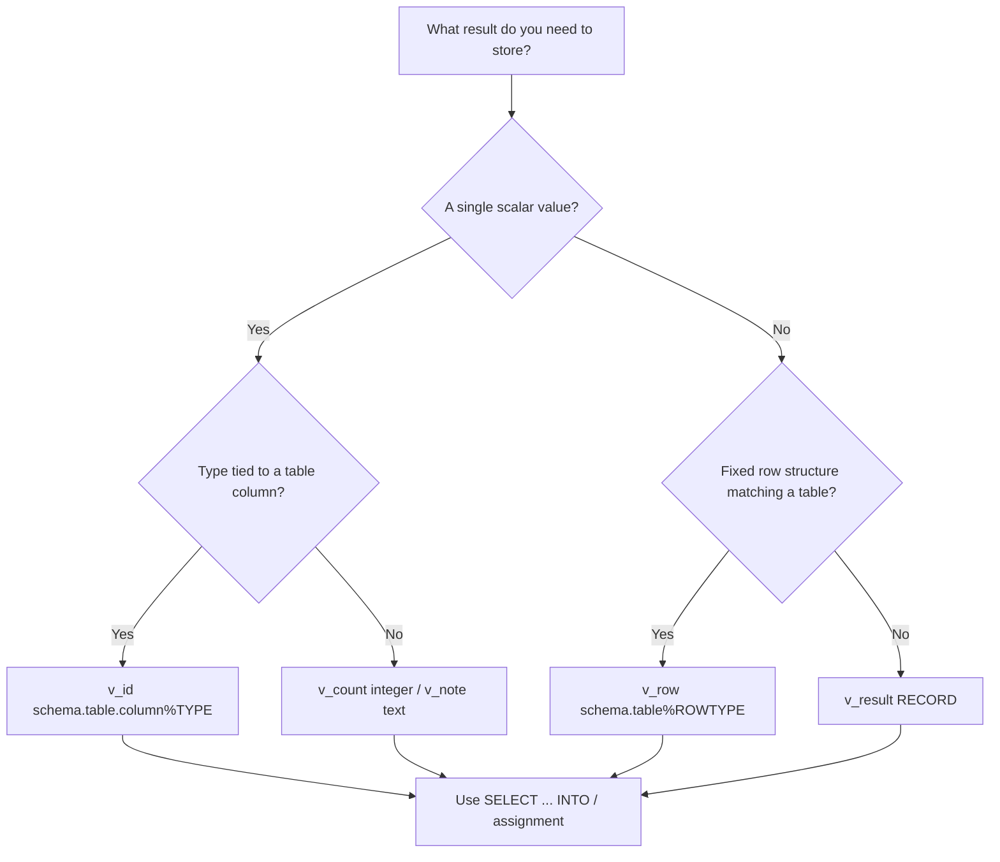

# Variables, Constants, %TYPE, %ROWTYPE, and Record in PL/pgSQL

When writing functions, procedures, or triggers in PostgreSQL, you often need to temporarily hold an order ID, calculate revenue, fetch customer information, or process a query result row. In **PL/pgSQL**, choosing the right variable type determines whether your program is easy to read, resilient to schema changes, and maintainable.

For example, all three of the following declarations relate to order data, yet they are not equivalent:

```sql
DECLARE
    v_total  numeric(12, 2);
    v_order  pl_lab.orders%ROWTYPE;
    v_result record;
```

- `v_total` is a **scalar variable** with an explicitly declared data type.
- `v_order` is a **row variable with a fixed structure** derived from the `pl_lab.orders` table.
- `v_result` is a **flexible record** that receives its column structure from the result assigned to it at runtime.

If you want a monetary variable to always match the exact type of a table column, you can also use `%TYPE`:

```sql
DECLARE
    v_total pl_lab.orders.total_amount%TYPE;
```

This lesson belongs to the **PL/pgSQL** chapter and focuses on five groups of concepts: **variables**, **constants**, **`%TYPE`**, **`%ROWTYPE`**, and **`record`**. The examples use SQL/PL/pgSQL that can run on a practice database and explain both valid cases, invalid cases, and common pitfalls in Java/JDBC applications.

## 1. Learning Objectives

After this lesson, you can:

1. Write PL/pgSQL blocks with `DECLARE`, `BEGIN`, `END`, and properly initialized variables.
2. Distinguish **regular variable**, **`CONSTANT`**, and `NOT NULL` variable declarations.
3. Use `%TYPE` to anchor a variable's type to a **table column** or an existing variable.
4. Use `%ROWTYPE` to hold **a row with a defined structure**.
5. Use `record` to hold results with a **flexible column list**.
6. Read data into variables via `SELECT ... INTO`, `... INTO STRICT`, and `RETURNING INTO`.
7. Understand `FOUND`, system variables, and the difference between `SELECT INTO` and `EXECUTE ... INTO`.
8. Avoid column/variable name collisions, and use nested blocks and variable scope cleanly.
9. Write functions that return typed results while handling missing data and multi-row errors.
10. Choose the right variable type when schemas change, when handling JOINs, and when calling from Java.

## 2. Decision Map: Which Variable Type Should You Choose?



| Need | Usually Sensible Choice | Example |
| --- | --- | --- |
| Counter, flag, message | Explicitly typed variable | `v_count integer`, `v_ok boolean` |
| Factor that must not be modified in a block | `CONSTANT` | `c_rate CONSTANT numeric := 0.05` |
| Order ID that should track a DB column type | `%TYPE` | `v_id pl_lab.orders.order_id%TYPE` |
| Full `orders` row | `%ROWTYPE` | `v_order pl_lab.orders%ROWTYPE` |
| JOIN result with a few columns, not matching one table | `record` | `v_summary record` |
| Multiple rows | `FOR` loop / `RETURN QUERY` or set-based construct | `FOR r IN SELECT ... LOOP` |

**`record` is not the best choice in every situation.** It is more flexible, but loses structural clarity until runtime. When the structure is known, explicitly typed variables or `%ROWTYPE` usually make code easier to understand.

## 3. Where Does PL/pgSQL Run?

You will encounter variable declarations in:

- `DO`: an anonymous one-shot block, suited for learning and controlled administrative tasks.
- `CREATE FUNCTION ... LANGUAGE plpgsql`: a function that can be called from SQL.
- `CREATE PROCEDURE ... LANGUAGE plpgsql`: a procedure that can be invoked with `CALL`, with transaction-control rules distinct from functions.
- Trigger functions: receive context variables such as `NEW`, `OLD`, and `TG_OP`.

To quickly test declarations without creating a function:

```sql
DO $$
DECLARE
    v_message text := 'Hello PL/pgSQL';
BEGIN
    RAISE NOTICE '%', v_message;
END;
$$ LANGUAGE plpgsql;
```

In `psql` or a compatible SQL client, the output looks like:

```text
NOTICE:  Hello PL/pgSQL
```

`DO` executes **on the PostgreSQL server side**, not in JavaScript or as a generic SQL block common to all RDBMSs.

## 4. Creating Practice Data

The examples below use a dedicated schema `pl_lab`. Run them only on a learning database or a fresh schema; never apply sample creation/loading commands to a production environment containing business data.

### 4.1. Customers Table

```sql
CREATE SCHEMA IF NOT EXISTS pl_lab;

CREATE TABLE pl_lab.customers (
    customer_id bigint PRIMARY KEY,
    full_name text NOT NULL,
    tier text NOT NULL
        CHECK (tier IN ('standard', 'vip'))
);

INSERT INTO pl_lab.customers (customer_id, full_name, tier)
VALUES
    (101, 'An Nguyen', 'vip'),
    (102, 'Binh Tran', 'standard'),
    (103, 'Chi Le', 'vip');
```

### 4.2. Orders Table

```sql
CREATE TABLE pl_lab.orders (
    order_id bigint PRIMARY KEY,
    customer_id bigint NOT NULL
        REFERENCES pl_lab.customers(customer_id),
    placed_at timestamptz NOT NULL,
    total_amount numeric(12, 2) NOT NULL
        CHECK (total_amount >= 0),
    status text NOT NULL
        CHECK (status IN ('pending', 'paid', 'cancelled')),
    note text
);

INSERT INTO pl_lab.orders
    (order_id, customer_id, placed_at, total_amount, status, note)
VALUES
    (1001, 101, TIMESTAMPTZ '2026-01-02 09:00:00+00',
        120.50, 'paid', 'First purchase'),
    (1002, 101, TIMESTAMPTZ '2026-01-03 10:00:00+00',
        250.00, 'pending', NULL),
    (1003, 102, TIMESTAMPTZ '2026-01-04 11:00:00+00',
        80.00, 'paid', 'Gift'),
    (1004, 103, TIMESTAMPTZ '2026-01-05 12:00:00+00',
        500.00, 'paid', 'Express delivery'),
    (1005, 101, TIMESTAMPTZ '2026-01-06 13:00:00+00',
        75.25, 'cancelled', NULL);

ANALYZE pl_lab.customers;
ANALYZE pl_lab.orders;
```

The dataset contains **3 customers and 5 orders**. Fixed IDs are used so examples like `WHERE order_id = 1001` can be re-run cleanly on a **fresh schema**.

### 4.3. Verification

```sql
SELECT
    o.order_id,
    c.full_name,
    o.total_amount,
    o.status
FROM pl_lab.orders AS o
JOIN pl_lab.customers AS c
  ON c.customer_id = o.customer_id
ORDER BY o.order_id;
```

With this dataset, customer 101 has three orders: one paid, one pending, and one cancelled. Several later exercises use that difference to explain `SELECT INTO` and multi-row handling.

> **Scope:** The functions in this lesson are created in the `pl_lab` schema. If re-running everything from scratch, use an empty practice database or schema to avoid "object already exists" or duplicate primary key errors.

## 5. Structure of a PL/pgSQL Block

General syntax:

```sql
[ <<label>> ]
[ DECLARE
    declarations ]
BEGIN
    statements;
[ EXCEPTION
    exception_handlers ]
END [ label ];
```

Where:

- `DECLARE` declares local variables. It can be omitted if no variables are needed.
- `BEGIN` opens the **statement section** of the block; it is not synonymous with `BEGIN TRANSACTION` in SQL.
- `END` closes the block.
- PL/pgSQL statements must end with `;`.
- `EXCEPTION` is an optional section for error handling.
- `<<label>>` is a label used to distinguish blocks, useful when nesting.

Example:

```sql
DO $do$
DECLARE
    v_customer_id bigint := 101;
    v_order_count integer;
BEGIN
    SELECT COUNT(*)
    INTO v_order_count
    FROM pl_lab.orders AS o
    WHERE o.customer_id = v_customer_id;

    RAISE NOTICE 'Customer % has % orders',
        v_customer_id, v_order_count;
END;
$do$ LANGUAGE plpgsql;
```

Expected notice: customer 101 has **3 orders**, assuming the sample data has not been modified.

### 5.1. DECLARE Is Not a Regular Statement Inside BEGIN

Do not write:

```sql
DO $$
BEGIN
    DECLARE v_count integer; -- Invalid position for variable declaration.
    v_count := 1;
END;
$$;
```

Declarations must appear in the `DECLARE` section of **a block**. When you want a temporary variable scoped to a small region inside the executable section, create a **subblock**:

```sql
DO $$
BEGIN
    DECLARE
        v_count integer := 1;
    BEGIN
        RAISE NOTICE 'Count = %', v_count;
    END;
END;
$$ LANGUAGE plpgsql;
```

The subblock has its own `DECLARE ... BEGIN ... END`, and its variables end their lifetime when execution leaves that block.

## 6. Variable Declaration Syntax

Primary declaration form:

```text
name [ CONSTANT ] type [ COLLATE collation_name ] [ NOT NULL ]
     [ { DEFAULT | := | = } expression ];
```

Example:

```sql
DO $$
DECLARE
    v_id bigint;
    v_status text DEFAULT 'pending';
    v_total numeric(12, 2) := 100.50;
    v_is_paid boolean = false;
    v_description text NOT NULL := 'new order';
BEGIN
    RAISE NOTICE 'id=%, status=%, total=%, paid=%, description=%',
        v_id, v_status, v_total, v_is_paid, v_description;
END;
$$ LANGUAGE plpgsql;
```

`DEFAULT expression`, `:= expression`, and `= expression` are all valid ways to **initialize variables** in PL/pgSQL declarations.

### 6.1. Uninitialized Variables Default to NULL

```sql
DO $$
DECLARE
    v_amount numeric;
BEGIN
    RAISE NOTICE 'Uninitialized amount: %', v_amount;
END;
$$;
```

`v_amount` defaults to **SQL NULL** if no initializer is provided and the type does not require otherwise.

Do not assume an uninitialized numeric variable is 0 or an uninitialized boolean variable is false. SQL uses **three-valued logic**: `true`, `false`, and `NULL`.

### 6.2. NOT NULL Requires a Valid Initializer

A `NOT NULL` variable must receive a non-NULL value upon initialization, and subsequent NULL assignments are rejected.

```sql
DO $$
DECLARE
    v_status text NOT NULL := 'pending';
BEGIN
    v_status := 'paid';
    RAISE NOTICE '%', v_status;
END;
$$;
```

**Invalid** example:

```sql
DO $$
DECLARE
    v_status text NOT NULL;  -- Missing initial value.
BEGIN
    NULL;
END;
$$;
```

Declaring `NOT NULL` without supplying a valid initial value is rejected by PostgreSQL. Likewise, assigning `NULL` to a `NOT NULL` variable raises an error.

### 6.3. Variable Data Types Are SQL Types

You can declare:

```sql
DECLARE
    v_count integer;
    v_customer_id bigint;
    v_money numeric(12, 2);
    v_day date;
    v_created_at timestamptz;
    v_note text;
    v_flags boolean[];
    v_document jsonb;
```

PL/pgSQL does not force every variable to be `text`. Choose the type matching your data so PostgreSQL enforces assignments, operators, and expressions.

## 7. Initializing and Reassigning Values

A standard assignment:

```sql
variable_name := expression;
```

Example:

```sql
DO $$
DECLARE
    v_quantity integer := 2;
    v_unit_price numeric(12, 2) := 40.00;
    v_amount numeric(12, 2);
BEGIN
    v_amount := v_quantity * v_unit_price;
    RAISE NOTICE 'Amount = %', v_amount;

    v_quantity := 3;
    v_amount := v_quantity * v_unit_price;
    RAISE NOTICE 'New amount = %', v_amount;
END;
$$;
```

Expected output: `80.00` then `120.00` according to PostgreSQL's `numeric` formatting.

### 7.1. Initial Values Are Evaluated Upon Block Entry

```sql
DO $$
DECLARE
    v_started_at timestamptz := clock_timestamp();
BEGIN
    RAISE NOTICE 'Block started at %', v_started_at;
END;
$$;
```

Initializer expressions are evaluated each time the block is entered; they are not static values computed when the source code is written.

This also applies to a **constant with an initializer expression**: being "constant" means its value cannot be modified after initialization **during that block activation**, not that it is a server-wide or compile-time constant.

### 7.2. DEFAULT Can Reference Other Variables

```sql
DO $$
DECLARE
    v_subtotal numeric(12, 2) := 100.00;
    v_tax_rate numeric(5, 4) := 0.0800;
    v_tax numeric(12, 2) := v_subtotal * v_tax_rate;
BEGIN
    RAISE NOTICE 'Tax: %', v_tax;
END;
$$;
```

For readability, declare referenced variables **before** the variables that depend on them. When initialization is conditional or complex, move assignments into `BEGIN` to avoid hard-to-read ordering dependencies.

### 7.3. Type-Checked Assignment

```sql
DO $$
DECLARE
    v_count integer := 0;
BEGIN
    v_count := 4;
    RAISE NOTICE '%', v_count;
END;
$$;
```

If an expression returns a value that cannot be converted to `integer`, PostgreSQL raises a conversion or range error. Do not rely on implicit casts from user input; use proper bound types and explicit casts when needed.

## 8. Constants with CONSTANT

Syntax:

```sql
name CONSTANT type := expression;
```

Discount calculation example:

```sql
DO $$
DECLARE
    c_vip_discount CONSTANT numeric(5, 4) := 0.1000;
    v_original_price numeric(12, 2) := 500.00;
    v_final_price numeric(12, 2);
BEGIN
    v_final_price := v_original_price * (1 - c_vip_discount);

    RAISE NOTICE 'Final price = %', v_final_price;
END;
$$;
```

Once initialized, `c_vip_discount` cannot be assigned a new value.

### 8.1. Attempting to Reassign a Constant Is Invalid

```sql
DO $$
DECLARE
    c_max_retry CONSTANT integer := 3;
BEGIN
    c_max_retry := 5;  -- Cannot reassign a CONSTANT.
END;
$$;
```

PostgreSQL rejects such an assignment. The purpose of `CONSTANT` is to prevent accidental modification **within the PL/pgSQL block**, not to define a constraint on a table column.

### 8.2. Constants Are Not Necessarily Global Immutable Literals

```sql
DO $$
DECLARE
    c_started_at CONSTANT timestamptz := clock_timestamp();
BEGIN
    RAISE NOTICE 'Started at %', c_started_at;
END;
$$;
```

Each execution of `DO` produces a different `clock_timestamp()` value. Within **a single run of the block**, `c_started_at` cannot be reassigned.

### 8.3. CONSTANT Does Not Replace Database CHECK and UNIQUE Constraints

```sql
DECLARE
    c_valid_status CONSTANT text := 'paid';
```

does not stop someone else from inserting `status='unexpected'` into another table. To protect data integrity, use **constraints, domains, foreign keys, or business logic enforced in the proper place**.

### 8.4. Naming Constants

A readable convention:

- `c_...` for constants: `c_tax_rate`.
- `v_...` for local variables: `v_total`.
- `p_...` for function parameters: `p_order_id`.
- `r_...` or `v_row` for row/record variables.

This is a **team convention**, not mandatory PostgreSQL syntax.

## 9. %TYPE: Inheriting a Type from a Table Column

In an evolving database, a column type might change from `integer` to `bigint`, or from `numeric(10,2)` to a precision suited to new data.

If column types are manually duplicated across many PL/pgSQL functions, it is easy to end up with **the schema using one type while code declares another**.

`%TYPE` lets you declare a variable using the type of a column:

```sql
DECLARE
    v_order_id pl_lab.orders.order_id%TYPE;
    v_total pl_lab.orders.total_amount%TYPE;
    v_status pl_lab.orders.status%TYPE;
```

In essence: the variable inherits the **data type** of the referenced attribute; it does not automatically fetch any row's value.

### 9.1. Example: Reading Total Amount by Order ID

```sql
DO $$
DECLARE
    v_order_id pl_lab.orders.order_id%TYPE := 1001;
    v_total pl_lab.orders.total_amount%TYPE;
BEGIN
    SELECT o.total_amount
    INTO v_total
    FROM pl_lab.orders AS o
    WHERE o.order_id = v_order_id;

    RAISE NOTICE 'Order % amount: %', v_order_id, v_total;
END;
$$;
```

Here:

- `v_order_id` has the same type as column `orders.order_id`.
- `v_total` has the same type as column `orders.total_amount`.
- The query loads the **value** into `v_total` via `SELECT ... INTO`.

### 9.2. %TYPE Does Not Fetch Data

Declaring:

```sql
v_total pl_lab.orders.total_amount%TYPE;
```

does not mean `v_total` automatically holds the latest order's amount. It only specifies the type. Before assignment, its value is NULL under normal rules.

To obtain data, you must run a query or an assignment.

### 9.3. %TYPE Can Reference an Already-Declared Variable

```sql
DO $$
DECLARE
    v_first_order_id pl_lab.orders.order_id%TYPE := 1001;
    v_second_order_id v_first_order_id%TYPE := 1002;
BEGIN
    RAISE NOTICE '% and %',
        v_first_order_id, v_second_order_id;
END;
$$;
```

This is useful when two variables need to share a type without repeating the explicit type name.

### 9.4. Column DEFAULT and CHECK Are Not Copied

The source column may be declared as:

```sql
total_amount numeric(12, 2) NOT NULL CHECK (total_amount >= 0)
```

Yet declaring:

```sql
DECLARE
    v_total pl_lab.orders.total_amount%TYPE;
```

**does not automatically copy** column-level `NOT NULL` or `CHECK (total_amount >= 0)` constraints onto the variable. The variable can be NULL unless `NOT NULL` is declared explicitly, and it can be assigned a negative value if the numeric type allows it.

```sql
DO $$
DECLARE
    v_total pl_lab.orders.total_amount%TYPE;
BEGIN
    v_total := -5.00;
    RAISE NOTICE 'Temporary value: %', v_total;
END;
$$;
```

This example only assigns to an **in-memory execution variable**; it does not insert a negative number into the table. When writing a negative value into `orders.total_amount`, the table's `CHECK` constraint will be enforced.

**Important exception:** if the column uses a **domain type**, `%TYPE` inherits that domain type; constraints that belong to the domain itself are still checked during assignment. Distinguish **column constraints** from **domain data-type constraints**.

### 9.5. %TYPE Does Not Guarantee Every Schema Change Is Harmless

`%TYPE` reduces type duplication, but changing a column from `bigint` to `uuid` can still break things:

- Old comparison expressions or casts may become invalid.
- Function signatures with `bigint` parameters will no longer match.
- Java clients may send the wrong type.
- Indexes and other queries may need updates.

Therefore, whenever changing schemas, you must still run migration tests and inspect dependent functions and applications.

## 10. When to Use an Explicit Type vs. %TYPE?

| Case | Explicit Type | `%TYPE` |
| --- | --- | --- |
| Loop counter | `integer` is appropriate | Usually unnecessary |
| Boolean flag | `boolean` | Usually unnecessary |
| Customer ID read from DB | Can drift on schema change | **Worth considering** |
| Monetary value from a DB column | May require knowing exact typmod | **Worth considering** |
| Result of `COUNT(*)` | `bigint` matches the result type | Do not arbitrarily tie to an ID column |
| Result of `AVG(...)` | Choose type based on aggregate expression | Does not default to the source column type |
| Function parameter in SQL signature | Declare SQL type explicitly | `%TYPE` is mainly for PL/pgSQL `DECLARE` |

Example counting orders:

```sql
DO $$
DECLARE
    v_count bigint;
BEGIN
    SELECT COUNT(*)
    INTO v_count
    FROM pl_lab.orders;

    RAISE NOTICE 'Total orders: %', v_count;
END;
$$;
```

`COUNT(*)` returns `bigint`, so `v_count bigint` is direct and clear. Not every variable needs `%TYPE`.

## 11. %ROWTYPE: A Variable with the Structure of a Row

If you need multiple columns from the same table, instead of declaring six separate variables, you can write:

```sql
DECLARE
    v_order pl_lab.orders%ROWTYPE;
```

`v_order` has a **row structure** matching the columns of `pl_lab.orders`:

- `v_order.order_id`.
- `v_order.customer_id`.
- `v_order.placed_at`.
- `v_order.total_amount`.
- `v_order.status`.
- `v_order.note`.

Each field carries the data type of its corresponding source column.

### 11.1. Reading an Entire Row

```sql
DO $$
DECLARE
    v_order pl_lab.orders%ROWTYPE;
BEGIN
    SELECT o.*
    INTO v_order
    FROM pl_lab.orders AS o
    WHERE o.order_id = 1001;

    RAISE NOTICE 'Order %, status %, total %',
        v_order.order_id,
        v_order.status,
        v_order.total_amount;
END;
$$;
```

Expected: order 1001, status `paid`, total `120.50`.

Using `o.*` returns **the exact column structure of the orders table** into the row variable; it prevents accidentally pulling columns from a joined table into a differently typed row.

### 11.2. Accessing and Modifying Fields of a Row Variable

```sql
DO $$
DECLARE
    v_order pl_lab.orders%ROWTYPE;
BEGIN
    SELECT o.*
    INTO v_order
    FROM pl_lab.orders AS o
    WHERE o.order_id = 1002;

    v_order.note := 'Preview only';
    v_order.total_amount := v_order.total_amount + 10.00;

    RAISE NOTICE 'Local row: %, %, %',
        v_order.order_id,
        v_order.total_amount,
        v_order.note;
END;
$$;
```

The assignments above **only modify the `v_order` variable**; they do not execute an `UPDATE` on the table.

To persist changes back to the database, you must execute a DML statement such as `UPDATE` with appropriate key conditions and transaction handling.

### 11.3. Declaring a Row Variable Does Not Mean It Holds a Row Yet

```sql
DO $$
DECLARE
    v_order pl_lab.orders%ROWTYPE;
BEGIN
    RAISE NOTICE 'Initially: %', v_order.order_id;
END;
$$;
```

You can access fields according to the known structure; unassigned fields are NULL. This is an important difference from an unassigned `record`.

### 11.4. %ROWTYPE Does Not Carry Full Table Constraints

An `orders%ROWTYPE` knows **the column names and types**, but it does not become a table row that enforces every `PRIMARY KEY`, `FOREIGN KEY`, or `CHECK` constraint whenever a field in the variable is modified.

For example, assigning `v_order.total_amount := -10` in PL/pgSQL does not trigger the table column's `CHECK` constraint. Only when a DML statement writes that data back to the relation are the table constraints checked under SQL rules.

If a field has a domain type, domain constraints still apply to values of that type.

### 11.5. %ROWTYPE Makes Row Contracts Explicit

When a function specifically operates on **one orders row**, `%ROWTYPE` makes the intent obvious and helps catch references to nonexistent fields earlier in many cases.

When a SELECT returns a combination of columns that does not match `orders`'s structure, `record` or a dedicated composite type is usually better.

## 12. %ROWTYPE and SELECT with a Different Column List

Compare:

```sql
SELECT o.*
FROM pl_lab.orders AS o
WHERE o.order_id = 1001;
```

with:

```sql
SELECT
    o.order_id,
    o.total_amount
FROM pl_lab.orders AS o
WHERE o.order_id = 1001;
```

The first query returns the full `orders` structure; the second returns only **two columns**.

When the target is:

```sql
v_order pl_lab.orders%ROWTYPE;
```

select columns that **match the row type's structure**. PL/pgSQL requires results assigned to a row variable to be compatible with the row variable's field list and types; a query returning only a couple of columns is not a way to "populate a few fields and leave the rest untouched."

To fetch only two fields, use:

```sql
DO $$
DECLARE
    v_order_id pl_lab.orders.order_id%TYPE;
    v_total pl_lab.orders.total_amount%TYPE;
BEGIN
    SELECT o.order_id, o.total_amount
    INTO v_order_id, v_total
    FROM pl_lab.orders AS o
    WHERE o.order_id = 1001;

    RAISE NOTICE 'Order %, amount %', v_order_id, v_total;
END;
$$;
```

Or use a flexible `record` if the column list represents an intermediate result with its own field names.

### 12.1. Assignment Is Positional, Not Name-Matched by Default

When assigning SQL results to PL/pgSQL targets, the count and positions of values matter. Do not assume PostgreSQL matches columns by name to fix field alignment if SELECT returns them in the wrong order.

Misleading example:

```sql
-- Do not pass a reordered or type-mismatched column list
-- into a fixed row variable and expect PostgreSQL
-- to reorder fields by column name automatically.
SELECT o.total_amount, o.order_id
FROM pl_lab.orders AS o;
```

With scalar variables, list `INTO v_total, v_order_id` in the **same order** as `SELECT o.total_amount, o.order_id`. With `%ROWTYPE` variables, select a matching column list or use another appropriate variable.

## 13. RECORD: A Record Variable with Flexible Structure

Syntax:

```sql
DECLARE
    v_result record;
```

`record` is a PL/pgSQL **pseudo-type** capable of holding a result row whose structure is determined at assignment time. It does not need to be bound to a single table's structure at declaration time.

### 13.1. RECORD Fits JOIN Results Naturally

```sql
DO $$
DECLARE
    v_summary record;
BEGIN
    SELECT
        o.order_id,
        c.full_name AS customer_name,
        o.total_amount AS amount,
        o.status
    INTO v_summary
    FROM pl_lab.orders AS o
    JOIN pl_lab.customers AS c
      ON c.customer_id = o.customer_id
    WHERE o.order_id = 1001;

    RAISE NOTICE 'Order %, customer %, amount %, status %',
        v_summary.order_id,
        v_summary.customer_name,
        v_summary.amount,
        v_summary.status;
END;
$$;
```

`v_summary` gets its fields from the **SELECT output list**: `order_id`, `customer_name`, `amount`, `status`.

No base table in the schema has those exact four columns, making `record` a convenient target.

### 13.2. Before Receiving a Value, RECORD Has No Field List

**Intentionally invalid** example:

```sql
DO $$
DECLARE
    v_rec record;
BEGIN
    RAISE NOTICE '%', v_rec.order_id;
END;
$$;
```

`v_rec` has not yet received a row descriptor from an assignment or query. Accessing a field when it **has not been assigned a structure** raises an error such as `"record ... is not assigned yet"`.

By contrast, `v_order pl_lab.orders%ROWTYPE` has a structure known from its declaration, so it behaves differently.

### 13.3. RECORD Can Change Structure Across Assignments

```sql
DO $$
DECLARE
    v_rec record;
BEGIN
    SELECT
        o.order_id,
        o.total_amount
    INTO v_rec
    FROM pl_lab.orders AS o
    WHERE o.order_id = 1001;

    RAISE NOTICE 'First shape: %, %',
        v_rec.order_id, v_rec.total_amount;

    SELECT
        c.customer_id,
        c.full_name
    INTO v_rec
    FROM pl_lab.customers AS c
    WHERE c.customer_id = 101;

    RAISE NOTICE 'Second shape: %, %',
        v_rec.customer_id, v_rec.full_name;
END;
$$;
```

After the second assignment, `v_rec` takes on a **new shape**: `customer_id` and `full_name`.

Accessing `v_rec.total_amount` after that point will fail because that field no longer exists in the current record.

### 13.4. RECORD Is Flexible, Not "All Fields Are Optional"

A record only permits reading fields that **actually exist in its current structure**. There is no magic `v_rec.anything` syntax returning NULL for nonexistent fields.

Distinguish:

- Field **exists in record**, value is SQL NULL → reading the field returns NULL.
- Field **does not exist in current record structure** → accessing the field raises an error.
- Record **has not been assigned any structure yet** → accessing a field raises an error.

That is why `record` works well for generic code, provided you control its shape and access conditions carefully.

## 14. Comparing %ROWTYPE and RECORD

| Criterion | `table%ROWTYPE` | `record` |
| --- | --- | --- |
| Structure known at declaration | **Yes**, from the relation's row type | **No**, acquired upon assignment |
| Valid fields | Columns of the corresponding table/view/composite type | Columns of the most recently assigned result |
| Use with `SELECT table.*` | Very well suited | Usable |
| Use with JOIN returning custom columns | Only if matching a declared type | **Very well suited** |
| Can change shape between assignments | No (fixed type) | **Yes** |
| Fields before first assignment | Structured, values are NULL | No descriptor yet; field access errors |
| When table schema changes | Tracks new row type; compatibility must be verified | Shape depends on the executed query's output |
| Contract verification | Clearer | Higher risk of field errors only discovered at runtime |

**Selection rule:** if a function has a contract to work with **one specific table row**, prefer `%ROWTYPE`. If a function handles **JOIN results, aggregates, or dynamic SELECTs** with custom shapes, `record` may be appropriate.

### 14.1. RECORD Is Not Automatically Faster Than %ROWTYPE

There is no rule that `record` is lighter or faster than every row variable. Actual performance depends on the SQL query, column/row counts, query plan, result materialization, and field access patterns.

Choose types primarily for **data semantics and clarity**, then measure performance if the routine sits on a hot path.

## 15. SELECT ... INTO in PL/pgSQL

General pattern:

```sql
SELECT expressions
INTO target_variable_or_row
FROM ...
WHERE ...;
```

In PL/pgSQL, `INTO` places **query results** into a variable, variable list, row variable, or record.

Example:

```sql
DO $$
DECLARE
    v_customer_id bigint;
    v_amount numeric(12, 2);
BEGIN
    SELECT
        o.customer_id,
        o.total_amount
    INTO v_customer_id, v_amount
    FROM pl_lab.orders AS o
    WHERE o.order_id = 1001;

    RAISE NOTICE 'Customer %, amount %',
        v_customer_id, v_amount;
END;
$$;
```

### 15.1. SELECT INTO in PL/pgSQL Is Not CREATE TABLE

In pure PostgreSQL SQL, `SELECT ... INTO new_table` is a legacy/specific syntax for creating a table.

However, **inside PL/pgSQL**, `SELECT ... INTO` means **assigning query output to variables**. To create a new table inside a function, use `CREATE TABLE ... AS SELECT ...` subject to appropriate privileges and transaction constraints.

### 15.2. What If No Rows Match?

When `SELECT INTO` does **not use `STRICT`**:

- If at least one row matches, the target receives the **first row**.
- If no rows match, the target is set to appropriate NULL values.
- `FOUND` is set to true or false accordingly.
- If multiple rows match, subsequent rows are **discarded**.

Example:

```sql
DO $$
DECLARE
    v_status pl_lab.orders.status%TYPE := 'old value';
BEGIN
    SELECT o.status
    INTO v_status
    FROM pl_lab.orders AS o
    WHERE o.order_id = -999;

    RAISE NOTICE 'FOUND = %, status = %', FOUND, v_status;
END;
$$;
```

Expected: `FOUND=false`, `v_status=NULL`; the initial value `'old value'` is **not preserved** when the SELECT finds no rows.

### 15.3. Multiple Rows Without ORDER BY: The First Row Is Nondeterministic

```sql
DO $$
DECLARE
    v_order_id bigint;
BEGIN
    SELECT o.order_id
    INTO v_order_id
    FROM pl_lab.orders AS o
    WHERE o.customer_id = 101;

    RAISE NOTICE 'One matching order: %', v_order_id;
END;
$$;
```

Customer 101 has **three orders**, so a non-`STRICT` query simply picks one row according to execution order.

**Never assume "the first row" means "the oldest order," "the newest order," or "the smallest key" without an `ORDER BY`.**

To fetch the newest order:

```sql
SELECT o.order_id
INTO v_order_id
FROM pl_lab.orders AS o
WHERE o.customer_id = 101
ORDER BY o.placed_at DESC, o.order_id DESC
LIMIT 1;
```

This illustrates a statement **inside a PL/pgSQL block** where `v_order_id` has already been declared.

## 16. SELECT INTO STRICT: Requiring Exactly One Row

When business logic requires a query to return **exactly one row**, use `STRICT`:

```sql
DO $$
DECLARE
    v_order pl_lab.orders%ROWTYPE;
BEGIN
    SELECT o.*
    INTO STRICT v_order
    FROM pl_lab.orders AS o
    WHERE o.order_id = 1001;

    RAISE NOTICE 'Found order %', v_order.order_id;
END;
$$;
```

If the query:

- Returns **0 rows** → `NO_DATA_FOUND` error.
- Returns **more than 1 row** → `TOO_MANY_ROWS` error.
- Returns **exactly 1 row** → target is assigned, `FOUND=true`.

### 16.1. Catching an Expected Missing-Row Case

```sql
DO $$
DECLARE
    v_order pl_lab.orders%ROWTYPE;
BEGIN
    BEGIN
        SELECT o.*
        INTO STRICT v_order
        FROM pl_lab.orders AS o
        WHERE o.order_id = -999;

        RAISE NOTICE 'Order exists: %', v_order.order_id;
    EXCEPTION
        WHEN NO_DATA_FOUND THEN
            RAISE NOTICE 'Order not found';
    END;
END;
$$;
```

### 16.2. Catching a Multiple-Row Error

```sql
DO $$
DECLARE
    v_order_id bigint;
BEGIN
    BEGIN
        SELECT o.order_id
        INTO STRICT v_order_id
        FROM pl_lab.orders AS o
        WHERE o.customer_id = 101;

        RAISE NOTICE 'One order: %', v_order_id;
    EXCEPTION
        WHEN TOO_MANY_ROWS THEN
            RAISE NOTICE 'More than one matching order found';
    END;
END;
$$;
```

**Do not use `STRICT` if you actually intend to fetch multiple rows.** Use `FOR ... IN SELECT`, `RETURN QUERY`, a cursor, or set-based SQL instead.

### 16.3. STRICT Does Not Replace a UNIQUE Constraint

`SELECT INTO STRICT` detects multiple rows during **one function execution**, but it does not enforce a database-wide uniqueness invariant across concurrent transactions. If data must be unique, table-level `UNIQUE`/`PRIMARY KEY` constraints remain essential.

## 17. FOUND and Checking SELECT INTO Results

PL/pgSQL provides a special boolean variable `FOUND`. It is updated by several PL/pgSQL statements, including `SELECT INTO`.

```sql
DO $$
DECLARE
    v_status text;
BEGIN
    SELECT o.status
    INTO v_status
    FROM pl_lab.orders AS o
    WHERE o.order_id = 1001;

    IF FOUND THEN
        RAISE NOTICE 'Found status %', v_status;
    ELSE
        RAISE NOTICE 'Not found';
    END IF;
END;
$$;
```

### 17.1. Check FOUND Immediately After the Relevant Statement

`FOUND` reflects the status of **PL/pgSQL statements that update it**, not a permanent flag tied to one particular query.

Misleading example:

```sql
DO $$
DECLARE
    v_status text;
    v_count bigint;
BEGIN
    SELECT o.status INTO v_status
    FROM pl_lab.orders AS o
    WHERE o.order_id = -999;

    -- COUNT(*) always returns one row even when the count is 0.
    SELECT COUNT(*) INTO v_count
    FROM pl_lab.orders AS o
    WHERE o.order_id = -999;

    RAISE NOTICE 'FOUND now = %, count = %',
        FOUND, v_count;
END;
$$;
```

After `SELECT COUNT(*) INTO v_count`, `FOUND` is **true** because an ungrouped aggregate returns one row with `COUNT(*)=0`.

If you need to know whether the first SELECT found a row, save `FOUND` **immediately after the first SELECT**:

```sql
DO $$
DECLARE
    v_status text;
    v_found_order boolean;
    v_count bigint;
BEGIN
    SELECT o.status INTO v_status
    FROM pl_lab.orders AS o
    WHERE o.order_id = -999;

    v_found_order := FOUND;

    SELECT COUNT(*) INTO v_count
    FROM pl_lab.orders AS o
    WHERE o.order_id = -999;

    RAISE NOTICE 'Found order = %, count = %',
        v_found_order, v_count;
END;
$$;
```

### 17.2. FOUND Is Distinct from "Variable Value Is Not NULL"

If a row exists whose `note` column is NULL:

```sql
DO $$
DECLARE
    v_note pl_lab.orders.note%TYPE;
BEGIN
    SELECT o.note INTO v_note
    FROM pl_lab.orders AS o
    WHERE o.order_id = 1002;

    RAISE NOTICE 'FOUND=%, note IS NULL=%',
        FOUND, v_note IS NULL;
END;
$$;
```

Expected: **FOUND=true** and **note IS NULL=true**. Do not replace an existence check with `IF v_note IS NULL THEN...`, because a legitimate NULL column value and a missing row are two different things.

### 17.3. SELECT INTO vs. PERFORM

If you want to **run a query solely to check whether rows exist**, you can use `PERFORM`:

```sql
DO $$
BEGIN
    PERFORM 1
    FROM pl_lab.orders AS o
    WHERE o.order_id = 1001;

    RAISE NOTICE 'Exists: %', FOUND;
END;
$$;
```

`PERFORM` evaluates the query without storing column values in variables. When you simply need a boolean existence check in pure SQL, `EXISTS (SELECT ...)` is also a clean option.

## 18. A Practical Function Using %TYPE and CONSTANT

Write a function calculating the discounted amount for an order. In this example, VIP gets a 10% discount and standard customers get none; this is an **illustrative** rule, not a general commercial policy.

```sql
CREATE OR REPLACE FUNCTION pl_lab.net_amount_for_order(
    p_order_id bigint
)
RETURNS numeric
LANGUAGE plpgsql
AS $fn$
DECLARE
    c_vip_discount CONSTANT numeric(5, 4) := 0.1000;

    v_amount pl_lab.orders.total_amount%TYPE;
    v_customer_tier pl_lab.customers.tier%TYPE;
    v_net_amount numeric(14, 2);
BEGIN
    SELECT
        o.total_amount,
        c.tier
    INTO STRICT
        v_amount,
        v_customer_tier
    FROM pl_lab.orders AS o
    JOIN pl_lab.customers AS c
      ON c.customer_id = o.customer_id
    WHERE o.order_id = p_order_id;

    IF v_customer_tier = 'vip' THEN
        v_net_amount := round(
            v_amount * (1 - c_vip_discount),
            2
        );
    ELSE
        v_net_amount := v_amount;
    END IF;

    RETURN v_net_amount;
END;
$fn$;
```

Call it:

```sql
SELECT
    pl_lab.net_amount_for_order(1001) AS vip_order_net,
    pl_lab.net_amount_for_order(1003) AS standard_order_net;
```

With the sample data:

- Order 1001 belongs to a VIP customer: `120.50 × 0.9 = 108.45`.
- Order 1003 belongs to a standard customer: `80.00`.

### 18.1. Why Use %TYPE for Those Two Fields?

If `orders.total_amount` or `customers.tier` undergoes a compatible type change, schema-anchored declarations reduce the risk of manual type drift. Still, comparison logic like `tier = 'vip'` and arithmetic must be re-verified whenever schemas or business rules change.

### 18.2. Why Is RETURNS numeric Declared Explicitly?

The return type is **the function's contract with its caller**, so it is declared in the signature. `%TYPE` is used for **local variables** inside `DECLARE`.

### 18.3. Handling Nonexistent Orders

The function uses `SELECT INTO STRICT`, so if an ID does not exist, PostgreSQL raises `NO_DATA_FOUND`. That is an API design choice: the caller must handle it or the function must translate it into a specific business error.

There is no universal rule that every function must return NULL for missing IDs. Choose the behavior and document it clearly in the contract.

## 19. Function Returning a Typed Row with %ROWTYPE

A function can return a table's row type:

```sql
CREATE OR REPLACE FUNCTION pl_lab.get_order(
    p_order_id bigint
)
RETURNS pl_lab.orders
LANGUAGE plpgsql
AS $fn$
DECLARE
    v_order pl_lab.orders%ROWTYPE;
BEGIN
    SELECT o.*
    INTO v_order
    FROM pl_lab.orders AS o
    WHERE o.order_id = p_order_id;

    IF NOT FOUND THEN
        RETURN NULL;
    END IF;

    RETURN v_order;
END;
$fn$;
```

Call the function as a relation-valued expression:

```sql
SELECT *
FROM pl_lab.get_order(1001);
```

Or:

```sql
SELECT (pl_lab.get_order(1001)).*;
```

The second call illustrates expanding fields from a composite result in SQL.

### 19.1. RETURNS table_name vs. table_name%ROWTYPE Differ in Placement

- `RETURNS pl_lab.orders` **declares the return type in the function signature**.
- `v_order pl_lab.orders%ROWTYPE` **declares a local PL/pgSQL variable**.

They work together to ensure the returned variable has the exact structure promised by the function contract.

### 19.2. When Not Found, Return NULL or Raise an Error?

Two common options:

1. **`RETURN NULL`**: fits a "find if present" API.
2. **`SELECT ... INTO STRICT` letting `NO_DATA_FOUND` raise**: fits a "must exist" API.

Do not choose by syntax preference; choose based on business semantics and client error handling.

### 19.3. Avoid SELECT * When Only a Few Fields Are Needed

`%ROWTYPE` makes sense for functions retrieving a full row. If the client only needs `status` and `total_amount`, returning the entire row couples the contract to every table column and transfers unnecessary data.

When only a few fields are needed, consider `RETURNS TABLE(...)` or a direct SQL query with an explicit column list.

## 20. Function Returning a JOIN Result: record Internally, Explicit Output Externally

A `record` can hold a JOIN result internally while the function's public interface exposes a clear contract.

Example:

```sql
CREATE OR REPLACE FUNCTION pl_lab.order_card(
    p_order_id bigint
)
RETURNS TABLE (
    order_number bigint,
    customer_name text,
    amount numeric,
    order_status text
)
LANGUAGE plpgsql
AS $fn$
DECLARE
    v_card record;
BEGIN
    SELECT
        o.order_id AS order_number,
        c.full_name AS customer_name,
        o.total_amount AS amount,
        o.status AS order_status
    INTO v_card
    FROM pl_lab.orders AS o
    JOIN pl_lab.customers AS c
      ON c.customer_id = o.customer_id
    WHERE o.order_id = p_order_id;

    IF NOT FOUND THEN
        RETURN;
    END IF;

    order_number := v_card.order_number;
    customer_name := v_card.customer_name;
    amount := v_card.amount;
    order_status := v_card.order_status;

    RETURN NEXT;
END;
$fn$;
```

Call it:

```sql
SELECT *
FROM pl_lab.order_card(1001);
```

This structure illustrates three layers:

1. The JOIN query yields a row with a custom shape.
2. `v_card record` receives the selected fields.
3. `RETURNS TABLE(...)` publishes **column names and types** to the caller.

### 20.1. RETURNS TABLE Columns Are Also PL/pgSQL Variables

In a function with `RETURNS TABLE (order_number ..., customer_name ...)`, the output names are treated as output variables. Therefore:

```sql
order_number := v_card.order_number;
RETURN NEXT;
```

means "assign the output variable, then emit an output row."

**Watch out for name collisions:** if columns are unqualified inside SQL, output variable names like `amount` can collide with table column names. Use explicit aliases like `o.total_amount`, `c.full_name`, and avoid overly generic names.

### 20.2. RETURN QUERY Can Be Shorter

For a function that merely returns a query's result set, `RETURN QUERY SELECT ...` is usually cleaner than routing through a `record`:

```sql
CREATE OR REPLACE FUNCTION pl_lab.order_card_simple(
    p_order_id bigint
)
RETURNS TABLE (
    order_number bigint,
    customer_name text,
    amount numeric,
    order_status text
)
LANGUAGE plpgsql
AS $fn$
BEGIN
    RETURN QUERY
    SELECT
        o.order_id,
        c.full_name,
        o.total_amount,
        o.status
    FROM pl_lab.orders AS o
    JOIN pl_lab.customers AS c
      ON c.customer_id = o.customer_id
    WHERE o.order_id = p_order_id;
END;
$fn$;
```

Not every multi-column query needs a `record`. Use it when **intermediate processing genuinely needs field-by-field access**.

## 21. FOR ... IN SELECT with record and %ROWTYPE

When a query returns multiple rows, a loop can assign each row into a target variable.

### 21.1. Iterating Over Multiple Orders with RECORD

```sql
DO $$
DECLARE
    v_item record;
BEGIN
    FOR v_item IN
        SELECT
            o.order_id,
            o.total_amount,
            o.status
        FROM pl_lab.orders AS o
        WHERE o.customer_id = 101
        ORDER BY o.order_id
    LOOP
        RAISE NOTICE 'Order %, amount %, status %',
            v_item.order_id,
            v_item.total_amount,
            v_item.status;
    END LOOP;
END;
$$;
```

`v_item` receives the three-column structure on each iteration. It does not need to match the full `orders` table shape.

### 21.2. Iterating Over Full Rows with %ROWTYPE

```sql
DO $$
DECLARE
    v_order pl_lab.orders%ROWTYPE;
BEGIN
    FOR v_order IN
        SELECT o.*
        FROM pl_lab.orders AS o
        WHERE o.customer_id = 101
        ORDER BY o.order_id
    LOOP
        RAISE NOTICE 'Order %, customer %',
            v_order.order_id,
            v_order.customer_id;
    END LOOP;
END;
$$;
```

Because the target is `orders%ROWTYPE`, the query returns the exact table structure.

### 21.3. Loops Are Not the Best Choice for All Aggregations

If the goal is just summing amounts, set-based SQL is shorter and more efficient:

```sql
SELECT
    customer_id,
    SUM(total_amount) AS total_amount
FROM pl_lab.orders
GROUP BY customer_id;
```

Do not pull rows one by one into PL/pgSQL just to add them manually when `SUM` or `GROUP BY` solves it cleanly. PL/pgSQL is meant for **workflow control**, not replacing set-based SQL calculations.

## 22. Variable Scope and Shadowing

PL/pgSQL supports nested blocks. Variables in an outer block can be accessed from an inner block unless shadowed by an inner variable with the same name.

```sql
DO $$
DECLARE
    v_message text := 'outer';
BEGIN
    RAISE NOTICE 'Before subblock: %', v_message;

    DECLARE
        v_message text := 'inner';
    BEGIN
        RAISE NOTICE 'Inside subblock: %', v_message;
    END;

    RAISE NOTICE 'After subblock: %', v_message;
END;
$$;
```

Logical output:

```text
Before subblock: outer
Inside subblock: inner
After subblock: outer
```

The `v_message` variable in the subblock **shadows** the outer variable of the same name within its scope.

### 22.1. Using Labels to Reference Outer Block Variables

```sql
DO $$
<<outer_block>>
DECLARE
    v_limit integer := 10;
BEGIN
    DECLARE
        v_limit integer := 20;
    BEGIN
        RAISE NOTICE 'Outer: %, inner: %',
            outer_block.v_limit, v_limit;
    END;
END outer_block;
$$;
```

The `outer_block` label clearly disambiguates the outer block's variable.

### 22.2. Convention to Minimize Shadowing

Although shadowing is valid, it hurts maintainability. Unless there is a specific reason, use distinct names:

- `v_current_order_id`.
- `v_outer_total`.
- `v_row_total`.

Do not create multiple `count` or `status` variables with identical names across complex nested blocks just to save keystrokes.

### 22.3. Variables Are Local Per Invocation

A variable in a function is not global state shared across sessions.

Two calls to the same function have independent block execution states. Do not treat PL/pgSQL variables as shared memory to coordinate multiple requests. For shared state, use proper database structures and transactions.

## 23. Name Collisions Between Variables and SQL Columns

This is a very common trap:

```sql
-- Intentionally illustrating a style prone to ambiguity:
-- DECLARE
--     customer_id bigint;
-- BEGIN
--     SELECT customer_id INTO customer_id
--     FROM pl_lab.orders
--     WHERE order_id = 1001;
-- END;
```

In the `SELECT` statement, `customer_id` could refer to either the **table column** or the **PL/pgSQL variable**. PostgreSQL applies name-collision resolution rules and, by default, raises an error on genuinely ambiguous references.

### 23.1. Use Prefixes and Aliases

Clear version:

```sql
DO $$
DECLARE
    v_customer_id pl_lab.orders.customer_id%TYPE;
    p_order_id bigint := 1001;
BEGIN
    SELECT o.customer_id
    INTO v_customer_id
    FROM pl_lab.orders AS o
    WHERE o.order_id = p_order_id;

    RAISE NOTICE 'Customer ID = %', v_customer_id;
END;
$$;
```

- `o.customer_id` and `o.order_id` are unmistakably **SQL columns**.
- `v_customer_id` is a **local variable**.
- `p_order_id` is an input/parameter-style variable.

### 23.2. Do Not Change Conflict Settings to Mask Ambiguous Code

PL/pgSQL has settings such as `plpgsql.variable_conflict` and corresponding directives in supported contexts. However, switching the mode to favor columns or variables can cause SQL statements to silently take on a **different meaning** if names collide.

Prefer **writing unambiguous code** using aliases, prefixes, and labels. This is far safer to audit when future migrations add new column names.

### 23.3. RETURNS TABLE Puts Output Names into Scope

If a function declares `RETURNS TABLE (customer_id bigint, total numeric)`, those names also exist as output variables in PL/pgSQL scope.

In JOIN queries or multi-source SELECTs, always qualify columns with table aliases to avoid confusing output variables with columns. That is why examples in this lesson write `o.customer_id` instead of bare `customer_id`.

## 24. DML RETURNING INTO and Typed Variables

PL/pgSQL allows retrieving values from `INSERT`, `UPDATE`, `DELETE` (and DML supporting RETURNING in the corresponding PostgreSQL version) via `RETURNING ... INTO`.

Example updating an order status inside a transaction and rolling back so sample data stays unchanged:

```sql
BEGIN;

DO $$
DECLARE
    v_order_id pl_lab.orders.order_id%TYPE;
    v_new_status pl_lab.orders.status%TYPE;
BEGIN
    UPDATE pl_lab.orders AS o
    SET status = 'paid'
    WHERE o.order_id = 1002
    RETURNING o.order_id, o.status
    INTO v_order_id, v_new_status;

    IF FOUND THEN
        RAISE NOTICE 'Updated %, status %',
            v_order_id, v_new_status;
    ELSE
        RAISE NOTICE 'No order updated';
    END IF;
END;
$$;

ROLLBACK;
```

In this example:

- The DML actually runs inside the transaction.
- `RETURNING` returns the values **after the UPDATE**.
- `INTO` writes the result into two variables.
- `ROLLBACK` undoes the practice transaction's UPDATE.

### 24.1. Multi-Row RETURNING Differs from SELECT INTO

With non-`STRICT` `SELECT ... INTO`, multiple rows cause the first row to be assigned.

For `INSERT/UPDATE/DELETE/MERGE ... RETURNING ... INTO` in PL/pgSQL, PostgreSQL enforces a stricter rule: if the DML returns **more than one row** into a single target, it raises an error even if `STRICT` is not written.

This is an easy detail to miss. When DML can affect multiple rows:

- Use set-based SQL directly.
- If you need all returned rows, use a set-returning design or an appropriate loop.
- Do not expect `RETURNING INTO v_row` to "just grab one row" like non-STRICT `SELECT INTO`.

### 24.2. UPDATE Can Affect 0 Rows

`FOUND` after `UPDATE` indicates whether any rows were affected according to statement rules. When no rows match, the `RETURNING INTO` target does not hold a valid row result.

Never assume `WHERE order_id = p_order_id` always matches just because `p_order_id` is non-NULL. The row may have been deleted or the ID may not exist.

### 24.3. Checking ROW_COUNT

`GET DIAGNOSTICS` reads how many rows the most recent SQL statement processed:

```sql
DO $$
DECLARE
    v_affected bigint;
BEGIN
    UPDATE pl_lab.orders AS o
    SET note = o.note
    WHERE o.customer_id = -999;

    GET DIAGNOSTICS v_affected = ROW_COUNT;

    RAISE NOTICE 'Affected: %', v_affected;
END;
$$;
```

The sample query matches no rows and prints `0`. In real systems, remember that an UPDATE—even reassigning the same logical value—creates new row versions and write overhead; never run dummy UPDATEs just to count rows.

## 25. RECORD with EXECUTE ... INTO for Dynamic SQL

A clear advantage of `record` is receiving results whose column list is determined by **dynamic SQL**.

Example allowing only reading one of the two text columns `status` or `note`:

```sql
CREATE OR REPLACE FUNCTION pl_lab.order_text_field(
    p_order_id bigint,
    p_column_name text
)
RETURNS text
LANGUAGE plpgsql
AS $fn$
DECLARE
    v_rec record;
    v_row_count bigint;
BEGIN
    IF p_column_name NOT IN ('status', 'note') THEN
        RAISE EXCEPTION 'Unsupported column: %', p_column_name
            USING ERRCODE = '22023';
    END IF;

    EXECUTE format(
        'SELECT order_id, %I AS selected_value
         FROM pl_lab.orders
         WHERE order_id = $1',
        p_column_name
    )
    INTO v_rec
    USING p_order_id;

    GET DIAGNOSTICS v_row_count = ROW_COUNT;

    IF v_row_count = 0 THEN
        RETURN NULL;
    END IF;

    RETURN v_rec.selected_value;
END;
$fn$;
```

Call it:

```sql
SELECT
    pl_lab.order_text_field(1001, 'status') AS status_value,
    pl_lab.order_text_field(1001, 'note') AS note_value;
```

Here:

1. `p_column_name` is restricted via a **whitelist**.
2. `format('%I', p_column_name)` quotes the **SQL identifier** safely.
3. `USING p_order_id` passes data into the dynamic query as a **parameter**, rather than concatenating literals.
4. `v_rec record` receives the shape `(order_id, selected_value)`.
5. `GET DIAGNOSTICS ... ROW_COUNT` checks whether a row was returned.

### 25.1. Why Not Use FOUND Immediately After EXECUTE?

Unlike static `SELECT INTO`, the PL/pgSQL `EXECUTE` statement **does not update `FOUND` the way static `SELECT INTO` does**. To check how many rows the dynamic query returned, use `GET DIAGNOSTICS ... ROW_COUNT` immediately afterward.

Do not write:

```sql
EXECUTE dynamic_sql INTO v_rec;
IF FOUND THEN
    -- Prone to bugs because FOUND does not reflect EXECUTE results as expected.
END IF;
```

### 25.2. Dynamic SQL Is Not an Excuse to Skip Validation

Even though `format('%I', ...)` prevents broken identifier syntax, it does not guarantee **the caller is authorized to read that column**.

That is why the whitelist in the example is just as important as quoting. For complex queries with dynamic table or schema names, also enforce privileges and `search_path`.

### 25.3. EXECUTE INTO STRICT Also Enforces Row Count Rules

`EXECUTE ... INTO STRICT` requires the query to return exactly one row, just like `SELECT INTO STRICT`. Use it only when a business invariant guarantees uniqueness and the caller expects an error otherwise.

## 26. RECORD and Individual Field Data Types

A record can hold:

```sql
DO $$
DECLARE
    v_rec record;
BEGIN
    SELECT
        1001::bigint AS order_id,
        120.50::numeric(12, 2) AS amount,
        true AS is_paid
    INTO v_rec;

    RAISE NOTICE 'id=%, amount=%, paid=%',
        v_rec.order_id, v_rec.amount, v_rec.is_paid;
END;
$$;
```

Although `record` has no fixed shape at declaration time, **each field retains a concrete PostgreSQL data type** once assigned. It does not turn everything into text or JSON.

### 26.1. RECORD Is Not jsonb

`record` stores the fields of **a PostgreSQL tuple**, whereas `jsonb` is a **JSON value** accessed via JSON operators.

Example:

```sql
DO $$
DECLARE
    v_rec record;
    v_json jsonb;
BEGIN
    SELECT
        1001::bigint AS order_id,
        'paid'::text AS status
    INTO v_rec;

    v_json := to_jsonb(v_rec);

    RAISE NOTICE 'record.order_id=%, json=%',
        v_rec.order_id, v_json;
END;
$$;
```

Remember:

- `v_rec.order_id` accesses a row/record field.
- `v_json -> 'order_id'` accesses a JSON key.
- `to_jsonb(v_rec)` is an explicit conversion.

Do not treat `record` as a "dynamic dictionary" capable of accepting arbitrary keys at runtime without a row descriptor.

### 26.2. If You Need a Stable Contract Shape, Create a Composite Type

An alternative:

```sql
CREATE TYPE pl_lab.order_summary_type AS (
    order_id bigint,
    customer_name text,
    total_amount numeric
);
```

Then:

```sql
DO $$
DECLARE
    v_summary pl_lab.order_summary_type;
BEGIN
    SELECT
        o.order_id,
        c.full_name,
        o.total_amount
    INTO v_summary
    FROM pl_lab.orders AS o
    JOIN pl_lab.customers AS c
      ON c.customer_id = o.customer_id
    WHERE o.order_id = 1001;

    RAISE NOTICE 'Summary: %, %, %',
        v_summary.order_id,
        v_summary.customer_name,
        v_summary.total_amount;
END;
$$;
```

This composite type defines a fixed shape independent of any single table. It is worth considering when multiple functions share the same JOIN result shape.

## 27. Special Variables in PL/pgSQL

Besides programmer-declared variables, PL/pgSQL provides several special/context variables.

| Variable or Construct | Role |
| --- | --- |
| `FOUND` | Boolean reflecting the result of PL/pgSQL statements that update it |
| `SQLSTATE` | Current error code inside an appropriate `EXCEPTION` block |
| `SQLERRM` | Current error message inside an appropriate `EXCEPTION` block |
| `NEW` / `OLD` | Row values in trigger functions (record-like), depending on trigger event |
| `TG_OP` | Trigger operation name such as INSERT, UPDATE, DELETE, TRUNCATE as applicable |
| `$1`, `$2` | Positional function parameters where applicable |
| Output params | Variables implicitly created from `OUT`/`INOUT`/`RETURNS TABLE` |

### 27.1. Function Parameters Are Variables

Example:

```sql
CREATE OR REPLACE FUNCTION pl_lab.double_amount(
    p_amount numeric
)
RETURNS numeric
LANGUAGE plpgsql
AS $fn$
BEGIN
    RETURN p_amount * 2;
END;
$fn$;
```

`p_amount` can be used like a variable in PL/pgSQL and SQL expressions. Use the `p_` prefix to avoid column collisions.

### 27.2. NEW and OLD Are Records in Triggers

In trigger functions, PostgreSQL provides records representing the new/old rows depending on the trigger type.

Conceptual example:

```sql
-- Inside a RETURNS trigger function:
-- NEW.status    : new row status (if the trigger event provides NEW)
-- OLD.status    : old row status (if the trigger event provides OLD)
-- TG_OP         : trigger operation name
```

Do not reference `NEW` or `OLD` in an ordinary `DO` block expecting them to exist. They are context variables provided by the trigger manager, not general global PL/pgSQL variables.

### 27.3. Output Parameter Names Are In-Scope Variables

As seen in the `RETURNS TABLE` example earlier, output parameters can be assigned and emitted with `RETURN NEXT`. This is convenient, but also a potential source of name collisions with SQL columns.

## 28. Domain Types and Variable NOT NULL

To clearly see how **data-type constraints** differ from **table-column constraints**, create a domain:

```sql
CREATE DOMAIN pl_lab.nonnegative_money AS numeric(12, 2)
CHECK (VALUE >= 0);
```

Use the domain in PL/pgSQL:

```sql
DO $$
DECLARE
    v_money pl_lab.nonnegative_money := 5.00;
BEGIN
    RAISE NOTICE 'Valid money: %', v_money;
END;
$$;
```

If you try assigning a negative number:

```sql
DO $$
DECLARE
    v_money pl_lab.nonnegative_money := 5.00;
BEGIN
    v_money := -2.00; -- Domain CHECK rejects this.
END;
$$;
```

This constraint belongs to the **domain type** and is enforced whenever a value is converted or assigned to that domain.

### 28.1. %TYPE from a Domain Column Preserves the Domain Type

If a column is defined with `pl_lab.nonnegative_money`, a variable declared as `table.column%TYPE` inherits that domain type rather than becoming a plain unrestricted numeric.

Thus:

- `CHECK` constraints declared directly on a table column are **not** copied onto `%TYPE` variables.
- `CHECK` constraints belonging to a **domain** remain part of the referenced type's semantics.

### 28.2. Domain CHECK Does Not Replace Full Validation

A domain `CHECK (VALUE >= 0)` accepts SQL NULL by default unless `NOT NULL` is also attached to the domain or variable; comparing NULL returns UNKNOWN, and CHECK treats UNKNOWN as satisfied.

When a value is **mandatory**, enforce `NOT NULL` at the appropriate layers and validate business rules.

## 29. NULL, COALESCE, and Assignment

PL/pgSQL follows SQL NULL semantics.

Example:

```sql
DO $$
DECLARE
    v_note text;
    v_label text;
BEGIN
    v_label := 'Note: ' || v_note;

    RAISE NOTICE 'Without COALESCE: %', v_label;

    v_label := 'Note: ' || COALESCE(v_note, '(none)');

    RAISE NOTICE 'With COALESCE: %', v_label;
END;
$$;
```

Normally:

- `text || NULL` returns NULL.
- `COALESCE(NULL, '(none)')` returns `'(none)'`.

### 29.1. Compare Against NULL with IS NULL

Incorrect:

```sql
IF v_note = NULL THEN
    -- Does not evaluate true like a normal equality check.
END IF;
```

Correct:

```sql
IF v_note IS NULL THEN
    RAISE NOTICE 'No note';
END IF;
```

Similarly, `IS DISTINCT FROM` helps compare two values cleanly when NULL-safe equality semantics are needed.

### 29.2. Boolean NULL in IF

```sql
DO $$
DECLARE
    v_approved boolean;
BEGIN
    IF v_approved THEN
        RAISE NOTICE 'Approved';
    ELSE
        RAISE NOTICE 'Not approved or unknown';
    END IF;
END;
$$;
```

An uninitialized `v_approved` variable is NULL; `IF` enters the `THEN` branch only when the condition is **true**. That does not turn NULL into false as data; it is just how `IF` branches.

When distinguishing "rejected" from "not yet checked," include an explicit `IS NULL` branch.

## 30. EXCEPTION and Variable Lifetime

A block with `EXCEPTION` creates an error-handling scope. PostgreSQL rolls back database changes made inside the exception block's subtransaction, but **PL/pgSQL variables** assigned prior to the error retain their values at the time of the error.

Learning example:

```sql
DO $$
DECLARE
    v_step text := 'start';
BEGIN
    BEGIN
        v_step := 'before failure';

        INSERT INTO pl_lab.orders (
            order_id, customer_id, placed_at,
            total_amount, status
        )
        VALUES (
            1001, 101, clock_timestamp(),
            10.00, 'paid'
        );
        -- Key 1001 already exists => unique_violation.
    EXCEPTION
        WHEN unique_violation THEN
            RAISE NOTICE 'Database write rolled back in block';
            RAISE NOTICE 'Variable remains: %', v_step;
    END;
END;
$$;
```

Because `order_id=1001` already exists in the dataset, the INSERT triggers a unique violation, which is caught.

Key lessons:

- Entering an exception handler does not revert local variables to their pre-subblock values.
- Database changes inside the block roll back under exception subtransaction semantics.
- Do not overuse exceptions as control flow in place of routine data checks; they add overhead and obscure logic.

### 30.1. Do Not Use EXCEPTION to Mask All Errors

`WHEN OTHERS THEN RETURN NULL` can swallow schema errors, permission errors, and conversion errors, preventing applications from telling "not found" apart from "system failure."

Catch **expected** errors, handle or re-raise them with context. For missing rows, `FOUND`/`STRICT` usually express the semantics cleanly.

## 31. Schema Changes and Their Impact on %TYPE/%ROWTYPE

Suppose existing code declares:

```sql
DECLARE
    v_amount pl_lab.orders.total_amount%TYPE;
    v_order pl_lab.orders%ROWTYPE;
```

After a migration, the `orders` table gains a `currency text` column. Questions to check:

1. Does `v_order` now include the new field matching the table structure?
2. Are existing `SELECT o.* INTO v_order` queries still compatible?
3. Does a function with `RETURNS pl_lab.orders` affect clients?
4. Does a Java application reading `SELECT *` depend on column order?
5. Do any functions manually construct column lists in the old order?
6. Do triggers or dynamic SQL depend on the old row structure?

`%ROWTYPE` keeps row declarations aligned with the relation, but **does not make schema changes impact-free**. PostgreSQL handles invalidation/recompilation of dependent objects, yet SQL logic and client contracts still require testing.

### 31.1. Keep Interface Types Stable When Needed

A public function always returning `RETURNS pl_lab.orders` exposes the entire table structure to clients. Adding an internal column changes the API shape.

When an interface needs stability, consider:

- `RETURNS TABLE(...)` with a fixed column list.
- A composite type managed explicitly as an API contract.
- Explicit queries with column aliases.
- Views or application-layer DTOs to hide internal table details.

### 31.2. %TYPE Fits Code Close to the Schema

`%TYPE` is especially useful when a local variable directly mirrors a table column, and less useful for variables representing **independent calculations** such as tax rates, loop counters, or row totals.

Do not turn `%TYPE` into a mandatory ritual for every declaration.

## 32. Performance: Choose Proper Types First, Tune SQL Second

When a PL/pgSQL function is slow, the cause is usually:

- Queries returning too many rows.
- Missing indexes or stale statistics.
- `SELECT *` pulling large unnecessary columns.
- Queries executed repeatedly inside a loop.
- Row-by-row processing instead of set-based SQL.
- Dynamic SQL being repeatedly parsed and planned.
- Locks, I/O, or network overhead from other layers.
- Exceptions being triggered too frequently.

Switching `v_row orders%ROWTYPE` to `v_row record` **does not fix** any of those causes.

### 32.1. Avoid N+1 Queries in PL/pgSQL

An expensive pattern across millions of orders:

```sql
FOR v_order IN
    SELECT o.* FROM pl_lab.orders AS o
LOOP
    -- Every iteration runs another SELECT against customers for the name.
END LOOP;
```

If you only need a report, a single SQL JOIN is usually better:

```sql
SELECT
    o.order_id,
    c.full_name,
    o.total_amount
FROM pl_lab.orders AS o
JOIN pl_lab.customers AS c
  ON c.customer_id = o.customer_id;
```

If per-row PL/pgSQL processing is required for specialized control flow, you can still use `FOR v_rec IN SELECT JOIN ... LOOP` to avoid repeated lookup queries.

### 32.2. Variable Types Can Affect Casts, While the Query Plan Remains Central

If an ID column is `bigint` while a variable or parameter is declared `text`, incompatible expressions or casts can cause errors or prevent index optimization.

Declaring the right types (`%TYPE`, `bigint`) clarifies intent and avoids unwanted casts. Even so, performance depends primarily on **the full SQL statement and how the planner chooses indexes**, not the variable type keyword itself.

### 32.3. Use EXPLAIN on Queries Inside Functions

In practice, you can extract `SELECT` statements written inside a function and run:

```sql
EXPLAIN (ANALYZE, BUFFERS)
SELECT o.*
FROM pl_lab.orders AS o
WHERE o.order_id = 1001;
```

This lets you inspect the access path, actual row counts, and buffer usage. On tiny tables, the planner may pick a Seq Scan; do not conclude from that that `%ROWTYPE` is causing slowness.

To profile multi-statement PL/pgSQL execution, use environment-appropriate observability tools or extensions where permitted, rather than relying solely on a standalone SELECT plan.

## 33. Practical Code Style for PL/pgSQL

A maintainable pattern:

```sql
CREATE OR REPLACE FUNCTION pl_lab.is_high_value_order(
    p_order_id bigint,
    p_min_amount numeric
)
RETURNS boolean
LANGUAGE plpgsql
AS $fn$
DECLARE
    v_amount pl_lab.orders.total_amount%TYPE;
BEGIN
    IF p_min_amount IS NULL OR p_min_amount < 0 THEN
        RAISE EXCEPTION 'min_amount must be non-negative'
            USING ERRCODE = '22023';
    END IF;

    SELECT o.total_amount
    INTO v_amount
    FROM pl_lab.orders AS o
    WHERE o.order_id = p_order_id;

    IF NOT FOUND THEN
        RETURN false;
    END IF;

    RETURN v_amount >= p_min_amount;
END;
$fn$;
```

Call it:

```sql
SELECT
    pl_lab.is_high_value_order(1004, 200.00) AS high_value,
    pl_lab.is_high_value_order(-999, 200.00) AS missing_is_false;
```

Characteristics:

- Parameters use the `p_` prefix.
- Local variables use the `v_` prefix and schema-anchored types.
- Table alias `o` keeps the SELECT condition unambiguous.
- Parameters are validated at the top of the function.
- `FOUND` is checked immediately after the SELECT.
- Behavior for missing IDs is explicitly defined: returns false.

In production systems, you might choose `NULL` or an error for missing IDs instead of `false`; what matters is a **clear and consistent contract**.

## 34. Java/JDBC: Calling PL/pgSQL Functions with Proper Types

Even though `%TYPE` and `%ROWTYPE` live on the server, Java clients must still send matching SQL types.

Example calling a scalar-returning function:

```java
import java.math.BigDecimal;
import java.sql.Connection;
import java.sql.PreparedStatement;
import java.sql.ResultSet;
import java.sql.SQLException;
import javax.sql.DataSource;

public class OrderFunctionsRepository {
    private final DataSource dataSource;

    public OrderFunctionsRepository(DataSource dataSource) {
        this.dataSource = dataSource;
    }

    public BigDecimal netAmount(long orderId) throws SQLException {
        String sql = """
            SELECT pl_lab.net_amount_for_order(?)
            """;

        try (Connection connection = dataSource.getConnection();
             PreparedStatement ps = connection.prepareStatement(sql)) {

            ps.setLong(1, orderId);

            try (ResultSet rs = ps.executeQuery()) {
                rs.next();
                return rs.getBigDecimal(1);
            }
        }
    }
}
```

### 34.1. Types on Both Sides Must Be Compatible

- PostgreSQL `order_id bigint` → Java `long`/`setLong` is typically appropriate.
- PostgreSQL `numeric` → Java `BigDecimal` preserves exact precision.
- PostgreSQL `timestamptz` → `OffsetDateTime` per modern PgJDBC support.
- PostgreSQL `boolean` → Java `boolean`/`Boolean`, handling NULL appropriately.

When the server changes a column type, `%TYPE` in a function picks up the new type at declaration level, but **Java code does not automatically know a migration occurred**. You must update and verify mappings and SQL signatures.

### 34.2. Calling a Typed Row-Returning Function

```java
String sql = """
    SELECT order_id, customer_id, total_amount, status
    FROM pl_lab.get_order(?)
    """;
```

For a nonexistent ID, returning a composite NULL expanded into columns can force the client to distinguish an all-NULL row from a valid row. For important APIs, design an explicit "not found" contract (such as raising an error or using a `RETURNS TABLE` function returning 0 rows) rather than relying on ambiguous all-NULL columns.

### 34.3. Never Concatenate Variables into SQL Strings

Incorrect:

```java
String sql = "SELECT pl_lab.get_order(" + userInput + ")";
```

Correct: use `PreparedStatement` with `?`. This prevents unintended SQL injection and transmits parameters with proper types.

PL/pgSQL `%TYPE` protects **internal server code**; it does not prevent SQL injection at the application layer.

## 35. Distinguishing RECORD Variables from RETURNS record in SQL

A variable:

```sql
DECLARE
    v_any record;
```

is an **internal local variable** of the block.

A function:

```sql
CREATE FUNCTION some_function(...) RETURNS record
```

declares a **return type of `record` whose structure is unspecified in the signature**. This forces callers to supply a column definition list or an appropriate typed context when invoking it.

Do not assume that using `record` as a local target means callers of the function automatically know the result column names and types.

### 35.1. Prefer Explicit Interfaces for Applications

Rather than arbitrarily declaring `RETURNS record`, SQL APIs are usually clearer with:

- `RETURNS pl_lab.orders` when returning a single row matching a table.
- `RETURNS TABLE (order_number bigint, customer_name text, ...)` when returning a report shape.
- `RETURNS SETOF some_composite_type` for a set of rows with a fixed type.

Use `record` internally when flexibility is needed, while **keeping external outputs explicitly typed for stable client usage**.

## 36. Diagnosing Common Errors

| Symptom | Possible Cause | Resolution |
| --- | --- | --- |
| `record ... is not assigned yet` | Accessing a field before the record has a row descriptor | Run `SELECT ... INTO record` or use `%ROWTYPE` |
| `record ... has no field ...` | Current assigned record shape lacks that field | Check SELECT aliases/column list and most recent assignment |
| `column reference ... is ambiguous` | PL/pgSQL variable and SQL column share the same name | Use `p_/v_` prefixes and table aliases `o.column` |
| `query returned no rows` / `NO_DATA_FOUND` | `INTO STRICT` matched 0 rows | Handle missing-row case per business rules |
| `TOO_MANY_ROWS` | `INTO STRICT` matched multiple rows | Fix query/key or use set/loop processing |
| Same variable receives unexpected value | Non-STRICT `SELECT INTO` with multiple rows and no ORDER BY | Add `ORDER BY`/`LIMIT` or use `STRICT` |
| `FOUND=true` even though `COUNT(*)=0` | Aggregate COUNT returns one row | Inspect the count value instead of `FOUND` |
| `FOUND` does not reflect `EXECUTE` | `EXECUTE` does not update `FOUND` like static `SELECT INTO` | Use `GET DIAGNOSTICS ROW_COUNT` |
| Assigning NULL to `NOT NULL` variable errors | Variable requires non-NULL value | Initialize properly and check for NULLs |
| Reassigning `CONSTANT` errors | Constants cannot be modified | Switch to a regular variable if updates are needed |
| Assigning negative number to `%TYPE` does not error | Column-level CHECK is not copied to variables | Validate before DML or use a domain type |
| Code breaks when a table column is added | `%ROWTYPE` and SELECT lists/contracts changed | Run schema migration tests |
| JOIN result missing a field | SELECT lacked proper alias or record shape differs | Use explicit aliases and check assignment |
| Function is slow using `record` | Underlying SQL or loop design issue | Run EXPLAIN, eliminate N+1 queries, use set-based SQL |
| Java fails to parse result | SQL type/composite contract and JDBC mapping mismatch | Fix interface contract and map types accurately |
| Function hides all errors by returning NULL | Overly broad exception handler | Catch expected errors only; preserve logs/SQLSTATE |

## 37. Practice Exercises

Use `pl_lab.customers` and `pl_lab.orders`. For each exercise, predict the output or error condition before running it.

### Exercise 1 — Scalar Variable Declarations

Write a `DO` block with `v_count integer := 5`, `v_message text := 'hello'`, and `v_ok boolean := true`. Use `RAISE NOTICE` to display all three variables.

Then remove the initializer from `v_ok`. What is its new value?

### Exercise 2 — NOT NULL

Declare `v_status text NOT NULL := 'pending'`, then try `v_status := NULL` in the practice database.

Predict the error and explain why `NOT NULL` on a variable differs from `NOT NULL` on a table column.

### Exercise 3 — CONSTANT

Declare `c_tax_rate CONSTANT numeric(5,4) := 0.08` and use it to calculate tax. Try reassigning the constant and observe the behavior.

Is a constant evaluated once at `CREATE FUNCTION` time or initialized each time the block is entered?

### Exercise 4 — %TYPE by ID

```sql
DO $$
DECLARE
    v_id pl_lab.orders.order_id%TYPE := 1001;
    v_status pl_lab.orders.status%TYPE;
BEGIN
    SELECT o.status INTO v_status
    FROM pl_lab.orders AS o
    WHERE o.order_id = v_id;

    RAISE NOTICE '%', v_status;
END;
$$;
```

Change `v_id` to a nonexistent ID. What values do `v_status` and `FOUND` have?

### Exercise 5 — %TYPE from Another Variable

Declare `v_first_id pl_lab.orders.order_id%TYPE`, then declare `v_second_id v_first_id%TYPE`. Assign 1001 and 1002 and display them.

When should you still use `bigint` directly instead of `%TYPE`?

### Exercise 6 — Column Constraints Are Not Automatically Copied

Declare `v_amount pl_lab.orders.total_amount%TYPE`, assign `-5`, and display it. Why does the variable assignment succeed while `UPDATE orders SET total_amount=-5` violates CHECK?

Distinguish this from when a column uses a domain type.

### Exercise 7 — %ROWTYPE Reading a Full Row

```sql
DO $$
DECLARE
    v_order pl_lab.orders%ROWTYPE;
BEGIN
    SELECT o.* INTO v_order
    FROM pl_lab.orders AS o
    WHERE o.order_id = 1004;

    RAISE NOTICE '%, %, %',
        v_order.order_id,
        v_order.status,
        v_order.total_amount;
END;
$$;
```

List the fields `v_order` can access and explain why its structure is known at declaration time.

### Exercise 8 — Modifying a Row Variable Is Not an UPDATE

After `SELECT o.* INTO v_order`, assign `v_order.total_amount := 1.00` and query the table with SQL.

Why did the table not change? Which SQL command is needed to write back, and what key condition should it use?

### Exercise 9 — RECORD Reading a JOIN

Use `v_card record` to receive `o.order_id`, `c.full_name AS customer_name`, and `o.total_amount AS amount`. Access `v_card.customer_name` in `RAISE NOTICE`.

Why does `orders%ROWTYPE` lack a `customer_name` field?

### Exercise 10 — Unassigned RECORD

```sql
DO $$
DECLARE
    v_rec record;
BEGIN
    RAISE NOTICE '%', v_rec.customer_name;
END;
$$;
```

Predict the error. How do you assign a row descriptor before reading fields?

### Exercise 11 — RECORD Changing Shape

Assign `v_rec` from a SELECT returning `order_id, total_amount`. Then reassign it from a SELECT returning `customer_id, full_name`.

What happens if you access `v_rec.total_amount` after the second assignment?

### Exercise 12 — SELECT INTO and Multiple Rows

```sql
DO $$
DECLARE
    v_id bigint;
BEGIN
    SELECT o.order_id INTO v_id
    FROM pl_lab.orders AS o
    WHERE o.customer_id = 101;

    RAISE NOTICE '%', v_id;
END;
$$;
```

Why must you not claim the result is the smallest ID? Rewrite it to fetch the newest order using `ORDER BY placed_at DESC, order_id DESC LIMIT 1`.

### Exercise 13 — INTO STRICT: Not Found

Use `SELECT o.* INTO STRICT v_order` with `order_id=-999`. Catch `NO_DATA_FOUND` and emit an appropriate notice.

Why does `STRICT` help express the invariant "there must be exactly one row"?

### Exercise 14 — INTO STRICT: Multiple Rows

Use `INTO STRICT` with `WHERE customer_id = 101`. Catch `TOO_MANY_ROWS`.

Why should you not simply add `LIMIT 1` if business rules genuinely require a unique result?

### Exercise 15 — FOUND and COUNT(*)

Run `SELECT status INTO v_status` for a nonexistent ID, then run `SELECT COUNT(*) INTO v_count` for the same ID.

Explain why `FOUND` after the second query is true even though `v_count=0`, and how to preserve the first SELECT's status.

### Exercise 16 — NULL Column on an Existing Row

Select `note` for order 1002 into `v_note`. Check both `FOUND` and `v_note IS NULL`.

Do those two true results contradict each other? When should `STRICT` be used?

### Exercise 17 — Scope and Labels

Create an outer block `<<outer_block>>` with `v_limit=10`, and a subblock with `v_limit=20`.

Print `outer_block.v_limit` and `v_limit` inside the subblock, then print the outer variable after the subblock ends.

### Exercise 18 — Avoiding Name Collisions

Try writing code with variable `customer_id` and column `orders.customer_id`. Then rename them to `v_customer_id` and `o.customer_id`.

Explain why aliases and prefixes make code reviews easier than changing `plpgsql.variable_conflict`.

### Exercise 19 — RETURNING INTO

Inside a transaction followed by `ROLLBACK`, update `status` on order 1002 and capture `order_id, status` via `RETURNING ... INTO`.

When the WHERE clause matches nothing, what is `FOUND`? If `UPDATE ... RETURNING` affects 3 rows, how does a single target behave?

### Exercise 20 — Dynamic SQL with RECORD

Write a function that allows reading only `status` or `note` by column name. Use:

- Whitelisted column names.
- `format('%I', ...)` for the identifier.
- `EXECUTE ... USING` for the value.
- `v_rec record` to hold the result.
- `GET DIAGNOSTICS ... ROW_COUNT` to check whether a row matched.

Why is `FOUND` not the right choice immediately after `EXECUTE`?

### Exercise 21 — Composite Type vs. RECORD

Create `TYPE (order_id bigint, customer_name text, total_amount numeric)` and compare it with `record` receiving the same SELECT.

When should you choose a composite type as a shared contract across multiple functions?

### Exercise 22 — Function Returning a Typed Row

Write a function taking `p_order_id bigint` that uses `orders%ROWTYPE` and `RETURNS pl_lab.orders` to return the entire row.

Explicitly specify behavior when not found: `RETURN NULL` or an error. Why do those two choices represent different contracts?

### Exercise 23 — Optimizing a Loop

A function loops over 10,000 orders and runs a SELECT per iteration to look up customer names. Rewrite it using a single JOIN query inside `FOR v_rec IN SELECT ... LOOP` or a set-based SELECT.

How many lookup queries does the new version eliminate? Why is switching from `%ROWTYPE` to `record` only a design detail rather than the main reason for the speedup?

### Exercise 24 — Java/JDBC and Migration

Suppose `orders.order_id` is changed from `bigint` to `uuid` in a real project.

List the impact on:

1. `%TYPE` variables.
2. Function signatures and ID comparisons.
3. `RETURNS pl_lab.orders`.
4. Java `setLong`/`getLong`.
5. SQL casts, indexes, and validation.
6. Migration tests and rollback plan.

Why is `%TYPE` helpful without automatically making the whole system compatible with the new type?

## 38. Pre-Production Checklist for PL/pgSQL Functions

For any function using variables and records, review this checklist:

**Step 1 — State the contract.** What parameters does the function accept, does it return a scalar/row/set, and how are nonexistent IDs handled?

**Step 2 — Choose appropriate variable types.** Use `bigint` for counts, schema-appropriate types for IDs, and `%TYPE` when closely coupled to a column.

**Step 3 — Choose row types clearly.** `%ROWTYPE` for an exact table row; `record` for custom JOIN or dynamic query shapes; a composite type when a stable contract is needed.

**Step 4 — Check initialization and nullability.** `NOT NULL` variables need initializers; never assume an uninitialized scalar equals 0 or false.

**Step 5 — Name and alias carefully.** Prevent collisions between PL/pgSQL variables and SQL columns, especially `RETURNS TABLE` output parameters.

**Step 6 — Control row cardinality.** Use `SELECT INTO STRICT` when exactly one row must exist; `ORDER BY ... LIMIT 1` when intentionally picking one row by criteria; set-based SQL or loops for multiple rows.

**Step 7 — Read FOUND at the right moment.** Do not let subsequent SQL overwrite status you need; use `ROW_COUNT` with `EXECUTE` when needed.

**Step 8 — Prevent SQL injection in dynamic SQL.** Use `EXECUTE format('%I', ...) USING ...`, identifier whitelists, and privilege checks.

**Step 9 — Scope error handling.** Never swallow all errors with `WHEN OTHERS`; handle expected errors, inspect `SQLSTATE`, and log sufficient detail.

**Step 10 — Verify query performance.** Favor set-based SQL, eliminate N+1 queries, and inspect indexes and plans before micro-optimizing variable types.

**Step 11 — Test with representative datasets.** Match present rows, missing rows, multiple rows, NULLs, boundary values, concurrent updates, and schema migrations.

**Step 12 — Verify client contracts.** Ensure Java/JDBC binds and reads matching types, especially `bigint`, `numeric`, `timestamptz`, and composite results.

This checklist does not demand that every function be long or include an exception handler. The goal is **correct types, exact row cardinality, clear semantics, and maintainability**.

## 39. Key Principles to Remember

- **PL/pgSQL variables** are declared in `DECLARE`; uninitialized variables default to SQL NULL.
- **`CONSTANT`** prevents reassignment during each block activation; its initializer expression is still evaluated upon entering the block.
- **`NOT NULL`** on a variable requires a valid initial value and rejects NULL assignments.
- **`%TYPE`** copies a type from a column or variable, but **does not copy column-level values, CHECKs, or DEFAULTs**. Domain constraints are different because they belong to the data type itself.
- **`%ROWTYPE`** creates a row variable with a fixed structure matching a table, view, or composite type.
- **`record`** acquires its structure dynamically from an assigned result; accessing fields before assignment errors, and reassigning a different shape removes old fields.
- **`SELECT ... INTO`** assigns the first row when non-STRICT; sets targets to NULL on 0 rows; requires `ORDER BY` when multiple rows exist and row selection order matters.
- **`INTO STRICT`** enforces exactly one row, raising `NO_DATA_FOUND` or `TOO_MANY_ROWS` otherwise.
- **`FOUND`** reflects the outcome of statements that update it; inspect or save it immediately after the statement of interest. `COUNT(*)=0` still returns one row.
- **`EXECUTE ... INTO`** does not update `FOUND` like static `SELECT INTO`; use `GET DIAGNOSTICS ... ROW_COUNT` when needed.
- **DML `RETURNING ... INTO`** into a single target does not silently ignore multiple rows the way non-STRICT `SELECT INTO` does.
- **Nested blocks have scope and shadowing**; use labels or avoid duplicate names.
- **Variables and SQL columns can collide**; use `p_/v_/c_` prefixes and table aliases.
- **Schema changes still require testing** even with `%TYPE`/`%ROWTYPE`; they do not automatically guarantee function signatures and Java mappings remain compatible.
- **Choose the right variables first, optimize SQL for the workload second**; `record` does not cure N+1 queries or missing indexes.

Mastering these five concepts lets you write PL/pgSQL with clean data boundaries: **scalar values**, **block-scoped constants**, **schema-anchored types**, **fixed-structure rows**, and **dynamic records for flexible results**.

## 40. PostgreSQL Documentation References

- [PL/pgSQL Declarations — variable declarations, CONSTANT, %TYPE, %ROWTYPE, and RECORD](https://www.postgresql.org/docs/current/plpgsql-declarations.html)
- [PL/pgSQL Structure — block structure, scope, and labels](https://www.postgresql.org/docs/current/plpgsql-structure.html)
- [PL/pgSQL Basic Statements — assignment, SELECT INTO, STRICT, and EXECUTE](https://www.postgresql.org/docs/current/plpgsql-statements.html)
- [PL/pgSQL Control Structures — IF, LOOP, RETURN, and EXCEPTION](https://www.postgresql.org/docs/current/plpgsql-control-structures.html)
- [PL/pgSQL Under the Hood — substitution and variable/column name conflicts](https://www.postgresql.org/docs/current/plpgsql-implementation.html)
- [Composite Types — row types in PostgreSQL](https://www.postgresql.org/docs/current/rowtypes.html)
- [Data Types — SQL types, NULL, and domains](https://www.postgresql.org/docs/current/datatype.html)
- [CREATE FUNCTION — parameter and return types](https://www.postgresql.org/docs/current/sql-createfunction.html)

The `current` links point to the latest PostgreSQL documentation. For systems running a specific major version, always consult the documentation **matching your server version** before relying on syntax, privilege, or runtime details.
