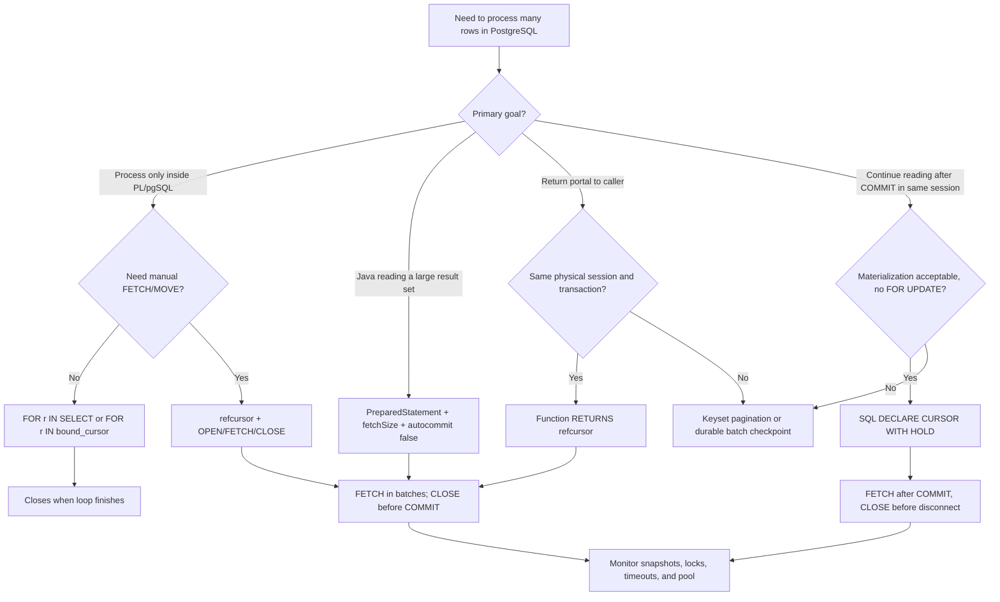

# Cursors, `refcursor`, and Transaction Lifecycles in PL/pgSQL

When a PostgreSQL query returns hundreds of thousands or millions of rows, an application does not always need to receive **the entire result set at once**. A *cursor* lets you hold the execution/retrieval state of a query on the PostgreSQL server side and read one row or batch at a time using `FETCH`. In PL/pgSQL, cursors also let you write multi-row processing loops, or let a function **open a query and return a `refcursor`** so the caller can continue reading from it.

However, a cursor is more than syntax for "reading page by page." It has a **lifecycle tied to the session, transaction, portal, snapshot, and server resources**. A common mistake is:

```sql
-- Each statement runs in independent autocommit:
SELECT demo_cursor.open_paid_orders();
FETCH ALL FROM paid_orders_cursor;
```

If the cursor was opened with PL/pgSQL's `OPEN` and the first `SELECT` already ended its transaction, its portal is **already closed** by the time `FETCH` arrives. Returning a `refcursor` string does not keep a portal alive across `COMMIT`.

This lesson belongs to the **PL/pgSQL** chapter of the *Database Engine Relational PostgreSQL* module. It covers everything from SQL-level `DECLARE CURSOR` to PL/pgSQL cursor variables, `OPEN`/`FETCH`/`MOVE`/`CLOSE` operations, parameterized cursors, returning `refcursor` from functions, `SCROLL`, `WITH HOLD`, effects of `COMMIT`/`ROLLBACK`/savepoints, interaction with procedures, and batch fetching in Java JDBC.

> **Key takeaway:** `refcursor` is a **value holding a portal name**, not an independent stored result table. To use a normal cursor, the caller must keep working **on the same connection and inside an active transaction**. Only SQL cursors declared holdable under the applicable rules can continue to be read after `COMMIT` within the same session.

Examples use the `demo_cursor` schema in a test database. Blocks that intentionally raise errors are clearly marked; do not run data-modifying examples on production.

---

## 1. What Should You Master After This Lesson?

1. Distinguish **cursor**, **portal**, **`refcursor` variable**, **cursor name**, and **transaction**.
2. Use SQL `DECLARE ... CURSOR FOR` to open an SQL-level cursor.
3. Use `FETCH NEXT`, `FETCH FORWARD n`, `FETCH ALL`, `MOVE`, and `CLOSE`.
4. Declare an **unbound `refcursor`** and `OPEN ... FOR SELECT` in PL/pgSQL.
5. Declare a **bound cursor** tied to a query, with or without parameters.
6. Use `FOUND` at the right moment inside a `FETCH` loop.
7. Use `FOR record IN SELECT` and `FOR record IN bound_cursor(...)` when you want the cursor closed automatically after the loop.
8. Return `refcursor` from a function to a caller and read it within the same transaction/session.
9. Distinguish `SCROLL`, `NO SCROLL`, forward-only behavior, and caveats with `VOLATILE` functions.
10. Explain **`WITHOUT HOLD`**, **`WITH HOLD`**, `COMMIT`, and `ROLLBACK` accurately.
11. Understand why a cursor can keep a transaction open too long, causing snapshot/lock/resource pressure.
12. Avoid confusing SQL cursors with **pgJDBC fetch-size cursors** or REST/HTTP pagination cursors.
13. Use `pg_cursors` to inspect portals in the current session.
14. Know when `WHERE CURRENT OF` and `FOR UPDATE` apply when updating rows through a cursor.
15. Choose suitable strategies for large reports, batch processing, and API pagination.

## 2. A Cursor Is Not an Array or Temporary Table

A regular query:

```sql
SELECT order_id, total_amount
FROM demo_cursor.sales_order
ORDER BY order_id;
```

when read normally by a client may force the driver or application to buffer many rows in memory, depending on the protocol and how the client manages `ResultSet`.

A cursor allows a query to be opened and fetched incrementally:

```text
Client                            PostgreSQL session
  │                                       │
  ├── BEGIN ────────────────────────────► │
  ├── DECLARE c CURSOR FOR SELECT ... ─►  │  portal "c"
  ├── FETCH 2 FROM c ──────────────────►  │
  ◄── two rows ───────────────────────────┤
  ├── FETCH 2 FROM c ──────────────────►  │
  ◄── next two rows ──────────────────────┤
  ├── CLOSE c ─────────────────────────►  │  portal closed
  └── COMMIT ──────────────────────────►  │  transaction ends
```

A cursor is not an independent copy of a table with its own B-tree index, nor is it a durable cache by itself. Depending on the query plan, PostgreSQL may still need to sort, hash, materialize, or scan a large amount of data **before returning the first row**.

### 2.1. Four Distinct Entities

| Concept | Meaning |
|---|---|
| **SQL cursor** | A query object opened via `DECLARE ... CURSOR FOR` or equivalent |
| **Portal** | Internal server structure holding query/cursor execution state |
| **`refcursor`** | PL/pgSQL/SQL data type holding a **portal name** |
| **Transaction** | The default boundary governing when non-holdable cursors close |

Because a portal name is meaningful only inside the session holding it, **you cannot store a `refcursor` in a queue or table and expect another connection to `FETCH` from it**.

### 2.2. Why Is It Called a Cursor?

Picture a position pointer moving through the result stream:

```text
Result per ORDER BY: [row1] [row2] [row3] [row4] [row5]
Cursor position:          ^
FETCH NEXT   → next row per positioning rules
FETCH PRIOR  → previous row if cursor supports scroll
MOVE         → move position without returning payload rows
```

To make ordering meaningful to business logic, include an `ORDER BY` with a unique tie-breaker key in the cursor query.

## 3. Creating Lab Data

Create a dedicated schema and orders table. Using a separate `demo_cursor` name makes cleanup easy after the lesson:

```sql
CREATE SCHEMA IF NOT EXISTS demo_cursor;

CREATE TABLE demo_cursor.customer (
    customer_id BIGINT PRIMARY KEY,
    customer_name TEXT NOT NULL
);

CREATE TABLE demo_cursor.sales_order (
    order_id BIGINT PRIMARY KEY,
    customer_id BIGINT NOT NULL
        REFERENCES demo_cursor.customer(customer_id),
    created_at TIMESTAMPTZ NOT NULL,
    total_amount NUMERIC(12, 2) NOT NULL
        CHECK (total_amount >= 0),
    status TEXT NOT NULL
        CHECK (status IN ('NEW', 'PAID', 'CANCELLED'))
);
```

Insert sample data:

```sql
INSERT INTO demo_cursor.customer
    (customer_id, customer_name)
VALUES
    (1, 'An'),
    (2, 'Bình'),
    (3, 'Chi');

INSERT INTO demo_cursor.sales_order
    (order_id, customer_id, created_at, total_amount, status)
VALUES
    (101, 1, '2026-10-01 08:00:00+07',  90.00, 'PAID'),
    (102, 1, '2026-10-02 09:00:00+07', 125.00, 'NEW'),
    (103, 2, '2026-10-03 10:00:00+07', 250.00, 'PAID'),
    (104, 2, '2026-10-04 11:00:00+07',  40.00, 'CANCELLED'),
    (105, 1, '2026-10-05 14:00:00+07', 180.00, 'PAID'),
    (106, 3, '2026-10-06 15:00:00+07',  60.00, 'PAID'),
    (107, 3, '2026-10-07 16:00:00+07', 450.00, 'NEW'),
    (108, 2, '2026-10-08 17:00:00+07', 320.00, 'PAID');

CREATE INDEX idx_demo_order_customer
ON demo_cursor.sales_order(customer_id, order_id);

CREATE INDEX idx_demo_order_status_created
ON demo_cursor.sales_order(status, created_at, order_id);

ANALYZE demo_cursor.sales_order;
```

Test query:

```sql
SELECT order_id, customer_id, total_amount, status
FROM demo_cursor.sales_order
ORDER BY order_id;
```

The dataset has 8 orders, 5 of which have status `PAID` (101, 103, 105, 106, 108). The examples use small numbers so each `FETCH` state is easy to observe.

## 4. SQL-Level `DECLARE`: The Simplest Cursor

Inside **one PostgreSQL session**, run:

```sql
BEGIN;

DECLARE cur_orders CURSOR FOR
SELECT order_id, customer_id, total_amount
FROM demo_cursor.sales_order
ORDER BY order_id;

FETCH FORWARD 3 FROM cur_orders;

FETCH FORWARD 2 FROM cur_orders;

CLOSE cur_orders;

COMMIT;
```

The first fetch returns order IDs **101, 102, 103**. The second returns **104, 105**. The query does not restart from the beginning on each `FETCH` the way two separate `SELECT ... LIMIT 3` statements would.

### 4.1. Why Is `BEGIN` Required?

A regular SQL cursor defaults to **`WITHOUT HOLD`**, existing only inside the transaction that creates it.

If the client uses autocommit per statement, a non-holdable `DECLARE ... CURSOR` outside an explicit transaction provides no window for a subsequent `FETCH`; PostgreSQL raises an error when declaring a `WITHOUT HOLD` cursor outside a transaction block.

### 4.2. Cursor Names Must Be Unique Within a Session

`cur_orders` is a portal name. While that portal remains open, you cannot simultaneously create another portal with the same name in the same session.

Other sessions can use the same cursor name because the portal namespace belongs to the **session**, not globally to the database.

### 4.3. What If `ORDER BY` Is Missing?

There is no deterministic ordering guarantee. Emitted rows depend on the query and execution plan. A cursor preserves retrieval state; it does not decide what "the first order" means.

## 5. SQL `DECLARE` vs. PL/pgSQL `DECLARE` (Variable Declaration)

These two snippets have different meanings:

**SQL command:**

```sql
BEGIN;
DECLARE cur_orders CURSOR FOR
SELECT * FROM demo_cursor.sales_order ORDER BY order_id;
FETCH 2 FROM cur_orders;
CLOSE cur_orders;
COMMIT;
```

**PL/pgSQL block:**

```sql
DO $$
DECLARE
    cur_orders REFCURSOR;
BEGIN
    OPEN cur_orders FOR
        SELECT *
        FROM demo_cursor.sales_order
        ORDER BY order_id;
    CLOSE cur_orders;
END;
$$;
```

In PL/pgSQL, `DECLARE` after `DO $$` is the **variable declaration block**. `OPEN` is what actually creates the portal and performs the equivalent of declaring an SQL cursor.

### 5.1. Do Not Copy SQL `DECLARE` Inside PL/pgSQL `BEGIN`

Writing:

```plpgsql
BEGIN
    DECLARE c CURSOR FOR SELECT ...;
END;
```

is not valid PL/pgSQL cursor declaration syntax. Use `DECLARE c CURSOR FOR ...;` in the variable declaration section, or `c REFCURSOR; OPEN c FOR ...;`.

### 5.2. `BEGIN` in PL/pgSQL Does Not Start a New SQL Transaction

PL/pgSQL's `BEGIN ... END` is a **control block**, not SQL's `BEGIN; ... COMMIT;`. A function runs inside the caller's transaction; it does not start a separate transaction per block.

## 6. `FETCH`: Reading in Batches

In SQL:

```sql
BEGIN;

DECLARE cur_paid CURSOR FOR
SELECT order_id, total_amount
FROM demo_cursor.sales_order
WHERE status = 'PAID'
ORDER BY order_id;

FETCH NEXT FROM cur_paid;
FETCH FORWARD 2 FROM cur_paid;
FETCH ALL FROM cur_paid;

CLOSE cur_paid;
COMMIT;
```

For the 5 `PAID` orders:

- `FETCH NEXT` fetches 101.
- `FETCH FORWARD 2` fetches 103 and 105.
- `FETCH ALL` fetches the remainder: 106 and 108.

### 6.1. Common `FETCH` Directions

| SQL syntax | Effect |
|---|---|
| `FETCH NEXT FROM c` | Fetch the next row |
| `FETCH PRIOR FROM c` | Fetch the previous row, if scrollable |
| `FETCH FIRST FROM c` | Position at and fetch the first row |
| `FETCH LAST FROM c` | Fetch the last row if supported |
| `FETCH ABSOLUTE 3 FROM c` | Fetch the row at absolute position 3 |
| `FETCH RELATIVE 2 FROM c` | Fetch the row 2 positions from current |
| `FETCH FORWARD 100 FROM c` | Fetch up to the next 100 rows |
| `FETCH BACKWARD 5 FROM c` | Fetch rows moving backward |
| `FETCH ALL FROM c` | Fetch all remaining rows in the default direction |
| `FETCH BACKWARD ALL FROM c` | Fetch all preceding rows backward when supported |

Backward and arbitrary positioning clauses must be checked against `SCROLL` and query properties rather than assuming every cursor supports them.

### 6.2. `FETCH ALL` Can Produce a Large Payload

Even with a cursor open, `FETCH ALL` can still transfer millions of rows to the client. If your goal is avoiding memory spikes, fetch in bounded batches and process/release each batch.

### 6.3. `FETCH` Does Not Modify Data

`FETCH` retrieves results from a portal; it is not `DELETE` or `UPDATE`. However, a cursor backed by a `FOR UPDATE` query acquires row locks as rows are fetched, so "merely fetching" is not always concurrency-free.

## 7. `MOVE`: Changing Position Without Returning Rows

`MOVE` repositions a cursor without transferring row payloads:

```sql
BEGIN;

DECLARE cur_move SCROLL CURSOR FOR
SELECT order_id
FROM demo_cursor.sales_order
ORDER BY order_id;

MOVE FORWARD 3 FROM cur_move;

FETCH NEXT FROM cur_move;

MOVE BACKWARD 2 FROM cur_move;

FETCH NEXT FROM cur_move;

CLOSE cur_move;
COMMIT;
```

After `MOVE FORWARD 3`, the cursor has skipped the first three rows; `FETCH NEXT` reads the next row.

### 7.1. `MOVE` Differs from `OFFSET`

`MOVE` updates the **position of an already-open portal**. `OFFSET` is part of an independent `SELECT` query. Depending on the plan, skipping many rows can have similar cost, yet their lifecycles differ completely.

### 7.2. `MOVE` Is Not "Key-Based Seeking"

To jump quickly to orders with IDs greater than a key, use a keyset query:

```sql
SELECT order_id, total_amount
FROM demo_cursor.sales_order
WHERE order_id > 1000
ORDER BY order_id
LIMIT 100;
```

That uses an indexable predicate, unlike `MOVE ABSOLUTE 1000`. Cursor position counts **row sequence**, not business key values.

## 8. `CLOSE`: Releasing a Portal Early

`CLOSE cursor_name;` closes the cursor and frees its resources.

```sql
BEGIN;

DECLARE cur_close CURSOR FOR
SELECT * FROM demo_cursor.sales_order;

FETCH 1 FROM cur_close;
CLOSE cur_close;

-- INTENTIONAL ERROR: cursor is already closed.
FETCH 1 FROM cur_close;

ROLLBACK;
```

When `FETCH` after `CLOSE` fails, the transaction enters an aborted state. `ROLLBACK` returns the session to a state where new queries can run.

### 8.1. Should You `CLOSE` Even If You Are About to `COMMIT`?

Non-holdable cursors close automatically when the transaction ends. Even so, if the application continues doing work in the transaction after finishing with a cursor, **closing it early** frees server portal resources immediately and prevents name collisions.

### 8.2. `CLOSE` Does Not `COMMIT`

`CLOSE` closes the portal; it does not complete the transaction. The caller must still explicitly `COMMIT` or `ROLLBACK`.

## 9. `SCROLL` and `NO SCROLL`

If you need forward and backward traversal, declare `SCROLL`:

```sql
BEGIN;

DECLARE cur_scroll SCROLL CURSOR FOR
SELECT order_id, total_amount
FROM demo_cursor.sales_order
ORDER BY order_id;

FETCH FORWARD 3 FROM cur_scroll;
FETCH PRIOR FROM cur_scroll;
FETCH FIRST FROM cur_scroll;
FETCH LAST FROM cur_scroll;

CLOSE cur_scroll;
COMMIT;
```

`SCROLL` permits non-sequential positioning, though it may make plans or resource usage heavier.

If you only need to read start-to-finish:

```sql
BEGIN;

DECLARE cur_forward NO SCROLL CURSOR FOR
SELECT order_id, total_amount
FROM demo_cursor.sales_order
ORDER BY order_id;

FETCH FORWARD 3 FROM cur_forward;

-- INTENTIONALLY UNSUPPORTED:
-- FETCH PRIOR FROM cur_forward;

CLOSE cur_forward;
COMMIT;
```

### 9.1. Default Behavior Is Not Guaranteed `SCROLL`

With a plain `DECLARE c CURSOR FOR ...`, PostgreSQL may allow backward fetching for **certain plans**, without making the same guarantee as specifying `SCROLL`.

Write `SCROLL` when backward positioning is truly needed and supported by the query; write `NO SCROLL` when forward-only reading is intended so the contract is explicit.

### 9.2. `SCROLL` Can Change Results with `VOLATILE` Functions

A query containing `random()`, `clock_timestamp()`, or other volatile functions may not yield consistent values if scrolling causes a row to be re-fetched in a way that re-evaluates the expression.

If deterministic values are needed, avoid combining `SCROLL` with volatile queries, or materialize results explicitly under clear semantics. Do not treat `SCROLL` as "freezing every expression value forever."

### 9.3. `SCROLL` and `FOR UPDATE` Restrictions

PostgreSQL does not allow `SCROLL` when a query contains `FOR UPDATE`/`FOR SHARE`, nor does it allow backward fetches in that mode. When locking rows for updates, use a forward-only cursor.

## 10. Cursors and Stable `ORDER BY`

When processing orders chronologically:

```sql
SELECT order_id, created_at
FROM demo_cursor.sales_order
ORDER BY created_at, order_id;
```

Add `order_id` as a tie-breaker so orders with identical timestamps have a total order.

### 10.1. A Cursor Does Not Make an Underspecified `ORDER BY` Stable Across Openings

If you only write `ORDER BY created_at` and multiple rows share a `created_at`, opening the cursor across two separate transactions may order tied timestamps differently.

### 10.2. Never Substitute Cursor Position for a Primary Key

The 20th position in a cursor is not a durable identifier for an order. APIs and ETL jobs must persist a business key or dedicated pagination token when resuming across closed transactions or sessions.

## 11. PL/pgSQL `refcursor`: Unbound Declaration

Cursor variables in PL/pgSQL have the `refcursor` type.

```sql
DO $$
DECLARE
    v_cursor REFCURSOR;
    v_row RECORD;
BEGIN
    OPEN v_cursor FOR
        SELECT order_id, total_amount, status
        FROM demo_cursor.sales_order
        WHERE status = 'PAID'
        ORDER BY order_id;

    LOOP
        FETCH v_cursor INTO v_row;
        EXIT WHEN NOT FOUND;

        RAISE NOTICE 'order=%, amount=%',
            v_row.order_id, v_row.total_amount;
    END LOOP;

    CLOSE v_cursor;
END;
$$;
```

Characteristics:

1. `v_cursor REFCURSOR`: no specific query is attached at declaration time.
2. `OPEN v_cursor FOR SELECT ...`: creates the portal and opens the query.
3. `FETCH v_cursor INTO v_row`: fetches one row into a `RECORD` variable.
4. `EXIT WHEN NOT FOUND`: stops when rows are exhausted.
5. `CLOSE v_cursor`: closes the portal.

### 11.1. Why Is It Called Unbound?

Unbound means the `refcursor` variable is not permanently tied to one query in its declaration. You can choose which `SELECT` to open at `OPEN` time.

### 11.2. `RECORD` Receives Its Shape from `FETCH`

`v_row RECORD` holds the fields of the fetched row. Because the query selects `order_id`, `total_amount`, and `status`, after a successful `FETCH` you can access `v_row.order_id` and `v_row.total_amount`.

Never access a field that was not selected or read a `RECORD` before it has been assigned a valid row structure.

### 11.3. `FETCH` Does Not Automatically Terminate a Loop

Without `EXIT WHEN NOT FOUND`, a function can loop infinitely once rows run out or reuse stale variable contents. Always include an explicit termination check.

## 12. `FOUND`: Checking `FETCH` Results Immediately

In PL/pgSQL, `FETCH` updates the special `FOUND` variable:

- `TRUE` when a row is successfully fetched.
- `FALSE` when no row is available in the requested direction or position.

Pattern:

```plpgsql
FETCH v_cursor INTO v_row;
EXIT WHEN NOT FOUND;
```

### 12.1. Do Not Insert Other SQL Between `FETCH` and `FOUND` Carelessly

`FOUND` is also updated by other PL/pgSQL statements. If you write:

```plpgsql
FETCH v_cursor INTO v_row;
PERFORM some_other_function();
EXIT WHEN NOT FOUND;
```

`FOUND` after `PERFORM` may no longer reflect the `FETCH` result.

Safe approach: inspect `FOUND` **immediately** after `FETCH`, or save the state into a dedicated boolean variable before executing other operations.

### 12.2. A `RECORD` with a `NULL` Field Does Not Mean `FETCH` Failed

A real row in another schema might have `total_amount = NULL`. `FOUND = TRUE` because a row existed, even if one or more fields are SQL `NULL`.

Never replace `EXIT WHEN NOT FOUND` with `EXIT WHEN v_row.some_field IS NULL` on nullable columns.

## 13. Opening an Unbound Cursor with Input Parameters

A function can reference its input parameters inside the cursor query:

```sql
CREATE FUNCTION demo_cursor.count_over_amount(
    p_threshold NUMERIC
)
RETURNS BIGINT
LANGUAGE plpgsql
STABLE
AS $$
DECLARE
    v_cursor REFCURSOR;
    v_order_id BIGINT;
    v_count BIGINT := 0;
BEGIN
    OPEN v_cursor FOR
        SELECT o.order_id
        FROM demo_cursor.sales_order AS o
        WHERE o.total_amount >= p_threshold
        ORDER BY o.order_id;

    LOOP
        FETCH v_cursor INTO v_order_id;
        EXIT WHEN NOT FOUND;
        v_count := v_count + 1;
    END LOOP;

    CLOSE v_cursor;
    RETURN v_count;
END;
$$;
```

Call:

```sql
SELECT demo_cursor.count_over_amount(200);
```

With the lab data, the expected result is **3** (250, 450, 320).

### 13.1. This Is a Cursor Example, Not the Optimal Way to Count

When the business logic simply counts rows:

```sql
SELECT COUNT(*)
FROM demo_cursor.sales_order
WHERE total_amount >= 200;
```

is usually simpler and faster than fetching each row and incrementing a counter. Use explicit cursors when per-row procedural logic or batch delivery is needed.

## 14. Bound Cursors: Attaching the Query in `DECLARE`

PL/pgSQL also lets you declare a cursor **already bound to a query**:

```sql
DO $$
DECLARE
    v_row RECORD;

    cur_paid CURSOR FOR
        SELECT order_id, total_amount
        FROM demo_cursor.sales_order
        WHERE status = 'PAID'
        ORDER BY order_id;
BEGIN
    OPEN cur_paid;

    LOOP
        FETCH cur_paid INTO v_row;
        EXIT WHEN NOT FOUND;
        RAISE NOTICE 'paid order: %', v_row.order_id;
    END LOOP;

    CLOSE cur_paid;
END;
$$;
```

`cur_paid CURSOR FOR SELECT ...` both declares a `refcursor` variable and binds a query to it.

### 14.1. `OPEN` on a Bound Cursor Does Not Take `FOR SELECT`

Because the query was specified in `DECLARE`, write only:

```plpgsql
OPEN cur_paid;
```

Do not repeat `OPEN cur_paid FOR SELECT ...` on a bound cursor.

### 14.2. When to Use a Bound Cursor?

- Fixed query where only parameters vary.
- Complex function using one query in clear procedural logic.
- When you want a cursor `FOR` loop that opens and closes automatically.
- Separating dedicated named cursors from flexible `refcursor` variables.

If a query is only used once without manual cursor control, `FOR v_row IN SELECT ... LOOP` is usually cleaner.

## 15. Parameterized Bound Cursors

Parameters can be declared directly on the cursor:

```sql
DO $$
DECLARE
    v_row RECORD;

    cur_by_customer CURSOR (p_customer BIGINT) FOR
        SELECT
            o.order_id,
            o.customer_id,
            o.total_amount
        FROM demo_cursor.sales_order AS o
        WHERE o.customer_id = p_customer
        ORDER BY o.order_id;
BEGIN
    OPEN cur_by_customer(1);

    LOOP
        FETCH cur_by_customer INTO v_row;
        EXIT WHEN NOT FOUND;

        RAISE NOTICE 'customer=%, order=%',
            v_row.customer_id, v_row.order_id;
    END LOOP;

    CLOSE cur_by_customer;
END;
$$;
```

### 15.1. Why Name the Parameter `p_customer` Different from the Column?

If a parameter shares the column name `customer_id`, references inside the query can become ambiguous. Clear naming like:

```sql
WHERE o.customer_id = p_customer
```

lets PostgreSQL distinguish variables from columns effortlessly.

### 15.2. Named Arguments in `OPEN`

```plpgsql
OPEN cur_by_customer(p_customer := 2);
```

This is helpful when a cursor takes multiple arguments and you want to avoid positional mistakes.

### 15.3. Parameter Values Are Bound at `OPEN` Time

When `OPEN cur_by_customer(1)` runs, the query opens with the current value of its arguments. Changing an outer variable after `OPEN` **does not dynamically change the filter of an already-open cursor**.

To query a different customer ID, close the cursor and re-open it with the new value.

## 16. Cursor `FOR` Loops Open and Close Automatically

With a bound cursor, manual `OPEN` and `CLOSE` are optional:

```sql
DO $$
DECLARE
    cur_by_customer CURSOR (p_customer BIGINT) FOR
        SELECT order_id, total_amount
        FROM demo_cursor.sales_order
        WHERE customer_id = p_customer
        ORDER BY order_id;
BEGIN
    FOR v_row IN cur_by_customer(2) LOOP
        RAISE NOTICE 'order=%, amount=%',
            v_row.order_id, v_row.total_amount;
    END LOOP;
END;
$$;
```

Inside a cursor `FOR` loop:

- PostgreSQL opens the cursor automatically for its bound query.
- Each iteration fetches one row into the loop record variable.
- When the loop finishes, the cursor closes automatically.

### 16.1. Do Not `OPEN` Before a `FOR` Loop Like Above

A cursor `FOR` loop requires the cursor to be unopened; if you call `OPEN cur_by_customer(2)` and then run `FOR v_row IN cur_by_customer(2)`, you break the auto-open model.

### 16.2. `FOR` Loops Do Not Produce Table-Valued Output

`RAISE NOTICE` emits messages from PL/pgSQL; it does not return result rows to an SQL caller. To return rows from a function, use `RETURNS SETOF`/`RETURNS TABLE` with `RETURN NEXT` or `RETURN QUERY`, or return a `refcursor` to the caller.

## 17. `FOR record IN SELECT`: Simpler Than Explicit Cursors

When you just need to iterate sequentially:

```sql
DO $$
BEGIN
    FOR v_row IN
        SELECT order_id, total_amount
        FROM demo_cursor.sales_order
        WHERE status = 'PAID'
        ORDER BY order_id
    LOOP
        RAISE NOTICE 'paid: %', v_row.order_id;
    END LOOP;
END;
$$;
```

PL/pgSQL uses an internal cursor under the hood for `FOR ... IN SELECT`; you do not need to declare a `refcursor`, `FETCH`, `FOUND`, or `CLOSE`.

### 17.1. When Is an Explicit Cursor Unnecessary?

- Processing all rows in one pass inside a function.
- No need to return a portal name to a client.
- No need for `MOVE`/`PRIOR`/`ABSOLUTE`.
- No need to swap among multiple queries at runtime.
- No need to pause/resume across multiple caller statements in a transaction.

Explicit cursors add complexity, so reserve them for when their capabilities are actually needed.

### 17.2. `FOR` Loops Avoid `EXIT WHEN NOT FOUND` Mistakes

When there are zero rows, the loop simply runs zero iterations. You never have to check `FOUND` manually after each fetch.

## 18. Bound Cursors and `NO SCROLL`/`SCROLL` in PL/pgSQL

Scroll mode can be declared directly on a bound cursor:

```plpgsql
DECLARE
    c_forward NO SCROLL CURSOR FOR
        SELECT ...;
    c_backward SCROLL CURSOR FOR
        SELECT ...;
```

This illustrates PL/pgSQL variable declaration syntax, not standalone SQL.

For an unbound cursor:

```plpgsql
OPEN v_cursor NO SCROLL FOR
    SELECT ...;
```

or:

```plpgsql
OPEN v_cursor SCROLL FOR
    SELECT ...;
```

### 18.1. Specify `SCROLL` in the Right Place

- **Bound:** specify in the **declaration**.
- **Unbound:** can be specified in **`OPEN`**.
- Do not try to force `OPEN bound_cursor SCROLL` when a bound cursor already specifies its scroll policy in its declaration.

### 18.2. `SCROLL` Has Costs on Complex Queries

Requiring backward seeking can force the executor to retain or re-evaluate additional state. If the client only reads forward in batches, `NO SCROLL` expresses the requirement accurately.

## 19. `OPEN FOR EXECUTE`: Dynamic Queries

An unbound `refcursor` can accept a dynamically built SQL string:

```sql
CREATE FUNCTION demo_cursor.count_by_dynamic_status(
    p_status TEXT
)
RETURNS BIGINT
LANGUAGE plpgsql
STABLE
AS $$
DECLARE
    v_cursor REFCURSOR;
    v_order_id BIGINT;
    v_count BIGINT := 0;
BEGIN
    OPEN v_cursor FOR EXECUTE
        'SELECT order_id
         FROM demo_cursor.sales_order
         WHERE status = $1
         ORDER BY order_id'
    USING p_status;

    LOOP
        FETCH v_cursor INTO v_order_id;
        EXIT WHEN NOT FOUND;
        v_count := v_count + 1;
    END LOOP;

    CLOSE v_cursor;
    RETURN v_count;
END;
$$;
```

### 19.1. Syntax Illustration Only—No Dynamic SQL Needed Just to Count

Since this query only varies the `status` value, `OPEN v_cursor FOR SELECT ... WHERE status = p_status` is shorter and easier to optimize. `EXECUTE` is useful when the query structure itself must vary.

### 19.2. Use `USING` for Data

`USING p_status` passes the value via placeholder `$1` without concatenating text input into SQL. Never write:

```plpgsql
-- Do not do this with untrusted input:
OPEN v_cursor FOR EXECUTE
    'SELECT ... WHERE status = ''' || p_status || '''';
```

String concatenation risks SQL injection or escaping bugs.

### 19.3. Identifiers Cannot Use `USING`

Table and column names cannot be passed through `USING` as parameter values. If a table must be selected at runtime, enforce a strict allowlist and then use `format('%I', identifier)` or properly schema-qualified identifiers.

## 20. `refcursor` Holds a Portal Name, Not the Data

In PL/pgSQL:

```plpgsql
DECLARE
    v_cursor REFCURSOR;
BEGIN
    OPEN v_cursor FOR SELECT ...;
    RETURN v_cursor;
END;
```

`RETURN v_cursor` returns **a portal name value**, rather than serializing the `SELECT` rows into a long-lived standalone object.

### 20.1. The Portal Must Still Be Open

If a function executes:

```plpgsql
OPEN v_cursor FOR SELECT ...;
CLOSE v_cursor;
RETURN v_cursor;
```

the caller receives a name that **no longer points to an open portal**. Having a `refcursor` string value does not mean the portal still exists.

### 20.2. Only the Same Session Can Access It

Connection A opens portal `c`. Connection B calling `FETCH FROM c` cannot access A's portal, even when both connect to the same database as the same user.

### 20.3. Never Store `refcursor` in a Table as a Job Bookmark

After `COMMIT` or connection close, a portal name from an old session is no longer a valid resume pointer. To resume a job after a restart, persist **a business key, offset/token, and job state** in a durable schema.

## 21. Returning a `refcursor` with a Fixed Portal Name from a Function

A minimal example intentionally assigning a name:

```sql
CREATE FUNCTION demo_cursor.open_paid_orders(
    p_min_amount NUMERIC DEFAULT 0
)
RETURNS REFCURSOR
LANGUAGE plpgsql
STABLE
AS $$
DECLARE
    v_cursor REFCURSOR := 'paid_orders_cursor';
BEGIN
    OPEN v_cursor FOR
        SELECT order_id, customer_id, total_amount
        FROM demo_cursor.sales_order
        WHERE status = 'PAID'
          AND total_amount >= p_min_amount
        ORDER BY order_id;

    RETURN v_cursor;
END;
$$;
```

**Correct lifecycle usage:**

```sql
BEGIN;

SELECT demo_cursor.open_paid_orders(100);

FETCH FORWARD 2 FROM paid_orders_cursor;
FETCH ALL FROM paid_orders_cursor;

CLOSE paid_orders_cursor;

COMMIT;
```

`SELECT open_paid_orders(100)` returns the portal name `paid_orders_cursor`. Subsequent `FETCH` statements read that portal **inside the same transaction and connection**.

### 21.1. Fixed Names Are Handy for Demos, Collision-Prone in Real Apps

If a session opens `paid_orders_cursor` a second time **while a portal of that name is still open**, PostgreSQL raises a duplicate cursor error.

An application running multiple concurrent queries on the same session should not hard-code shared portal names without lifecycle management.

### 21.2. What If You `SELECT` the Function in Autocommit Mode?

`SELECT open_paid_orders(...)` finishes its transaction when the statement completes. Any non-holdable cursor opened inside is closed immediately; a subsequent `FETCH` reports that the cursor does not exist.

Do not use a `refcursor` API when callers cannot hold one transaction/session open across fetches.

## 22. Returning a `refcursor` with an Auto-Generated Name

Omit assigning a fixed string name:

```sql
CREATE FUNCTION demo_cursor.open_customer_orders(
    p_customer_id BIGINT
)
RETURNS REFCURSOR
LANGUAGE plpgsql
STABLE
AS $$
DECLARE
    v_cursor REFCURSOR;
BEGIN
    OPEN v_cursor FOR
        SELECT order_id, total_amount, status
        FROM demo_cursor.sales_order
        WHERE customer_id = p_customer_id
        ORDER BY order_id;

    RETURN v_cursor;
END;
$$;
```

Call:

```sql
BEGIN;

SELECT demo_cursor.open_customer_orders(1) AS cursor_name;

-- Check the actual returned portal name, then use that exact name:
-- FETCH ALL FROM "<unnamed portal 1>";  -- this name is ONLY illustrative
-- CLOSE "<unnamed portal 1>";

ROLLBACK;
```

### 22.1. Do Not Hard-Code Auto-Generated Names

Portal names can contain spaces, punctuation, and unpredictable sequence numbers. Output may look like `<unnamed portal 1>`, but you must never assume every session or run uses that exact string.

When using raw SQL interactively, pass the **exact returned name** to `FETCH` and quote the identifier properly. When using JDBC, rely on safe identifier escaping or driver support.

### 22.2. PostgreSQL 16 Changed the Default for Bound Cursor Names

Before PostgreSQL **16**, bound cursor variables in PL/pgSQL were initialized to **the variable's own name**, so the default portal name often matched the declaration name.

Starting in PostgreSQL **16**, that default changed: bound cursor variables start as `NULL` so the system generates unique portal names automatically, reducing collision risk.

Therefore, never write callers that assume `cur_by_customer` will be the portal name just because it is the bound variable name. Read the actual `refcursor` return value, or assign a portal name explicitly when external callers need one.

## 23. Same Transaction Is Not Enough Across Different Connections

Conceptual flow:

```text
Request A                         Pool
   ├── Connection 1
   │     BEGIN
   │     SELECT open_customer_orders(1)
   │     → portal "...1" on session 1
   └── Release connection

Request B
   └── Connection 2
         FETCH FROM "...1"
         → Does not exist in session 2
```

Even with the same database user, the portal namespace belongs to the backend session. When transactions are managed by a framework, ensure the **exact same physical connection** stays pinned from `OPEN` through `CLOSE`/`COMMIT`.

### 23.1. Connection Pools Do Not Transfer Portals

Never store a `refcursor` name, release the connection back to the pool, and open another connection later to fetch. When HTTP requests span separate transactions, use keyset pagination or durable job state instead of `refcursor`.

### 23.2. Returning a `refcursor` Does Not Stream Over the Internet

The client still must issue SQL `FETCH` commands over that database session. Server-side cursors do not turn into WebSocket/HTTP streams or provide built-in reconnect resume tokens.

## 24. Returning Multiple `refcursor`s from One Function

When a caller needs two separate result sets (for instance `PAID` and `NEW` orders), a function can return **multiple portal names**:

```sql
CREATE FUNCTION demo_cursor.open_two_order_groups(
    p_paid REFCURSOR,
    p_new REFCURSOR
)
RETURNS SETOF REFCURSOR
LANGUAGE plpgsql
STABLE
AS $$
BEGIN
    OPEN p_paid FOR
        SELECT order_id, total_amount
        FROM demo_cursor.sales_order
        WHERE status = 'PAID'
        ORDER BY order_id;

    RETURN NEXT p_paid;

    OPEN p_new FOR
        SELECT order_id, total_amount
        FROM demo_cursor.sales_order
        WHERE status = 'NEW'
        ORDER BY order_id;

    RETURN NEXT p_new;
END;
$$;
```

Call:

```sql
BEGIN;

SELECT *
FROM demo_cursor.open_two_order_groups(
    'paid_group',
    'new_group'
);

FETCH ALL FROM paid_group;
FETCH ALL FROM new_group;

CLOSE paid_group;
CLOSE new_group;

COMMIT;
```

### 24.1. Each `refcursor` Is an Independent Portal

Each active portal name must be unique within the session. If the caller closes only one cursor, the other holds its resources until closed or until the transaction ends.

### 24.2. `SETOF refcursor` Returns a Set of Names, Not Combined Rows

`RETURNS SETOF REFCURSOR` returns two **`refcursor` values**. It does not merge order rows into one result. The caller must `FETCH` each portal individually.

### 24.3. Do Not Use Two Portals When One `SELECT` Makes More Sense

If the API only needs `status` and order rows, a single query `SELECT ... WHERE status IN ('PAID', 'NEW') ORDER BY ...` can be simpler. Multi-`refcursor` functions shine when you genuinely need two distinct result shapes under one transaction.

## 25. SQL Cursor `WITHOUT HOLD`: Default Lifecycle

Try a transaction:

```sql
BEGIN;

DECLARE cur_short CURSOR WITHOUT HOLD FOR
SELECT order_id
FROM demo_cursor.sales_order
ORDER BY order_id;

FETCH 2 FROM cur_short;

COMMIT;

-- INTENTIONAL ERROR:
-- FETCH ALL FROM cur_short;
```

After `COMMIT`, the non-holdable portal closes. Keeping the cursor name in a client variable does not keep the query state alive.

### 25.1. Lifecycle Table

| Event | Non-holdable cursor |
|---|---|
| `DECLARE`/`OPEN` | Portal created in session |
| `FETCH` | Portal retains/updates position |
| `CLOSE` | Portal closed |
| `COMMIT` | Portal closed automatically |
| `ROLLBACK` | Portal closed automatically |
| Connection closed | Portal destroyed |
| Another connection `FETCH`es same name | Inaccessible |

This is the default behavior for cursors opened via PL/pgSQL `OPEN` and SQL `DECLARE` without `WITH HOLD`.

## 26. `WITH HOLD`: An SQL-Level `DECLARE` Exception

At the SQL level:

```sql
BEGIN;

DECLARE cur_hold CURSOR WITH HOLD FOR
SELECT order_id, total_amount
FROM demo_cursor.sales_order
ORDER BY order_id;

FETCH FORWARD 2 FROM cur_hold;

COMMIT;

-- Still on the SAME connection/session:
FETCH FORWARD 3 FROM cur_hold;
FETCH ALL FROM cur_hold;

CLOSE cur_hold;
```

**`WITH HOLD`** lets the cursor remain usable after the **creating transaction successfully `COMMIT`s**, within the same session.

### 26.1. What `WITH HOLD` Does Not Permit

- Does not transfer the portal to **another session**.
- Does not survive closing the session or connection.
- Does not refresh results with data committed by subsequent transactions.
- Does not eliminate execution cost: PostgreSQL must preserve remaining results to read after `COMMIT`.
- Cannot be used if the cursor query contains `FOR UPDATE`/`FOR SHARE`.

### 26.2. Materialization Mechanism at `COMMIT`

PostgreSQL saves rows of a held cursor into memory or temporary storage so they remain readable after `COMMIT`.

```text
BEGIN ── DECLARE WITH HOLD ── partial FETCH ── COMMIT
                                                 │
                                                 ▼
                                 Remaining results are materialized
                                                 │
                                                 ▼
                               Session continues FETCH in a later txn
```

Therefore, `WITH HOLD` is not an "infinite O(1) streaming cursor." It shifts the trade-off toward memory/temp storage, especially for large result sets.

### 26.3. `WITH HOLD` Is an SQL-Level Option

`OPEN v_refcursor FOR SELECT ...` in PL/pgSQL **has no simple `WITH HOLD` clause** matching SQL `DECLARE CURSOR WITH HOLD`. If a holdable cursor is truly needed, design it at the SQL level with clear transaction boundaries; never assume returning a `refcursor` from a function makes it holdable.

## 27. `COMMIT` and `ROLLBACK` with a Held Cursor

| Event | SQL cursor `WITH HOLD` |
|---|---|
| Created inside transaction | Portal active |
| Creating transaction `COMMIT`s successfully | Portal survives inside the same session |
| Creating transaction `ROLLBACK`s before commit | Portal discarded |
| `FETCH` after commit, same session | Allowed if not yet `CLOSE`d |
| `CLOSE` | Portal closed |
| Disconnect / session ends | Portal closed |
| Another connection | Cannot read portal |
| `ROLLBACK` of a later reading transaction | Depends on held portal state; does not turn the portal into cross-session data |

### 27.1. Creation-Time `ROLLBACK` vs. Post-Hold `ROLLBACK`

Try:

```sql
BEGIN;

DECLARE cur_cancelled CURSOR WITH HOLD FOR
SELECT order_id
FROM demo_cursor.sales_order
ORDER BY order_id;

ROLLBACK;

-- INTENTIONAL ERROR: the creating transaction was aborted,
-- the cursor never had a successful COMMIT.
-- FETCH 1 FROM cur_cancelled;
```

Once a held cursor survives a successful `COMMIT`, it belongs to the session and can be read in later transactions. Still, never build applications relying on subtle cursor-position edge cases after failed fetches or rollbacks without testing your exact PostgreSQL version and driver.

### 27.2. Do Not Treat `WITH HOLD` as a Business Cache

Even when used after commit, a held cursor reflects **the result at the time it was created/materialized**, not a live view updated by newer writes.

## 28. Quick Comparison: Regular Cursor, `WITH HOLD`, `refcursor`

| Trait | SQL `DECLARE ... WITHOUT HOLD` | SQL `DECLARE ... WITH HOLD` | PL/pgSQL `OPEN refcursor` |
|---|---|---|---|
| Multiple fetches inside one transaction | Yes | Yes | Yes |
| Survives `COMMIT` of creating transaction | No | **Yes**, same session | Not by default |
| Survives `ROLLBACK` of creating transaction | No | No | No |
| Survives reconnect | No | No | No |
| Has a portal name | Yes | Yes | Yes |
| Holds query state/position | Yes | Yes | Yes |
| Materializes rows on commit | Not like a held cursor | Yes | No direct `WITH HOLD` mechanism |
| Returned by name from PL/pgSQL function | Via `refcursor` name if valid | Do not expect function `OPEN` to create hold | Yes |
| Typical purpose | Batch fetch inside transaction | Continued fetch after commit, same session | Cursor loops and returning portal name |

**Design question:** Can you hold one physical connection and one transaction long enough? If not, a default `refcursor` is not the right interface for paginating across multiple HTTP requests.

## 29. Snapshots: Does a Cursor See Subsequent Data Changes?

A cursor executes a query under PostgreSQL's MVCC system. Its results and visibility depend on the query type, snapshot timing, isolation level, locks, and materialization.

### 29.1. Do Not Assume Each `FETCH` Is a Fresh `SELECT`

Calling `FETCH NEXT` on the same portal does not re-run the entire `SELECT` from scratch under a brand-new snapshot like an independent query. It advances the already-open query state.

### 29.2. `READ COMMITTED` Does Not Turn a Cursor into a "Real-Time Feed"

Never rely on expecting "another session inserts a new order so my next `FETCH` will immediately see it." Cursor output is governed by the portal's execution/snapshot, not like a subscription or CDC stream.

### 29.3. `WITH HOLD` Is Even Less of a Live Cursor

Once `COMMIT` materializes the rows, the held rows are a static set replayed in the session; updates by other transactions never modify the output of an existing held cursor.

### 29.4. `REPEATABLE READ` and `SERIALIZABLE`

Under stricter isolation levels, snapshot and serialization rules change visibility and abort likelihood. A transaction holding a long cursor faces higher contention, transaction-ID horizon pressure, and concurrency failures requiring transaction retries on the appropriate SQLSTATEs.

Never raise isolation to `SERIALIZABLE` just to "keep a cursor consistent" without retry logic and cost analysis.

## 30. Long-Open Cursors Impact `VACUUM` and Locks

Long-lived cursors and transactions can:

- Pin snapshots or transaction horizons longer than desired.
- Prevent `VACUUM` from reclaiming old row versions promptly.
- Increase table bloat, WAL volume, and storage pressure.
- Hold relation/row locks for the duration of the query/transaction.
- Occupy a connection from the pool.
- Retain executor memory, temp files, and portal state on the server.

Not every cursor triggers every issue, yet **keeping a transaction open across many seconds or minutes** must be treated as an operational decision.

### 30.1. Never Hold a Transaction Open During External HTTP Calls

Dangerous pattern:

```text
BEGIN
  OPEN cursor
  FETCH row
  Call external API (may time out after 30 seconds)
  FETCH next row
  ...
COMMIT
```

Both the connection and transaction sit blocked waiting on an external service, causing pool starvation and stale snapshots.

For large jobs, split batches by durable business keys, commit each batch, and persist progress safely.

## 31. `SAVEPOINT` and Subtransactions

SQL supports `SAVEPOINT`:

```sql
BEGIN;

SAVEPOINT sp_one;

DECLARE cur_sp CURSOR FOR
SELECT order_id
FROM demo_cursor.sales_order
ORDER BY order_id;

ROLLBACK TO SAVEPOINT sp_one;

-- The portal created after the savepoint was rolled back,
-- so do not keep using cur_sp as if it were still open.

COMMIT;
```

Do not treat savepoints as "undo a `FETCH` position and replay the same cursor." PostgreSQL enforces specific rules on portal lifetime and positioning when rolling back to a savepoint.

### 31.1. Warning: `FETCH`/`MOVE` vs. Position Rollback

Some cursor positioning operations do not roll back like table writes. Therefore, never rely on `ROLLBACK TO SAVEPOINT` to rewind a cursor position accurately.

### 31.2. `EXCEPTION` in PL/pgSQL Creates a Subtransaction

A block with an `EXCEPTION` handler runs inside a subtransaction. A cursor opened inside a scope that rolls back due to an exception can be closed or invalidated.

Safe pattern:

- Use cursors inside well-scoped exception handling.
- After an exception, never assume a portal remains usable.
- If needed, re-open a fresh cursor starting from a saved **business key** rather than attempting to salvage a rolled-back portal position.

### 31.3. Do Not Write SQL `SAVEPOINT` Directly Inside PL/pgSQL

PL/pgSQL does not support direct `SAVEPOINT`/`ROLLBACK TO SAVEPOINT`/`RELEASE SAVEPOINT` statements the way an SQL client does; use `BEGIN ... EXCEPTION ... END` blocks when subtransaction semantics are appropriate.

## 32. SQL Cursors and `WHERE CURRENT OF` Updates

Cursors also support row-by-row processing that updates the exact row most recently fetched.

Example **modifying lab data**, protected inside a `ROLLBACK` transaction:

```sql
BEGIN;

DECLARE cur_for_update NO SCROLL CURSOR FOR
SELECT order_id, total_amount, status
FROM demo_cursor.sales_order
WHERE status = 'NEW'
FOR UPDATE;

FETCH NEXT FROM cur_for_update;

UPDATE demo_cursor.sales_order
SET status = 'PAID'
WHERE CURRENT OF cur_for_update;

FETCH NEXT FROM cur_for_update;

CLOSE cur_for_update;

ROLLBACK;
```

### 32.1. Why `FOR UPDATE`?

`FOR UPDATE` acquires row locks as rows are fetched, preventing another transaction from altering a row before you update it.

Per PostgreSQL documentation, `WHERE CURRENT OF` should be paired with `FOR UPDATE` to avoid ambiguity if rows change concurrently and to ensure the cursor is treated as updatable.

### 32.2. Do Not Combine `WITH HOLD` with `FOR UPDATE`

PostgreSQL forbids `DECLARE ... CURSOR WITH HOLD FOR SELECT ... FOR UPDATE`. Row locks and transaction boundaries are incompatible with holding a cursor across commits.

### 32.3. Do Not Combine `SCROLL` with `FOR UPDATE`

Cursors using `FOR UPDATE` do not support `SCROLL`-style backward fetching. Use forward-only traversal and short transactions.

### 32.4. Do Not Use `WHERE CURRENT OF` on Arbitrary Joins or Aggregates

A cursor with `GROUP BY`, `DISTINCT`, complex joins, or non-simply-updatable queries cannot position a single target row for `UPDATE`. Lock rows and update by primary key in a clear transaction design whenever `WHERE CURRENT OF` does not apply.

## 33. `FOR UPDATE SKIP LOCKED` and Work Queues

A queue consumer can pick unprocessed jobs via:

```sql
SELECT job_id
FROM some_job_queue
WHERE status = 'PENDING'
ORDER BY job_id
FOR UPDATE SKIP LOCKED;
```

This helps when multiple workers pull from the same queue without blocking on locked rows.

Combining it with cursors requires caution:

- Locks and visibility follow transaction rules.
- `SKIP LOCKED` produces a non-uniform view suited to queues, not reports.
- Never hold the transaction open across slow external work.
- If committing job by job, non-holdable cursors do not survive commit.

A better architecture is usually **claiming a small batch in a transaction, `COMMIT`ting (marking claimed/in-progress), processing, and acknowledging state in a separate transaction** with idempotency and retries.

## 34. Procedures with `COMMIT` and Cursor `FOR` Loops

PostgreSQL procedures invoked with `CALL` on supported versions can perform transaction control under specific conditions.

A special case inside a procedure:

```plpgsql
FOR r IN SELECT ... LOOP
    ...
    COMMIT;
END LOOP;
```

can continue running after `COMMIT` because PostgreSQL **automatically converts the `FOR` loop's internal cursor to holdable** upon the first `COMMIT` or `ROLLBACK`.

### 34.1. What Actually Happens?

PostgreSQL documentation explains that on the first `COMMIT`/`ROLLBACK`, the cursor backing a `FOR` loop over a `SELECT` is **evaluated to completion** and its results are held so the loop can continue, instead of maintaining its original row-by-row streaming execution.

Consequences:

- Can consume substantial memory or temp files.
- Snapshot and rows reflect materialization at that point.
- Any row locks acquired by the cursor query are released on `COMMIT`.
- The `FOR` loop still closes the cursor automatically when the loop finishes.

### 34.2. Do Not Confuse This with Normal `OPEN refcursor`

This is a **special feature of cursor `FOR` loops under procedure transaction control**; it does not turn arbitrary `OPEN`ed `refcursor` variables into `WITH HOLD` portals when a procedure calls `COMMIT`.

### 34.3. `COMMIT` Is Not Allowed in Every Call Context

Transaction control is allowed only inside top-level `CALL` or eligible nested `CALL`/`DO` chains without intervening `SELECT` statements under PostgreSQL's rules.

If the client already opened an explicit transaction block and calls a procedure that executes `COMMIT`, PostgreSQL rejects it. Test against your actual caller and framework transaction manager.

## 35. Example Procedure with Transaction Control

Create a dedicated audit table:

```sql
CREATE TABLE demo_cursor.audit_scan (
    audit_id BIGINT GENERATED ALWAYS AS IDENTITY PRIMARY KEY,
    order_id BIGINT NOT NULL,
    scanned_at TIMESTAMPTZ NOT NULL DEFAULT clock_timestamp()
);
```

Illustrative procedure:

```sql
CREATE PROCEDURE demo_cursor.scan_paid_and_commit()
LANGUAGE plpgsql
AS $$
DECLARE
    v_row RECORD;
    v_count INTEGER := 0;
BEGIN
    FOR v_row IN
        SELECT order_id
        FROM demo_cursor.sales_order
        WHERE status = 'PAID'
        ORDER BY order_id
    LOOP
        INSERT INTO demo_cursor.audit_scan(order_id)
        VALUES (v_row.order_id);

        v_count := v_count + 1;

        IF v_count % 2 = 0 THEN
            COMMIT;
        END IF;
    END LOOP;
END;
$$;
```

Run the following in the lab **only at top level outside any explicit transaction block**:

```sql
CALL demo_cursor.scan_paid_and_commit();
```

### 35.1. This Demonstrates the Mechanism, Not a Production Job Recipe

Running that procedure again inserts duplicate audit rows, and mid-loop `COMMIT` persists partial progress even if a later iteration fails. Real jobs require:

- Idempotency keys and unique constraints.
- Durable resume state.
- Retry policies and failure compensation.
- Batch sizing and monitoring.
- Testing exception and connection-loss scenarios.
- Verifying whether materialization at the first `COMMIT` is acceptable.

### 35.2. Never `COMMIT` Inside a Cursor Loop Driven by DML `RETURNING`

PostgreSQL forbids transaction commands inside cursor loops driven by **non-read-only** statements such as `UPDATE ... RETURNING`. Never open a DML-driven loop and commit row by row.

## 36. When Should You Use `CURSOR WITH HOLD`?

Appropriate when:

- The same database session needs to keep reading after the creating transaction commits.
- The result size is moderate enough for server materialization.
- Row locks (`FOR UPDATE`/`FOR SHARE`) are not needed.
- Post-commit reads can rely on the **held result snapshot** without seeing newer changes.
- An explicit `CLOSE` lifecycle exists.

Inappropriate when:

- API requests span different connections.
- Result sets are huge and temp storage is constrained.
- Resuming after an application restart is required.
- Transactions need row locks.
- Live visibility into newly committed data is required.

## 37. When Should You Use an Explicit `refcursor`?

Scenarios worth considering:

1. Complex functions/procedures needing explicit `FETCH`/`MOVE` control.
2. Stored functions passing a portal so a client can fetch in multiple batches **within the same transaction**.
3. Callers needing multiple independent cursors with different query shapes.
4. Pipelines requiring explicit cursor positioning.
5. JDBC/`psql` sessions with strict transaction management.

If you simply want to stream many rows into Java, **pgJDBC `fetchSize`** with `PreparedStatement` is often much simpler than an explicit `refcursor` API.

## 38. pgJDBC: Batch Fetching Without `CREATE FUNCTION`

With pgJDBC, a `ResultSet` can use driver-managed cursor fetching:

```java
import java.sql.Connection;
import java.sql.PreparedStatement;
import java.sql.ResultSet;

Connection conn = dataSource.getConnection();
try {
    conn.setAutoCommit(false);

    String sql = """
        SELECT order_id, customer_id, total_amount
        FROM demo_cursor.sales_order
        WHERE status = ?
        ORDER BY order_id
        """;

    try (PreparedStatement ps = conn.prepareStatement(
            sql,
            ResultSet.TYPE_FORWARD_ONLY,
            ResultSet.CONCUR_READ_ONLY)) {

        ps.setString(1, "PAID");
        ps.setFetchSize(200);

        try (ResultSet rs = ps.executeQuery()) {
            while (rs.next()) {
                long id = rs.getLong("order_id");
                long customerId = rs.getLong("customer_id");
                java.math.BigDecimal amount =
                    rs.getBigDecimal("total_amount");

                // Process each row or buffer a small batch.
                System.out.println(id + " / " + customerId
                    + " / " + amount);
            }
        }
    }

    conn.commit();
} catch (Exception ex) {
    conn.rollback();
    throw ex;
} finally {
    conn.close();
}
```

### 38.1. Prerequisites for Cursor-Based `ResultSet`

Per pgJDBC documentation, cursor-based fetching activates only when required conditions hold, notably:

- **Autocommit disabled** so the transaction stays alive across fetch rounds.
- `ResultSet` is **forward-only**.
- Positive fetch size, such as `ps.setFetchSize(200)`.
- Protocol and query conditions compatible with the driver.
- If prerequisites are not met, the driver can **silently fall back to fetching all rows**.

### 38.2. `setFetchSize` Is Not `LIMIT`

`setFetchSize(200)` does not cap total results at 200. It sets the batch size the driver requests per round trip. If the query matches 2 million rows, `while (rs.next())` still reads all 2 million.

### 38.3. Close `ResultSet` Before `COMMIT`

If results remain unread, ending the transaction closes the portal. Wrapping `ResultSet` and `PreparedStatement` in `try-with-resources` before `conn.commit()` keeps the lifecycle clean.

### 38.4. Never Make Slow HTTP Calls Inside the Transaction

Even though the client buffers only 200 rows, the transaction and connection stay open throughout the read loop. If each row triggers a 2-second external service call, the system risks pool starvation and `VACUUM` lag.

## 39. pgJDBC `CallableStatement` Returning `refcursor` Has Specific Limits

pgJDBC supports retrieving a `refcursor` from a function via `CallableStatement`, yet the driver documentation notes that a **`ResultSet` obtained from a `refcursor` on this path can be fetched and cached completely on the client**, with `setFetchSize` ignored.

Illustrative example:

```java
import java.sql.CallableStatement;
import java.sql.ResultSet;
import java.sql.Types;

conn.setAutoCommit(false);

try (CallableStatement cs =
         conn.prepareCall("{ ? = call demo_cursor.open_paid_orders(?) }")) {

    cs.registerOutParameter(1, Types.OTHER);
    cs.setBigDecimal(2, new java.math.BigDecimal("100"));
    cs.execute();

    try (ResultSet rs = (ResultSet) cs.getObject(1)) {
        while (rs.next()) {
            System.out.println(rs.getLong("order_id"));
        }
    }
}

conn.commit();
```

### 39.1. Do Not Assume This Streams Millions of Rows Efficiently

`CallableStatement#getObject` for `refcursor` does not share the bounded-memory behavior of a forward-only `PreparedStatement` cursor query. When saving client RAM on large sets is the goal, benchmark and prefer `PreparedStatement` with fetch-size cursors or explicit SQL `FETCH`.

### 39.2. Callable Syntax and Driver Configuration

Calling functions/procedures through JDBC escape syntax depends on pgJDBC version and `escapeSyntaxCallMode`. The snippet above illustrates `refcursor` access. Test against your actual driver and prefer explicit `SELECT function(...)` / `CALL procedure(...)` syntax where appropriate.

## 40. JDBC Calling `refcursor` via SQL `SELECT` and `FETCH`

With a **server-controlled** fixed portal name, a client can:

1. `setAutoCommit(false)`.
2. Call `SELECT demo_cursor.open_paid_orders(?)`.
3. Issue `FETCH FORWARD n FROM paid_orders_cursor` repeatedly.
4. `CLOSE paid_orders_cursor`.
5. `commit()`.

Logical pattern:

```java
conn.setAutoCommit(false);

try {
    try (PreparedStatement open =
             conn.prepareStatement(
                 "SELECT demo_cursor.open_paid_orders(?)")) {
        open.setBigDecimal(
            1, new java.math.BigDecimal("100")
        );

        try (ResultSet rs = open.executeQuery()) {
            rs.next();
            String portal = rs.getString(1);
            // Portal name from server must be trusted by the backend.
            System.out.println("Portal = " + portal);
        }
    }

    // Example applies only to a function that explicitly names
    // portal = paid_orders_cursor.
    boolean more = true;

    while (more) {
        int batchCount = 0;

        try (java.sql.Statement fetch =
                 conn.createStatement();
             ResultSet batch = fetch.executeQuery(
                 "FETCH FORWARD 2 FROM paid_orders_cursor")) {
            while (batch.next()) {
                batchCount++;
                long orderId = batch.getLong("order_id");
                System.out.println(orderId);
            }
        }

        more = batchCount > 0;
    }

    try (java.sql.Statement close =
             conn.createStatement()) {
        close.execute("CLOSE paid_orders_cursor");
    }

    conn.commit();
} catch (Exception ex) {
    conn.rollback();
    throw ex;
}
```

### 40.1. Never Pass a Cursor Name via an SQL Placeholder

The cursor name in `FETCH ... FROM cursor_identifier` is an **identifier**, not a bindable value like:

```sql
-- Not a way to bind an identifier:
FETCH 100 FROM ?;
```

If portal names are auto-generated, quote the identifier safely with a proper quoting utility and accept only names returned from a trusted server contract. Never concatenate user-supplied strings into SQL.

### 40.2. Why Did This Example Use a Fixed Name?

To demonstrate SQL `FETCH` without assuming how names like `<unnamed portal 1>` are escaped. In production, static portal names break if one session opens multiple portals concurrently; manage distinct portal names or use driver-managed `fetchSize`.

## 41. Transaction Frameworks and `autoCommit`

In Spring/JPA or similar frameworks, a `@Transactional` method does not guarantee all cursor work stays on the same physical connection if code escapes method boundaries, spawns async threads, or returns a lazy `ResultSet` after the transaction commits.

Dangerous pattern:

```text
@Transactional
openCursor() returns refcursor name

HTTP response sent; transaction commits

Later request: fetchCursor(name)
   → portal is already closed
```

### 41.1. Never Return a `ResultSet`/Lazy Stream Outside Transaction Scope

Reading data after the `EntityManager` or `Connection` closes will fail. Consume the data **inside** the transaction scope, or switch to a durable pagination mechanism.

### 41.2. Connection Pool Leaks

If code skips closing `ResultSet`, `Statement`, or `Connection` on exceptions, cursors or open transactions leak pool connections. Always use `try-with-resources`, roll back, and close on all paths.

## 42. Server-Side Cursors Do Not Replace Keyset Pagination

An SQL cursor created with:

```sql
DECLARE c CURSOR FOR
SELECT order_id
FROM demo_cursor.sales_order
ORDER BY order_id;
```

lives only inside its transaction/session.

In a REST API, a user might fetch page 1 now and page 2 seconds later on a different pooled connection; use **keyset pagination** with the last seen key:

```sql
SELECT order_id, total_amount
FROM demo_cursor.sales_order
WHERE order_id > :last_seen_order_id
ORDER BY order_id
LIMIT 100;
```

This query requires no open PostgreSQL transaction or cursor across HTTP requests.

### 42.1. Keysets Require a Total Ordering

When sorting by `created_at DESC`, add `order_id DESC` as a tie-breaker and compare composite keys:

```sql
SELECT order_id, created_at, total_amount
FROM demo_cursor.sales_order
WHERE (created_at, order_id)
    < (:last_created_at, :last_order_id)
ORDER BY created_at DESC, order_id DESC
LIMIT 100;
```

With nullable columns or mixed sort directions, keyset predicates are trickier and must be designed carefully.

### 42.2. Cursors Do Not Solve Long-Lived API Pagination Consistency

Holding a snapshot across fetches inside one transaction gives snapshot consistency within that transaction, yet stateless APIs cannot keep portals across reconnects. When consistent bulk exports are required, use a dedicated export/ETL job contract.

## 43. Async and Batch Workers: Persist Business Progress

A job processing 10 million orders could attempt:

```text
Open cursor → process 10 million rows → COMMIT
```

That keeps one transaction open far too long.

An alternative pattern:

```text
last_order_id = 0
LOOP:
    BEGIN
      SELECT next 1000 IDs WHERE order_id > last_order_id
      process and record progress appropriately
    COMMIT
    update durable checkpoint
UNTIL done
```

### 43.1. Avoiding Lost Work and Duplicates

Crashing between processing and saving a checkpoint can cause duplicate execution. Design for:

- Idempotent operations.
- Same-transaction checkpoints or transactional outbox patterns.
- Retries with backoff.
- Unique constraints on side effects that must not repeat.
- Monitoring offset/business keys and progress.

### 43.2. Avoid Deep `OFFSET`

`OFFSET 1000000` still scans and discards many rows before returning the target page. Indexed keyset iteration performs much better for long batch runs when business keys and cursor predicates are designed correctly.

## 44. Cursors and the Planner Parameter: `cursor_tuple_fraction`

PostgreSQL provides the `cursor_tuple_fraction` planner setting estimating **the fraction of a cursor query's rows that will be fetched**. It shifts how the planner weighs startup cost against total cost for cursors.

```sql
SHOW cursor_tuple_fraction;
```

There is no rule saying "raising `cursor_tuple_fraction` is always faster." If an app fetches only a few rows and closes early, a fast-startup plan helps. If it always fetches everything, a lowest-total-cost plan is better.

### 44.1. Measure Against Real Workloads

- Total query row count.
- Actual rows fetched.
- Filter selectivity.
- Index access paths.
- `SORT`/`HASH`/`AGGREGATE` costs.
- Network round trips per batch.
- Memory and temp reads/writes.

Tune using representative data and apply configuration changes within controlled scopes rather than changing database-wide defaults blindly.

## 45. Why Can a Cursor Still Be Slow on the First `FETCH`?

A query like:

```sql
SELECT customer_id, SUM(total_amount)
FROM demo_cursor.sales_order
GROUP BY customer_id
ORDER BY SUM(total_amount) DESC;
```

may have to read and aggregate most of the table before emitting the very first group. Wrapping it in `DECLARE CURSOR` does not turn aggregates or sorts into O(1) row-by-row steps.

### 45.1. The Query Plan Decides

Nodes such as `Sort`, `HashAggregate`, `Materialize`, and certain join strategies must process many input rows before producing output. Run `EXPLAIN (ANALYZE, BUFFERS)` on the **underlying `SELECT`** and measure real fetch latency.

### 45.2. `LIMIT` Differs from `FETCH` Batch Size

If business logic needs only 100 records, adding `LIMIT 100` inside the query can cut total work dramatically. Running `FETCH 100` outside a cursor does not always prevent blocking nodes inside the query from computing the full intermediate set.

## 46. Inspecting Open Cursors with `pg_cursors`

PostgreSQL exposes the `pg_cursors` view for the current session:

```sql
BEGIN;

DECLARE cur_inspect SCROLL CURSOR FOR
SELECT order_id
FROM demo_cursor.sales_order
ORDER BY order_id;

SELECT
    name,
    statement,
    is_holdable,
    is_binary,
    is_scrollable,
    creation_time
FROM pg_cursors
ORDER BY creation_time;

CLOSE cur_inspect;
COMMIT;
```

### 46.1. Key Columns

| Column | Meaning |
|---|---|
| `name` | Portal name |
| `statement` | SQL statement used to create the cursor |
| `is_holdable` | Whether it remains readable after creating-transaction commit |
| `is_binary` | Whether the cursor uses binary mode per declaration/protocol |
| `is_scrollable` | Whether non-sequential positioning is supported |
| `creation_time` | Timestamp when the cursor was created |

### 46.2. `pg_cursors` Does Not Show Other Sessions

`pg_cursors` lists cursors accessible from the **current session** (including certain internal server/driver portals). It is not a cluster-wide inventory of open cursors.

To investigate long-running transactions across the system, inspect `pg_stat_activity` and database monitoring metrics.

## 47. `pg_stat_activity` and Long-Open Transactions

Session-level monitoring query:

```sql
SELECT
    pid,
    usename,
    application_name,
    state,
    xact_start,
    now() - xact_start AS transaction_age,
    wait_event_type,
    wait_event,
    left(query, 180) AS recent_sql
FROM pg_stat_activity
WHERE datname = current_database()
ORDER BY xact_start NULLS LAST;
```

Sessions stuck `idle in transaction` for long periods retain snapshots, transaction horizons, and locks, degrading overall database health.

### 47.1. Do Not Blame Every Open Transaction on Cursors

Sessions hold transactions for many reasons: slow app processing, lock waits, missing commits, debugging breakpoints, prepared statements, or cursors. Correlate logs, query traces, and application context to pinpoint the cause.

### 47.2. Do Not Terminate Backends Recklessly

`pg_terminate_backend` aborts active work and can disrupt business flows. Production DBA intervention requires proper authorization and procedures; while learning, observe only.

## 48. Setting `statement_timeout` and `idle_in_transaction_session_timeout`

In environments exposed to runaway cursors, consider appropriate timeouts:

- `statement_timeout`: caps single-statement runtime.
- `idle_in_transaction_session_timeout`: caps idle time spent inside an open transaction.
- `lock_timeout`: caps lock wait time per statement.

Timeouts stop hung transactions, yet **they can also abort legitimate long cursors or jobs mid-run**. Combine sensible timeouts with retries and idempotency rather than setting aggressively tiny timeouts indiscriminately.

### 48.1. `FETCH` Is Also a Statement

`FETCH` can block on locks/I/O or resume heavy plan execution. Runtime is not spent solely during `DECLARE`/`OPEN`.

### 48.2. Idle Means Time Between Statements

A client taking too long to process a batch before sending the next `FETCH` leaves the backend `idle in transaction`, building resource pressure. Never hold a cursor open waiting on interactive user input.

## 49. Resource Cleanup on Exceptions

A cursor-processing function can hit errors mid-loop. Unhandled exceptions abort the transaction and clean up portals via transaction/subtransaction lifecycle rules.

If a function catches exceptions, never assume a cursor opened inside the rolled-back block stays usable.

Design pattern:

```plpgsql
DECLARE
    v_cursor refcursor;
BEGIN
    OPEN v_cursor FOR SELECT ...;

    -- Process data here.

    CLOSE v_cursor;
EXCEPTION
    WHEN OTHERS THEN
        -- After subtransaction rollback, portal state
        -- may have changed or closed; do not CLOSE blindly.
        RAISE;
END;
```

This is a **conceptual pattern**, not a complete standalone SQL block. On exceptions, the safest policy is typically rolling back at the caller, logging/handling appropriately, and restarting from a durable checkpoint.

### 49.1. Avoid `EXCEPTION WHEN OTHERS THEN NULL`

Swallowing every error can fool the application into reporting batch success after a broken portal or incomplete writes. Define recoverable conditions explicitly and keep transaction state sound.

## 50. Cursors and Security

A `refcursor` is just a portal name, not an independent capability token safe to hand out freely to untrusted clients.

Security checklist questions:

- Which role and privileges run the cursor query?
- Is the function `SECURITY INVOKER` or `SECURITY DEFINER`?
- Are tenant and user predicates enforced properly?
- Does the cursor expose restricted columns?
- Can portal names be guessed or passed outside the session?
- Does dynamic SQL concatenate client input into identifiers or query text?
- Is transaction state strictly isolated per request/tenant?

### 50.1. `SECURITY DEFINER` Is Especially Sensitive

A `SECURITY DEFINER` function opening a cursor reads data using the function owner's privileges. Callers granted `EXECUTE` must never be able to extract data beyond their permitted scope.

Enforce authorization predicates, RLS/role rules, a locked `search_path`, and tight `EXECUTE` grants. Never let returning a `refcursor` bypass authorization.

### 50.2. Portal Names Are Not Authorization

One session can hold multiple portals. Never let clients submit arbitrary portal names to `FETCH` if an API shares physical connections across different security contexts.

## 51. Cursors with `SELECT FOR UPDATE` and Deadlocks

A `FOR UPDATE` cursor locks rows in fetch order. If two transactions process rows in opposite orders, deadlocks can occur.

Conceptual illustration:

```text
Transaction A                 Transaction B
Fetch & lock order 101        Fetch & lock order 102
Needs lock on order 102       Needs lock on order 101
          \                     /
               deadlock risk
```

### 51.1. Mitigating Deadlock Risk

- Lock rows in a consistent order by primary key.
- Keep transactions short.
- Avoid network calls while holding row locks.
- Configure `lock_timeout` and transaction retry policies.
- For work queues, consider `SKIP LOCKED` where appropriate.
- Avoid updating rows in other tables in inconsistent orders across iterations.

## 52. Cursors and `ORDER BY` Under Concurrent Updates

When a query uses `FOR UPDATE`, PostgreSQL follows row-recheck/locking semantics at fetch time. Under `READ COMMITTED`, concurrent updates can produce ordering or visibility that differs from a simple static list sorted upfront in every edge case.

Never use a locked cursor as an immutable reporting snapshot. When consistent reports are needed, omit `FOR UPDATE` and select the proper isolation level and snapshot strategy.

## 53. SQL-Level `FETCH` vs. PL/pgSQL `FETCH INTO`

In an **SQL client**:

```sql
FETCH FORWARD 2 FROM cur_orders;
```

returns a result set to the client.

Inside a **PL/pgSQL body**:

```plpgsql
FETCH cur_orders INTO v_row;
```

places a single row into local variables inside the function or block. That is why the same `FETCH` keyword appears in two contexts with different mechanics.

### 53.1. Fetching Multiple Rows in PL/pgSQL

Inside PL/pgSQL loops, `FETCH ... INTO v_row` normally reads one row per iteration. To stream batches directly to a client, consider SQL `FETCH n` externally or a forward-only pgJDBC cursor.

### 53.2. `MOVE` in PL/pgSQL

PL/pgSQL supports directional `MOVE` to reposition a cursor without populating target variables. Still, if code simply scans forward once, omit `MOVE` to avoid unnecessary complexity.

## 54. Opening a Cursor Before Fetching

A newly declared `refcursor` variable points to no portal until `OPEN` executes. You cannot run:

```plpgsql
DECLARE
    v_cursor refcursor;
BEGIN
    FETCH v_cursor INTO v_row;
END;
```

without opening a valid portal. Even if a `refcursor` variable holds a string name, a portal with that name must actually exist in the session.

### 54.1. Bound Cursors Must Also Be `OPEN`ed

Declaring:

```plpgsql
DECLARE
    c CURSOR FOR SELECT ...;
```

does not execute the `SELECT`. You must `OPEN c` or iterate with an auto-opening cursor `FOR` loop.

## 55. Reusing a Cursor Variable After `CLOSE`

Once a portal is closed, the same cursor variable can be reused to open another portal properly:

```sql
DO $$
DECLARE
    v_cursor REFCURSOR;
    v_row RECORD;
BEGIN
    OPEN v_cursor FOR
        SELECT order_id
        FROM demo_cursor.sales_order
        WHERE status = 'NEW';

    FETCH v_cursor INTO v_row;
    CLOSE v_cursor;

    -- Choose another name or reset the variable if needed.
    v_cursor := NULL;

    OPEN v_cursor FOR
        SELECT order_id
        FROM demo_cursor.sales_order
        WHERE status = 'PAID';

    FETCH v_cursor INTO v_row;
    CLOSE v_cursor;
END;
$$;
```

### 55.1. A `refcursor` Variable and a Portal Are Distinct

`CLOSE v_cursor` does not automatically reset every other variable holding that string name to `NULL`. Another copy of the portal name string stays non-null, even though its underlying portal is already closed.

## 56. Passing Cursors Across a Function Call Chain

Function A can open a `refcursor` and pass its name to Function B **within the same transaction and session**; PL/pgSQL does not restrict cursor operations solely to the function that opened the portal.

Across nested functions, however:

- Define clearly which function owns `CLOSE`.
- Never `COMMIT` mid-chain and expect a non-holdable portal to survive.
- Avoid colliding fixed portal names.
- Never swallow exceptions that invalidate cursor state.

Establish a clear ownership contract such as **"function opens, caller closes"** or **"function opens and closes before returning a scalar"** so resources never leak.

## 57. Comparing `refcursor` with `RETURNS TABLE`/`SETOF`

| Criterion | `RETURNS TABLE`/`SETOF` | `RETURNS refcursor` |
|---|---|---|
| How caller reads data | `SELECT * FROM function(...)` | Receives portal name, then `FETCH`es |
| Primary return shape | Typed result rows | One portal-name value |
| Requires transaction across multiple statements | Not required for a single `SELECT` | **Yes** for non-holdable cursors |
| Usable directly in `JOIN` | Yes | Not directly; must `FETCH` from portal |
| Fit for SQL APIs | Usually cleaner | Session/transaction-coupled |
| Client batch control | Driver/fetchSize dependent | Explicit SQL `FETCH` or driver API |
| Lifecycle risk | Ends with query | Portal must remain open in same session |
| PL/pgSQL `SETOF` materialization | May use tuplestore | Portal fetch can reduce client memory |

### 57.1. Do Not Pick `refcursor` Just Because a Function Returns Multiple Rows

If callers want:

```sql
SELECT * FROM demo_cursor.list_paid_orders(100);
```

and consumers are other SQL queries, `RETURNS TABLE` is far more natural. When consumers need an explicit portal for multi-step `FETCH` inside one transaction, `refcursor` fits better.

### 57.2. `RETURNS TABLE` Does Not Always Stream Inside PL/pgSQL

A PL/pgSQL function using `RETURN QUERY` may accumulate rows in a tuplestore before returning, so measure actual implementations rather than relying solely on return signatures.

## 58. Lab: Table Function for Comparison Against Cursors

```sql
CREATE FUNCTION demo_cursor.list_paid_orders(
    p_min_amount NUMERIC DEFAULT 0
)
RETURNS TABLE (
    order_id BIGINT,
    customer_id BIGINT,
    total_amount NUMERIC
)
LANGUAGE sql
STABLE
AS $$
    SELECT o.order_id, o.customer_id, o.total_amount
    FROM demo_cursor.sales_order AS o
    WHERE o.status = 'PAID'
      AND o.total_amount >= p_min_amount
    ORDER BY o.order_id;
$$;
```

Call:

```sql
SELECT *
FROM demo_cursor.list_paid_orders(100);
```

This matches the query inside `open_paid_orders(100)` without forcing the caller to `FETCH` a portal name across multiple statements.

### 58.1. Choice Depends on the Consumer

- SQL joins or single-request pages: table functions are convenient.
- Single-transaction batch reader: `refcursor` or driver cursor.
- Stateless multi-request pagination: keyset tokens on business keys.

## 59. `EXPLAIN` and Timing Cursor Execution

Run `EXPLAIN` on the underlying query:

```sql
EXPLAIN (ANALYZE, BUFFERS)
SELECT order_id, customer_id, total_amount
FROM demo_cursor.sales_order
WHERE status = 'PAID'
  AND total_amount >= 100
ORDER BY order_id;
```

Then measure real cursor execution:

```sql
BEGIN;

DECLARE cur_bench CURSOR FOR
SELECT order_id, customer_id, total_amount
FROM demo_cursor.sales_order
WHERE status = 'PAID'
  AND total_amount >= 100
ORDER BY order_id;

FETCH FORWARD 2 FROM cur_bench;
FETCH FORWARD 2 FROM cur_bench;
FETCH FORWARD 2 FROM cur_bench;

CLOSE cur_bench;
COMMIT;
```

In `psql`, enable:

```text
\timing on
```

to observe per-command duration.

### 59.1. Why Measure More Than One `FETCH`?

Total elapsed time includes:

- Planning and `OPEN`/`DECLARE`.
- Query execution across chunks.
- Type conversion and network round trips.
- Application processing.
- `CLOSE`/`COMMIT`.
- Materialization overhead when using `WITH HOLD`.

### 59.2. An 8-Row Lab Does Not Prove Throughput

Small datasets suffice for learning syntax, but comparing fetch sizes like 100 vs. 1000 requires realistic data sizes, network RTTs, and driver configurations.

## 60. Choosing Fetch Batch Size

Small batch size:

- Lower client memory usage.
- More network round trips.
- Potentially higher total latency.

Large batch size:

- Fewer round trips.
- Higher RAM/payload per fetch.
- Can increase Java GC pressure or cause bursty batch processing.

There is no universal magic number. Measure against row byte size, network RTT, throughput, backend capacity, and SLA targets.

### 60.1. Do Not Size Batches by Row Count Alone

100 rows containing multi-megabyte JSONB columns are still huge. Always evaluate **byte payload size**, not row count alone.

## 61. Diagnosing "Cursor Does Not Exist" Errors

Common symptom:

```text
ERROR: cursor "..." does not exist
SQLSTATE: 34000  (invalid_cursor_name)
```

Possible causes:

- `COMMIT` ran before `FETCH` on a non-holdable cursor.
- The function called `CLOSE` before returning the `refcursor`.
- Different connection picked from the pool.
- `ROLLBACK` ran after opening the cursor.
- `ROLLBACK TO SAVEPOINT` removed a portal created after that savepoint.
- Misspelled or unquoted portal name.
- Caller already called `CLOSE`.
- Client reconnected after a network failure.

### 61.1. Diagnostic Checklist

1. Check application `autoCommit` and transaction boundaries.
2. Verify physical connection / backend session ID (`pg_backend_pid()`).
3. Inspect the actual returned `refcursor` string.
4. Query `pg_cursors` inside the **same session**.
5. Check whether functions/procedures executed `CLOSE`, `COMMIT`, or hit exceptions.
6. Check pool timeouts, idle timeouts, or connection drops.

Never "just retry `FETCH`" on a brand-new connection without a durable checkpoint.

## 62. Distinguishing Portal Name vs. PL/pgSQL Variable Name

Example:

```plpgsql
DECLARE
    v_cursor refcursor := 'my_portal';
```

Here:

- `v_cursor` is the PL/pgSQL **variable name**.
- `my_portal` is the **variable's value**, used as the **portal name** on `OPEN`.

SQL callers must fetch from:

```sql
FETCH ALL FROM my_portal;
```

not `FETCH ALL FROM v_cursor`, unless the portal name was literally set to `'v_cursor'`.

### 62.1. PG16+ Makes Reading the Actual Portal Name Essential

Because bound cursor default names changed in PG16, the safest rule is: **read and use the actual returned `refcursor` value**, never infer it from the variable name in source code.

## 63. `refcursor` as a Data Type

PostgreSQL defines the `refcursor` type to pass portal names around. Fundamentally, it represents a name rather than a cross-session resource handle.

Example:

```sql
SELECT 'paid_orders_cursor'::refcursor;
```

This `SELECT` merely produces **a value of type `refcursor`**. It **does not open** a `paid_orders_cursor` portal.

### 63.1. Do Not Confuse with Server-Side Prepared Statements

A prepared statement stores a parsed/planned query template in the session; a portal is an active execution instance holding result state. One prepared statement can execute repeatedly, while each cursor portal has its own runtime lifecycle.

## 64. Cursors and Temporary Tables

A cursor can `SELECT` from a temporary table within the current session:

```sql
BEGIN;

CREATE TEMP TABLE tmp_order_ids ON COMMIT DROP AS
SELECT order_id
FROM demo_cursor.sales_order
WHERE status = 'PAID';

DECLARE cur_temp CURSOR FOR
SELECT order_id FROM tmp_order_ids ORDER BY order_id;

FETCH ALL FROM cur_temp;

CLOSE cur_temp;
COMMIT;
```

### 64.1. Combine `TEMP TABLE` and `WITH HOLD` Carefully

If a temp table drops or truncates on commit, a held cursor reading it interacts with PostgreSQL's materialization and DDL dependency rules; do not build designs on vague assumptions that a dropped temp table stays around post-commit.

If post-commit export is required, test the `WITH HOLD` + temp table + transaction flow against your target PostgreSQL version first.

## 65. Cursors and Transaction Isolation: Guidance Table

| Concern | Question to ask |
|---|---|
| `READ COMMITTED` | When do the cursor query's snapshot and row locks take effect? |
| `REPEATABLE READ` | Will holding one snapshot across a long cursor cause table bloat? |
| `SERIALIZABLE` | Is there retry logic for serialization failures? |
| `FOR UPDATE` | Does locking rows block writers or create deadlock risks? |
| `WITH HOLD` | Is it acceptable that materialized post-commit data misses newer writes? |
| Timeouts | Could timeouts abort the session or cursor mid-batch? |
| Autocommit | Will a non-holdable cursor close immediately after opening? |

Never base a cursor design on isolation level alone; evaluate the full lifecycle.

## 66. Choosing Between `CURSOR` and External Streaming Options

When exporting large volumes of data, options include:

- SQL cursor with batched `FETCH`.
- Driver-managed forward-only `ResultSet`.
- `COPY (SELECT ...) TO STDOUT` via protocol/driver APIs where supported.
- Application-side keyset pagination.
- Batch ETL with durable checkpoints.
- Materialized/reporting pipelines.

### 66.1. `COPY` Can Excel for Bulk Exports

If the goal is purely exporting structured rows to a file or stream, `COPY ... TO STDOUT` through a supporting driver API is often hard to beat. It has its own protocol and privileges and does not replace cursors when per-row transactional PL/pgSQL processing is needed.

### 66.2. Cursors Are a Tool, Not the Default for Every Query

For 100 rows, a plain `SELECT` and `ResultSet` is plenty. Do not introduce explicit `refcursor`s and multi-statement transaction lifecycles without clear benefit.

## 67. Exercise 1: Does a Cursor Survive `COMMIT`?

```sql
BEGIN;
DECLARE c CURSOR FOR SELECT generate_series(1,5);
FETCH 2 FROM c;
COMMIT;
-- FETCH 1 FROM c;
```

**Answer:** No; default is `WITHOUT HOLD`. After `COMMIT`, the portal is closed.

## 68. Exercise 2: Does `WITH HOLD` Survive Disconnect?

```sql
BEGIN;
DECLARE c CURSOR WITH HOLD FOR SELECT 1;
COMMIT;
-- Disconnect and open another connection.
```

**Answer:** No. `WITH HOLD` allows reads after `COMMIT` within the **same session**, not across reconnects.

## 69. Exercise 3: Calling a Function Then `FETCH`ing in Autocommit

```sql
SELECT demo_cursor.open_paid_orders(100);
FETCH ALL FROM paid_orders_cursor;
```

**Answer:** When each statement runs in independent autocommit, the non-holdable portal closes as soon as the first `SELECT` finishes. Wrap both inside an explicit transaction on the same connection.

## 70. Exercise 4: Does `refcursor` Carry All Rows?

A function `RETURNS refcursor` opens a `SELECT` over 1 million rows.

**Answer:** The returned value is a **portal name**, not a JSON document or array holding 1 million rows. The portal and execution state live on the server; the caller must `FETCH` within the same session and transaction.

## 71. Exercise 5: `CLOSE` Before `RETURN`

Inside a function:

```plpgsql
OPEN v_cur FOR SELECT ...;
CLOSE v_cur;
RETURN v_cur;
```

**Answer:** The returned name no longer points to an active portal for the caller to fetch. Define clear ownership: either the function closes internally and returns scalar/table data, or it returns an open portal for the caller to close later.

## 72. Exercise 6: Variable Name vs. Portal Name

```plpgsql
v_cur refcursor := 'report_portal';
```

**Question:** Which name does an SQL caller `FETCH` from?

**Answer:** `report_portal`, not `v_cur`.

## 73. Exercise 7: PG16 Bound Cursors

A PostgreSQL 16+ function declares `c1 CURSOR FOR SELECT ...` without assigning a portal name.

**Answer:** Never assume the portal defaults to `c1`. Since PG16, bound cursor variables are no longer initialized to their variable name by default; read the actual returned portal value or assign a name explicitly.

## 74. Exercise 8: `FETCH 2` Followed by `FETCH 2`

A cursor ordered by `ORDER BY order_id` contains IDs `101..108`.

**Answer:** Two consecutive `FETCH FORWARD 2` statements read `101, 102` and then `103, 104`; the cursor does not reset to the start after each `FETCH`.

## 75. Exercise 9: Why Can `FETCH ALL` Exhaust RAM?

**Answer:** `FETCH ALL` pulls every remaining row in a single response, forcing the driver and client to buffer huge volumes. Use batched fetches and proper resource cleanup when bounded memory matters.

## 76. Exercise 10: `NO SCROLL` and `PRIOR`

```sql
DECLARE c NO SCROLL CURSOR FOR SELECT ...;
FETCH PRIOR FROM c;
```

**Answer:** Backward fetching is unsupported. If backward positioning is needed and compatible with the query, declare `SCROLL`; never rely on implicit default behavior.

## 77. Exercise 11: `SCROLL` with `random()`

**Answer:** Queries with volatile functions can evaluate differently if scrolling causes a row to be re-fetched. Prefer `NO SCROLL` or materialize results explicitly under verified semantics.

## 78. Exercise 12: `SCROLL` and `FOR UPDATE`

**Answer:** PostgreSQL disallows `SCROLL` and backward fetches on `FOR UPDATE`/`FOR SHARE` queries. Use a forward-only cursor when locking rows.

## 79. Exercise 13: Overwritten `FOUND`

```plpgsql
FETCH c INTO v_row;
PERFORM do_something();
EXIT WHEN NOT FOUND;
```

**Answer:** `FOUND` may have been overwritten by `PERFORM`. Check `FOUND` immediately after `FETCH`, or save it to a variable before running another statement.

## 80. Exercise 14: Bound Cursors and `OPEN`

```plpgsql
DECLARE
    c CURSOR (p_id bigint) FOR
        SELECT * FROM demo_cursor.sales_order
        WHERE customer_id = p_id;
BEGIN
    OPEN c(1);
END;
```

**Answer:** The bound cursor binds `p_id` when `OPEN` runs. To read rows, issue `FETCH`, or use `FOR r IN c(1) LOOP` when `c` is unopened.

## 81. Exercise 15: Does a `FOR` Loop Close the Cursor?

```plpgsql
FOR r IN c(1) LOOP
    ...
END LOOP;
```

**Answer:** For a bound cursor, the `FOR` loop automatically opens and closes the cursor. Do not call `CLOSE` on it after the loop exits.

## 82. Exercise 16: Counting Orders

A function opens a cursor, `FETCH`es each order, and increments a counter.

**Answer:** Direct `SELECT COUNT(*)` is normally simpler and much faster. Cursors make sense when per-row procedural processing or batched streaming is needed, not for mimicking aggregates.

## 83. Exercise 17: Portal Name in Another Session

Connection A receives `'<unnamed portal 1>'` from a function; Connection B calls `FETCH` on the same name.

**Answer:** The portal exists only inside session A and cannot be accessed from B.

## 84. Exercise 18: `WITH HOLD` and `FOR UPDATE`

```sql
DECLARE c CURSOR WITH HOLD FOR
SELECT * FROM demo_cursor.sales_order FOR UPDATE;
```

**Answer:** Invalid. `WITH HOLD` cannot be combined with `FOR UPDATE`/`FOR SHARE` in SQL cursor queries.

## 85. Exercise 19: Does a Held Cursor See Newly Inserted Data?

Transaction A creates a `WITH HOLD` cursor and `COMMIT`s; Transaction B inserts a new order; Session A continues `FETCH`ing.

**Answer:** The held cursor reads its materialized snapshot result set, not a live query updated by subsequent inserts.

## 86. Exercise 20: Long Transactions and `VACUUM`

A session keeps a cursor and transaction open for 2 hours while processing a file.

**Answer:** This retains snapshots and locks, increases bloat and `VACUUM` pressure, and ties up a pool connection. Process in smaller batches outside long transactions or use durable checkpoints.

## 87. Exercise 21: Does `pg_cursors` Show Portals from Other Sessions?

**Answer:** No; `pg_cursors` shows cursors accessible in the current session. To inspect other sessions across the cluster, use monitoring and `pg_stat_activity`.

## 88. Exercise 22: Procedure `COMMIT` Inside `FOR SELECT`

A procedure runs `FOR r IN SELECT ... LOOP ... COMMIT; END LOOP`.

**Answer:** Where procedure transaction control is permitted, the `FOR` loop cursor automatically converts to holdable on the first `COMMIT`, evaluating and materializing the entire result set rather than streaming row by row. Do not confuse this with a regular `OPEN refcursor`.

## 89. Exercise 23: `CALL` Inside an Explicit Transaction

Client executes `BEGIN; CALL procedure_that_commits(); COMMIT;`.

**Answer:** Procedures cannot commit inside every call context; a `CALL` inside an explicit transaction block is rejected if the procedure attempts transaction control. Check top-level `CALL` rules.

## 90. Exercise 24: pgJDBC `fetchSize`

`ps.setFetchSize(500)` with `conn.setAutoCommit(true)`.

**Answer:** Cursor-based `ResultSet` fetching requires specific conditions, and `autoCommit = true` causes the driver to fall back to loading all rows. Disable autocommit and use a forward-only `ResultSet` per driver guidance.

## 91. Exercise 25: `CallableStatement` `refcursor` and Memory

pgJDBC retrieves a `refcursor` using `CallableStatement#getObject` alongside `setFetchSize(100)`.

**Answer:** Per pgJDBC documentation, this path currently has limitations: it may load and cache the entire result on the client, ignoring `fetchSize`. Do not assume bounded-memory streaming here.

## 92. Exercise 26: Multi-Request API Pagination

One REST request opens a cursor and returns its name to the browser; the next request uses a new connection to `FETCH`.

**Answer:** Invalid design for session-scoped `refcursor`s. Use keyset tokens/offsets aligned with business rules, or a dedicated batch export service with managed connection lifetimes.

## 93. Exercise 27: Does `SAVEPOINT` Rewind Cursor Position?

A transaction fetches 3 rows, sets a `SAVEPOINT`, and executes `ROLLBACK TO SAVEPOINT`.

**Answer:** Do not treat savepoints as "cursor position rewind"; cursor positioning follows separate rules and does not simply revert like table writes. To restart traversal, reopen a cursor from a saved business key.

## 94. Exercise 28: `WHERE CURRENT OF`

A cursor needs to update the exact row just fetched.

**Answer:** Use a compatible cursor query with `FOR UPDATE` and `UPDATE table ... WHERE CURRENT OF cursor_name` in the same transaction. Do not use `WITH HOLD` or `SCROLL` on such a locked cursor.

## 95. Exercise 29: Empty Cursor Results

A function returns a `refcursor` matching zero rows; the caller reads the result set.

**Answer:** `FETCH` returns zero rows immediately. In JDBC, `while (rs.next())` simply exits; it does not fabricate an all-`NULL` placeholder row like `LEFT JOIN`. Do not confuse "no rows" with "one row containing a `NULL` field."

## 96. Exercise 30: A Function Opening Two Portals

`open_two_order_groups('paid_group', 'new_group')`.

**Answer:** The function returns two portal names. The caller must `FETCH` and `CLOSE` both, and each portal follows the session/transaction lifecycle.

## 97. Quick Reference Table

| Goal | Syntax |
|---|---|
| Open an SQL cursor | `DECLARE c CURSOR FOR SELECT ...` |
| Explicit forward-only cursor | `DECLARE c NO SCROLL CURSOR FOR ...` |
| Backward-scrollable cursor | `DECLARE c SCROLL CURSOR FOR ...` |
| Cursor surviving `COMMIT` | `DECLARE c CURSOR WITH HOLD FOR ...` |
| SQL fetch 1 row | `FETCH NEXT FROM c` |
| SQL fetch N rows | `FETCH FORWARD n FROM c` |
| SQL fetch all remaining | `FETCH ALL FROM c` |
| SQL fetch backward | `FETCH PRIOR FROM c` when supported |
| Reposition without payload | `MOVE FORWARD n FROM c` |
| Close portal | `CLOSE c` |
| PL/pgSQL unbound variable | `v_cursor REFCURSOR;` |
| PL/pgSQL open query | `OPEN v_cursor FOR SELECT ...` |
| PL/pgSQL dynamic query | `OPEN v_cursor FOR EXECUTE sql USING ...` |
| PL/pgSQL fetch one row | `FETCH v_cursor INTO v_row;` |
| Detect exhausted cursor | `EXIT WHEN NOT FOUND;` right after `FETCH` |
| Bound cursor | `c CURSOR FOR SELECT ...;` |
| Parameterized bound cursor | `c CURSOR (p bigint) FOR SELECT ...;` |
| Open bound cursor | `OPEN c(value);` |
| Auto-close after loop | `FOR r IN c(value) LOOP ... END LOOP;` |
| Loop without explicit cursor | `FOR r IN SELECT ... LOOP ... END LOOP;` |
| Return portal name to caller | `RETURNS refcursor` + `RETURN v_cursor` |
| Return multiple portal names | `RETURNS SETOF refcursor` + `RETURN NEXT` |
| Inspect session cursors | `SELECT * FROM pg_cursors` |
| Spot long transactions | `pg_stat_activity` |
| JDBC batched fetch | `setAutoCommit(false)` + `setFetchSize(n)` |
| Resume across HTTP reconnects | **Do not use `refcursor`**; use keyset/bookmark |
| Procedure transaction control | `CALL` in valid call context |
| Update current row | `UPDATE ... WHERE CURRENT OF c`, query uses `FOR UPDATE` |

## 98. Tool Selection Flowchart



## 99. Operational Checklist

1. Was the cursor created with **SQL `DECLARE`** or **PL/pgSQL `OPEN`**?
2. If using a `refcursor` variable, has the portal actually been `OPEN`ed?
3. Is the `refcursor` value an actual portal name rather than just a variable name?
4. Which major PostgreSQL version is running?
5. Does code rely on pre-PG16 default bound cursor names?
6. Does the client pin the **same physical connection** while `FETCH`ing?
7. Does autocommit inadvertently end the transaction right after `OPEN`?
8. Are `BEGIN`/`COMMIT`/`ROLLBACK` boundaries explicit?
9. Does the cursor need to outlive `COMMIT`?
10. If using `WITH HOLD`, is full result materialization acceptable?
11. Is `WITH HOLD` combined with `FOR UPDATE` (invalid)?
12. Is `SCROLL` genuinely required?
13. Are `VOLATILE` functions in the query compatible with scroll semantics?
14. Does `ORDER BY` define a total order with a unique tie-breaker key?
15. Are you aware `FETCH ALL` can pull huge row counts to the client?
16. Is `FOUND` checked immediately after `FETCH` in PL/pgSQL?
17. Can a cursor `FOR` loop replace manual `OPEN`/`FETCH`/`CLOSE` for single-pass iteration?
18. Does `CLOSE` follow a clear ownership contract?
19. On exception retries, do you resume from a business key rather than an old portal name?
20. Are savepoints/subtransactions accounted for where cursors may close?
21. Are transaction and statement timeouts configured appropriately?
22. Are long `idle in transaction` sessions monitored?
23. Have impacts on `VACUUM`, locks, and the connection pool been evaluated?
24. For work queues, were short transactions and idempotent batches considered?
25. In JDBC, are `TYPE_FORWARD_ONLY` and positive `fetchSize` set?
26. Have you verified `CallableStatement` `refcursor` caching vs. `fetchSize` behavior?
27. Are `ResultSet`/`Statement`/`Connection` closed with `try-with-resources`?
28. Are long HTTP calls kept outside open transactions?
29. Are you checking `pg_cursors` from the exact session under debug?
30. Are you inspecting `pg_stat_activity` instead of guessing which cursors hold locks?
31. Did you benchmark `OPEN`, individual `FETCH` calls, and `COMMIT` together?
32. Did you inspect the `EXPLAIN` plan of the underlying `SELECT`?
33. Did you test concurrent modifications under the real isolation level?
34. Does `WHERE CURRENT OF` pair with row locks and no `SCROLL`?
35. Are tenant/role authorization checks enforced when a function returns a portal?
36. Is SQL injection prevented when constructing dynamic queries or cursor identifiers?
37. Do you avoid persisting portal names as durable resume tokens?
38. Is keyset pagination used across multi-request HTTP endpoints?
39. Do you understand that `COMMIT` inside a procedure `FOR` loop converts that cursor to holdable?
40. Are transaction commands avoided inside disallowed `CALL` contexts?
41. Are supporting indexes and batch sizes documented for cursor query paths?
42. Is mid-batch connection loss recovery clearly defined?

## 100. Official References

- [PostgreSQL 18 — PL/pgSQL Cursors](https://www.postgresql.org/docs/18/plpgsql-cursors.html): cursor variables, bound/unbound, OPEN, FETCH, MOVE, CLOSE, returning cursors.
- [PostgreSQL 18 — SQL DECLARE](https://www.postgresql.org/docs/18/sql-declare.html): `WITH HOLD`, `SCROLL`, limitations, and snapshots.
- [PostgreSQL 18 — SQL FETCH](https://www.postgresql.org/docs/18/sql-fetch.html): fetch directions and position changes.
- [PostgreSQL 18 — SQL MOVE](https://www.postgresql.org/docs/18/sql-move.html): cursor positioning without returning payload.
- [PostgreSQL 18 — SQL CLOSE](https://www.postgresql.org/docs/18/sql-close.html): closing cursors.
- [PostgreSQL 18 — PL/pgSQL Transaction Management](https://www.postgresql.org/docs/18/plpgsql-transactions.html): `COMMIT` in procedures and auto-holdable cursor `FOR` loops.
- [PostgreSQL 18 — pg_cursors](https://www.postgresql.org/docs/18/view-pg-cursors.html): session view of open portals.
- [pgJDBC — Issuing a Query and Processing the Result](https://jdbc.postgresql.org/documentation/query/): cursor-based `ResultSet` and fetch size.
- [pgJDBC — Calling Stored Functions and Procedures](https://jdbc.postgresql.org/documentation/callproc/): `refcursor`/`CallableStatement` and driver limits.

Always cross-check against the exact **major and minor versions** of PostgreSQL and pgJDBC deployed in your environment. Client driver fetching optimizations cannot be inferred solely from server documentation.

## 101. Summary

**A cursor is a mechanism for managing incremental query result retrieval, whereas `refcursor` is merely a name referencing an open portal inside a session.** Using them well requires understanding both syntax and lifecycle:

1. **SQL cursors:** `DECLARE ... CURSOR FOR SELECT`, followed by `FETCH`/`MOVE`/`CLOSE`. Without `WITH HOLD`, an open transaction is required and the cursor closes on `COMMIT`/`ROLLBACK`.
2. **PL/pgSQL cursors:** declare an unbound `refcursor` or a query-bound cursor. `OPEN` creates the portal, `FETCH ... INTO` reads one row, `FOUND` signals fetch success, and `CLOSE` releases it. For a single traversal, `FOR ... IN SELECT` or a cursor `FOR` loop is usually cleaner.
3. **`refcursor` returned from a function:** the caller receives a **portal name**, not the row list; it must `FETCH` within **the same session and transaction**. Fixed portal names risk collisions; auto-generated names must be read dynamically. Starting in PostgreSQL 16, never infer portal names from bound variable names.
4. **`WITH HOLD`:** specified on SQL `DECLARE` when a cursor must survive a successful `COMMIT` **within the same session**. It materializes results, never survives reconnects, cannot pair with `FOR UPDATE`/`SHARE`, and does not create a live feed.
5. **Transactions, snapshots, and resources:** long-open cursors and transactions delay `VACUUM`, hold locks, pin connection pool slots, and consume temp storage. Inside procedures, `COMMIT` inside `FOR r IN SELECT` automatically makes that loop's cursor holdable and evaluates remaining rows on the first commit.
6. **JDBC:** `PreparedStatement` with `setAutoCommit(false)`, `TYPE_FORWARD_ONLY`, and `setFetchSize(n)` is usually the practical way to read large row sets. `CallableStatement` returning `refcursor` can cache the whole result on the client, so do not assume both have identical memory behavior.
7. **API design:** a cursor is not a persistent bookmark. To paginate across HTTP requests or run restartable batch jobs, use keyset pagination or durable checkpoints with idempotency.

Before choosing a cursor, ask: **"Who owns the portal, which transaction keeps it alive, which connection will `FETCH` next, and when are resources freed?"** Without clear answers to those four questions, even syntactically valid cursor SQL can trigger "cursor does not exist" errors, pin long transactions, or cause unwanted memory load.
